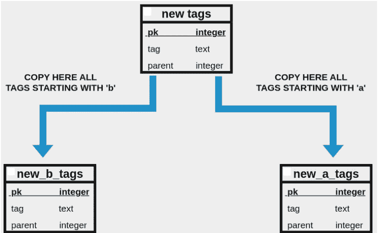

## Triggers and Rules

在上一章中，我们谈到了服务器端编程。在本章中，我们将使用上一章中介绍的概念来管理 PostgreSQL 中的事件编程。我们需要解决的第一件事是 PostgreSQL 中事件到底是什么。在 PostgreSQL 中，可能的事件由 SELECT/INSERT/UPDATE 和 DELETE 语句给出。还有与数据定义语言 DDL 操作相关的事件；然而我们将在第 17 章《事件触发器》中讨论这些事件。

在 PostgreSQL 中，有两种处理事件的方式：

- Rules
- Triggers

在本章中，我们将探索这两种方式，并讨论何时更适合使用其中一种。作为起点，我们通常可以说规则通常是简单的事件处理程序，而触发器是更复杂的事件处理程序。触发器和规则通常用于更新累加器以及修改或删除属于与我们修改记录的表不同的表的记录。它们是非常强大的工具，允许我们在修改数据的表以外的表中执行操作。触发器和规则也将在下一章中使用，当我们谈论分区时。这是因为，在 PostgreSQL 中，仍有一个基于触发器和规则的分区模型。

在本章中，我们将讨论以下内容：

- Exploring rules in PostgreSQL
- Managing triggers in PostgreSQL
- Event triggers

## Technical requirements

开始之前，请记住启动名为 chapter_08 的 Docker 容器，如下所示：

```
$ bash run-pg-docker.sh chapter_08
postgres@learn_postgresql:~$ psql -U forum forumdb
```

## Exploring rules in PostgreSQL

如前所述，规则是简单的事件处理程序。在用户级别，可以管理执行写操作的所有事件，分别是：

- INSERT
- DELETE
- UPDATE

规则背后的基本概念是修改事件的流程。如果我们给定一个事件，当某些条件发生时我们可以做的是：

- 什么都不做然后撤销该事件的操作。
- 触发另一个事件而不是默认事件。
- 与默认事件一起触发另一个事件。

因此，给定一个写操作，例如 INSERT 操作，我们可以执行以下三种操作之一：

- 取消操作。
- 执行另一个操作而不是 INSERT。
- 执行 INSERT，并在同一事务中执行另一个操作。

## Understanding the OLD and NEW variables

在开始使用规则然后使用触发器之前，我们需要理解 OLD 和 NEW 变量的概念。

OLD 和 NEW 变量表示事件前后表中行的状态。OLD 和 NEW 值是表示整个记录的光标。为了更好地理解这一点，请考虑一个 UPDATE 操作；在这种情况下，OLD 变量包含已存在于表中的记录的值，而 NEW 变量包含 UPDATE 操作后表记录将具有的值。


例如，我们可以考虑包含以下记录的 `tags` 表：

```
forumdb=> select * from tags;
 pk |      tag      | parent
----+---------------+--------
  1 | Operating Systems |
  2 | Linux         | 1
  3 | Ubuntu        | 2
 [...]
```

假设我们想要修改 `pk=3` 的标签，将其从 Ubuntu 改为 Fedora，可以使用如下 UPDATE 操作：

```
forumdb=> update tags set tag='Fedora' where pk=3;
UPDATE 1
```

此时 OLD 变量将具有以下值：

| pk | tag    | parent |
|----|--------|--------|
| 3  | Ubuntu | 1      |

NEW 变量将具有以下值：

| pk | tag    | parent |
|----|--------|--------|
| 3  | Fedora | 1      |

很自然地，对于某些操作来说，OLD 变量和 NEW 变量可能同时存在；但对于其他操作，可能只有其中一个存在。下面我们更详细地说明这一点：

| 操作/变量 | NEW     | OLD     |
|--------------------|---------|---------|
| INSERT             | 存在    | 不存在  |
| DELETE             | 不存在  | 存在    |
| UPDATE             | 存在    | 存在    |

现在一切都更清晰了，我们可以开始使用规则了。

## INSERT 规则

首先，我们来介绍规则的语法：

```
CREATE [ OR REPLACE ] RULE name AS ON event
  TO table [ WHERE condition ]
```

```
DO [ ALSO | INSTEAD ] { NOTHING | command | ( command ; command ... ) }
```

如我们所见，规则的定义非常简单。当我们决定使用规则时，有三个选项可供选择：

- ALSO 选项
- INSTEAD 选项
- INSTEAD NOTHING 选项

### ALSO 选项

假设我们想从 `tags` 表中，将所有 `tag` 字段值以字母 a 开头的记录复制到 `a_tag` 表中：

1. 首先，让我们创建一个名为 `0_tags` 的新表：

```
forumdb=> create table 0_tags (
  pk integer not null primary key,
  tag text,
  parent integer);
CREATE TABLE
```

2. 然后按照如下方式创建新规则：

```
forumdb=> create or replace rule r_tags1
  as on INSERT to tags
  where NEW.tag ilike '0%' DO ALSO
  insert into 0_tags(pk,tag,parent)values (NEW.pk,NEW.tag,NEW.parent);
CREATE RULE
```

在我们刚刚定义的规则中，我们只是告诉 PostgreSQL：每当插入一条 `tag` 值以字母“O”开头的记录时，除了将其插入到 `tags` 表中，还必须将其插入到 `0_tags` 表中。

3. 现在我们执行以下查询：

```
forumdb=> insert into tags (tag) values ('OpenBSD');
INSERT 0 1
```

4. 然后我们检查 `tags` 表和 `0_tags` 表中的记录。在 `tags` 表中，我们会看到：

```
forumdb=> select * from tags;
 pk |      tag      | parent
----+---------------+--------
  1 | Operating Systems |
  2 | Linux         |      1
  3 | Ubuntu        |      2
  4 | OpenBSD       |
(4 rows)
```

在 `0_tags` 表中，我们会看到：

```
forumdb=> select * from 0_tags;
 pk |   tag    | parent
----+----------+--------
  5 | OpenBSD  |
(1 row)
```

记录同时存在于两个表中。值得一问的问题是：规则是在事件之前执行，还是在事件之后执行？例如，新建的规则是在 INSERT 之前执行，还是在 INSERT 之后执行？答案是：在 PostgreSQL 中，规则总是在事件之前执行。

### INSTEAD OF 选项

现在假设我们想要将 `tag` 字段以字母 F 或 f 开头的所有记录移动到 `F_tags` 表中：

1. 首先，让我们创建一个名为 `F_tags` 的新表：

```
forumdb=> create table F_tags (
  pk integer not null primary key ,
  tag text,
  parent integer);
CREATE TABLE
```

2. 然后创建新规则：

```
forumdb=> create or replace rule r_tags2
    as on INSERT to tags
```

```
where NEW.tag ilike 'f%'
DO INSTEAD insert into f_tags(pk,tag,parent)values (NEW.pk,NEW.
tag,NEW.parent);
```

这一次，在规则中，我们只是告诉 PostgreSQL：每当插入一条 `tag` 值以字母 f 或大写字母 F 开头的记录时，它必须被移动到 `f_tags` 表中。

3. 现在让我们执行这条查询：

```
forumdb=> insert into tags (tag) values ('Fedora Linux');
INSERT 0 0
```

从返回结果 `INSERT 0 0` 中，我们已经可以猜测到，`tags` 表中什么也没有被插入。

4. 现在，我们执行以下语句：

```
forumdb=> select * from tags;
pk | tag | parent
----+---------------+--------
 1 | Operating Systems |
 2 | Linux | 1
 3 | Ubuntu | 2
 4 | OpenBSD |
(4 rows)
```

5. 正如我们在前面的片段中看到的那样，值 `Fedora Linux` 没有出现在 `tags` 表中，而在 `f_tags` 表中，我们将看到：

```
forumdb=> select * from f_tags ;
pk | tag | parent
----+-------------+--------
 6 | Fedora Linux |
(1 row)
```

我们定义的规则确保该记录没有被插入到 `tags` 表中，而是被插入到了 `f_tags` 表中。

6. 作为 INSERT 规则的最后一个例子，假设我们希望在每次插入 `tag` 字段以字母 R 或 r 开头的记录时，什么都不插入。

和之前一样，让我们创建规则：

```
forumdb=> create or replace rule r_tags3
    as on INSERT to tags
    where NEW.tag ilike 'r%'
    DO INSTEAD NOTHING;
CREATE RULE
```

7. 这次，我们对 PostgreSQL 说：每当 `tags` 表收到一条 `tag` 字段以字母 r 或 R 开头的记录时，这条记录不应被考虑。让我们来验证我们所说的：

```
forumdb=> insert into tags (tag) values ('Red Hat Linux');
INSERT 0 0
```

8. 即使现在，我们从服务器得到的回答也是 `INSERT 0 0`，并且我们可以检查该记录没有被插入到任何表中：

```
forumdb=> select pk,tag,parent,'tags' as tablename
from tags
union all
select pk,tag,parent,'f_tags' as tablename
from f_tags
order by tablename, tag;
pk |      tag      | parent | tablename
----+---------------+--------+----------
 6 | Fedora Linux  |        | f_tags
 2 | Linux         |      1 | tags
 4 | OpenBSD       |        | tags
 1 | Operating Systems |        | tags
 3 | Ubuntu        |      2 | tags
(5 rows)
```

如我们所见，该记录没有出现在任何表中。在前面的查询中，我们使用了 `UNION ALL`。这将两个查询的结果合并在一起。重要的是，字段类型必须相互兼容。

## DELETE/UPDATE 规则

在上一节中，我们研究了如何在 INSERT 事件上使用规则。在本节中，我们将看到如何在 DELETE 和 UPDATE 事件上使用规则。

现在，我们将从上面描述的概念出发，看一个关于如何使用规则的完整示例。

我们想要达到的目标如下所述：

- 1. 创建一个名为 `new_tags` 的表，与 `tags` 表相同；这个表将帮助我们拥有一个干净的环境，在其中进行测试。
- 2. 创建两个表：一个名为 `new_a_tags`，用于复制所有以字母 a 开头的标签记录；另一个名为 `new_b_tags`，用于复制所有以字母 b 开头的标签记录。
- 3. 创建所有能使一切正常工作的 INSERT/DELETE/UPDATE 规则。

让我们开始吧。

### 创建 new_tags 表

第一步是创建一个新的 `new_tags` 表。我们将基于现有的 `tags` 表来创建这个表：

```
forumdb=> create table new_tags as select * from tags limit 0;
SELECT 0

forumdb=# \d new_tags

            Table "public.new_tags"
 Column | Type    | Collation | Nullable | Default
--------+---------+-----------+----------+--------
 pk     | integer |           |          |
 tag    | text    |           |          |
 parent | integer |           |          |
```

前面的语句将 `tags` 表的字段结构复制到了 `new_tags` 表中，但没有复制约束或任何索引。现在我们需要在新表上创建主键约束：

```
forumdb=> alter table new_tags alter pk set not null ;
ALTER TABLE
forumdb=> alter table new_tags add constraint new_tags_pk primary key (pk);
ALTER TABLE
forumdb=# \d new_tags
```


Table "public.new_tags"
Column | Type      | Collation | Nullable | Default
--------+-----------+-----------+----------+--------
pk     | integer   |           | not null |
tag    | text      |           |          |
parent | integer   |           |          |
Indexes:
  "new_tags_pk" PRIMARY KEY, btree (pk)

With this, step 1 is complete.

## Creating two tables

Similar to what we just did, let’s create new_a_tags and new_b_tags tables. For the new_a_tags table, we will have the following:

```
forumdb=> create table new_a_tags as select * from tags limit 0;
SELECT 0
forumdb=> alter table new_a_tags alter pk set not null ;
ALTER TABLE
forumdb=> alter table new_a_tags add constraint new_a_tags_pk primary key (pk);
ALTER TABLE
forumdb=> \d new_a_tags
               Table "forum.new_a_tags"
 Column |  Type   | Collation | Nullable | Default
--------+---------+-----------+----------+---------
pk     | integer |           | not null |
tag    | text    |           |          |
parent | integer |           |          |
Indexes:
  "new_a_tags_pk" PRIMARY KEY, btree (pk)
```

In the same way, we will create the new_b_tags table:

```
forumdb=> create table new_b_tags as select * from tags limit 0;
SELECT 0
forumdb=> alter table new_b_tags alter pk set not null ;
ALTER TABLE
forumdb=> alter table new_b_tags add constraint new_b_tags_pk primary key (pk);
ALTER TABLE
forumdb=> \d new_b_tags
       Table "forum.new_b_tags"

 Column |  Type   | Collation | Nullable | Default
--------+---------+-----------+----------+--------
 pk     | integer |           | not null |
 tag    | text    |           |          |
 parent | integer |           |          |
Indexes:
    "new_b_tags_pk" PRIMARY KEY, btree (pk)
```

Step 2 is now complete, and we have everything we need to start our complete example.

## Managing rules on INSERT, DELETE, and UPDATE events

The goal we want to achieve is shown in the following figure:



Figure 8.1: Managing rules

We want all tags starting with the letter a to be stored in the new_tags table and also copied to the new_a_tags table, and we want the same for tags that begin with the letter b.

We have to manage rules for INSERT, DELETE, and UPDATE events in the following ways:

- INSERT rules must recognize all tags starting with the letters a or b and copy those records into their respective tables – new_a_tags and new_b_tags.
- DELETE rules must recognize all the tags starting with the letters a or b and delete those records in the respective tables – new_a_tags and new_b_tags.
- UPDATE rules must recognize all the tags that begin with the letters a or b, and if a record changes its tag, the rule must check whether the record should be copied or deleted in the new_a_tags and new_b_tags tables.

### INSERT rules

Let's start by creating two INSERT rules:

```
forumdb=# create or replace rule r_new_tags_insert_a as on INSERT to new_tags where NEW.tag like 'a%' DO ALSO insert into new_a_tags(pk,tag,parent) values (NEW.pk,NEW.tag,NEW.parent);
CREATE RULE

forumdb=# create or replace rule r_new_tags_insert_b as on INSERT to new_tags where NEW.tag like 'b%' DO ALSO insert into new_b_tags(pk,tag,parent) values (NEW.pk,NEW.tag,NEW.parent);
CREATE RULE
```

As we can see, the new_tags table now has two new rules:

```
forumdb=# \d new_tags
                Table "forum.new_tags"
 Column |  Type   | Collation | Nullable | Default
--------+---------+-----------+----------+--------
pk      | integer |           | not null |
tag     | text    |           |          |
parent  | integer |           |          |
Indexes:
  "new_tags_pk" PRIMARY KEY, btree (pk)
Rules:
  r_new_tags_insert_a AS
    ON INSERT TO new_tags
    WHERE new.tag ~~ 'a%'::text DO  INSERT INTO new_a_tags (pk, tag, parent)
VALUES (new.pk, new.tag, new.parent)
    r_new_tags_insert_b AS
    ON INSERT TO new_tags
    WHERE new.tag ~~ 'b%'::text DO  INSERT INTO new_b_tags (pk, tag, parent)
    VALUES (new.pk, new.tag, new.parent)
```

To check whether the rules work, let’s insert some data:

```
forumdb=> insert into new_tags values(1,'linux',NULL);
INSERT 0 1
forumdb=> insert into new_tags values(2,'alpine linux',1);
INSERT 0 1

forumdb=> insert into new_tags values(3,'bsd unix',NULL);
INSERT 0 1
```

Then let’s check the parent table:

```
forumdb=> select * from new_tags ;
 pk |    tag        | parent
----+---------------+--------
  1 | linux         |
  2 | alpine linux  |     1
  3 | bsd unix      |
(3 rows)
```

Now let’s see what is in the table_a child table:

```
forumdb=> select * from new_a_tags ;
 pk |    tag        | parent
----+---------------+--------
  2 | alpine linux  |     1
(1 row)
```

And what’s in the table_b child table:

```
forumdb=> select * from new_b_tags ;
 pk | tag | parent
----+-----+--------
```

We can see that the two rules work.

### DELETE rules

Now let’s create the DELETE rules. We need rules that, if a record is deleted from the new_tags table and it begins with the letter a or b, its copy in the new_a_tags and new_b_tags table must also be deleted. For all the records that start with the letter a, we need this rule:

```
forumdb=> create or replace rule r_new_tags_delete_a as on delete to new_tags where OLD.tag like 'a%' DO ALSO delete from new_a_tags where pk=OLD.pk;
CREATE RULE
```

Similarly, we need this rule for records beginning with the letter b:

```
forumdb=> create or replace rule r_new_tags_delete_b as on delete to new_tags where OLD.tag like 'b%' DO ALSO delete from new_b_tags where pk=OLD.pk;
CREATE RULE
```

The current situation of the new_tags table is as follows:

```
forumdb=> \d new_tags
                Table "forum.new_tags"
    Column  |  Type   | Collation | Nullable | Default
    --------+---------+-----------+----------+--------
    pk      | integer |           | not null |
    tag     | text    |           |          |
    parent  | integer |           |          |
Indexes:
    "new_tags_pk" PRIMARY KEY, btree (pk)
Rules:
    r_new_tags_delete_a AS
    ON DELETE TO new_tags
    WHERE old.tag ~~ 'a%'::text DO  DELETE FROM new_a_tags
    WHERE new_a_tags.pk = old.pk
    r_new_tags_delete_b AS
    ON DELETE TO new_tags
WHERE old.tag ~~ 'b%'::text DO  DELETE FROM new_b_tags
WHERE new_b_tags.pk = old.pk
r_new_tags_insert_a AS
ON INSERT TO new_tags
WHERE new.tag ~~ 'a%'::text DO  INSERT INTO new_a_tags (pk, tag, parent)
VALUES (new.pk, new.tag, new.parent)
r_new_tags_insert_b AS
ON INSERT TO new_tags
WHERE new.tag ~~ 'b%'::text DO  INSERT INTO new_b_tags (pk, tag, parent)
VALUES (new.pk, new.tag, new.parent)
```

Let’s test whether the two new rules work:

```
forumdb=> delete from new_tags where tag = 'alpine linux';
DELETE 1
forumdb=> delete from new_tags where tag = 'bsd unix';
DELETE 1

forumdb=> select * from new_tags ;
pk | tag | parent
----+-------+--------
 1 | linux |
(1 row)

forumdb=> select * from new_a_tags ;
pk | tag | parent
----+-------+--------
(0 rows)

forumdb=> select * from new_b_tags ;
pk | tag | parent
----+-------+--------
(0 rows)
```

We can see from this that the new rules work.

### UPDATE rules

Now we need to introduce a rule that checks whether a tag is updated with a word that starts with a or b. The simple way to do this is to first create a function that conducts this check and then create a rule based on that function. Let’s start by creating the function:

```
forumdb=> create or replace function move_record (p_pk integer, p_tag text, p_parent integer,p_old_pk integer,p_old_tag text ) returns void
language plpgsql as
$$
BEGIN
    if left(lower(p_tag),1) in ('a','b') THEN
        delete from new_tags where pk = p_old_pk;
        insert into new_tags values(p_pk,p_tag,p_parent);
    end if;
END;
$$;
CREATE FUNCTION
```

This function takes five parameters as input; the first three parameters are the NEW values that arrive from the update, and the last two parameters are the OLD values of the record that are present in the record. The function checks if the record in the table starts with the letter a or b, and it deletes the old record and inserts the new record.

So, finally, the rule is as follows:

```
forumdb=> create or replace rule r_new_tags_update_a as on UPDATE to new_tags DO ALSO select move_record(NEW.pk,NEW.tag,NEW.parent,OLD.pk,OLD.tag);
CREATE RULE
```

The rule calls the function if there is an update. Let’s see if this rule works:

```
forumdb=> update new_tags set tag='alpine linux' where tag='linux';
move_record
-------------

(1 row)
UPDATE 0

forumdb=> select * from new_a_tags ;
```


pk |    tag    | parent
----+-----------+-------
 1 | alpine linux |
(1 row)

forumdb=> select * from new_tags ;
pk |    tag    | parent
----+-----------+-------
 1 | alpine linux |
(1 row)

现在让我们看看如果一条记录的标签从 alpine linux 改为 bsd unix 会发生什么：

```
forumdb=> update new_tags set tag='bsd unix' where tag='alpine linux';
move_record
------------

(1 row)

UPDATE 0

forumdb=> select * from new_tags ;
pk |    tag    | parent
----+-----------+-------
 1 | bsd unix |
(1 row)

forumdb=> select * from new_a_tags ;
pk | tag | parent
----+-----+-------
(0 rows)

forumdb=> select * from new_b_tags ;
pk |    tag    | parent
----+-----------+-------
1 | bsd unix |
(1 row)
```

规则有效！在这个简短的练习中，我们尝试介绍了一个完整的规则管理的示例。这是一个教学示例，达到相同目标的方式还有很多。在下一节中，我们将探索在 PostgreSQL 中管理事件的另一种方式：触发器。

## 在 PostgreSQL 中管理触发器

在上一节中，我们谈到了规则。在本节中，我们将谈论触发器，它们是什么以及如何使用它们。我们需要先了解触发器是什么；如果我们理解规则是什么，这应该很简单。在上一节中，我们将规则定义为简单的事件处理器；现在我们可以将触发器定义为复杂的事件处理器。对于触发器，就像规则一样，有 NEW 和 OLD 记录，它们对触发器的含义与对规则的含义相同。对于触发器，可管理的事件是 INSERT/DELETE/UPDATE 和 TRUNCATE。规则和触发器之间的另一个区别是，使用触发器，可以在事件发生之前或发生之后处理 INSERT/UPDATE/DELETE 和 TRUNCATE 事件。使用触发器，我们也可以使用 INSTEAD OF 选项，但仅限于视图。

因此，我们可以管理以下事件：

- BEFORE INSERT/UPDATE/DELETE/TRUNCATE
- AFTER INSERT/UPDATE/DELETE/TRUNCATE
- INSTEAD OF INSERT/UPDATE/DELETE

对于规则，只能在 INSERT 操作中拥有 NEW 记录，在 UPDATE 操作中拥有 NEW 和 OLD 记录，在 DELETE 操作中拥有 OLD 记录。前两个列表项也可以用于外表以及真实表，而第三个列表项只能用于视图。有关更多信息，请参阅 https://www.postgresql.org/docs/current/sql-createtrigger.html。

我们现在将迈出使用触发器的第一步，并了解如何获得使用规则时所实现的结果。使用触发器，我们可以做规则能做的一切，甚至更多。

在继续之前，我们需要牢记两点：

- 如果触发器和规则同时存在于表的同一事件上，规则总是先触发。
- 如果同一表的同一事件上有多个触发器（例如 BEFORE INSERT），它们将按字母顺序执行。

还有另一类触发器，称为事件触发器，将在事件触发器部分介绍。

## 触发器语法

如官方文档所述，定义触发器的语法如下：

```
CREATE [ CONSTRAINT ] TRIGGER name { BEFORE | AFTER | INSTEAD OF } { event [ OR ... ] }
ON table_name
[ FROM referenced_table_name ]
[ NOT DEFERRABLE | [ DEFERRABLE ] [ INITIALLY IMMEDIATE | INITIALLY DEFERRED ] ]
[ REFERENCING { { OLD | NEW } TABLE [ AS ] transition_relation_name } [ ... ] ]
[ FOR [ EACH ] { ROW | STATEMENT } ]
[ WHEN ( condition ) ]
EXECUTE { FUNCTION | PROCEDURE } function_name ( arguments )

where event can be one of:

INSERT
UPDATE [ OF column_name [, ... ] ]
DELETE
TRUNCATE
```

我们只会查看这种语法的最常用方面；有关更多信息，请参阅 https://www.PostgreSQL.org/docs/current/sql-createtrigger.html。触发器执行背后的关键点如下：

- 我们想要处理的事件，例如 INSERT、DELETE 或 UPDATE。
- 我们希望触发器执行开始的时间（例如 BEFORE INSERT）。
- 触发器调用一个函数来执行某些操作。

触发器调用的函数必须以特定方式定义，如此处原型所示：

```
CREATE OR REPLACE FUNCTION function_name RETURNS trigger as
$$
DECLARE
....
BEGIN
    RETURN
END;
$$
LANGUAGE 'plpgsql';
```

由触发器调用的函数是没有输入参数且必须返回 TRIGGER 类型的函数；这些函数从 NEW/OLD 记录中获取参数。从前述函数的这个原型开始，可以描述 BEFORE INSERT 事件的可能触发器定义如下：

```
CREATE TRIGGER trigger_name BEFORE INSERT on table_name FOR EACH ROW
EXECUTE PROCEDURE function_name.
```

还有这种语法：

```
CREATE TRIGGER trigger_name BEFORE INSERT on table_name FOR EACH STATEMENT
EXECUTE PROCEDURE function_name.
```

FOR EACH ROW 和 FOR EACH STATEMENT 之间的区别在于：

- 使用 FOR EACH ROW 定义的触发器将为操作中涉及的每一行执行一次（例如，为插入、更新或删除的每一行执行一次），前提是该行满足触发器的条件。
- 使用 FOR EACH STATEMENT 定义的触发器将仅为满足触发器条件的每个 SQL 语句执行一次，无论操作涉及多少行。

在下一节中，我们将尝试实现我们用规则编写的内容，这次应用触发器。

## INSERT 上的触发器

在本节中，我们将了解如何创建我们的第一个触发器：

1. 让我们回到 ALSO 选项部分中我们编写的规则；我们编写了如下规则：
   ```
   create or replace rule r_tags1
   as on INSERT to tags
   where NEW.tag like 'a%' DO ALSO
   insert into new_a_tags(pk,tag,parent)values (NEW.pk,NEW.tag,NEW.parent);
   ```
2. 现在让我们看看如何使用触发器实现相同的目标。首先，让我们回到初始情况：
   ```
   forumdb=> drop table if exists new_tags cascade;
   forumdb=> create table new_tags as select * from tags limit 0;
   forumdb=> truncate table new_a_tags;
   ```
3. 现在我们可以创建函数，然后由触发器调用：
   ```
   forumdb=> CREATE OR REPLACE FUNCTION f_tags() RETURNS trigger as $$
   BEGIN
   IF lower(substring(NEW.tag from 1 for 1)) = 'a' THEN
   insert into new_a_tags(pk,tag,parent)values (NEW.pk,NEW.tag,NEW.parent);
   END IF;
   RETURN NEW;
   END;
   $$
   LANGUAGE 'plpgsql';
   CREATE FUNCTION
   ```

让我们更深入地看看代码的含义：

- 语句 lower(substring (NEW.tag from 1 for 1)) 取字符串的第一个字符并将其转换为小写。
- RETURN NEW 语句将新记录从表中传递到 new_tags 表的 INSERT。

4. 现在让我们在 t_tags 表的 BEFORE INSERT 事件上定义触发器：

```
forumdb=> CREATE TRIGGER t_tags BEFORE INSERT on new_tags FOR EACH ROW EXECUTE PROCEDURE f_tags();
CREATE TRIGGER
```

5. 因此，当向 new_tags 表插入值时，在执行 INSERT 之前，触发器会被执行并将 NEW 记录返回给默认操作（对 new_tags 表的 INSERT）。现在让我们检查它是否有效：

```
forumdb=> insert into new_tags (pk,tag,parent) values (1,'bsd unix',NULL);
INSERT 0 1

forumdb=> insert into new_tags (pk,tag,parent) values (2,'alpine linux',1);
INSERT 0 1

forumdb=> select * from new_tags ;
pk | tag | parent
----+-------------+--------
 1 | bsd unix | 
 2 | alpine linux | 1
(2 rows)

forumdb=> select * from new_a_tags ;
pk | tag | parent
----+-------------+--------
 2 | alpine linux | 1
(1 row)
```

正如我们在这里看到的，它有效！

6. 我们将从这里逐步进行，以更好地理解使用规则和触发器工作之间的区别。我们希望用触发器实现的目标是获得与以下规则可以实现的结果相同的结果：

```
create or replace rule r_tags2
as on INSERT to tags
```


```
where NEW.tag ilike 'b%'
DO INSTEAD insert into new_b_tags(pk,tag,parent)values (NEW.pk,NEW.tag,NEW.parent);
```

- 7. 现在，让我们使用与规则中相同的流程：创建一个新函数，然后由触发器触发它：

```
forumdb=> CREATE OR REPLACE FUNCTION f2_tags() RETURNS trigger as $$
BEGIN
    IF lower(substring(NEW.tag from 1 for 1)) = 'b' THEN
    insert into new_b_tags(pk,tag,parent)values (NEW.pk,NEW.tag,NEW.parent);
    RETURN NULL;
    END IF;
    RETURN NEW;
END;
$$ LANGUAGE 'plpgsql';
CREATE FUNCTION

forumdb=> CREATE TRIGGER t2_tags BEFORE INSERT on new_tags FOR EACH ROW EXECUTE PROCEDURE f2_tags();
CREATE TRIGGER
```

- 8. 这个 lower 语句 `(substring(NEW.tag from 1 for 1)) = 'b'` 与我们最初在规则中看到的几乎相同。不同之处在于 `RETURN NULL`，这意味着如果 `NEW.tag` 的值以 `b` 开头，则会向默认操作返回一个 `NULL` 值，并且对 `new_tags` 表的 `INSERT` 将不会插入任何值。相反，如果 `IF` 条件不满足，则函数返回 `NEW`，记录会被插入到 `new_tags` 表中。

让我们看看它是否有效：

```
forumdb=> truncate new_tags;
TRUNCATE TABLE
forumdb=> truncate new_a_tags;
TRUNCATE TABLE
forumdb=> truncate new_b_tags;
TRUNCATE TABLE

forumdb=> insert into new_tags (pk,tag,parent) values (1,'bsd unix',NULL);
INSERT 0 0
```

正如我们所见，`IF` 条件生效了，结果 `INSERT 0 0` 表示没有记录被插入到 `new_tags` 表中。这是因为触发器作用于 `BEFORE INSERT` 事件，`IF` 条件将记录转移到了 `new_b_tags` 表中。

- 9. 我们现在来看看如何使用单个触发器编写整个流程。首先，让我们回到环境的初始条件。和之前一样，我们删除表中的数据，并使用 `CASCADE` 选项删除选定的触发器及其所有关联的触发器：

```
forumdb=> TRUNCATE new_tags;
TRUNCATE TABLE
forumdb=> TRUNCATE new_a_tags;
TRUNCATE TABLE
forumdb=> TRUNCATE new_b_tags;
TRUNCATE TABLE
forumdb=> DROP TRIGGER t_tags ON new_tags CASCADE;
DROP TRIGGER
forumdb=> DROP TRIGGER t2_tags ON new_tags CASCADE;
DROP TRIGGER
```

- 10. 在最后一步中，我们将把在函数 `f_tags()` 和 `f2_tags()` 中编写的内容合并到一个单独的函数 `f3_tags()` 中，该函数将在 `BEFORE INSERT` 事件中由 `t3_tags` 触发器触发：

```
forumdb=> CREATE OR REPLACE FUNCTION f3_tags() RETURNS trigger as $$
BEGIN
    IF lower(substring(NEW.tag from 1 for 1)) = 'a' THEN
        insert into new_a_tags(pk,tag,parent) values (NEW.pk,NEW.tag,NEW.parent);
        RETURN NEW;
    ELSIF lower(substring(NEW.tag from 1 for 1)) = 'b' THEN
        insert into new_b_tags(pk,tag,parent) values (NEW.pk,NEW.tag,NEW.parent);
    RETURN NULL;
    ELSE
        RETURN NEW;
    END IF;
END;
$$ 
LANGUAGE 'plpgsql';
CREATE FUNCTION

forumdb=> CREATE TRIGGER t3_tags BEFORE INSERT on new_tags FOR EACH ROW EXECUTE PROCEDURE f3_tags();
CREATE TRIGGER
```

该函数包含了前面两个函数的逻辑。这样，我们就可以通过使用单个函数和单个触发器更优雅地解决问题。让我们看看它是否有效：

```
forumdb=> insert into new_tags (pk,tag,parent) values (1,'operating systems',NULL);
INSERT 0 1

forumdb=> insert into new_tags (pk,tag,parent) values (2,'alpine linux',1);
INSERT 0 1
forumdb=> insert into new_tags (pk,tag,parent) values (3,'bsd unix',1);
INSERT 0 0

forumdb=> select * from new_tags ;
pk |      tag      | parent
----+---------------+--------
  1 | operating systems |
  2 | alpine linux  |      1
(2 rows)

forumdb=> select * from new_a_tags ;
pk |   tag       | parent
----+-------------+-------
  2 | alpine linux |     1
(1 row)

forumdb=> select * from new_b_tags ;
pk |   tag   | parent
----+---------+-------
  3 | bsd unix |     1
(1 row)
```

可以看到，该函数运行正常。

## TG_OP 变量

如官方文档 https://www.PostgreSQL.org/docs/current/plpgsql-trigger.html 所示，PostgreSQL 允许使用特殊变量来控制触发器，其中两个我们已经见过（`NEW` 变量和 `OLD` 变量）。还有另一个特殊变量叫做 `TG_OP`，它告诉我们触发器是从哪个事件触发的。`TG_OP` 变量的可能值为 `INSERT`、`DELETE`、`UPDATE` 和 `TRUNCATE`。

## UPDATE / DELETE 触发器

现在，让我们回到图 8.1 中使用的示例。我们想要实现的目标是创建一个能够处理 `INSERT`、`DELETE` 和 `UPDATE` 事件的单一函数。首先，让我们回到环境的初始条件：

```
forumdb=> truncate new_tags;
TRUNCATE TABLE
forumdb=> truncate new_a_tags;
TRUNCATE TABLE
forumdb=> truncate new_b_tags;
TRUNCATE TABLE
forumdb=> drop trigger t3_tags on new_tags cascade;
DROP TRIGGER
```

现在，和之前一样，我们将逐步进行。第一步是编写将在 `INSERT` 事件期间执行的代码部分。然后，我们将看到如何扩展该函数以管理 `DELETE` 和 `UPDATE` 事件。

将处理所有这三个事件的函数将是 `fcopy_tags()` 函数；此函数将由 `tcopy_tags` 触发器调用。`fcopy_tags()` 函数使用 `TG_OP` 变量，将能够区分 `INSERT`、`UPDATE` 和 `DELETE` 事件。

让我们首先编写 `fcopy_tags()` 函数来处理 `INSERT` 事件：

```
forumdb=> CREATE OR REPLACE FUNCTION fcopy_tags() RETURNS trigger as $$
BEGIN
IF TG_OP = 'INSERT' THEN
    IF lower(substring(NEW.tag from 1 for 1)) = 'a' THEN
        insert into new_a_tags(pk,tag,parent)values (NEW.pk,NEW.tag,NEW.parent);
    ELSIF lower(substring(NEW.tag from 1 for 1)) = 'b' THEN
        insert into new_b_tags(pk,tag,parent)values (NEW.pk,NEW.tag,NEW.parent);
    END IF;
    RETURN NEW;
END IF;
END;
$$ LANGUAGE 'plpgsql';
CREATE FUNCTION

forumdb=> CREATE TRIGGER tcopy_tags_ins BEFORE INSERT on new_tags FOR EACH ROW EXECUTE PROCEDURE fcopy_tags();
CREATE TRIGGER
```

现在让我们看看，对于 `INSERT` 事件，这段代码是否有效：

```
forumdb=> insert into new_tags (pk,tag,parent) values (1,'operating systems',NULL);
INSERT 0 1
forumdb=> insert into new_tags (pk,tag,parent) values (2,'alpine linux',1);
INSERT 0 1
forumdb=> insert into new_tags (pk,tag,parent) values (3,'bsd unix',1);
INSERT 0 1

forumdb=> select * from new_a_tags ;
pk |     tag     | parent
----+--------------+-------
2  | alpine linux |     1
(1 row)

forumdb=> select * from new_b_tags ;
pk |     tag     | parent
----+--------------+-------
3  | bsd unix |     1
(1 row)

forumdb=> select * from new_tags ;
pk |          tag          | parent
----+----------------------+--------
1  | operating systems |
2  | alpine linux |     1
3  | bsd unix |     1
(3 rows)
```

很明显，它有效！

接下来，让我们处理 `DELETE` 事件。我们需要做的事情如下：

- 向函数添加一些代码行来管理 `DELETE` 操作。
- 添加一个能够处理 `DELETE` 事件的新触发器。

该函数变为如下形式：

```
forumdb=> CREATE OR REPLACE FUNCTION fcopy_tags() RETURNS trigger as $$
BEGIN
IF TG_OP = 'INSERT' THEN
    IF lower(substring(NEW.tag from 1 for 1)) = 'a' THEN
        insert into new_a_tags(pk,tag,parent)values (NEW.pk,NEW.tag,NEW.parent);
    ELSIF lower(substring(NEW.tag from 1 for 1)) = 'b' THEN
        insert into new_b_tags(pk,tag,parent)values (NEW.pk,NEW.tag,NEW.parent);
    END IF;
    RETURN NEW;
END IF;
IF TG_OP = 'DELETE' THEN
    IF lower(substring(OLD.tag from 1 for 1)) = 'a' THEN
        DELETE FROM new_a_tags WHERE pk = OLD.pk;
        ELSIF lower(substring(OLD.tag from 1 for 1)) = 'b' THEN
        DELETE FROM new_b_tags WHERE pk = OLD.pk;
    END IF;
    RETURN OLD;
END IF;
END;
$$ 
LANGUAGE 'plpgsql';
CREATE FUNCTION
```

添加了这段代码：

```
IF TG_OP = 'DELETE' THEN
    IF lower(substring(OLD.tag from 1 for 1)) = 'a' THEN
        DELETE FROM new_a_tags WHERE pk = OLD.pk;
    ELSIF lower(substring(OLD.tag from 1 for 1)) = 'b' THEN
        DELETE FROM new_b_tags WHERE pk = OLD.pk;
    END IF;
    RETURN OLD;
END IF;
```

如果待删除的记录以字母 `a` 或 `b` 开头，这段代码会删除 `new_a_tags` 和 `new_b_tags` 表中的数据。现在我们必须创建一个能够处理 `DELETE` 事件的新触发器：

```
forumdb=> CREATE TRIGGER tcopy_tags_del
AFTER DELETE on new_tags FOR EACH ROW EXECUTE PROCEDURE fcopy_tags();
CREATE TRIGGER
```

该触发器在 `AFTER DELETE` 时执行；在这种情况下，我们创建的 `TRIGGER` 是 `BEFORE` 还是 `AFTER INSERT` 函数都没有什么区别。让我们看看这个针对 `DELETE` 事件的触发器是否有效：

```
forumdb=> delete from new_tags where pk=2;
DELETE 1
forumdb=> delete from new_tags where pk=3;
DELETE 1
```


```
forumdb=> select * from new_a_tags ;
 pk | tag | parent
-----+-------+-------
(0 rows)

forumdb=> select * from new_b_tags ;
 pk | tag | parent
-----+-------+-------
(0 rows)

forumdb=> select * from new_tags ;
 pk |      tag      | parent
----+----------------+--------
  1 | operating systems |
(1 row)
```

可以看到，TRIGGER 正常工作。

对于最后一步，我们需要管理 UPDATE 事件。让我们从头开始完整地编写函数和触发器。再次，让我们将环境恢复到初始条件：

```
forumdb=> truncate new_tags ;
TRUNCATE TABLE
forumdb=> truncate new_a_tags ;
TRUNCATE TABLE
forumdb=> truncate new_b_tags ;
TRUNCATE TABLE

forumdb=> insert into new_tags (pk,tag,parent) values (1,'operating systems',NULL),(2,'alpine linux',1),(3,'bsd unix',1);
INSERT 0 3
```

现在我们可以为 UPDATE 事件编写完整代码：

```
forumdb=> CREATE OR REPLACE FUNCTION fcopy_tags() RETURNS trigger as $$
BEGIN
IF TG_OP = 'INSERT' THEN
    IF lower(substring(NEW.tag from 1 for 1)) = 'a' THEN
```
```
insert into new_a_tags(pk,tag,parent)values (NEW.pk,NEW.tag,NEW.parent);
    ELSIF lower(substring(NEW.tag from 1 for 1)) = 'b' THEN
        insert into new_b_tags(pk,tag,parent)values (NEW.pk,NEW.tag,NEW.parent);
    END IF;
    RETURN NEW;
END IF;
IF TG_OP = 'DELETE' THEN
    IF lower(substring(OLD.tag from 1 for 1)) = 'a' THEN
        DELETE FROM new_a_tags WHERE pk = OLD.pk;
    ELSIF lower(substring(OLD.tag from 1 for 1)) = 'b' THEN
        DELETE FROM new_b_tags WHERE pk = OLD.pk;
    END IF;
    RETURN OLD;
END IF;
IF TG_OP = 'UPDATE' THEN
    IF (lower(substring(OLD.tag from 1 for 1)) in( 'a','b') ) THEN
        DELETE FROM new_a_tags WHERE pk=OLD.pk;
        DELETE FROM new_b_tags WHERE pk=OLD.pk;
        DELETE FROM new_tags WHERE pk = OLD.pk;
        INSERT into new_tags(pk,tag,parent) values (NEW.pk,NEW.tag,NEW.parent);
    END IF;
    RETURN NEW;
END IF;
END;
$$ 
LANGUAGE 'plpgsql';
CREATE FUNCTION
forumdb=> CREATE TRIGGER tcopy_tags_upd
    AFTER UPDATE on new_tags FOR EACH ROW EXECUTE PROCEDURE fcopy_tags();
CREATE TRIGGER
```

在这种情况下，触发器必须使用 AFTER UPDATE 定义，而不是 BEFORE UPDATE，因为在 UPDATE 部分，我们有指令 DELETE FROM new_tags WHERE pk = OLD.pk; 如果触发器使用 BEFORE UPDATE 定义，我们会遇到错误，因为我们会尝试删除一个为 UPDATE 保留的记录。

让我们看看完整函数是否工作：

```
forumdb=> select * from new_tags;
 pk |      tag      | parent
----+---------------+--------
  1 | operating systems |
  2 | alpine linux  |     1
  3 | bsd unix      |     1
(3 rows)

forumdb=> select * from new_a_tags;
 pk |      tag      | parent
----+---------------+--------
  2 | alpine linux |     1
(1 row)

forumdb=> select * from new_b_tags;
 pk |      tag      | parent
----+---------------+--------
  3 | bsd unix |     1
(1 row)

forumdb=> update new_tags set tag='apple dos' where pk=3;
UPDATE 1

forumdb=> select * from new_a_tags;
 pk |      tag      | parent
----+---------------+--------
```
```
2 | alpine linux | 1
3 | apple dos | 1
(2 rows)

forumdb=> select * from new_tags;
pk | tag | parent
----+---------------+--------
1 | operating systems |
2 | alpine linux | 1
3 | apple dos | 1
(3 rows)
```

正如所示，触发器方法有效。在本节中，我们看到了如何通过使用规则和触发器来修改数据操纵语言级别的事件。在下一节中，我们将看到如何使用事件触发器拦截和修改与 DDL 操作相关的事件。

## 事件触发器

规则和触发器充当 DML 语句，这意味着它们由更改数据但不更改数据布局或表属性的操作触发。PostgreSQL 提供了所谓的事件触发器，这是一种特殊的触发器，在 DDL 语句上触发。因此，事件触发器的目的是管理和响应将更改数据结构而不是数据内容的事件。触发器可以用多种方式用于在数据库中强制执行特定策略。

一旦触发，事件触发器会接收一个事件和一个命令标签，两者都可用于内省并提供有关触发触发器的信息的有用信息。特别是，命令标签包含命令的描述，例如 CREATE 或 ALTER，而事件包含触发触发器的类别，特别是以下内容：

- ddl_command_start 和 ddl_command_end 分别表示 DDL 命令的开始和完成。
- sql_drop 表示 DROP 命令即将完成。
- table_rewrite 表示完整的表重写即将开始。

与 DML 触发器一样，有特定的命令来创建、删除和修改事件触发器：

- CREATE EVENT TRIGGER 添加新的事件触发器
- DROP EVENT TRIGGER 删除现有触发器
- ALTER EVENT TRIGGER 修改现有触发器

以下是创建新事件触发器的概要：

```
CREATE EVENT TRIGGER name
  ON event
  [ WHEN filter_variable IN (filter_value [, ... ]) [ AND ... ] ]
  EXECUTE { FUNCTION | PROCEDURE } function_name()
```

与它们的 DML 对应触发器类似，事件触发器与一个助记符名称和一个在触发时执行的函数相关联。然而，与普通触发器不同，事件触发器不指定它们附加到的表；事实上，事件触发器与任何特定表无关，而是与 DDL 命令相关。

事件触发器必须由数据库管理员创建，并且具有数据库范围，这意味着它们存在并在它们被定义的数据库中运行。

有几个特殊函数可以帮助开发人员在事件触发器内进行内省，以了解触发触发器的确切事件。最重要的函数如下：

- pg_event_trigger_commands()，为 DDL 语句期间执行的每个命令返回一个元组。
- pg_event_trigger_dropped_objects()，为同一 DDL 语句内的每个被删除对象报告一个元组。

除了上述实用函数外，仔细阅读事件触发器文档以了解何时命令会触发事件触发器或不会触发非常重要。更详细地解释事件触发器超出了本节的范围；相反，我们将在下一节中查看一个实际示例。有关事件触发器的更多信息，请参阅官方文档或 Packt 书籍 PostgreSQL 11 Server-Side Programming。

## 事件触发器的示例

为了更好地理解事件触发器的工作原理，让我们构建一个简单的触发器示例，该触发器可防止数据库中的任何 ALTER TABLE 类似命令。

第一步是定义一个函数，该函数将在触发器触发时执行；该函数需要检查 DDL 语句属性以了解是否由 ALTER TABLE 命令调用。内省使用特殊的 `pg_event_trigger_ddl_commands()` 函数完成，该函数为同一命令内执行的每个 DDL 语句返回一个元组。这些元组包含一个名为 `command_tag` 的字段，报告命令组，大写，以及 `object_type`，报告 DDL 语句执行的对象的对象类型，小写。该函数必须返回触发器类型，特别是事件触发器类型；因此，函数可以定义如下：

```
```sql
forumdb=> CREATE OR REPLACE FUNCTION
f_avoid_alter_table()
RETURNS EVENT_TRIGGER
AS
$code$
DECLARE
event_tuple record;
BEGIN
    FOR event_tuple IN SELECT * FROM             pg_event_trigger_ddl_
commands() LOOP
        IF event_tuple.command_tag = 'ALTER TABLE' AND event_tuple.object_
type = 'table' THEN
            RAISE EXCEPTION 'Cannot execute an ALTER TABLE!';
        END IF;
    END LOOP;
END
$code$
LANGUAGE plpgsql;
CREATE FUNCTION
```
```

如你所见，如果函数发现执行的命令具有 ALTER TABLE 标签和表对象类型，它会引发异常，导致整个语句失败。

一旦函数就位，就有可能将其附加到事件触发器，但由于事件触发器处理 DDL 语句，只有超级用户可以创建事件触发器；因此，首先，让我们以超级用户身份连接到 forum 数据库：

```
```bash
forumdb=> \q
postgres@learn_postgresql:~$ psql forumdb
```
```


```
psql (15.2 (Debian 15.2-1.pgdg110+1))
Type "help" for help.

forumdb=#
```

然后让我们执行：

```sql
forumdb=# CREATE EVENT TRIGGER tr_avoid_alter_table ON ddl_command_end
EXECUTE FUNCTION forum.f_avoid_alter_table();
CREATE EVENT TRIGGER
```

请记住，我们是以 postgres 用户身份连接到 forumdb 数据库，因此我们必须指定 postgres 用户可以找到 f_avoid_alter_table() 函数所在的模式。

此时，触发器已激活，并且在系统接近命令结束时，函数将为每个 DDL 命令触发。

现在可以测试触发器，看看用户是否允许执行 ALTER TABLE：

```text
forumdb=> ALTER TABLE tags ADD COLUMN thumbs_up int DEFAULT 0;
ERROR:  Cannot execute an ALTER TABLE!
CONTEXT:  PL/pgSQL function f_avoid_alter_table() line 9 at RAISE
```

正如我们所见，一旦执行 ALTER TABLE 命令就会引发异常，并且这种行为不仅适用于非超级用户（如我们刚才看到的），也适用于超级用户；这是因为我们编写的事件触发器拦截了 alter table 命令并修改了其行为：

```text
forumdb=# ALTER TABLE forum.tags ADD COLUMN thumbs_up int DEFAULT 0;
ERROR:  Cannot execute an ALTER TABLE!
CONTEXT:  PL/pgSQL function forum.f_avoid_alter_table() line 9 at RAISE
```

虽然事件触发器可以像前面的示例那样用于阻止用户执行特定命令，但更好的策略是尽可能通过权限来避免不适当的命令执行。事件触发器很复杂，用于提供对逻辑复制、审计和其他基础设施等事物的支持。

## Summary

在本章中，我们介绍了触发器和规则的主题。我们使用一些相同的示例探索了规则和触发器。我们确定规则是简单的事件处理器，而触发器是复杂的事件处理器。

我们介绍了触发器变量的概念：

- NEW
- OLD
- TG_OP

除了基于数据操作的触发器之外，我们还简要介绍了 PostgreSQL 事件触发器，它允许开发人员和数据库管理员更好地控制触发和执行函数。

我们了解到触发器是极其复杂的事件处理器。在本章中，我们开始展示 PostgreSQL DBA 可用的工具的强大功能；在下一章中，我们将讨论分区，并利用本章介绍的主题来实现分区。

## Verify your knowledge

- What is the NEW record?

NEW 记录是在执行 INSERT 语句或 UPDATE 语句之前将被处理的记录，例如：

```
insert into mytable(id,city_name) values (1,'New York')
```

```
NEW.id = 1
NEW.city_name = 'New York'
```

有关更多详细信息，请参阅 *Exploring rules in PostgreSQL* 部分。

- Can we execute an INSERT on two tables in a single transaction using rules?

可以；我们可以使用 ALSO 子句来实现。有关更多详细信息，请参阅 *Exploring rules in PostgreSQL* 部分。

- Can we make all the things we do with rules using triggers?

可以；使用触发器，我们可以实现使用规则所做的一切，甚至更多。有关更多详细信息，请参阅 *Managing triggers in PostgreSQL* 部分。

- Can we know if a trigger has been fired from an INSERT event, from an update EVENT, or from a DELETE event?

可以，使用 TG_OP 变量。有关更多详细信息，请参阅 *Managing triggers in PostgreSQL* 部分。

- Can we write an audit procedure that informs us when a DDL has been executed?

可以，使用事件触发器。有关更多详细信息，请参阅 *Event triggers* 部分。

## References

- PostgreSQL rules on the INSERT, UPDATE, and DELETE official documentation: https://www.PostgreSQL.org/docs/current/rules-update.html
- PostgreSQL trigger functions official documentation: https://www.PostgreSQL.org/docs/current/plpgsql-trigger.html
- PostgreSQL ALTER TRIGGER official documentation: https://www.PostgreSQL.org/docs/current/sql-altertrigger.html
- PostgreSQL DROP TRIGGER official documentation: https://www.PostgreSQL.org/docs/current/sql-droptrigger.html
- PostgreSQL EVENT TRIGGER official documentation: https://www.postgresql.org/docs/current/functions-event-triggers.html

## Learn more on Discord

要加入本书的 Discord 社区——在那里你可以分享反馈、向作者提问并了解新版本——请扫描下面的二维码：

https://discord.gg/jYWCjF6Tku


