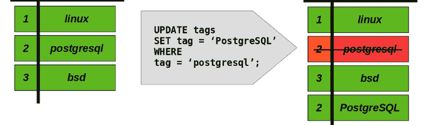
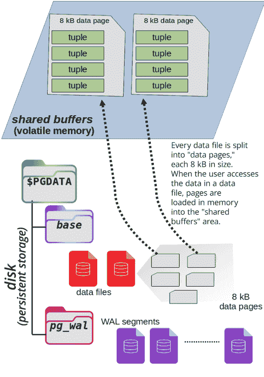
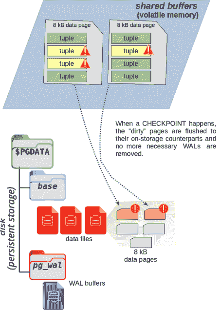
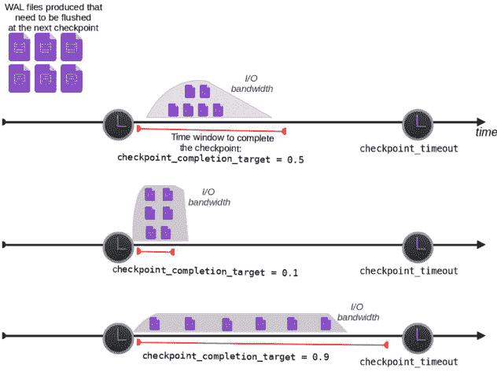
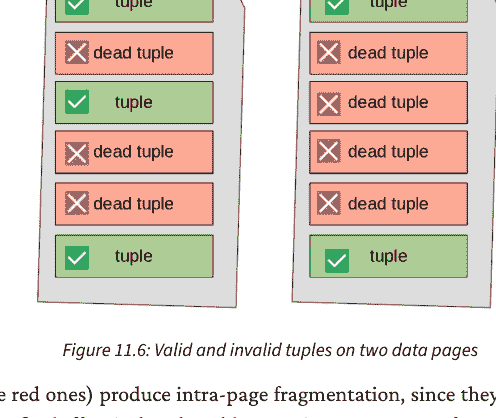

## 11

## 事务、MVCC、WAL 和检查点

本章向你介绍事务，这是每个企业级数据库系统的基本组成部分。事务是数据库管理多个操作的方式，使其如同单个原子操作。PostgreSQL 具有非常丰富且符合标准的事务机制，允许用户具体定义事务属性，包括嵌套事务。

PostgreSQL 严重依赖事务来保持数据在并发连接和并行活动中的一致性，并且得益于 **预写日志（WALs）**，PostgreSQL 尽最大努力保持数据安全可靠。此外，PostgreSQL 实现了 **多版本并发控制（MVCC）**，这是一种在事务之间保持高并发的方式。

本章可分为两部分：第一部分更实用，提供事务是什么、如何使用以及如何理解 MVCC 的具体示例。第二部分更理论化，解释 WAL 的工作原理，以及它们如何使 PostgreSQL 即使在崩溃后也能恢复。

在本章中，你将学习以下主题：

- 事务属性
- 事务隔离级别
- MVCC 是什么以及它如何工作
- 保存点


在我们能够检查两种类型的事务并进行比较之前，我们需要对事务概念有更多一点的背景知识。

首先，任何事务都被分配一个唯一的编号，称为事务标识符，或简称为 xid。系统会自动为新创建的事务——无论是隐式还是显式——分配一个 xid，并保证数据库中在同一时间不存在两个具有完全相同 xid 的事务。

我们在解释事务时需要尽早理解的另一个主要概念是，PostgreSQL 会将生成和/或修改某个元组的 xid 存储在元组本身内部。其原因在我们看到 PostgreSQL 如何处理事务并发时就会变得清晰，因此，就本部分而言，让我们假设数据库中每个表里的每个元组都自动标记有创建该元组的事务的 xid 值。

你可以通过特殊的函数 txid_current() 来检查当前事务是什么。例如，如果你向系统询问几个简单的语句，比如当前时间，你会看到每个 SELECT 语句都是作为不同的事务执行的：

```
forumdb=> SELECT current_time, txid_current();
    current_time     | txid_current
--------------------+-------------
 16:51:35.042584+01 |        4813
(1 row)

forumdb=> SELECT current_time, txid_current();
    current_time     | txid_current
--------------------+-------------
 16:52:23.028124+01 |        4814
(1 row)
```

正如前面的示例所示，系统已为每个语句分别分配了两个不同的事务标识符，分别是 4813 和 4814，证实了这些语句是在不同的隐式事务中执行的。你在自己的系统上可能会得到不同的数字。

如果你检查表中特殊的隐藏列 xmin，你可以获取有关创建元组的事务的信息；看下面的例子：

```
forumdb=> SELECT xmin, * FROM categories;
 xmin | pk | title | description
------+-----+--------------------------------+-----------------------------------
 561 |   1 | DATABASE                       | Database related discussions
 561 |   2 | UNIX                           | Unix and Linux discussions
 561 |   3 | PROGRAMMING LANGUAGES          | All about programming languages
(3 rows)
```

正如你所见，前表中所有的元组都是由同一个事务，即编号 561 创建的。

> PostgreSQL 管理了一些不同的隐藏列，你在查询表时需要显式请求才能看到它们。特别是，每个表都有 xmin、xmax、cmin 和 cmax 隐藏列。它们的使用和目的将在本章后面进行解释。

现在你已经知道每个事务都有编号，并且这些编号用于标记每个表中的元组，我们可以继续前进，看看隐式事务和显式事务之间的区别。

## 比较隐式和显式事务

隐式事务是你没有请求但系统会应用到你的语句上的事务。换句话说，是 PostgreSQL 决定事务何时开始、何时结束（事务边界），规则很简单：每个单独的语句都在其自己的独立事务中执行。

为了更好地理解这个概念，让我们向表中插入几条记录：

```
forumdb=> INSERT INTO tags( tag ) VALUES( 'linux' );
INSERT 0 1
forumdb=> INSERT INTO tags( tag ) VALUES( 'BSD' );
INSERT 0 1
forumdb=> INSERT INTO tags( tag ) VALUES( 'Java' );
INSERT 0 1
forumdb=> INSERT INTO tags( tag ) VALUES( 'Perl' );
INSERT 0 1
forumdb=> INSERT INTO tags( tag ) VALUES( 'Raku' );
INSERT 0 1
```

让我们查询表中的数据是什么：

```
```text
forumdb=> SELECT xmin, * FROM tags;
 xmin | pk | tag  | parent
------+----+------+--------
 4824 |  9 | linux |
 4825 | 10 | BSD   |
 4826 | 11 | Java  |
 4827 | 12 | Perl  |
 4828 | 13 | Raku  |
(5 rows)
```
```

正如你所见，xmin 字段对每个插入的元组都有不同的（自增）值，这意味着为元组分配了一个新的事务标识符（xid），或者更准确地说，为执行 INSERT 的语句分配了 xid。这意味着每个单独的语句都在其自己的单语句包装事务中执行。

> 你看到 xid 递增一个单位，是因为在用于示例的机器上没有并发，即没有其他数据库活动正在进行。然而，你不能对在具有不同并发连接和正在运行语句的实时系统中下一个 xid 会是什么做出任何预测。

如果我们一次性插入所有之前的标签，并确保如果其中任何一个由于任何原因无法存储，则全部消失怎么办？为此，我们可以使用 *显式事务*。显式事务是一组语句，具有明确的事务边界：你发出 BEGIN 语句来标记事务的开始，然后用 COMMIT 或 ROLLBACK 来结束事务。如果你发出 COMMIT，事务被标记为成功；因此，修改的数据会永久存储。另一方面，如果你发出 ROLLBACK，事务被认为失败，所有更改都会消失。

让我们在实践中看看这一点——再添加一批标签，但这次在单个显式事务内：

```
```text
forumdb=> BEGIN;
BEGIN
forumdb=*> INSERT INTO tags( tag ) VALUES( 'PHP' );
INSERT 0 1
```

```
forumdb=> INSERT INTO tags( tag ) VALUES( 'C#' );
INSERT 0 1
forumdb=>* COMMIT;
COMMIT
```

与之前的一批 INSERT 语句相比，唯一的区别是显式使用了 BEGIN 和 COMMIT；由于事务已提交，数据必须存储在表中：

```
forumdb=> SELECT xmin, * FROM tags;
xmin | pk | tag | parent
-------+----+-------+--------
4824 | 9 | linux |
4825 | 10 | BSD |
4826 | 11 | Java |
4827 | 12 | Perl |
4828 | 13 | Raku |
4829 | 14 | PHP |
4829 | 15 | C# |
(7 rows)
```

正如你所见，数据不仅如我们预期那样被存储，而且最后两行也有完全相同的事务标识符，即 4829。这意味着 PostgreSQL 以某种方式将两个不同的语句合并为一个。

> 当你发出显式事务时，psql 会更改其提示，在提示中添加一个星号，以提醒你处于一个打开的事务中（即尚未完成的事务）。如果事务因错误而被中止，星号会被改为感叹号。

让我们看看如果事务以 ROLLBACK 语句结束会发生什么——最终结果是更改不应被存储。作为示例，将每个元组的标签值修改为全大写：

```
forumdb=> BEGIN;
BEGIN
forumdb=>* UPDATE tags SET tag = upper( tag );
UPDATE 7
forumdb=>* SELECT tag FROM tags;
```

最简单的例子是当你输入语法错误时：

```
```text
forumdb=> BEGIN;
BEGIN
forumdb=*> UPDATE tags SET tag = uppr( tag );
ERROR:  function uppr(text) does not exist
LINE 1: UPDATE tags SET tag = uppr( tag );
                              ^
HINT:  No function matches the given name and argument types. You might
need to add explicit type casts.
forumdb=!> COMMIT;
ROLLBACK
```
```

当 PostgreSQL 遇到错误时，它会中止当前事务。中止事务意味着，虽然事务仍处于打开状态，但它不会执行任何后续命令，也不会执行 COMMIT，并且在你关闭事务时会自动发出 ROLLBACK 命令。因此，即使你在错误后尝试继续工作，PostgreSQL 也会拒绝接受你的语句：

```
```text
forumdb=> BEGIN;
BEGIN
forumdb=*> INSERT INTO tags( tag ) VALUES( 'C#' );
INSERT 0 1
forumdb=*> INSERT INTO tags( tag ) VALUES( PHP );
ERROR:  column "php" does not exist
LINE 1: INSERT INTO tags( tag ) VALUES( PHP );
forumdb=!> INSERT INTO tags( tag ) VALUES( 'Ocaml' );
ERROR:  current transaction is aborted, commands ignored until end of
transaction block
forumdb=!> COMMIT;
ROLLBACK
```
```

无论如何，处理语法错误或拼写错误的对象的名称并不是你在运行事务时可能遇到的唯一问题，而且无论如何，这些问题都很容易修复，但你也可能会发现你的事务无法继续，因为存在某些数据约束阻止语句成功完成。想象一下，我们不允许任何描述少于两个字符的标签：

```
```sql
forumdb=> ALTER TABLE tags
             ADD CONSTRAINT constraint_tag_length
```


```
CHECK ( length( tag ) >= 2 );
ALTER TABLE
```

考虑一个执行两个不同 INSERT 语句的工作单元，如下所示：

```
forumdb=> BEGIN;
BEGIN
forumdb=*> INSERT INTO tags( tag ) VALUES( 'C' );
ERROR:  new row for relation "tags" violates check constraint "constraint_tag_length"
DETAIL:  Failing row contains (17, C, null).
forumdb=!> INSERT INTO tags( tag ) VALUES( 'C++' );
ERROR:  current transaction is aborted, commands ignored until end of transaction block
forumdb=!> COMMIT;
ROLLBACK
```

正如你所见，一旦 DML 语句失败，PostgreSQL 就会中止事务并拒绝处理任何其他语句。你清除这种情况的唯一方法是通过结束显式事务，而无论你以何种方式结束它（COMMIT 或 ROLLBACK），PostgreSQL 都会丢弃你的更改，回滚当前事务。完全相同的逻辑也适用于隐式事务：当语句失败（出于任何原因）时，PostgreSQL 会回滚包装该语句的隐式事务，最终结果是数据根本不会持久化。

在前面的示例中，我们一直展示事务以 COMMIT 结束，但很明显，当你对数据、所做的更改或不可恢复的错误存有疑虑时，你应该发出 ROLLBACK。我们展示 COMMIT 是为了明确 PostgreSQL 会防止错误的工作成功终止。

那么，你应该在什么时候使用显式事务？每当你有一个必须全部成功或全部失败的工作负载时，你就必须将其包装在显式事务中。特别是，当丢失工作的一部分可能会损害剩余数据时，使用事务是一个好时机。例如，想象一个在线购物应用程序：你肯定不希望在更新客户购物车并检查存储中产品的可用性之前就向客户收费。另一方面，作为客户，我也不希望收到订单已确认的消息，却发现由于某种原因付款失败。

因此，由于所有步骤和操作都必须以原子方式执行（检查产品的可用性、更新购物车、收取付款、确认订单），显式事务是我们保持数据一致性所需要的。

## 事务中的时间

事务是*时间离散的*：在事务期间时间不会改变。你可以通过开启一个事务并多次查询当前时间来轻松看到这一点：

```
forumdb=> BEGIN;
BEGIN
forumdb=*> SELECT CURRENT_TIME;
    current_time
-------------------
14:51:50.730287+01
(1 row)

forumdb=*> SELECT pg_sleep_for( '5 seconds' );
 pg_sleep_for
-------------

(1 row)

forumdb=*> SELECT CURRENT_TIME;
    current_time
-------------------
14:51:50.730287+01
(1 row)

forumdb=*> ROLLBACK;
ROLLBACK
```

如果你在运行事务时确实需要一个时间连续的来源，可以使用 clock_timestamp()：

```
forumdb=> BEGIN;
BEGIN
forumdb=*> SELECT CURRENT_TIME, clock_timestamp()::time;
    current_time    | clock_timestamp
-------------------+---------------
14:53:17.479177+01 | 14:53:22.152435
(1 row)

forumdb=*> SELECT pg_sleep_for( '5 seconds' );
pg_sleep_for
-------------

(1 row)

forumdb=*> SELECT CURRENT_TIME, clock_timestamp()::time;
    current_time    | clock_timestamp
---------------------+-----------------
14:53:17.479177+01 | 14:53:33.022884
(1 row)

forumdb=*> ROLLBACK;
ROLLBACK
```

我们如何区分一个事务和另一个事务？每个事务都有一个标识符，如以下章节所述。

## 更多关于事务标识符的信息 — XID  wraparound 问题

如前所述，每个事务都与一个称为 xid 的数字标识符相关联，其中 x 代表事务，id 代表标识符。这样的计数器使用 modulo 2³¹ 操作，因此对于任何当前 xid 值，未来有 2³¹ 个事务，即具有更高值的事务。另一方面，过去有 2³¹ 个事务，即具有更低值的事务。因此，xid 计数器是一个循环值。

PostgreSQL 在任何情况下都不允许两个事务共享相同的 xid。然而，作为一个自动递增的计数器，xid 迟早会进行 wraparound，这意味着它会重新开始计数。这就是所谓的 xid wraparound 问题，PostgreSQL 为防止这种情况发生做了大量工作，如你稍后会看到的。但如果数据库接近 wraparound，PostgreSQL 会在日志中开始发出类似以下的警告：

```
WARNING:  database "forumdb" must be vacuumed within 177009986 transactions

HINT:  To avoid a database shutdown, execute a database-wide VACUUM in "forumdb".
```

如果你仔细阅读警告信息，你会看到系统正在告诉系统管理员，一旦检测到 xid wraparound 的风险，它就会关闭。原因是在这种情况下，数据可能会丢失，因此为了防止这种情况，系统会在 xid wraparound 接近时自动关闭。

然而，有一种方法可以避免这种自动关闭，即通过 PostgreSQL 工具 VACUUM 强制清理。正如你将在本章后面看到的，VACUUM 的能力之一是将旧元组冻结以防止 xid wraparound 的副作用，从而允许数据库服务的连续性。但 xid wraparound 的影响是什么？

为了理解这些问题，我们必须记住每个事务都被分配一个唯一的 xid，并且下一个可分配的 xid 是通过将上一个分配的 xid 增加一个单位获得的。

这意味着具有更高 xid 的事务比具有更低 xid 的事务开始得更晚，即使这两个事务可能并行运行。由于每个元组在每个表中都存储创建该元组的事务标识符（在隐藏字段 xmin 中），具有更高 xid 的元组必须是在具有更低创建 xid 的元组之后创建的。

但当 xid 溢出并因此从低数字重新开始编号时，后开始的事务将显示出比正在运行的事务更低的 xid，因此它们会突然出现在过去。作为结果，具有更高事务 xmin 的元组似乎是在未来创建的，因此时间工作流程和元组存储会出现不匹配。

为了避免 xid wraparound，PostgreSQL 实现了所谓的*元组冻结*：一旦元组被冻结，其 xmin 必须被认为相对于任何正在运行的事务始终在过去，即使其 xmin 的值高于任何当前正在运行的事务 xid。事实上，每个元组都包含一个特殊的信息位，告诉 PostgreSQL 该元组是否已被冻结。

因此，随着 xid 溢出临近，VACUUM 会执行广泛的冻结操作，将数据库中所有过去的元组标记为已冻结，这样即使 xid 从较低的数字重新开始计数，数据库中已有的元组也始终会出现在过去。

xid 计数器从特殊值 3 开始，将较低值保留用于内部使用。因此，不可能存在 xid 低于 3 的正在运行的事务。在旧版本的 PostgreSQL 中，VACUUM 字面地删除了要冻结的元组的 xmin 值，用特殊值 2 替换其值，该值低于最小可用值 3，表明该元组在过去。然而，当需要取证分析时，保留原始 xmin 是有价值的，因此 PostgreSQL 现在使用状态位来指示元组是否已被冻结。

## 虚拟和真实事务标识符

作为一个如此重要的资源，PostgreSQL 足够智能以避免浪费事务标识符编号。特别是，当事务启动时，集群使用虚拟 xid，它的工作方式类似于 xid，但不是从事务标识符计数器获得。这样，每个事务从一开始就不会消耗一个 xid 数字，从而减少了冻结的需求。一旦事务执行了一些涉及数据操作和更改的工作，虚拟 xid 就会转变为真实 xid，即从 xid 计数器获得的 xid。换句话说，任何“只读”工作负载都不会消耗事务标识符，而任何涉及数据写入的工作负载都会。

多亏了这项额外工作，PostgreSQL 不会在那些不需要强标识的事务上浪费事务标识符。例如，没有必要在一个像下面这样的事务块上浪费一个 xid：

```
forumdb=> BEGIN;
BEGIN
forumdb=*> ROLLBACK;
ROLLBACK
```

由于前面的事务根本什么都没做，为什么 PostgreSQL 要涉及所有 xid 机制呢？没有理由使用一个不会附加到数据库中任何元组上、因此不会干扰任何活动快照的 xid。


然而，有一点很重要需要注意：`txid_current()` 函数的使用总是会物化一个 xid，即使事务尚未获得一个。为此，PostgreSQL 提供了另一个名为 `txid_current_if_assigned()` 的 introspection 函数，如果事务仍处于虚拟 xid 空间中，并且因此尚未执行任何可写操作，则该函数返回 NULL。需要注意的是，除非事务操作了某些数据，否则 PostgreSQL 不会分配真实的 xid，这可以通过以下工作流程轻松证明：

```
forumdb=> BEGIN;
BEGIN

forumdb=> SELECT txid_current_if_assigned();
txid_current_if_assigned
-----------------------------

(1 row)

forumdb=> SELECT count(*) FROM tags;
 count
-------
     7

(1 row)

forumdb=> SELECT txid_current_if_assigned();
txid_current_if_assigned
-----------------------------

(1 row)

forumdb=> UPDATE tags SET tag = upper( tag );
UPDATE 7
forumdb=> SELECT txid_current_if_assigned();
txid_current_if_assigned
-----------------------------
       4837
```

```
(1 row)

forumdb=> SELECT txid_current();
 txid_current
---------------
       4837

(1 row)

forumdb=> ROLLBACK;
ROLLBACK
```

在事务开始时，没有分配 xid，事实上，`txid_current_if_assigned()` 返回 NULL。即使在数据读取（即 SELECT）之后，xid 也未被分配。然而，一旦事务执行某些写活动（例如 UPDATE），xid 就会被分配，并且 `txid_current_if_assigned()` 和 `txid_current()` 的结果相同。

## 多版本并发控制

如果两个事务，无论是隐式还是显式，尝试对同一数据执行冲突的更改会发生什么？PostgreSQL 必须确保数据始终一致，因此，它必须有一种锁定（即阻塞和保护）受冲突更改影响的数据的方法。锁是一种沉重的机制，会限制系统的并发性：锁越多，事务获取锁的等待时间就越长。为缓解此问题，PostgreSQL 实现了 MVCC，这是一种在企业级数据库中广泛使用的技术。

MVCC 规定，系统不得在数据库中修改现有元组，而必须复制元组，应用更改并使原始元组失效。你可以将此与 ZFS 等操作系统文件系统中使用的方法复制时写入进行比较。

为了更好地理解这意味着什么，让我们假设 categories 表有三个元组，并且我们更新其中一个，以更改其描述。

发生的情况是，一个源自我们要应用 UPDATE 的元组的新元组被插入到表中，并且原始元组被使无效：



图 11.1：更新元组会创建新元组并使旧元组失效

为什么 PostgreSQL 和 MVCC 要处理这项额外的工作，而不是对元组进行原地更新？原因在于，这样数据库可以处理同一元组的多个版本，并且每个版本在特定的时间窗口内有效。这意味着修改数据所需的锁更少，因为数据库能够同时处理同一数据的多个版本，并且不同的事务可能会看到不同的值。

为了使 MVCC 正常工作，PostgreSQL 必须处理快照的概念：快照表示某个事务被允许感知数据的时限。快照从根本上说是定义当前事务可用数据边界的事务 xid 范围：数据库中标记有该范围内 xid 的每一行都可被当前事务感知和使用。换句话说，每个事务都会看到数据库中所有可用数据的一个专用子集。MVCC 机制以及决定元组是否可见的测试比上述描述复杂得多，但其核心思想如上所述。

特殊的函数 `txid_current_snapshot()` 返回定义当前事务时间边界的最小和最大事务标识符。使用几个并行会话很容易演示该概念。

在第一个会话中，让我们运行一个显式事务，提取标识符和快照以供将来参考，并执行一个操作：

```
-- session 1
```

```
```sql
forumdb=> BEGIN;
BEGIN

forumdb=> SELECT txid_current(), txid_current_snapshot();
 txid_current | txid_current_snapshot
--------------+-----------------------
         4928 | 4928:4928:

(1 row)

forumdb=> UPDATE tags SET tag = lower( tag );
UPDATE 5
```
```

正如前面的示例所示，事务编号为 4928，其快照仅限于自身，这意味着事务将看到数据库中已合并的所有内容。

现在，让我们暂停此会话片刻并打开另一个连接到同一数据库的会话 - 执行一个包装在隐式事务中的单个 INSERT 语句并获取其 xid 的信息：

```
```sql
forumdb=> INSERT INTO tags( tag ) VALUES( 'KDE' ) RETURNING txid_current();
 txid_current
--------------
         4929

(1 row)
```
```

单次事务已被分配 xid 4929，这当然是前一个显式事务之后可用的下一个 xid（系统未运行其他并发事务以使编号更易于跟踪）。

返回第一个会话，并再次检查事务快照的信息：

```
```sql
-- session 1
forumdb=> SELECT txid_current(), txid_current_snapshot();
 txid_current | txid_current_snapshot
--------------+-----------------------
         4928 | 4928:4930:

(1 row)
```
```

这次，事务将其快照从自身扩展到事务 4930，而事务 4930 尚未开始（`txid_current_snapshot()` 将其上界报告为非包含）。换句话说，当前事务现在可以看到从在其之后开始的事务 4929 合并的数据。这如果事务查询表会更明确：

```
-- session 1
forumdb=> SELECT xmin, tag FROM tags;
    xmin    |  tag
------------+-------
  4928 | linux
  4928 | bsd
  4928 | java
  4928 | perl
  4928 | raku
  4929 | KDE
(6 rows)
```

正如你所见，除了最后一个之外，所有元组都是由当前事务生成的，最后一个是由 xid 4929 生成的。但前一个事务只是故事的一部分；在第一个事务仍未完成时，让我们从另一个并行会话检查同一表：

```
forumdb=> SELECT xmin, tag FROM tags;
    xmin    |  tag
------------+-------
  4922 | linux
  4923 | BSD
  4924 | Java
  4925 | Perl
  4926 | Raku
  4929 | KDE
(6 rows)
```

除了最后一个元组之外，所有元组都有不同的描述，最值得注意的是 xmin 的值与事务 4928 看到的不同。这意味着什么？这意味着虽然表经历了几乎所有元组的完全重写（除了最后一个元组之外的所有元组的 UPDATE），但其他并发事务仍然可以访问表中的数据，而不会被锁阻塞。这就是 MVCC 的本质：每个事务都会感知存储的不同视图，并且视图的有效性取决于与事务关联的时间窗口（快照）。

迟早，存储上的数据必须被合并，因此，当事务 4928 完成其工作的 COMMIT 时，表中的数据将成为从那时起每个事务都会感知的事实：

```
-- session 1
forumdb=> COMMIT;
COMMIT

-- out from the transaction now
-- we all see consolidated data
forumdb=> SELECT xmin, tag FROM tags;
 xmin | tag
-------+------
4928 | linux
4928 | bsd
4928 | java
4928 | perl
4928 | raku
4929 | KDE
(6 rows)
```

MVCC 并不能总是防止使用锁：如果两个或多个并发事务开始操作同一组数据，系统必须应用有序的更改，因此必须强制对每个并发事务进行锁定，以便只有一个可以继续。使用与前面类似的两个并行会话很容易证明这一点：

```
-- session 1
forumdb=> BEGIN;
BEGIN
forumdb=> SELECT txid_current(), txid_current_snapshot();
 txid_current | txid_current_snapshot
---------------+------------------------
 4930 | 4930:4930:
(1 row)

forumdb=> UPDATE tags SET tag = upper( tag );
UPDATE 6
```


同时，在另一个会话中，执行以下语句：

```
-- session 2
forumdb=> BEGIN;
BEGIN
forumdb=> SELECT txid_current(), txid_current_snapshot();
txid_current | txid_current_snapshot
---------------+------------------------
  4931 | 4930:4930:
(1 row)
forumdb=> UPDATE tags SET tag = lower( tag );
-- LOCKED!!!
```

事务 4931 被锁定，因为 PostgreSQL 无法决定应用哪种数据操作。一方面，事务 4930 将所有标签应用大写，同时，事务 4931 将完全相同的数据应用小写。

由于这两种更改冲突，并且最终结果（即将在数据库中合并的结果）取决于更改应用的确切顺序（特别是最后一次应用的更改），PostgreSQL 不能允许两个事务同时进行。因此，由于 4930 在 4931 之前应用了更改，后者被挂起，等待事务 4930 以成功或失败完成。一旦你结束第一个事务，第二个事务将被解除阻塞（显示 UPDATE 语句的状态消息）：

```
-- session 1
forumdb=> COMMIT;
COMMIT

-- session 2
UPDATE 6
-- unblocked, can proceed further ...
forumdb=>
```

因此，MVCC 并不是防止锁使用的灵丹妙药，但允许数据库整体使用中获得更好的并发性。

MVCC 也有代价：由于系统必须根据活动事务及其快照维护不同的元组版本，存储空间将 literally 随着合并数据的有效大小而增长。

为防止此问题，一个名为 VACUUM 的特定工具，以及与其一起在后台运行的兄弟进程 autovacuum，负责扫描表（和索引）以查找可以丢弃的元组版本，从而收回存储空间。但何时一个元组版本有资格被 VACUUM 销毁呢？当没有更多事务引用该元组 xid（即 xmin）时，即当该元组不再被合并时。

## 事务隔离级别

在并发数据库系统中，你可能会遇到三种不同的问题：

- **脏读：** 脏读发生在数据库允许一个事务看到来自其他尚未完成的事务的工作进度数据时。换句话说，未合并的数据对其他事务可见。没有生产就绪的数据库允许这种情况，PostgreSQL 也不例外：你保证你的事务只会感知已合并的数据，而要被合并，创建此类数据的事务必须已完成。
- **不可重复读：** 不可重复读发生在同一个事务中同一查询被多次执行时，感知到不同的数据集。这本质上意味着数据在同一事务中两次顺序执行同一查询之间发生了变化。PostgreSQL 通过快照不允许这种问题：每个事务都可以感知到根据特定事务边界可用的数据的快照。
- **幻读：** 幻读与不可重复读 somewhat 相似，但不同的是在同一查询的顺序执行之间发生变化的是结果集的大小。这意味着数据没有改变，但新的数据已被“追加”到上一次执行的结果集中。

SQL 标准提供了事务可以采用的四个隔离级别，以防止上述任何问题：

- **读未提交：** 可能的最低级别。
- **读已提交：** PostgreSQL 中的默认隔离级别。
- **可重复读：** 对于长时间运行的作业很有用，因为系统看不到并发事务的影响；这使我们能够在整个事务执行期间在一致的快照上工作。
- **可串行化：** 可用的最强隔离级别。

每个级别在前一个级别之上提供递增的隔离；因此，例如，READ COMMITTED 包装了 READ UNCOMMITTED 的行为，REPEATABLE READ 包装了 READ COMMITTED（和 READ UNCOMMITTED），而 SERIALIZABLE 包装了所有前面的级别。

PostgreSQL 不支持所有前述级别，正如你将在以下小节中详细看到的那样。你始终可以在事务开始时为显式事务指定所需的隔离级别；每个隔离级别都有完全相同的名称，如前列表所示。因此，例如，以下以 READ committed 模式开始一个事务：

```
forumdb=> BEGIN TRANSACTION ISOLATION LEVEL READ COMMITTED;
BEGIN
```

你可以省略可选关键字 TRANSACTION，即使我们认为这会提高可读性。也可以通过 SET TRANSACTION 语句显式设置事务隔离级别。作为示例，以下片段产生与前一个相同的效果：

```
forumdb=> BEGIN;
BEGIN
forumdb=> SET TRANSACTION ISOLATION LEVEL READ COMMITTED;
SET
```

需要注意的是，一旦事务开始，事务隔离级别就不能更改。为了生效，SET TRANSACTION 语句必须是事务块中执行的第一个语句。任何后续更改已设置隔离级别的 SET TRANSACTION 语句都会导致失败并使事务进入中止状态；如果后续 SET TRANSACTION 未更改隔离级别，它将没有效果且不会产生错误。

为了更好地理解这种情况，以下是一个错误的 workflow 示例，其中在事务已经执行语句后更改了隔离级别，即使它没有更改任何数据：

```
forumdb=> BEGIN;
BEGIN
forumdb=> SELECT count(*) FROM tags;
count
-------
    7
(1 row)
-- a query has been executed, the SET TRANSACTION
-- is not anymore the very first command
forumdb=> SET TRANSACTION ISOLATION LEVEL SERIALIZABLE;
ERROR:  SET TRANSACTION ISOLATION LEVEL must be called before any query
```

在以下各节中，我们将详细讨论每个隔离级别。

### READ UNCOMMITTED

READ UNCOMMITTED 隔离级别允许事务受到脏读问题的影响，这意味着它可以感知来自其他未完成事务的未合并数据。

PostgreSQL 不支持此隔离级别，因为毕竟它不是真正的隔离级别。事实上，READ UNCOMMITTED 意味着事务之间根本没有隔离，这当然是数据损坏交错发生的情况。

你可以显式设置隔离级别，但 PostgreSQL 将忽略你的请求并静默将其设置为最稳健的 READ COMMITTED。

### READ COMMITTED

隔离级别 READ COMMITTED 是 PostgreSQL 使用的默认值；如果你不设置级别，每个事务（隐式或显式）都将具有此隔离级别。

此级别防止脏读，并允许当前事务在事务中的每个语句执行时看到所有已合并的数据。我们已经在并发会话示例中实践看到了这种行为。

### REPEATABLE READ

REPEATABLE READ 隔离级别规定事务中的每个语句只会感知在事务开始时或更理想地在事务的第一个语句开始时已合并的数据。

### SERIALIZABLE

SERIALIZABLE 隔离级别施加 REPEATABLE READ 级别并确保两个并发事务能够成功完成，但前提是最终结果与两个事务按顺序运行的结果相同。

换句话说，如果两个（或更多）事务具有 SERIALIZABLE 隔离级别并以冲突的方式修改相同的数据子集，PostgreSQL 将确保只有一个事务可以完成，而另一个事务失败。

让我们通过创建一个初始事务并修改一个数据子集来实际操作：

```
-- session 1
forumdb=> BEGIN TRANSACTION ISOLATION LEVEL SERIALIZABLE;
BEGIN
forumdb=> UPDATE tags SET tag = lower( tag );
UPDATE 7
```

为了模拟并发，让我们暂停此事务并在另一个会话中打开一个新的事务，对同一数据集应用其他更改：

```
-- session 2
forumdb=> BEGIN TRANSACTION ISOLATION LEVEL SERIALIZABLE;
BEGIN
forumdb=> UPDATE tags SET tag = '[' || tag || ']';
-- blocked
```

由于操作的数据集相同，第二个事务被锁定，正如我们在之前的另一个示例中看到的那样。现在，假设第一个事务成功完成：

```
-- session 1
forumdb=> COMMIT;
COMMIT
```

PostgreSQL 意识到如果让另一个事务也能继续进行，将会破坏 SERIALIZABLE 承诺，因为按顺序应用事务会产生不同的结果，具体取决于它们的顺序。


因此，一旦第一个事务提交，第二个事务就会自动以可序列化错误中止：

```
-- session 2
forumdb=> UPDATE tags SET tag = '[' || tag || ']';
ERROR:  could not serialize access due to concurrent update
```

如果事务操作的数据看起来似乎不相关会怎样？一个事务可能再次失败；事实上，让我们只修改来自一个事务的一个元组：

```
-- session 1
forumdb=> BEGIN TRANSACTION ISOLATION LEVEL SERIALIZABLE;
BEGIN
forumdb=> UPDATE tags SET tag = '{' || tag || '}' WHERE tag = 'java';
UPDATE 1
```

与此同时，从另一个会话修改完全不同的一个事务：

```
-- session 2
forumdb=> BEGIN TRANSACTION ISOLATION LEVEL SERIALIZABLE;
BEGIN
forumdb=> UPDATE tags SET tag = '[' || tag || ']' WHERE tag = 'perl';
UPDATE 1
```

这次，由于触及的元组完全不同，第二个事务不会被锁定。然而，一旦第一个事务执行 COMMIT，第二个事务就无法自行 COMMIT 了：

```
-- session 2 (assume session 1 has issued COMMIT)
forumdb=> COMMIT;
ERROR:  could not serialize access due to read/write dependencies among transactions
DETAIL:  Reason code: Canceled on identification as a pivot, during commit attempt.
HINT:  The transaction might succeed if retried.
```

这在使用可序列化事务时相当常见的一个场景：应用程序或用户必须准备好一遍又一遍地执行其事务，因为 PostgreSQL 可能由于工作流的可序列化性而使其失败。

## 解释 MVCC

xmin 只是管理 MVCC 故事的一部分。PostgreSQL 为数据库中的每个元组标记四个不同的字段，名为 xmin（已描述）、xmax、cmin 和 cmax。类似于你关于 xmin 学到的内容，为了使这些字段出现在查询结果中，你需要显式引用它们——例如：

```
forumdb=> SELECT xmin, xmax, cmin, cmax, * FROM tags ORDER BY tag;
 xmin | xmax | cmin | cmax | pk | tag | parent
-------+------+------+------+------+------+--------
 4854 | 0 | 0 | 0 | 24 | c++ |
 4853 | 0 | 0 | 0 | 23 | java |
 4852 | 0 | 0 | 0 | 22 | perl |
 4855 | 0 | 0 | 0 | 25 | unix |
(4 rows)
```

xmin 的含义已在前一节中描述过：它表示创建该元组的事务标识符。xmax 字段则表示使该元组失效的事务的 xid，例如因为它已删除数据。cmin 和 cmax 字段分别表示在同一事务内创建和使该元组失效的命令标识符（PostgreSQL 从 0 开始为事务中的每个语句编号）。

跟踪语句标识符（cmin、cmax）为什么重要？由于 PostgreSQL 应用的最低隔离级别是 READ COMMITTED，事务中的每个单独语句（即命令）都必须看到在命令开始时整合的数据快照。

你可以在以下示例中看到同一事务内 cmin 和 cmax 的使用。首先，我们开始一个显式事务，然后使用两个不同的 INSERT 语句插入几行元组；这意味着创建的元组将具有不同的 cmin：

```
forumdb=> BEGIN;
BEGIN

forumdb=> SELECT xmin, xmax, cmin, cmax, tag, txid_current()
    FROM tags ORDER BY tag;
 xmin | xmax | cmin | cmax | tag | txid_current
```

```
------+----------------+--------+--------+--------+------------
4854 |      0 |      0 |      0 | c++    |       4856
4853 |      0 |      0 |      0 | java   |       4856
4852 |      0 |      0 |      0 | perl   |       4856
4855 |      0 |      0 |      0 | unix   |       4856
(4 rows)

-- first writing command (number 0)
forumdb=> INSERT INTO tags( tag ) values( 'raku' );
INSERT 0 1

-- second writing command (number 1)
forumdb=> INSERT INTO tags( tag ) values( 'lua' );
INSERT 0 1

-- fourth command within transaction (number 3)
forumdb=> SELECT xmin, xmax, cmin, cmax, tag, txid_current()
    FROM tags ORDER BY tag;

 xmin | xmax | cmin | cmax | tag  | txid_current
------+-------+-------+-------+-------+-------------
 4854 |   0 |   0 |   0 | c++  |       4856
 4853 |   0 |   0 |   0 | java |       4856
 4856 |   0 |   1 |   1 | lua  |       4856
 4852 |   0 |   0 |   0 | perl |       4856
 4856 |   0 |   0 |   0 | raku |       4856
 4855 |   0 |   0 |   0 | unix |       4856
(6 rows)
```

到目前为止，在同一事务内，两个新插入的元组具有与 txid_current() 相同的 xmin；显然，这些元组是由同一事务创建的。然而，请注意第二个元组由于在第二个写命令中，其 cmin 持有 1（命令计数从 0 开始）。

因此，PostgreSQL 可以通过事务和该事务内的命令来知道每个元组何时被创建。

让我们继续我们的事务：声明一个对 tags 表进行查询的光标，并删除除两个之外的所有元组。事务会话继续如下：

```
forumdb=> DECLARE tag_cursor CURSOR FOR SELECT xmin, xmax, cmin, cmax, tag, txid_current() FROM tags ORDER BY tag;
DECLARE CURSOR

forumdb=> DELETE FROM tags WHERE tag NOT IN ( 'perl', 'raku' );
DELETE 4

forumdb=> SELECT xmin, xmax, cmin, cmax, tag, txid_current()
       FROM tags ORDER BY tag;
xmin | xmax | cmin | cmax | tag  | txid_current
-------+------+-------+-------+-------+-------------
 4852 |   0 |   0 |   0 | perl |        4856
 4856 |   0 |   0 |   0 | raku |        4856
(2 rows)
```

正如你所见，表现在只持有两个元组——这是删除后预期的行为。

然而，光标是在 DELETE 语句之前开始的，因此它必须将数据视为 DELETE 语句之前的状态。事实上，如果我们询问光标它能获得什么数据，我们会看到它返回了 DELETE 语句之前的所有元组：

```
forumdb=> FETCH ALL FROM tag_cursor;
xmin | xmax | cmin | cmax | tag  | txid_current
-------+------+-------+-------+-------+-------------
 4854 | 4856 |   2 |   2 | c++  |        4856
 4853 | 4856 |   2 |   2 | java |        4856
 4856 | 4856 |   0 |   0 | lua  |        4856
 4852 |   0 |   0 |   0 | perl |        4856
 4856 |   0 |   0 |   0 | raku |        4856
 4855 | 4856 |   2 |   2 | unix |        4856
(6 rows)
```

有一点很重要需要注意：每个被删除的元组在 xmax 中都有一个值，该值持有当前事务标识符（4856），意味着正是这个事务删除了这些元组。然而，事务尚未提交；因此，元组仍然存在，但被标记为与以 4856 结束的快照绑定。

此外，被删除的元组具有值为 2 的 c max，这意味着这些元组是在事务中的第三个写命令中被删除的。

由于光标是在语句之前定义的，它能够“看到”元组在当时是什么样子，即使 PostgreSQL 精确地知道它们从何时开始消失。

> 读者可能已经注意到 c min 和 c max 持有相同的值，这是由于这些字段重叠了相同的存储。

在下一节中，你将看到如何通过保存点将事务拆分为更小的部分。

## 保存点

事务是一块必须整体成功或失败的工作。保存点是一种将事务拆分为可以独立回滚的更小块的方法。借助保存点，你可以将一个大事务（一个包含多个语句的事务）分成更小的块，允许较大事务的子集失败而不会使整个事务失败。PostgreSQL 不处理事务嵌套，因此你不能发出嵌套的 BEGIN 或 COMMIT/ROLLBACK 语句。然而，保存点允许 PostgreSQL 模拟事务块的嵌套。

保存点用助记符名称标记，你可以使用它来提交或回滚。名称必须在事务内唯一，如果你一遍又一遍地重用相同的名称，先前的具有相同名称的保存点将被丢弃。让我们看一个例子：

```
forumdb=> BEGIN;
BEGIN
forumdb=> INSERT INTO tags( tag ) VALUES ( 'Eclipse IDE' );
INSERT 0 1
forumdb=> SAVEPOINT other_tags;
SAVEPOINT
forumdb=> INSERT INTO tags( tag ) VALUES ( 'Netbeans IDE' );
INSERT 0 1
forumdb=> INSERT INTO tags( tag ) VALUES ( 'Comma IDE' );
INSERT 0 1
forumdb=> ROLLBACK TO SAVEPOINT other_tags;
```


ROLLBACK
forumdb=> INSERT INTO tags( tag ) VALUES ( 'IntelliJIdea IDE' );
INSERT 0 1
forumdb=> COMMIT;
COMMIT

forumdb=> SELECT tag FROM tags WHERE tag like '%IDE';
    tag
-----------------
 Eclipse IDE
 IntelliJIdea IDE
(2 rows)

在前面的事务中，第一条语句不属于任何保存点，因此遵循显式事务本身的生命周期。在创建 other_tags 保存点之后，其后的所有语句都遵循保存点本身的生命周期；因此，一旦发出 ROLLBACK TO SAVEPOINT，保存点内的语句将被丢弃。之后，其他语句属于显式事务，因此遵循事务本身的生命周期。最终结果是，所有在保存点之外执行的内容都存储在表中。

一旦你定义了保存点，你也可以改变主意并释放它，使得保存点内的语句遵循主事务相同的生命周期。以下是一个示例：

```
forumdb=> BEGIN;
BEGIN
forumdb=> SAVEPOINT editors;
SAVEPOINT
forumdb=> INSERT INTO tags( tag ) VALUES ( 'Emacs Editor' );
INSERT 0 1
forumdb=> INSERT INTO tags( tag ) VALUES ( 'Vi Editor' );
INSERT 0 1
forumdb=> RELEASE SAVEPOINT editors;
RELEASE
forumdb=> INSERT INTO tags( tag ) VALUES ( 'Atom Editor' );
INSERT 0 1
forumdb=> COMMIT;
```

```
COMMIT

forumdb=> SELECT tag FROM tags WHERE tag LIKE '%Editor';
    tag
-------------
 Emacs Editor
 Vi Editor
 Atom Editor
(3 rows)
```

当发出 RELEASE SAVEPOINT 时，就像保存点消失了，因此，这两个 INSERT 语句遵循主事务生命周期。换句话说，就像保存点从未被定义过一样。

在一个事务中，你可以有多个保存点，但一旦回滚其中一个，你就会回滚其后声明的所有保存点：

```
forumdb=> BEGIN;
BEGIN
forumdb=> SAVEPOINT perl;
SAVEPOINT
forumdb=> INSERT INTO tags( tag ) VALUES ( 'Rakudo Compiler' );
INSERT 0 1
forumdb=> SAVEPOINT gcc;
SAVEPOINT
forumdb=> INSERT INTO tags( tag ) VALUES ( 'Gnu C Compiler' );
INSERT 0 1
forumdb=> ROLLBACK TO SAVEPOINT perl;
ROLLBACK
forumdb=> COMMIT;
COMMIT

forumdb=> SELECT tag FROM tags WHERE tag LIKE '%Compiler';
    tag
-----
(0 rows)
```

正如你所见，即使事务已发出 COMMIT，事务回滚到 perl 保存点之后所做的一切也被回滚了。

换句话说，回滚到保存点意味着你回滚保存点声明之后所做的一切。

事务可能导致集群无法继续的情况。这些情况被称为 *死锁*，将在下一节中描述。

## 死锁

死锁是当不同事务以循环方式相互依赖时发生的事件。死锁在一定程度上是并发数据库环境中的正常事件，除非它们变得极其频繁，意味着应用程序和事务中存在某种依赖错误，否则管理员不必担心。

当死锁发生时，别无选择，只能终止被锁定的事务。PostgreSQL 拥有非常强大的死锁检测引擎，它执行正是这项工作：它查找停滞的事务，并在死锁情况下终止它们（产生 ROLLBACK）。

为了产生死锁，想象两个并发事务以冲突的方式对完全相同的元组应用更改。例如，第一个事务可以执行以下操作：

```
-- session 1
forumdb=> BEGIN;
BEGIN
forumdb=> SELECT txid_current();
txid_current
-------------
       4875
(1 row)
forumdb=> UPDATE tags SET tag = 'Perl 5'
    WHERE tag = 'perl';
UPDATE 1
```

与此同时，另一个事务执行以下操作：

```
-- session 2
forumdb=> BEGIN;
BEGIN
forumdb=> SELECT txid_current();
```
```
txid_current
-------------
       4876

(1 row)

forumdb=> UPDATE tags SET tag = 'Java and Groovy'
               WHERE tag = 'java';

UPDATE 1
```

到目前为止，两个事务都更新了单个元组而没有相互冲突。现在，想象第一个事务尝试修改另一个事务已经更改的元组；正如我们在之前的示例中看到的，事务将保持锁定，等待获取元组上的锁：

```
-- session 1
forumdb=> UPDATE tags SET tag = 'The Java Language'
               WHERE tag = 'java';
-- locked
```

如果第二个事务另一方面尝试修改已被第一个事务触及的元组，它将被锁定，等待锁获取：

```
-- session 2
forumdb=> UPDATE tags SET tag = 'Perl and Raku'
               WHERE tag = 'perl';
ERROR:  deadlock detected
DETAIL:  Process 78918 waits for ShareLock on transaction 4875; blocked by process 80105.
Process 80105 waits for ShareLock on transaction 4876; blocked by process 78918.
HINT:  See server log for query details.
CONTEXT:  while updating tuple (0,1) in relation "tags"
```

这次，PostgreSQL意识到这两个事务无法解决问题，因为它们在循环依赖上等待，因此，它决定杀死第二个事务以给第一个事务完成的机会。正如错误消息所示，PostgreSQL 知道事务 4875 在等待事务 4876 持有的锁，反之亦然，因此要继续进行，别无选择，只能杀死其中一个。

作为并发事务系统中的自然事件，死锁是你必须处理的事情，你的应用程序必须准备好在被死锁检测强制回滚时重放事务。

死锁检测是一个复杂且资源消耗大的过程；因此，PostgreSQL 按计划进行。特别是，deadlock_timeout 配置参数表示 PostgreSQL 应多久搜索一次停滞事务之间的依赖关系。默认情况下，此值设置为 1 秒，并以毫秒为单位表示：

```
forumdb=> SELECT name, setting, unit
    FROM pg_settings
    WHERE name like '%deadlock%';
    name           | setting | unit
------------------+---------+------
deadlock_timeout  | 1000    | ms
(1 row)

forumdb=> SHOW deadlock_timeout;
deadlock_timeout
-----------------
1s
(1 row)
```

降低此值通常是个坏主意；你的应用程序和事务将在死锁条件下更早失败，但你的集群将被迫在依赖分析中消耗额外的资源。

在下一节中，你将了解 PostgreSQL 如何确保数据在存储上保持持久，即使集群崩溃也是如此。

## PostgreSQL 如何处理持久性和一致性：WALs

在前面的章节中，你已经了解了如何与事务交互，以及最重要的是，PostgreSQL 如何在显式或隐式事务内执行每条语句。

PostgreSQL 在内部执行非常复杂的工作，以确保存储中的合并数据反映已提交事务的状态。换句话说，只有当产生（或修改）它的事务已成功提交时，数据才可被视为已合并。但这也意味着，一旦事务成功提交，其数据在存储上是“安全”的，无论未来发生什么：如果事务被报告为成功，其数据必须保持持久，即使数据库或整个系统崩溃。

PostgreSQL 通过 WAL 管理事务和数据合并。本节向你介绍 WAL 的概念及其在 PostgreSQL 中的使用。

## WALs

在深入细节之前，需要简要解释 PostgreSQL 在内部如何处理数据。元组存储在 $PGDATA/base 目录下的大容量存储——通常是磁盘——中，文件仅以数字命名。当事务请求访问特定的一组元组时，PostgreSQL 从 $PGDATA/base 目录加载请求的数据并将其放置在一个或多个共享缓冲区中。共享缓冲区是磁盘上数据的内存副本，所有事务都访问共享数据，因为它们提供更高的性能，并且不需要每个事务都从存储中查找数据。


The next figure shows a few data pages loading into the shared buffers’ memory location:



When a transaction modifies some data, it does so by modifying the in-copy memory, which means it modifies the “shared buffers” area.

At this point, the in-memory copy of the data does not correspond to the stored version, and it is here that PostgreSQL has to guarantee consistency and persistency without losing performance.

What happens is that the data is kept in memory but is marked as dirty, meaning that it is a copy not yet synchronized with the on-disk original source. Once the changes to a dirty buffer have been committed, PostgreSQL consolidates the changes in the WALs and keeps the dirty buffer in memory, to be served as the most recent available copy for other transactions and connections.

Why is the WAL space considered to be more efficient than overwriting the original data block in the $PGDATA/base directory? The trick is that in order to find the exact position on the disk storage where the block has to be overwritten, PostgreSQL should have to perform what is called a random-seek, which is a costly I/O operation. On the other hand, WALs are sequentially written as a journal, and therefore, there is no need to perform a random-seek. Writing the WALs prevents the I/O performance degradation and allows PostgreSQL to overwrite the data block in the future, when, for instance, the cluster is not overloaded and has I/O bandwidth available.

Every time a transaction performs a COMMIT, its actions and modified data are permanently stored in a piece of the WAL, in particular a specific part of the current WAL segment (more on this later). Therefore, PostgreSQL can reproduce the transaction and its effects in order to perform the very same data changes.

This, however, does not suffice in making PostgreSQL reliable: PostgreSQL makes a big effort to ensure data actually hits the disk storage. In particular, during the writing of the WALs, PostgreSQL isolates itself from the outside world, disabling operating system signals, so that it cannot be interrupted. Moreover, PostgreSQL issues fsync(2), a particular operating system call that forces the filesystem cache to flush data on disk.

PostgreSQL does all of this in order to ensure that the data physically hits the disk layer, but it must be clear that if the filesystem, or the disk controller (that is, the hardware), lies, the data could not be physically on the disk. This is important, but PostgreSQL cannot do anything about that and has to trust what the operating system (and, thus, the hardware) reports back as feedback.

In any case, COMMIT will return success to the invoking transaction if, and only if, PostgreSQL has been able to write the changes on the disk. Therefore, at the transaction level, if a COMMIT succeeds (that is, there is no error), the data has been written in the WALs and, therefore, can be assumed to be safe on the storage layer.

WALs are split into chunks called segments. A segment is a file made of exactly 16 MB of changes in data. While it is possible to modify the size of segments during initdb, we strongly discourage this and will assume every segment is 16 MB in size.

This means that PostgreSQL writes, sequentially, a single file at a time (that is, a WAL segment), and when this has reached the size of 16 MB, it is closed and a new 16 MB file is created. The WAL segments are stored in the pg_wal directory under $PGDATA. Every segment has a name made up of hexadecimal digits, 24 characters long.

The first eight characters indicate the so-called *timeline* of the cluster (something related to physical backups and replication), the next eight digits indicate an increasing sequence number named the **Log Sequence Number (LSN)**, and the last eight digits provide the offset within the LSN. Here’s an example:

```
$ ls -l $PGDATA/pg_wal
0000000700000247000000A8
0000000700000247000000A9
0000000700000247000000AA
0000000700000247000000AB
0000000700000247000000AC
0000000700000247000000AD
...
```

In the previous content of the pg_wal, you can see that every WAL segment has the same timeline, number 7, and the LSN is 247. Every file, then, has a different offset, with the first one being A8, the second A9, and so on. As you can imagine, WAL segment names are not made for humans, but PostgreSQL knows exactly how and in which file it has to search for information.

Sooner or later, depending on the memory resources and usage of the cluster, the data in memory will be written back to its original disk positions, meaning that the WALs serve only as temporary safe storage on disk. The reason for that is not only tied to a performance boost, as already explained, but also to allow data restoration in the event of a crash.

# WALs as a rescue method in the event of a crash

When you cleanly stop a running cluster, for example, by means of pg_ctl, PostgreSQL ensures that all dirty data in memory is flushed to the storage in the correct order, and then halts itself.

But what happens if the cluster is uncleanly stopped, for example, by means of a power failure?

This event is named a **crash**, and once PostgreSQL starts over, it performs a so-called **crash recovery**. In particular, PostgreSQL understands it has stopped in an unclean way, and therefore, the data on the storage might not be the last version that existed in memory when the cluster terminated its activity. But PostgreSQL knows that all committed data is at least present in the WALs and, therefore, starts reading the WALs in what is called **WAL replay**, adjusting the data in the storage according to what is in the WALs. Until the crash recovery has completed, the cluster is not usable and does not accept connections; once the crash recovery has finished, the cluster knows that the data on the storage has been made coherent, and therefore, normal operativity can start again.

This process allows the cluster to somehow self-heal after an external event that caused its normal life cycle to abort. This makes it clear that the main aim of the WALs is not to avoid performance degradations but, rather, to ensure the cluster is able to recover after a crash. And in order to be able to do that, it must have data written permanently to the storage, but thanks to the sequential way in which WALs are written, data is made persistent with less I/O penalties.

# Checkpoints

Sooner or later, the cluster must make every change that has already been written in WALs also available in the data files; that is, it has to write tuples in an I/O-scattered way. These writes happen at very specific times, named **checkpoints**. A checkpoint is a point in time at which a database makes an extra effort to ensure that everything already present in the WALs is also written in the correct position in the data storage.

The following diagram helps to understand what happens during a CHECKPOINT:



*Figure 11.4: An example of a CHECKPOINT*

In fact, when a checkpoint is reached, the database must force every dirty buffer from memory to disk, and this usually means that an I/O spike is introduced; during such a spike, other concurrent database activities, such as getting new data from the storage, will be penalized because the I/O bandwidth is temporarily exhausted from the checkpoint activity.

For the preceding reasons, it is very important to carefully tune checkpoints, and in particular, their tuning must reflect the cluster workload.

Checkpoints can be tuned by means of three main configuration parameters that interact with each other, which are explained in the following subsections.

# checkpoint_timeout and max_wal_size

Checkpoint frequency can be tuned by two orthogonal parameters: `max_wal_size` and `checkpoint_timeout`.

The `max_wal_size` parameter dictates how much space the pg_wal directory can occupy. Since at every checkpoint WAL segments are recycled, the pg_wal directory tends to occupy the very same size eventually. Tuning the `max_wal_size` parameter specifies after how many data changes the checkpoint must be completed, and therefore, this parameter is a *quantity* specification.

`checkpoint_timeout` expresses after how much time the checkpoint must be forced.

The two parameters are orthogonal, meaning that the first that happens triggers the checkpoint execution; your database produces data changes over the `max_wal_size` parameter or when the `checkpoint_timeout` time has elapsed.

As an example, let’s take a system with the default settings:

```
```text
forumdb=> SHOW checkpoint_timeout;
checkpoint_timeout
------------------
5min
(1 row)

forumdb=> SHOW max_wal_size ;
max_wal_size
------------
1GB
(1 row)
```
```


```
-- or you can query the pg_settings
forumdb=> SELECT name, setting, unit
    FROM pg_settings
    WHERE name IN ( 'checkpoint_timeout', 'max_wal_size' );
    name              | setting | unit
----------------------+---------+------
 checkpoint_timeout | 300     | s
 max_wal_size       | 1024    | MB
(2 rows)
```

在300秒（5分钟）之后会触发检查点，除非在此期间已经产生了1,024 MB的WAL数据。这两个参数的目标是保证连续两次检查点之间既不会间隔太长时间，也不会有太多已变更的数据，从而缩小内存中数据状态与磁盘上安全存储状态之间的差异。

由于WAL段由写入事务填充，设置`max_wal_size`与数据库中被更改的用户数据量成正比。写入WAL的数据量并不完全等于用户数据产生量，因为WAL段还存储校验和，以及在恢复或副本情况下对数据库有用的其他信息，但你可以近似认为产生的WAL量反映了数据库中已变更的数据量。

因此，`max_wal_size`的含义是：一旦数据库产生了如此多的数据更改，就会触发检查点，并将内存中的状态反映并同步到磁盘。另一方面，如果数据库不够繁忙，产生的数据不足以达到`max_wal_size`，则会触发`checkpoint_timeout`，这意味着即使负载很低，也会在特定时间后同步。

在上方所示的默认配置中，每5分钟或每产生1 GB新（WAL）数据就会执行一次检查点。

请注意，只有在自上次检查点以来情况发生变化时才会执行检查点；在极少数情况下，如果数据库没有产生任何新数据（即完全没有负载），即使`checkpoint_timeout`时间已过，也不会触发检查点。实际上，如果自上次检查点以来没有任何数据更改，就没有什么可同步的，因此检查点也就根本无需执行任何工作。

## 检查点节流

检查点无需急于完成：如果系统没有将所有内存中的数据同步到磁盘，并且发生故障，系统将把所有WAL段重放到上一个已完成的检查点。基于这一考虑，PostgreSQL提供了一个配置参数，用于指示系统完成检查点的速度。

为了避免检查点执行期间出现I/O尖峰，PostgreSQL使用`checkpoint_completion_target`，其值可介于0和1之间。该参数表示检查点可以延迟写入脏缓冲区的时长。具体来说，完成检查点的时间计算为`checkpoint_timeout x checkpoint_completion_target`。

例如，如果将`checkpoint_completion_target`设置为0.2，`checkpoint_timeout`为300秒，则系统将有60秒时间写入所有数据。系统会校准所需的存储I/O带宽，以完成脏缓冲区的写入。

`checkpoint_completion_target`设置得越接近0，在检查点执行时出现的I/O尖峰就越明显，从而导致I/O带宽占用较高；另一方面，将该参数设置为接近1会避免I/O尖峰，代之以低带宽消耗的持续I/O活动。下图说明了上述概念：



默认情况下，`checkpoint_completion_target`设置为0.9，这意味着检查点将尽可能缓慢地完成，以避免I/O尖峰和资源消耗：

```
forumdb=> show checkpoint_completion_target;
checkpoint_completion_target
-----------------------------
0.9
(1 row)
```

## 手动触发检查点

集群管理员随时可以手动启动检查点进程：PostgreSQL的CHECKPOINT语句会启动通常由`checkpoint_timeout`或`max_wal_size`触发的所有活动。

既然检查点是一种侵入性较强的操作，为什么还要有人手动执行它呢？一个原因可能是在开始流复制或文件级备份之前，确保磁盘上的所有数据都已同步。

在下一节中，你将了解VACUUM进程——这种技术让PostgreSQL能够回收未使用的空间，移除不再可见的元组。

## VACUUM

在前面的章节中，你了解了PostgreSQL如何利用MVCC存储同一数据（元组）的不同版本，这些版本可由不同事务根据其活动快照来感知。然而，相对于最新的活动版本，保留相同元组的不同版本需要额外空间，而这些空间迟早会填满你的存储。为了防止这种情况并回收存储空间，PostgreSQL提供了一个名为VACUUM的内部工具，其目标是分析存储的元组版本，并移除那些不再可感知的版本。


> 请记住：当不再有任何活动事务可以引用该版本（即该元组版本位于其快照中）时，该元组就是不可感知（不可见）的。不可感知的元组通常被称为死元组，表示在数据库生命周期中它已不再需要。

VACUUM可能是一项I/O密集型操作，因为它必须回收和释放磁盘空间，因此可能是一种侵入性操作。为此，你不应过于频繁地手动运行VACUUM，PostgreSQL还提供了一个名为autovacuum的后台任务，它可以根据当前数据库活动替你运行VACUUM。

以下小节将向你展示手动和自动VACUUM。

## 手动VACUUM

手动VACUUM可以针对单个表、表列的子集或整个数据库运行，其概要如下：

```
VACUUM [ FULL ] [ FREEZE ] [ VERBOSE ] [ ANALYZE ] [ table_and_columns [, ...] ]
```

VACUUM主要有三种版本，它们执行逐步更强力的数据重构：

- *普通* VACUUM（默认）进行轻微的空间回收，这意味着它会丢弃死元组版本，但不会对表进行碎片整理，因此最终效果是不会回收空间。
- VACUUM FULL 会重写整个表，丢弃死元组并消除碎片，从而也积极回收磁盘空间。
- VACUUM FREEZE 将已整合的元组标记为冻结，以防止 xid 回卷问题。

VACUUM不能在一个事务中执行，也不能在函数或过程中执行。附加选项VERBOSE和ANALYZE分别提供详细输出并执行表内容的统计信息更新（这对于性能提升很有用）。

为了查看VACUUM的效果，让我们构建一个简单的示例。首先，确保autovacuum已设置为off。如果没有，请编辑`$PGDATA/postgresql.conf`配置文件，将该参数设置为off，然后重启集群。之后，检查tags表的大小：

```
forumdb=> SHOW autovacuum;
 autovacuum
-------------
 off
(1 row)
```

```
forumdb=> SELECT relname, reltuples, relpages, pg_size_pretty( pg_relation_size( 'tags' ) )
FROM pg_class WHERE relname = 'tags' AND relkind = 'r';
 relname | reltuples | relpages | pg_size_pretty
---------+-----------+----------+----------------
 tags    |         6 |        1 | 8192 bytes
(1 row)
```

如你所见，该表只有六个元组，在磁盘上仅占用一个大小为8 KB的数据页。现在，让我们向表中填充大约100万个随机元组：

```
forumdb=> INSERT INTO tags( tag )
SELECT 'FAKE-TAG-#' || x
FROM generate_series( 1, 1000000 ) x;
INSERT 0 1000000
```

由于我们已停止autovacuum，PostgreSQL不知道表的真实大小，因此我们需要执行手动ANALYZE，告知集群表中新增的数据：

```
forumdb=> ANALYZE tags;
ANALYZE
forumdb=> SELECT relname, reltuples, relpages, pg_size_pretty( pg_relation_size( 'tags' ) )
FROM pg_class WHERE relname = 'tags' AND relkind = 'r';
 relname | reltuples | relpages | pg_size_pretty
---------+-----------+----------+----------------
 tags    | 1.00001e+06 |     6370 | 50 MB
```

现在是时候使我们插入的所有元组失效了，例如，使用UPDATE覆盖它们（由于MVCC，这将使元组产生副本）：

```
forumdb=> UPDATE tags SET tag = lower( tag ) WHERE tag LIKE 'FAKE%';
UPDATE 1000000
```

该表现在仍然有大约100万个有效元组，但大小几乎翻倍，因为每个元组现在都有两个版本，其中一个已死亡：

```
forumdb=> ANALYZE tags;
ANALYZE
forumdb=> SELECT relname, reltuples, relpages, pg_size_pretty( pg_relation_size( 'tags' ) )
```


FROM pg_class WHERE relname = 'tags' AND relkind = 'r';
 relname |  reltuples  |  relpages | pg_size_pretty
----------+-------------+-----------+----------------
 tags     | 1.00001e+06 |     12739 | 100 MB
(1 row)

我们现在构建了一个可用于 VACUUM 测试实验室的东西。如果我们执行普通的 VACUUM，每个数据页中的死元组都将被清除，但页面不会被重建，因此数据页的数量将保持不变，存储上的最终表大小也将相同：

```
forumdb=> VACUUM VERBOSE tags;
...
INFO:  "tags": found 1000000 removable, 1000006 nonremovable row versions in 12739 out of 12739 pages

VACUUM
forumdb=> ANALYZE tags;
ANALYZE

forumdb=> SELECT relname, reltuples, relpages, pg_size_pretty( pg_relation_size( 'tags' ) )
FROM pg_class WHERE relname = 'tags' AND relkind = 'r';
 relname |  reltuples  |  relpages | pg_size_pretty
----------+-------------+-----------+----------------
 tags     | 1.00001e+06 |     12739 | 100 MB
(1 row)
```

VACUUM 告知我们有 100 万个元组可以安全删除，而 100 万个（加上原始的 6 个元组）元组无法删除，因为它们代表最后的活动版本。然而，执行后，表大小没有变化：所有数据页在内部都被去碎片化，但没有释放存储空间，因为页面的总数没有变化。

那么，普通 VACUUM 的目的是什么？这种 VACUUM 在每个页面上提供新的空闲空间，因此表本质上可以在不改变自身大小的情况下容纳 100 万个新元组。我们可以通过执行我们已经做过的相同的元组失效来证明这一点：

```
forumdb=> UPDATE tags SET tag = upper( tag ) WHERE tag LIKE 'fake%';
UPDATE 1000000
forumdb=> ANALYZE tags;
```

```
ANALYZE
forumdb=> SELECT relname, reltuples, relpages, pg_size_pretty( pg_relation_size( 'tags' ) )
FROM pg_class WHERE relname = 'tags' AND relkind = 'r';
 relname |  reltuples  | relpages | pg_size_pretty
----------+-------------+----------+----------------
 tags     | 1.00001e+06 |    12739 | 100 MB
(1 row)
```

正如你所见，元组数、页面数和表大小都没有变化。本质上是这样的：我们最初引入了 100 万个新元组，然后我们更新了所有这些元组，使 100 万个变成 200 万个，然后我们在表上使用 VACUUM，将数量再次降低到 100 万，但保留了已分配的空闲空间，使得表占用了 200 万个元组的空间，但只有一半的存储被填满。之后，我们创建了 100 万个新的元组版本，但系统不需要分配更多空间，因为已经有足够的空闲空间，即使这些空闲空间分散在整个表中。

另一方面，VACUUM FULL 不仅释放表内的空间，还收回所有此类空间，将表压缩到最小尺寸。如果我们现在执行 VACUUM FULL，至少将收回 50 MB 的数据空间，因为 100 万个元组将被丢弃：

```
forumdb=> VACUUM FULL VERBOSE tags;
INFO:  vacuuming "public.tags"
INFO:  "tags": found 1000000 removable, 1000006 nonremovable row versions in 12739 pages
DETAIL:  0 dead row versions cannot be removed yet.
CPU: user: 0.18 s, system: 0.61 s, elapsed: 1.03 s.
VACUUM
forumdb=> ANALYZE tags;
ANALYZE
forumdb=> SELECT relname, reltuples, relpages, pg_size_pretty( pg_relation_size( 'tags' ) )
FROM pg_class WHERE relname = 'tags' AND relkind = 'r';
 relname |  reltuples  | relpages | pg_size_pretty
----------+-------------+----------+----------------
 tags     | 1.00001e+06 |     6370 | 50 MB
(1 row)
```

VACUUM FULL 的输出与普通 VACUUM 几乎相同：它显示有 100 万个元组可以被丢弃。然而，最终结果是整个表获得了这些元组所占用的空间。需要记住的是，虽然诱人，但 VACUUM FULL 会强制完全重写表，因此会将大量工作推给 I/O 系统，从而带来潜在的性能损失。

可以用图片总结 VACUUM 的主要效果。想象一下如下图所示的情况，其中一个表占用了两个数据页，分别有四个和三个有效元组（绿色）：



图 11.6：两个数据页上的有效和无效元组

死元组（红色）会产生页内碎片，因为它们与可见元组交错。最终效果是表占用了两个页的存储空间，而所有可见元组都可以“打包”到一个页面中。

如果执行普通 VACUUM，页面的总数将保持不变，但每个页面都会释放死元组占用的空间并将有效元组压缩在一起，如下图所示：

换句话说，PostgreSQL 会尽最大努力保持运行，即使你错误地配置了它！

autovacuum 的主要设置可以从 `$PGDATA/postgresql.conf` 配置文件或通常的 `pg_settings` 目录中检查。最重要的配置参数如下：

- `autovacuum` 启用或禁用 autovacuum 后台机制。除非进行实验，如我们在上一节中所做的，否则没有理由保持 autovacuum 禁用。
- `autovacuum_vacuum_threshold` 指示在 autovacuum 可以在表上激活之前允许产生多少个新元组版本。想法是我们不希望 autovacuum 在表上只有少量元组发生变化时触发，因为这会在没有有效收益的情况下产生 I/O 惩罚。默认情况下，此参数设置为 50 个元组，这意味着如果你的表中的更改没有产生至少 50 个新的元组版本，则不会被认为足以触发 autovacuum。
- `autovacuum_vacuum_scale_factor` 指示作为百分比，表中有多少元组必须被更改，autovacuum 才会对表执行具体的 VACUUM。想法是表增长得越多，autovacuum 就越会等待死元组，然后再执行其活动。此设置在默认安装中为 `0.2`，这意味着当至少有 20% 的元组被标记为死时，autovacuum 将触发。
- `autovacuum_cost_limit` 是一个衡量后台进程必须暂停自身以便稍后恢复的最大阈值的值。
- `autovacuum_cost_delay` 指示 autovacuum 为了不干扰其他数据库活动而被暂停的毫秒数（以十为倍数）。仅在达到成本延迟时才执行暂停。

本质上，autovacuum 的活动是这样的：它扫描数据库中的每个表，如果更改的元组数大于 `autovacuum_vacuum_threshold + ( table-tuples * autovacuum_vacuum_scale_factor )`，则 autovacuum 进程被激活。它然后对表执行真空测量工作量。如果工作量达到 `autovacuum_cost_limit` 设置的值，进程会暂停自身 `autovacuum_cost_delay` 毫秒，然后恢复并继续进行。只要 autovacuum 达到阈值，它就会暂停自身，产生增量 VACUUM 的效果。这种 autovacuum 的 *停止-启动* 行为旨在减少对运行集群的整体影响：autovacuum 会暂停自身以便为交互式连接和用户留下资源。

但 autovacuum 如何计算其正在进行的活动的成本呢？有一组可调值，表示获取新数据页、扫描脏页等的成本如何。

这些值与手动 VACUUM 共享：

```
forumdb=> SELECT name, setting  FROM pg_settings
    WHERE name like 'vacuum_cost%';
            name            | setting
----------------------------+---------
vacuum_cost_delay          | 0
vacuum_cost_limit          | 200
vacuum_cost_page_dirty     | 20
vacuum_cost_page_hit       | 1
vacuum_cost_page_miss      | 2
(5 rows)
```

这些值用于手动 VACUUM 和 autovacuum，两者均适用，唯一的例外是 autovacuum 有自己的 autovacuum_vacuum_cost_limit，通常设置为 200。另一方面，手动 VACUUM 的 vacuum_cost_delay 设置为 0，这意味着本质上手动 VACUUM 进程永远不会暂停自身。毕竟，数据库管理员希望手动 VACUUM 尽快完成。

ANALYZE 部分也存在类似的参数，因为 autovacuum 后台进程执行 VACUUM ANALYZE，因此你有 autovacuum_analyze_threshold 和 autovacuum_analyze_scale_factor，它们负责定义 ANALYZE 部分的活动窗口（该部分涉及更新表内容的统计信息）。

## Summary

PostgreSQL 利用 MVCC 来提供对底层数据的高并发访问，这意味着每个事务都会感知到数据的快照，而系统会保留同一元组的不同版本。迟早，无效元组将被删除，存储空间将被收回。一方面，MVCC 提供了更好的并发性，但另一方面，它需要额外的努力来收回事务不再引用死元组时的存储空间。PostgreSQL 为此目的提供了 VACUUM，并且还有一个名为 autovacuum 的后台进程机制，以定期且非侵入的方式保持系统干净健康。

为了提高 I/O 和可靠性，PostgreSQL 将数据存储在顺序写入的日志中，即 WAL。WAL 被分成段，并在特定时间间隔，称为检查点，将内存中的所有脏数据强制到存储中的指定位置，并回收 WAL 段。


在本章中，你已经学习了 WAL 和 MVCC 的内部机制，以及事务边界和保存点。你还看到了如何根据需要强制执行特定的事务隔离级别，从而保护你的数据免受同一元组的并发更新。

在下一章中，你将发现 PostgreSQL 如何通过可插拔模块，即扩展，在其正常功能之外得到扩展。

## 验证你的知识

- 什么是事务？
  事务是一个工作单元，要么整体提交，要么整体丢弃。事务可以由单个语句或多个语句组成，可以是隐式的也可以是显式的。有关更多详细信息，请参阅 *Introducing transactions* 部分。
- 什么是 xid 以及它受什么问题影响？
  xid 是一个事务标识符，是一个在整个集群中唯一表示一个事务的数字。作为计数器存储，其值会受到所谓的 *xid wraparound* 问题的影响，而 VACUUM 和 autovacuum 冻结可以解决此问题。有关更多详细信息，请参阅 *More about transaction identifiers – the XID wraparound problem* 部分。
- 什么是 MVCC？
  MVCC 是一种技术，通过它，在某一瞬间，数据库中可以存在元组的多个版本。根据当前运行的事务及其提交状态，会使用不同的版本。有关更多详细信息，请参阅 *Explaining MVCC* 部分。
- WAL 是什么以及为什么它们如此重要？
  WAL 是数据库的 *intent logs*；在对存储进行任何修改之前，PostgreSQL 会将更改写入 WAL。这样，写入会更快，并且在崩溃的情况下不会丢失数据。有关更多详细信息，请参阅 *How PostgreSQL handles persistency and consistency: WALs* 部分。
- 什么是检查点？
  检查点是集群将内存中的数据与磁盘上的数据同步的时间点，确保存储反映最新的更改。检查点完成后，旧的 WAL 段可以被回收。有关更多详细信息，请参阅 *Checkpoints* 部分。

## 参考资料

- PostgreSQL transaction isolation levels – official documentation: https://www.postgresql.org/docs/current/sql-set-transaction.html
- PostgreSQL transaction isolation level SERIALIZABLE – official documentation: https://www.postgresql.org/docs/current/transaction-iso.html#XACT-SERIALIZABLE
- PostgreSQL savepoints – official documentation: https://www.postgresql.org/docs/current/sql-savepoint.html
- PostgreSQL VACUUM – official documentation: https://www.postgresql.org/docs/current/sql-vacuum.html

## 在 Discord 上了解更多

要加入本书的 Discord 社区——在那里你可以分享反馈、向作者提问并了解新版本——请扫描下面的二维码：

https://discord.gg/jYWCjF6Tku


