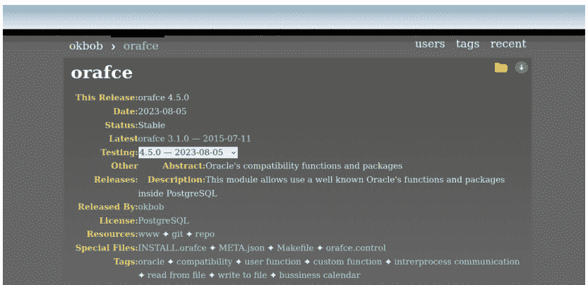

## 12

## 扩展数据库——扩展生态系统

扩展是将相关的数据库对象，如函数、例程和表，打包在一起的强大方式，使得将对象作为一个整体进行管理变得更容易。扩展允许你和其他开发者通过提供一种清晰、简洁和准确的方式来安装、升级和删除功能和对象，从而扩展已经丰富的 PostgreSQL 功能集。在本章中，你将了解扩展是什么以及如何使用不同的工具安装、升级或删除它们。此外，你将学习如何从头开始构建自己的扩展，以便立即在打包自己的脚本和工具以在其他数据库和 PostgreSQL 实例之间分发方面变得高效。

本章包含以下主题：

- Introducing extensions
- Managing extensions
- Exploring the PGXN client
- Installing extensions
- Creating your own extension

## 技术要求

本章示例可以在本书 GitHub 仓库中找到的 chapter_12 Docker 镜像上运行：https://github.com/PacktPublishing/Learn-PostgreSQL-Second-Edition。有关本书 Docker 镜像的安装和使用说明，请参阅第 1 章，Introduction to PostgreSQL。

## Introducing extensions

SQL 是一种声明式语言，允许你创建和操作对象以及数据。你可以将 SQL 语句分组到脚本中，以便以更可预测和可重复的方式运行脚本。然而，这样的脚本被 PostgreSQL 看作是一系列不相关的命令，也就是说，你有责任将这些命令关联成适当的脚本。当你必须处理外语编程语言（例如 PL/Perl 和其他非 SQL 语言）或二进制库时，情况会变得更糟；集群对你的目标或对象之间的关系一无所知。幸运的是，扩展帮助你从混乱中理出秩序。

扩展是一组打包的文件，可以安装在集群中以提供更多功能，即“扩展”当前集群的功能集。与脚本不同，扩展是通过特定的命令严格管理的，这些命令将扩展作为一个整体进行安装、部署、加载和升级，即使它由多个不同的文件组成。

扩展可以是通用的，例如一种新的数据类型、一种新的索引类型，或从 PostgreSQL 内部直接发送电子邮件的服务，也可以是针对特定用例的非常具体的，例如一组表和数据以提供临时配置。扩展对你如何使用它没有意见，因此你可以自由地安装后就忘记它，或在集群的每个数据库中使用它。

扩展机制的主要目的是为管理新功能提供一个通用接口。得益于扩展，你有一组通用的语句可以在集群中将扩展作为一个整体部署、安装、升级和删除。无论你的扩展由单个函数组成还是由一组链接对象组成，扩展机制都会一次性处理所有对象，使管理变得更容易。此外，扩展机制定义了一种标准方式以结构化和干净的方式添加功能，从而使每个人更轻松地为 PostgreSQL 做出贡献。

PostgreSQL 附带了一组有用的扩展，包含在 contrib 包中并由 PostgreSQL 开发者自己开发。因此，contrib 扩展集是坚固且安全的，因为它们与 PostgreSQL 数据库本身紧密构建在一起。然而，扩展可以来自第三方，这就是这种方法的美妙之处：每个人都可以通过提供新功能的扩展为 PostgreSQL 做出贡献。请注意，PostgreSQL 开发者不保证第三方扩展的稳定性。

操作系统包通常提供一个 postgresql-contrib 包，用于安装所有 PostgreSQL contrib 扩展。该包被单独保留，以便用户可以选择是否安装这些扩展。显然，即使没有 contrib 模块，PostgreSQL 也能正常工作，而该模块实际上通过扩展添加了功能。

PostgreSQL 已围绕扩展的概念构建了整个生态系统，因此它不仅提供用于管理扩展的语句，还提供用于构建新扩展和将现有脚本转换为扩展的平台。然后，扩展可以通过一个名为 PostgreSQL eXtensions Network（PGXN）的全球存储库公开提供。

你可以将 PostgreSQL 扩展视为编程语言中的可重用库，例如 Perl 的模块、Ruby 的 gems、Java 的 JAR 等。同样，PGXN 基础设施可以被视为 Perl 的 CPAN（或 PHP 的 PEAR 等）。

## The extension ecosystem

扩展的美妙之处在于它们提供了一种统一的方式来捆绑可以部署（安装）和在 PostgreSQL 中使用的模块。开发者可以自由地为 PostgreSQL 可用模块的数量做出贡献，这已迅速发展成为一个完整的生态系统。

类似于 Perl、Python 等编程语言，PostgreSQL 现在可以用共享通用基础设施和架构的插件和模块进行定制，并且可以用相同的语句进行管理，而无需考虑它们提供的功能。

扩展主要收集在 PGXN 中，这是一个在线存储库，可以查询以获取有关扩展的信息或下载扩展（以及其特定版本），并且可以用新模块进行更新。

记住，PGXN 就像 Perl 的 CPAN、LaTeX 的 CTAN、PHP 的 PEAR 等。


虽然你在互联网上到处都能找到 PostgreSQL 扩展，但几乎每次你需要新扩展时，你都会与 PGXN 交互。PGXN 不是一个简单的网站或代码仓库，而是一个由四个部分组成的详细平台：搜索引擎、扩展管理器、**应用程序编程接口 (API)**，以及客户端。

**搜索引擎**允许用户搜索 PGXN 内容以查找特定扩展。**管理器**负责接收新扩展（或新扩展版本）并让用户获取它们（即分发扩展）。**API** 定义了应用程序如何与管理器和搜索引擎交互，因此也定义了客户端如何构建。目前有两个主要客户端可用——PGXN 网站和 pgxnclient 命令行应用程序。pgxnclient 应用程序可能是获取和安装扩展的最有效方式，这将在以下小节中详细介绍；然而，你也可以直接与 PGXN 网站交互来搜索和下载扩展。你将在本章后面看到使用 PGXN 网站的示例。

扩展是基于 **PostgreSQL 扩展系统 (PGXS)** 构建的，PGXS 是一组基本规则，扩展必须遵守这些规则才能提供一个通用的可管理接口。特别是，PostgreSQL 提供了一个统一的 Makefile，每个扩展都应使用它来提供安装、升级和移除扩展的一组通用功能。你可以通过 `pg_config` 检查 PGXS 基础 Makefile，找到其位置：

```
```sh
$ pg_config --pgxs
/usr/lib/postgresql/16/lib/pgxs/src/makefiles/pgxs.mk
```
```

pgxs.mk 是为每个扩展提供通用功能的基 Makefile，其用法在我们展示如何从头创建扩展时将变得更加清晰。

## 扩展组件

一个扩展由两个主要组件组成——**控制文件**和**脚本文件**：

- **控制文件**提供有关扩展及其管理方式的信息，例如在哪里以及如何安装它，如何升级它等等。控制文件在某种程度上是扩展的元数据。
- **脚本文件**是一个 SQL 文件，其中包含创建扩展一部分的数据库对象的语句。在某种程度上，这就是扩展的内容。脚本文件可以反过来加载完成扩展的其他文件，如共享库等。

当你要求 PostgreSQL 安装扩展时，系统会检查控制文件以获取有关扩展的信息，确保扩展尚未安装，然后在事务中执行脚本文件。结果，你可以在数据库中使用该扩展。

每个扩展都有一个版本，以便你可以精确决定要安装哪个版本。如果未指定版本，PostgreSQL 将假定你想要最新可用版本。

扩展安装在集群的 share 目录中，通常可以通过执行带 `--sharedir` 选项的 pg_config 命令找到。以下是一个示例：

```
$ pg_config --sharedir
/usr/share/postgresql/16
```

组成扩展的所有文件都将放置在共享目录中，集群期望这些文件对运行集群的用户可用（通常是操作系统用户 postgres）。一旦文件对集群可用，扩展必须在需要它的每个数据库中选择性安装；请记住，PostgreSQL 在数据库之间提供非常强的隔离，因此加载到一个数据库中的扩展不会自动在另一个数据库中可用。但是，请记住模板数据库（参见第 2 章）可作为新创建数据库的骨架，因此一旦你在模板数据库中安装了扩展，你将在所有其他创建的数据库中找到该扩展已可用。

## 控制文件

扩展控制文件必须具有与扩展相关且后缀为 .control 的名称。例如，一个有效名称可以是 learnpg.control。

控制文件是一个文本文件，你可以在其中指定指令，这些指令是安装说明和元数据，让 PostgreSQL 处理扩展安装。每个指令都有一个名称和一个值。最常见的指令如下：

- directory 指定扩展脚本路径。
- default_version 指定当用户未指定任何版本时要安装的扩展版本。
- comment 是扩展及其目的的描述。
- requires 是安装和使用本扩展所需其他扩展的可选列表，因此代表依赖列表。

## 管理扩展

每个扩展都在数据库级别管理，这意味着每个需要扩展的数据库都必须管理该扩展生命周期。换句话说，没有按集群管理扩展并将其应用于集群中每个数据库的方法。

扩展主要由三个 SQL 语句管理：CREATE EXTENSION、DROP EXTENSION 和 ALTER EXTENSION，分别用于在数据库中安装扩展、从数据库中移除扩展以及修改扩展属性或升级它们。

每个扩展由一个助记符和一个版本指定；如果未指定版本，PostgreSQL 假定你想要处理最新可用版本或已安装的版本。

在以下小节中，将解释这三个管理语句中的每一个。

### 创建扩展

CREATE EXTENSION 语句允许你在当前数据库中安装现有扩展。

该语句的概要如下：

```
CREATE EXTENSION [ IF NOT EXISTS ] extension_name
    [ WITH ] [ SCHEMA schema_name ]
                [ VERSION version ]
                [ CASCADE ]
```

扩展名称是扩展的助记符，如你所见，你可以指定要安装的扩展版本号。如果扩展依赖于任何其他扩展，CASCADE 选项允许系统自动递归执行依赖项的 CREATE EXTENSION。你可以决定扩展对象必须放置到哪个模式中，当然，这仅对可以重新定位的扩展才有意义。

正如你所能想象的，IF NOT EXISTS 允许命令在扩展已被安装时优雅地失败。更精确地说，如果扩展已在数据库中安装，则不执行任何操作。

为了更好地了解 CREATE EXTENSION 的工作原理，假设我们想在 forumdb 数据库中安装 PL/Perl 过程语言；由于 PL/Perl 扩展作为 PostgreSQL contrib 模块提供，你应该已经在集群中拥有该扩展。

因此，为了安装它，你需要执行以下操作：

```
forumdb=# CREATE EXTENSION plperl;
CREATE EXTENSION
```

请注意，PL/Perl 扩展（助记符 plperl）需要使用数据库管理员进行安装。如果你尝试再次安装同一扩展，命令将失败，除非你使用 IF NOT EXISTS 子句：

```
forumdb=# CREATE EXTENSION plperl;
ERROR:  extension "plperl" already exists

forumdb=# CREATE EXTENSION IF NOT EXISTS plperl;
NOTICE:  extension "plperl" already exists, skipping
CREATE EXTENSION
```

作为另一个简单的示例，我们可以安装 pg_stat_statements 扩展的特定版本：

```
forumdb=# CREATE EXTENSION pg_stat_statements VERSION '1.10';
CREATE EXTENSION
```

请注意，pg_stat_statements 需要更改 shared_preload_libraries 配置参数，这反过来需要重启集群。在本章的 Docker 镜像中，shared_preload_libraries 设置已为你配置好，以便使用 pg_stat_statements 扩展。如果你想手动更改 PostgreSQL 配置以使用 pg_stat_statements，你需要编辑 postgresql.conf 配置文件或执行：

ALTER SYSTEM SET shared_preload_libraries TO 'pg_stat_statements';

然后重启集群。

## 查看已安装的扩展

在 psql 终端中，可以使用 \dx 特殊命令获取已安装扩展的列表：

```
forumdb=# \dx

                         List of installed extensions

    Name    | Version | Schema | Description
```


-----------------+---------+----------------------------------
-----------------------------
pg_stat_statements | 1.10    | public      | track execution statistics
of all SQL statements executed
plperl             | 1.0     | pg_catalog   | PL/Perl procedural language
plpgsql            | 1.0     | pg_catalog   | PL/pgSQL procedural language
(3 rows)

完全相同的信息可以从特殊的 pg_extension 目录中获取，该目录可以与 pg_namespace 关联，以提取有关扩展所在的模式的人类可读信息：

```
forumdb=# SELECT x.extname, x.extversion, n.nspname
            FROM pg_extension x JOIN pg_namespace n
            ON n.oid = x.extnamespace;

     extname     | extversion | nspname
-----------------+------------+----------
plpgsql          | 1.0        | pg_catalog
plperl           | 1.0        | pg_catalog
pg_stat_statements | 1.10      | public
(3 rows)
```

## 查找可用的扩展版本

可以检查集群以获取有关可用扩展版本的信息，这意味着你可以在数据库中实际安装的版本。特殊的 pg_available_extension_versions 目录允许你获取任何可用扩展的所有可用版本。以 pg_stat_statements 扩展为例，集群中可用的值如下：

```
forumdb=# SELECT name, version
            FROM pg_available_extension_versions
            WHERE name = 'pg_stat_statements';

     name             | version
---------------------+--------
     name             | version
---------------------+--------
pg_stat_statements   | 1.4
pg_stat_statements | 1.5
pg_stat_statements | 1.6
pg_stat_statements | 1.8
pg_stat_statements | 1.9
pg_stat_statements | 1.7
pg_stat_statements | 1.10
```

了解 pg_stat_statements 扩展可以根据需要安装在 1.4 到 1.10 之间的版本是有用的。

> 你应该始终安装扩展的最新版本，即版本号最高的版本，除非你被迫为向后兼容而安装特定版本。

## 修改现有扩展

ALTER EXTENSION 语句非常丰富且复杂，允许你完全修改现有扩展。该语句允许对现有扩展进行四项主要更改：

- 将扩展升级到新版本
- 设置可重新定位扩展的模式
- 向扩展添加数据库对象
- 从扩展中删除数据库对象

为了升级已安装的扩展，你必须指定 UPDATE 子句，并指定目标版本号。例如，考虑前面介绍的 pg_stat_statements 扩展，并假设我们出于升级目的安装了它的 1.6 版本。为了将扩展更新到 1.10 版本，可以发出以下示例所示的 ALTER EXTENSION 语句：

```
forumdb=# CREATE EXTENSION
    pg_stat_statements WITH VERSION '1.6';
CREATE EXTENSION

forumdb=# ALTER EXTENSION pg_stat_statements
    UPDATE TO '1.10';
ALTER EXTENSION
```

```
forumdb=# \dx pg_stat_statements
                         List of installed extensions
      Name       | Version | Schema |
Description
----------------------+---------+--------+-------------------------------
 pg_stat_statements | 1.10    | public | track execution statistics of
all SQL statements executed
(1 row)
```

通过指定 SET SCHEMA 子句，可以将可重新定位扩展从一个模式移动到另一个模式，例如：

```
forumdb=# ALTER EXTENSION pg_stat_statements SET SCHEMA my_schema;
ALTER EXTENSION

forumdb=# \dx pg_stat_statements
                         List of installed extensions
      Name       | Version |  Schema  |
Description
----------------------+---------+----------+-------------------------
 pg_stat_statements | 1.10    | my_schema | track execution statistics of
all SQL statements executed
(1 row)
```

这将把所有扩展对象移动到 my_schema 模式中，该模式必须在扩展被重新定位之前存在。

如果你想从一个扩展中删除现有的数据库对象，例如表，可以使用 DROP 子句，后跟对象的类型，当然还有其名称。重要的是要理解，从扩展中删除对象不会从数据库中删除该对象；相反，它将对象的生命周期与扩展的生命周期分离。换句话说，从扩展中删除的对象成为一个普通的数据库对象。例如，如果我们从同名的扩展中删除 pg_stat_statements 视图，我们可以在 DROP 子句后指定对象类型（VIEW），如下所示：

```
forumdb=# ALTER EXTENSION pg_stat_statements
             DROP VIEW pg_stat_statements;
ALTER EXTENSION
```

如果扩展已被重新定位，则需要为每个对象指定限定名称，因此要在对象名称前加上当前扩展模式。例如，在将扩展重新定位到 my_schema 命名空间之后，上述命令变为：

```
forumdb=# ALTER EXTENSION pg_stat_statements
    DROP VIEW my_schema.pg_stat_statements;
ALTER EXTENSION
```

上述 DROP VIEW 命令的结果是，在扩展部署时最初创建的视图仍然存在于数据库中并且可以正常查询；但此视图现在是一个与扩展本身生命周期独立的对象。

只需查询它即可轻松看出视图仍然可用：

```
forumdb=# SELECT count(*) FROM pg_stat_statements;
count
------
    2
(1 row)
```

当然，可以使用 ADD 子句向扩展添加新对象，其工作原理与 DROP 相反，需要对象的类型和名称。例如，要将 pg_stat_statements 视图添加回扩展，可以执行以下操作：

```
forumdb=# ALTER EXTENSION pg_stat_statements
    ADD VIEW pg_stat_statements;
ALTER EXTENSION
```

你也可以将自己的对象添加到扩展中。因此，例如，将新表添加到扩展意味着该扩展将经历扩展生命周期：

```
forumdb=# CREATE TABLE t_ext( i int, t text );
forumdb=# ALTER EXTENSION pg_stat_statements
    ADD TABLE t_ext;
ALTER EXTENSION
```

t_ext 表现在是扩展的一部分，因此，不能再使用不考虑扩展的语句对其进行操作。

例如，如果你尝试删除该表，PostgreSQL 将阻止你损坏扩展：

```
forumdb=# DROP TABLE t_ext;
ERROR:  cannot drop table t_ext because extension pg_stat_statements requires it
HINT:  You can drop extension pg_stat_statements instead.
```

最后一个示例恰当地展示了扩展的强大功能：属于扩展的所有对象都作为一个整体进行管理，因此不能因相互依赖而被意外管理或删除。这意味着，为了删除上述表，你要么需要在删除表本身之前将其从扩展中移除，要么删除整个扩展。

## 删除现有扩展

DROP EXTENSION 从当前数据库中删除扩展。该语句的语法如下：

```
DROP EXTENSION [ IF EXISTS ] name [, ...] [ CASCADE | RESTRICT ]
```

该命令支持 IF EXISTS 子句，就像许多其他语句一样。此外，可以指定要从数据库中删除多个扩展。

CASCADE 选项还会删除依赖于扩展对象的数据库对象，而其对应项 RESTRICT 则会在仍有其他对象依赖于此扩展时使命令失败。此外，可以同时删除多个扩展。

例如，以下语句一次删除两个扩展，并删除依赖于这些扩展的所有对象：

```
forumdb=# DROP EXTENSION plperl, plpgsql CASCADE;
NOTICE:  drop cascades to function get_max(integer,integer)
DROP EXTENSION
```

正如你所见，由于用户定义的 get_max() 函数依赖于两个扩展之一，CASCADE 选项使该过程也删除了该函数。


`get_max()` 函数是一个简单的 PL/PgSQL 函数，已安装在本章的 Docker 容器中，仅用于演示 PostgreSQL 在删除扩展时如何足够智能地移除所有依赖对象。

总之，你已经学会了如何手动管理一个扩展，从安装到升级或移除；在下一节中，你将学习如何以更自动化的方式执行相同的步骤。

## 探索 PGXN 客户端

PGXN 客户端是一个外部应用程序，用 Python 编写，作为 PGXN 的命令行界面。该应用程序名为 pgxnclient，通过命令运行，这些命令是 install、download、uninstall 等操作，允许数据库管理员与 PGXN 和扩展进行交互。

在某种程度上，pgxnclient 的工作方式与 Perl 的 cpan（或 cpanm）命令、Raku 的 zef、Python 的 pip 等相同。

作为一个外部应用程序，pgxnclient 不随 PostgreSQL 分发，因此在使用它之前你需要在机器上安装它。安装 pgxnclient 并不是使用 PostgreSQL 扩展的强制要求，但它可以让你的生活变得轻松许多。

在下面的小节中，你将看到如何在主要的 Unix 和类 Unix 操作系统上安装 pgxnclient，但在那之前，重要的是让你知道，一旦安装完成，你的系统上会出现两个可执行文件：pgxn 和 pgxnclient。你可以将这两个可执行文件视为彼此的别名，即使这并不完全正确（一个包装了另一个）；然而，你可以使用其中任何一个，得到完全相同的结果。在本章中，我们将使用 pgxn 作为主要的可执行文件。

在本书仓库中的 Docker 镜像里，pgxnclient 程序已经安装好了，所以你不需要安装它。

有关如何安装 pgxnclient 的详细说明超出了本书的范围，因此如果你无法让应用程序正常工作，请仔细检查项目文档和安装说明。

## 在 Debian GNU/Linux 及衍生版上安装 pgxnclient

pgxnclient 已为 Debian GNU/Linux 及衍生版打包，这意味着你可以简单地让 apt 安装它：

```
$ sudo apt install pgxnclient
```

程序安装完成后，你可以使用 --version 选项简单地测试它，它会打印你安装的版本号：

```
$ pgxn --version
pgxnclient 1.3.2
```

## 在 Fedora Linux 和基于 Red Hat 的发行版上安装 pgxnclient

pgxnclient 也已为 Fedora 打包，因此你可以使用操作系统的包管理器安装它：

```
$ sudo dnf install -y pgxnclient
```

进程完成后，你可以查询应用程序以验证它是否正常工作：

```
$ pgxn --version
pgxnclient 1.3.2
```

## 在 FreeBSD 上安装 pgxnclient

pgxnclient 已为 FreeBSD 打包，因此你可以通过 pkg 工具或通过软件 ports 安装它。最快的方式是使用 pkg，你只需要请求安装该程序：

```
$ sudo pkg install --yes pgxnclient
```

## 从源码安装 pgxnclient

你始终可以从源码安装 pgxnclient，即使这仅建议在你的操作系统未提供打包版本，或版本相对于你的需求已过时的情况下使用。你可以从官方项目 GitHub 仓库下载最新发布的压缩版本，例如：

```
$ wget https://github.com/pgxn/pgxnclient/archive/refs/tags/v1.3.2.zip
```

一旦你拥有压缩归档，你需要解压缩它并进入随之创建的目录——以你下载的 PGXN 版本命名——在我们的例子中是 pgxnclient-1.3.2。一旦进入该目录，执行 setup.py Python 脚本将允许你安装应用程序：

```
$ unzip v1.3.2.zip
$ cd pgxnclient-1.3.2
$ sudo python setup.py install
...
Finished processing dependencies for pgxnclient==1.3.2
```

安装完成后，你可以查询应用程序以验证它是否正常工作：

```
$ pgxn --version
pgxnclient 1.3.2
```

## pgxnclient 命令行界面

PGXN 客户端应用程序提供了一个类似于其他基于命令的应用程序（如 cpanm 和 git）的命令行界面。你可以通过请求帮助来获取主要命令列表：

```
$ pgxn help
usage: pgxn [--version] [--help] COMMAND ...

Interact with the PostgreSQL Extension Network (PGXN).

optional arguments:
  --version  print the version number and exit
  --help     show this help message and exit

available commands:
  COMMAND    the command to execute. The complete list is available using 'pgxn help --all'. Builtin commands are:
  check      run a distribution's test
  download   download a distribution from the network
  help       display help and other program information
  info       print information about a distribution
  install    download, build and install a distribution
```

```
load      load a distribution's extensions into a database
mirror    return information about the available mirrors
search    search in the available extensions
uninstall
          remove a distribution from the system
unload    unload a distribution's extensions from a database
```

通常，你会使用以下子集命令：

- search 用于使用关键词搜索发行版
- info 用于更仔细地查看一个扩展
- download 用于下载（但不安装）一个扩展
- install 用于下载并在集群中安装一个扩展
- load 用于针对特定数据库执行 CREATE EXTENSION
- unload 用于针对特定数据库执行 DROP EXTENSION
- uninstall 用于从集群中移除一个扩展

你可能使用的最小命令集是 search、install 和 uninstall。

对于每个命令，如果你将命令指定为 help 命令的参数，你可以获得更详细的帮助。例如，要获取有关 search 命令的更多信息，你可以执行以下操作：

```
$ pgxn help search
usage: pgxn search [--help] [--mirror URL] [--verbose] [--yes]
                    [--docs | --dist | --ext]
                    TERM [TERM ...]

search in the available extensions

positional arguments:
  TERM        a string to search

optional arguments:
  --help      show this help message and exit
  --docs      search in documentation [default]
  --dist      search in distributions
  --ext       search in extensions
```

```
global options:
  --mirror URL  the mirror to interact with [default: https://api.pgxn.org/]
  --verbose     print more information
  --yes         assume affirmative answer to all questions
```

在下面的章节中，你将看到如何有效地使用 PGXN 来安装一个扩展。

## 安装扩展

通常，使扩展运行起来的工作流程涉及几个步骤。首先，你需要找出使用哪个扩展、哪个版本，以及与你的集群的兼容性。一旦你找到了需要的扩展，你必须在集群中安装它。

在集群中安装它实际上意味着将其部署到 PostgreSQL 目录中，即将所有扩展相关文件和库移动到集群的共享目录中，以便 PostgreSQL 可以查找运行扩展所需的代码。

最后，你需要在需要它的每个数据库中创建扩展。创建扩展就像在特定数据库内启用扩展的使用一样。

为了演示扩展的使用，我们将安装 orafce，即 Oracle 兼容函数扩展。描述整个扩展并不是本节的目的，所以让我们简单地说，这个扩展提供了一组函数、数据类型和其他内容，使 PostgreSQL 看起来像 Oracle 数据库，从而使基于 Oracle 的应用程序迁移变得更容易。

以下小节描述了使扩展运行所需的每个步骤。

### 通过 pgxnclient 安装扩展

通常，安装扩展的第一步是获取有关它的详细信息——这意味着搜索一个扩展。在这种特殊情况下，我们已经知道要查找的扩展是什么，但让我们通过 pgxn 搜索它：

> 注意，orafce 版本会定期更改。4.5.0 在撰写时是最新的，但你可能会看到更新的版本号。




Figure 12.3: The extension download page

要继续进行，你首先需要解压下载的归档文件：

```
$ unzip orafce-4.5.0.zip
```

现在你可以进入为此扩展创建的目录并编译它（系统上需要安装编译器和所有源代码构建工具）：

```
$ cd orafce-4.5.0
$ make
```

你需要 PGXS Makefiles 才能从头编译扩展。通常，此类 Makefiles 会随 PostgreSQL 的开发工具一起安装。例如，在基于 Red Hat 的 Linux 发行版上，你需要安装 postgresql16-dev 包。在本章的 Docker 镜像中，所有编译和安装扩展所需的工具都已准备就绪。

如果编译成功，扩展将被创建并准备好添加到 PostgreSQL 共享库目录。为了将扩展文件移入集群，你需要访问数据库目录，例如使用 sudo：

```
$ sudo make install
```

从这里开始，你可以在需要该扩展的每个数据库中使用 CREATE EXTENSION 语句。

## 使用已安装的扩展

一旦扩展被安装——也就是说，无论是手动还是通过 pgxn *部署*到 PostgreSQL 集群——你就可以在需要它的每个数据库中创建该扩展。

orafce 扩展必须由超级用户创建，因此你需要以管理员身份连接到数据库才能执行 CREATE EXTENSION 语句：

```
$ psql -U postgres forumdb
psql (16.0)
Type "help" for help.

forumdb=# CREATE EXTENSION orafce;
CREATE EXTENSION
```

如果现在检查数据库中已安装的扩展，你会看到刚刚创建的 orafce，版本为 4.5.0——与我们使用 pgxn 或在网站上搜索扩展时找到的版本相同：

```
forumdb=# \x \dx
Expanded display is on.
List of installed extensions
```

| Name | Version | Schema | Description |
|---|---|---|---|
| orafce | 4.5 | public | Functions and operators that emulate a subset of functions and packages from the Oracle RDBMS |
| pg_stat_statements | 1.10 | public | track planning and execution statistics of all SQL statements executed |
| plpgsql | 1.0 | pg_catalog | PL/pgSQL procedural language |

一旦扩展已安装到数据库中，每个用户都可以使用它。作为一个简单的测试，你可以查询 Oracle 拥有的 DUAL 表，而 orafce 为你的遗留查询创建了该表以继续运行：

```
$ psql -U luca forumdb
psql (16.0)
Type "help" for help.

forumdb=> SELECT * FROM oracle.dual;
```

| dummy |
|-------|
| X     |

(1 row)

请注意，扩展创建的表位于 oracle 命名空间中。通过使用 search_path，很容易避免在任何对象名称前输入 oracle：

```
forumdb=> SET search_path TO "$user", public, oracle;
SET
forumdb=> SELECT * FROM dual;
```

| dummy |
|-------|
| X     |

(1 row)

## 移除已安装的扩展

可能会出现你不再需要某个扩展，因此想要将其从集群中移除的情况。移除未使用的扩展是一个好习惯，因为它能保持集群整洁，不依赖于你真正不需要的对象。

如果某个数据库不再需要扩展及其相关内容，你可以发出 DROP EXTENSION 语句，扩展就会从你的数据库中消失。当然，如果扩展是由数据库超级用户安装的，你也需要以超级用户身份发出该语句。关于 orafce 的例子，作为超级用户，你可以执行以下操作：

```
$ psql -U postgres forumdb
psql (16.0)
Type "help" for help.

forumdb=# DROP EXTENSION orafce;
DROP EXTENSION
```

正如你所想象的，检查扩展列表时将不再显示 orafce 条目，并且所有功能，包括 DUAL 表，都已消失：

```
forumdb=# \dx
List of installed extensions
```

| Name | Version | Schema | Description |
|---|---|---|---|
| pg_stat_statements | 1.10 | public | track planning and execution statistics of all SQL statements executed |
| plpgsql | 1.0 | pg_catalog | PL/pgSQL procedural language |

(2 rows)

```
forumdb=# SELECT * FROM oracle.dual;
ERROR: relation "oracle.dual" does not exist
LINE 1: SELECT * FROM oracle.dual;
```

从单个数据库中移除扩展并不会将其从你已执行过显式 CREATE EXTENSION 函数的其他数据库中移除。它也不会从集群共享目录中移除扩展文件和库。

从集群中移除（取消部署）扩展的确切方式取决于你最初安装它的方式。

### 通过 pgxnclient 移除扩展

pgxn 的 uninstall 命令执行与 install 命令完全相反的操作：它会移除与扩展相关的所有文件。命令行选项相同，这使我们能够执行如下简单的命令：

```
$ pgxn uninstall orafce --sudo --verbose
```

所有与扩展相关的文件都将被从集群的共享库目录中移除。扩展因此永远消失，如果你需要再次安装它，将需要从第一步重新开始。

### 移除手动编译的扩展

要移除你手动从源代码编译的扩展，你需要再次使用 make，这次使用 uninstall 命令，在你解压下载的压缩归档的目录中：

```
$ cd orafce-4.5.0
$ sudo make uninstall
```

> 避免使用不同工具混合管理扩展。如果你通过 pgxnclient 安装了扩展，最好用同一客户端将其移除；反之，如果你是从源代码安装的，请使用相同的方法将其移除。

总之，你已经了解了如何使用 PGXN 客户端或手动通过 PGXN 基础设施处理扩展。在下一节中，你将学习如何构建自己的扩展。

## 创建你自己的扩展

在本节中，我们将从头构建一个扩展，以便你更好地理解它们是如何构成的。其目的是让你了解如何将你自己的 SQL 脚本甚至转换为扩展，并利用扩展在可管理性方面带来的所有优势。

### 定义示例扩展

为了演示如何构建自己的扩展，我们将创建一个适用于论坛数据库的简单功能集，提供一些额外功能。特别是，我们将定义一个名为 tagext 的扩展，它将提供一个实用函数，给定 tag 表中的特定标签，将返回该标签的完整路径，包括所有祖先。

例如，Linux 标签是 Operating Systems 标签的子标签，因此 Linux 标签的路径为 Operating System > Linux。

特别是，我们希望我们的扩展为我们提供一个名为 tag_path 的函数，给定一个标签，提供如下示例中的标签路径：

```
forumdb=> SELECT tag_path( 'Kubuntu' );
```

| tag_path |
|----------|
| Operating Systems > Linux > Ubuntu > Kubuntu |

(1 row)

在以下各节中，你将看到如何通过实现示例扩展来实现上述结果。所有必需的文件都可在本书源代码仓库中找到。

### 创建扩展文件

让我们先从控制文件开始，在其中插入有关扩展的一些基本信息。创建一个名为 tagext.control 的文件并将其放入文件夹中，例如 /src/tagext。该文件的内容如下：

```
comment = 'Tag Programming Example Extension'
default_version = '1.0'
superuser      = false
relocatable    = true
```

在本章示例中使用的 Docker 镜像中，你将在 /src/tagext 文件夹中找到扩展文件，并能够进入该文件夹安装扩展。

上述控制文件包含一个描述扩展给其他管理员的注释，指定 default_version，即如果用户未指定版本时要安装的版本，并规定此扩展可以由任何用户安装（superuser = false）并移动到用户希望的任何模式（relocatable = true）。

然后是 Makefile，即构建和安装扩展的文件：

```
EXTENSION = tagext
DATA = tagext--1.0.sql

PG_CONFIG = pg_config
```


```
PGXS := $(shell $(PG_CONFIG) --pgxs)
include $(PGXS)
```

Makefile 非常简单，可以作为其他扩展 Makefile 的骨架。特别是，我们通过此 Makefile 定义要管理的扩展的名称，以及用于生成扩展内容的 files。这在 DATA 变量中指定，因此我们将系统配置为使用 tagext--1.0.sql 文件来创建该扩展提供的对象。

尾部的行定义了 PGXS 构建基础设施的使用，特别是用于包含由 pg_config 命令输出计算得出的 PGXS 基础 Makefile。

在所有基础设施就绪后，现在可以定义扩展的内容，因此 tagext--1.0.sql 文件包含一个函数的定义（参见 *第 7 章，服务器端编程*），该函数给定特定标签，返回包含所有祖先的标签路径的文本表示：

```
CREATE OR REPLACE FUNCTION tag_path( tag_to_search text )
RETURNS TEXT
AS $CODE$
DECLARE
    tag_path text;
    current_parent_pk int;
BEGIN

    tag_path = tag_to_search;

    SELECT parent
    INTO   current_parent_pk
    FROM   tags
    WHERE  tag = tag_to_search;

    -- here we must loop
    WHILE current_parent_pk IS NOT NULL LOOP
        SELECT parent, tag || ' > ' || tag_path
        INTO   current_parent_pk, tag_path
        FROM   tags
        WHERE  pk = current_parent_pk;
    END LOOP;

RETURN tag_path;
END
$CODE$
LANGUAGE plpgsql;
```

该函数通过接受标签作为参数，然后查询 tags 表以获取父主键，然后在每个父标签上循环工作。在每次循环中，tag_path 文本字符串都会通过父标签名称进行丰富，以便结果得到类似 parent 1 > parent 2 > child 的字符串。

一旦所有文件准备就绪，我们将有如下情况，包含 Makefile、控制文件和扩展内容文件：

```
$ ls -1 /src/tagext
Makefile
tagext--1.0.sql
tagext.control
```

## 安装扩展

在所有组件就绪后，可以使用 Makefile 将扩展安装（部署）到集群中。由于扩展将安装在 PostgreSQL 目录中，你可能需要使用特权用户来安装扩展：

```
$ sudo make install
```

现在可以使用 CREATE EXTENSION 在 forumdb 数据库中安装扩展，然后尝试执行扩展定义的函数：

```
forumdb=> CREATE EXTENSION tagext;
CREATE EXTENSION

List of installed extensions
Name | Version | Schema |
Description
----------------------------+----------+------------------------------------------
----------------------------
----------------
```

```
pg_stat_statements | 1.10    | public     | track planning and execution
statistics of all SQL statements executed
plpgsql             | 1.0     | pg_catalog | PL/pgSQL procedural language
tagext              | 1.0     | forum      | Tag Programming Example
Extension


forumdb=> SELECT tag_path( 'Kubuntu' );
                              tag_path
--------------------------------------------------------------
 Operating Systems > Linux > Ubuntu > Kubuntu
(1 row)
```

该函数工作正常，可以为指定标签构建标签树或路径，包括其所有祖先，同时 PostgreSQL 报告扩展的版本为 1.0。

## 创建扩展升级

假设我们想要丰富我们的扩展函数，以便用户可以在路径输出中指定标签分隔符。我们可以生成函数的新的版本，删除旧版本，并允许用户使用新内容升级扩展。

让我们首先创建扩展内容的升级，即扩展提供的新的函数。首先，创建一个名为 `tagext--1.0--1.1.sql` 的文件并在其中放置以下内容：

```
CREATE OR REPLACE FUNCTION tag_path( tag_to_search text,
                                     delimiter text DEFAULT ' > ' )
RETURNS TEXT
AS $CODE$
DECLARE
    tag_path text;
    current_parent_pk int;
BEGIN

tag_path = tag_to_search;

SELECT parent
INTO    current_parent_pk
FROM    tags
WHERE   tag = tag_to_search;

-- here we must loop
WHILE current_parent_pk IS NOT NULL LOOP
    SELECT parent, tag || delimiter || tag_path
    INTO    current_parent_pk, tag_path
    FROM    tags
    WHERE   pk = current_parent_pk;
END LOOP;

RETURN tag_path;
END
$CODE$
LANGUAGE plpgsql;
```

该文件首先删除旧版本的函数（如果它存在并且已被此扩展的先前版本安装）。在此之后，创建一个具有额外可选参数的新函数。该函数与前一个函数执行完全相同的工作，但这次它利用变量 delimiter 来分隔多个标签。

由于我们向扩展添加了新的文件，我们需要通知 Makefile 关于该文件，因此我们必须将新文件添加到 DATA 变量中，以便 Makefile 的内容如下所示：

```
EXTENSION = tagext

DATA = tagext--1.0.sql tagext--1.0--1.1.sql

PG_CONFIG = pg_config
PGXS := $(shell $(PG_CONFIG) --pgxs)
include $(PGXS)
```

## 执行扩展升级

有了新的 Makefile 和 tagext--1.0--1.1.sql 文件后，磁盘上的情况如下：

```
$ ls -1 /src/tagext
Makefile
tagext--1.0--1.1.sql
tagext--1.0.sql
tagext.control
```

因此现在可以再次运行 install 命令将扩展部署到集群：

```
$ make install
/bin/mkdir -p '/usr/local/share/postgresql/extension'
/bin/mkdir -p '/usr/local/share/postgresql/extension'
/usr/bin/install -c -m 644 ./tagext.control '/usr/local/share/postgresql/extension/'
/usr/bin/install -c -m 644 ./tagext--1.0.sql ./tagext--1.0--1.1.sql '/usr/local/share/postgresql/extension/'
```

并且在数据库内部，可以使用 ALTER EXTENSION 升级扩展：

```
forumdb=> ALTER EXTENSION tagext UPDATE TO '1.1';
ALTER EXTENSION

forumdb=> \dx tagext
            List of installed extensions
 Name   | Version | Schema |        Description
--------+---------+--------+----------------------------
tagext  | 1.1     | public | Tag Programming Example Extension
(1 row)
```

正如你所见，扩展版本现在为 1.1，因此可以有或没有新的参数调用 tag_path 函数：

```
forumdb=> SELECT tag_path( 'Kubuntu' );
    tag_path
-------------------------------
Operating Systems > Linux > Ubuntu > Kubuntu
(1 row)

forumdb=> SELECT tag_path( 'Kubuntu', ' --> ' );
                tag_path
----------------------------------------------------
Operating Systems --> Linux --> Ubuntu --> Kubuntu
(1 row)
```

你现在知道如何管理扩展的整个生命周期。

## 总结

本章向你介绍了扩展生态系统，这是一个非常丰富和强大的系统，用于打包相关对象并作为单个单元进行管理。扩展提供了一种向集群和数据库添加新功能的方法，最显著的是提供了一种清晰简洁的方式来构建更新和可重复的安装，从而简化了功能向其他集群和数据库的分发。

PostgreSQL 随 contrib 包提供了有用的扩展；这些扩展由 PostgreSQL 开发者直接开发，因此与当前 PostgreSQL 版本集成得非常好。另一方面，PGXN 网络提供了第三方扩展，可以用新功能改进你的集群。

得益于 PGXS 构建基础设施，从头创建扩展是全面的且相当容易的，而得益于 pgxnclient 等工具，管理大量扩展可以实现自动化。

在下一章，你将学习如何照顾集群的状态和性能，而第 19 章将向你展示一些其他有用的扩展。

## 验证你的知识

- 什么是扩展？
  扩展是一组相关的数据库对象，可以作为单个单元进行安装、升级或删除。有关更多详细信息，请参阅 *介绍扩展* 部分。
- 什么是 pgxnclient 命令？
  pgxnclient 是一个简化 PGXN 使用的命令，可下载、安装和删除扩展。有关更多详细信息，请参阅 *探索 PGXN 客户端* 部分。


- 什么是扩展控制文件？

  控制文件是一种文本文件，用于定义扩展的主要属性，例如名称、版本和其他依赖项。更多详细信息请参阅*扩展组件*一节。
- 如何检查数据库中已创建了哪些扩展？

  特殊的pg_extension目录提供了已安装扩展的信息；在psql中，特殊的\dx命令显示已安装扩展的摘要。更多详细信息请参阅*查看已安装的扩展*一节。
- 如何更改扩展的版本（更新）？

  可以使用`ALTER EXTENSION UPDATE TO`语句来指定扩展要升级到的版本。更多详细信息请参阅*修改现有扩展*一节。

## 参考

- [关于扩展的PostgreSQL官方文档](https://www.postgresql.org/docs/current/extend-extensions.html)
- [关于扩展构建系统（PGXS）的PostgreSQL官方文档](https://www.postgresql.org/docs/current/extend-pgxs.html)
- [pgxnclient官方仓库](https://pypi.org/project/pgxnclient/)
- [pgxnclient官方文档](https://pgxn.github.io/pgxnclient/)
- *PostgreSQL 11 服务端编程 – 快速入门指南*，Packt Publishing

## 在Discord上了解更多

要加入本书的Discord社区——在这里你可以分享反馈、向作者提问，并了解新版本发布——请扫描下方的二维码：

https://discord.gg/jYWCjF6Tku


