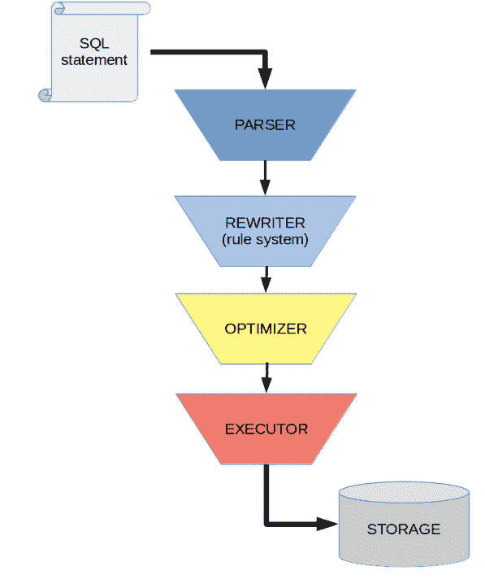
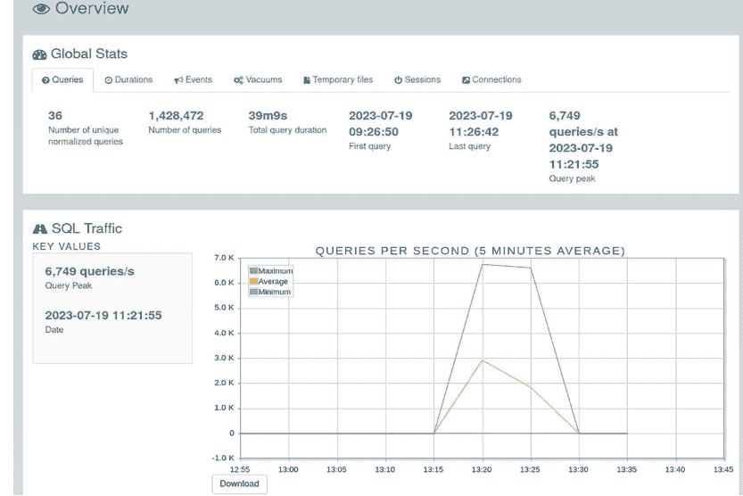
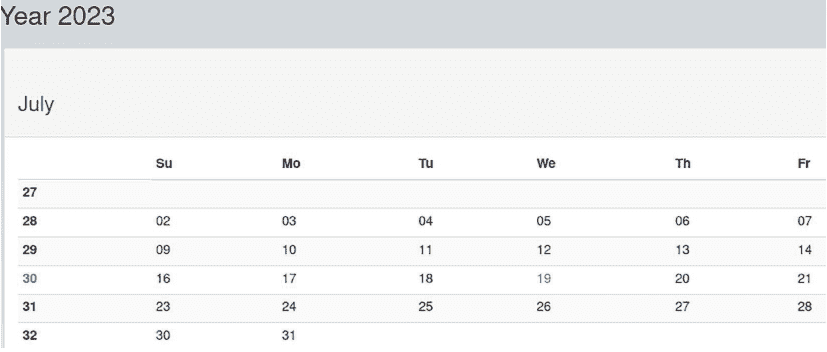

## 13

## 查询调优、索引与性能优化

性能调优是数据库管理员（DBA）日常工作中最复杂的任务之一。SQL 是一种声明式语言，因此它不定义如何访问底层数据——这一责任交由数据库引擎承担。因此，PostgreSQL 必须为每条语句选择最佳的数据访问方式。

其中一个特定组件——规划器（planner）——负责从所有可用的底层数据访问路径中选出最佳路径，而另一个组件——优化器（optimizer）——负责按照该特定访问计划执行语句。

本章旨在教你了解 PostgreSQL 如何执行查询、规划器如何计算最佳执行计划，以及你如何通过索引帮助提高性能。

在本章中，你将学习以下主题：

- 语句的执行
- 索引
- EXPLAIN 语句
- 查询调优示例
- ANALYZE 与更新统计信息的方法
- 自动EXPLAIN

## 技术要求

你需要了解以下内容：

- 如何执行针对数据库的查询
- 如何执行数据描述语言（DDL）语句

本章示例可以在本书GitHub仓库中的chapter_13镜像上运行：https://github.com/PacktPublishing/Learn-PostgreSQL-Second-Edition。有关本书可用Docker镜像的安装和使用，请参阅第1章《PostgreSQL简介》中的说明。

## 语句的执行

SQL是一种声明式语言：你要求数据库对其包含的数据执行某些操作，但你不指定数据库应如何完成该SQL语句。例如，当你要求获取某些数据时，你执行一条SELECT语句，但只提供了指定所需数据子集的子句，而没有说明数据库应如何从其持久化存储中取出数据。你必须信任数据库——特别是PostgreSQL——能够完成其工作，并在任何工作负载情况下始终为你找到访问数据的最快路径。好消息是，PostgreSQL非常擅长这一点，能够理解（并在一定程度上解释）你的SQL语句及其当前工作负载，从而以最快的方式为你提供数据访问。

然而，找到数据的最快路径通常需要在寻找绝对最快路径与花在推理这条路径上的时间之间取得平衡；换句话说，PostgreSQL有时会选择一种折中方案，以足够快的速度为你返回数据，即使那不是绝对最快的路径。

另一方面，有时PostgreSQL不能很好地理解如何找到数据的最快路径，这时DBA可以帮助改进性能。通常，添加索引可以帮助PostgreSQL更快地检索底层数据。其他时候，一条缓慢的语句可能隐藏着一个写错的查询（即包含错误或矛盾子句的语句）。此外，查询缓慢还可能是由于PostgreSQL对其必须处理的数据集大小判断有误。在所有这些情况下，DBA必须对数据库或语句进行一些调优，以帮助PostgreSQL做出最佳决策。

为了能够帮助你的集群优化语句，你首先需要理解PostgreSQL如何处理SQL语句。在下一节中，你将学习SQL语句如何被转换为PostgreSQL为管理数据而执行的一组操作的所有基础知识。

## 执行阶段

一条SQL语句（简称为查询）分四个主要阶段处理：

1. 第一阶段是解析；一个专门的组件——解析器（parser）——处理语句的文本形式（SQL文本），并验证其是否正确。如果语句存在任何语法错误，执行就会在这个早期阶段停止；否则，解析器将语句拆解为其主要部分，例如涉及的表和列的列表、过滤数据的子句、排序等。
2. 解析器成功完成后，语句进入第二阶段：重写阶段。重写器（rewriter）负责应用任何语法规则，将原始SQL语句重写为实际要执行的语句。特别是，重写器负责应用规则（参见第8章《触发器与规则》）。当重写器完成任务，生成了数据库将要处理的有效语句后，该语句进入下一阶段：优化。
3. 在优化阶段，查询由优化器处理，优化器负责找到访问数据的最快路径。找到这条最快路径并非易事：优化器必须决定在索引或直接访问等所有可用访问方法中，如何获取数据。可以想象，在所有可用访问方法之间进行推理和迭代会消耗时间和资源，因此优化器的任务不仅是要找出最快的访问方法，还要在短时间内找出来。
4. 最后，当优化器决定了如何访问数据后，查询进入最后一个阶段：执行。执行阶段由执行器（executor）组件处理，执行器负责实际访问存储，并使用执行器决定的访问方法检索（或插入）数据。

总而言之，一条SQL语句会经历四个阶段，如下面的图所示：检查语句语法的解析阶段、将查询转换为更具体内容的重写阶段、决定如何访问查询所请求数据的优化阶段，以及最后获得数据物理访问权的执行阶段。

这可以通过下面的图来直观展示：



图13.1：PostgreSQL查询阶段

DBA只能在优化阶段与数据库交互，在PostgreSQL未能做出最优工作时，尝试帮助它更好地理解语句并正确优化。下一节将更深入地介绍优化器，帮助你了解如何调整查询和数据库，从而以更智能、更快的方式处理查询。

## 优化器

优化器是负责决定使用什么来尽可能快地访问数据的组件。如果一张表没有提供任何索引，那么访问其数据只有一种方式，因此无需思考从表中提取数据的方式。


另一方面，如果一个表提供了几个索引，优化器必须决定哪一个最适合要执行的语句。当存在多个表，每个表又有多个索引时，情况变得更加复杂：优化器必须考虑所有可能到达最终结果的方式。

优化器如何在不同的数据访问方式中进行选择？优化器使用成本的概念：每种访问数据的方式都被分配一个成本，成本最低的方式获胜并被选为最佳访问方法。

正因如此，PostgreSQL 优化器被称为基于成本的优化器。

PostgreSQL 被配置为为其执行的每个操作分配特定的成本：从存储中获取数据、执行某些基于 CPU 的操作（例如，在内存中排序）等等。优化器遍历访问数据并将其处理以向用户返回所需结果的所有可能方式，计算每种方式的总成本——即 PostgreSQL 将执行的所有操作的成本之和。之后，成本最低的计划将作为一系列要执行的操作传递给执行器，从而管理数据。

然而，这只是故事的一半。在某些情况下，优化器的任务非常简单：如果只有一个访问方法，决定如何访问数据是微不足道的。然而，有些语句涉及如此多的对象和表，以至于遍历所有可能性需要花费大量时间，以至于结果会被计算最佳访问方式所花费的时间所超过。因此，如果语句涉及超过 12 个表连接，优化器不会遍历所有可能性，而是执行遗传算法来找到一种折中的数据访问方式。这种折中是在计算数据路径所花费的时间和找到一个不太差的访问路径之间进行的。

执行器也可以使用并行作业来执行数据访问。这意味着，例如，检索非常大的数据集可以通过将工作量分配给不同的并行工作进程（例如线程）来执行，每个工作进程负责数据的一个较小子集。

在所有情况下，优化器将要传递给执行器的一组操作划分为节点；节点是为提供最终结果或中间结果而执行的操作。例如，假设你执行一个通用查询，要求按特定顺序获取数据，如下所示：

```
SELECT * FROM categories ORDER BY description;
```

优化器将向执行器传递两个操作，即两个节点：一个用于检索所有数据，一个用于对数据进行排序。

在下面的小节中，我们将介绍优化器考虑并传递给执行器的主要节点。我们将从顺序节点开始——这些节点将使用单个作业执行——然后我们将看到 PostgreSQL 如何在其之上构建并行性。

## 优化器使用的节点

在本节中，我们将介绍优化器计划中可能遇到的主要节点。对于可以执行的每种操作，以及 PostgreSQL 接受的每种不同的访问方法，都有不同的节点。

需要注意的是，节点是可堆叠的：一个节点的输出可以用作另一个节点的输入。这允许由不同节点构成的非常复杂的执行计划，从而产生对数据的细粒度访问方法。

## 顺序节点

顺序节点是那些将按顺序一个接一个执行以实现最终结果的节点。主要节点在此列出，并在以下小节中进行解释：

- Sequential Scan
- Index Scan, Index-Only Scan, and Bitmap Index Scan
- Nested Loop, Hash Join, and Merge Join
- The Gather and Merge parallel nodes

## Sequential Scan

**Sequential Scan (Seq Scan)** 是优化器和执行器始终可用的唯一节点，尤其是在没有其他有价值的替代方案时。在顺序扫描中，执行器将转到磁盘上数据集的开头——例如，对应于表的文件的开头——并按顺序逐块读取所有数据。

例如，当你请求表的全部内容而没有任何特定的过滤子句时，这个节点总是被使用，如以下示例所示：

```
SELECT * FROM categories;
```

**Sequential Scan** 节点也用于查询中的过滤子句不是非常限制性的情况，以至于最终结果将是获取几乎整个表的内容。在这种情况下，数据库可以更快地执行顺序读取全部操作，丢弃被查询子句过滤掉的那些元组。

## 索引节点

索引扫描可以访问涉及索引的数据，以便快速找到请求的数据集。在 PostgreSQL 中，所有索引都是二级的，这意味着它们与表并存；因此，你将在存储中为表有一个数据文件，为你在表上构建的每个索引有一个文件。这意味着索引扫描始终需要对存储进行两次不同的访问：一次读取磁盘并提取请求元组在表中的位置信息，另一次访问磁盘以查找索引指向的元组。

由此可以清楚地看出，PostgreSQL 会避免在索引不有用时使用索引，即前面提到的双重存储访问带来的缺点多于优点。

然而，当 PostgreSQL 认为通过索引访问数据可能有价值时，它会生成一个索引节点，该节点可以专门化为三种不同的类型。

**Index Scan** 正如其名所示，是“经典”的索引访问方法。PostgreSQL 读取所选索引，并据此去查找元组，再次从存储中读取。

**Index-Only Scan** 是一种特殊的 Index Scan：如果请求的数据仅涉及属于索引的列，PostgreSQL 足够智能，可以避免第二次存储访问，因为它可以直接从索引中提取所有所需信息。

你可能遇到的最后一种基于索引的节点是 **Bitmap Index Scan**：PostgreSQL 构建一个内存位图，标明满足语句子句的元组所在位置，然后此位图用于定位这些元组。**Bitmap Index Scan** 通常与 **Bitmap Heap Scan** 关联，如你在以下各节的示例中将会看到。

## 连接节点

当 PostgreSQL 在两个（或更多）表之间执行连接时，它使用三种可能的节点之一。在本节中，我们将描述这些连接节点，考虑两个表之间的连接：外表（连接左侧的表）和内表（连接右侧的表）。

最简单的节点是 **Nested Loop**：两个表都以顺序或基于索引的方法进行扫描，并检查每个元组是否匹配。基本上，该算法可以用以下伪 Java 代码描述：

```
for ( Tuple o : outerTable )
    for ( Tuple i : innerTable )
        if ( o.matches( i ) )
            appendTupleToResultDataSet( o, i );
```

正如前面的伪代码所示，**Nested Loop** 以其执行嵌套循环来评估内外表之间每个元组的方式命名。

事实上，**Nested Loop** 不必对两个表都执行顺序扫描，实际上，根据上下文，每个表都可以用顺序或基于索引的访问方法遍历。然而，**Nested Loop** 的核心不会改变：始终会有嵌套的双重循环来在元组之间搜索匹配项。

PostgreSQL 仅在内表足够小，以至于每次对其循环不会引入任何特定惩罚时才选择 **Nested Loop**。

另一种执行连接的方式是使用 **Hash Join** 节点：内表被映射到一个哈希中，这是一个包含表元组的桶集合；然后遍历外表，对于从外表提取的每个元组，搜索哈希以查看是否存在匹配。以下伪 Java 代码说明了 **Hash Join** 的机制：

```
Hash innerHash = buildHash( innerTable );
for ( Tuple o : outerTable )
    if ( innerHash.containsKey( buildHash( o ) ) )
        appendTupleToResultDataSet( o, i );
```

正如前面的示例所示，第一步涉及对内表进行哈希，然后遍历外表以查看其任何元组是否与内表哈希映射中的值匹配。

PostgreSQL 中你可能遇到的最后一种连接是 **Merge Join**。正如名称所示，**Merge Join** 涉及排序步骤：两个表首先按连接键排序，然后按顺序遍历。对于外表的每个元组，所有在内表中匹配的元组都会被提取。由于两个表都已排序，不匹配的元组表明是时候转到下一个连接键了。

以下伪 Java 代码说明了 **Merge Join** 的算法：

```
outerTable = sort( outerTable );
innerTable = sort( innerTable );
int innerIdx = 0;

for ( Tuple o : outerTable )
    for ( ; innerIdx < innerTable.length(); innerIdx++ ){
        Tuple i = innerTable[ innerIdx ];
```


```
if ( o.matches( i ) )
    appendTupleToResultSet( o, i );
else
    break;
}
```

正如你所见，一旦表被排序，就会从外部表提取一个元组，并与内部表中的所有元组进行比较。一旦元组不再匹配，就会从外部表提取另一个元组，内部表从上一个位置重新开始循环。换句话说，两个表都被遍历恰好一次。

我们现在将进入并行节点。

## 并行节点

并行节点是指 PostgreSQL 可以执行以将工作量分配给并行进程的节点，从而更快地得到最终结果。需要注意的是，并行执行并不总是正确的选择：需要在并行进程之间分配作业的设置时间，以及返回每个进程结果所需的时间和资源。因此，PostgreSQL 只有在估计的并行版本比顺序执行更有益时，才会启用某些节点的并行执行。

举一个简单的例子，假设你有一个非常小的表，只包含几个元组，比如四个。如果需要整个表内容，启动和同步并行进程所花费的资源和时间将远大于直接访问表并顺序获取结果数据集。经验法则是：如果请求的数据集足够小，PostgreSQL 永远不会选择并行执行。

必须理解的是，仅因为规划器生成了并行计划，即由并行节点组成的执行计划，并不意味着执行器会遵循这种并行性。可能存在条件，特别是运行时条件，会阻止 PostgreSQL 执行并行计划，即使这会是最佳选择（例如，PostgreSQL 没有足够的空间来生成所需的并行进程数量）。

在下面的小节中，你将了解主要的并行节点有哪些。

## Gather 节点

并行执行计划始终涉及两种类型的 Gather 节点：普通的 Gather 节点和 Gather Merge 节点。

你可以通过一个额外的配置参数 – debug_parallel_query – 强制 PostgreSQL 执行并行计划，即使前面的值不满足，该参数默认设置为 off：

```
forumdb=> SHOW min_parallel_table_scan_size;
min_parallel_table_scan_size
-----------------------------
8MB
(1 row)

forumdb=> SHOW min_parallel_index_scan_size;
min_parallel_index_scan_size
-----------------------------
512kB
(1 row)

forumdb=> SHOW debug_parallel_query ;
debug_parallel_query
--------------------
off
(1 row)
```

无论如何，当 PostgreSQL 认为并行计划是一个选项时，它不会默认使用它：它会仔细评估顺序计划的成本和并行计划的成本，以查看是否仍值得额外的设置工作。

然而，并行计划的应用还有其他限制：PostgreSQL 必须确保不会生成过多的并行进程，因此如果系统上已经有太多并行进程在工作，并行执行将不会被视为一个选项。此外，任何产生数据写入的语句——即不同于 SELECT 语句的任何内容——都不会是并行计划的有效候选，以及任何可以挂起和恢复的语句，例如使用游标。

最后，任何涉及调用标记为 PARALLEL UNSAFE 的函数的查询都不会产生并行计划候选。

## 工具节点

除了已经介绍的用于访问单个表中的数据——或在连接的情况下多个表——的节点外，还有一些工具节点用于在计划中实现最终结果。

当你的语句涉及结果排序，例如 ORDER BY 子句时，规划器会插入一个 Sort 节点。如果查询有输出限制，例如 LIMIT 子句，则在计划中插入一个 Limit 节点以减少最终结果集。

在这种情况下，而不是使用 UNION ALL 语句，使用的是 Append 节点（请记住 UNION ALL 允许重复元组，而 UNION 不允许）。

如果你的语句涉及不同查询的聚合，如 UNION，则会插入一个 Distinct 节点。完全相同的节点还有另一个功能：它可以提供 DISTINCT 元组选择。

当语句使用 GROUP BY 子句时，规划器会插入一个 GroupAggregate 节点负责元组的压缩。类似地，当语句涉及窗口函数时（请参阅第 7 章，服务器端编程），规划器会引入一个 WindowAgg 节点来管理窗口函数所需的元组聚合。

在公用表表达式（CTE）的情况下，规划器会引入一个 CTEScan 节点负责 CTE 子查询与真实表之间的连接。如果连接需要物化一个数据集——即需要从一组查询结果模拟一个表——规划器会引入一个 Materialize 节点。

## 节点成本

PostgreSQL 规划器必须评估最低成本的执行计划，为了计算所有可能的替代方案，它会计算所有评估的访问计划的成本。

每个节点都关联一个成本，即估计执行该节点在计算资源方面的开销。当然，每个节点的成本是可变的，取决于输入的类型和数量，以及节点类型。

PostgreSQL 为节点可以执行的主要操作类型提供了一份以任意单位表示的成本列表。因此，计算节点的成本就是计算节点执行的单个操作的成本乘以这些操作重复的次数，这取决于节点需要评估的数据大小。

成本可以在集群配置中调整——即在 postgresql.conf 主文件或 pg_settings 目录中。特别是，可以查询集群关于节点执行涉及的主要成本：

```
forumdb=> SELECT name, setting
    FROM pg_settings
    WHERE name LIKE 'cpu%_cost'
```

```
OR name LIKE '%page\_cost'
ORDER BY setting DESC;

    name | setting
-----------------+---------
random_page_cost | 4
seq_page_cost | 1
cpu_tuple_cost | 0.01
cpu_index_tuple_cost | 0.005
cpu_operator_cost | 0.0025
```

以上是 PostgreSQL 新安装的默认成本，除非你非常确定自己在做什么，否则不应更改上述任何值。请记住，成本决定了规划器在不同计划之间的选择，因此设置成本不正确会导致优化器采用错误的执行计划。

成本表示为“开销”，但这些值与执行时间无关：成本表示 PostgreSQL 获取数据所需付出的努力；因此，成本越高，需要付出的努力越大。

正如你从上述成本列表中看到的那样，优化器计算的基础是顺序模式下访问单个数据页的成本：该值设置为成本单位。CPU 成本，即与已在内存中元组的分析相关的成本，远小于一个单位，而以随机方式访问存储的成本远高于顺序访问。

成本可以根据系统的计算能力而变化；特别是，使用企业级 SSD 存储磁盘可以将你的 random_page_cost 降低到 1.5，这几乎与顺序页成本相同。

更改优化器成本虽然简单到只需更改几个设置，但需要对 PostgreSQL 内部结构和底层硬件有非常深入的了解，并且仅在非常特定的情况下才有用；因此，在几乎所有场景中都不建议这样做，并且不在本书的范围内。相反，你将了解规划器如何估计访问数据的成本。

本章后面你将看到如何应用上述成本来计算查询计划的总体成本。

在下一节中，你将了解索引，这是一种 PostgreSQL 可以更有效地访问数据的功能。


# 索引

索引是一种数据结构，它允许更快地访问底层表，以便可以快速找到特定的元组。这里的“快速”是指比扫描整个底层表并分析每一个元组都要快。

PostgreSQL 支持不同类型的索引，并非所有类型都适用于每种场景和工作负载。在下面的各节中，你将了解到 PostgreSQL 提供的索引主要类型，但在任何情况下，你都可以用自己的索引或扩展提供的索引来扩展 PostgreSQL。

PostgreSQL 中的索引可以基于单个列或一次多个列构建；PostgreSQL 支持最多 32 列的索引。

索引可以覆盖底层表中的所有数据，也可以仅索引特定值——在这种情况下，索引被称为“部分”索引。例如，你可以决定仅索引你将最常使用的某些列的值。

索引也可以是唯一的，这意味着它用于确保其所索引值的唯一性，例如表的 primary keys。此外，索引可以基于用户定义的函数构建，这意味着索引将索引这些函数的返回值。

> 为了能在索引中使用，用户定义的函数必须声明为 IMMUTABLE，这意味着对于完全相同的输入，其输出必须相同。

PostgreSQL 能够混合使用索引；因此，多个不同的索引可以用来满足查询计划。得益于 PostgreSQL 的这一重要特性，你不必定义所有可能的列排列索引，因为 PostgreSQL 会尝试将不相关的索引混合使用。

在下面的小节中，你将了解 PostgreSQL 16 集群中所有可用的索引类型，以及如何创建或删除索引。

## 索引类型

PostgreSQL 默认使用的索引是平衡树（B-Tree），这是一种树的特定实现，即使底层表大小大幅增加也能保持其深度恒定，因此从根到叶的遍历所需的工作量相同。

B-Tree 索引可用于大多数操作符和列类型，甚至 LIKE 基于查询中的字符串比较，但只有当模式以固定字符串开头时才有效。B-Tree 索引还支持 UNIQUE 条件，因此用于构建主键索引。

B-Tree 索引的一个缺点是它会将整列的值复制到树结构中；因此，如果你使用 B-Tree 索引大值（例如长字符串），索引会迅速增长并占用空间。

PostgreSQL 提供的另一种索引类型是 **哈希索引**：该索引基于列值(s)的哈希函数结果构建。需要注意的是，哈希索引只能用于相等操作符，不能用于范围操作符或不等操作符。事实上，由于该索引基于哈希函数构建，索引无法比较两个哈希值以了解其顺序；只有相等（产生完全相同的哈希值）才能被评估。

**块范围索引（BRIN）** 是一种特殊的索引类型，它基于存储上数据块中的值范围。思路是每个块都有最小值和最大值，索引然后为存储上的每个数据块存储一对值。当从查询中搜索特定值时，索引知道值可能在哪个数据块中，但该块中的所有元组都必须被评估。

因此，这种类型的索引不如 B-Tree 精确，被称为 *有损*（以强调它不精确；即可能有损失），但相对于其他所有类型的索引，其大小要小得多，因为它仅为每个数据块存储一对值。

**GIN** 是一种索引类型，它不是指向单个元组，而是指向多个值，在某种程度上指向一组值。通常，这种类型的索引用于全文搜索场景，其中你索引的是包含多个重复键的书面文本（例如同一个词或术语）指向不同位置（例如不同短语和行中的同一个词）。

接下来是 **广义索引搜索树（GIST）**，它是一个平台，可以在其上构建新的索引类型。其思路是提供一个可插拔的基础设施，你可以在其中定义可索引数据结构的运算符和功能。一个例子是 SP-GIST，一种用于地理应用的空间索引。

## 创建索引

索引可以通过 CREATE INDEX 语句创建，其格式如下：

```
CREATE [ UNIQUE ] INDEX [ CONCURRENTLY ] [ [ IF NOT EXISTS ] name ] ON [ ONLY ] table_name [ USING method ]
```

```
({ column_name | ( expression ) } [ COLLATE collation ] [ opclass ] [ ASC | DESC ] [ NULLS { FIRST | LAST } ] [, ...] )
[ INCLUDE ( column_name [, ...] ) ]
[ WITH ( storage_parameter = value [, ...] ) ]
[ TABLESPACE tablespace_name ]
[ WHERE predicate ]
```

索引由与之相关的表类似的助记符名称标识。有趣的是要注意索引名称始终是不限定的，这意味着它不包括索引将要所在的模式：索引始终位于与底层表完全相同的模式中。然而，可以将索引存储在与底层表不同的表空间中，这对于将重要索引存储在更快的存储中很有用。该语句支持 IF NOT EXISTS 子句，以在已存在同名索引时以温和的方式中止创建。

UNIQUE 子句指定索引将验证其列的唯一性。WHERE 子句允许创建部分索引，即仅包含满足 WHERE 条件(s)的那些元组信息的索引。

INCLUDE 子句允许你指定底层表的一些额外列，这些列将存储在索引中，即使未被索引。思路是如果索引对仅索引扫描有用，你仍然可以在不访问底层表的情况下获取额外信息。当然，具有覆盖索引（即 INCLUDE 子句索引的名称）意味着索引会增长，并且同时每个元组更新都可能需要额外的索引更新工作。

USING 子句允许指定要构建的索引类型，如果未指定，则使用默认的 B-Tree。

CONCURRENTLY 子句允许以并发方式创建索引：当索引处于构建阶段时，底层表会被锁定以防止更改，以便索引可以完成对元组值的索引工作。在并发索引创建中，表在索引创建期间仍允许更改，但一旦索引构建完成，就需要对底层表进行另一次遍历以“调整”在此期间发生的更改。

为了使其更实用，让我们看看如何在 posts 表上构建一个简单索引。假设我们想索引帖子所属的类别：

```
forumdb=> CREATE INDEX idx_post_category
```

```
ON posts( category );
CREATE INDEX
```

前面的代码将在 posts 表上创建一个名为 idx_post_category 的索引，使用单列 category 和默认索引类型（B-Tree）。

以下内容类似，创建了一个多列索引：

```
forumdb=> CREATE INDEX idx_author_created_on
    ON posts( author, created_on );
CREATE INDEX
```

需要注意的是，在创建多列索引时，你应始终将最具选择性的列放在前面。PostgreSQL 会从第一列开始考虑多列索引，因此如果前几列最具选择性，索引访问方法将是最便宜的。在前面的示例中，假设我们要搜索作者和日期的组合，我们可以预期许多作者在特定一天发布，因此日期（created_on 列）不会非常具有选择性，至少不如特定作者具有选择性；正因如此，我们将 created_on 列推到了列列表的右侧。

如果我们想创建一个哈希索引，可以执行如下操作：

```
forumdb=> CREATE INDEX idx_post_created_on
    ON posts USING hash ( created_on );
CREATE INDEX
```

当然，这样的索引仅对相等比较有用，因此如下查询永远不会使用前面的索引：

```
SELECT * FROM posts WHERE created_on < CURRENT_DATE;
```

但如下查询可以使用哈希索引：

```
SELECT * FROM posts WHERE created_on = CURRENT_DATE;
```

这是因为我们要求的是相等比较。

## 检查索引

索引“附加”在其底层表上，因此 psql 在你使用 \d 特殊命令描述表时，会显示已定义的索引：

```
forumdb=> \d posts

Table "forum.posts"
```


Column | Type | Collation | Nullable | Default
-------------------------------+-------------------+------------+----------+----------------
pk | integer | | not null | generated always as identity
title | text | | | 
content | text | | | 
author | integer | | not null |
category | integer | | not null |
reply_to | integer | | | 
created_on | timestamp with time zone | | | CURRENT_TIMESTAMP
last_edited_on | timestamp with time zone | | | CURRENT_TIMESTAMP
editable | boolean | | | true
likes | integer | | | 0
Indexes:
  "posts_pkey" PRIMARY KEY, btree (pk)
  "idx_author_created_on" btree (author, created_on)
  "idx_post_category" btree (category)
  "idx_post_created_on" hash (created_on)
...

从前面代码片段可以看到，该命令会显示所有可用的索引及其方法（例如 btree）以及索引所基于的列列表。

pg_index 特殊目录包含有关索引及其主要属性的信息，因此可以查询它以获取 psql 提供的相同信息（以及更多信息）。特别是，由于索引是以 relkind 值为 i 的特殊值注册到 pg_class 中，我们可以将 pg_class 和 pg_index 连接起来，以语句形式获取详细信息，如下所示：

```
forumdb=> SELECT relname, relpages, reltuples,
    i.indisunique, i.indisclustered, i.indisvalid,
    pg_catalog.pg_get_indexdef(i.indexrelid, 0, true)
FROM pg_class c JOIN pg_index i ON c.oid = i.indrelid
WHERE c.relname = 'posts';
```

```
-[ RECORD 1 ]---+-------------------------------------------------------------------------------
-----------------
relname       | posts
relpages      | 21
reltuples     | 1004
indisunique   | t
indisclustered | f
 indisvalid    | t
pg_get_indexdef | CREATE UNIQUE INDEX posts_pkey ON posts USING btree (pk)
-[ RECORD 2 ]---+-------------------------------------------------------------------------------
-----------------
relname       | posts
relpages      | 21
reltuples     | 1004
indisunique   | f
indisclustered | f
 indisvalid    | t
pg_get_indexdef | CREATE INDEX idx_post_category ON posts USING btree (category)
-[ RECORD 3 ]---+-------------------------------------------------------------------------------
-----------------
relname       | posts
relpages      | 21
reltuples     | 1004
indisunique   | f
indisclustered | f
 indisvalid    | t
pg_get_indexdef | CREATE INDEX idx_author_created_on ON posts USING btree (author, created_on)
-[ RECORD 4 ]---+-------------------------------------------------------------------------------
-----------------
relname       | posts
relpages      | 21
reltuples     | 1004
indisunique   | f
indisclustered | f
```

```
indisvalid | t
pg_get_indexdef | CREATE INDEX idx_post_created_on ON posts USING hash (created_on)
```

indisunique 列在索引使用 UNIQUE 子句创建时设置为 true，就像主键索引的情况一样。indisvalid 是一个布尔值，表示索引是否可用（正如你稍后会看到的，你可以出于任何原因禁用一个索引）。由于你可以根据索引对表进行聚簇——也就是说，你可以根据特定索引对表进行排序——indisclustered 表示表是否针对特定索引进行了聚簇。

pg_get_indexdef() 特殊函数提供用于生成每个索引的 CREATE INDEX 语句的文本表示，可以非常有用地解码和学习如何构建复杂索引。

因此，无论使用 psql \d 命令还是查询 pg_index，你都可以获取现有索引及其状态的详细信息。

## Dropping an index

要丢弃一个索引，你需要使用 DROP INDEX 语句，其格式如下：

```
DROP INDEX [ CONCURRENTLY ] [ IF EXISTS ] name [, ...] [ CASCADE | RESTRICT ]
```

该语句接受索引名称，如果在同一语句中指定多个名称，则可以同时删除多个索引。

CONCURRENTLY 子句可防止命令在底层表上获取独占锁，从而防止在索引被删除之前其他查询访问该表。注意，此子句并非总能使用；例如，在显式事务中不能使用它。

CASCADE 选项会删除索引以及依赖于该索引的所有其他对象（例如表约束），而 RESTRICT 选项是其对应项，如果仍有对象依赖于该索引，则会阻止删除索引。RESTRICT 子句是默认值。

最后，IF EXISTS 选项允许命令在索引已被删除时优雅地中止。

## Invalidating an index

可以使索引失效，这是一种在不删除并重建索引的情况下告诉 PostgreSQL 完全不考虑该索引的方法。这在你研究集群行为并希望强制优化器选择不包含特定索引的数据访问路径的情况下可能很有用，或者在索引出现问题时可能也是必要的。

要使索引失效，你必须直接操作 pg_index 系统目录，将 indisvalid 属性设置为 false。例如，为了暂停 idx_author_created_on 索引的使用，你需要对 pg_index 执行更新，如下所示：

```
forumdb=# UPDATE pg_index SET indisvalid = false
    WHERE indexrelid = ( SELECT oid FROM pg_class
        WHERE relkind = 'i'
        AND relname = 'idx_author_created_on' );

UPDATE 1

forumdb=# \d posts
...
Indexes:
  "posts_pkey" PRIMARY KEY, btree (pk)
  "idx_author_created_on" btree (author, created_on) INVALID
  "idx_post_category" btree (category)
  "idx_post_created_on" hash (created_on)
...
```

> 你需要以管理员用户身份使索引失效，即使你是创建该索引的用户。这是因为你需要操作系统目录，而这项活动仅限管理员用户。

正如你所看到的，索引随后被标记为 INVALID，以表示 PostgreSQL 将永远不会在执行计划中考虑它。当然，你可以重置索引到其原始状态，使用与前面相同的更新，并将 indisvalid 列设置为 true 值。

- 它不会执行你要求计划的语句，除非你明确要求执行。因此，EXPLAIN 执行速度很快，每次都基本恒定。
- 它会向你展示执行器将用于提供数据集的所有执行节点。

让我们看一个 EXPLAIN 的示例以更好地理解。假设我们需要了解 SELECT * FROM categories 语句的执行计划。在这种情况下，你需要将 EXPLAIN 命令作为前缀，如下所示：

```
forumdb=> EXPLAIN SELECT * FROM categories;

            QUERY PLAN

------------------------------------------------------------
Seq Scan on categories  (cost=0.00..1.05 rows=5 width=68)
(1 row)
```

正如你所看到的，EXPLAIN 的输出报告了查询计划。只有一个执行节点，类型为 Seq Scan，后面跟着节点执行的表（on categories）。在 EXPLAIN 命令的输出中，你会找到前面各节中讨论过的所有类型的执行节点。

对于每个节点，EXPLAIN 会在括号之间报告更多信息：成本、行数和宽度。成本是执行节点所需的努力量，始终表示为“启动成本”和“最终成本”。启动成本是 PostgreSQL 在开始执行节点之前必须完成的工作量；在前面的示例中，成本为 0，意味着节点的执行可以立即开始。最终成本是 PostgreSQL 为提供数据集的最后一部分所需的努力量——即完成节点的执行。

rows 字段表示节点预计在最终数据集中提供的元组数，这是一个纯粹的估计。由于是估计值，该值可能错误，你必须记住它永远不会为零：当 PostgreSQL 估计元组数非常低时，它总是提供 1 作为行数。

最后，width 字段表示每个元组平均占用的位数。本质上，此信息用于估计查询将产生的网络流量：在前面的示例中，可以估计每个元组为 68 字节。


现在考虑另一个示例，以熟悉 EXPLAIN 的输出；对查询稍作修改，会产生更多节点，如下所示：

```
forumdb=> EXPLAIN
    SELECT title
    FROM categories ORDER BY description DESC;
                QUERY PLAN
                        --------
    ---------------------------------------------
    Sort  (cost=1.11..1.12 rows=5 width=64)
      Sort Key: description DESC
      ->  Seq Scan on categories  (cost=0.00..1.05 rows=5 width=64)
```

这里有两个不同的节点：顶部第一个是 Sort 节点（由 ORDER BY 子句引起），第二个节点是 Seq Scan，与前面的示例相同。请注意，输出有三行，那么我们如何判断哪些行是节点，哪些不是？计划中的第一行始终是一个节点，其他节点行向右缩进，并以箭头（->）作为前缀。计划中的其他行提供其所属节点的信息；因此，在上面的示例中，Sort Key 行是 Sort 节点的附加信息。

另一种区分节点行与附加信息的方法是，每个节点行在括号中都有 cost、rows 和 width 属性。

一旦发现了查询的节点，就需要找出第一个节点，它通常是最缩进的那个，也是启动成本最低的那个；在上面的示例中，Seq Scan 是第一个执行的节点。该节点做的事情与前面示例中解释的完全相同：它强制执行器转到物理存储上的表，按顺序检索所有表内容。不过，上面的示例中有一个不同之处：平均宽度有所减小，这是因为查询并不需要每个元组的所有列，只需要 title 列。

一旦 Sequential Scan 节点完成，其输出将用作 Sort 节点的输入，后者执行所需的 ORDER BY 操作。正如你很容易读到的那样，原始语句的排序键被打印出来，以提供足够的信息，让你了解执行器将按什么数据排序。Sort 节点的启动成本大于（更好或几乎相同于）前一节点的最终成本：顺序扫描的最终成本为 1.05，而排序的启动成本为 1.11。这再次强调了节点是如何在管道中执行的，也告诉你排序不能在前一个节点完成之前开始。Sort 节点的最终成本几乎等于启动成本，这意味着这个节点对 PostgreSQL 来说执行起来很简单。

你可以尝试在不同的语句上执行 EXPLAIN，查看计划如何变化，以及会生成哪些节点，以便用于识别节点和资源信息。

在接下来的小节中，你将看到对一条语句进行 EXPLAIN 的不同选项。

## EXPLAIN 输出格式

默认情况下，EXPLAIN 提供基于文本的输出，但也可以提供 XML、JSON 和 YAML 格式的、结构更清晰的输出。这些其他格式不仅在需要处理外部工具和应用程序时有用，而且对于优化查询计划也很有用，因为它们提供了更多信息。

你可以使用 FORMAT 选项指定所需的格式，后跟格式名称，可以是 TEXT、XML、JSON 或 YAML。请看下面的示例：

```
forumdb=> EXPLAIN ( FORMAT JSON ) SELECT * FROM categories;
QUERY PLAN
------------------------------------
[
    +
    {
        +
        "Plan": {
            +
            "Node Type": "Seq Scan",
            +
            "Parallel Aware": false,
            +
            "Async Capable": false,
            +
            "Relation Name": "categories",
            +
            "Alias": "categories",
            +
            "Startup Cost": 0.00,
            +
            "Total Cost": 1.05,
            +
            "Plan Rows": 5,
            +
            "Plan Width": 68
            +
        }
        +
    }
    +
]

(1 row)
```

如你所见，JSON 格式不仅为查询计划提供了不同的结构，还提供了不同且更丰富的信息集。例如，从上面的示例中，我们可以看到查询是以非并行模式执行的（“Parallel Aware”：false）。

如果你需要使用应用程序或工具解析 EXPLAIN 输出，应坚持使用结构化格式之一，而不是默认的文本格式。

## EXPLAIN ANALYZE

EXPLAIN 的 ANALYZE 模式通过实际运行要解释的查询来增强该命令。因此，该命令执行双重任务：它打印出执行查询的最佳计划，并运行查询，同时报告一些统计信息。

为了更好地理解这个概念，请将 EXPLAIN ANALYZE 的输出与普通 EXPLAIN 命令的输出进行对比：

```
forumdb=> EXPLAIN SELECT * FROM posts;
                    QUERY PLAN
--------------------------------------------------
Seq Scan on posts  (cost=0.00..31.04 rows=1004 width=71)
(1 row)

forumdb=> EXPLAIN ANALYZE SELECT * FROM posts;
                    QUERY PLAN
--------------------------------------------------
--------------------------------------------------
Seq Scan on posts  (cost=0.00..31.04 rows=1004 width=71) (actual time=0.006..0.101 rows=1004 loops=1)
Planning Time: 0.052 ms
Execution Time: 0.163 ms
(3 rows)
```

EXPLAIN ANALYZE 命令的输出通过每个节点的“actual”部分得到增强：执行器精确地汇报节点的执行情况。因此，EXPLAIN 只能估算节点的成本，而 EXPLAIN ANALYZE 则提供关于执行时间（以毫秒为单位）、有效行数以及节点被执行次数（loops）的反馈。

节点时间的表示方式与成本类似，分为启动时间和最终时间，最终时间是节点完成执行所花费的时间。因此，在上面的示例中，PostgreSQL 花费 0.006 毫秒“预热”，并在 0.101 毫秒内完成查询执行，因此该节点完成工作需要 0.107 毫秒。

节点输出的 actual 部分中另一个重要信息是行数（即节点生成的元组数），这与普通 EXPLAIN 的估计方式类似。为什么需要再次报告节点获取的行数？请记住，EXPLAIN 是估算，而 EXPLAIN ANALYZE 提供节点实际获取的元组数量。当这两个值相差很大（一个数量级或更多）时，PostgreSQL 就无法正确估算结果集的大小，从而无法选择访问数据的最佳计划——这意味着它可能会选择非最优的访问方法。

最后，在实际输出中还有 loops 的数量，即同一节点被执行的次数。通常这个数字是 1，表示节点只执行了一次，但如果节点属于子查询，该值可能大于 1。计时和行数与单次循环执行相关；因此，要得到最终值，需要将行数和时间乘以 loops。

在命令输出的最末尾，EXPLAIN ANALYZE 提供总体时间信息，其中包括规划时间（优化器生成最佳候选访问计划所花费的时间）和执行时间（运行查询所花费的总时间，不包括解析和规划时间）。

因此，上面的示例花费 0.163 毫秒“获取数据”，并花费 0.052 毫秒决定如何获取数据，查询总共耗时 0.219 毫秒（比 0.052 + 0.163 略多，因为有一些时间花在资源分配上）。

当需要访问的数据很小时，规划时间会比执行时间长。

执行时间还包括运行 BEFORE 触发器所花费的时间，而 AFTER 触发器则不计入，因为它们的函数是在计划完成后执行的。

同样，规划时间只计算生成最佳访问计划所花费的时间，不包括处理规则、编写语句以及解析所需的时间。

EXPLAIN ANALYZE 总是会执行你想要分析的查询；因此，为了避免副作用，你应该将 EXPLAIN ANALYZE 包裹在事务中，并在分析完成后回滚工作。


EXPLAIN ANALYZE 也可以通过将 ANALYZE 作为选项传递给 EXPLAIN 来调用，如下所示：

```
forumdb=> EXPLAIN ( ANALYZE ) SELECT * FROM categories ORDER BY title DESC;
```

EXPLAIN ANALYZE 的选项形式在你想要为 EXPLAIN 添加其他选项时非常方便，如以下小节所示。

## EXPLAIN 选项

EXPLAIN 提供了一套丰富的选项，其中大多数只能在 ANALYZE 形式中使用。本节介绍的所有 EXPLAIN 选项都是布尔值，这意味着它们可以打开或关闭，但不能做更多。

VERBOSE 选项允许每个节点报告更详细的信息，例如输出列的列表，即使未指定。例如，即使查询未明确要求列列表，注意借助 VERBOSE，你也可以了解到节点将为输出数据集提供的列：

```
forumdb=> EXPLAIN (VERBOSE on) SELECT * FROM categories;

                    QUERY PLAN

------------------------------------------------------------
Seq Scan on forum.categories  (cost=0.00..1.05 rows=5 width=68)
    Output: pk, title, description
(2 rows)
```

SETTINGS 选项用于识别查询是否使用与集群范围的通用配置选项不同的配置进行规划。某些更改可以按会话为基础应用；因此，EXPLAIN 能够报告会话是否使用自定义设置。作为示例，考虑更改 work_mem 参数，即使它与以下示例中显示的查询无关，EXPLAIN 也会报告它在查询规划前被手动更改的参数：

```
forumdb=> SHOW work_mem;
work_mem
----------
4MB
(1 row)
```

```
forumdb=> SET work_mem TO '32MB';
SET
forumdb=> EXPLAIN (SETTINGS on) SELECT * FROM posts ORDER BY created_on DESC;

                    QUERY PLAN
-------------------------------------------------------------
Sort  (cost=164403.31..166903.32 rows=1000004 width=75)
  Sort Key: created_on DESC
  ->  Seq Scan on posts  (cost=0.00..20309.04 rows=1000004 width=75)
Settings: work_mem = '32MB'
(4 rows)
```

借助 SETTINGS 选项，可以了解查询计划是否使用某些参数的自定义配置生成，从而更好地理解这些参数对查询计划的影响。

COSTS 选项默认打开，显示节点的成本部分。例如，关闭它会移除启动和最终成本，以及平均宽度和行数：

```
forumdb=> EXPLAIN (COSTS off) SELECT * FROM categories;

                    QUERY PLAN
-----------------------------
Seq Scan on categories
(1 row)

forumdb=> EXPLAIN (COSTS on) SELECT * FROM categories;

                    QUERY PLAN
-------------------------------------------------------------
Seq Scan on categories  (cost=0.00..1.05 rows=5 width=68)

(1 row
```

TIMING 选项默认打开，在 EXPLAIN 与 ANALYZE 一起调用时显示实际执行时间。换句话说，将 TIMING 设置为 off 意味着 EXPLAIN 的输出不会显示节点执行的时间。

例如，注意在以下 EXPLAIN 语句中，实际时间已从输出中省略：

```
forumdb=> EXPLAIN (ANALYZE on, TIMING off) SELECT * FROM categories;
QUERY PLAN
------------------------------------------------------------
--------
Seq Scan on categories  (cost=0.00..1.05 rows=5 width=68) (actual rows=5 loops=1)
Planning Time: 0.113 ms
Execution Time: 0.047 ms
(3 rows)
```

SUMMARY 选项报告规划执行所花费的总时间和查询执行所花费的时间，以便你了解规划器为找到最佳执行计划所付出的努力。

BUFFERS 选项默认关闭，提供查询完成时使用的数据缓冲区信息。例如，注意在以下查询中，Execution 节点上存在与缓冲区相关的信息：

```
forumdb=> EXPLAIN (ANALYZE, BUFFERS on) SELECT * FROM posts;
QUERY PLAN
------------------------------------------------------------
----------------
Seq Scan on posts  (cost=0.00..31.04 rows=1004 width=71) (actual time=0.006..0.100 rows=1004 loops=1)
  Buffers: shared hit=21
Planning Time: 0.061 ms
Execution Time: 0.171 ms
(4 rows)
```

缓冲区信息并不简单易于分析，可以分为两部分：前缀和后缀。

前缀可以是以下任意一种：

+   - shared，表示 PostgreSQL 共享缓冲区，即数据库内存缓存
+   - temp，表示临时内存（用于排序、哈希等）
+   - local，表示临时数据库对象空间（例如，临时表）

后缀可以是以下任意一种：

+   - hit，提供内存命中次数
+   - read，提供从存储读取的缓冲区数量（因此，未在缓存中）
+   - dirtied，查询修改的缓冲区数量
+   - written，从 PostgreSQL 缓存中移除并写入磁盘的缓冲区数量
+   - lossy，PostgreSQL 在第二次检查中在内存中检查的缓冲区数量

将前缀和后缀组合提供缓冲区信息。例如，在之前的查询中，缓冲区行包含 shared hit=21，读作“21 个缓冲区已成功在数据库缓存中找到，无需再进行缓冲区操作。”

WAL 选项提供写入语句的 WAL 使用信息。作为示例，考虑以下查询，它向 users 表添加了一堆假用户名：

```
forumdb=> EXPLAIN (ANALYZE on, WAL on, FORMAT yaml)
INSERT INTO posts( title, content, author, created_on, category )
SELECT 'A random post title ' || v, md5( v::text ), v%2 + 1, current_date - v, v%5 + 1
FROM generate_series( 1, 100000 ) v;

QUERY PLAN
--------------------------------------------------
- Plan:
    + 
    Node Type: "ModifyTable"
    +
...
    Actual Loops: 1
    +
    WAL Records: 506908
    +
    WAL FPI: 651
    +
    WAL Bytes: 46291062
    +
...
```

如你所见，输出报告了生成的 WAL 记录数（506908）、WAL 全页映像（FPI）数（651）以及写入 WAL 日志的字节数（46291062）。因此，上述语句生成了大约 46 MB 的 WAL 流量。


WAL 大小始终大于实际表大小。例如，在上述示例中，表中产生的数据约为 13 MB，而 WAL 大小要大得多，约为 46 MB。大小差异的原因是 PostgreSQL 必须确保数据在 WAL 中安全且可用于崩溃恢复；因此，WAL 不仅存储数据内容，还存储如何正确恢复该内容的元数据。

## 查询调优示例

在上一节中，你了解了 EXPLAIN 如何显示 PostgreSQL 将用于访问底层数据的计划；现在是时候使用 EXPLAIN 来调优一些慢查询并提高性能。

本节将向你展示 EXPLAIN 日常使用中的一些基本概念，作为确定在何处以及如何为 PostgreSQL 仪器化以更快访问数据的强大工具。当然，查询调优是一个非常复杂的主体，通常需要重复的基于试验的优化，因此本节的目标不是为你提供关于查询调优的深入知识，而是提供如何改进自己的数据库和查询的基本理解。

有时，调优查询只是以 PostgreSQL 更舒适或更易理解的方式重写它，但最常见的是，查询调优意味着使用适当的索引来加快对底层数据的访问。

在查询调优时需要考虑的一件重要事情是缓存效应：当 PostgreSQL 访问某些数据时，它会将数据加载到共享缓冲区中的内存中。该内存区域用作缓存；因此，如果 PostgreSQL 再次需要相同的数据，它将从内存中取出而不是去磁盘存储。这意味着查询第一次可能很慢，但如果第二次执行，更一般地说，反复执行所需的时间可能小于初始时间。因此，在检查慢查询时，尝试多次执行它以查看缓存效应如何影响所花费的时间。

我们的数据库据说包含一千名作者，每人发布五百篇帖子，总计五十万篇帖子：

```
forumdb=> SELECT reltuples, pg_size_pretty( pg_relation_size( oid ) ),
relname FROM pg_class
WHERE relname IN ( 'posts', 'users' ) AND relkind = 'r';
reltuples | pg_size_pretty | relname
```


-------------+-----------------+---------
500000 | 59 MB           | posts
1000   | 88 kB            | users

本章的 Docker 镜像已预先填充了上述数量的数据。请注意谨慎，因为此类数据需要您大约有 60 MB 的可用磁盘空间。

让我们从一个简单的示例开始；我们想要按创建日期提取所有帖子，因此查询如下：

```
SELECT * FROM posts ORDER BY created_on;
```

我们可以将其传递给 EXPLAIN 来了解 PostgreSQL 将如何执行它：

```
forumdb=> EXPLAIN SELECT * FROM posts ORDER BY created_on;
                 QUERY PLAN
--------------------------------------------------------------------------------------------------------------------------------
Sort  (cost=83838.92..85088.92 rows=500000 width=81)
  Sort Key: created_on
  ->  Seq Scan on posts  (cost=0.00..12584.00 rows=500000 width=81)
```

正如你所见，第一个要执行的节点是顺序扫描（初始成本为 0），它将产生 500,000 个元组作为输出。为什么是顺序扫描？首先，没有过滤条件——我们想要检索表中存储的所有数据——其次，表上没有访问方法（没有索引）。

由于我们要求对输出进行排序，下一个要执行的节点是排序节点，它产生的元组数量与结果完全相同。

执行前面的查询需要多长时间？EXPLAIN ANALYZE 可以帮助我们回答这个问题：

```
forumdb=> EXPLAIN ANALYZE SELECT * FROM posts ORDER BY created_on;
--------------------------------------------------------------------------------------------------------------------------------
--------------------------------------------------------------------------------------------------------------------------------
Sort  (cost=83838.92..85088.92 rows=500000 width=81) (actual time=304.283..393.395 rows=500000 loops=1)
  Sort Key: created_on
```

```
Sort Method: external merge  Disk: 51192kB
->  Seq Scan on posts  (cost=0.00..12584.00 rows=500000 width=81)
(actual time=0.045..63.449 rows=500000 loops=1)
Planning Time: 0.059 ms
Execution Time: 429.838 ms
```

纯执行时间接近半秒。通过在 created_on 字段上构建特定索引是否可以减少总时间：

```
forumdb=> CREATE INDEX idx_posts_date ON posts( created_on );
CREATE INDEX
forumdb=> EXPLAIN ANALYZE SELECT * FROM posts ORDER BY created_on;

QUERY PLAN
--------------------------------------------------
--------------------------------------------------
Index Scan using idx_posts_date on posts  (cost=0.42..16887.80 rows=500000 width=81) (actual time=0.079..133.305 rows=500000 loops=1)
Planning Time: 0.203 ms
Execution Time: 162.143 ms
(3 rows)
```

查询现在以几乎是无索引时所需时间的三分之一的速度运行，并且事实上，查询计划已从顺序扫描更改为使用新创建的新索引的索引扫描。

当然，新创建的索引在存储空间方面有惩罚；正如你所想象的，速度的提升伴随着额外的空间成本，可以通过以下方式检查：

```
forumdb=> SELECT pg_size_pretty( pg_relation_size( 'posts' ) ) AS table_size,
    pg_size_pretty( pg_relation_size( 'idx_posts_date' ) ) AS index_size;
    table_size | index_size
----------------+----------
59 MB          | 3600 kB
(1 row)
```

现在，是否额外的磁盘空间太多取决于你的资源和最终目标；在前面的情况下，假设你经常执行查询，增加的速度是合理的。

让我们现在集中在更典型的查询上：查找特定用户在特定时间段内的所有帖子。假设为 2 天时间段，结果查询将如下所示：

```
SELECT p.title, u.username
FROM posts p
JOIN users u ON u.pk = p.author
WHERE u.username = 'fluca1978'
AND daterange( CURRENT_DATE - 2, CURRENT_DATE ) @> p.created_on::date
```

PostgreSQL 如何执行前面的查询？同样，EXPLAIN 可以帮助我们了解数据库认为的最佳查询计划是什么：

```
forumdb=> EXPLAIN
    SELECT p.title, u.username
    FROM posts p
    JOIN users u ON u.pk = p.author
    WHERE u.username = 'fluca1978'
    AND daterange( CURRENT_DATE - 2, CURRENT_DATE ) @> p.created_on::date;

                              QUERY PLAN
----------------------------------------------------------------------------------------------------------------------------------------
Gather  (cost=1008.30..13803.58 rows=2 width=26)
  Workers Planned: 2
  ->  Hash Join  (cost=8.30..12803.38 rows=1 width=26)
        Hash Cond: (p.author = u.pk)
        ->  Parallel Seq Scan on posts p  (cost=0.00..12792.33 rows=1042 width=15)
              Filter: (daterange((CURRENT_DATE - 2), CURRENT_DATE) @> (created_on)::date)
        ->  Hash  (cost=8.29..8.29 rows=1 width=19)
              ->  Index Scan using users_username_key on users u (cost=0.28..8.29 rows=1 width=19)
                    Index Cond: (username = 'fluca1978'::text)
```

规划器选择启动并行查询执行：顶部节点是 Gather 节点，因此充当并行工作者的同步点。特别是，规划器决定使用两个并行进程来完成查询。最右边的节点，因此是第一个被执行的节点，是 users 表上的 Index Scan 节点。结果被哈希，并且与此同时，Parallel Seq Scan 被触发以从 posts 表中提取数据。结果被连接，Gather 收集最终结果集。此查询的总执行时间可以通过 EXPLAIN ANALYZE 轻松获得，它向我们展示查询完成大约需要 140 毫秒：

```
forumdb=> EXPLAIN ANALYZE
    SELECT p.title, u.username
    FROM posts p
    JOIN users u ON u.pk = p.author
    WHERE u.username = 'fluca1978'
    AND daterange( CURRENT_DATE - 20, CURRENT_DATE ) @> p.created_on::date;

QUERY PLAN
--------------------------------------------------
--------------------------------------------------
Gather  (cost=1008.30..13803.58 rows=2 width=26) (actual time=0.856..141.434 rows=20 loops=1)
  Workers Planned: 2
  Workers Launched: 2
  ->  Hash Join  (cost=8.30..12803.38 rows=1 width=26) (actual time=0.968..135.209 rows=7 loops=3)
        Hash Cond: (p.author = u.pk)
        ->  Parallel Seq Scan on posts p  (cost=0.00..12792.33 rows=1042 width=15) (actual time=0.076..133.975 rows=6667 loops=3)
              Filter: (daterange((CURRENT_DATE - 20), CURRENT_DATE) @> (created_on)::date)
              Rows Removed by Filter: 160000
        ->  Hash  (cost=8.29..8.29 rows=1 width=19) (actual time=0.053..0.054 rows=1 loops=3)
              Buckets: 1024  Batches: 1  Memory Usage: 9kB
```

```
->  Index Scan using users_username_key on users u
(cost=0.28..8.29 rows=1 width=19) (actual time=0.047..0.048 rows=1 loops=3)

    Index Cond: (username = 'fluca1978'::text)

Planning Time: 0.188 ms
Execution Time: 141.471 ms
```

如果我们在 posts 表的 author 列上添加索引会怎样？

```
forumdb=> CREATE INDEX idx_posts_author ON posts( author );
CREATE INDEX
forumdb=> EXPLAIN ANALYZE
    SELECT p.title, u.username
    FROM posts p
    JOIN users u ON u.pk = p.author
    WHERE u.username = 'fluca1978'
    AND  daterange( CURRENT_DATE - 20, CURRENT_DATE ) @> p.created_on::date;

QUERY PLAN
---------------------------------------------------------------
---------------------------------------------------------------
Nested Loop  (cost=8.45..1602.29 rows=2 width=26) (actual time=0.145..0.926 rows=20 loops=1)
  ->  Index Scan using users_username_key on users u  (cost=0.28..8.29 rows=1 width=19) (actual time=0.011..0.012 rows=1 loops=1)
         Index Cond: (username = 'fluca1978'::text)
  ->  Bitmap Heap Scan on posts p  (cost=8.17..1593.98 rows=2 width=15) (actual time=0.129..0.904 rows=20 loops=1)
         Recheck Cond: (author = u.pk)
         Filter: (daterange((CURRENT_DATE - 20), CURRENT_DATE) @> (created_on)::date)
         Rows Removed by Filter: 480
         Heap Blocks: exact=500
           ->  Bitmap Index Scan on idx_posts_author  (cost=0.00..8.17 rows=500 width=0) (actual time=0.059..0.059 rows=500 loops=1)
```


```
Index Cond: (author = u.pk)
Planning Time: 0.401 ms
Execution Time: 0.954 ms
(12 rows)
```

首先，查询现在是顺序执行的，因为没有Gather节点：这意味着PostgreSQL现在能够提前减少需要检查的结果集。此外，执行时间现在不到一毫秒。

如你所见，第一个执行的节点是对posts表的Index Scan节点，与之前的并行计划不同，它现在被首先使用，然后通过Nested Loop与authors表连接缩减后的结果集。使用Nested Loop证实了PostgreSQL能够提前从posts表中只获取所需的元组，从而缩减结果集。

同样有趣的是，不再有任何理由保留created_on列上的索引，因为前面的查询计划已经不再使用它了。

现在索引需要多少空间？同样，检查起来非常简单：

```
forumdb=> SELECT pg_size_pretty( pg_relation_size( 'posts') ) AS table_size,
    pg_size_pretty( pg_relation_size( 'idx_posts_date' ) ) AS idx_date_size,
    pg_size_pretty( pg_relation_size( 'idx_posts_author' ) ) AS idx_author_size;

table_size | idx_date_size | idx_author_size
------------+---------------+----------------
59 MB      | 3600 kB       | 3600 kB

(1 row)
```

两个索引占用相同的空间，但正如我们所说，我们可以删除基于日期的索引，因为它不再需要。事实上，即使有特定的日期条件，该索引也不再被使用：

```
forumdb=> EXPLAIN ANALYZE
    SELECT p.title, u.username
    FROM posts p
    JOIN users u ON u.pk = p.author
    WHERE u.username = 'fluca1978'
AND  p.created_on::date = CURRENT_DATE -2;

QUERY PLAN
--------------------------------------------------
Nested Loop (cost=8.45..1599.79 rows=2 width=26) (actual time=0.132..0.737 rows=1 loops=1)
  ->  Index Scan using users_username_key on users u  (cost=0.28..8.29 rows=1 width=19) (actual time=0.009..0.010 rows=1 loops=1)
        Index Cond: (username = 'fluca1978'::text)
  ->  Bitmap Heap Scan on posts p  (cost=8.17..1591.48 rows=2 width=15) (actual time=0.119..0.723 rows=1 loops=1)
        Recheck Cond: (author = u.pk)
        Filter: ((created_on)::date = (CURRENT_DATE - 2))
        Rows Removed by Filter: 499
        Heap Blocks: exact=500
      ->  Bitmap Index Scan on idx_posts_author  (cost=0.00..8.17 rows=500 width=0) (actual time=0.053..0.053 rows=500 loops=1)
            Index Cond: (author = u.pk)
Planning Time: 0.237 ms
Execution Time: 0.763 ms
```

识别未使用的索引很重要，因为它能让我们回收磁盘空间，并简化管理和数据插入：请记住，每次表发生变化时，索引都必须更新，这也会消耗额外资源，例如时间和磁盘空间。

因此，如你所见，分析应用程序执行最频繁的查询并判断索引是否有助于提高执行速度非常重要，但同时也要记住，索引在空间和维护方面都有额外成本，所以不要滥用索引。

但是，如果连正在运行的查询都不知道，你又如何识别未使用的索引呢？

幸运的是，PostgreSQL为你提供了关于每个索引使用情况的详细信息：特殊的pg_stat_user_indexes视图提供了索引被使用了多少次以及如何使用的信息。例如，要获取posts表上索引的信息，你可以执行如下命令：

```
forumdb=> SELECT indexrelname, idx_scan, idx_tup_read, idx_tup_fetch FROM pg_stat_user_indexes WHERE relname = 'posts';
```

```
indexrelname   | idx_scan | idx_tup_read | idx_tup_fetch
---------------+----------+--------------+--------------
posts_pkey     |        5 |            5 |            5
idx_posts_date |        1 |       500000 |       500000
idx_posts_author |     51 |         8534 |            0
```

这告诉我们，idx_posts_date被使用了1次，提供了500000个元组，而idx_posts_author被使用了51次，提供的元组要少得多（仅8534个），这意味着它非常高效。

随着时间推移，如果观察到这种趋势，即idx_posts_date很少被使用，你就可以放心地删除它。

作为最后一个例子，让我们考虑一个写得不好的查询及其隐含的问题：假设我们想要提取在某个日期创建了帖子，并且在同一天获得了特定数量点赞的所有作者。一个糟糕的查询可能是这样的：

```sql
SELECT u.username
FROM users u JOIN posts p ON p.author = u.pk WHERE p.created_on = CURRENT_DATE - 5
AND u.pk IN ( SELECT pp.author FROM posts pp WHERE likes = 5 and
p.created_on = created_on );
```

显然，这里并不需要对posts表的子查询，但这是一个具体的例子，用来演示理解如何编写良好查询的重要性。

乍一看，前面的查询运行得足够快；它执行需要190毫秒，正如EXPLAIN ANALYZE所展示的那样：

```text
forumdb=> EXPLAIN ANALYZE SELECT u.username
FROM users u JOIN posts p ON p.author = u.pk WHERE p.created_on = CURRENT_DATE - 5
AND u.pk IN ( SELECT pp.author FROM posts pp WHERE likes = 5 and
p.created_on = created_on );
                              QUERY PLAN

--------------------------------------------------------------------------

Hash Join  (cost=33.93..92.04 rows=498 width=15) (actual
 time=1.351..189.308 rows=100 loops=1)
   Hash Cond: (p.author = u.pk)
```
```
Join Filter: (SubPlan 1)
Rows Removed by Join Filter: 900
->  Index Scan using idx_posts_date on posts p  (cost=0.43..55.92 rows=996 width=12) (actual time=0.029..0.254 rows=1000 loops=1)
    Index Cond: (created_on = (CURRENT_DATE - 5))
->  Hash  (cost=21.00..21.00 rows=1000 width=19) (actual time=0.345..0.345 rows=1000 loops=1)
    Buckets: 1024  Batches: 1  Memory Usage: 59kB
    ->  Seq Scan on users u  (cost=0.00..21.00 rows=1000 width=19) (actual time=0.006..0.151 rows=1000 loops=1)
SubPlan 1
    ->  Index Scan using idx_posts_date on posts pp  (cost=0.42..58.49 rows=99 width=4) (actual time=0.005..0.176 rows=95 loops=1000)
        Index Cond: (created_on = p.created_on)
        Filter: (likes = 5)
        Rows Removed by Filter: 855
Planning Time: 0.393 ms
Execution Time: 189.439 ms
```

然而，查看输出，你可以看到在pp posts上使用idx_posts_date的Index Scan节点的loops计数器设置为1000：这意味着该节点在查询中执行了1000次。该节点就是子查询，这正是SQL实现结果的方式：每当找到外层查询的一个元组，就必须运行内层查询并连接结果。一种可能的方案是重写查询，避免PostgreSQL进行循环，例如，使用带有GROUP BY表达式的子查询：

```
forumdb=> EXPLAIN ANALYZE
WITH likes AS (
    SELECT pp.author, pp.created_on FROM posts pp
    WHERE likes = 5
    GROUP BY pp.author, pp.created_on
)
SELECT u.username
FROM users u JOIN posts p ON p.author = u.pk
JOIN likes l ON l.created_on = p.created_on AND l.author = u.pk
WHERE p.created_on = CURRENT_DATE - 5;
```

```
---------------------------------------------
---------------------------------------------
-------------
Hash Join  (cost=89.47..149.68 rows=98 width=15) (actual time=0.581..0.896 rows=100 loops=1)
  Hash Cond: (p.author = u.pk)
  ->  Index Scan using idx_posts_date on posts p  (cost=0.43..55.92 rows=996 width=12) (actual time=0.012..0.167 rows=1000 loops=1)
        Index Cond: (created_on = (CURRENT_DATE - 5))
  ->  Hash  (cost=87.82..87.82 rows=98 width=31) (actual time=0.561..0.562 rows=100 loops=1)
        Buckets: 1024  Batches: 1  Memory Usage: 15kB
        ->  Hash Join  (cost=62.09..87.82 rows=98 width=31) (actual time=0.305..0.540 rows=100 loops=1)
              Hash Cond: (u.pk = l.author)
              ->  Seq Scan on users u  (cost=0.00..21.00 rows=1000 width=19) (actual time=0.005..0.094 rows=1000 loops=1)
              ->  Hash  (cost=60.86..60.86 rows=98 width=12) (actual time=0.294..0.294 rows=100 loops=1)
                    Buckets: 1024  Batches: 1  Memory Usage: 13kB
                    ->  Subquery Scan on l  (cost=58.90..60.86 rows=98 width=12) (actual time=0.243..0.276 rows=100 loops=1)
                          ->  HashAggregate  (cost=58.90..59.88 rows=98 width=12) (actual time=0.242..0.260 rows=100 loops=1)
                                Group Key: pp.author, pp.created_on
                                Batches: 1  Memory Usage: 24kB
                                ->  Index Scan using idx_posts_date on posts pp  (cost=0.43..58.41 rows=98 width=12) (actual time=0.009..0.208 rows=100 loops=1)
                                      Index Cond: (created_on = (CURRENT_DATE - 5))
                                      Filter: (likes = 5)
                                      Rows Removed by Filter: 900
Planning Time: 0.455 ms
Execution Time: 0.954 ms
```


这个查询在不到一毫秒的时间内就能返回结果，最重要的是，它不会让 PostgreSQL 对同一个子查询进行循环。

显然，完全不用子查询来编写查询，是让 PostgreSQL 理解其任务的最有效方式：

```
forumdb=> EXPLAIN ANALYZE
SELECT u.username
FROM users u JOIN posts p ON p.author = u.pk
WHERE p.created_on = CURRENT_DATE - 5
AND p.likes = 5;

QUERY PLAN
------------------------------------------------------------
------------------------------------------------------------
Hash Join  (cost=33.93..92.17 rows=98 width=15) (actual time=0.413..0.638 rows=100 loops=1)
  Hash Cond: (p.author = u.pk)
  ->  Index Scan using idx_posts_date on posts p  (cost=0.43..58.41 rows=98 width=4) (actual time=0.015..0.212 rows=100 loops=1)
        Index Cond: (created_on = (CURRENT_DATE - 5))
        Filter: (likes = 5)
        Rows Removed by Filter: 900
  ->  Hash  (cost=21.00..21.00 rows=1000 width=19) (actual time=0.393..0.394 rows=1000 loops=1)
        Buckets: 1024  Batches: 1  Memory Usage: 59kB
        ->  Seq Scan on users u  (cost=0.00..21.00 rows=1000 width=19) (actual time=0.007..0.173 rows=1000 loops=1)
Planning Time: 0.263 ms
Execution Time: 0.666 ms
```

前面的简单示例说明了理解 EXPLAIN 和 EXPLAIN ANALYZE 输出的重要性，以便更好地判断查询是否缺少索引，或者是否需要重写，从而让 PostgreSQL 发挥最佳效能。

## ANALYZE 以及如何更新统计信息

PostgreSQL 利用统计方法来评估不同的执行计划。这意味着 PostgreSQL 并不知道表中有多少元组，但它拥有一个良好的近似值，使规划器能够计算执行计划的成本。

统计信息不仅与数量（有多少元组）有关，还与底层数据的质量有关——例如，有多少不同的值、哪些值在列中更常见等等。正是凭借这些数据的组合，PostgreSQL 才能做出高性能的决策。

但有时统计数据质量不足以让 PostgreSQL 选择最佳计划，这个问题通常被称为“过时的统计信息”。实际上，统计信息并不是实时更新的；相反，PostgreSQL 会跟踪每个数据库中每张表的动态，并汇总新增、更新和删除的元组数量及其数据质量。由于本章后面将要解释的各种原因，统计信息可能更新不够频繁（甚至完全未更新），因此 DBA 应该始终有一种方法可以强制 PostgreSQL 从头开始并“重建”统计信息。

用于执行此操作的命令是 ANALYZE。

> ANALYZE 命令与 EXPLAIN 命令的 ANALYZE 选项无关；相反，它类似于 VACUUM 命令中同名选项，如*第 11 章*所述。

ANALYZE 接受一个表（以及可选的一组列），并为指定表（或仅指定列）构建所有统计信息。

尽管保持统计信息最新很重要，但手动运行 ANALYZE 并不是好习惯，因此，当表发生足够多的变化时，自动分析守护进程会负责定期更新统计信息。

ANALYZE 命令的语法如下：

```
ANALYZE [ ( option [, ...] ) ] [ table_and_columns [, ...] ]
```

基本上，可以针对单个表执行该命令，如下所示：

```
forumdb=> \timing

forumdb=> ANALYZE posts;
ANALYZE
Time: 252.771 ms
```

你可以使用 psql 的特殊命令 `\timing` 来查看执行命令和查询所需的时间，它会在每条语句执行后打印耗时摘要。这并不是衡量性能的可靠方法，只能让你大致了解某项任务花费了多少时间。

ANALYZE 支持的选项不多，主要有 VERBOSE（用于显示 ANALYZE 正在做什么的详细输出）和 SKIP_LOCKED（当由于其他正在进行的操作已经获取了不兼容的锁而导致 ANALYZE 无法获取适当锁时，它会跳过该表）。

PostgreSQL 将 ANALYZE 收集的统计信息存储在哪里？pg_stats 特殊目录包含了规划器用于确定检查属性的值和约束的所有统计信息。例如，让我们看看 PostgreSQL 对 posts 表的 author 列了解到了什么，特别是其中有多少不同的值：

```
forumdb=> SELECT n_distinct
          FROM pg_stats
          WHERE attname = 'author' AND tablename = 'posts';
 n_distinct
------------
        1000
(1 row)
```

PostgreSQL 知道在我们的示例数据库中，有 1,000 位不同的作者发布了至少一篇帖子，正如上一节中的 EXPLAIN ANALYZE 命令所展示的那样。

你可以在 pg_stats 目录中找到的一项重要信息是最常见的值，以及这些值出现频率的相关数据。提取此信息需要多加注意，因为值和频率都以数组形式存储，因此以下查询提供了 author 列最常见的值和频率：

```
forumdb=> select most_common_vals, most_common_freqs from pg_stats where
tablename = 'posts' and attname = 'category';
-[ RECORD 1 ]----+----------------------------------------------
most_common_vals  | {3,4,1,5,2}
most_common_freqs | {0.20566666,0.20163333,0.19843334,0.19743334,0.19683333}
```

该查询的输出意味着：主键为 3 的类别出现的频率为 0.2056，主键为 4 的类别出现的频率为 0.2016，依此类推。频率乘以表中包含的元组数（500,000）即可转换为元组数量。因此，主键为 3 的类别出现在 posts 表的 500,000 × 0.2056 = 102,800 个元组中。这可以很容易地通过以下查询来验证：

```
forumdb=> SELECT count(*), category
FROM posts
GROUP BY category
ORDER BY 2;
count | category
--------+----------
100000 | 1
100000 | 2
100000 | 3
100000 | 4
100000 | 5
(5 rows)
```

从 pg_stats 中提取的结果与 SELECT count(*) 查询的结果并不相同，因为 pg_stats 并非旨在提供绝对准确的结果，而是提供一个数量级。

pg_stats 中还包含其他信息，例如某列中 NULL 值的数量、不同值的数量等等。

总之，PostgreSQL 会跟踪每张表中每一列的统计信息；这些统计信息由 ANALYZE 或自动分析守护进程进行更新，因此始终可以信赖规划器对表中存储数据的数量和质量有良好的近似估计。

## Auto-explain（自动解释）

Auto-explain 是一个扩展，可帮助 DBA 了解慢查询及其执行计划。本质上，当正在运行的查询慢于指定阈值时，auto-explain 会触发，并将该查询的执行计划转储到 PostgreSQL 日志中（更多细节请参阅第 14 章“日志记录与审计”）。

注意：本章的 Docker 镜像预配置了 auto-explain 和日志机制。

这样，DBA 无需重新执行这些查询，就能深入了解慢查询及其执行计划。借此，DBA 可以检查执行计划，并决定是否在适当位置应用索引或进行更深入的分析。

auto-explain 模块通过一组 auto_explain 参数选项进行配置，这些选项可以插入到 PostgreSQL 配置（postgresql.conf 文件）中，但你需要记住，要激活该模块，必须重启集群。

auto-explain 模块几乎可以完成手动 EXPLAIN 命令所能完成的相同任务，包括 EXPLAIN ANALYZE，但必须进行适当配置。

auto-explain 的所有设置都位于 auto_explain 命名空间中，因此任何参数的前缀都以 auto_explain. 开头；主要设置如下：

- auto_explain.log_min_duration 是一条语句被记录之前必须达到的时间阈值。任何耗时超过此设置值的语句都将与其 EXPLAIN 输出一起出现在集群日志中。
- auto_explain.log_format 和 auto_explain.log_level 控制输出的格式，包括文本、JSON、YAML、XML 以及此输出将被记录的级别（例如 INFO）。
- auto_explain.log_verbose，如果开启，会在输出中提供更详细的信息。
- auto_explain.sample_rate 是一个介于 0 和 1 之间的值，表示会话的采样率。例如，0.5 表示每两条语句中将记录一条。
- auto_explain.log_nested_statements 是一个布尔值，用于确定“内部”语句是否需要单独记录。例如，如果在记录函数调用时开启此选项，则函数内部发生的语句也会被记录和解释。
- auto_explain.log_analyze 是一个布尔值，指示被记录的语句是否还必须报告 EXPLAIN ANALYZE 的值，主要是实际时间。请注意，获取每个节点的计时信息可能会消耗大量资源，从而可能拖慢整个查询。当此参数开启时，其他设置也可开启，以提供 EXPLAIN ANALYZE 所提供的相同信息：
- auto_explain.log_buffers，开启时，提供有关缓冲区利用率的信息。
- auto_explain.log_wal，开启时，提供有关查询产生的 WAL 的信息。


- auto_explain.log_timing，开启后，提供每个节点的计时信息。
- auto_explain.log_triggers，开启后，提供语句中触发器执行的信息。
- auto_explain.log_settings，开启后，会报告与集群级配置不同的设置。

为了安装和配置该模块，我们从一个简单的开始，在 postgresql.conf 的集群配置中添加以下两个设置：

```
session_preload_libraries = 'auto_explain'
auto_explain.log_min_duration = '100ms'
```

第一行告诉 PostgreSQL 加载与 auto-explain 模块相关的库，而第二行则让模块在任何查询耗时超过 100 毫秒时触发记录。当然，你可以根据自己的需求调高或调低查询时长阈值。

完成配置后，现在可以执行一个较长的查询，如下所示（假设你已经删除了上一节中创建的索引或禁用了它们）：

```
forumdb=> \timing
forumdb=> SELECT count(*)
FROM posts p
JOIN users u ON u.pk = p.author
WHERE u.username = 'fluca1978'
AND daterange( CURRENT_DATE - 20, CURRENT_DATE ) @> p.created_on::date;
 count
-------
     20
(1 row)

Time: 142.629 ms
```

该查询花费了 142 毫秒，足以触发我们的 auto-explain 功能。事实上，在 PostgreSQL 日志中，你可以看到以下内容：

```
$ tail /postgres/16/data/log/postgresql.log
INFO:  duration: 139.933 ms  plan:
Query Text: SELECT count(*)
FROM forum.posts p
JOIN forum.users u ON u.pk = p.author
WHERE u.username = 'fluca1978'
AND  daterange( CURRENT_DATE - 20, CURRENT_DATE ) @> p.created_on::date;
Aggregate  (cost=13803.59..13803.60 rows=1 width=8)
    Output: count(*)
  ->  Gather  (cost=1008.30..13803.58 rows=2 width=0)
        Workers Planned: 2
      ->  Hash Join  (cost=8.30..12803.38 rows=1 width=0)
            Inner Unique: true
            Hash Cond: (p.author = u.pk)
          ->  Parallel Seq Scan on forum.posts p  (cost=0.00..12792.33 rows=1042 width=4)
...
```

这正是普通 `EXPLAIN` 命令对同一查询所产生的输出。

这种方法的美妙之处在于，你不必担心或记住要对查询或收集到的查询执行 `EXPLAIN`；你只需检查日志，就能找出慢查询的执行计划。一旦你修复了如上所示的查询（例如通过创建索引），你可以提高 auto-explain 的阈值来捕获更慢的查询，并再次重复该过程。

为了演示开启 auto_explain.log_analyze 后运行查询在输出上的差异，下面是针对同一查询所产生的输出：

```
INFO:  duration: 139.730 ms  plan:
Query Text: SELECT count(*)
FROM forum.posts p
JOIN forum.users u ON u.pk = p.author
WHERE u.username = 'fluca1978'
AND  daterange( CURRENT_DATE - 20, CURRENT_DATE ) @> p.created_on::date;
Aggregate  (cost=13803.59..13803.60 rows=1 width=8) (actual time=138.110..139.720 rows=1 loops=1)
    Output: count(*)
    Buffers: shared hit=487 read=7264
  ->  Gather  (cost=1008.30..13803.58 rows=2 width=0) (actual time=0.397..139.703 rows=20 loops=1)
        Workers Planned: 2
```

```
Workers Launched: 2
Buffers: shared hit=487 read=7264
  ->  Hash Join  (cost=8.30..12803.38 rows=1 width=0) (actual time=44.493..134.889 rows=7 loops=3)
    Inner Unique: true
    Hash Cond: (p.author = u.pk)
    Buffers: shared hit=487 read=7264
    Worker 0:  actual time=132.750..132.751 rows=0 loops=1
      Buffers: shared hit=238 read=3192
    Worker 1:  actual time=0.667..134.246 rows=4 loops=1
      Buffers: shared hit=162 read=2120
    ->  Parallel Seq Scan on forum.posts p  (cost=0.00..12792.33 rows=1042 width=4) (actual time=0.132..133.575 rows=6667 loops=3)
      Output: p.pk, p.title, p.content, p.author, p.category, p.reply_to, p.created_on, p.last_edited_on, p.editable, p.likes
      ;
  Finalize Aggregate  (cost=114848.33..114848.34 rows=1 width=8) (actual time=5190.322..5190.323 rows=1 loops=1)
    ->  Gather  (cost=114848.12..114848.33 rows=2 width=8) (actual time=5189.678..5193.226 rows=3 loops=1)
      Workers Planned: 2
      Workers Launched: 2
      ->  Partial Aggregate  (cost=113848.12..113848.13 rows=1 width=8) (actual time=4861.705..4861.712 rows=1 loops=3)
        ->  Hash Join  (cost=8.30..113848.09 rows=10 width=0) (actual time=2477.949..4861.639 rows=27 loops=3)
...
```

如你所见，输出现在包含了 `EXPLAIN ANALYZE` 所报告的相同信息。

## 总结

PostgreSQL 拥有一个非常复杂的基于成本的查询规划器和优化器，它会尽最大努力提供对底层数据的最快访问。

借助 `EXPLAIN` 命令，数据库管理员可以监控查询，追踪执行成本和耗时，并决定如何改进查询以获得更快的结果。通常，创建索引是查询调优中侵入性最小的选择，而 PostgreSQL 拥有非常丰富且富有表现力的索引接口，允许创建不同类型的单列、多列和部分索引，以及采用不同的技术。当索引不够用时，查询重写可能是执行查询调优的一种可行解决方案。

规划器使用的成本基于统计数据，而这些数据必须尽可能保持最新。虽然 auto-analyze 守护进程旨在完成这项工作，但 DBA 始终可以依靠手动执行 `ANALYZE` 命令来更新统计信息。

理解查询计划、了解涉及哪些节点以及它们对查询执行意味着什么、判断统计信息何时过期，以及能够尝试不同的查询访问方法，这些都是每个 DBA 应该学习的复杂任务。

我们还探讨了 auto-explain 扩展，它可以用于自动收集优化器所选计划的信息，从而让 DBA 轻松检查哪些查询运行不佳。

需要强调的是，性能调优是数据库管理中最复杂的任务之一，没有银弹或一刀切的解决方案，因此需要经验和大量实践。在下一章中，我们将通过尝试日志记录和审计来积累这方面的经验。

## 验证你的知识

- 如何检查查询的计划？
  
  专门的 `EXPLAIN` 命令允许你检查 PostgreSQL 将如何执行给定的查询，并为每个执行步骤显示一个“节点”。更多详情请参阅 *EXPLAIN 语句* 一节。
  
- `EXPLAIN` 和 `EXPLAIN ANALYZE` 之间有什么区别？
  
  `EXPLAIN` 命令不会执行查询，只计算访问计划；另一方面，`EXPLAIN ANALYZE` 命令会执行查询并在输出中打印查询计划。更多详情请参阅 *EXPLAIN ANALYZE* 一节。

- PostgreSQL 如何保持统计信息最新？
  
  每次手动执行 `ANALYZE` 命令或 auto-vacuum（auto-analyze）守护进程对表运行时，统计信息都会更新。更多详情请参阅 *ANALYZE 以及如何更新统计信息* 一节。
- PostgreSQL 如何选择使用特定的访问方法（例如索引）？
  
  优化器根据每种访问方法的成本来决定访问数据的路径：成本最低的方法获胜，并被用来访问底层数据。更多详情请参阅 *优化器* 一节。
- 什么是 auto_explain 扩展？
  
  auto_explain 扩展允许系统在查询达到定义的门槛（例如执行时间超过预设限制）时，自动将查询执行计划输出到日志中。这使 DBA 能够自动获取有关问题查询的信息。更多详情请参阅 *Auto-explain* 一节。

## 参考

- PostgreSQL 官方文档之 CREATE INDEX：https://www.postgresql.org/docs/current/sql-createindex.html
- PostgreSQL 官方文档之 pg_stats：https://www.postgresql.org/docs/current/view-pg-stats.html
- PostgreSQL 官方文档之 EXPLAIN：https://www.postgresql.org/docs/current/using-explain.html
- PostgreSQL 官方文档之 ANALYZE：https://www.postgresql.org/docs/current/sql-analyze.html
- Auto-explain 官方文档：https://www.postgresql.org/docs/current/auto-explain.html


## 在 Discord 上了解更多

要加入本书的 Discord 社区——在那里你可以分享反馈、向作者提问并了解新版本发布信息——请扫描以下二维码：

https://discord.gg/jYWCjF6Tku


## 14

## 日志记录与审计

PostgreSQL 提供了非常丰富的日志记录基础设施。能够检查日志是每个数据库管理员的关键技能——日志提供了有关集群做了什么、正在做什么以及过去发生了什么的线索和信息。本章将解释 PostgreSQL 日志配置的基础知识，为你提供如何配置日志机制以获取有关集群活动所需信息的说明。日志可以手动分析，但数据库管理员通常也会利用自动化工具来更广泛地洞察集群活动。与日志记录相关的是审计主题，即跟踪谁对哪些数据做了什么。审计通常是由政府法规强制执行的，而非数据库管理员的需求。然而，一个良好的审计系统也可以帮助管理员识别数据库中发生了什么。

在本章中，你将学习以下主题：

- 日志记录简介
- 使用 pgBadger 从日志中提取信息
- 实现审计

### 技术要求

你需要了解以下内容：

- 如何管理 PostgreSQL 配置
- 如何启动、重启和监控 PostgreSQL 并与 PGDATA 文件交互

本章示例可以在 chapter_14 Docker 镜像上运行，你可以在本书的 GitHub 仓库中找到它：https://github.com/PacktPublishing/Learn-PostgreSQL-Second-Edition。有关本书提供的 Docker 镜像的安装和使用说明，请参阅 *第 1 章，PostgreSQL 简介*。

## 日志记录简介

像许多其他服务和数据库一样，PostgreSQL 提供了自己的日志记录基础设施，以便管理员始终可以检查守护进程正在做什么以及数据库系统的当前状态。虽然日志对于数据和数据库活动并非至关重要，但它们代表了整个系统中发生了什么或正在发生的重要知识，并提供了管理员可以据此采取行动的重要线索。

PostgreSQL 拥有非常灵活且可配置的日志基础设施，允许不同的日志配置、轮转、归档和后分析。

日志以文本形式存储，因此可以使用常见的日志分析工具轻松分析，包括 grep(1)、sed(1) 等操作系统实用程序和文本编辑器。

> 本章中使用的“日志”一词仅指系统的文本日志，而不指 **预写日志 (WALs)**，后者在数据库生命周期中至关重要（参见 *第 11 章，事务、MVCC、WALs 和检查点*）。

在默认安装中，日志包含在 PGDATA 目录的一个特定子文件夹中，但正如你在以下小节中看到的，你可以自由地将日志移动到操作系统存储中的几乎任何位置。

数据库中发生的每个事件都在日志中以单独的一行文本记录下来，这在你想使用行导向工具（如常见的 Unix 命令，例如 grep(1)）分析日志时是一个重要且有用的方面。当然，将大量信息写入日志也有缺点；它需要系统资源并可能填满日志所在的存储空间。因此，重要的是根据集群的目标管理日志基础设施，因此只记录可用于后分析的最小信息量。

> 如果你没有适当配置日志，日志会迅速填满你的磁盘存储空间，因此你应确保集群不会产生超出系统处理能力的日志。

遵循常见的 Unix 哲学，PostgreSQL 允许你将日志发送到名为 syslog 的外部组件。想法是，在你的基础设施中可能存在一个组件或机器，负责收集来自所有可用服务（包括数据库、Web 服务器、应用服务器等）的日志。因此，你可以将 PostgreSQL 日志重定向到同一个公共 syslog 设施，并将集群日志收集在你已为其他服务所做的相同位置。然而，这并不总是好的选择，正是出于这个原因，PostgreSQL 提供了自己的组件，名为日志收集器，来存储日志。

事实上，在重负载下，syslog 集中式收集器可能会开始丢弃（因此丢失）日志条目，而 PostgreSQL 日志收集器专门设计为不会丢失任何日志信息。因此，随 PostgreSQL 提供的日志收集器通常是跟踪日志的首选方式，这样你就可以确信一旦开始分析日志，你拥有集群产生的所有信息，没有任何遗漏。

PostgreSQL 日志记录通过主集群配置中的可调参数进行配置，即 postgresql.conf 文件。在以下小节中，你将了解 PostgreSQL 日志配置，并将看到如何调整自己的日志以满足你的需求。

## 日志记录位置

配置日志系统的第一步是决定在哪里以及如何存储文本日志。控制日志系统的<|message|>


日志轮转很有用，因为它允许你生成更小的日志文件，这些文件可以限定在特定的时间段内。一方面，这会将日志分散到多个（可能很小）的文件中；另一方面，它不会产生一个单一的（可能巨大的）日志文件，而这可能导致分析问题。

一旦你启用了日志收集器，就必须对其进行配置，以便它按照你想要的方式和位置存储日志。实际上，你可以使用以下参数来配置日志收集器进程，只需在 PostgreSQL 配置文件中为以下任一设置放置正确的值即可：

- log_directory：这是必须存储各个日志文件的目录。它可以是相对于 PGDATA 的相对路径，也可以是绝对路径（进程必须能够写入该路径）。显然，它必须是运行集群的操作系统用户具有写访问权限的路径。
- log_filename：这是指定每个日志文件（位于 log_directory 内）名称的单个文件名或模式。模式可以按照 strftime(3) 指定，以便使用日期和时间进行格式化。例如，值 postgresql-%Y-%m-%d.log 将生成带有日期（分别为年、月、日）的日志文件名，例如 postgresql-2022-07-19.log。
- log_rotation_age：这表示日志在应用自动日志轮转之前应等待的时间。例如，1d 表示 1 天，并指定日志将每天轮转一次。
- log_rotation_size：这指定日志文件在轮转到新文件之前的大小。例如，50MB 表示日志文件在达到 50 MB 大小时将被轮转。
- log_truncate_on_rotation：此布尔参数决定 PostgreSQL 在轮转时是否必须截断（即清空并重新开始）现有文件，或改为将新日志数据追加到现有文件。

请注意，日志轮转并不精确：日志文件可能会略微超过轮转大小或年龄，具体取决于集群的日志活动。

所有与轮转相关的设置都需要 logging_collector 打开：毕竟，只有 PostgreSQL 负责日志记录时，它才能管理轮转。

`postgresql.conf` 文件中的示例日志配置可能如下所示：

```conf
logging_collector  = on
log_destination    = 'stderr,csvlog,jsonlog'
log_directory      = 'log'
log_filename       = 'postgresql-%Y-%m-%d.log'
log_rotation_age   = '1d'
log_rotation_size  = '50MB'
```

使用上述设置，集群将在 log 目录（相对于 PGDATA）内为每天（或 50 MB 的信息）生成一个新的日志文件，使用日志收集器，并且每个日志文件都将标明其创建的年、月、日。请注意，作为示例，系统将同时以文本、JSON 和 CSV 格式生成日志；PostgreSQL 会智能地将后两种格式的日志文件名扩展名分别更改为 `.json` 和 `.csv`。

使用上述日志配置（也在本章的 Docker 镜像中使用），检查日志目录将产生类似于以下内容的输出：

```sh
$ ls -1 /postgres/16/data/log
postgresql-2023-07-19.csv
postgresql-2023-07-19.json
postgresql-2023-07-19.log
...
```

`.log` 文件是纯文本格式的文件，而另外两个文件具有 CSV 和 JSON 格式的条目。

## 何时记录日志

决定何时在日志中报告事件非常重要。有很多选项可以控制日志操作的触发方式，通过阈值指定。日志阈值可以采用助记值，表示日志事件将被插入日志的最小值。

最常见的值按顺序为 info、notice、warning、error、log、fatal 和 panic，其中 info 为最小值，fatal 为最高值。

例如，如果你决定 warning 是你想要接受的最小阈值，则每个具有更低阈值的日志事件（例如 info 和 notice）都不会被插入到日志中。

正如你所见，阈值随着向 error 值（如 fatal 和 panic）移动而增加，这些值始终会自动记录，因为它们代表不可恢复的问题。还有最低级别的 debug1 到 debug5，用于获取开发信息和有关进程执行的内部细节（即，它们通常在用 PostgreSQL 开发时使用）。

因此，集群将在不同时间产生不同日志事件，并且所有事件都具有不同的优先级，而这些事件将根据你配置的阈值插入到日志中。

特别是，有两个参数可用于调整日志阈值：`log_min_messages` 和 `client_min_messages`。

前者 `log_min_messages` 决定日志系统的阈值，而后者决定每个新用户连接的阈值。它们有何不同？

`log_min_messages` 指定集群必须插入到日志中的内容，而不考虑传入的用户连接及其设置。`client_min_messages` 决定客户端在连接期间必须向用户报告哪些日志事件。这两个设置都可以采用上述阈值列表中的值。

开发或测试环境的一个典型用例可能是以下内容：

```text
log_min_messages    = 'info'
client_min_messages = 'debug1'
```

使用上述配置，集群将在文本日志中仅记录 info 消息，这与进程的正常执行有关，而传入的用户连接将向用户报告更详细的开发等消息。

设置阈值并不是决定何时触发日志插入的唯一方法：还有另外几个设置可用于处理语句和实用程序的持续时间。

如果你有兴趣记录客户端执行的语句（即查询），则有以下日志参数可供调整：

- `log_min_duration_statement` 包含一个整数值，表示毫秒数。每个耗时超过设定值的语句都将被记录。因此，将此值设置为 0 意味着系统中发生的每个语句都将被转储到日志中。
- `log_min_duration_sample` 和 `log_statement_sample_rate` 是协同工作的参数。`log_min_duration_sample` 处理毫秒数，并仅记录运行时间远长于毫秒值语句的样本。换句话说，它的工作方式与 `log_min_duration_statement` 类似，但不是记录每个语句，而是仅记录其中一部分。要记录的语句比例由 `log_statement_sample_rate` 决定，后者处理 0 到 1 之间的值。
- `log_transaction_sample_rate` 是 0 到 1 之间的值，表示有多少事务将被完全记录（即事务的每个语句都将出现在日志中），而不考虑语句持续时间。

样本参数背后的想法是减少日志活动（和大小）的数量，同时仍提供有关集群中发生情况的有用见解。

为了更好地理解上述参数，请考虑以下配置：

```
log_min_duration_statement = 500
log_min_duration_sample = 100
log_statement_sample_rate = 0.8
log_transaction_sample_rate = 0.5
```

上述配置将记录运行时间超过 500 毫秒的每个语句（`log_min_duration_statement`）以及运行时间超过 100 毫秒的每个语句中的 80%（`log_min_duration_sample` 和 `log_statement_sample_rate`）。最后，它将记录每两个事务中的一个事务（`log_transaction_sample_rate`）。

你可以使用以下简单工作负载进行测试：

```
forumdb=> BEGIN;
BEGIN
forumdb=> SELECT 'transaction 1';
 ?column?
-------------
 transaction 1
(1 row)
forumdb=> ROLLBACK;
ROLLBACK
forumdb=> BEGIN;
```


```
BEGIN
forumdb=> SELECT 'transaction 2';
    ?column?
-------------
 transaction 2
(1 row)

forumdb=> ROLLBACK;
ROLLBACK
forumdb=> SELECT pg_sleep( 2 );
 pg_sleep
---------

(1 row)
forumdb=> BEGIN;
BEGIN
forumdb=> SELECT pg_sleep( 0.120 );  --repeat 10 times
 pg_sleep
---------

(1 row)
forumdb=> ROLLBACK;
ROLLBACK
```

在日志中，你会发现类似如下的内容：

```
LOG:  duration: 0.047 ms  statement: BEGIN;
LOG:  duration: 0.253 ms  statement: SELECT 'transaction 2';
LOG:  duration: 0.068 ms  statement: ROLLBACK;
LOG:  duration: 2003.742 ms  statement: SELECT pg_sleep( 2 );
LOG:  duration: 121.593 ms  statement: SELECT pg_sleep( 0.120 );
LOG:  duration: 121.464 ms  statement: SELECT pg_sleep( 0.120 );
LOG:  duration: 120.459 ms  statement: SELECT pg_sleep( 0.120 );
LOG:  duration: 121.448 ms  statement: SELECT pg_sleep( 0.120 );
LOG:  duration: 121.455 ms  statement: SELECT pg_sleep( 0.120 );
LOG:  duration: 121.416 ms  statement: SELECT pg_sleep( 0.120 );
```

根据 `log_transaction_sample_rate` 参数，只有两个事务中的一个被记录下来。还要注意 `pg_sleep(2)` 被插入是因为它花费的时间超过了 500 毫秒（`log_min_duration_statement`），以及对 `pg_sleep(0.120)` 的 10 次调用中有 6 次被插入，因为 `log_transaction_sample_rate` 设置为 0.8（即 80% 的运行事务）。你可以注意到 `log_transaction_sample_rate` 并不是一个精确的值：即使配置告诉 PostgreSQL 记录 80% 的查询，系统记录的却更少（60%）。

## 要记录的内容

要记录的信息质量由一组丰富的参数配置，通常是布尔值，用于打开或关闭特定事件的记录。

一个被广泛使用且被滥用的设置是 `log_statement`：如果打开，它将记录来自每个连接对集群执行的所有语句。这可能非常有用，因为它允许你重建数据库的确切操作以及使用的语句，但另一方面，它也可能非常危险。记录每个语句可能会使私有或敏感数据出现在日志中，而日志因此可能被未经授权的人获取。此外，记录所有语句可能会迅速填满日志存储，特别是在集群处于高负载和高并发的情况下。


> 通常，配置 `log_min_duration_statement` 设置来仅记录“慢”语句，比记录所有语句更有用。

可以通过 `log_statement` 来微调要记录的语句类别：该设置可以取 off、ddl、mod 或 all 的值。off 和 all 的含义很容易理解，但 ddl 意味着所有数据定义语言语句（例如 CREATE TABLE、ALTER TABLE 等）都会被记录，而 mod 意味着所有数据操作语句（例如 INSERT、UPDATE 和 DELETE）都会被记录。日志类别各自是前一个的超集，因此 mod 也包括 ddl，而 all 包括前者并允许记录 SELECT 类型语句。值得注意的是，如果语句包含语法错误，无论设置如何，都不会通过 `log_statement` 记录。

日志中的信息质量也由 `log_line_prefix` 参数确定。`log_line_prefix` 是一个模式字符串，用于定义在每条日志行开头插入的内容，因此可用于详细说明所记录的事件。该模式与 `sprintf(3)` 相同的方式使用一些占位符，在本书的范围内记录每个选项是不合适的。

- log_lock_waits：此布尔参数表示每次用户会话等待获取锁的时间过长时都应创建日志条目。阈值是配置参数 deadlock_timeout。

现在我们已经了解了所有关于日志记录的内容，接下来我们将使用一个名为 pgBadger 的特殊工具，从创建的日志中提取信息。

## 从日志中提取信息 — pgBadger

由于日志中可以包含丰富的各种信息，因此可以自动化日志信息分析和提取。有多个工具旨在实现此目的，其中最受欢迎和最完整的是 pgBadger。

pgBadger 是一个自包含的 Perl 5 应用程序，它仔细读取并从 PostgreSQL 日志中提取信息，生成一个包含其在日志中发现的所有信息的汇总的 Web 仪表板。该应用程序的目标是为你提供更有用的日志洞察，而无需手动搜索特定信息。

使用 pgBadger 并非强制；你的集群在没有它也能正常工作，你仍然能够在日志中查找信息和问题。然而，使用 pgBadger 可以为你提供有关服务器所做操作的更有用提示。

需要注意的是，使用 pgBadger 以及进行任何自动或手动日志分析，都不会提供实时信息，而只是对服务器过去活动的回顾。

在以下小节中，你将学习如何安装和使用 pgBadger。

## 安装 pgBadger

pgBadger 需要在运行的系统上安装 Perl 5，这是它唯一的依赖项。你可以在 PostgreSQL 集群运行的同一主机上运行 pgBadger，也可以在远程系统上运行（将在后面的小节中展示）。在本节中，我们假设 pgBadger 将安装并在与 PostgreSQL 集群相同的机器上执行。

安装 pgBadger 最简单的方法是通过操作系统的包管理器，例如在 GNU/Debian 和基于 Ubuntu 的系统上如下：

```shell
$ sudo apt install pgbadger
```

也可以通过以下步骤从源码安装 pgBadger：

```shell
$ wget https://github.com/darold/pgbadger/archive/v12.0.tar.gz
$ tar xzvf v12.0.tar.gz
$ cd pgbadger-12.0
$ perl Makefile.PL
$ make
$ sudo make install
```

安装 pgBadger 后，你可以通过输入以下命令测试它是否正常工作：

```shell
$ pgbadger --version
pgBadger version 12.0
```


## 为 pgBadger 使用配置 PostgreSQL 日志记录

pgBadger 足够智能，可以在许多情况下理解 PostgreSQL 日志，但在某些情况下，你需要指定一些配置选项，以便 PostgreSQL 生成更易于理解的日志。

首先，pgBadger 需要访问 PostgreSQL 日志，这意味着你应该使用 `logging_collector` 来生成日志。如果你更改 `log_line_prefix`，你应该将相同的配置设置传递给 pgBadger，以便它能够正确解析日志前缀。最后，你应该启用尽可能多的日志上下文。

以下是使 PostgreSQL 生成 pgBadger 能够正确理解的日志的配置参数示例：

```conf
logging_collector  = on
log_destination   = 'stderr,csvlog,jsonlog'
log_directory     = 'log'
log_filename      = 'postgresql-%Y-%m-%d.log'
log_rotation_age  = '1d'
log_rotation_size = '50MB'
```

现在是第一次启动 pgBadger 的时候：

```
$ pgbadger -o /data/html/first_report.html \
    /postgres/16/data/log/postgresql-2023-07-19.log
[====================>] Parsed 261891612 bytes of 261891612 (100.00%),
queries: 1428472, events: 27
LOG: Ok, generating html report...
```

第一个参数 -o 指定我们希望存储报告的文件名。pgBadger 每次运行只生成一个文件，因此如果你想生成另一份报告而不覆盖现有报告，需要更改文件名。

第二个参数是要分析的 PostgreSQL 日志文件；你也可以指定 JSON 或 CSV 文件，pgBadger 会相应地解析它们。

程序运行几秒钟，或根据日志文件大小运行几分钟，并报告它在日志文件中找到的一些统计信息（在此示例中为 140 万条语句）。你可以很容易地检查生成的报告文件：

> 如果你要分析大日志文件或多个文件，可以使用 pgBadger 的并行模式，使用 -j 选项后跟要启动的并行进程数。例如，传递 -j 4 意味着每个日志文件将被分成四部分，每部分由一个单独的进程分析。得益于并行性，你可以利用机器的所有核心，更快地获得大量日志的结果。

```
$ ls -l -s /data/html/first_report.html
1172 /data/html/first_report.html
```


无论你的集群有多活跃，生成的 pgBadger 文件有多大，一旦你有了报告，你就可以将网页浏览器指向本地文件（或通过 Web 服务器提供结果）。你将看到如下所示的报告。报告提供了集群活动的概览，包括语句的数量、为这些语句提供服务所花费的时间，以及显示特定时间段内语句流量的图表：



图 14.1：pgBadger 仪表板的初始页面

如果你使用本章的 Docker 镜像，可以将网页浏览器指向 URL http://localhost:8080/first_report.html，你将能够看到报告。

在网页顶部，有一个菜单栏，其中包含多个菜单，允许你查看不同的图表和仪表板。

例如，**Connections** 菜单允许你获取有关并发连接数量的信息，如此处示例所示：

图 14.2：Connections 仪表板的示例

pgBadger 还在同一页面上显示更详细的版本，如下图所示：

| Rank | Times executed | Total duration | Min duration | Max duration | Avg duration | Query |
|------|-----------------|----------------|--------------|--------------|--------------|-------|
| 1 | 294 Details | 4m56s | 949ms | 3s199ms | 1s7ms | SELECT count(*) FROM posts; Examples User(s) involved App(s) involved |
| 2 | 294 Details | 169ms | 0ms | 5ms | 0ms | SELECT count(*) FROM tags; Examples User(s) involved App(s) involved |
| 3 | 73 Details | 83ms | 0ms | 3ms | 1ms | ROLLBACK; Examples User(s) involved App(s) involved |
| 4 | 73 Details | 2ms | 0ms | 0ms | 0ms | BEGIN; Examples User(s) involved App(s) involved |
| 5 | 67 Details | 357ms | 3ms | 16ms | 5ms | TRUNCATE posts CASCADE; Examples User(s) involved App(s) involved |

图 14.5：关于耗时最多的查询的详细信息

讨论 pgBadger 的所有功能和仪表板超出了本书的范围，但请参阅官方文档以获取更多详细信息以及每个选项清晰准确的解释。

## Scheduling pgBadger

pgBadger 可以以计划的方式使用，以便在指定的时间段内持续生成准确的报告。这是因为 pgBadger 包含增量功能，使用该功能报告不会每次都被覆盖；相反，程序可以生成按小时的报告和按周的汇总报告。

这很方便，因为你可以例如使用 cron(1) 安排 pgBadger 执行，然后就不用再管它了。让我们先看看 pgBadger 如何以增量模式运行：

```
$ pgBadger -I --outdir /data/html -f stderr  /postgres/16/data/log/
postgresql-2023-*.log
[=====================>] Parsed 22008130 bytes of 22008130 (100.00%),
queries: 120569, events: 1
LOG: Ok, generating HTML daily report into /data/html/2023/07/19/...
LOG: Ok, generating HTML weekly report into /data/html/2023/week-30/...
LOG: Ok, generating global index to access incremental reports...
```

-I 参数指定增量模式，因此 pgBadger 将为按小时和按周的报告生成单独的文件。请注意，输出文件不是通过指定输出文件来指定的，而是使用 --outdir 选项指定放置文件的目录。-f 选项告诉 pgBadger 它正在管理哪种日志；在本例中，普通文本文件。最后，和往常一样，有要分析的日志文件，以 shell glob 形式表示（postgresql-2023-*.log）。

最终结果，正如你从程序输出中猜到的那样，是生成了一个类似于以下内容的目录树：

```
$ ls -R /data/html/
/data/html/:
2023  LAST_PARSED  index.html

/data/html/2023:
07  week-30

/data/html/2023/07:
19

/data/html/2023/07/19:
2023-07-19-65.bin  index.html

/data/html/2023/week-30:
index.html
```

主 index.html 文件是整个增量报告的入口点。然后有一个树，其中包含年份（2023）、月份（07）和日期（19）的目录，以及该日期的 index.html 文件。

树中还有一部分收集当前周的数据；在本例中为第 30 周。随着更多日期的出现，树将因此而扩展。特殊的 LAST_PARSED 文件由 pgBadger 用于记住它停止解析的时间，从而使其在下一次增量调用时可以从那里开始。

如果你将网页浏览器指向主索引文件，你将看到如下屏幕截图中的日历，你可以在其中选择月份和日期以查看按日报告。



*图 14.6：pgBadger 在一段日期范围内的全局仪表板*

点击特定日期，你将被重定向到每日报告，其中显示了前面讨论过的完全相同的仪表板。显然，你无法点击尚未生成报告的日期或 PostgreSQL 日志中没有对应活动的日期。

得益于增量方法，你现在可以在自己的调度程序中安排执行；例如，在 cron(1) 中你可以插入如下行：

```
```sh
59 23 * * * pgbadger -I --outdir /data/html/ -f stderr /postgres/16/data/log/postgresql-'date +'%Y-%m-%d'".log
```
```

这本质上与前一个命令行相同，只是当前日期会自动计算。上一行将在每天结束时生成当天的报告，并用它来填充你的报告树。

> > 上一个 crontab 条目只是一个示例。请考虑将所有内容包装在健壮的脚本中并测试其执行的正确性。

```
```text
3 | PROGRAMMING LANGUAGES | All about programming languages
(1 row)
```
```

这将以详细日志记录的方式显示以下内容：

```
```text
LOG:  duration: 19.011 ms  statement: PREPARE my_query( text ) AS SELECT *
FROM forum.categories WHERE title like $1;
LOG:  duration: 6.539 ms  statement: EXECUTE my_query( 'PROGRAMMING%' );
```
```

正如你所见，在日志中，你重建用户所做操作所需的一切，但这并不简单。你必须明白这两行彼此相关，并且执行语句的会话是相同的。这并不总是可能的——尤其是在你感兴趣的两行之间记录了其他查询时。

此外，可能日志不会报告你所需的所有信息——也许是因为你选择不记录执行速度快于阈值的语句。

因此，虽然你可以使用日志执行审计，但这并不总是最佳选择。在本节中，你将了解 PgAudit 扩展，它是为了提供可靠且易于使用的审计基础设施而创建的。PgAudit 利用了出色的 PostgreSQL 日志记录功能；因此，你需要以适当的方式配置日志记录基础设施，正如你在下一小节中将看到的那样。

在深入 PgAudit 的配置和使用之前，有一些细节和概念需要解释。PgAudit 可以以两种不同的方式工作：按会话审计或按对象审计。前者是通过用户或应用程序对（整个）会话的一部分进行审计的快速简单方法；后者是对特定数据库对象相关操作进行日志记录的更复杂和更细粒度的方法（例如，谁从该表中删除了行？）。

按会话审计的工作方式很简单，即在会话中配置要审计的语句类别。另一方面，按对象审计要求你配置各个数据库角色，根据其权限集将触发特定操作的审计。在以下小节中，你将看到这两种方式都被用于审计。

## Installing PgAudit

安装 PgAudit 的最快方法是使用操作系统包管理器。例如，在 GNU/Debian 或 Ubuntu 系统上你可以输入：

```
```bash
$ sudo apt install pgaudit-16-pgaudit
```
```


如果你需要从源码安装 PgAudit，首先需要获取一个与你自己的 PostgreSQL 集群兼容的版本，然后解压并安装：

```
$ wget https://github.com/pgaudit/pgaudit/archive/refs/tags/1.7.0.tar.gz
..
$ tar xzvf 1.7.0.tar.gz
...
$ cd pgaudit-1.7.0
$ make USE_PGXS=1
...
$ sudo make USE_PGXS=1 install
```

扩展安装完成后，你需要配置 PostgreSQL 以使用 PgAudit。

## 配置 PostgreSQL 以利用 PgAudit

PgAudit 是一个需要在服务器启动时加载的扩展，因此你必须修改主配置文件 postgresql.conf，以包含 pgaudit 库，如下所示：

```
shared_preload_libraries = 'pgaudit'
```

> 如果你使用本章的 Docker 镜像，PgAudit 已经为你安装好了！

然后，重启你的集群以使更改生效：

```
$ pg_ctl -D /postgres/16/data restart
```

由于 PgAudit 是一个扩展，你必须在要审计的数据库中启用它才能激活它。为简单起见，让我们在 forumdb 数据库中启用它（你需要以数据库超级用户身份连接）：

```
forumdb=# CREATE EXTENSION pgaudit;
CREATE EXTENSION
```

现在是时候决定何时以及如何应用审计了。

## 配置 PgAudit

PgAudit 附带了一组丰富的配置参数，使你可以精确指定记录什么、何时记录、从审计中排除什么等等。所有配置参数都位于 pgaudit 命名空间内，因此不会与现有的同名设置冲突。

最重要的设置是 pgaudit.log，它定义了你想要审计的语句和操作。该参数可以取以下任一值：

- ALL：审计每一条语句
- NONE：完全不审计
- READ：仅审计 SELECT 和 COPY 语句
- WRITE：审计所有修改数据的语句（INSERT、UPDATE 和 COPY）
- ROLE：审计角色更改或创建
- DDL：审计所有数据定义语句，从而审计对数据库结构的任何更改
- FUNCTION：审计所有代码执行，包括 DO 块
- MISC：审计上述未明确分类的所有内容
- MISC_SET：审计所有类似 SET 的命令

你可以通过逗号分隔单个名称来同时指定多个设置，例如：

```
pgaudit.log = 'WRITE,FUNCTION';
```

此设置可用于审计所有数据更改和代码执行。

另一个重要的配置参数是 pgaudit.log_level，它指定 PgAudit 用于使审计消息出现在日志中的日志级别。默认情况下，此设置采用 log 值，但你可以将其更改为除错误类阈值（如 ERROR、FATAL 和 PANIC）之外的任何其他日志阈值。

为了在审计信息中包含更多细节，你可能希望启用 pgaudit.log_parameter 来转储任何查询参数（稍后你会看到一个示例）。

如果你打算按对象配置 PgAudit，你需要设置 pgaudit.role 参数，你将在本章后面看到。

## 按会话审计

使用 PgAudit 的第一种方式（也是理解和尝试起来最简单的方式）是按会话审计。

与其他配置设置一样，你也可以通过 SET SQL 语句来设置 PgAudit 配置。这在将配置应用于整个集群之前进行测试非常有用。尝试在交互式会话中直接设置 pgaudit.log，并执行一些操作看看会发生什么。例如，假设我们想要审计对数据的任何更改：

```
forumdb=# SET pgaudit.log TO 'write, ddl';
SET
forumdb=# SELECT count(*) FROM forum.categories;
 count
-------
     3
(1 row)

forumdb=# INSERT INTO forum.categories( description, title ) VALUES(
 'Fake', 'A Malicious Category' );
INSERT 0 1

forumdb=# SELECT count(*) FROM forum.categories;
 count
-------
     4
(1 row)

forumdb=# INSERT INTO forum.categories( description, title ) VALUES(
 'Fake2', 'Another Malicious Category' );
INSERT 0 1
```

pgaudit.log 参数只能由超级用户设置，因此如果你想在交互式会话中动态尝试，你需要以数据库管理员身份连接。当然，你也可以通过在 postgresql.conf 配置文件中设置该参数，在集群级别为所有用户设置此参数。

在日志中，PostgreSQL 将写入类似以下内容：

有几个这样的日志行细节，但在我们检查字段之前，请注意没有关于两条 SELECT 语句的任何记录：由于我们要求 PgAudit 不审计 READ 查询，SELECT 语句已从审计中被丢弃。

请注意，每条审计行都有一个相当不言自明的前缀 AUDIT，这使得很容易理解该日志行是由 PgAudit 生成的，还是由 PostgreSQL 内部的其他事件生成的。

每一行都指明审计类型——在前面的示例中是 SESSION——以及一个递增的计数器，用于指示语句被审计的时间顺序。然后是 PgAudit 识别的语句类别——在前面的示例中，两条都是 WRITE 事件——接着是已执行的完整语句。还有其他细节的空间，将在后续示例中讨论。

让我们继续看另一个示例——考虑执行一个动态构建的查询，如下所示：

```
forumdb=# DO $$ BEGIN
EXECUTE 'TRUNCATE TABLE ' || 'forum.tags CASCADE';
END $$;
NOTICE:  truncate cascades to table "forum.j_posts_tags"
DO
```

该语句不是直接执行 TRUNCATE TABLE tags，而是通过连接两个字符串构建而成。在日志中，PgAudit 会插入如下一行：

```
LOG:  AUDIT: SESSION,3,1,WRITE,TRUNCATE TABLE,,,TRUNCATE TABLE forum.tags CASCADE,<not logged>
```

同样，该行报告审计模式（SESSION）、审计语句编号（3）、类别（WRITE）和语句（TRUNCATE TABLE），以及完整执行的语句。最后这个细节很重要：如果你在没有审计的情况下执行同一条语句，PostgreSQL 日志将包含如下一行：

```
LOG:  duration: 12.616 ms  statement: DO $$ BEGIN
    EXECUTE 'TRUNCATE TABLE ' || 'forum.tags CASCADE';
    END $$;
```

在这里，你可以看到日志盲目地复制了源语句，包括字符串拼接和换行符，使其难以阅读和搜索。

## 按角色审计

PgAudit 的按角色审计机制允许你以非常细粒度的方式定义你感兴趣审计的事件。

其思想是，你定义一个数据库角色，并向该角色授予与你要审计的操作相关的权限。一旦角色及其权限设置完毕，你通知 PgAudit 按该角色进行审计，这意味着 PgAudit 将在日志中报告与授予审计角色的操作相匹配的任何操作，而不管执行该操作的角色是谁。

因此，第一步是创建一个仅用于指定要审计哪些操作的角色，因此它不会用作交互式会话的普通角色：

```
forumdb=# CREATE ROLE auditor WITH NOLOGIN;
CREATE ROLE
```

为了指定角色必须审计哪些操作，我们只需将这些操作授权给该角色。例如，假设我们要审计所有表上的所有 DELETE 操作，以及仅在 posts 和 categories 上的 INSERT 操作，我们必须向该角色授予以下权限集：

```
forumdb=# GRANT DELETE ON ALL TABLES IN SCHEMA forum TO auditor;
GRANT
forumdb=# GRANT INSERT ON forum.posts TO auditor;
GRANT
forumdb=# GRANT INSERT ON forum.categories TO auditor;
GRANT
```

一旦我们的审计角色配置正确，我们可以在修改配置文件 `postgresql.conf` 并设置 `pgaudit.role` 可调参数后保存配置，如下所示：

```conf
pgaudit.role = 'auditor'
```

如你所见，基于角色的审计比基于会话的审计灵活得多：后者只允许你指定要审计的操作类别，而前者允许你细粒度地定义究竟要审计哪些语句。

## 总结

PostgreSQL 为日志记录提供了可靠且灵活的基础设施，允许数据库管理员监控集群在最近一段时间内所做的事情。得益于其灵活性，日志可以配置为允许外部工具进行集群分析访问，例如 pgBadger。此外，相同的日志记录基础设施还可用于执行审计，这是当地政府法律通常要求的一种内省。

在本章中，你已经学习了如何配置 PostgreSQL 日志系统以满足你的需求，如何通过 pgBadger 提供的 Web 仪表板监控你的集群，以及最后如何对你的用户和应用程序执行审计。

在下一章中，你将学习如何备份你自己的集群。

## 验证你的知识

- 日志记录和审计之间有什么区别？

  日志记录是一种跟踪集群内发生的某些活动的方式，而不特别关注此类活动的“目标”。另一方面，审计是一种记录和跟踪特定目标上发生的特定活动的方式。例如，日志记录可以跟踪“每个慢查询”，而不考虑查询针对哪张表运行，而审计可以跟踪“对表 xyz 的每次修改”。更多细节请参阅*实施审计*一节。

- 什么是 pgBadger？

  pgBadger 是一个外部命令，可以检查 PostgreSQL 文本日志并构建一个显示集群活动的仪表板。更多细节请参阅*从日志中提取信息 – pgBadger*一节。


# 15

# 备份与恢复

无论你的硬件和软件有多么坚固——迟早，你都需要回到过去来恢复意外删除或损坏的数据。这就是备份的目的——提供一个可以保存特定时间的安全副本，以便在数据丢失时进行恢复。作为企业级数据库集群，PostgreSQL 提供了一套特定的工具，允许数据库管理员处理备份和恢复，本章将向你展示所有主要工具，以便确保你的数据能够在任何意外滥用中幸存。

备份和恢复并不是一个非常复杂的主题，但在任何生产系统中都是基础性的，并且需要仔细规划。事实上，通过备份副本，你手头上就多了一份数据库的精确副本，以防出现不好的情况；这份额外副本会消耗资源，最明显的是存储空间。决定需要多少份额外副本、多久收集一次以及需要保存多久，这需要仔细关注，且超出了本章的范围。在本章中，我们将介绍执行备份的主要方式，无论是逻辑备份还是物理备份，以及 PostgreSQL 发行版提供的所有工具，以便你可以管理备份。

在本章中，我们将涵盖以下主题：

- 介绍各种类型的备份和恢复
- 探索逻辑备份
- 探索物理备份

## 技术要求

要完成本章，你需要了解以下内容：

- 如何与命令行工具交互
- 如何检查你的文件系统和 PGDATA 目录

本章示例可以在 `chapter_15` Docker 镜像上运行，你可以在本书的 GitHub 仓库中找到它：https://github.com/PacktPublishing/Learn-PostgreSQL-Second-Edition。有关本书记载的 Docker 镜像的安装和使用说明，请参阅 *Chapter 1, Introduction to PostgreSQL* 中的说明。

## 介绍备份和恢复的类型

主要适用于 PostgreSQL 的有两种备份类型：**逻辑备份**和**物理备份**（也称为热备份）。根据你选择的备份类型，恢复过程也会相应不同。

PostgreSQL 随附了执行经典逻辑备份所需的所有集成工具，在大多数情况下已足够。然而，PostgreSQL 可以轻松配置以支持物理备份，当集群规模变得巨大时，以及当你有特定需求时，这很有用，正如你将在本章后面发现的那样。

但这两种备份方法有什么区别呢？正如你所想象的，它们都实现了完全相同的目标：让你获得数据的可用“副本”以便在某处恢复。两种备份策略之间的区别在于从集群中提取数据的方式。

逻辑备份的工作方式类似于数据库客户端，它逐表请求数据库中的所有数据，并将结果存储在存储系统中。它就像一个应用程序打开一个事务并对每个表执行 SELECT，将获得的数据保存到磁盘。当然，其复杂程度远不止于此，但这个例子可以让你简单了解其内部原理。

这种备份之所以称为“逻辑”，是因为它作为专用客户端应用程序，与其他数据库连接和活动并行运行，并依赖数据库提供“逻辑上”一致的数据。事实上，备份是在数据库的快照中执行以保持数据一致性。

这种备份策略的优点是：（i）实现简单，因为 PostgreSQL 提供了执行完整备份所需的所有软件，（ii）它是一致的，（iii）可以相当容易地恢复。

然而，这种备份方法也有一些缺点：由于它与其他数据库活动并行执行，因此可能会减慢（或被减慢）其他活动以及其他并发事务。此外，它要求数据库在备份运行期间跟踪正在进行的备份过程，而不会在备份期间破坏快照。最后，产生的备份集在备份开始时是一致的；也就是说，如果备份需要很长时间才能完成，在此期间发生的数据更改可能不会出现在备份中（因为它必须保持一致）。

另一方面，物理备份对其他连接和事务的侵入性较小：备份需要对 PGDATA 内容进行文件级复制——主要是数据库文件（PGDATA/base）和从备份开始实例到备份结束的预写日志（WALs）。结果将是一个不一致的数据库副本，需要特别注意才能正确恢复。基本上，恢复过程就像数据库崩溃一样，并将重做所有事务（从 WALs 中提取）以达到一致状态。

这种备份的设置要复杂得多，虽然你可以自行执行，正如你将在本章中看到的那样，已经出现了许多工具来帮助你更熟练、更可靠地执行这种备份。这种备份策略的主要优点是其侵入性较小——数据库不会注意到与备份相关的任何特定活动，除了执行文件级复制所需的存储 I/O 带宽。另一个重要的优点是，这种备份策略允许进行时间点恢复（PITR），这使数据库管理员能够将数据库恢复到自原始备份以来的任何实例。

在设计备份策略时，还有另一个需要考虑的问题：逻辑备份应该始终有效，无论你运行的是哪个数据库版本（假设你已经运行的是最新版本），并且在一定程度上，无论目标数据库是否为 PostgreSQL。另一方面，物理备份仅在完全相同的 PostgreSQL 主版本实例和操作系统架构之间有效。

在下一节中，你将学习如何执行这两种备份方法，以及如何恢复备份。我们将先从逻辑备份开始。

## 探索逻辑备份

PostgreSQL 随附了执行逻辑备份和恢复所需的所有工具。许多操作系统，包括 FreeBSD 和 Debian GNU/Linux，为 PostgreSQL 备份和恢复工具提供了脚本和包装器，以帮助系统管理员安排备份和恢复。此处不会解释这些脚本和包装器。如需更多信息，请考虑阅读操作系统的 PostgreSQL 包文档。

有三个主要应用程序参与备份和恢复操作——pg_dump、pg_dumpall 和 pg_restore。正如其名称所示，pg_dump 和 pg_dumpall 与提取（转储）数据库内容相关，从而创建备份，而 pg_restore 是它们的对应工具，允许你恢复现有备份。

> 需要注意的是，工具版本很重要，你应始终使用与相同 PostgreSQL 主版本匹配的工具。虽然你可以使用最新版本的工具对旧集群执行备份，但反之则不行。

需要注意的是，与其他数据库引擎不同，PostgreSQL 不需要特殊的“备份”权限来转储数据库内容：执行备份的用户只需拥有访问其想要备份的数据所需的授权即可。同样，为了恢复数据，用户必须获得写入表的足够权限。然而，为了简化权限管理，PostgreSQL 提供了两个特定的预定义角色——pg_read_all_data 和 pg_write_all_data。可以将这些角色授予需要执行备份和/或恢复的用户，它们将自动为用户提供访问（读取）或恢复（写入）数据所需的所有权限。

pg_dump 应用程序用于转储集群中的单个数据库，pg_dumpall 为我们提供了一种方便的方式来转储整个集群内容，包括角色和其他集群内部对象，而 pg_restore 可以处理前两个应用程序的输出以执行恢复。

> 请记住，备份只有在可以恢复时才有效。pg_dump 和 pg_dumpall 不会产生损坏的备份，但你的存储可能会意外损坏备份文件，因此为了确保你拥有有效的备份，你应始终尝试在另一台机器或集群上恢复它。

这三个命令都可以本地或远程在集群上工作以备份或恢复数据，这意味着你可以从远程备份机器或集群运行的同一服务器上使用它们。应用程序遵循与 psql 相同的参数和变量约定，例如，你可以通过 -U 命令行标志指定执行备份（或恢复）的用户名，以及通过 -h 指定集群运行的远程主机，等等。如果未提供参数，应用程序假定集群在本地运行，并通过当前操作系统用户连接到它，就像 psql 一样。

在接下来的小节中，你将学习如何备份和恢复你自己的数据库。


## 转储单个数据库

为了转储——即创建数据库的备份副本——你需要使用 pg_dump 命令。

pg_dump 允许使用以下主要备份格式，其中只有第一种格式无需 pg_restore 即可恢复：

- **纯文本格式：** 这里，备份由可重现的 SQL 语句组成，并且基于文本 SQL 语句。生成的备份可以是纯文本，也可以是即时压缩的。
- **目录格式：** 备份被放置到特定目录中，并且每个数据库表和大对象都被放置到一个压缩文件中。
- **自定义格式：** 这是一种 PostgreSQL 特定格式，适用于通过 pg_restore 进行选择性恢复。
- **tar 格式：** 上述目录格式的 tar(1) 版本。

默认情况下，pg_dump 使用纯文本格式，该格式会生成可用于重建数据库结构和内容的 SQL 语句，并将备份直接输出到标准输出。这意味着，如果你在不使用任何特定选项的情况下备份数据库，你会看到一长串 SQL 语句：

```
$ pg_dump forumdb
-- PostgreSQL database dump
...
SET client_encoding = 'UTF8';
SET standard_conforming_strings = on;
SELECT pg_catalog.set_config('search_path', '', false);
...
CREATE SCHEMA forum;

ALTER SCHEMA forum OWNER TO forum;

SET default_tablespace = '';

SET default_table_access_method = heap;

--
```

```
-- Name: categories; Type: TABLE; Schema: forum; Owner: forum
--

CREATE TABLE forum.categories (
    pk integer NOT NULL,
    title text NOT NULL,
    description text

);

...
COPY forum.tags (pk, tag, parent) FROM stdin;
1	Operating Systems	\N
2	Linux	1
3	Ubuntu	2
4	Kubuntu	3
5	Database	\N
6	Operating Systems	\N
\.
...
```

正如你所见，pg_dump 生成了一组有序的 SQL 语句，如果将其推送到交互式连接中，就能让你重建数据库结构（表和函数）以及其内容（表中的数据）、权限（授予和撤销）和其他必需对象。所有以双破折号开头的行都是 SQL 注释，pg_dump 勤勉地放置它们以帮助你分析和理解数据库的备份内容。

关于备份内容，有几件重要的事情需要注意。首先是 pg_dump 会在备份的最开头放置一堆 SET 语句；这些 SET 语句对于备份来说不是强制性的，但对于从此备份内容进行恢复是必需的。换句话说，备份的前几行与备份的内容无关，而是关于如何使用此类备份。

这些 SET 语句中一个重要的行是以下这一行，该行已在 PostgreSQL 的最近版本中引入：

```
SELECT pg_catalog.set_config('search_path', '', false);
```

这样的行会移除（即清空）search_path 变量，该变量是用于搜索未限定对象的一组模式名称列表。此类行的效果是，在恢复期间从备份创建的每个对象都不会利用可能污染你的环境和 search_path 的任何恶意代码。其副作用是，如后面将所示，恢复后，用户将拥有一个空的 search path，并且无法通过名称找到任何未完全限定的对象。

关于备份内容的另一件重要事情是，pg_dump 默认使用 COPY 作为向单个表中插入数据的方式。COPY 是 PostgreSQL 的一个命令，其作用类似于 INSERT，允许一次指定多个元组，最值得注意的是，它针对批量加载进行了优化，从而实现了更快的恢复速度。然而，这会使备份在不同数据库引擎之间不可移植，因此，如果你的目的是为了将数据库内容转储到另一个引擎，你必须指定 pg_dump 使用常规 INSERT 语句，这可以通过 --insert 命令行标志来实现：

```
$ pg_dump --insert forumdb

...

INSERT INTO forum.tags OVERRIDING SYSTEM VALUE VALUES (1, 'Operating Systems', NULL);
INSERT INTO forum.tags OVERRIDING SYSTEM VALUE VALUES (2, 'Linux', 1);
INSERT INTO forum.tags OVERRIDING SYSTEM VALUE VALUES (3, 'Ubuntu', 2);
INSERT INTO forum.tags OVERRIDING SYSTEM VALUE VALUES (4, 'Kubuntu', 3);
INSERT INTO forum.tags OVERRIDING SYSTEM VALUE VALUES (5, 'Database', NULL);
INSERT INTO forum.tags OVERRIDING SYSTEM VALUE VALUES (6, 'Operating Systems', NULL);

...
```

备份的整个内容是相同的，但这次，表是通过标准的 INSERT 语句填充的。可以想象，最终结果更具可移植性，但也更长（因此体积更大）。然而，请注意，在前面的示例中，INSERT 语句并未包含每个字段值映射到的列列表；可以通过用 --column-inserts 选项替换 --inserts 选项来获得完全可移植的 INSERT 语句集：

```
$ pg_dump --column-inserts  forumdb
...
INSERT INTO forum.tags (pk, tag, parent) OVERRIDING SYSTEM VALUE VALUES
(1, 'Operating Systems', NULL);
INSERT INTO forum.tags (pk, tag, parent) OVERRIDING SYSTEM VALUE VALUES
(2, 'Linux', 1);
INSERT INTO forum.tags (pk, tag, parent) OVERRIDING SYSTEM VALUE VALUES
(3, 'Ubuntu', 2);
INSERT INTO forum.tags (pk, tag, parent) OVERRIDING SYSTEM VALUE VALUES
(4, 'Kubuntu', 3);
INSERT INTO forum.tags (pk, tag, parent) OVERRIDING SYSTEM VALUE VALUES
(5, 'Database', NULL);
INSERT INTO forum.tags (pk, tag, parent) OVERRIDING SYSTEM VALUE VALUES
(6, 'Operating Systems', NULL);
...
```

能够转储数据库内容是有用的，但能够将此类内容存储在文件中更有用，并且允许在稍后进行恢复。将 pg_dump 的输出保存到文件主要有两种方法。一种要求我们将输出重定向到文件，如以下示例所示：

```
$ pg_dump --column-inserts  forumdb > backup_forumdb.sql
```

另一种（建议）方法是使用 pg_dump -f 选项，它允许我们指定内容将被放置到的文件名。在这里，前面的命令行可以重写如下：

```
$ pg_dump --column-inserts -f backup_forumdb.sql forumdb
```

这与生成 backup_forumdb.sql 文件的效果完全相同，该文件包含与前面示例中所示相同的 SQL 内容。

pg_dump 还允许详细输出，这将在备份执行时打印备份正在执行的操作。-v 命令行标志启用此详细输出：

```
$ pg_dump -f backup_forumdb.sql -v forumdb
pg_dump: last built-in OID is 16383
pg_dump: reading extensions
...
pg_dump: creating SCHEMA "forum"
pg_dump: creating TABLE "forum.categories"
pg_dump: creating SEQUENCE "forum.categories_pk_seq"
pg_dump: creating TABLE "forum.delete_posts"
pg_dump: creating TABLE "forum.j_posts_tags"
pg_dump: creating TABLE "forum.new_categories"
pg_dump: creating TABLE "forum.posts"
pg_dump: creating SEQUENCE "forum.posts_pk_seq"
...
...
```

一旦你的备份文件准备就绪，你可以轻松地将其恢复。我们将在下一节学习如何执行此操作。

## 恢复单个数据库

如果你生成的备份是纯 SQL，你不需要任何其他东西，只需一个数据库连接即可恢复它——你可以按正确顺序执行一批语句来重新创建数据库内容。

> pg_dump 足够智能，能够确定表和其他对象需要被转储的正确顺序，确保它们的依赖关系能够按正确顺序恢复。

需要注意的是，默认情况下，pg_dump 在其备份内容中不会发出 CREATE DATABASE 语句。事实上，假设我们按如下方式生成备份文件：

```
$ pg_dump --column-inserts -f backup_forumdb.sql forumdb
```

生成的 backup_forumdb.sql 文件将不包含如何创建新数据库的任何说明。这可能很方便，但也可能很危险：这意味着恢复将在你所连接的数据库内发生。


假设我们想要将数据库内容恢复到另一个本地数据库，我们将其命名为 forumdb_restore。这里，第一步是创建数据库，如下所示：

```
$ psql -c 'CREATE DATABASE forumdb_restore WITH OWNER forum;'
CREATE DATABASE
```

现在，可以连接到目标数据库并让 psql 执行备份文件中的全部内容：

```
$ psql -U forum forumdb_restore
forumdb_restore=> \i backup_forumdb.sql
SET
SET
SET
SET
CREATE SCHEMA
ALTER SCHEMA
SET
SET
CREATE TABLE
ALTER TABLE
ALTER TABLE
CREATE TABLE
ALTER TABLE
CREATE TABLE
ALTER TABLE
CREATE TABLE
ALTER TABLE
CREATE TABLE
ALTER TABLE
ALTER TABLE
CREATE TABLE
ALTER TABLE
ALTER TABLE
CREATE TABLE
ALTER TABLE
ALTER TABLE
INSERT 0 1
```

```
INSERT 0 1
INSERT 0 1
...
```

你会看到一系列命令输出代码，例如 INSERT  0  1，表示发生了单次 INSERT，以及 ALTER  TABLE、GRANT 和备份中包含的每条其他命令的确认。根据备份的大小以及机器的性能，恢复可能需要从几秒到几分钟不等。

恢复完成后，可以通过例如查询单个表的数据来测试备份是否已恢复：

```
forumdb_test=> SELECT * FROM tags;
ERROR:  relation "tags" does not exist
LINE 1: SELECT * FROM tags;
                    ^
```

请稍等——这并不意味着备份和恢复过程没有正常工作！请记住 pg_dump 已插入适当的指令以删除 search_path 中的每个条目，因此 psql 不知道如何查找名为 tags 的表，而它可以正常找到 forum.tags 这样的完全限定名称的表：

```
forumdb_restore=> SELECT * FROM forum.tags;
pk |       tag       | parent
----+---------------+--------
 1 | Operating Systems |
 2 | Linux         | 1
 3 | Ubuntu        | 2
 4 | Kubuntu       | 3
 5 | Database      |
 6 | Operating Systems |
(6 rows)
```

你可以关闭连接并重新开始以获得 search_path 的常规设置版本，或者通过例如使用 set_config() 在当前连接中手动设置它：

```
forumdb_test=> SELECT pg_catalog.set_config('search_path', 'public, "$user"', false);
"set_config"
```

```
---------------
 public, "$user"
(1 row)

forumdb_test=> SELECT * FROM tags;
 pk |      tag      | parent
----+---------------+--------
  1 | Operating Systems |
  2 | Linux         |      1
  3 | Ubuntu        |      2
  4 | Kubuntu       |      3
  5 | Database      |
  6 | Operating Systems |
(6 rows)
```

正如你所见，现在连接工作正常。

也可以在同一个数据库中执行备份（和恢复）。首先，pg_dump 必须包含一个名为 --create 的特殊选项，该选项指示应用程序将 CREATE DATABASE 作为恢复的第一个指令发出：

```
$ pg_dump --column-inserts --create -f backup_forumdb.sql forumdb
$ less backup_forumdb.sql
...
CREATE DATABASE forumdb WITH TEMPLATE = template0 ENCODING = 'UTF8' LOCALE_PROVIDER = libc LOCALE = 'en_US.utf8';

ALTER DATABASE forumdb OWNER TO forum;

\connect forumdb
...
```

正如你所见，pg_dump 的输出现在包含了数据库的创建，以及用于立即连接到该数据库的特殊 \c 命令。换句话说，通过 psql 启动此文件将会在目标数据库不存在时在正确的数据库中恢复全部内容。

为了测试这一点，让我们销毁我们心爱的数据库并通过最初连接到 template1 来恢复它：

```
$ psql -c 'DROP DATABASE forumdb';
DROP DATABASE
$ psql
postgres=# \i backup_forumdb.sql
...
forumdb=#
```

注意命令提示符如何发生变化以反映我们现在已连接到已恢复的 forumdb 数据库这一事实。

那么，你应该使用哪种转储和恢复版本？如果你在另一个集群中复制数据库，例如将暂存数据库迁移到生产环境，你应该包含 --create 选项以让数据库引擎为你创建数据库。如果你将数据库内容迁移到现有数据库，则 --create 选项必须完全不存在，因为不需要设置数据库；这可能有风险，因为你可能会将对象恢复到错误的数据库，因此在重新加载备份脚本之前，你需要仔细检查自己是否已连接到正确的数据库。

如果你将数据库内容迁移到另一个引擎，例如另一个关系数据库，你应该使用诸如 --inserts 或 --column-inserts 之类的选项使数据库备份更具可移植性。

## 限制备份数据的数量

pg_dump 允许使用大量的过滤器和标志来限制要备份的数据量。例如，你可以决定只转储数据库模式而不包含任何数据，这可以通过 -s 标志实现。另一方面，你可能已经有了数据库模式，并且你可能只需要不带任何 DDL 语句的数据库内容。这可以通过 -a 选项实现。当然，你可以组合不同的 pg_dump 命令以获得单独的备份：

```
$ pg_dump -s -f database_structure.sql forumdb
$ pg_dump -a -f database_content.sql forumdb
```

你将得到一个名为 database_structure.sql 的文件，其中包含所有不同的 CREATE TABLE 语句，以及另一个仅包含 COPY（或如果你指定了 --inserts 则为 INSERT 语句）的文件。

你也可以通过 -t 命令行标志按模式或数据将备份范围限制为少数几个表，或者通过 -T 参数排除某些表。例如，如果我们只想备份 users 表和 users_pk_seq 序列，我们可以执行以下操作：

```
$ pg_dump -f users.sql -t forum.users -t forum.user_pk_seq forumdb
```

创建的 users.sql 文件将只包含足以重建用户相关内容的数据，而不会包含更多内容。另一方面，如果我们想从备份中排除 users 表，我们可以执行类似以下操作：

```
$ pg_dump -f users.sql -T forum.users -T forum.user_pk_seq forumdb
```

当然，你可以以对你有意义的方式混合搭配任何选项，更重要的是，它允许你恢复你需要的确切内容。作为示例，如果你想要 posts 表中包含的所有数据以及表结构本身，你可以执行以下操作：

```
$ pg_dump -f posts.sql -t forum.posts -a -v forumdb
...
pg_dump: warning: there are circular foreign-key constraints on this table:
pg_dump:   posts
pg_dump: You might not be able to restore the dump without using
--disable-triggers or temporarily dropping the constraints.
pg_dump: Consider using a full dump instead of a --data-only dump to avoid
this problem.
```

pg_dump 足够智能，可以看到 posts 表具有不同的依赖关系和外键，因此它警告你转储将无法恢复 posts 表的所有内容。管理此类依赖关系的方式取决于你，因为你要求 pg_dump 不要执行完整备份（完整备份始终完整且一致）。

## 压缩

pg_dump 提供了一个特殊的命令行选项 -Z，它接受 0 到 9 之间的整数来指示备份的压缩级别。级别 0 表示完全不压缩，而 9 是最高压缩级别。

为了演示压缩的工作方式，假设我们对同一数据库进行两次备份，第一次未压缩，第二次压缩（注意命令行选项和文件名如何变化）：

```
$ pg_dump -f backup_forumdb_uncompressed.sql forumdb
$ pg_dump -f backup_forumdb_compressed.sql.gz -Z 9 forumdb
$ ls -1s backup_forumdb*
4 backup_forumdb_compressed.sql.gz
12 backup_forumdb_uncompressed.sql
```

正如你所见，压缩文件占用了普通备份三分之一的空间，但这次文件不能直接编辑，因为它已以二进制压缩格式存储。

压缩可以应用于纯文本（即 SQL）转储和目录格式，但不能应用于 tar 输出格式。

## 转储格式和 pg_restore

在前面的章节中，你只看到了备份和恢复的纯 SQL 格式，但 pg_dump 提供了更复杂和智能的格式。除纯 SQL 外的所有格式都必须使用 pg_restore 进行恢复，因此不适合手动编辑。

备份格式由传递给 pg_dump 的 -F 命令行参数指定，它允许以下值之一：

- - c（custom）是 PostgreSQL 特定的格式，位于单个文件归档中。
- - d（directory）是 PostgreSQL 特定的压缩格式，其中每个对象分布在目录内的不同文件中。
- - t（tar）是 .tar 未压缩格式，解压后结果与目录格式提供的布局相同。

让我们从第一个格式开始：自定义单文件格式。备份数据库的命令类似于纯 SQL 格式的命令，其中你必须指定输出文件，但这次文件不是纯文本文件：

```
$ pg_dump -Fc --create -f backup_forumdb.backup forumdb
```

产生的输出文件比纯 SQL 文件小，无法作为文本编辑，因为它是二进制的。许多 pg_dump 命令行参数同样适用于自定义格式，而其他参数则完全没有意义。


在任何情况下，pg_dump 都足够智能，能够知道需要考虑什么以及需要丢弃什么，因此以下命令行将生成与前一个示例中所示相同的备份：

```
$ pg_dump -Fc --create --inserts -f backup_forumdb.backup forumdb
$ pg_dump -Fc --create --column-inserts -f backup_forumdb.backup forumdb
```

显然，在这种备份中，--column-inserts 和 --inserts 命令行标志没有任何意义，因为不会生成任何文本文件（因此也不会生成任何 SQL 语句）。

一旦有了自定义备份，如何恢复数据库内容？请记住，自定义备份格式需要使用 pg_restore 才能成功恢复。正如我们之前所做的一样，让我们再次销毁数据库并通过 pg_restore 恢复它：

```
$ psql -c 'DROP DATABASE forumdb';
DROP DATABASE
$ pg_restore -C -d postgres backup_forumdb.backup
```

pg_restore 静默运行并恢复指定的数据库。-C 选项表示 pg_restore 将在恢复对象之前重新创建数据库。-d 选项告诉程序先连接到 postgres 数据库，发出 CREATE DATABASE，然后连接到新创建的数据库以继续恢复，这与普通备份格式所做的类似。显然，pg_restore 需要一个强制性的文件来操作——即命令行上指定的最后一个参数。

值得注意的是，pg_restore 可以生成将要执行的 SQL 语句列表，而无需实际执行它们。-f 命令行选项可以做到这一点，让你将纯 SQL 存储在文件中或在继续恢复之前检查它：

```
$ pg_restore backup_forumdb.backup -f restore.sql
$ less restore.sql
--
-- PostgreSQL database dump
--

CREATE DATABASE forumdb WITH TEMPLATE = template0 ENCODING = 'UTF8'
LOCALE_PROVIDER = libc LOCALE = 'en_US.utf8';

ALTER DATABASE forumdb OWNER TO forum;
```

最后一个 pg_dump 格式是 .tar 格式，可以通过 -Ft 命令行标志获得。其结果是创建一个 tar(1) 未压缩的归档，其中包含我们在前一个示例中创建的相同目录结构，但每个文件都未压缩：

```
$ pg_dump -Ft -f backup_forumdb.tar forumdb
$ tar -tf backup_forumdb.tar
toc.dat
3368.dat
3370.dat
3371.dat
3372.dat
3373.dat
3375.dat
3377.dat
```

接下来，我们将查看如何执行选择性恢复，这将帮助你选择要恢复的数据库元素的哪些部分。

## 执行选择性恢复

当执行纯 SQL 数据库转储时，你可以手动编辑结果，因为它是纯文本，并有选择地删除你不想恢复的部分。使用自定义格式和 pg_restore，你可以做完全相同的事情，但需要执行几个步骤。

首先，你始终可以通过 pg_restore 及其 --list 选项检查二进制转储的内容，该选项会将目录（目录表或简称为 ToC）打印到屏幕上。你需要在 --list 选项之后指定单个文件或包含备份的目录，以打印 ToC：

```
$ pg_restore --list backup.d
;
; Archive created at 2023-09-29 15:35:12 UTC
;
; dbname: forumdb
;
; TOC Entries: 39
;
; Compression: -1
;
; Dump Version: 1.14-0
;
; Format: DIRECTORY
;
;
```

```
; Selected TOC Entries:
;
6; 2615 16653 SCHEMA - forum forum
215; 1259 16654 TABLE forum categories forum
216; 1259 16659 SEQUENCE forum categories_pk_seq forum
217; 1259 16660 TABLE forum delete_posts forum
218; 1259 16665 TABLE forum j_posts_tags forum
219; 1259 16668 TABLE forum new_categories forum
220; 1259 16673 TABLE forum posts forum
221; 1259 16682 SEQUENCE forum posts_pk_seq forum
222; 1259 16683 TABLE forum tags forum
223; 1259 16688 SEQUENCE forum tags_pk_seq forum
224; 1259 16689 TABLE forum users forum
225; 1259 16694 SEQUENCE forum users_pk_seq forum
3368; 0 16654 TABLE DATA forum categories forum
3370; 0 16660 TABLE DATA forum delete_posts forum
3371; 0 16665 TABLE DATA forum j_posts_tags forum
3372; 0 16668 TABLE DATA forum new_categories forum
3373; 0 16673 TABLE DATA forum posts forum
3375; 0 16683 TABLE DATA forum tags forum
3377; 0 16689 TABLE DATA forum users forum
3385; 0 0 SEQUENCE SET forum categories_pk_seq forum
...
```

以分号开头的行是注释，正如你所看到的，打印出的前几行是描述备份内容、备份日期、格式（在此示例中为“目录”）以及备份中条目（对象）数量的横幅。

每行不是注释的行代表数据库对象或恢复过程将执行的单个操作。例如，查看以下行：

```
222; 1259 16683 TABLE forum tags forum
```

这表示 tags 表将由用户 forum 在 forum 模式中恢复。

以下行意味着同一个表将被填充数据：

```
3373; 0 16673 TABLE DATA forum posts forum
```

得益于此 ToC，你可以控制恢复过程。事实上，如果你移动或删除 ToC 中的行，你可以指示 pg_restore 更改其执行方式。例如，首先，让我们将 ToC 存储在文本文件中：

```
$ pg_restore --list backup.d > custom_toc.txt
```

现在，使用你喜欢的编辑器编辑 custom_toc.txt 文件，并按如下方式注释掉提到的部分，通过将分号放在行的第一个字符处，或删除填充 tags 表和相关联表行的行：

```
;3373; 0 16673 TABLE DATA forum posts forum
;3371; 0 16665 TABLE DATA forum j_posts_tags forum
```

现在保存 custom_toc.txt 文件。有了它，就可以通过 pg_restore 恢复数据库，但你必须指示程序遵循你自己的 ToC，而不是随备份本身提供的完整且未修改的 ToC。为此，pg_restore 允许指定 -L 标志以使用要使用的 ToC：

```
$ psql -c 'DROP DATABASE forumdb;'
DROP DATABASE

$ pg_restore -C -d postgres -L custom_toc.txt  backup.d
$ psql -c 'SELECT count(*) FROM forum.tags;' forumdb
count
------
    0
(1 row)
```

正如你所看到的，表已被创建，但它是空的。这演示了如何驱动备份的恢复，以有选择地重新排列要恢复的对象。

也可以重新排列行以使某些对象在其他对象之前恢复，但这要复杂得多，特别是当存在对象之间的交叉引用和依赖关系时。无论如何，这是一种非常灵活的方式，可以有选择地决定恢复什么，而且还可以创建不同的 ToC 以在不同的工作集中恢复相同格式的备份。

pg_dumpall 提供了一个特别有用的选项 --globals-only，用于仅转储集群内对象，例如角色、表空间和复制槽。此选项可用于在不同集群之间转储和恢复此类对象：

```
$ pg_dumpall --globals-only -f cluster.sql
```

## 并行备份

可以使用并行化来加快备份和恢复速度。其基本思想是拥有多个进程（和数据库连接），每个进程被分配一个较小的任务来执行，这样并行执行所有任务将为你提供更好的性能。

需要注意的是，通常问题不在于备份速度更快——而是能够尽可能快地执行恢复。因此，虽然可以以并行模式执行备份和恢复，但你会发现恢复是最重要的。

pg_dump 允许你通过 -j 命令行参数指定并行级别，你必须为其分配一个正整数——即要启动的并行进程数。pg_dump 然后将以等于并行度的数量打开到数据库的并行连接，外加一个连接来统领它们，并强制每个连接转储单独的表。这显然意味着启动的进程数超过数据库中需要备份的表数是没有意义的。

由于所有进程都将转储单个表，并行模式仅适用于目录 (-Fd) 格式，其中每个表都存储在单独的文件中，以便进程不会混合它们的写入。

例如，以下指令将使用三个并行作业转储数据库，从而打开四个数据库连接：

```
$ pg_dump -Fd -f backup_forumdb -v -j 3 forumdb
...
pg_dump: finished item 3373 TABLE DATA posts
pg_dump: finished item 3370 TABLE DATA delete_posts
pg_dump: finished item 3377 TABLE DATA users
pg_dump: dumping contents of table "forum.j_posts_tags"
pg_dump: dumping contents of table "forum.new_categories"
pg_dump: dumping contents of table "forum.tags"
pg_dump: finished item 3372 TABLE DATA new_categories
```


pg_dump: finished item 3375 TABLE DATA tags
pg_dump: finished item 3371 TABLE DATA j_posts_tags

诸如 finished item 的消息是作为单个表完成的单个转储进程，它们不会在 pg_dump 命令的非并行详细输出中显示。重要的是要考虑并行 pg_dump 打开的连接数：它们总是在每个并行作业上执行，再加一个，用于同步和管理整个备份过程。这意味着为了执行并行备份，你必须确保针对数据库有足够的连接可用；否则，备份将失败。

并行备份的另一个重要方面是它们可能在并发情况下失败。事实上，一旦 pg_dump 启动，“主”进程会在并行进程将要转储的每个对象上获取轻量级锁（共享锁），而在启动时，每个并行进程都会在对象上获取独占（重量级）锁。这可以防止对象（表）在并行进程完成工作之前被销毁。然而，在主进程获取第一个锁与由其生成的并行进程获取重量级锁之间，另一个并发连接可能会尝试获取表上的锁，从而导致可能的死锁情况。为防止这种情况，主 pg_dump 进程会检测到依赖关系并中止整个备份。

pg_restore 也支持通过相同的助记符 -j 命令行参数进行并行恢复。该命令会生成指定数量的进程，参与数据加载、索引创建以及所有其他繁重且耗时的操作。

与 pg_dump 不同，pg_restore 可以同时对目录格式和自定义格式进行并行工作。确定要指定给 pg_restore 的并行作业数量并不简单，但通常这是 CPU 核心的数量，即使略大于该值的数值也能产生更快的恢复速度。

例如，下面的命令允许并行恢复我们之前所做的备份（第一行删除数据库以使恢复成功）：

```
$ psql -c "DROP DATABASE forumdb;"
$ pg_restore -C -d postgres -j 4 -v backup.d
...
pg_restore: finished item 3388 SEQUENCE SET users_pk_seq
pg_restore: finished item 3387 SEQUENCE SET tags_pk_seq
```

```
pg_restore: finished item 3220 FK CONSTRAINT j_posts_tags j_posts_tags_post_pk_fkey
pg_restore: finished main parallel loop
```

得益于详细标志，很清楚 pg_restore 如何并行恢复数据库中的数据。诸如 launching item 和 finished item 的消息指示并行工作者在何时以及对哪个对象进行了操作。

## 备份自动化

通过结合 pg_dump 和 pg_dumpall，很容易创建自动化备份，例如在每晚或数据库系统未被大量使用的每天运行。取决于你使用的操作系统，可以安排此类备份并使其自动执行和轮换。

如果你使用的是 Unix，例如，可以通过 cron(1) 安排 pg_dump，如下所示：

```
$ crontab -e
```

完成此操作后，你将添加以下行：

```
30 23 * * * pg_dump -Fc -f /backup/forumdb.backup -U forum forumdb
```

这会在每天 23:30 以自定义格式启动一次完整备份。然而，以上方法有几个缺点，例如管理已存在的备份，处理需要向 crontab 添加另一行的新添加的数据库等等。

得益于 PostgreSQL 及其目录的灵活性，开发一个包装脚本来轻松处理备份所有数据库是相当简单的。作为起点，以下脚本对除 template0 之外的每个数据库执行完整备份：

```
#!/bin/sh

BACKUP_ROOT=/backup

for database in $( psql -U postgres -A -t -c "SELECT datname FROM pg_database WHERE datname <> 'template0'" postgres )
do
    backup_dir=$BACKUP_ROOT/$database/$(date +'%Y-%m-%d')
    if [ -d $backup_dir ]; then
        echo "Skipping backup $database, already done today!"
```

```
continue
fi

mkdir -p $backup_dir
pg_dump -U postgres -Fd -f $backup_dir $database
echo "Backup $database into $backup_dir done!"
done
```

想法很简单：系统查询 PostgreSQL 目录 pg_database 以获取集群服务的每个数据库，并对每个数据库搜索一个以数据库命名的专用目录，其中包含一个以当前日期命名的目录。如果目录存在，则备份已完成，因此只需继续下一个数据库。否则，可以执行备份。因此，系统将在一天将 forumdb 数据库备份到 /backup/forumdb/2023-07-19 目录，第二天备份到 /backup/forumdb/2023-07-20，等等。由于此原因，很容易将上述脚本添加到你的 crontab 中，而不必为新数据库添加新行，也不必删除对应已删除数据库的行：

```
30 23 * * * my_backup_script.sh
```

当然，以上脚本并不代表复杂的备份系统，而是一个起点，如果你需要一个快速灵活的解决方案来执行自动逻辑备份，使用你的 PostgreSQL 集群和操作系统提供的工具。正如前面所说，许多操作系统已经考虑到了备份 PostgreSQL 集群，并提供了现成的脚本来帮助你解决这个问题。其中一个很好的例子是 502.pgsql 脚本，它随 FreeBSD 的 PostgreSQL 包一起提供。

## COPY 命令

COPY 命令按设计不是备份设施，但它在批量加载数据方面非常高效，因此在备份恢复方面也很高效，如前所述。然而，此命令可以单独使用以双向加载数据：借助 COPY 你可以从表中提取数据（即执行转储）或将数据加载到表中（即执行恢复）。此外，COPY 可以与外部程序交互；即，它可以直接从另一个进程发送（或接收）数据。

COPY 有两种主要操作模式：

- COPY TO 从表中提取数据并将其发送到文件系统上的文件或另一个外部应用程序或进程。
- COPY FROM 从文件系统上的文件或外部应用程序加载数据并将其插入到指定的表中。

> 当处理外部文件或程序时，COPY 命令需要超级用户权限（或至少用户属于 `pg_write_server_files` 组）。因此，本节中显示的示例将作为 postgres 超级用户运行。

作为一个简单的例子，假设我们需要提取 categories 表中的所有数据；这是一种 COPY TO 类型的命令，如下所示指定：

```
forumdb=# COPY forum.categories TO '/tmp/categories.backup.txt';
COPY 5
```

在上面的示例中，表的内容被写入本地文件 /tmp/categories.backup.txt，并且文件内容仅由元组组成，没有任何特定的 SQL 指令：

```
$ cat /tmp/categories.backup.txt
5        Software engineering    Software engineering discussions
1        Database                Database related discussions
2        Unix                    Unix and Linux discussions
3        Programming Languages   All about programming languages
4        A.I.                    Machine Learning discussions
```

COPY 命令支持广泛的选项，允许用户定义字段分隔符、表头（即列名）的存在、引号字符等等。这使得构建自己的 **逗号分隔值 (CSV)** 数据集变得非常简单：

```
forumdb=# COPY forum.categories TO '/tmp/categories.csv'
WITH ( HEADER on, DELIMITER ';' );
COPY 5

$ cat /tmp/categories.csv
pk;title;description
5;Software engineering;Software engineering discussions
1;Database;Database related discussions
2;Unix;Unix and Linux discussions
3;Programming Languages;All about programming languages
```


4;A.I;Machine Learning discussions

如上例所示，现在所有字段都已用分号分隔，并且文件中的第一行是表列清单。值得注意的是，COPY 已自带一个定义的 CSV 格式，可通过 FORMAT csv 选项指定：

```sql
forumdb=# COPY forum.categories TO '/tmp/categories.csv'
WITH ( FORMAT csv );
COPY 5
```

拥有包含数据的 CSV 文件意味着 COPY FROM 可以将数据加载到表中。换句话说，COPY 不仅是一个高效的批量加载器；它也是将数据从电子表格等外部资源加载到数据库中的有用工具。

假设我们需要将 categories.csv 文件中的数据加载到另一个名为 categories_reloaded 的表中：

```sql
forumdb=# CREATE TABLE forum.categories_reloaded( LIKE forum.categories );
CREATE TABLE
forumdb=# COPY forum.categories_reloaded
             FROM '/tmp/categories.csv'
             WITH (FORMAT csv);
COPY 5
```

也可以指定 WHERE 子句，以过滤将要加载的内容；例如，假设我们只想加载奇数行：

```sql
forumdb=# COPY forum.categories_reloaded
             FROM '/tmp/categories.csv'
             WITH (FORMAT csv)
             WHERE pk % 2 = 1;
```

COPY TO 不允许使用 WHERE 子句，但可以从查询中复制，这可以实现元组的过滤：

```sql
forumdb=# COPY
    ( SELECT * FROM forum.categories
      WHERE pk % 2 = 1 )
    TO '/tmp/categories.odd.csv'
    WITH (FORMAT csv);
```

换句话说，COPY 不能被无特权用户使用。为此，psql 提供了自己的 COPY 替代命令，名为 \copy，它会以 psql 客户端可访问的文件为对象，在任一方向上流式传输内容。这样，用户就能在无需任何特定服务器权限（如 pg_write_server）的情况下使用 COPY。

因此，要从查询中提取数据并将其放入文件，无特权用户应执行类似以下操作：

```
forumdb=> \COPY
( SELECT * FROM forum.categories
WHERE pk % 2 = 1 )
TO '/tmp/categories.odd.csv'
WITH (FORMAT csv);
COPY 3
```

注意使用的是 \copy 而不是 COPY。

得益于 COPY 的可用性及其 psql 包装器 \copy，用户可以轻松地批量加载数据并从数据库中提取数据。

现在我们已经探索了逻辑备份，让我们继续研究物理备份。

## 探索物理备份

物理备份是在数据库集群正常运行期间进行的低级备份。这里的低级是指备份以某种方式在备份集群“外部”执行——也就是说，在文件系统级别执行。

正如你在第 10 章《用户、角色和数据库安全》中所了解的那样，数据库集群需要 PGDATA/base 中包含的数据文件和 PGDATA/wal 中包含的 WAL，以及一些其他文件，才能正常工作。主要概念是，数据文件和 WAL 可以使集群具备自愈能力并从崩溃中恢复。因此，物理备份会复制所有集群文件，然后在需要恢复时，模拟数据库崩溃并利用 WAL 使集群自愈。

物理备份之所以重要，是因为它允许我们有效地克隆一个集群，从其构成的文件开始。这意味着，一方面，你不能将物理备份的集群恢复到不同版本的 PostgreSQL 上，另一方面，你在备份阶段几乎无需与集群进行任何交互。

最后一点尤其重要：物理备份几乎可以在任何时刻进行，而不会像逻辑备份那样对数据库造成巨大的事务影响，也不会干扰正在进行的数据库活动，例如客户端连接和查询。确实，在这种备份期间，存储系统——特别是文件系统——会承受压力，但对集群而言，备份几乎是透明的。

可以说，集群必须被告知备份已开始，以便在 WAL 中明确标记备份正在进行，但除了这个“简单”的操作外，备份完全在数据库集群的范围之外。

此外，物理备份允许你选择最适合低级文件复制的工具。你可以自由使用任何文件系统特定的命令，如 cp(1)、rsync(1)、tar(1) 等；你可以通过网络使用操作系统提供的任何文件复制机制进行备份，甚至可以自行开发工具。PostgreSQL 也有很多备份解决方案，包括作者最喜欢的 pgBackRest，因此你可以根据环境和需求自由定制备份策略，以使用最合适的工具。

在下面的小节中，你将学习如何使用随 PostgreSQL 一起提供的工具 pg_basebackup 来执行物理备份。该工具被开发为克隆集群的主要工具，例如作为复制系统的起点（复制将在后面的章节中介绍）。

请注意，无论如何，pg_basebackup 所做的都是执行任何系统管理员都可以手动执行的步骤，因此该工具是进行物理备份的一种方便且经过充分测试的方法。

## 执行手动物理备份

pg_basebackup 工具执行本地或远程数据库集群克隆操作，可用作备份。为了正常工作，需要克隆的集群必须相应地设置好。由于 pg_basebackup “要求” PostgreSQL 提供 WAL，因此目标集群必须至少有两个活动的 WAL Sender 进程（WAL Sender 进程负责通过客户端连接提供 WAL）。

因此，对要备份的数据库执行的第一个步骤是检查 max_wal_senders 配置参数（在 postgresql.conf 文件中）的值是否大于或等于 2：

```
max_wal_senders = 2
```

```
pg_basebackup: created temporary replication slot "pg_basebackup_117"
pg_basebackup: write-ahead log end point: 0/2000100
pg_basebackup: waiting for background process to finish streaming ...
pg_basebackup: syncing data to disk ...
pg_basebackup: renaming backup_manifest.tmp to backup_manifest
pg_basebackup: base backup completed
```

-D 标志指定要将备份存储到的目录，在此示例中为 /backup/data。-l 可选标志允许你为备份提供文本标签，可用于检查备份以获取有关其的一些额外信息。-v 标志启用详细模式，会在每一步产生有关命令执行情况的丰富输出。重复的 -T 标志告诉 PostgreSQL 如何重新映射用作表空间的每个目录：等号左侧的目录是从中获取备份的现有目录，等号右侧的目录是重新映射的路径。

其他参数是典型的 PostgreSQL libpq 客户端标志，用于指定如何连接到数据库以便克隆它——在本例中，是通过用户 postgres 在端口 5432 的 localhost 上。

pg_basebackup 支持其他多个选项，可用于例如限制网络带宽使用、显示正在进行的备份的进度等等。请参阅命令文档和在线帮助以获取更多详细信息。

如果检查备份存储的目录，你会发现它实际上是所备份服务器的 PGDATA 目录的克隆，包括其配置文件。

## pg_verifybackup

自 PostgreSQL 13 起，可以使用名为 pg_verifybackup 的工具来验证通过 pg_basebackup 完成的备份的完整性。大致如下：

```
$ pg_verifybackup /backup/data/
backup successfully verified
```


指定包含备份的目录后，工具能够执行检查并报告任何损坏。工具执行四个主要步骤：

- 1. 它评估备份清单以检查其是否可读且包含有效的备份信息。
- 2. 它扫描备份内容以查找丢失或被修改的数据文件（此步骤中会跳过某些配置文件，因为用户可能已更改它们）。
- 3. 它将所有数据文件校验和与清单值进行比较，以确保文件未被损坏。
- 4. 通过利用另一个实用程序，`pg_waldump`，它验证用于恢复备份的 WAL 记录是否已就位且可读。

得益于 `pg_verifybackup`，你可以确信你的备份未因文件系统问题、磁盘故障或其他原因而损坏，因此可以从此类备份恢复。

## 启动克隆的集群

`pg_basebackup` 会完整克隆目标集群，包括配置文件。这意味着集群的配置并未“适配”到克隆所在的位置，包括数据目录和监听选项（例如 TCP/IP 端口）。因此，在启动克隆集群时必须小心，因为它可能会与原始集群冲突，尤其是在备份在本地执行（在同一台机器上）时。

此时，你可以选择在尝试启动备份集群之前编辑配置、在命令行上更改主要设置，或将备份移动到远程主机。

如果你想启动克隆的集群，假设它已保留在本地，如上一节所述，你可以例如使用以下命令行设置重新启动它：

```
$ pg_ctl -D /backup/data/ -o '-p 5433' start
waiting for server to start....
LOG:  database system was interrupted; last known up at 2023-07-19 16:43:39 UTC
LOG:  redo starts at 0/2000028
LOG:  consistent recovery state reached at 0/2000138
```

```
LOG:  redo done at 0/2000138 system usage: CPU: user: 0.00 s, system: 0.00 s, elapsed: 0.00 s
LOG:  database system is ready to accept connections
done
server started
```

这里，服务器已在克隆的 PGDATA 目录和 TCP/IP 端口 5433 上启动。如果你检查数据库集群日志，你会注意到 PostgreSQL 声称已被中断，并且重做过程已启动，然后完成。一旦重做完成，数据库即可开始其正常活动。简而言之，这是一种类似崩溃的情况：物理转储复制了数据库的“脏”状态，但得益于 WAL，它能够自我修复。

你会看到数据库已从“强制崩溃”中恢复；也就是说，克隆集群在其首次启动时进行了自我修复。

## 从物理备份恢复

如果需要从物理备份恢复，你需要用 `pg_basebackup` 产生的克隆副本覆盖原始 PGDATA 目录。这是一项非常危险的操作，因为你将丢失 PGDATA 目录中的所有内容并用备份副本替换它，这意味着出现错误的可能性很高。

因此，与其执行在线恢复，我们建议你像上一节所示那样在其他位置启动一个克隆集群，以便你可以提取需要恢复的数据并仅将该数据恢复到目标集群。例如，你可以启动克隆服务器，通过 `pg_dump` 提取需要恢复的数据，然后将其恢复到目标集群。

当然，也有需要恢复整个集群的情况，因此需要覆盖 PGDATA，但在这种情况下，我们仍然建议你使用更高级的工具，例如 pgBackRest，它在备份和恢复部分都能驱动并协助你。

物理备份和恢复是非常强大的机制，但它们要求你深入理解其内部工作原理。因此，请花时间仔细试验它们，以便在生产环境中应用时做好准备。

## PITR 背后的基本概念

时间点恢复，常用 PITR 表示，是一种技术，允许你在过去的特定时间点恢复数据库。展示如何使用 PITR 超出了本章的范围，本节仅解释该技术背后的基本概念。

PITR 只能通过物理备份实现，并且通常通过上述的 pgBackRest 等特定备份工具执行，尽管 PostgreSQL 提供了执行 PITR 所需的所有基础设施。

PITR 背后的主要思想是先从物理备份开始，然后持续存储数据库 WAL 段，这一过程称为 *WAL 归档*。WAL 可以存储在本地或发送到远程机器，通常是特定的备份机器。需要归档所有 WAL 的原因是，正如 *第 11 章* 中已解释的那样，PostgreSQL 在修改后的数据安全存储在磁盘上后会回收 WAL；因此，为了获得连续的 WAL 流，管理员需要保留所有 WAL。PostgreSQL 提供了一个特定的配置设置，名为 `archive_command`，可以调整为执行外部命令（例如，复制命令如 cp、scp、sftp 等）；`archive_command` 在 PostgreSQL 完成每个 WAL 段并切换到新段后立即对每个 WAL 段执行。

有了物理备份和 WAL 流，数据库集群可以被指示按顺序重放所有事务（包含在 WAL 中），直到达到预期的恢复时间。此时，集群可以忽略超出范围的 WAL 并从那里作为一个独立的新实例启动。

因此，PITR 的思想是从物理备份开始，让集群在时间上向前移动，直到达到期望的实例。恢复点可以指定为时间戳，从而指示特定时间实例，或事务标识符，甚至可以是数据库管理员放置在 WAL 中的 *标签*，而无需他们担心时间或发生的事务。

PITR 的一个缺点是，将集群恢复到给定时间需要一些时间和精力。此外，如果 WAL 流中缺少单个 WAL 段，集群将无法恢复。因此，使用专用备份工具来管理 PITR 通常是最好的选择。

## 总结

在本章中，我们了解到 PostgreSQL 提供了高级工具，以便我们可以执行备份和恢复。备份很重要，因为即使在经过实战检验且高质量的产品如 PostgreSQL 中，也可能出现问题：通常，用户可能会意外损坏其数据，但有时硬件或软件也可能严重故障。因此，能够部分或完全恢复数据非常重要，每个数据库管理员都应仔细规划备份策略。

我们还了解到 PostgreSQL 提供了逻辑和物理备份的工具。逻辑备份是通过从数据库本身读取数据，使用普通的 SQL 交互来获取的；物理备份是通过克隆 PGDATA 目录获取的，要么使用操作系统工具，要么使用 PostgreSQL 的专用解决方案。恢复在逻辑备份的情况下由特定工具执行，而在物理备份的情况下由数据库自我修复机制执行。

最后，重要的是要强调，备份本身在成功恢复之前是无效的，因此为了确保你能够恢复集群，你也需要测试你的备份。

现在你能够备份和恢复你的集群了，在下一章中，我们将研究配置和监控。

## 验证你的知识

- 逻辑备份和物理备份有什么区别？
  
  逻辑备份，也称为“转储”，是一种直接与数据库及其正在运行的事务交互的备份。物理备份，也称为“热备份”，是底层文件系统和 WAL 的副本，以便可以恢复数据库的最后已知清晰状态。有关更多详细信息，请参阅 *介绍备份和恢复的类型* 部分。

- pg_dump 和 pg_dumpall 有什么区别？
  
  pg_dump 命令用于转储单个数据库，而 pg_dumpall 会转储所有数据库内对象（例如用户），然后对集群中的每个数据库执行 pg_dump。有关更多详细信息，请参阅 *转储整个集群* 部分。


- COPY 命令是什么？

  COPY 命令是 PostgreSQL 特有的语句，用于批量加载或提取数据。它通常被用作从表中转储/恢复数据的方式。有关更多详细信息，请参阅 *The COPY command* 部分。
- pg_basebackup 命令是什么？

  pg_basebackup 命令是一个执行正在运行的集群物理备份的命令，也可以归档 WAL。有关更多详细信息，请参阅 *Performing a manual physical backup* 部分。
- 什么是时间点恢复 Point in Time Recovery (PITR)？

  PITR 是一种技术，通过它可以在备份开始后将物理备份恢复到特定时间点。它是一种将集群 *back in time* 的方式。有关更多详细信息，请参阅 *Basic concepts behind PITR* 部分。

## References

- PostgreSQL pg_dump 工具官方文档：https://www.postgresql.org/docs/current/app-pgdump.html
- PostgreSQL pg_dumpall 工具官方文档：https://www.postgresql.org/docs/current/app-pg-dumpall.html
- PostgreSQL pg_restore 工具官方文档：https://www.postgresql.org/docs/current/app-pgrestore.html
- FreeBSD 502.pgsql 备份脚本：https://www.freshports.org/databases/postgresql83-server/files/502.pgsql
- PostgreSQL pg_basebackup 工具官方文档：https://www.postgresql.org/docs/current/app-pgbasebackup.html
- PostgreSQL pg_verifybackup 工具官方文档：https://www.postgresql.org/docs/current/app-pgverifybackup.html
- PostgreSQL COPY 命令官方文档：https://www.postgresql.org/docs/current/sql-copy.html
- 用于物理备份的 pgBackRest 外部工具：https://pgbackrest.org/

## Learn more on Discord

要加入本书的 Discord 社区——在那里你可以分享反馈、向作者提问并了解新版本发布信息——请扫描下方二维码：

https://discord.gg/jYWCjF6Tku


