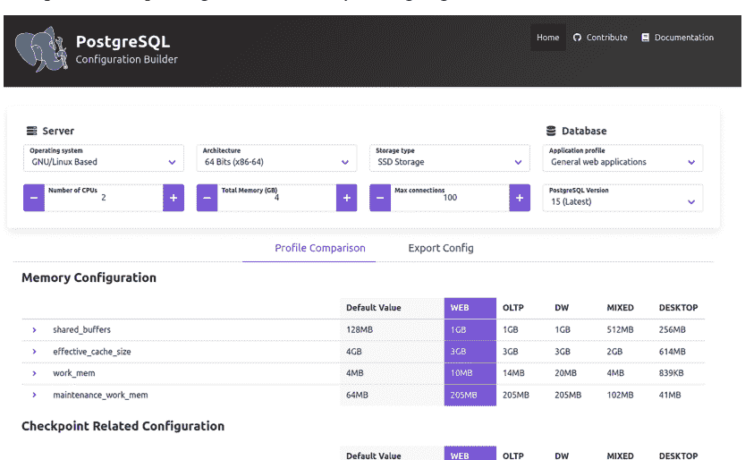
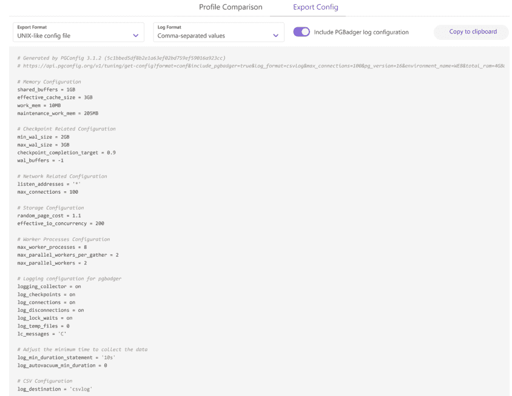
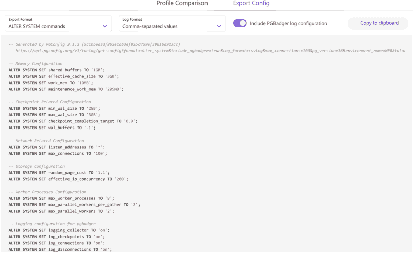

# 16

## Configuration and Monitoring

数据库管理员的一项职责是配置集群，使其对当前的工作负载和环境表现良好。配置并非静态的：大多数情况下，你会发现自己需要对配置进行更改，因此熟悉检查和更改集群配置非常重要。

另一个重要且部分与配置相关的任务是监控集群，以便了解系统实际的运行情况以及是否存在需要解决的瓶颈和问题。此类问题有时可以通过更改集群配置、使用不同的硬件（例如增加可用内存）以及修复可能导致瓶颈的应用程序来解决。

本章将向你展示如何管理和检查集群配置、从头生成配置、查找当前配置中的错误和失误，以及通过丰富的统计子系统交互式地监控集群活动。最后，你将发现一个非常强大且常用的扩展 pg_stat_statements，它允许你以极大的细节和灵活性监控集群活动。

本章将涵盖以下主题：

- Cluster configuration
- Monitoring the cluster
- Advanced statistics with pg_stat_statements

Let’s get started!

## Technical requirements

要完成本章，你需要了解以下内容：

- 如何在 PGDATA 目录中与配置文件交互
- 如何以数据库管理员身份连接到你的集群
- 如何针对系统目录执行 SQL 语句

本章示例可以在 chapter_16 Docker 镜像上运行，你可以在本书的 GitHub 仓库中找到它：https://github.com/PacktPublishing/Learn-PostgreSQL-Second-Edition。

## Cluster configuration

PostgreSQL 通过一组包含用于引导集群并使其运行的指令和值的文本文件进行配置。我们在整本书中已经了解了配置文件是如何处理的，但在本章中，我们将详细解释配置是如何管理的。

有三个主要配置文件构成了任何配置的 *starting point*：

- postgresql.conf 是主要的集群配置文件，包含启动集群、设置进程（如 WAL 发送者）和日志记录所需的所有数据，并配置集群如何接受连接（例如，在哪个 TCP/IP 地址上）。
- postgresql.auto.conf 是一个由集群自动生成和编辑的文件，其中包含超级用户从集群内部更改的参数。你永远不应手动编辑此文件，但可以使用文本编辑器检查它以读取其内容。
- pg_hba.conf 是用于允许或拒绝客户端连接到集群的文件。它在第 3 章 Managing Users and Connections 中有详细说明，并与用户和角色身份验证机制相关。

通常，上述两个文件都位于包含所有集群数据的 PGDATA 目录中，但某些操作系统可能会将此类文件放置在其他目录中；例如，通常 Debian GNU Linux 会将它们放置在 /etc/postgresql 中。

> 在本书的 Docker 镜像中，配置文件保存在 PGDATA 目录下，即 /postgres/16/data。

PGDATA 目录中通常还保存着其他配置文件，但此处不予讨论。本节主要致力于 `postgresql.conf`，即默认配置文件。

`postgresql.conf` 文件是一个文本文件，通常带有有用的注释，其中包含一组配置参数。每个参数都以 `key = value` 的形式表示，其中 key 是配置参数名称，value 是该参数的配置值。我们在前几章中见过一些配置参数。例如，`max_wal_senders = 2` 配置参数将 max_wal_senders 配置参数设置为 2。

每个配置参数必须位于单行上，所有以 `#` 符号开头的行都是注释，集群不会考虑这些注释。注释很有用，因为它们允许你添加有关特定配置意图的额外信息。例如，让我们看一下以下代码片段：

```
```conf
# set to 2 to allow pg_basebackup to work properly
max_wal_senders = 2
```
```

前面的示例清楚地提示了为什么参数被如此配置。你不需要在配置文件中放置注释，但记录你所做的事情以及原因是一个非常好的习惯。

参数可以被定义多次；在这种情况下，最后找到的定义是 PostgreSQL 使用的定义。

如果你不想配置特定参数，可以删除该参数的行，使其完全从配置文件中消失，或者在前面加上注释符号，将该行转换为纯注释。需要注意的是，如果参数未在文件中配置，因为它缺失或被注释掉了，那么它将采用其默认值。每个参数都有一个默认值，你必须查阅文档以了解每个默认值；然而，默认安装的配置文件包含所有可用参数，并附带解释其用途和默认设置的注释。

每个配置参数只接受特定的一组值，具体取决于配置参数本身的类型。主要来说，你可以遇到数值、字符串值和列表（以逗号分隔）；还有一些值可以用测量单位表示，例如时间，如 2ms（2 毫秒），或大小，如 2GB（2 千兆字节）。


# 检查所有配置参数

你可以通过对 pg_settings 特殊目录发出查询来检查来自实时系统的所有配置参数。该目录包含当前版本的 PostgreSQL 将接受的每个设置，以及默认值、当前值、参数目的的描述等等。

作为示例，通过以下查询，你可以收集有关每个配置参数的信息，包括它们的简短和长描述、默认值和当前值：

```
forumdb=> SELECT name, setting || ' ' || unit AS current_value, short_desc, extra_desc, min_val, max_val, boot_val, reset_val FROM pg_settings;
...
name          | authentication_timeout
current_value | 360 s
short_desc    | Sets the maximum allowed time to complete client authentication.
extra_desc    |
min_val       | 1
max_val       | 600
boot_val      | 60
reset_val     | 360
```

在前面的示例中，authentication_timeout 已被设置为 360 秒，如 setting 列所示，其值可在 1 秒到 600 秒的范围内调整；boot_val 是参数在未配置时将采用的默认值，设置为 60 秒。类似地，reset_val 列指示参数在更改后重置时将采用的值。

pg_settings 特殊目录还包含其他有用的信息，包括参数是从哪个文件和行号加载的。这些信息可用于快速找到配置参数在 postgresql.conf 文件或其他配置文件中设置的位置。作为示例，以下查询将显示每个参数是从哪里加载的：

```
forumdb=# SELECT name, setting AS current_value, sourcefile, sourceline, pending_restart FROM pg_settings;
...
name          | log_destination
current_value | stderr
sourcefile     | /postgres/16/data/postgresql.auto.conf
sourceline     | 4
pending_restart | f
```

正如你所见，在此示例安装中，log_destination 配置参数是从 /postgres/16/data/postgresql.auto.conf 文件加载的。这不是主要的 postgresql.conf 文件；它是一个 PostgreSQL 自动生成的用于处理从集群内部更改的配置参数的文件。postgresql.auto.conf 的使用将在本章后面变得清晰；目前，知道配置参数已从另一个文件加载并且 pg_settings 清楚地报告了这一点就足够了。

> 你需要拥有数据库超级用户权限才能收集额外信息，例如文件位置和行号。

pg_settings 特殊目录中可以获得的另一条重要信息是：如果在运行时更改参数会发生什么？根据参数的性质，更改可以立即应用，也可以延迟到等待特定事件甚至集群重启。pending_restart 列指示当前参数是否已从其启动时值更改以及该值是否已应用于集群。在前面的示例中，pending_restart 为 false，因此你看到的配置就是当前在集群上运行的有效配置。

查询 pg_settings 为你提供了了解当前配置状态所需的所有信息，但有一个快捷方式可以更快地获取参数的设置：SHOW 命令。特殊命令 SHOW 接受参数的名称并以人类可理解的形式报告该参数的值。作为示例，假设我们想检查 shared_buffers 内存值：

```
forumdb=> SHOW shared_buffers ;
shared_buffers
----------------
128MB
(1 row)
```

相同的信息显然可以从 pg_settings 中获得，使用更长的查询，并且需要将确切值转换为人类可读的形式（注意内存值以 8kB 块表示）：

```
forumdb=> SELECT name, setting, unit FROM pg_settings WHERE name = 'shared_buffers';
      name      | setting | unit
------------------+---------+------
shared_buffers | 16384   | 8kB
(1 row)
```

因此，如果你只需要快速查看配置参数，SHOW 是正确的命令，而如果你需要有关确切值、参数在配置文件中设置的位置等更准确和完整的信息，则应查询 pg_settings 目录。

# 查找配置错误

PostgreSQL 提供了一个非常有用的目录 pg_file_settings，它让数据库管理员可以一目了然地查看所有配置参数及其加载的文件，从而提供有关错误的信息。以下查询从目录中提取所有信息，修剪后的输出为我们提供了一些重要信息：

```
postgres=# SELECT name, setting, sourcefile, sourceline, applied, error FROM pg_file_settings where name = 'log_destination';
-[ RECORD 1 ]---------------------------------------------
name      | log_destination
setting   | stderr
sourcefile | /postgres/16/data/postgresql.conf
sourceline | 444
applied   | f
error     |
-[ RECORD 2 ]---------------------------------------------
name      | log_destination
setting   | csvlog
sourcefile | /postgres/16/data/postgresql.conf
sourceline | 818
applied   | f
error     |
```

```
- [ RECORD 3 ]-------------------------------------
name      | log_destination
setting   | stderr
sourcefile | /postgres/16/data/postgresql.auto.conf
sourceline | 4
applied   | t
error     |
```

正如你在上面的示例安装中所见，log_destination 配置参数已被多次加载：恰好三次，来自不同的源文件。已应用的是来自 /postgres/16/data/postgresql.auto.conf 文件第 4 行的配置设置，如 applied 列的状态所报告。如果参数包含错误，error 列将提供有关问题的提示。

在同一文件或不同文件中多次定义参数并不是错误，而是一种覆盖该参数的方式。特殊视图 pg_file_settings 有助于找出为什么文件中定义的参数未被加载以及哪些参数被其他分散的定义覆盖。

如果参数因包含错误而无法应用，error 列将为你提供有关问题的提示，而 applied 列将显示为 false 值。

# 嵌套配置文件

你不必将每个参数都配置在 postgresql.conf 文件中：你可以定义自己的微小且专注的配置文件，并指示 PostgreSQL 读取并将其内容添加到配置中。借助此功能，你可以为特定任务创建一组更小更干净的配置文件，从而使维护变得更简单。

PostgreSQL 提供三个主要指令来包含其他配置文件：

- include_file: 在配置中包含单个文件
- include_dir: 包含指定目录中的所有文件
- include_if_exists: 仅在文件存在时包含文件

最后一个指令非常方便，因为如果包含的文件不存在，PostgreSQL 将抛出错误，而使用 include_if_exists，集群不会警告你如果要包含的文件尚未创建。这对于配置管理很有用，例如，你可以设置一个包含多个文件的主配置文件，并仅将这些文件分发给真正需要此类配置的系统。

为了给出一个具体的例子，考虑一个名为 `memory.conf` 的文件，它放置在 PGDATA 目录中，其内容如下：

- `shared_buffers = 321 MB`
- `work_mem = 16 MB`

然后在 `postgresql.conf` 文件末尾添加以下指令：

```
```conf
include_if_exists = 'memory.conf'
```
```

这样，一旦集群重启，`postgresql.conf` 文件将指示集群加载另一个名为 `memory.conf` 的配置文件，而该文件又会覆盖几项内存设置（请记住，配置参数的最后一次定义是被选为应用的定义）。最终结果可以通过查询 `pg_file_settings` 目录来查看：

```
```text
postgres=# SELECT * FROM pg_file_settings WHERE name IN ('shared_buffers', 'work_mem');

                    sourcefile              | sourceline | seqno |      name       |
setting | applied | error
---------------------------------------------+------------+-------+-----------------+
---------------------------------------------+----------+-------+-----------------
/postgres/16/data/postgresql.conf |    127 |   3 | shared_buffers |
128MB     | f       |
/postgres/16/data/memory.conf     |      1 |  15 | shared_buffers |
321MB     | t       |
/postgres/16/data/memory.conf     |      2 |  16 | work_mem       |
16MB      | t       |
(3 rows)
```
```

正如你所见，`shared_buffers` 参数已被覆盖并从新创建的 memory 文件中应用，而 `work_mem` 在默认安装中被注释掉了，也已从包含的文件中应用（没有覆盖任何其他定义）。

# 配置上下文

每个配置参数都属于一个所谓的 **context**，该组定义了 *何时* 可以应用对参数的更改。几个参数可以在集群生命周期期间更改并生效。然而，其他参数则不能，需要重启集群；配置参数的上下文有助于系统管理员了解更改何时生效。


配置上下文可以从 pg_settings 目录中提取，如以下示例所示：

```
forumdb=> SELECT distinct context FROM pg_settings ORDER BY context;
    context
-----------------
 backend
 internal
 postmaster
 sighup
 superuser
 superuser-backend
 user
(7 rows)
```

如你所见，允许的配置上下文如下：

- internal：此配置值取决于 PostgreSQL 源代码，并在编译时确定，因此除非你决定从头编译，否则无法更改。例如，每个内存页的大小都在源代码中定义。
- postmaster：此进程负责获取更改。换句话说，整个集群（及其主进程 postmaster）必须重启才能更改此项。
- sighup：通过此项，集群在收到挂断信号时将感知到更改，通常是操作系统服务的重新加载。
- superuser-backend 和 backend：更改将应用于客户端和管理员连接。这样的更改将从两种类型的下一个连接开始即可感知。
- user 和 superuser：这些更改将立即应用于当前连接，无论它是无特权连接还是超级用户连接。

## 主要配置设置

PostgreSQL 包含大量配置选项，描述所有选项需要一整本书。此外，配置取决于许多不同因素，包括集群工作负载和连接并发性。许多参数会为其他参数暗示不同的行为。因此，不可能提供简单有效的分步配置指南，但可以提供一些建议来帮助你开始调整集群。

在以下小节中，你将了解主要配置参数，具体取决于它们所属的主要类别。在应用更改之前，请花时间清楚地理解每个设置的作用，并记住配置上下文可能会阻止你立即看到结果。

## WAL 设置

WAL 对于集群正常工作以及能够从崩溃中恢复至关重要。因此，与 WAL 相关的设置对集群的生命周期至关重要。

主要设置如下：

- `fsync` 告诉集群在每次执行 COMMIT 时发出一次操作系统 `fsync(2)` 调用；也就是说，每当必须将内容存储到 WAL 段中时。
- `wal_level` 表示集群需要在 WAL 段中保留的信息量。
- `wal_sync_method` 告诉 PostgreSQL 使用哪个有效的 `fsync(2)` 系统调用。
- `synchronous_commit` 告诉 PostgreSQL 每个 COMMIT 是否必须跟随立即且同步的 `fsync(2)`，还是刷新可以由 `wal_writer_delay` 定义的时间延迟。
- `wal_writer_delay` 和 `wal_writer_flush_after` 确定一个名为 WAL writer 的进程在异步 COMMIT 模式下必须多久将数据刷新到磁盘一次。在每次 `wal_writer_delay` 毫秒或累积 `wal_writer_flush_after` 兆字节数据后，异步提交将被刷新到磁盘。
- `checkpoint_timeout`、`checkpoint_completion_target` 和 `max_wal_size` 控制检查点，如第 11 章《事务、MVCC、WAL 和检查点》中所讨论的，我们在解释事务和 WAL 时说明了这一点。

`fsync` 设置必须保持为开启，因为禁用它会使集群面临数据丢失的风险：文件系统不会在 COMMIT 时将数据刷新到磁盘，因此 PostgreSQL 无法保证数据已真正存储在磁盘上，在崩溃（例如断电）情况下，数据可能会丢失。设置此选项为关闭的场景非常少，但请记住（如果你确实找到了这样的理由）禁用此选项仍会使你的集群无法承受崩溃。

`wal_level` 设置表示 PostgreSQL 必须在 WAL 段中累积多少信息。WAL 的主要用途是使集群能够在崩溃后存活，但在复制场景中，WAL 也用于将更改传播到其他集群。

wal_level 设置可以设为 minimal，即单个集群拥有所有用于存活崩溃的信息，也可以设为 replica（默认值），这使得 WAL 也可用于物理复制场景，最后可以设为 logical，这使得 WAL 也包含用于逻辑复制场景的信息。

wal_sync_method 允许管理员配置用于同步脏缓冲区的特定操作系统调用。所有 POSIX 操作系统都实现了 fsync(2)，但其中一些提供了特殊变体，具体取决于文件系统，其行为更快或更好。可以通过 wal_sync_method 指定要使用的系统调用的确切名称。通常，PostgreSQL 会随操作系统一起提供适当的配置。

但你如何发现最适合你的操作系统的最佳（或只是可用的）fsync(2) 实现？你可以在机器上运行 pg_test_fsync 程序，以对你可能使用的可能方法以及最佳方法做出合理猜测。例如，在 FreeBSD 机器上，该程序提供以下输出：

```
$ pg_test_fsync
5 seconds per test

O_DIRECT supported on this platform for open_datasync and open_sync.

Compare file sync methods using one 8kB write:
(in wal_sync_method preference order, except fdatasync is Linux's default)
    open_datasync                         n/a
    fdatasync                     6845.727 ops/sec    146 usecs/op
    fsync                         3685.769 ops/sec    271 usecs/op
    fsync_writethrough                    n/a
    open_sync                     2521.228 ops/sec    397 usecs/op
...
```

你应该比较可用选项并选择最快的那个。因此，在前面的示例中，wal_sync_method = open_datasync 是最佳选择。

synchronous_commit 是一个多选选项，表示在向发出 COMMIT 的事务返回“成功”状态之前，有多少 WAL 必须写入磁盘。默认情况下，此设置的值为 on，表示在事务被允许成功之前每个位都必须命中磁盘。

将参数设为 off 意味着即使 WAL 未刷新到磁盘，事务也会成功。与 fsync 设置不同，将 synchronous_commit 设为 off 是安全的，并且不会导致任何数据丢失，因为异步提交由 wal_writer_delay 控制，这意味着事务将被合并，但时间会晚一些。此参数还有其他值，所有这些都意味着 on 行为：local、remote_apply 和 remote_write。这些设置只有在复制场景中才有意义，当此集群充当主节点并由一个（或多个）从属集群跟随（复制）时。在此场景中，local 意味着只要主节点已将每个位刷新到磁盘，事务就会成功（即默认的 on 行为）；另一方面，remote_write 会等待备库确认它们已接收到相同的 WAL 信息并将复制它，这意味着主节点已合并事务，备库也将很快这样做。最后，remote_write 会等待事务成功，直到主节点和备库都将所有数据刷新到磁盘。

## 内存相关设置

PostgreSQL 利用系统的易失性 RAM 来缓存来自永久存储的数据，并管理将要稍后存储的数据。

与内存管理相关的主要设置如下：

- shared_buffers 是 PostgreSQL 将用于缓存数据的内存量。
- work_mem 是 PostgreSQL 将按需提供以执行特定数据活动所用的内存量。
- hash_mem_multiplier 用于确定连接可用于基于哈希操作的内存阈值。
- maintenance_work_mem 是 PostgreSQL 为其内部操作保留的内存量。
- wal_buffers 是用于 WAL 段的缓存。

shared_buffers 可能是这里最重要的设置，因为它决定了 PostgreSQL 将使用的总内存量。此内存将专门提供给 PostgreSQL 及其派生进程；该内存将不会提供给同一台机器上运行的其他服务。通常，你应该从系统总 RAM 的 25% 到 45% 之间开始。值过低会使 PostgreSQL 从永久存储加载和刷新数据，而值过高会使 PostgreSQL 与操作系统的文件系统缓存竞争，导致可能的性能问题。


work_mem 是每个连接在执行特定数据重排操作时可使用的内存量，例如 SORT 或哈希连接中进行的操作。在处理基于哈希的任务时，一个连接可以在进程开始换出到磁盘之前消耗 work_mem * hash_mem_multiplier 的内存。在任何情况下，当一个进程无法再使用更多内存时，它将开始换出到磁盘——例如，将内存中的 SORT 转换为磁盘上的合并 SORT。

maintenance_work_mem 确定了每个会话用于特别密集的命令（如 VACUUM 和 CREATE INDEX）的内存量。由于在一个连接中同时只能有一个此类命令处于活动状态，你可以根据需要服务的管理员连接数量来提高该值。

wal_buffers 可能是你最容易调整的内存相关设置：它指示用于缓存 WAL 段的内存量。由于 WAL 段通常以 16 兆字节的块写入，这正是此类设置的理想值。

## 进程信息设置

PostgreSQL 是一个多进程系统，它为每个传入连接生成一个进程。有几个设置可以帮助从操作系统的角度监控每个与 PostgreSQL 相关的进程：

- update_process_title 使每个进程报告它正在做什么；例如，当使用 ps(1) 和 top(1) 等操作系统工具查询时，它正在执行的查询。
- cluster_name 是一个助记名称，用于识别每个进程所属的集群，以防同一台机器上运行多个集群。

值得注意的是，这些设置可能会使系统在某些操作系统上运行变慢，例如 FreeBSD。

日志相关设置已在第 14 章《日志记录和审计》中详细解释，因此在此不再讨论。

## 网络相关设置

通常，PostgreSQL 在 TCP/IP 地址上监听传入连接，该地址由一组网络相关设置指定。主要设置如下：

- listen_addresses 指定要监听的 TCP/IP 地址。
- port 指定 postmaster 等待传入连接的 TCP/IP 端口。
- `max_connections`、`reserved_connections` 和 `superuser_reserved_connections` 指定允许的传入连接数。
- `authentication_timeout` 和 `ssl` 表示身份验证超时和加密模式。

`listen_addresses` 可以包含多个地址，用逗号分隔，以防服务器是多宿主的。它甚至可以指定为特殊值 *，表示服务器应监听所有可用地址。`port` 指定 TCP/IP 端口号，默认为 5432。

`max_connections` 是传入连接的最大允许数：如果达到此阈值，集群将不再允许更多连接。超级用户连接计为 `superuser_reserved_connection`，这是因为在紧急情况下，超级用户必须仍有一种方式连接到集群。最后，`reserved_connections` 统计了具有特殊角色 `pg_use_reserved_connection` 的用户建立的连接数，并表示一组特殊用户（非超级用户）拥有保留的连接槽。因此，普通用户可用的空闲连接数为 `max_connections - superuser_reserved_connection - reserved_connections`。

`authentication_timeout` 是身份验证尝试在过期前的时长，而 `ssl` 使服务器能够在连接上处理 SSL 握手（此处不解释 SSL）。

> 有很多参数可以微调 SSL 和身份验证阶段，但本书未涵盖，因为它们也需要对这些主题有深入的背景知识。

## 归档和复制设置

有不同的归档和复制设置，处理集群如何归档其 WAL 以及如何作为主节点或从节点与其他集群通信。所有设置将在 *第 17 章，物理复制* 和 *第 18 章，逻辑复制* 中详细介绍，这里仅简要列出：

- `wal_level`（已在前一节讨论）表示 WAL 中的信息将如何使用。这可以是 `minimal`（用于独立系统）、`replica`（用于复制系统）或 `logical`（用于逻辑复制）。
- `archive_mode`、`archive_command`、`archive_library` 和 `archive_timeout` 管理归档模式——即将 WAL 存储到其他位置以进行时间点恢复或复制。
- `primary_conninfo` 和 `primary_slot_name` 用于确定从备节点到主节点的连接。
- `hot_standby` 在复制系统上使用时，允许只读查询。
- `max_standby_archive_delay` 和 `max_standby_streaming_delay` 定义在备机上与主节点上的某些其他操作冲突的查询在被取消之前可以等待的时间。
- `recovery_min_apply_delay` 在备节点上引入延迟，以便它可以以时间偏移的方式跟随主节点。
- `max_replication_slots` 和 `max_wal_senders` 用于定义将接受并使用的复制槽的数量以及将管理复制的进程数量。
- `synchronous_standby_names` 定义哪些节点在复制中被视为同步的，因此主节点在应用更改之前必须收到持续反馈。

这些设置和其他复制相关设置将在 *第 17 章，配置和监控* 和 *第 18 章，复制* 中讨论。

## Vacuum 和 autovacuum 相关设置

有不同的设置可用于定义和调整 vacuum 和 autovacuum 设置。这些已在 *第 11 章，事务、MVCC、WAL 和检查点* 中讨论。

## 优化器设置

PostgreSQL 优化器采用基于成本的方法。可以调整这些成本，如 *第 13 章，查询调优、索引和性能优化* 中所述。

## 统计收集器

PostgreSQL 利用 **统计收集器** 来收集有关集群中发生的情况的事实，正如你将在本章后面的 *监控集群* 部分学到的那样。

由于收集这些数字对运行时影响很小，因此可以完全排除收集，或者过滤统计收集器以仅收集你真正感兴趣的事实。主要设置如下：

- `track_activities` 允许其他进程监控当前正在执行的命令或查询。
- `track_counts` 收集有关表和索引使用的计数信息。
- `track_functions` 收集有关函数和存储过程使用的统计信息。
- `track_io_timing` 允许我们统计在不同输入/输出操作中花费的时间。
- `stat_temp_directory` 是用于统计收集的临时存储的（相对）目录名。

## 从实时系统修改配置

可以通过数据库连接使用 ALTER SYSTEM 命令从内部修改集群配置。

ALTER SYSTEM 为我们提供了一种以 SQL 方式设置参数值的方法，并且该参数将被追加到特殊文件 postgresql.auto.conf 中，该文件位于 PGDATA 目录内。postgresql.auto.conf 文件在服务器启动或发出重载信号（HUP）时会自动加载，因此 postgresql.auto.conf 中的参数将优先于 postgresql.conf 中的参数，最终结果是更改将像你手动编辑 postgresql.conf 文件一样应用。

ALTER SYSTEM 只能由数据库管理员执行。例如，假设你发出以下命令：

```
forumdb=# ALTER SYSTEM SET archive_mode = 'on';
ALTER SYSTEM
```

最终结果将是 postgresql.auto.conf 文件如下所示：

```
$ cat /postgres/16/data/postgresql.auto.conf
# Do not edit this file manually!
# It will be overwritten by the ALTER SYSTEM command.
archive_mode = 'on'
```


正如你所见，已更改的参数已按你手动编辑的方式放置在文件中。该文件包含一条警告横幅，说明不应手动编辑它，因为系统不会考虑你的更改并会覆盖其内容。

你也可以将 DEFAULT 指定为选项的值，这样该选项就会从 postgresql.conf.auto 文件中移除。ALTER SYSTEM 也支持 RESET 以将设置重置为之前的值，或使用 RESET ALL 将 postgresql.auto.conf 中的所有设置全部重置。

假设我们仅更改了 archive_mode，如前例所示，以下两个命令是等价的，并且会将已更改的设置从 postgresql.auto.conf 文件中移除：

```
forumdb=# ALTER SYSTEM SET archive_mode TO DEFAULT;
ALTER SYSTEM
forumdb=# ALTER SYSTEM RESET archive_mode;
ALTER SYSTEM
```

以下输入将移除 postgresql.auto.conf 中的所有已更改设置：

```
forumdb=# ALTER SYSTEM RESET ALL;
ALTER SYSTEM
```

## 配置生成器

与其从带注释的 postgresql.conf 文件开始并自行调优，你可以利用自动调优系统从头开始获取配置。这样的配置可能已经足够好，或者至少可作为进一步改进的起点，具体取决于你的需求以及生成该配置的工具的好坏。

一个不错的配置系统是 PGConfig，这是一个在线系统，可在 https://www.pgconfig.org 上使用，你可以在其中指定承载集群的主机的主要设置，例如内存、硬盘类型、并发等。

有了这些细节，如以下屏幕截图所示，系统可以根据你打算将集群用于的工作负载生成不同的配置：



图 16.1：PGConfig PostgreSQL 自动配置生成器

该工具允许你选择多个预打包的配置，例如联机事务处理（OLTP）或联机分析处理（OLAP），甚至是 Web 应用程序。

一旦你选择了最适合工作负载的配置，你可以将该配置导出为 postgresql.conf 文件，或作为一组 ALTER SYSTEM 语句以 SQL 交互式脚本的形式执行，以便将配置应用到你的集群：



图 16.2：自动生成的配置示例

正如你所见，结果是一堆可复制粘贴到“空白”配置文件中的配置参数。其思路是从此配置开始并在此基础上继续调优。

以下屏幕截图显示的是完全相同的配置，但以 ALTER SYSTEM 语句的形式生成；也就是说，你可以根据需要将其作为 SQL 脚本应用：



*图 16.3：基于 ALTER SYSTEM 命令的自动生成配置示例*

PGConfig 只是你可以用来获取可开始工作的自定义配置的一个选项。当然，没有必要使用它，因为 PostgreSQL 自带默认配置，而且该配置生成器并不是提供集群最佳配置的“银弹”。无论如何，你都需要根据需求、工作负载和硬件来调优和修复参数以优化集群。

在下一节中，你将了解如何监控集群，以及如何发现可通过调优查询或集群配置来修复的瓶颈和问题。

## 监控集群

监控集群允许你在任何给定时间点了解集群正在做什么，并可能据此采取行动和反应，以避免数据库性能和可用性下降。PostgreSQL 提供了一套丰富的目录，允许数据库管理员仅通过发出 SQL 语句和查询来监控整体活动。

```
query          | delete from tags;
granted        | t
mode           | RowExclusiveLock
...
-[ RECORD 9 ]--------------------------------------------
--
username       | luca
application_name | psql
datname        | forumdb
query          | insert into tags( tag ) values( 'FreeBSD' );
granted        | t
mode           | ExclusiveLock
```

用户 luca 对 forumdb 数据库有两个连接，一个连接已获取锁以删除元组，而另一个正在向 tags 表中插入元组。granted 列表示锁是否已获取，因此仅选择未授予的锁是获取阻塞查询建议的一个良好起点。mode 列指示查询试图获取何种类型的锁。

借助这些建议，并且再次感谢与 pg_stat_activity 的精确连接，你可以找到阻塞的查询，如以下示例所示（这是之前描述场景的延续）：

```
forumdb=# SELECT query, backend_start, xact_start, query_start,
    state_change, state,
    now()::time - state_change::time AS locked_since,
    pid, wait_event_type, wait_event
  FROM pg_stat_activity
 WHERE wait_event_type IS NOT NULL
 ORDER BY locked_since DESC;
...
-[ RECORD 6 ]--------------------------------------------
query          | insert into tags( tag ) values( 'FreeBSD' );
backend_start  | 2023-09-14 08:26:57.762887+02
xact_start     | 2023-09-14 08:27:00.017983+02
query_start    | 2023-09-14 08:27:14.745784+02
state_change   | 2023-09-14 08:27:14.775535+02
state          | idle in transaction
```

```
```text
locked_since    | 00:07:33.411832
pid             | 60239
wait_event_type | Client
wait_event      | ClientRead
```
```

正如你所见，该查询已等待 7 分钟 33 秒（`locked_since` 列），但查询处于事务中空闲状态（state 列），并且正在等待来自客户端的输入（`wait_event` 和 `wait_event_type` 列）。换句话说，该查询正在等待用户完成事务（提交或回滚）。

利用 `pg_locks` 可以帮助你跟踪事务的演变及其争用情况，并决定如何终止阻塞其他工作负载的查询。

还有一个名为 `pg_blocking_pids()` 的通用函数，它接受后端进程标识符作为参数，并返回阻塞该进程的进程标识符列表。

## 检查数据库

你可以通过查询 `pg_stat_database` 特殊目录来获取有关数据库状态的详细信息。该目录提供有关 COMMIT 和 ROLLBACK 事务、死锁和冲突的信息。请注意，死锁和回滚是数据库中的自然事件，但如果数字快速增长，这可能意味着存在应用程序错误或有客户端试图在数据库中做错误的事情从而被迫回滚。

例如，通过使用以下查询，你可以获取有关数据库的详细信息：

```
```sql
forumdb=# SELECT datname, xact_commit, xact_rollback, blks_read,
conflicts, deadlocks,
        tup_fetched, tup_inserted, tup_updated, tup_deleted, stats_reset
        FROM pg_stat_database;
...
-[ RECORD 6 ]+-----------------------------
datname       | forumdb
xact_commit   | 802
xact_rollback | 9
blks_read     | 1800
conflicts     | 0
deadlocks     | 0
tup_fetched   | 32977
```
```

```
tup_inserted | 1391
tup_updated | 46
tup_deleted | 0
stats_reset |
```

正如你所见，forumdb 数据库没有任何冲突或死锁，已提交事务的数量（xact_commit 列）远高于已中止事务的数量（xact_rollback 列）。因此，我们可以假设数据库正常，并且应用程序发出的查询良好。

最后一列 stats_reset 特别重要，因为它指示数据库的统计信息是否已被重置，即删除。了解统计信息重置以来经过了多少时间有助于验证数据库。如果该列为空，则表示数据库统计信息从未被手动重置过。

## 检查表和索引

pg_stat_user_tables 和 pg_stat_user_indexes 特殊目录提供有关表或索引使用情况的详细信息，例如元组数量、读写次数等。

为了更好地理解，考虑一个表中某些事务已被删除或更新并插入了新记录的表；以下查询提供有关该表状态的详细信息：

```
forumdb=# SELECT relname, seq_scan, idx_scan,
    n_tup_ins, n_tup_del, n_tup_upd, n_tup_hot_upd,
    n_live_tup, n_dead_tup,
    last_vacuum, last_autovacuum,
    last_analyze, last_autoanalyze
    FROM pg_stat_user_tables;

-[ RECORD 1 ]---------------------------------------------
relname | tags
seq_scan | 20
idx_scan | 0
n_tup_ins | 100007
n_tup_del | 63
```


| n_tup_upd | 200030 |
| n_tup_hot_upd | 106 |
| n_live_tup | 100000 |
| n_dead_tup | 50000 |
| last_vacuum | |
| last_autovacuum | 2023-09-15 15:13:47.424223+00 |
| last_analyze | |
| last_autoanalyze | 2023-09-15 15:13:47.60569+00 |

`last_vacuum`、`last_analyze`、`last_autovacuum` 和 `last_autoanalyze` 列对于理解手动或自动清理和分析是否在该表上运行特别重要；这些信息对于理解自动守护进程是否正常工作可能至关重要。`n_live_tup` 列根据 MVCC（参见*第11章，事务、MVCC、WAL和检查点*）报告当前可见的元组，而 `n_dead_tup` 列报告不再可见但仍然占用空间、但将被手动或自动清理回收的元组数量。

其他列几乎不言自明，`seq_scan` 和 `idx_scan` 分别是表通过顺序扫描或通过可用索引之一被访问的次数；`n_tup_ins`、`n_tup_upd` 和 `n_tup_del` 分别提供了有关新插入多少个元组以及更新或删除了多少个元组的信息。`n_tup_upd_hot` 列报告通过一种称为 **仅堆元组（HOT）** 的机制原地更新的元组数量，而不是创建新元组。

`pg_stat_user_indexes` 特殊目录提供了有关现有索引使用情况的详细信息。特别是，`idx_scan`、`idx_tup_read` 和 `idx_tup_fetch` 字段指定了索引被使用的次数、读取了多少索引元组，以及借助索引获得了多少表元组。有关更多信息，请参见*第13章，查询调优、索引和性能优化*。

还有其他成对的目录，其名称中包含“all”或“sys”，表示它们引用所有可用的表（包括 PostgreSQL 内部表），或者仅引用后者（系统表）。因此，`pg_stat_all_tables` 与 `pg_stat_user_tables` 相同，但也包含系统表的信息，这些信息保存在 `pg_stat_sys_tables` 中。`pg_stat_all_indexes` 也是如此；也就是说，它是 `pg_stat_user_indexes` 和 `pg_stat_sys_indexes` 的并集。

## 更多统计信息

PostgreSQL 包含一组非常丰富的与统计相关的目录，由于篇幅限制，这里无法全部描述。

其中一些最重要的事项包括：

- `pg_stat_replication`、`pg_stat_replication_slots`、`pg_stat_wal_receiver` 和 `pg_stat_subscription` 收集有关集群副本状态的信息。
- `pg_stat_bgwriter` 获取有关输入/输出的信息。
- `pg_stat_archiver` 获取有关 WAL 归档方式的信息。
- `pg_statio_user_tables`、`pg_statio_user_indexes` 以及相关的 `pg_statio_all_tables` 和 `pg_statio_all_indexes` 提供表或索引级别的输入/输出信息，指示缓冲区缓存的命中数和未命中数，以及从存储中读取新页面的情况。
- `pg_stat_database` 和 `pg_stat_database_conflicts` 提供有关数据库状态的信息，包括已执行的事务、冲突、回滚等。

还有大量的*进度*统计信息，仅显示正在进行的操作及其进度状态。您最可能想要使用的进度统计信息包括：

- `pg_stat_progress_analyze` 和 `pg_stat_progress_vacuum` 分别提供有关任何 ANALYZE 或 VACUUM 操作的信息。
- `pg_stat_progress_cluster` 提供有关任何 CLUSTER 或 VACUUM FULL 操作进度的信息。
- `pg_stat_progress_copy` 提供有关任何 COPY 命令的信息，因此对于与 pg_dump 相关的活动也很有用。
- `pg_stat_progress_create_index` 显示索引创建的执行情况。
- `pg_stat_progress_basebackup` 显示有关基础备份的信息，这是一种复制正在运行的集群的物理方式。

您应该花时间熟悉所有统计目录，以便能够自信地监控您的集群。

在下一节中，您将了解一个非常方便的扩展，它可以帮助您管理集群并掌控集群活动。

## 使用 pg_stat_statements 的高级统计

虽然 PostgreSQL 统计收集器功能丰富且成熟，但监控连接活动可能有点棘手，因为 `pg_stat_activity` 目录不提供历史信息。例如，正如我们之前解释的，将只有单个元组包含最后执行的语句，因此不会提供历史记录或扩展详细信息。

`pg_stat_statements` 扩展解决了这个问题，它提供了一个单一视图，为您提供已执行语句的完整历史、执行时间和其他在自省时非常有用的小细节。此外，`pg_stat_statements` 提供了同一语句已执行次数的计数，这提供了查询为了优化目的可能需要关注的重要信息。

几个监控工具要求安装 `pg_stat_statements` 以收集数据。

在以下小节中，您将学习如何安装此扩展并使用它。

### 安装 pg_stat_statements 扩展

此扩展随 PostgreSQL 一起提供，因此您唯一需要做的就是配置数据库集群以使用它。由于 `pg_stat_statements` 需要共享库，您需要配置配置（postgresql.conf 文件）中的 `shared_preload_libraries` 设置并重启集群。

第一步是在 postgresql.conf 中进行以下设置：

```
shared_preload_libraries = 'pg_stat_statements'
```

或者使用如下的 ALTER SYSTEM：

```
ALTER SYSTEM SET shared_preload_libraries to 'pg_stat_statements';
```

由于 `pg_shared_preload_libraries` 是一个上下文为 postmaster 的参数，您需要重启集群以应用更改。

`pg_stat_statements` 收集有关您所有集群的信息，但它只会将此类信息导出到您在其中创建扩展的数据库中，在我们的示例中是 forumdb 数据库：

```
$ psql -U postgres -c "CREATE EXTENSION pg_stat_statements;" forumdb
CREATE EXTENSION
```

该扩展现在可以使用了。


### 使用 pg_stat_statements

一旦启用 `pg_stat_statements`，它就会开始收集信息。该扩展的运行时开销非常小，因此您也可以在生产系统中保持启用它。

由于 `pg_stat_statements` 收集来自整个集群的数据，因此将 `pg_stat_statements` 特殊视图与其他目录（如 `pg_database` 和 `pg_authid`）连接起来有助于分别收集有关语句在其中执行的数据库和用户名的信息。以下查询提供了示例：

```sql
forumdb=# SELECT auth.rolname,query, db.datname, calls, min_exec_time,
max_exec_time
    FROM pg_stat_statements
        JOIN pg_authid auth ON auth.oid = userid
        JOIN pg_database db ON db.oid = dbid
ORDER BY calls DESC;
...
rolname       | postgres
query         | SELECT count(*) FROM forum.posts WHERE last_edited_on >=
CURRENT_DATE - $1
datname       | forumdb
calls         | 17
min_exec_time | 0.037292
max_exec_time | 0.04165
```

前面的示例显示，自 `pg_stat_statements` 开始收集数据以来，该查询已执行了 17 次，运行时间在 0.037 到 0.042 毫秒之间。根据每个查询的频率和计时，通过索引检查和优化该查询可能很有意义。

在上面的示例中，查询被报告为*规范化查询*：每个参数，即使是字面量，都被移除并替换为占位符 $1（其他参数将被标记为 $2、$3，依此类推）：`SELECT count(*) FROM forum.posts WHERE last_edited_on >= CURRENT_DATE - $1`。


The idea is to track a group of queries that have the same normalized text so that you can get an idea of how many times such a group has been executed, even if with different arguments.

The `pg_stat_statements` special view keeps track of the most frequently executed queries up to the value of the configuration parameter `pg_stat_statements.max`, which defaults to 5000. Once the limit is reached, the least executed queries will be discarded in favor of fresh new ones. This ensures that the space occupied by the `pg_stat_statements` table will remain pretty much constant without any regard to the number of executed statements.

The `pg_stat_statements` view provides many fields that cannot be discussed in detail here, ranging from planning time to buffers and I/O activity. This extension is very useful when you want to deal with the workload of your cluster.

## Resetting data collected from pg_stat_statements

It is possible, at any given time, to reset all the data that’s been collected by the extension that’s invoking the `pg_stat_statements_reset()` function as a database administrator. The function will erase all the data that’s been collected and will allow the extension to collect new data from scratch. This can be useful when you want to test new configurations or hardware without having the collected data be biased due to old statistics:

```
```sql
formundb=# SELECT pg_stat_statements_reset();
```
```

By default, pg_stat_statements data is kept across clean database shutdowns and restarts.

## Tuning pg_stat_statements

The extension allows database administrators to limit the amount of data that’s collected. In particular, you can tune the following parameters in your postgresql.conf configuration file:

- `pg_stat_statements.max` indicates the maximum number of individual queries to collect.
- `pg_stat_statements.save` is a Boolean that indicates whether the content of the collected data must survive a clean system reboot. By default, this setting is true.
- `pg_stat_statements.track` allows you to specify the nesting level to track. With the top value, the extension will collect data about the query that was issued directly within clients and within tracking nested statements. This is triggered by the execution of other statements (for example, in function statements). With the value of all, the extension will trigger every statement and its descendants, while with none, no data will be collected about user statements.
- `pg_stat_statements.track_utility` tracks all statements that are not in SELECT, INSERT, UPDATE, or DELETE – in other words, “non-ordinary” statements. By default, this setting is on.

Usually, you don’t have to tune these settings since `pg_stat_statements` comes already configured to track what most use cases need.

## Summary

In this chapter, you learned how PostgreSQL manages configuration through a main text file, `postgresql.conf`, that can be split into smaller files, including the automatically loaded `postgresql.auto.conf`, which is always loaded at the end of the configuration process. Every configuration option can be edited in the configuration file and can be inspected within the database thanks to dedicated system catalogs. This allows the database administrator to not only have a clear understanding of the currently running configuration but to also search for configuration errors and incorrectly loaded settings.

PostgreSQL also collects *statistics*; that is, runtime data that was gathered during the cluster’s operational time. Those statistics can help an administrator understand what is going on, or what happened in the near past, in the cluster. Thanks to a different set of catalogs, which was exposed in this chapter, you learned how to dig into the details of all the information that PostgreSQL has collected for you. Being able to track and analyze what single applications, users, and connections are doing in a specific moment against the cluster provides database administrators with a great way to fix bottlenecks and other problems, thus helping to improve the cluster experience.

Finally, you learned about the `pg_stat_statements` extension, thanks to which it is possible to collect historical data about query execution and timing so that it is possible to apply optimization and deep analysis of the cluster activity.

Now that you’ve understood how to configure and monitor your cluster, it is time to learn how to replicate this. The next chapter will show you how to perform physical replication by configuring the cluster appropriately.

## Verify your knowledge

- What is a configuration context?

A configuration context defines how the cluster will perceive changes to a configuration parameter – for example, only at boot time or at the next incoming connection. See the *Configuration contexts* section for more details.

- What is the difference between the catalogs pg_settings and pg_file_settings?

The pg_settings catalog shows the values of every configuration parameter, as well as its admitted and valid values; the pg_file_settings catalog shows where (i.e., in which file and at which line) a configuration parameter has been found and loaded. See the *Inspecting all configuration parameters* section for more details.

- Besides editing configuration files, how can you modify the cluster configuration via SQL statements?

You can issue an ALTER SYSTEM command to change the values of a configuration setting. Changes will be written into the postgresql.auto.conf file. See the *Modifying the configuration from a live system* section for more details.

- How can you get information about running connections, transactions, and queries?

The special catalog pg_stat_activity provides information about every single backend process, its running (or last run) query, and its transaction state. See the *Information about running queries and connections* section for more details.

- What does the pg_stat_statements extension do?

The pg_stat_statements extension provides a historical view of the most commonly repeated queries, with information about the running times, the number of executions, and other details. See the *Advanced statistics with pg_stat_statements* section for more details.

## References

- PostgreSQL cluster configuration, official documentation: https://www.postgresql.org/docs/current/runtime-config.html
- PGConfig online configurator: https://www.pgconfig.org/
- PostgreSQL statistics collector official documentation: https://www.postgresql.org/docs/current/monitoring-stats.html
- PostgreSQL pg_stat_statements official documentation: https://www.postgresql.org/docs/current/pgstatstatements.html

## Learn more on Discord

To join the Discord community for this book – where you can share feedback, ask questions to the author, and learn about new releases – follow the QR code below:

https://discord.gg/jYWCjF6Tku


