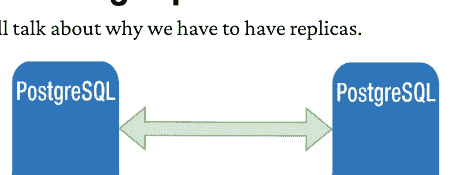
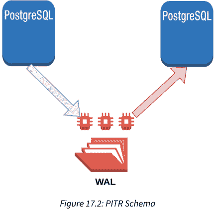
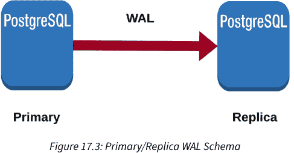
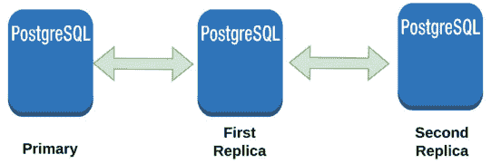

## 17

## Physical Replication

When a database, after passing the development and testing phases, arrives in production, the first problem that the DBA must address is managing replicas. Replicas must be managed in real time and automatically updated. Replicas allow us to always have a copy of our data updated in real time on another machine. This machine can be placed in the same data center as our data or in a different one. This chapter differs from all that we have seen previously in that we will talk about physical replication. In PostgreSQL, starting from version 9.x, it is possible to have physical replication natively. We will talk about what physical replication means, and we will see how to create a replica server and how to manage it. We will also see that it is possible to have synchronous or asynchronous replicas and that there can be multiple replicas of the same database, as well as the possibility of having replicas in a cascade.

In this chapter, we will return to the topic of WAL, something we have already discussed in Chapter 11, Transactions, MVCC, WAL, and Checkpoints. In order to execute the commands that will be shown in this chapter, we need to install a PostgreSQL server on two machines, or install two instances of PostgreSQL on the same machine but running on different ports. In the rest of the chapter, it will be presumed that you have two PostgreSQL installations available on different machines, to better simulate the situation of a real production environment, and starting from this chapter, we will learn how to install and configure a physical replication.


在本章中，当我们讨论如何安装复制系统时，我们将不使用 Docker 容器；这是因为要安装复制服务，我们需要在副本服务器上关闭 postgresql 服务，而在 Docker 环境中关闭一个服务会关闭整个容器。然而，在 Docker 上，关闭 postgresql 并同时重启它可以在 Docker 容器首次启动时完成，因此为了更好地理解如何在生产服务器上安装副本，最好不要使用 Docker 容器（即使在 GitLab 仓库中你也可以找到一些可用的容器）。在本章中，Docker 仅用于帮助不想安装副本服务器而想了解物理复制如何工作的读者；对于所有与安装部分有关的内容，我们将参考的不是 Docker 镜像的路径，而是 Debian 服务器的路径。

## 技术要求

在 Learn PostgreSQL GitHub 仓库中，你可以找到三个 Docker 镜像：

- **chapter17_streaming**：主/副本异步复制；如果你想在以下命令启动容器后使用副本容器：
  
  ```
  chapter_17$ bash run-pg-docker.sh chapter17_streaming
  ```
  
  你必须运行：
  
  ```
  chapter_17$ bash run-pg-docker_replica.sh chapter17_streaming
  ```
- **chapter17_synchronous**：主/副本同步复制；如果你想在以下命令启动容器后使用副本容器：
  
  ```
  chapter_17$ bash run-pg-docker.sh chapter17_synchronous
  ```
  
  你必须运行：
  
  ```
  chapter_17$ bash run-pg-docker_replica.sh chapter17_synchronous
  ```
- **chapter17_delayed**：主/副本延迟复制；如果你想在以下命令启动容器后使用副本容器：
  
  ```
  chapter_17$ bash run-pg-docker.sh chapter17_delayed
  ```
  
  你必须运行：
  
  ```
  chapter_17$ bash run-pg-docker_replica.sh chapter17_delayed
  ```

所有副本容器在我们退出主容器时都会停止。

在本章中，我们将涵盖以下主题：

- 探索基本复制概念
- 管理流复制

## 探索基本复制概念

在 PostgreSQL 中，有两种物理复制技术：

- **异步复制：** 在异步复制中，主设备（源）向次设备（目标）发送连续的数据流，而不会从目标接收任何返回代码。这种复制方式的优点是速度快，但它带来了更大的数据丢失风险，因为接收到的数据未得到确认。
- **同步复制：** 在同步复制中，源向目标发送数据，即第二台服务器；此时，服务器确认更改已正确写入。如果检查成功，则传输完成。

两种方法各有利弊，在本章的 *管理流复制* 部分，我们将对它们进行分析。

## 物理复制和 WAL

让我们简要总结一下我们已经了解的关于 MVCC 和 WAL 段的内容：我们已经看到 PostgreSQL 如何使用 WAL 段将数据存储在磁盘上，正如我们在 *第 11 章，事务、MVCC、WAL 和检查点* 中所见，WAL 段主要用于崩溃事件。崩溃后，PostgreSQL 会回溯 WAL 段并从上次检查点开始重新应用到数据；在崩溃后的恢复时间内，服务器将自己置于恢复状态。

以下是关于 WAL 段的关键信息摘要：

- WAL 大小固定为 16 MB。
- 默认情况下，WAL 文件在它们比最新检查点旧时就会被删除。
- 我们可以使用 wal_keep_segments 维护额外的 WAL 段。
- WAL 段存储在 pg_wal 目录中，如下所示：

```
postgres@pg2:~/16/main/pg_wal$ ls -alh
total 17M
drwx------  3 postgres postgres 4.0K May 22 09:52 .
drwx------ 19 postgres postgres 4.0K May 22 10:18 ..
-rw-------  1 postgres postgres 16M May 22 10:18
000000010000000000000001
drwx------  2 postgres postgres 4.0K May 22 09:52 archive_status
```

## wal_level 指令

wal_level 指令设置应存储在 WAL 段中的信息类型。默认值是 minimal。采用此值时，存储在 WAL 段中的所有信息都可以支持归档和物理复制。

> 有关更多信息，请参阅 https://www.postgresql.org/docs/current/runtime-config-wal.html#GUC-WAL-LEVEL。

因此，在本章中，我们将使用 wal_level=replica 值，这是默认值，而在下一章中，我们将使用 wal_level=logical。我们必须记住，每次更改 wal_level 参数时都需要重启 PostgreSQL 服务器。

## 为流复制准备环境设置

在本节中，我们将准备我们需要进行的两个服务器：第一个是主服务器机器，第二个是副本服务器。因此，让我们继续安装两台虚拟机。在以下示例中，我们将使用两台 Debian Linux 虚拟机，主服务器的 IP 为 192.168.122.10，复制服务器的 IP 为 192.168.122.11。在本章中，所有路径均指安装在 Debian 上的 PostgreSQL 16 实例，例如 /var/lib/postgresql/16/main。

1. 对于主服务器，我们将看到以下输出：

```
root@pg1# ip addr
1: lo: <LOOPBACK,UP,LOWER_UP> mtu 65536 qdisc noqueue state UNKNOWN
group default qlen 1000
    link/loopback 00:00:00:00:00:00 brd 00:00:00:00:00:00
    inet 127.0.0.1/8 scope host lo
       valid_lft forever preferred_lft forever
    inet6 ::1/128 scope host
       valid_lft forever preferred_lft forever
2: enp1s0: <BROADCAST,MULTICAST,UP,LOWER_UP> mtu 1500 qdisc fq_codel
state UP group default qlen 1000
    link/ether 52:54:00:5c:df:f4 brd ff:ff:ff:ff:ff:ff
    inet 192.168.122.10/24 brd 192.168.122.255 scope global enp1s0
        valid_lft forever preferred_lft forever
    inet6 fe80::5054:ff:fe5c:dff4/64 scope link
        valid_lft forever preferred_lft forever

root@pg1:# su - postgres
postgres@pg1:~$ psql
psql (16)
Type "help" for help.

postgres=#
```

2. 同样，对于副本服务器，我们将有以下内容：

```
root@pg2:~# ip addr
1: lo: <LOOPBACK,UP,LOWER_UP> mtu 65536 qdisc noqueue state UNKNOWN
group default qlen 1000
    link/loopback 00:00:00:00:00:00 brd 00:00:00:00:00:00
    inet 127.0.0.1/8 scope host lo
        valid_lft forever preferred_lft forever
    inet6 ::1/128 scope host
        valid_lft forever preferred_lft forever
2: enp1s0: <BROADCAST,MULTICAST,UP,LOWER_UP> mtu 1500 qdisc fq_codel
state UP group default qlen 1000
    link/ether 52:54:00:93:47:18 brd ff:ff:ff:ff:ff:ff
    inet 192.168.122.11/24 brd 192.168.122.255 scope global enp1s0
        valid_lft forever preferred_lft forever
    inet6 fe80::5054:ff:fe93:4718/64 scope link
        valid_lft forever preferred_lft forever
root@pg2:~# su - postgres
postgres@pg2:~$ psql
psql (16)
Type "help" for help.

postgres=#
```

3. 让我们检查一下两个服务器之间是否存在连接。

使用 ping 命令，我们将进行简单测试以检查节点 pg1 是否可以连接到节点 pg2，以及节点 pg2 是否可以连接到节点 pg1：

```
postgres@pg1:~$ ping 192.168.122.11
PING 192.168.122.11 (192.168.122.11) 56(84) bytes of data.
64 bytes from 192.168.122.11: icmp_seq=1 ttl=64 time=0.292 ms
64 bytes from 192.168.122.11: icmp_seq=2 ttl=64 time=0.406 ms

postgres@pg2:~$ ping 192.168.122.10
PING 192.168.122.10 (192.168.122.10) 56(84) bytes of data.
64 bytes from 192.168.122.10: icmp_seq=1 ttl=64 time=0.536 ms
64 bytes from 192.168.122.10: icmp_seq=2 ttl=64 time=0.359 ms
```

现在一切就绪，让我们开始探索物理复制的细节。

## 管理流复制

在本节中，我们将讨论为什么我们需要副本。



图 17.1：主/副本架构

在生产环境中，你通常需要在系统崩溃后尽快恢复。为此，我们必须使用流复制技术。为了使这成为可能，我们至少需要两台服务器，一台主服务器和一台次服务器。主服务器执行应用程序程序将请求的所有操作；副本服务器仅可用于读操作，并且数据会实时复制。

## 流复制的基本概念

流复制的思路是将 WAL 文件从主服务器复制到另一台（副本）服务器。


The replica server will be in a state of continuous recovery, and it continuously executes the WAL that is passed by the primary machine; this way, the replica machine binarily replicates the data of the primary machine through the WAL.

As we’ve seen in *Chapter 15, Backup and Restore*, in a classic PITR situation, WAL segments are saved somewhere by the primary, and then they are taken by the recovery machine using manual scripts:



In a streaming replication context, a communication channel will be open between the replica and primary, and the primary will send the WAL segments through it:



The replica server will receive the WAL segments and rerun them, remaining in a permanent recovery state.

We will now look at how to perform asynchronous physical replication. The technique is very similar to PITR.

## Asynchronous replication environment

Let’s prepare our environment. We need two servers: the first one will be called pg1, and its IP will be 192.168.122.10; the second one will be called pg2, and its IP will be 192.168.122.11. Let’s take a look at the preparatory steps for physical replication.

On the primary server, we need to do the following:

- 1. The first thing we have to do is modify listen_addresses so that it listens to the network. If we set listen_addresses = '*', PostgreSQL will listen to any IP; otherwise, we can specify a list of IP addresses separated by commas. This change requires a restart of the PostgreSQL service.
- 2. We need to create a new user that is able to perform the replication:
- 3. We have to modify the pg_hba.conf file so that from the replica machine with the user replicarole, it is possible to reach the primary machine:
- 4. To make this configuration active, we need to run a reload of the PostgreSQL server. For example, we can run the following:
- 5. On the replica server, we have to turn off the PostgreSQL service, destroy the PGDATA directory, and remake it – this time, empty and with the right permissions. To do this, we can use these statements:

```
postgres=# CREATE role replicarole WITH REPLICATION ENCRYPTED PASSWORD 'SuperSecret' LOGIN;
CREATE ROLE
```

```
host    replication    replicarole    192.168.122.11/32
scram-sha-256
```

```
postgres=# select pg_reload_conf();
 pg_reload_conf
-----------------
 t
(1 row)
```

```
root@pg1:/# systemctl stop postgresql
root@pg1:/# cd /var/lib/postgresql/16/
root@pg1:/# rm -rf main
root@pg1:/# mkdir main
```

## The slot way

In PostgreSQL, there is another approach that can be used to solve the problem of storing WAL segments: the slot technique. Through the slot technique, we can tell PostgreSQL to keep all the WAL segments on the primary until they have been transferred to the replica servers. In this way, we have dynamic, variable, and fully automated management of the number of WAL segments that the primary server must keep as a buffer. This is a very easy way to manage our physical replicas, and it is the method we will focus on in this book.

The instruction we need to perform on PostgreSQL to create a new slot is as follows:

```
postgres=# SELECT * FROM pg_create_physical_replication_slot('master');
slot_name | lsn
-----------+-----
master     |
(1 row)
```

The instruction we need to perform on PostgreSQL to drop a slot is this:

```
postgres=# select pg_drop_replication_slot('master');
pg_drop_replication_slot
------------------------

(1 row)
```

Later on in this chapter, we will look at these instructions in more detail.

## The pg_basebackup command

In Chapter 15, Backup and Restore, in the section Basic concepts behind Point In Time Recovery, we talked about the base backup; this is a hot backup that acts as a starting base on which we can then perform all the WAL segments. There is a command called pg_basebackup that implements this procedure almost automatically.

It is necessary that the max_wal_senders value is at least 2. It is a very useful command for the DBA because it allows us to do everything we need to do with a single instruction. We will use and better explain this command in the next section, where we will implement our first asynchronous physical replication.

For further information about the pg_basebackup command, please refer to https://www.PostgreSQL.org/docs/current/app-pgbasebackup.html.

## Asynchronous replication

We now have all the building blocks necessary to easily and quickly make our first asynchronous physical replication. By default, in PostgreSQL, physical replication is asynchronous. Let’s now start with the replication technique. By following the steps from the previous sections of this chapter, we already have a primary server ready to be connected to the replica server, and we have the replica ready to receive information from the primary. The replica server will now have the PostgreSQL service turned off and the PGDATA data folder created, empty, and with the right permissions granted:

- 1. Let’s go inside the PGDATA directory as the system postgres user:

```
root@pg2:# su - postgres
postgres@pg2:~$ cd /var/lib/PostgreSQL/16/main
```

- 2. Now let’s run the pg_basebackup command with the right options. This command will execute the base_backup command from the primary machine to the replica machine and prepare the replica machine to receive and execute the received WAL segments, causing the replica server to remain in a state of permanent recovery:

```
postgres@pg2:~/16/main$ pg_basebackup -h 192.168.122.10 -U replicarole -p5432 -D /var/lib/PostgreSQL/16/main -Fp -Xs -P -R -S master
Password:
22483/22483 kB (100%), 1/1 tablespace
```

The password that we have to insert is the password of the replicarole user; in our case, this is SuperSecret. If the pg_basebackup doesn’t start quickly, that means that it is waiting for a checkpoint from the primary, so to improve the performance of this operation, we can go on the primary server and execute:

```
postgres=# checkpoint ;
CHECKPOINT
```

Let’s analyze the pg_basebackup command in more detail:

- -h: With this option, we see the host that we want the replica to connect to.
- -U: This is the user created on the primary server used for replication.
- -p: This is the port where the primary server listens.
- -D: This is the PGDATA value on the replica server.
- -Fp: This performs a backup on the replica, maintaining the same data structure present on the primary.
- -Xs: This opens a second connection to the primary server and starts the transfer of the WAL segments at the same time as the backup is performed.
- -P: This shows the progress of the backup.
- -S: This is the slotname created on the primary server.
- -R: This creates the standby.signal file and adds the connection settings to the PostgreSQL.auto.conf file:
- postgres@pg2:~/16/main$ cat postgresql.auto.conf
- # Do not edit this file manually!
- # It will be overwritten by the ALTER SYSTEM command.
- primary_conninfo = 'user=replicarole password=SuperSecret channel_binding=disable host=192.168.122.10 port=5432 sslmode=disable sslcompression=0 sslcertmode=disable sslsni=1 ssl_min_protocol_version=TLSv1.2 gssencmode=disable krbsrvname=postgres target_session_attrs=any load_balance_hosts=disable'
- primary_slot_name = 'master

3. Now let’s start the PostgreSQL service on the replica machine, and physical replication should work. As the root user, let’s execute the following:

```
root@pg2:/var/lib/postgresql/16# systemctl start postgresql
```

As we can see from the PostgreSQL log file (/var/log/postgresql/postgresql-16-main.log), the replica machine started in standby mode and read-only mode:

```
2023-05-22 13:27:29.823 UTC [1244] LOG:  entering standby mode
2023-05-22 13:27:29.832 UTC [1244] LOG:  redo starts at 0/2000028
2023-05-22 13:27:29.835 UTC [1244] LOG:  consistent recovery state reached at 0/2000100
2023-05-22 13:27:29.835 UTC [1241] LOG:  database system is ready to accept read-only connections
```

4. Let’s connect to the replica server and try to see whether everything has been replicated:

```
postgres=# \l
databases
List of
```


Name | Owner | Encoding | Locale Provider | Collate | Ctype | ICU Locale | ICU Rules | Access privileges
-----------+----------+----------+-----------------+-------------+-----------+----------+----------+-----------------+-------------+
postgres | postgres | UTF8 | libc | en_US.UTF-8 | en_US.UTF-8 | | | 
template0 | postgres | UTF8 | libc | en_US.UTF-8 | en_US.UTF-8 | | | =c/postgres + postgres=CTc/postgres
template1 | postgres | UTF8 | libc | en_US.UTF-8 | en_US.UTF-8 | | | =c/postgres + postgres=CTc/postgres
(3 rows)

+   5.

让我们尝试创建一个表：

```
postgres=# create table test table (id integer);
ERROR: cannot execute CREATE TABLE in a read-only transaction
```

正如我们所见，服务器现在处于只读模式。

## 副本监控

在成功安装了我们的第一台异步副本服务器后，让我们看看如何监控副本的健康状况。PostgreSQL 为我们提供了一个视图，通过该视图我们可以实时监控副本的状态；其名称为 pg_stat_replication。该视图必须通过连接到主节点进行查询。

例如，如果我们连接到主节点，我们可以看到以下内容：

```
postgres=# \x
Expanded display is on.
postgres=# select * from pg_stat_replication ;
-[ RECORD 1 ]-----+------------------------
pid               | 1720
usesysid          | 16388
usename           | replicarole
application_name  | walreceiver
client_addr | 192.168.122.11
client_hostname | 
client_port | 41690
backend_start | 2023-05-22 13:27:29.849+00
backend_xmin | 
state | streaming
sent_lsn | 0/3000148
write_lsn | 0/3000148
flush_lsn | 0/3000148
replay_lsn | 0/3000148
write_lag | 
flush_lag | 
replay_lag | 
sync_priority | 0
sync_state | async
reply_time | 2023-05-22 13:30:59.928374+00
```

使用此视图，我们拥有大量信息，可以用来判断我们的 standby 服务器是否处于极佳的健康状态。

例如，我们可以看到从副本服务器收到的最后一条回复消息为 2023-05-22 13:30:59.928374+00，并且我们可以通过 sent_lsn 值与 replay_lsn 值之间的差异看出我们的复制服务器完全对齐。有关 pg_stat_replication 的更多信息，请参阅官方文档（https://www.postgresql.org/docs/current/monitoring-stats.html#PG-STAT-REPLICATION-VIEW）。

## 同步复制

到目前为止，我们讨论的是异步复制；这意味着主服务器将信息传递给副本 standby，而不确定 standby 服务器是否已复制数据。在异步复制中，主服务器不会等待副本服务器实际复制数据。在同步复制中，当主服务器执行提交时，所有复制的服务器会同步提交。在同步复制中，在执行提交后，我们可以确定数据已在主服务器和所有副本上复制。当我们想要实现同步复制时，最好让所有机器相同，并且机器之间有良好的网络连接；否则，性能可能会变慢。

## PostgreSQL 设置

从为异步复制所做的工作开始，只需更改一些设置，就有可能从异步复制更改为同步复制。

### 主服务器

在主服务器上，我们必须检查 synchronous_commit 参数是否设置为 on。现在，synchronous_commit = on 是新安装 PostgreSQL 的默认值。

设置此参数后，我们必须添加 synchronous_standby_names 参数，列出将同步复制数据的所有 standby 服务器的名称。我们也可以使用 '*' 通配符，从而指示 PostgreSQL 每个 standby 服务器都可能具有同步副本。例如，要将前例中的主服务器转换为可以为 pg2 服务器支持异步复制，我们必须写下以下内容：

```
synchronous_standby_names = 'pg2'
synchronous_commit = on
```

之后，我们需要重启服务器：

```
# systemctl restart postgresql
```

### Standby 服务器

在 standby 服务器上，我们必须在连接到主服务器的连接字符串中添加一个参数，以便主服务器知道回复请求来自谁。我们需要编辑 postgresql.auto.conf 文件；它目前如下所示：

```
# Do not edit this file manually!
# It will be overwritten by the ALTER SYSTEM command.
primary_conninfo = 'user=replicarole password=SuperSecret channel_binding=disable host=192.168.122.10 port=5432 sslmode=disable sslcompression=0 sslcertmode=disable sslsni=1 ssl_min_protocol_version=TLSv1.2 gssencmode=disable krbsrvname=postgres target_session_attrs=any load_balance_hosts=disable'
primary_slot_name = 'master'
```

我们需要将其更改为以下内容：

```
# Do not edit this file manually!
# It will be overwritten by the ALTER SYSTEM command.
```

## 级联复制

我们已经探讨了如何从主服务器开始创建异步副本。然而，在某些情况下，我们可能需要多个异步副本，最简单的方法是将第二台副本机器挂接到主机器，使用我们刚刚看到的程序。此程序可能会增加主机器的负载，因此 PostgreSQL 提供了另一种选择：级联物理复制。我们想要实现的结构是这样的：



图 17.4：级联复制

为了使我们的示例正常工作，我们将使用一台名为 pg3 的第三台机器。

机器将具有以下 IP：

- PRIMARY (pg1): IP 192.168.122.10
- 第一副本 (pg2): IP 192.168.122.11
- 第二副本 (pg3): IP 192.168.122.12

现在执行以下步骤：

- 1. 类似于我们之前所做的，让我们配置 pg2 机器，使其可以接收来自 pg3 机器的请求。我们必须将此行添加到 pg_hba.conf 文件中：

```
IPv4 local connections:
host replication replicarole 192.168.122.12/32 scram-sha-256
```

- 2. 现在，我们必须重新加载 PostgreSQL 服务：

```
root@pg2:# systemctl reload postgresql
```

- 3. 在 pg2 机器上，让我们执行以下 SQL 命令：

```
root@pg2:/usr/local/pgsql# su - postgres
postgres@pg2:~$ psql
psql (16)
```

```
client_addr      | 192.168.122.11
client_hostname  |
client_port      | 38844
backend_start    | 2023-05-29 09:31:18.443699+00
backend_xmin     |
state            | streaming
sent_lsn         | 0/43F1E40
write_lsn        | 0/43F1E40
flush_lsn        | 0/43F1E40
replay_lsn       | 0/43F1E40
write_lag        |
flush_lag        |
replay_lag       |
sync_priority    | 0
sync_state       | async
reply_time       | 2023-05-29 09:39:57.357726+00
```

9. 这是 standby1 服务器（pg2）上的 pg_stat_replication：

```
postgres=# select * from pg_stat_replication;
-[ RECORD 1 ]---------------------------------------------
pid              | 13015
usesysid         | 16390
username         | replicarole
application_name | walreceiver
client_addr      | 192.168.122.12
client_hostname  |
client_port      | 50990
backend_start    | 2023-05-29 09:39:26.994899+00
backend_xmin     |
state            | streaming
sent_lsn         | 0/43F1E40
write_lsn        | 0/43F1E40
flush_lsn        | 0/43F1E40
replay_lsn       | 0/43F1E40
write_lag        |
flush_lag        |
replay_lag       |
sync_priority  | 0
sync_state     | async
reply_time     | 2023-05-29 09:39:47.031691+00
```

因此，我们已经了解了级联复制的工作原理。级联复制在我们想要降低主机器负载时很有用，例如，作为基于三台 PostgreSQL 服务器的高可用性（HA）系统的基础，而不会给主服务器带来负载。

## 延迟复制

在某些情况下，有延迟的副本可能很有用；在 PostgreSQL 中，要实现此目标，我们可以在副本服务器的设置中使用 recovery_min_apply_delay。

例如，在副本服务器上，如果我们在 postgresql.conf 的末尾放置此设置：

```
recovery_min_apply_delay = 5000
```

并且我们对副本服务器上的 postgresql 服务进行重新加载：

```
root@pg2:~# systemctl reload postgresql
```

我们可以看到副本落后主服务器 5 秒，因为 recovery_min_apply_delay 使用的时间单位是毫秒。

在副本服务器上使用延迟意味着 WAL 文件会定期从主服务器下载，但它们会根据 recovery_min_apply_delay 参数指定的延迟进行处理。

## 将副本服务器提升为主服务器

如果主服务器宕机，在副本服务器的日志中，我们会收到这种错误：

```
LOG:  waiting for WAL to become available at 0/4000078
2023-05-23 07:22:14.813 UTC [1137] FATAL:  could not connect to the primary server: connection to server at "192.168.122.10", port 5432 failed: No route to host
Is the server running on that host and accepting TCP/IP connections?
```

这意味着副本服务器不再从主服务器接收 WAL 文件；如果出现这种情况，可以将副本节点提升为主节点；要实现此目标，在副本节点上，以 postgres 用户身份执行此语句：

```
postgres@pg2:~$ pg_ctl promote -D /var/lib/PostgreSQL/16/main
```


waiting for server to promote..... done
server promoted

After executing this statement on the log file, we will see something like:

```
2023-05-23 07:25:33.719 UTC [1078] LOG:  received promote request
2023-05-23 07:25:34.909 UTC [1211] FATAL:  could not connect to the
primary server: connection to server at "192.168.122.10", port 5432
failed: No route to host
        Is the server running on that host and accepting TCP/IP
connections?
2023-05-23 07:25:34.910 UTC [1078] LOG:  waiting for WAL to become
available at 0/4000078
2023-05-23 07:25:34.910 UTC [1078] LOG:  redo done at 0/4000028 system
usage: CPU: user: 0.00 s, system: 0.00 s, elapsed: 246.25 s
2023-05-23 07:25:34.928 UTC [1078] LOG:  selected new timeline ID: 2
2023-05-23 07:25:35.003 UTC [1078] LOG:  archive recovery complete
2023-05-23 07:25:35.014 UTC [1076] LOG:  checkpoint starting: force
2023-05-23 07:25:35.015 UTC [1075] LOG:  database system is ready to
accept connections
```

这意味着副本服务器已被提升为主服务器，现在可以在该节点上执行写操作。在本节中，我们学习了如何将副本服务器提升为主服务器，但有几件事我们必须牢记：

- PostgreSQL 不会自动完成此过程（没有第三方工具）。
- 将备用副本提升为主服务器后，旧主服务器将无法恢复。
- 如果主服务器宕机，在服务器宕机前如果并非所有 WAL 文件都已同步，我们可能会遭受数据丢失。

## Summary

在本章中，我们介绍了物理复制的概念。我们首先回顾并加深了对前几章中 WAL 段的了解。我们介绍了、查看并配置了异步物理副本和同步物理副本。我们查看了两种模式之间的区别，并看到了从一种模式切换到另一种模式是多么容易。然后我们探索了一些有用的工具来监控副本并检查其健康状况。在下一章中，我们将使用本章讨论的概念来解决逻辑复制的话题。

- Replica configuration official documentation: https://www.postgresql.org/docs/current/runtime-config-replication.html
- High Availability, Load Balancing, and Replication official documentation: https://www.postgresql.org/docs/current/high-availability.html

## Learn more on Discord

To join the Discord community for this book – where you can share feedback, ask questions to the author, and learn about new releases – follow the QR code below:

https://discord.gg/jYWCjF6Tku


