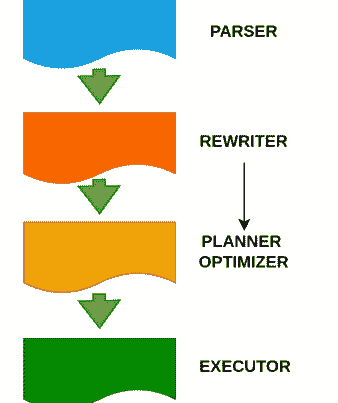
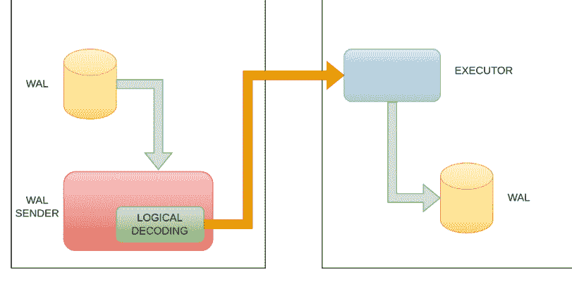
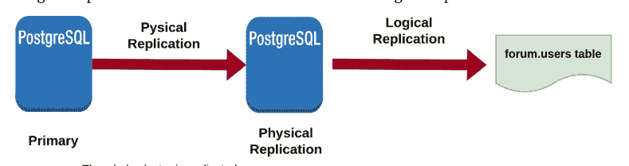

## 18

## Logical Replication

在上一章中，我们讨论了 WAL 段以及同步、异步和级联模式下的物理复制。在本章中，我们将介绍逻辑复制的主题。我们将了解如何执行逻辑复制，逻辑复制与物理复制有何不同，以及何时最好使用逻辑复制而不是物理复制。我们还将看到逻辑复制可用于进行 PostgreSQL 热升级。本章旨在作为逻辑复制的介绍；如需进一步信息，请参阅更高级的书籍，例如 Hans-Jürgen Schönig 所著的 *Mastering PostgreSQL*。

本章涵盖以下主题：

- Understanding the basic concepts of logical replication
- Comparing logical replication and physical replication
- Exploring a logical replication setup and new logical replication features on PostgreSQL 16

## Technical requirements

For this chapter, you will find three Docker environments in the repository:

- `chapter18_logical_clear`: contains two PostgreSQL installations ready for the configuration of a new logical replication.
- `chapter18_logical_ready`: contains two PostgreSQL installations with a new logical replication already active.
- `chapter18_physical_logical`: contains three PostgreSQL installations with a new logical replication made using a physical replication.

If you want to understand how to configure a new logical replication, you should use the first Docker environment; however, if you want to skip all the topics about configuration, you can use the second one. In the second Docker environment, which you can find on the publication server, you will find the forumdb database that we’ve used so far in the book; you’ll also find a logical replication of just the users table. Finally, the chapter18_physical_logical Docker environment will be used for the last section of this chapter.

## Understanding the basic concepts of logical replication

Logical replication is a method that we can use to replicate data based on the concept of identity replication. REPLICA IDENTITY is a parameter present in table management commands (such as CREATE TABLE and ALTER TABLE); this parameter is used by PostgreSQL to obtain additional information within WAL segments, to recognize which tuples have been eliminated and which tuples have been updated. The REPLICA IDENTITY parameter can take four values:

- DEFAULT
- USING INDEX index_name
- FULL
- NOTHING

The concept behind logical replication is to pass the logic of the commands executed on the primary machine to the server and not the exact copy of the blocks to be replicated, byte by byte. At the heart of logical replication, there is a reverse engineering process that, starting from the WAL segments and using a logical decoding process, is able to extrapolate the original SQL commands and pass them on to the replication machine, using a logical decoding process.

Let’s see a flow chart that shows how PostgreSQL internally executes queries:



Figure 18.1: An illustration of the backend process

As we can see, a query, before being executed, requires several internal steps; this is because the system tries to execute the query in the best possible way, according to the conditions prevailing at that moment in the database. Now, suppose we want to replicate the data logically; at this point, we have two possibilities in front of us:

- We can capture commands before they get to the parser and transfer these commands to a second machine.
- We can try, in some way, to get the queries that are already parsed.

The first method is implemented by systems designed prior to native logical replication, which was based on triggers; an example of the application of this method can be found on Slony (https://www.slony.info/).

The second method is used in logical replication.

In logical replication, we will take the commands to be sent to the replica server within the WAL segments. The problem is that within the WAL segments, we have a physical representation of the data. In other words, within the WAL segments, the data is ready to be sent or archived to make physical copies, not logical copies.

Logical replication is based on the concept that WAL segments, after being processed through a logical decoding process that reverses the physical information in a logical information, are made available through a publication mechanism. The primary will then start a publication process, and the replica will start a subscription process that, by connecting to the primary’s publication, is able to pass the decoded instructions directly to the query executor of the replica machine.



Figure 18.2: A logical replication schema

As we can see from the diagram, using a reverse engineering process, instructions are retrieved from the WAL segments, and these instructions are ready to be processed by the executor of the replica server without any parsing action. This second method is much faster than the first method. The first method was the only one available for PostgreSQL versions prior to 9.4; starting from 9.4, there is an extension called pglogical, and since version 10.0, the logical replica has become native.


> 请注意，由于我们可以在不同版本的 PostgreSQL 之间进行复制，逻辑复制是一种可用于执行 PostgreSQL 热升级的工具。

## 探索 PostgreSQL 16 上的逻辑复制设置和新的逻辑复制功能

让我们现在探索如何执行逻辑复制。在本节中，我们将准备执行逻辑复制所需的环境。

## 逻辑复制环境设置

假设我们有两台机器，我们将分别称之为 pg_pub 和 pg_sub。我们必须记住设置内部 DNS，或 /etc hosts 文件，以便 pg_pub 可以访问 pg_sub；例如，对于 pg_pub 服务器，主服务器的 IP 为 192.168.144.3，而对于 pg_sub 服务器，副本服务器的 IP 为 192.168.144.2。如果您使用 chapter18 容器，可以执行：

```
chapter_18$ bash run-pg-docker.sh chapter18_logical_clear
```

进入第一个容器后，您可以打开另一个 bash 终端并执行：

```
chapter_18$ bash run-pg-docker_replica.sh chapter18_logical_clear
```

现在，让我们检查两台服务器之间是否存在连接：

```
postgres@pg_pub:~$ ping pg_sub
PING pg_sub (192.168.144.3) 56(84) bytes of data.
64 bytes from chapter18_logical_clear_learn_postgresql_sub_1.chapter18_logical_clear_default (192.168.144.3): icmp_seq=1 ttl=64 time=0.094 ms

postgres@pg_sub:~$ ping pg_pub
PING pg_pub (192.168.144.2) 56(84) bytes of data.
64 bytes from chapter18_logical_clear_learn_postgresql_pub_1.chapter18_logical_clear_default (192.168.144.2): icmp_seq=1 ttl=64 time=0.070 ms
```

如图所示，两台服务器之间存在连接。

我们也可以指示所有表，如示例所示：

```
db_source=# CREATE PUBLICATION all_tables_pub FOR ALL TABLES;
CREATE PUBLICATION
```

5. 此时，我们前往副本机器并创建一个新数据库：

```
postgres=# create database db_destination;
CREATE DATABASE
postgres=# \c db_destination
You are now connected to database "db_destination" as user "postgres"
```

6. 我们重新创建在主机器上创建的表的确切结构：

```
db_destination=# create table t1 (id integer not null primary key,
name varchar(64));
CREATE TABLE
```

7. 之后，我们必须设置订阅，以便发布的数据在副本机器上进行复制：

```
db_destination=# CREATE SUBSCRIPTION sub_all_tables CONNECTION 'user=replicarole password=LearnPostgreSQL host=pg_pub port=5432 dbname=db_source' PUBLICATION all_tables_pub;
NOTICE:  created replication slot "sub_all_tables" on publisher
CREATE SUBSCRIPTION
```

现在我们的逻辑复制设置已完成。

8. 我们可以尝试向主服务器插入一些数据：

```
db_source=# insert into t1 values(1,'Linux'),(2,'FreeBSD');
INSERT 0 2
```

9. 如我们在此处所见，相同的数据已在副本服务器上复制：

```
db_destination=# select * from t1;
id | name
----+---------
 1 | Linux
 2 | FreeBSD
(2 rows)
```

因此，我们已成功准备好逻辑副本。我们将在下一节学习如何监控它。

## 监控逻辑复制

正如物理复制一样，PostgreSQL 提供了监控逻辑复制所需的工具。

对于逻辑复制，我们必须查询 pg_stat_replication 表，该表与用于监控物理复制的表相同，如下所示：

```
db_source=# \x
Expanded display is on.
db_source=# select * from pg_stat_replication ;
-[ RECORD 1 ]---------------------------------------------
pid              | 144
usesysid         | 16477
username         | replicarole
application_name | sub_all_tables
client_addr      | 192.168.144.2
client_hostname  | 
client_port      | 43162
backend_start    | 2023-06-16 15:04:09.074749+00
backend_xmin     | 
state            | streaming
sent_lsn         | 0/1DD0398
write_lsn        | 0/1DD0398
flush_lsn        | 0/1DD0398
replay_lsn       | 0/1DD0398
write_lag        | 
flush_lag        | 
replay_lag       | 
sync_priority    | 0
sync_state       | async
reply_time       | 2023-06-16 15:05:23.524003+00
```

此查询显示的信息与物理复制的情况相同，但我们知道此信息指的是逻辑副本，因为我们在 application_name 上有我们之前创建的槽名称 sub_all_tables。

```
subconninfo      | user=replicarole password=LearnPostgreSQL host=pg_pub
port=5432 dbname=db_source
subslotname      | sub_all_tables
subsynchroncommit | off
subpublications  | {all_tables_pub}
```

然后我们有有关数据库中创建的所有订阅的信息。有关更多信息，请参阅官方文档：https://www.postgresql.org/docs/current/catalog-pg-subscription.html。

## 只读与可写

在上一章中，我们看到只能使用读操作访问物理复制服务器，而不允许写操作。我们还看到物理复制会复制任何类型的操作，包括 DML 操作和 DDL 操作。使用逻辑复制，我们也可以在副本服务器上访问写操作，但在逻辑副本中，只有 DML 操作会被复制到副本服务器；DDL 操作不会被复制。让我们进行一些测试，看看会发生什么。在以下示例中，主服务器始终称为 pg_pub，而具有逻辑复制的服务器始终称为 pg_sub。

这是 pg_pub 服务器上的初始情况：

```
db_source=# select * from t1;
 id |  name
----+--------
  1 | Linux
  2 | FreeBSD
(2 rows)
```

这是 pg_sub 服务器上的初始情况：

```
db_destination=# select * from t1;
 id |  name
----+--------
  1 | Linux
  2 | FreeBSD
(2 rows)
```

让我们在 pg_sub 服务器上插入一条记录：

```
db_destination=# insert into t1 values (3,'OpenBSD');
INSERT 0 1
```

现在 pg_sub 服务器上的情况是：

```
db_destination=# select * from t1;
 id | name
-----+--------
  1 | Linux
  2 | FreeBSD
  3 | OpenBSD
(3 rows)
```

在 pg_pub 服务器上，我们仍然有以下内容：

```
db_source=# select * from t1;
 id | name
-----+--------
  1 | Linux
  2 | FreeBSD
(2 rows)
```

请注意，逻辑副本允许在副本服务器上执行写操作。

让我们看看如果我们在 pg_pub 服务器上添加一条记录会发生什么：

```
db_source=# insert into t1 values(4,'Minix');
INSERT 0 1
```

pg_pub 服务器上的情况如下：

```
db_source=# select * from t1;
 id | name
-----+--------
  1 | Linux
  2 | FreeBSD
  4 | Minix
(3 rows)
```

然后我们在 pg_pub 服务器上会有：

```
db_source=# select * from t1;
 id | name
-----+--------
  1 | Linux
  2 | FreeBSD
  4 | Minix
  3 | Windows
  5 | Unix
(5 rows)
```

在副本 pg_sub 服务器上，我们仍然会有：

```
db_destination=# select * from t1;
 id | name
-----+--------
  1 | Linux
  2 | FreeBSD
  3 | OpenBSD
  4 | Minix
(4 rows)
```

从现在开始，逻辑复制不再复制数据，如果我们在 pg_pub 服务器上执行此查询：

```
db_source=# select * from pg_stat_replication;
(0 rows)
```

将不再找到复制；那是因为我们的逻辑复制不再工作。

> 如果我们想在副本服务器上写入记录，我们必须确保这些记录不会与主服务器上的记录冲突。

重新对齐副本服务器的一种简单方法是删除订阅、截断表，然后重新创建订阅：

```
db_destination=# drop subscription sub_all_tables ;
NOTICE:  dropped replication slot "sub_all_tables" on publisher
```


- [ RECORD 1 ]---+-----------------------------
pid | 337
usesysid | 16477
username | replicarole
application_name | sub_all_tables
client_addr | 192.168.144.2
client_hostname |
client_port | 57826
backend_start | 2023-06-16 15:24:36.905319+00
backend_xmin |
state | streaming
sent_lsn | 0/1DD0BC0
write_lsn | 0/1DD0BC0
flush_lsn | 0/1DD0BC0
replay_lsn | 0/1DD0BC0
write_lag |
flush_lag |
replay_lag |
sync_priority | 0
sync_state | async
reply_time | 2023-06-16 15:27:47.24564+00

## DDL 命令

在上一节中，我们说过逻辑复制不会复制 DDL 命令，但如果我们在一个已经通过逻辑复制进行复制的主服务器上应用一个 DDL 语句会发生什么？DDL 命令如下：

- CREATE
- ALTER
- DROP
- RENAME
- TRUNCATE
- COMMENT

假设现在我们想在主服务器的 pg_pub 上的 t1 表上添加一个字段：

```
db_source=# alter table t1 add description varchar(64);
ALTER TABLE
```

现在让我们尝试在 pg_pub 服务器上执行一个 DML 命令。以下是一些 DML 命令的示例：

- INSERT
- DELETE
- UPDATE

例如，假设我们尝试从 pg_pub 服务器的 t1 表中删除一条记录：

```
db_source=# delete from t1 where id=5;
DELETE 1
```

在 pg_pub 服务器上，我们将有以下内容：

```
db_source=# select * from t1;
 id | name    | description
----+---------+-------------
  1 | Linux   |
  2 | FreeBSD |
  4 | Minix   |
  3 | Windows |
(4 rows)
```

而在 pg_sub 服务器上，我们仍然会有这个：

```
db_destination=# select * from t1;
 id | name
----+---------
  1 | Linux
  2 | FreeBSD
  4 | Minix
  3 | Windows
  5 | Unix
(5 rows)
```

如果我们检查 pg_sub 服务器上的 postgresql.log，我们会看到这个：

```
learn_postgresql_sub_1 | 2023-06-16 15:30:57.973 UTC [364] ERROR:
logical replication target relation "public.t1" is missing replicated
column: "description"
```

HINT:  Use ALTER SUBSCRIPTION ... SET (slot_name = NONE) to disassociate the subscription from the slot.

PostgreSQL 建议使用 ALTER SUBSCRIPTION ... SET (slot_name = NONE) 来将订阅与槽分离。问题在于，我们不能在禁用订阅之前执行此命令。事实上，如果我们现在尝试执行 PostgreSQL 建议的命令，我们会得到这个：

```
db_destination=# alter subscription sub_all_tables SET (slot_name = NONE);
ERROR:  cannot set slot_name = NONE for enabled subscription
```

我们必须执行的正确步骤如下：

- 1. 禁用订阅。
- 2. 将 slot_name 设置为 NONE。
- 3. 删除订阅。

我们必须执行以下三个语句：

```
db_destination=# alter subscription sub_all_tables disable;
ALTER SUBSCRIPTION
db_destination=# alter subscription sub_all_tables SET (slot_name = NONE);
ALTER SUBSCRIPTION
db_destination=# drop subscription sub_all_tables ;
DROP SUBSCRIPTION
```

如果主服务器变得不可达时我们想删除一个订阅，这些就是正确的步骤。我们也可以使用 ALTER SUBSCRIPTION sub_name DISABLE 命令将订阅从发布中分离，以及使用 ALTER SUBSCRIPTION sub_name ENABLE 命令将订阅重新附加到发布。

## 使用物理复制实例进行逻辑复制

在 PostgreSQL 16 中，可以从物理复制开始创建逻辑复制。

我们要采取的步骤如下：

- 1. 在 **Primary** 和 **Physical Replication** 服务器上设置 `wal_level=logical`。

在 **Primary server** 上：

- 2. 为物理复制创建一个角色：

```sql
CREATE ROLE replicarole WITH REPLICATION LOGIN PASSWORD
'LearnPostgreSQL';
```

- 3. 在 **Primary server** 上为逻辑复制创建一个角色：

```sql
CREATE ROLE logicalreplicarole WITH REPLICATION LOGIN PASSWORD
'LearnPostgreSQL'
```

- 4. 为 logicalreplicarole 分配对我们想要通过逻辑复制复制的模式和表的正确权限，例如：

```sql
GRANT USAGE ON SCHEMA forum TO logicalreplicarole;
GRANT SELECT ON forum.users TO logicalreplicarole
```

- 5. 创建一个物理复制槽或物理复制。

- 6. 创建一个将在 **Physical replication** 服务器上复制并由 **Logical Replication** 服务器上的逻辑复制订阅使用的发布。

在 **Physical replication server** 上：

- 7. 设置 `hot_standby_feedback = on` 以防止由于主服务器上的 vacuum 操作反映到副本服务器上而导致的问题，这可能会在副本上非常长的查询上产生冲突。

- 8. 使用 `pg_basebackup` 命令制作副本，如上一章所述。

在 **Logical replication server** 上：

- 9. 创建你想要从物理复制中复制数据的表。

- 10. 创建一个引用我们在主服务器上创建的发布的订阅，如我们所见。

现在，让我们使用 Docker 容器尝试此功能；我们想要尝试的场景是：

- 11. 主服务器上的一个 forumdb 数据库
- 12. 副本服务器上的整个集群的物理副本

13. 逻辑复制服务器上的 forum.users 表的逻辑复制。



图 18.3：物理/逻辑复制级联

让我们使用 chapter18_physical_logical Docker 容器并执行以下步骤：

- 1. 使用以下命令启动所有容器：
```
$ bash run-pg-docker-replica-logical.sh chapter18_physical_logical
```
- 2. 在我们的 Docker 主机上执行上述语句后，我们有三个容器正在运行：
```
chapter18_physical_logical_learn_postgresql_replica_sub_1
chapter18_physical_logical_learn_postgresql_master_pub_1
chapter18_physical_logical_learn_postgresql_replica_1
```
- 3. 我们运行的脚本直接带我们进入了主节点运行的容器；现在，我们必须打开两个 bash 终端窗口并在第一个中执行以下语句（进入物理复制节点）：
```
$ bash run-pg-docker-replica1.sh chapter18_physical_logical
```
- 4. 在第二个中，我们必须执行以下语句以进入逻辑复制节点：
```
bash run-pg-docker-replica2.sh chapter18_physical_logical
```
- 5. 现在，正如我们所见，在主节点上我们有：
```
postgres@pg_master_pub:~$ psql

postgres=# select * from pg_stat_replication;
-[ RECORD 1 ]---------------------------------
```

```
pid | 108
usesysid | 16384
username | replicarole
application_name | walreceiver
client_addr | 172.29.0.4
client_hostname | 
client_port | 43400
backend_start | 2023-06-20 16:10:30.779359+00
backend_xmin | 
state | streaming
sent_lsn | 0/3005948
write_lsn | 0/3005948
flush_lsn | 0/3005948
replay_lsn | 0/3005948
write_lag | 
flush_lag | 
replay_lag | 
sync_priority | 0
sync_state | async
reply_time | 2023-06-20 16:11:49.332655+00
```

在物理复制服务器上，我们有：

```
postgres@pg_replica:~$ psql forumdb

forumdb=# select * from pg_stat_replication;
-[ RECORD 1 ]---------------------------------------------
pid | 101
usesysid | 16468
username | logicalreplicarole
application_name | users_sub
client_addr | 172.29.0.2
client_hostname | 
client_port | 43950
backend_start | 2023-06-20 16:10:39.685477+00
backend_xmin | 
state | streaming
sent_lsn | 0/3005948
```

我们看到了如何在实践中制作逻辑副本，并解决了在使用逻辑复制时可能出现的一些问题。

在下一章中，我们将讨论有用的工具和扩展。我们将看到哪些工具最适合让 PostgreSQL DBA 的生活更轻松。

## 验证你的知识

- 是否可以在逻辑复制服务器的订阅上编写查询？
  可以。参见 *Exploring logical replication setup* 部分了解更多详情。
- 是否可以在逻辑复制服务器的订阅上拥有不同的字段？
  可以，订阅可以拥有比发布服务器上*更多*的字段。
  参见 *Exploring logical replication setup* 部分了解更多详情。
- 我是否必须在开始逻辑复制之前配置 pg_hba.conf 文件？
  是的，你必须。参见 *Exploring logical replication setup* 部分了解更多详情。
- 如果在发布服务器上执行 DDL 语句后，订阅服务器不再复制任何数据，我该怎么办？
  你必须在订阅服务器上复制 DDL 语句。参见 *DDL commands* 部分了解更多详情。
- 是否可以从物理复制开始进行逻辑复制？
  是的，在 PostgreSQL 16 中是可以的。

## 参考

- Slony website: https://www.slony.info
- Logical replication: https://www.postgresql.org/docs/current/logical-replication.html


