# 设置开发环境

Now we are going to set the stage for our future Red development. We'll get Red on to your computer, and then immediately start working in the Red console to get a feel for the environment. Then, we'll create our first script, run it in the console, and then compile and execute it. We will also discuss how Red compiles and what the different compilation options are. Finally, we'll show some coding environments to craft your Red code with ease.

We will cover the following topics:

*   Installing Red

*   Working interactively in the Red console

*   Running and compiling your first script

*   Other compilation options

*   Red's compilation model

*   Development environments for writing Red

## 技术要求

We'll download the Red toolchain from here: [`www.red-lang.org/p/download.html`](http://www.red-lang.org/p/download.html)

You'll find the code for this chapter here: [`github.com/PacktPublishing/Learn-Red-Fundamentals-of-Red/tree/master/Chapter02`](https://github.com/PacktPublishing/Learn-Red-Fundamentals-of-Red/tree/master/Chapter02)

## 安装 Red

To get Red on your machine, simply download and save the latest stable version that corresponds to your **操作系统** (**OS**) from here: [`www.red-lang.org/p/download.html`](http://www.red-lang.org/p/download.html). The download is named `red-num`  (on Windows, the file also has an `.exe` extension), where `num` is the version number, such as 063. This small file (around 1 MB) contains the full Red toolchain, runtime library, and console source code, truly batteries included! It is that small because no external dependencies other than the OS are included.

On the downloads page, you can also find the nightly automated build and the latest source code from the `master` branch. If you want to work with a Red version that has the latest functionalities, download the nightly master build. For regular development, you better stick with the last stable version. 

Red's runtime library is written as a mix of Red and `Red/System`. At this time, the Red toolchain (compilers, linkers, packagers) still depends heavily on REBOL 2. For example, the current compilers for Red and `Red/System` are written in REBOL 2. The goal for version 1.0 or beyond is to remove this REBOL dependency, so that Red is completely self-hosted.

### 在 Windows 上安装 Red

Save the file in a suitable folder (it can be installed anywhere), let's say `c:\\red`. For convenience, rename the file to `red.exe`. Now double-click this file—this will then automatically build the Red GUI-console, taking a few moments.

The `gui-console-yyyy-m-dd-nnnnn.exe` file (`yyyy-m-dd` is a build date and `nnnnn` a build number) is cached on disk in the `c:\\ProgramData\\Red` folder. Then the Red GUI console appears, waiting for your input at the `\>>` prompt:

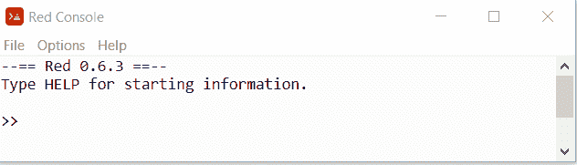About the version  

The first line shows that the current Red version at the time of writing is 0.6.3. The stable Red 0.6.3 version has only two menu-items—File and Options. This screenshot was built from the master branch in mid-April 2018, which already shows the 0.6.4 layout. You'll probably see a higher version number in your download. 

This Red console is completely written in Red.

Next time you start `red.exe`, the built-in REPL GUI console will open immediately. To make the Red toolchain available to your entire system, add the installation folder (here `c:\\red`) to the `Path` environment variables using Configuration, System, Advanced Configuration, Environment Variables.

Here are some useful remarks to help you out in certain cases:


# 已知问题

*   在编译 GUI 控制台时，一些杀毒软件（如 Avast 或 Avira）会报告 Win32:Malware-gen 或类似内容。这是因为它们的启发式搜索机制将 Red 编译的二进制文件误报为假阳性。解决方法是将 `C:\\ProgramData\\Red` 文件夹以及其他编译 Red 可执行文件的文件夹添加到杀毒软件界面的“排除文件夹”列表中，使其被列入白名单且不被杀毒程序检查。

*   当从安装文件夹以外的文件夹在控制台中启动 Red 时，你可能会看到以下错误——`PROGRAM ERROR: Invalid encapsulated data`。这是一个已知问题（[`github.com/red/red/issues/543`](https://github.com/red/red/issues/543)），目前是由 REBOL 支持引起的。目前运行 Red 需要一个包装的 shell 脚本 `red.bat`：
  *   将 `red.exe` 重命名为 `red-exe.exe`
  *   在同一文件夹中，创建一个 `red.bat` 文件，其内容为：`@"%~dp0red-exe.exe" %\*`
  *   现在，执行 `red` 命令将自动启动此 `red.bat` 命令文件

# 在 Linux 和 macOS 上安装 Red

要在 Linux 或 macOS 系统上安装 Red，你需要按照以下步骤操作：

1.  从 [`www.red-lang.org/p/download.html`](http://www.red-lang.org/p/download.html) 保存文件到你选择的某个文件夹，例如 `/home/user/red`（其中 `user` 是你的用户名）。
2.  将文件 `red-num` 重命名为 `red`。
3.  在你的终端中，进入 `red` 子文件夹，并执行 `chmod u+x red` 为 Red 二进制文件授予用户执行权限。
4.  如果你在 64 位 Linux 系统上工作，请安装一些 32 位支持库（这是为了执行 REBOL 2 所需的库）。打开一个终端应用程序并输入以下命令：
```
$ sudo dpkg --add-architecture i386
$ sudo apt-get update
$ sudo apt-get install libc6:i386 libcurl3:i386
```
5.  现在只需在终端窗口中使用 `red` 命令运行 Red 即可。

Red 控制台只会在第一次构建。控制台可执行文件构建在 `/home/user/.red` 文件夹内，名称格式为 `console-yyyy-m-dd-nnnnn`。

之后，命令行控制台会打开：

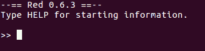

要在整个文件系统中都能使用 Red，请在你的 `.profile` 和 `.bashrc` 脚本中添加以下行：
```
export PATH=$PATH:/home/user/red
```
（在前面的命令中，`user` 是你的用户名。）

然后，打开一个新的终端应用程序。现在可以从任何目录启动 Red 可执行文件。

如果你像我一样在 `/bin` 中有一个 Red Linux 实用脚本，你必须按如下方式重命名它：
`cd /bin`
`sudo mv red red_old`

如果你遇到无效压缩数据问题，这与 Windows 中提到的 REBOL 问题相同。可以通过创建 shell 脚本 `red.sh` 并使用以下内容来解决：
```
#!/bin/bash
red $@
```
不要忘记使用 `chmod u+x red.sh` 使 shell 脚本可执行。

在 Linux 中，Red 命令行版本的替代方案是安装 WineHQ ([`www.winehq.org/`](https://www.winehq.org/))，这是一个可在 Linux 上运行 Windows 程序的工具。然后你可以使用图形控制台运行 Red Windows 版本。

对于 Arch Linux、FreeBSD 和其他特定发行版，你可以在下载页面找到进一步的说明。

Red 也可以通过使用 Chocolatey 包管理器 ([`chocolatey.org/packages/red`](https://chocolatey.org/packages/red)) 安装。

无论你使用哪个操作系统，要快速查看 Red 安装的版本号，请打开终端并输入：
```
red -V
```
这将给出版本号 `n.u.m`（例如，`0.6.3`）。

# 查看源代码

Red 的源代码可以在这里找到：[`github.com/red/red`](https://github.com/red/red)。如果你感兴趣，可以在本地下载一个归档文件（点击 Clone or download 按钮）并解压以便更仔细地查看，例如在你的 Red 安装目录内。或者，如果你的机器上安装了 `git`，你可以使用以下命令克隆源代码：
```
git clone https://github.com/red/red.git
```
为了便于参考，将源文件夹重命名为 `red-source`。以下是概览：

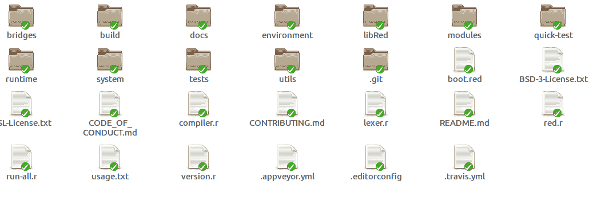

你会注意到很多源文件都有 `.r` 扩展名，这意味着它们是 REBOL 文件。事实上，在这个阶段，Red 框架是用 REBOL 搭建的。一些重要文件是：
*   `red.r`: 这是 Red 和 Red/System 编译器
*   `run-all.r`: 这是运行完整的 Red 测试套件的起点

Red 团队的目标是用 Red 完全重写此脚手架，从而移除对 REBOL 的依赖。这可能在 v2 中发生。然后，Red 将完全自托管，每个新版本都将从旧的 Red 版本启动。

在同一层级的文件夹中，你可以创建一个 `projects` 文件夹，在其中开始开发：
*   `red`
  *   `red-source`
  *   `projects`
  *   `red` 二进制文件或 shell 脚本

# 在 Red 控制台中交互工作

像任何动态语言一样，Red 有一个 REPL 控制台。不带参数的 `red` 命令（在 Windows 和 macOS 上打开或双击 `red.bat`）在 Windows 和 macOS 上启动图形窗口控制台，在 Linux 上启动命令行控制台。如果你需要在 Windows 和 macOS 上使用命令行控制台，只需使用命令 `red --cli` 即可。

控制台是一个完整的 Red 解释器，并在 `\>>` 提示符后期望输入 Red 代码，以便在按下 `Enter` 时进行求值然后执行。它是与语言的实时交互。简单地给出一个值（这里是一个用 `""` 表示的字符串）会在 `\==` 之后返回该值：
```
;-- see Chapter02/console-examples.red:
>> "Red is awesome"
== "Red is awesome"
```
（你可以在 `ch2/console-examples.red` 中找到这些示例的源代码。在所有代码文件中，我们将使用 `;==` 前缀来表示返回的输出，像这样，`;== "Red is awesome"`）。

如果在控制台中输入 `Red is awesome` 会怎样？REPL 会向你抛出错误——`Script Error: is does not allow word! for its 'field argument`。Red 看不到输入是一个字符串，所以无法理解它。

继续做一些计算：

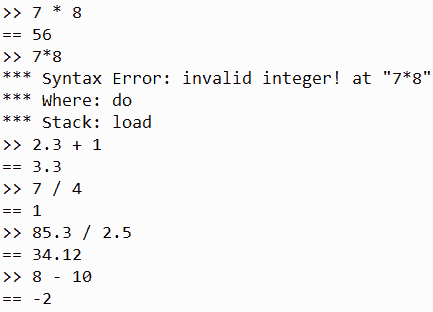

在第二行，我们看到了第一个语法错误。这意味着你必须在二元运算符（如 `\*`）前后使用空格。请注意，使用整数的 `/` 返回整数结果。

控制台有一个内置的帮助和文档系统，你可以通过输入 `?` 或 `help` 来启动：

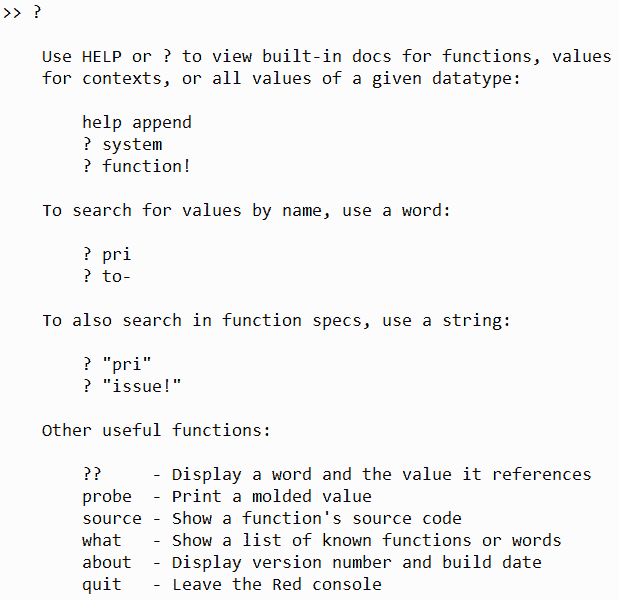

尝试示例以感受其搜索和补全功能（单词 **模塑的** 的意思是：在可读的格式中）。

以下是有关在控制台中工作的一些其他有用提示：
*   上箭头和下箭头用于检索上一个和下一个控制台命令，然后可以对其进行修改和/或重新执行。事实上，控制台命令的历史记录存储在 `system/console/history` 块中，并且从版本 0.6.4 开始，这在会话之间得以保留。在 第 6 章 中，*使用文件，* 在 *加载和保存文件* 部分，我们将学习一个不错的技巧来将控制台命令的历史记录保存到文件中以便更轻松地处理。
*   要清除屏幕，请使用 `CTRL+L`。
*   你可以随时通过关闭窗口图标关闭控制台，或从提示符处输入 `q` 或 `quit` + `Enter`（在 Linux 上，也可使用 `CTRL+D`）关闭。
*   `Home` 和 `End` 将光标定位在行的开头和结尾。
*   在 GUI 控制台中，当你想从（正在运行的）语句返回到提示符时，使用 `Esc` 键；对于命令行界面使用 `Ctrl+C`。
*   使用鼠标或常用的键盘快捷键（`Ctrl+C` - `Ctrl+V`）复制/粘贴代码（甚至整个 Red 脚本）。


* 使用 `pwd` 或 `what-dir` 获取当前文件夹（REPL 启动所在的文件夹）。输出如下：`%/E/Red/`。`%` 表示文件路径，其各部分由 `/` 分隔。
* 要更改当前文件夹，请使用 `cd`。例如，`cd %/E/Red/apps/google-finance`。
* 可以同时打开多个 Red 控制台。

启动 Red 的文件夹可通过输入 `system/options/path` 得到。

更改提示符以显示时间很容易，也能窥见 Red 的强大之处。请看以下命令：

```
system/console/prompt: rejoin [now/time " >> "]
;== "15:02:19 >> "
```

你可以在 `red-source/environment/console` 中找到 REPL 的源代码。

# 运行和编译你的第一个脚本

在 REPL 中进行实验对于小的代码片段来说是可以的，你也应该一定要使用它，但很快你会想要将代码保存在文件中。使用你喜欢的代码编辑器（或查看本章最后关于编写 Red 的开发环境部分，了解支持 Red 开发的编辑器和 IDE）并输入以下文本：

```
;-- see Chapter02/hello-world.red:
Red [
    Title: "Simple hello world script"
]
print "Hello Red World!"
```

将文件保存为 `hello-world.red`；`.red` 是 Red 源代码文件的扩展名。

`Red \[ \]` 头部块是强制性的；我们将在下一章看到其用途。

## 在 Red 控制台中执行脚本

使用 Red 控制台，我们可以通过五种方式执行此脚本：

1. 如果是小型脚本，你可以直接复制头部之后的代码并粘贴到 REPL 中。
2. 右键单击 `hello-world.red` 并选择“打开方式”。浏览到 Red `bat` 文件（在 Windows 上），并选择它。控制台将打开并显示输出信息。从现在开始，双击 Red 源文件将会在 Red 控制台中执行它。
3. 打开一个终端（在 Windows 中使用 `cmd` 或 PowerShell 控制台；在 Linux/macOS 中右键单击文件夹并选择在终端中打开）并导航到源文件所在的文件夹。然后在命令行中输入 `red hello-world.red`。
4. 在 Red 控制台提示符 `\>>` 处，输入 `do %hello-world.red` 以获得相同结果。`do` 是一个函数，用于计算其参数，在此例中为源文件。这是从控制台内部执行脚本的方式。

如果找不到脚本文件，例如 `red>> do %does-not-exist.red`，你会收到以下 Access 错误：

`*** Access error: cannot open: %does-not-exist.red`

为避免此错误，如果文件 `script.red` 存在，但位于不同的文件夹 `tests` 中，如果 `tests` 是子文件夹——`do %tests/script.red`，如果 `tests` 是上一级文件夹——`do %../tests/script.red`。

但你也可以通过执行 `cd tests` 或 `cd ../tests` 将 Red REPL 的当前活动文件夹（最初为启动时所在的文件夹）移动到文件所在位置，然后执行 `do %script.red`

5. 从菜单中打开 File | Run。会打开一个文件资源管理器窗口，可在其中搜索源文件。打开它会使用 `do` 命令运行代码。

在所有这些情况下，代码都是被解释执行的。这也意味着脚本不能包含 Red/System 代码。顺便说一下，这不是 JIT 即时编译到本地代码；这计划在 Red 的后续版本中实现。

如果你已按上一节所述下载了 Red 源代码，请在该文件夹中打开一个 Red 控制台并运行一些演示脚本以查看 Red 的实际效果。例如，一个通用的 Hello world：

```
red>> do %tests/hello.red
```

你应该会看到以下输出：

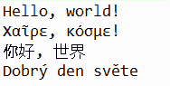

如果你查看源代码，会发现它只是打印这些字符串。这表明 Unicode 对 Red 来说不是问题！

## 编译脚本为可执行文件

现在我们来考察编译 Red 程序的两种不同模式。

### 开发模式

要将 Red 程序编译为本地代码，我们需要执行以下操作：

1. 打开一个终端窗口并进入脚本所在的文件夹。
2. 输入命令 `red -c hello-world.red`。

这是输出（在 Windows PowerShell 中）：

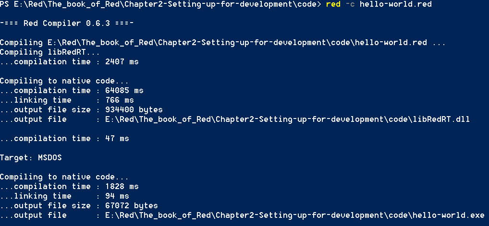

当执行 `-c` 编译时，Red 会在此文件夹中查找共享库 `libRedRT`（Windows 下为 `.dll`，Linux/macOS 下为 `.so`）；如果不存在，则会编译它。`libRedRT` 共享动态库包含整个编译好的标准库和 RunTime 的预编译形式，其大小小于 1 MB。如你所见，此编译大约需要一分钟。但这仅在第一次发生，是出于缓存原因。下一次，在此文件夹中编译任何程序都非常快：

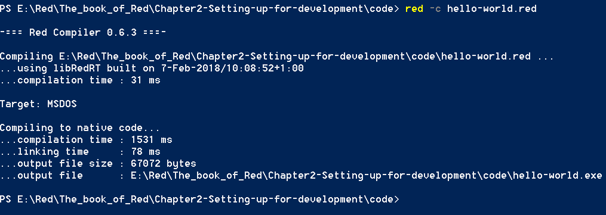

这是在开发模式下编译，这是默认模式。在同一代码上工作时，后续编译会快得多。在这种情况下，结果是一个本地二进制文件 `hello-world.exe`；因此以 `./hello-world.exe` 运行它以显示 hello 消息。它需要在同一文件夹中运行 `libRedRT` 库！

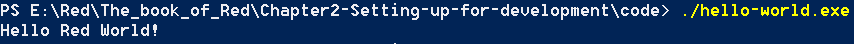

`libRedRT` 中的代码除非你更新 Red 版本否则不会改变。将 Red 二进制文件升级到新版本会在首次调用时自动升级 `libRedRT`。如果需要，你可以在编译文件夹中运行 `red clear` 命令以删除来自先前版本的所有文件。如果你的脚本包含 Red/System 代码，请使用 `red -u` 或 `red --update-libRedRT` 重新构建 `libRedRT` 并编译脚本。

### 发布模式

当开发和测试完成，并且你准备部署到生产环境时，你会希望将代码编译为一个独立的可执行文件，其中包含 `libRedRT` 和所有其他所需依赖项。这是通过 `red -r hello-world.red` 命令完成的，使用 `-r` 标志强制发布模式。以下是 Windows 上编译的屏幕输出：


此模式下的编译时间要长得多，但你只需要做一次。 resulting 二进制文件大小会有所增加（它包含运行时并提供额外的运行时函数），但仍然相当小。要部署，只需将生成的二进制文件复制到生产环境即可。

此编译模式也需要在程序包含 `#include` 语句或包含 Red/System 代码时使用。

Red 控制台可以在源代码 `/environment/console` 文件夹中找到，分别位于 CLI 和 GUI 子文件夹中。控制台包含在 Red 工具链中，但有了我们现在所知的知识，我们可以像这样单独编译然后使用它们：

```
red -r console.red
```

这是编译 GUI 控制台的命令：

```
red -r -t Windows gui-console.red
```

要包含任何图形内容，你必须添加 `-t` 平台标志，如前述命令中的 `-t Windows`。

### 其他编译选项

要查看 `red` 命令的文档，请在终端中输入 `red –h`。以下是一些有用的选项：

* 使用 `–o` 为输出二进制文件指定不同的名称。
* 在调试模式下使用 `–d`。用于打印调试信息的功能（如 `print` 和 `probe`）会在 Red 控制台中显示其输出。
* 使用 `–dlib` 从代码制作共享库，例如，仅包含函数的代码文件。
* 使用 `-e` 与 `-c` 或 `-r` 结合以在封装模式下编译；运行时将被编译并与你的脚本一起包含在单个二进制文件中。然而，你的脚本不会被编译；它会被转换为特殊格式（Redbin）并压缩。结果是一个独立的可执行文件，你的脚本将由解释器运行。这在遇到编译器限制但代码仍可被解释时可能很有用。


# 交叉编译能力

Red 编译器的一个令人惊叹的功能是其交叉编译能力，用于构建在与你正在开发的平台不同的平台上运行的可执行文件。这通过 `–t` 标志完成，如下所示：

```
red -t TargetID hello-world.red
```

这里，`TargetID` 可以取以下值：
* MSDOS：Windows，x86，控制台（+ GUI）应用程序
* Windows：Windows，x86，GUI 应用程序
* WindowsXP：Windows，x86，GUI 应用程序，无触摸 API
* Linux：GNU/Linux，x86
* Linux-ARM：GNU/Linux，ARMv5，armel（软浮点）
* RPi：GNU/Linux，ARMv5，armhf（硬浮点）
* Darwin：macOS Intel，仅控制台应用程序
* macOS：macOS Intel，应用程序包
* Syllable：Syllable OS，x86
* FreeBSD：FreeBSD，x86
* Android：Android，ARMv5
* Android-x86：Android，x86

因此，如果我想生成一个名为 `hello-linux` 的 Linux 可执行文件，我会这样做：

```
red -t Linux -o hello-linux hello-world.red
```

对于每个 `\-flag` 选项，都存在一个对应的 `\--option`。例如，`\--release` 与 `\-r` 相同，而 `\--target` 与 `\-t` 相同。详细版本使命令行脚本更易读。在终端中输入 `red -h` 可查看完整列表。

# Red 的编译模型

从之前 `red -r` 发布模式编译的截图中，我们可以看到这分为两步：
1. 第一步没有明确说明，但它将 Red 源代码编译为 Red/System 代码。
2. 第二步将 Red/System 编译为本地代码：

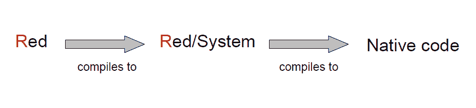

如前所述，编译是通过 REBOL `red.r` 脚本完成的。由于这一点，Red 目前仅为 32 位，自托管将使 64 位二进制文件成为可能。

如果你感觉冒险，可以尝试在 REBOL 控制台内编译 Red。访问：[`github.com/red/red#running-red-from-the-sources-for-contributors`](https://github.com/red/red#running-red-from-the-sources-for-contributors)

目前，执行 Red 程序有两种不同的模式：
* 使用解释器运行，这在内存中进行并涉及一定程度的编译
* 编译为二进制文件中的本地代码然后运行此可执行文件，其中 Red/System 作为中间步骤

最终的编译器架构将比其他语言更复杂，可以称为 **协作执行模型**；编译器将与 JIT 编译器和解释器协作工作。

# 编写 Red 的开发环境

你基本上只需要一个简单的文本编辑器和一个用于编译工作的终端即可。然而，一些语法高亮以及内置的编译和运行系统可以让你的生活更轻松。

## 简单文本编辑器

Notepad++ 是一个免费且多功能的源代码编辑器，仅在 Windows 上运行。在文章 [`helpin.red/Setup-Notepad.html`](http://helpin.red/Setup-Notepad.html) 中，你可以看到如何将其构建为 Red 开发环境。Everedit ([`www.everedit.net/`](http://www.everedit.net/))、Crimson Editor ([`www.crimsoneditor.com/`](http://www.crimsoneditor.com/)) 和 emacs ([`www.gnu.org/software/emacs/`](https://www.gnu.org/software/emacs/)) 也提供语法高亮模式。

一个方便的小型 Windows 编辑器是 Ride ([`www.mikeparr.info/redlang.html`](http://www.mikeparr.info/redlang.html))，由 Mike Parr 用 Delphi 编写：

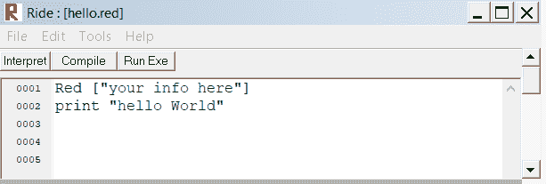

要使其与 Red 的最新版本一起工作，请使用菜单中的 Tools | Configure Red System 来导航到你的 Red 二进制文件或 shell 脚本。

## 更复杂的编辑器

Sublime Text ([`www.sublimetext.com/`](https://www.sublimetext.com/)) 提供了一个跨平台解决方案。它可以免费下载和评估；然而，为了继续使用必须购买许可证。一些 Red 插件可用，例如 Sublime-Red ([`github.com/Oldes/Sublime-Red`](https://github.com/Oldes/Sublime-Red)) 或 Rebol-Red-Sublime ([`github.com/onetom/rebol-red-sublime`](https://github.com/onetom/rebol-red-sublime))。它们提供不错的语法高亮、代码片段以及轻松集成构建系统的方式。

目前最好的也是最完整的跨平台选项是 [Visual Studio Code](http://code.visualstudio.com/) 配合由 Red 团队开发的插件 ([`marketplace.visualstudio.com/items?itemName=red-auto.red`](https://marketplace.visualstudio.com/items?itemName=red-auto.red))。它具有许多功能，例如自动补全、代码片段、悬停在函数词上时内置的函数文档，以及语法高亮和典型的文本编辑器功能。

有一个 Red 快捷菜单，即 `Ctrl+K`、`Ctrl+M`。`F6` 解释并 `F7` 编译当前 Red 文件，同时具有完全集成的终端（Windows 中的 PowerShell 控制台）。这里是一个典型的截图：

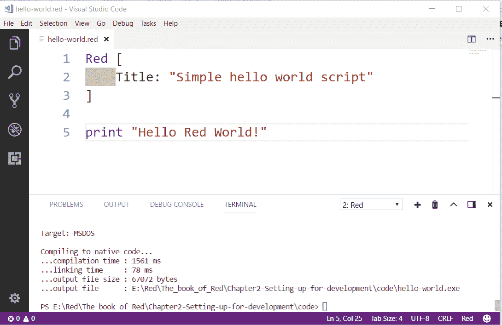

实际上，Red 非常适合构建一个专用的 **IDE**（**交互式开发环境**）。这是一项巨大的工作，肯定不是 Red 核心团队的优先事项，但也许有一天它会作为社区的努力出现。

同时，这里有一些用 Red 编写的编辑器；它们并不意味着完整，但它们展示了你可以用很少的 Red 代码做什么——RedEd ([`www.mycode4fun.co.uk/text-editors`](http://www.mycode4fun.co.uk/text-editors))、AutoRed ([`www.mycode4fun.co.uk/red-apps`](http://www.mycode4fun.co.uk/red-apps)) 和 Tired ([`www.mikeparr.info/tired.html`](http://www.mikeparr.info/tired.html))（35 行代码！）。

# 总结

到目前为止，你应该有一个运行中的开发环境并且能够使用 Red 控制台。你还学会了如何在开发模式和发布模式下编译和执行一个简单的脚本。你学习了最重要的编译选项，例如使用 `\-o` 重命名输出文件，或使用 `\-t` 将程序交叉编译到另一个部署平台。你也对 Red 的编译模型有了一些了解。最后，我们回顾了现有的编辑器选项，并准备了一个舒适的环境来开始编码，既可以与 Red 控制台交互式工作，也可以与源文件一起工作。

在下一章中，我们将探索 Red 程序的基本构建块——单词、值及其类型。

# 问题

1. 使用 `print` 打印出 `Hello Red world!` 然后使用 `prin`。有什么区别？用 `?` 查一下。现在使用 `prn`。会发生什么以及为什么？
2. `red.r` 脚本的目的是什么？
3. 什么是自托管语言？
4. 从控制台内部执行脚本必须使用哪个函数？
5. 发布模式下需要 `libRedRT` 吗？
6. 如果不需要，那么它的代码在哪里？
7. 哪个 Red 开发环境为你提供代码补全？
