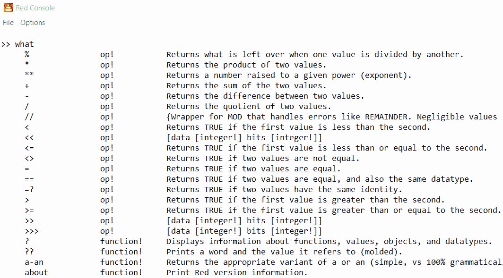
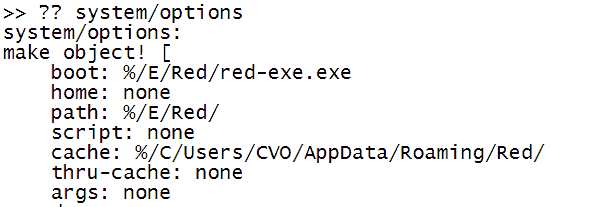
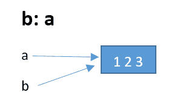
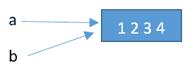
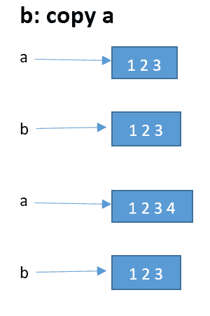
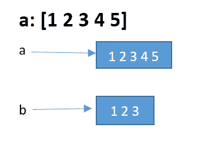
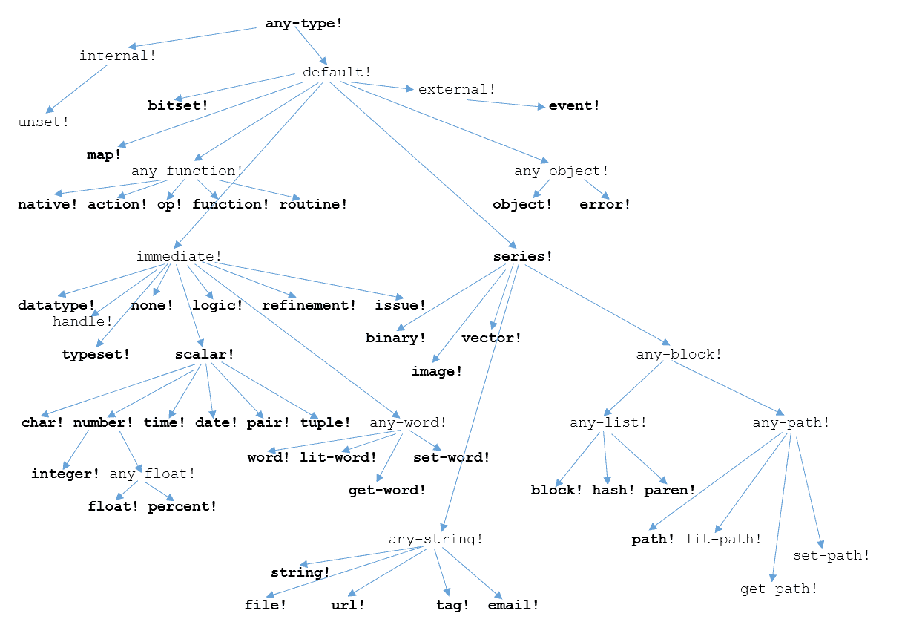

# 使用单词、值和类型

在本章中，我们将了解 Red 程序的基本构建块——单词和值。我们讨论 Red 中可用的不同类型，以及你可以做什么。一些解释在此时可能听起来有点枯燥，但由于 Red 与其他语言大不相同，你需要很好地理解其哲学。一定要在 Red 控制台中尝试示例！当我们深入代码时，事情也会变得更清晰。

我们将涵盖以下主题：
* 理解单词和值
* 一些常见数据类型
* 使用块和括号
* 单词绑定
* 关于类型的更多内容
* 评估表达式和块
* Red 程序的结构

## 技术要求


你可以在这里找到本章的代码（[`github.com/PacktPublishing/Learn-Red-Fundamentals-of-Red/tree/master/Chapter03`](https://github.com/PacktPublishing/Learn-Red-Fundamentals-of-Red/tree/master/Chapter03)）。如果已按照 第 2 章 中所述安装了 Red，*为开发做准备*，那么你就可以开始了。你可以在 Windows、macOS 或 Linux 上工作。尤其是本章，你可以在 Red 控制台中输入或粘贴任何代码以查看其结果。

# 理解单词和值

任何语言中的文本都由具有含义的 *单词* 组成，例如 *总计*、*温度*，以及承载数据值的 *值*，例如 500 和 37.5°C。同样，用 Red 语言编写的程序或脚本也由一系列单词组成，它们代表 *代码*，以及代表 *数据* 的值。执行程序时，Red 必须 *求值* 每个单词以获得一个值。Red 源代码中的每个值都有一个 *类型*。

一个单词例如可以是变量或函数的名称，由开发者创建或内置于语言中。程序中所有不同的单词，无论是预定义还是用户创建，都构成了其 *词典*。通过为变量、块、对象和函数选择合适的单词，你可以将 Red 代码塑造成适用于你的应用程序的几乎任何特定语言。

在控制台中输入命令 `what` 以获取 *预定义单词* 的概览（本节代码请参见 `Chapter03/words-and-values.red`）：



我们可以看到存在运算符（类型 `op!`），例如 `\*` 和 `<`，以及函数（类型 `function!`），例如 `cos` 和 `to-integer`。向下滚动，你可以看到 `action!` 单词，例如 `append` 和 `delete`。相同的操作可以应用于非常不同的数据类型，正如我们稍后将看到的。这称为 *多态性*；它大大减少了语言所需的单词数量。一些单词是 `native!`，例如 `if` 或 `list-env`，或 `routine!`，例如 `ask`，这意味着它们是用 Red/System 编写的。

与其它编程语言不同，Red 没有 *关键字*。单词的使用及其使用方式没有任何限制——正如每种语言一样，含义由单词使用的 *上下文* 提供。例如，Red 有一个用于打印值的 `print` 函数，但你可以定义自己的名为 `print` 的函数并改用它（事实上，我们在 第 6 章 的 *代码即数据，数据即代码* 部分中这样做了，*使用函数和对象*）。Red 中不必要的语法也被保持在最低限度，提高了可读性并简化了代码解析。

Red 使用人性化且可识别的格式表示值以使脚本更易读，例如 `2017-10-31` 或 `11%`；不需要特殊的构造函数。在某些情况下，会接受某类值的多种格式以允许国际差异，例如 `31/Oct/2017`。每个值都有一个 *数据类型*，它源自其格式，例如前面的示例中的 `date!` 或 `percent!`。按惯例，每个数据类型名称都以 `!` 结尾。我们将在下一节遇到最常见的数据类型。

在程序求值期间，Red 将每个单词的值分类为特定的数据类型并据此执行。

Red 中的一切都有数据类型，甚至数据类型本身的类型也是 `datatype!`

单词按顺序求值，并且必须具有值。如果存在未知单词，例如 `xyz`，你会收到此错误信息——`Script Error: xyz has no value`。这可能是你在 Red 之旅开始时遇到的最常见错误。给单词赋值的最简单方法是在单词后加上冒号，然后跟上我们想要关联的数据，例如：

```
room-number: 42
```

⇒ 现在回答 *问题* 部分的第 1 题。

单词用于命名变量、函数、操作和对象。它们之间由空格、换行符或以下字符分隔——`\[ \] ( ) { } " : ; / `。因此，空格、换行符或这些字符之一也意味着（前一个）单词的结束。

单词由非数字字符开头后跟字母字符组成，因此 `append` 是一个单词，但 `7lucky` 不是有效单词。像人类语言一样，单词不区分大小写（因此 `City`、`city` 和 `CITY` 是同一个单词），并且可以包含连字符（`\-`）和一些其它特殊字符，例如 ``\+ - \` \* ! ~ & ? |``。名称中的多个部分最好用破折号或连字符分隔，例如 `\-`。

以下是一些有效单词：

```
 is-integer?  
 date-of-birth   
 date!   
 *new-line*  
 Area51
```

某些字符如 `@ # $ % ^` 和 `,` 不能出现在单词中——它们用于表示特定数据类型，例如 `%` 用于 `percent!` 值。

⇒ 现在回答 *问题* 部分的第 2 题。

正如你所见，`system` 是一个特殊对象，用于保存运行时库所需的许多值。你可以使用路径分隔符 `/` 访问其每个部分，如此——`system/build` 或 `system/platform`。

`?? system/options` 揭示了一些内部信息，如下所示：



# 一些常见数据类型

Red 有许多预定义的数据类型。开发者可以使用相同的操作和函数，轻松处理常用的数据，如文件、图像、电子邮件和 URL。你可以在控制台中输入 `? datatype!` 查看可用类型的列表。以下是一些示例（请参见 `Chapter03/common-datatypes.red`）：

*   `integer!` 例如 `\-42`.

*   `float!` 例如 `1.23` 或 `1.23e12`；欧洲格式 `1,23` 也被识别；整数为有符号 32 位（4 字节），浮点数为 64 位。

*   `logic!` 例如 `true` 或 `false`，但也包括 `on` 或 `off` 以及 `yes` 或 `no`，更广为人知的是布尔值。

*   `char!` 例如 `#"a"`，它们是整数范围为十六进制 `00` 到 `10FFFF` 的 Unicode 代码点。

*   `string!` 例如 `"Red is awesome"`。要处理多行字符串或包含 `""` 的字符串，请将其用 `{ }` 括起来，例如 `{She said "Hi"}`。

*   `time!` 例如 `20:05:32`

*   `date!` 例如 `20-Apr-2018`、`2018-04-18`，国际格式如 `20-4-2018`，或带时间如 `2018-4-20/12:32`，当前日期由 `now` 给出，当前时间由 `now/time` 给出。

*   `tuple!` 例如 `0.6.4` 或 `199.4.80.7` 用于版本号、RGB 颜色值和网络地址。

*   `file!` 例如 `%"C:\\Users\\Peter\\Documents\\cv.txt"`、`%/c/windows/`、`%/home/users/Peter/Documents/cv.txt` 或 `%../scripts/\*.red`。

*   `tag!` 例如 `<font color="blue">` 并用于处理标记语言，如 HTML 和 XML。

*   `email!` 例如 `pres@oval.whitehouse.gov`。

*   `url!` 例如 `http://www.red-lang.org/` 或以方案名称开头（如 `ftp:` 或 `mailto:`）的其他形式。

*   `pair!` 例如 `100x50` 用于表示位置、点或大小。

*   `issue!` 例如 `#MFG-932-741-A` 或 `#0000-1234-5678-9999` 并用于识别号码，如电话号码、型号或信用卡号码。

*   `binary!` 是任意长度的字节序列，直接编码为十六进制（基数 16），例如 `#{5265642069732062656175746966756C}`，基数-2，例如 `2#{010001}`，或基数-64，例如 `64#{ffff}`（即数字 `8255455`）。它们用于存储原始数据，如图像、音频和电影文件，并在加密数据时使用。

在每种情况下，语法中都有一些东西可以将其与其它值区分开来，以便编译器自动识别其类型。每个数据类型都有可能值的范围、可对其值执行的操作数量，以及不同的内存存储方式。对于每个数据类型，都存在一个以 `?` 结尾的对应函数来测试值是否属于该类型，例如：


```
integer? -42        ;== true
logic? off          ;== true
date? 20-4-2018     ;== true
date? 2018-44-18    ;*** Script Error: cannot MAKE/TO date! from: [day month year]
```

# 使用块和括号

单词和任何类型的值都可以在 `blocks` 中组合，`blocks` 由方括号 `\[ \]` 限定。块的类型为 `block!`。下面是一个包含 `data` 的块：

```
;-- Chapter03/blocks.red:
[
    "Jeff" Jeff@amz.com #213-555-1010
    "Bill" billg@ms.com #315-555-1234
    "Steve" jobs@apl.com #408-555-4321
]
```

（在 Windows 和 macOS 上的图形化 REPL 中，可以按此布局复制粘贴。在 Linux 上，目前只有控制台 REPL，因此格式不会那么美观）。

你可以使用 `to-block` 将任何参数转换为块——`to-block {1 2 3} ;== \[1 2 3\]`。

块也可以包含 `code instructions`，如下所示：

```
loop 10 [prin "hello" print " world"]
```

在下面的代码片段中，第一个块 `\[site action\]` 包含单词，这些单词必须具有值，而第二个块包含代码：

```
foreach [site action] sites [
    data: read site
    do action
]
```

如你所见，代码和数据几乎没有区别；这将在后面的章节中变得更清晰。块本身不会求值，只有在用 `do` 调用时（参见 `Evaluation with do and reduce` 部分）或在代码上下文中才会这样做。

在大多数情况下，块中值或单词的 `order` 很重要——块是 `series` 的一个例子。

当然，块可以包含其他块，例如：`\[ \[125 12\] \[256 26\] \]`

最小的 Red 脚本是 `Red \[\]`，或如下所示：

```
Red [
]
```

它什么都不做，但包含一个必需的头部块，正如我们稍后会看到的那样，它可以包含有关脚本的信息。事实上，每个脚本文件本身也是一个块——它不包含括号，但隐含了一个包含整个源代码的块。

我们尚未提及的另一种数据类型是 `paren!`。与 `block!` 是方括号 `\[\]` 内的任何系列一样，`paren!` 是圆括号 `()` 内的任何系列，例如 `(1 + 2)`。与块不同，paren 总是自行求值——`(1 + 2) ;== 3`。

Red 有一个名为 `quote` 的函数，其特殊之处在于它不会对其参数求值。使用它，我们可以通过询问 `type?` 来显示 `paren!` 类型（我们将在 `Word bindings` 部分进一步讨论）：

```
quote (1 + 2)        ;== (1 + 2)
type? quote (1 + 2)  ;== paren!
```

# 注释

在程序中穿插着注释，注释是用于向人类解释代码的文本，Red 会忽略它。注释在行首或行中分号 (`;`) 之后开始：

```
;-- see Chapter03/comments.red:
; single-line comment
print "start" ; comment on a code line
```

多行注释形成如下：

```
comment {
    This is a multiline comment.
    This explains how this program works.
}
```

从下一节开始，我们将在以 `;==` 开头的注释中在同一行显示单词的返回值，如此——`;== value`。然而，`;==` 也是 REPL 显示返回值的[content]
```
integer? -42        ;== true
logic? off          ;== true
date? 20-4-2018     ;== true
date? 2018-44-18    ;*** Script Error: cannot MAKE/TO date! from: [day month year]
```

# 使用块和括号

单词和任何类型的值都可以在 `blocks` 中组合，`blocks` 由方括号 `\[ \]` 限定。块的类型为 `block!`。下面是一个包含 `data` 的块：

```
;-- Chapter03/blocks.red:
[
    "Jeff" Jeff@amz.com #213-555-1010
    "Bill" billg@ms.com #315-555-1234
    "Steve" jobs@apl.com #408-555-4321
]
```

（在 Windows 和 macOS 上的图形化 REPL 中，可以按此布局复制粘贴。在 Linux 上，目前只有控制台 REPL，因此格式不会那么美观）。

你可以使用 `to-block` 将任何参数转换为块——`to-block {1 2 3} ;== \[1 2 3\]`。

块也可以包含 `code instructions`，如下所示：

```
loop 10 [prin "hello" print " world"]
```

在下面的代码片段中，第一个块 `\[site action\]` 包含单词，这些单词必须具有值，而第二个块包含代码：

```
foreach [site action] sites [
    data: read site
    do action
]
```

如你所见，代码和数据几乎没有区别；这将在后面的章节中变得更清晰。块本身不会求值，只有在用 `do` 调用时（参见 `Evaluation with do and reduce` 部分）或在代码上下文中才会这样做。

在大多数情况下，块中值或单词的 `order` 很重要——块是 `series` 的一个例子。

当然，块可以包含其他块，例如：`\[ \[125 12\] \[256 26\] \]`

最小的 Red 脚本是 `Red \[\]`，或如下所示：

```
Red [
]
```

它什么都不做，但包含一个必需的头部块，正如我们稍后会看到的那样，它可以包含有关脚本的信息。事实上，每个脚本文件本身也是一个块——它不包含括号，但隐含了一个包含整个源代码的块。

我们尚未提及的另一种数据类型是 `paren!`。与 `block!` 是方括号 `\[\]` 内的任何系列一样，`paren!` 是圆括号 `()` 内的任何系列，例如 `(1 + 2)`。与块不同，paren 总是自行求值——`(1 + 2) ;== 3`。

Red 有一个名为 `quote` 的函数，其特殊之处在于它不会对其参数求值。使用它，我们可以通过询问 `type?` 来显示 `paren!` 类型（我们将在 `Word bindings` 部分进一步讨论）：

```
quote (1 + 2)        ;== (1 + 2)
type? quote (1 + 2)  ;== paren!
```

# 注释

在程序中穿插着注释，注释是用于向人类解释代码的文本，Red 会忽略它。注释在行首或行中分号 (`;`) 之后开始：

```
;-- see Chapter03/comments.red:
; single-line comment
print "start" ; comment on a code line
```

多行注释形成如下：

```
comment {
    This is a multiline comment.
    This explains how this program works.
}
```

从下一节开始，我们将在以 `;==` 开头的注释中在同一行显示单词的返回值，如此——`;== value`。然而，`;==` 也是 REPL 显示返回值的[content]
```
integer? -42        ;== true
logic? off          ;== true
date? 20-4-2018     ;== true
date? 2018-44-18    ;*** Script Error: cannot MAKE/TO date! from: [day month year]
```

# 使用块和括号

单词和任何类型的值都可以在 `blocks` 中组合，`blocks` 由方括号 `\[ \]` 限定。块的类型为 `block!`。下面是一个包含 `data` 的块：

```
;-- Chapter03/blocks.red:
[
    "Jeff" Jeff@amz.com #213-555-1010
    "Bill" billg@ms.com #315-555-1234
    "Steve" jobs@apl.com #408-555-4321
]
```

（在 Windows 和 macOS 上的图形化 REPL 中，可以按此布局复制粘贴。在 Linux 上，目前只有控制台 REPL，因此格式不会那么美观）。

你可以使用 `to-block` 将任何参数转换为块——`to-block {1 2 3} ;== \[1 2 3\]`。

块也可以包含 `code instructions`，如下所示：

```
loop 10 [prin "hello" print " world"]
```

在下面的代码片段中，第一个块 `\[site action\]` 包含单词，这些单词必须具有值，而第二个块包含代码：

```
foreach [site action] sites [
    data: read site
    do action
]
```

如你所见，代码和数据几乎没有区别；这将在后面的章节中变得更清晰。块本身不会求值，只有在用 `do` 调用时（参见 `Evaluation with do and reduce` 部分）或在代码上下文中才会这样做。

在大多数情况下，块中值或单词的 `order` 很重要——块是 `series` 的一个例子。

当然，块可以包含其他块，例如：`\[ \[125 12\] \[256 26\] \]`

最小的 Red 脚本是 `Red \[\]`，或如下所示：

```
Red [
]
```

它什么都不做，但包含一个必需的头部块，正如我们稍后会看到的那样，它可以包含有关脚本的信息。事实上，每个脚本文件本身也是一个块——它不包含括号，但隐含了一个包含整个源代码的块。

我们尚未提及的另一种数据类型是 `paren!`。与 `block!` 是方括号 `\[\]` 内的任何系列一样，`paren!` 是圆括号 `()` 内的任何系列，例如 `(1 + 2)`。与块不同，paren 总是自行求值——`(1 + 2) ;== 3`。

Red 有一个名为 `quote` 的函数，其特殊之处在于它不会对其参数求值。使用它，我们可以通过询问 `type?` 来显示 `paren!` 类型（我们将在 `Word bindings` 部分进一步讨论）：

```
quote (1 + 2)        ;== (1 + 2)
type? quote (1 + 2)  ;== paren!
```

# 注释

在程序中穿插着注释，注释是用于向人类解释代码的文本，Red 会忽略它。注释在行首或行中分号 (`;`) 之后开始：

```
;-- see Chapter03/comments.red:
; single-line comment
print "start" ; comment on a code line
```

多行注释形成如下：

```
comment {
    This is a multiline comment.
    This explains how this program works.
}
```

从下一节开始，我们将在以 `;==` 开头的注释中在同一行显示单词的返回值，如此——`;== value`。然而，`;==` 也是 REPL 显示返回值的[content]
```
integer? -42        ;== true
logic? off          ;== true
date? 20-4-2018     ;== true
date? 2018-44-18    ;*** Script Error: cannot MAKE/TO date! from: [day month year]
```

# 使用块和括号

单词和任何类型的值都可以在 `blocks` 中组合，`blocks` 由方括号 `\[ \]` 限定。块的类型为 `block!`。下面是一个包含 `data` 的块：

```
;-- Chapter03/blocks.red:
[
    "Jeff" Jeff@amz.com #213-555-1010
    "Bill" billg@ms.com #315-555-1234
    "Steve" jobs@apl.com #408-555-4321
]
```

（在 Windows 和 macOS 上的图形化 REPL 中，可以按此布局复制粘贴。在 Linux 上，目前只有控制台 REPL，因此格式不会那么美观）。

你可以使用 `to-block` 将任何参数转换为块——`to-block {1 2 3} ;== \[1 2 3\]`。

块也可以包含 `code instructions`，如下所示：

```
loop 10 [prin "hello" print " world"]
```

在下面的代码片段中，第一个块 `\[site action\]` 包含单词，这些单词必须具有值，而第二个块包含代码：

```
foreach [site action] sites [
    data: read site
    do action
]
```

如你所见，代码和数据几乎没有区别；这将在后面的章节中变得更清晰。块本身不会求值，只有在用 `do` 调用时（参见 `Evaluation with do and reduce` 部分）或在代码上下文中才会这样做。

在大多数情况下，块中值或单词的 `order` 很重要——块是 `series` 的一个例子。

当然，块可以包含其他块，例如：`\[ \[125 12\] \[256 26\] \]`

最小的 Red 脚本是 `Red \[\]`，或如下所示：

```
Red [
]
```

它什么都不做，但包含一个必需的头部块，正如我们稍后会看到的那样，它可以包含有关脚本的信息。事实上，每个脚本文件本身也是一个块——它不包含括号，但隐含了一个包含整个源代码的块。

我们尚未提及的另一种数据类型是 `paren!`。与 `block!` 是方括号 `\[\]` 内的任何系列一样，`paren!` 是圆括号 `()` 内的任何系列，例如 `(1 + 2)`。与块不同，paren 总是自行求值——`(1 + 2) ;== 3`。

Red 有一个名为 `quote` 的函数，其特殊之处在于它不会对其参数求值。使用它，我们可以通过询问 `type?` 来显示 `paren!` 类型（我们将在 `Word bindings` 部分进一步讨论）：

```
quote (1 + 2)        ;== (1 + 2)
type? quote (1 + 2)  ;== paren!
```

# 注释

在程序中穿插着注释，注释是用于向人类解释代码的文本，Red 会忽略它。注释在行首或行中分号 (`;`) 之后开始：

```
;-- see Chapter03/comments.red:
; single-line comment
print "start" ; comment on a code line
```

多行注释形成如下：

```
comment {
    This is a multiline comment.
    This explains how this program works.
}
```

从下一节开始，我们将在以 `;==` 开头的注释中在同一行显示单词的返回值，如此——`;== value`。然而，`;==` 也是 REPL 显示返回值的[content]
```
integer? -42        ;== true
logic? off          ;== true
date? 20-4-2018     ;== true
date? 2018-44-18    ;*** Script Error: cannot MAKE/TO date! from: [day month year]
```

# 使用块和括号

单词和任何类型的值都可以在 `blocks` 中组合，`blocks` 由方括号 `\[ \]` 限定。块的类型为 `block!`。下面是一个包含 `data` 的块：

```
;-- Chapter03/blocks.red:
[
    "Jeff" Jeff@amz.com #213-555-1010
    "Bill" billg@ms.com #315-555-1234
    "Steve" jobs@apl.com #408-555-4321
]
```

（在 Windows 和 macOS 上的图形化 REPL 中，可以按此布局复制粘贴。在 Linux 上，目前只有控制台 REPL，因此格式不会那么美观）。

你可以使用 `to-block` 将任何参数转换为块——`to-block {1 2 3} ;== \[1 2 3\]`。

块也可以包含 `code instructions`，如下所示：

```
loop 10 [prin "hello" print " world"]
```

在下面的代码片段中，第一个块 `\[site action\]` 包含单词，这些单词必须具有值，而第二个块包含代码：

```
foreach [site action] sites [
    data: read site
    do action
]
```

如你所见，代码和数据几乎没有区别；这将在后面的章节中变得更清晰。块本身不会求值，只有在用 `do` 调用时（参见 `Evaluation with do and reduce` 部分）或在代码上下文中才会这样做。

在大多数情况下，块中值或单词的 `order` 很重要——块是 `series` 的一个例子。

当然，块可以包含其他块，例如：`\[ \[125 12\] \[256 26\] \]`

最小的 Red 脚本是 `Red \[\]`，或如下所示：

```
Red [
]
```

它什么都不做，但包含一个必需的头部块，正如我们稍后会看到的那样，它可以包含有关脚本的信息。事实上，每个脚本文件本身也是一个块——它不包含括号，但隐含了一个包含整个源代码的块。

我们尚未提及的另一种数据类型是 `paren!`。与 `block!` 是方括号 `\[\]` 内的任何系列一样，`paren!` 是圆括号 `()` 内的任何系列，例如 `(1 + 2)`。与块不同，paren 总是自行求值——`(1 + 2) ;== 3`。

Red 有一个名为 `quote` 的函数，其特殊之处在于它不会对其参数求值。使用它，我们可以通过询问 `type?` 来显示 `paren!` 类型（我们将在 `Word bindings` 部分进一步讨论）：

```
quote (1 + 2)        ;== (1 + 2)
type? quote (1 + 2)  ;== paren!
```

# 注释

在程序中穿插着注释，注释是用于向人类解释代码的文本，Red 会忽略它。注释在行首或行中分号 (`;`) 之后开始：

```
;-- see Chapter03/comments.red:
; single-line comment
print "start" ; comment on a code line
```

多行注释形成如下：

```
comment {
    This is a multiline comment.
    This explains how this program works.
}
```

从下一节开始，我们将在以 `;==` 开头的注释中在同一行显示单词的返回值，如此——`;== value`。然而，`;==` 也是 REPL 显示返回值的[content]
```
integer? -42        ;== true
logic? off          ;== true
date? 20-4-2018     ;== true
date? 2018-44-18    ;*** Script Error: cannot MAKE/TO date! from: [day month year]
```

# 使用块和括号

单词和任何类型的值都可以在 `blocks` 中组合，`blocks` 由方括号 `\[ \]` 限定。块的类型为 `block!`。下面是一个包含 `data` 的块：

```
;-- Chapter03/blocks.red:
[
    "Jeff" Jeff@amz.com #213-555-1010
    "Bill" billg@ms.com #315-555-1234
    "Steve" jobs@apl.com #408-555-4321
]
```

（在 Windows 和 macOS 上的图形化 REPL 中，可以按此布局复制粘贴。在 Linux 上，目前只有控制台 REPL，因此格式不会那么美观）。

你可以使用 `to-block` 将任何参数转换为块——`to-block {1 2 3} ;== \[1 2 3\]`。

块也可以包含 `code instructions`，如下所示：

```
loop 10 [prin "hello" print " world"]
```

在下面的代码片段中，第一个块 `\[site action\]` 包含单词，这些单词必须具有值，而第二个块包含代码：

```
foreach [site action] sites [
    data: read site
    do action
]
```

如你所见，代码和数据几乎没有区别；这将在后面的章节中变得更清晰。块本身不会求值，只有在用 `do` 调用时（参见 `Evaluation with do and reduce` 部分）或在代码上下文中才会这样做。

在大多数情况下，块中值或单词的 `order` 很重要——块是 `series` 的一个例子。

当然，块可以包含其他块，例如：`\[ \[125 12\] \[256 26\] \]`

最小的 Red 脚本是 `Red \[\]`，或如下所示：

```
Red [
]
```

它什么都不做，但包含一个必需的头部块，正如我们稍后会看到的那样，它可以包含有关脚本的信息。事实上，每个脚本文件本身也是一个块——它不包含括号，但隐含了一个包含整个源代码的块。

我们尚未提及的另一种数据类型是 `paren!`。与 `block!` 是方括号 `\[\]` 内的任何系列一样，`paren!` 是圆括号 `()` 内的任何系列，例如 `(1 + 2)`。与块不同，paren 总是自行求值——`(1 + 2) ;== 3`。

Red 有一个名为 `quote` 的函数，其特殊之处在于它不会对其参数求值。使用它，我们可以通过询问 `type?` 来显示 `paren!` 类型（我们将在 `Word bindings` 部分进一步讨论）：

```
quote (1 + 2)        ;== (1 + 2)
type? quote (1 + 2)  ;== paren!
```

# 注释

在程序中穿插着注释，注释是用于向人类解释代码的文本，Red 会忽略它。注释在行首或行中分号 (`;`) 之后开始：

```
;-- see Chapter03/comments.red:
; single-line comment
print "start" ; comment on a code line
```

多行注释形成如下：

```
comment {
    This is a multiline comment.
    This explains how this program works.
}
```

从下一节开始，我们将在以 `;==` 开头的注释中在同一行显示单词的返回值，如此——`;== value`。然而，`;==` 也是 REPL 显示返回值的[content]
```
integer? -42        ;== true
logic? off          ;== true
date? 20-4-2018     ;== true
date? 2018-44-18    ;*** Script Error: cannot MAKE/TO date! from: [day month year]
```

# 使用块和括号

单词和任何类型的值都可以在 `blocks` 中组合，`blocks` 由方括号 `\[ \]` 限定。块的类型为 `block!`。下面是一个包含 `data` 的块：

```
;-- Chapter03/blocks.red:
[
    "Jeff" Jeff@amz.com #213-555-1010
    "Bill" billg@ms.com #315-555-1234
    "Steve" jobs@apl.com #408-555-4321
]
```

（在 Windows 和 macOS 上的图形化 REPL 中，可以按此布局复制粘贴。在 Linux 上，目前只有控制台 REPL，因此格式不会那么美观）。

你可以使用 `to-block` 将任何参数转换为块——`to-block {1 2 3} ;== \[1 2 3\]`。

块也可以包含 `code instructions`，如下所示：

```
loop 10 [prin "hello" print " world"]
```

在下面的代码片段中，第一个块 `\[site action\]` 包含单词，这些单词必须具有值，而第二个块包含代码：

```
foreach [site action] sites [
    data: read site
    do action
]
```

如你所见，代码和数据几乎没有区别；这将在后面的章节中变得更清晰。块本身不会求值，只有在用 `do` 调用时（参见 `Evaluation with do and reduce` 部分）或在代码上下文中才会这样做。

在大多数情况下，块中值或单词的 `order` 很重要——块是 `series` 的一个例子。

当然，块可以包含其他块，例如：`\[ \[125 12\] \[256 26\] \]`

最小的 Red 脚本是 `Red \[\]`，或如下所示：

```
Red [
]
```

它什么都不做，但包含一个必需的头部块，正如我们稍后会看到的那样，它可以包含有关脚本的信息。事实上，每个脚本文件本身也是一个块——它不包含括号，但隐含了一个包含整个源代码的块。

我们尚未提及的另一种数据类型是 `paren!`。与 `block!` 是方括号 `\[\]` 内的任何系列一样，`paren!` 是圆括号 `()` 内的任何系列，例如 `(1 + 2)`。与块不同，paren 总是自行求值——`(1 + 2) ;== 3`。

Red 有一个名为 `quote` 的函数，其特殊之处在于它不会对其参数求值。使用它，我们可以通过询问 `type?` 来显示 `paren!` 类型（我们将在 `Word bindings` 部分进一步讨论）：

```
quote (1 + 2)        ;== (1 + 2)
type? quote (1 + 2)  ;== paren!
```

# 注释

在程序中穿插着注释，注释是用于向人类解释代码的文本，Red 会忽略它。注释在行首或行中分号 (`;`) 之后开始：

```
;-- see Chapter03/comments.red:
; single-line comment
print "start" ; comment on a code line
```

多行注释形成如下：

```
comment {
    This is a multiline comment.
    This explains how this program works.
}
```

从下一节开始，我们将在以 `;==` 开头的注释中在同一行显示单词的返回值，如此——`;== value`。然而，`;==` 也是 REPL 显示返回值的[content]
```
integer? -42        ;== true
logic? off          ;== true
date? 20-4-2018     ;== true
date? 2018-44-18    ;*** Script Error: cannot MAKE/TO date! from: [day month year]
```

# 使用块和括号

单词和任何类型的值都可以在 `blocks` 中组合，`blocks` 由方括号 `\[ \]` 限定。块的类型为 `block!`。下面是一个包含 `data` 的块：

```
;-- Chapter03/blocks.red:
[
    "Jeff" Jeff@amz.com #213-555-1010
    "Bill" billg@ms.com #315-555-1234
    "Steve" jobs@apl.com #408-555-4321
]
```

（在 Windows 和 macOS 上的图形化 REPL 中，可以按此布局复制粘贴。在 Linux 上，目前只有控制台 REPL，因此格式不会那么美观）。

你可以使用 `to-block` 将任何参数转换为块——`to-block {1 2 3} ;== \[1 2 3\]`。

块也可以包含 `code instructions`，如下所示：

```
loop 10 [prin "hello" print " world"]
```

在下面的代码片段中，第一个块 `\[site action\]` 包含单词，这些单词必须具有值，而第二个块包含代码：

```
foreach [site action] sites [
    data: read site
    do action
]
```

如你所见，代码和数据几乎没有区别；这将在后面的章节中变得更清晰。块本身不会求值，只有在用 `do` 调用时（参见 `Evaluation with do and reduce` 部分）或在代码上下文中才会这样做。

在大多数情况下，块中值或单词的 `order` 很重要——块是 `series` 的一个例子。

当然，块可以包含其他块，例如：`\[ \[125 12\] \[256 26\] \]`

最小的 Red 脚本是 `Red \[\]`，或如下所示：

```
Red [
]
```

它什么都不做，但包含一个必需的头部块，正如我们稍后会看到的那样，它可以包含有关脚本的信息。事实上，每个脚本文件本身也是一个块——它不包含括号，但隐含了一个包含整个源代码的块。

我们尚未提及的另一种数据类型是 `paren!`。与 `block!` 是方括号 `\[\]` 内的任何系列一样，`paren!` 是圆括号 `()` 内的任何系列，例如 `(1 + 2)`。与块不同，paren 总是自行求值——`(1 + 2) ;== 3`。

Red 有一个名为 `quote` 的函数，其特殊之处在于它不会对其参数求值。使用它，我们可以通过询问 `type?` 来显示 `paren!` 类型（我们将在 `Word bindings` 部分进一步讨论）：

```
quote (1 + 2)        ;== (1 + 2)
type? quote (1 + 2)  ;== paren!
```

# 注释

在程序中穿插着注释，注释是用于向人类解释代码的文本，Red 会忽略它。注释在行首或行中分号 (`;`) 之后开始：

```
;-- see Chapter03/comments.red:
; single-line comment
print "start" ; comment on a code line
```

多行注释形成如下：

```
comment {
    This is a multiline comment.
    This explains how this program works.
}
```

从下一节开始，我们将在以 `;==` 开头的注释中在同一行显示单词的返回值，如此——`;== value`。然而，`;==` 也是 REPL 显示返回值的[content]
```
integer? -42        ;== true
logic? off          ;== true
date? 20-4-2018     ;== true
date? 2018-44-18    ;*** Script Error: cannot MAKE/TO date! from: [day month year]
```

# 使用块和括号

单词和任何类型的值都可以在 `blocks` 中组合，`blocks` 由方括号 `\[ \]` 限定。块的类型为 `block!`。下面是一个包含 `data` 的块：

```
;-- Chapter03/blocks.red:
[
    "Jeff" Jeff@amz.com #213-555-1010
    "Bill" billg@ms.com #315-555-1234
    "Steve" jobs@apl.com #408-555-4321
]
```

（在 Windows 和 macOS 上的图形化 REPL 中，可以按此布局复制粘贴。在 Linux 上，目前只有控制台 REPL，因此格式不会那么美观）。

你可以使用 `to-block` 将任何参数转换为块——`to-block {1 2 3} ;== \[1 2 3\]`。

块也可以包含 `code instructions`，如下所示：

```
loop 10 [prin "hello" print " world"]
```

在下面的代码片段中，第一个块 `\[site action\]` 包含单词，这些单词必须具有值，而第二个块包含代码：

```
foreach [site action] sites [
    data: read site
    do action
]
```

如你所见，代码和数据几乎没有区别；这将在后面的章节中变得更清晰。块本身不会求值，只有在用 `do` 调用时（参见 `Evaluation with do and reduce` 部分）或在代码上下文中才会这样做。

在大多数情况下，块中值或单词的 `order` 很重要——块是 `series` 的一个例子。

当然，块可以包含其他块，例如：`\[ \[125 12\] \[256 26\] \]`

最小的 Red 脚本是 `Red \[\]`，或如下所示：

```
Red [
]
```

它什么都不做，但包含一个必需的头部块，正如我们稍后会看到的那样，它可以包含有关脚本的信息。事实上，每个脚本文件本身也是一个块——它不包含括号，但隐含了一个包含整个源代码的块。

我们尚未提及的另一种数据类型是 `paren!`。与 `block!` 是方括号 `\[\]` 内的任何系列一样，`paren!` 是圆括号 `()` 内的任何系列，例如 `(1 + 2)`。与块不同，paren 总是自行求值——`(1 + 2) ;== 3`。

Red 有一个名为 `quote` 的函数，其特殊之处在于它不会对其参数求值。使用它，我们可以通过询问 `type?` 来显示 `paren!` 类型（我们将在 `Word bindings` 部分进一步讨论）：

```
quote (1 + 2)        ;== (1 + 2)
type? quote (1 + 2)  ;== paren!
```

# 注释

在程序中穿插着注释，注释是用于向人类解释代码的文本，Red 会忽略它。注释在行首或行中分号 (`;`) 之后开始：

```
;-- see Chapter03/comments.red:
; single-line comment
print "start" ; comment on a code line
```

多行注释形成如下：

```
comment {
    This is a multiline comment.
    This explains how this program works.
}
```

从下一节开始，我们将在以 `;==` 开头的注释中在同一行显示单词的返回值，如此——`;== value`。然而，`;==` 也是 REPL 显示返回值的[content]
```
integer? -42        ;== true
logic? off          ;== true
date? 20-4-2018     ;== true
date? 2018-44-18    ;*** Script Error: cannot MAKE/TO date! from: [day month year]
```

# 使用块和括号

单词和任何类型的值都可以在 `blocks` 中组合，`blocks` 由方括号 `\[ \]` 限定。块的类型为 `block!`。下面是一个包含 `data` 的块：

```
;-- Chapter03/blocks.red:
[
    "Jeff" Jeff@amz.com #213-555-1010
    "Bill" billg@ms.com #315-555-1234
    "Steve" jobs@apl.com #408-555-4321
]
```

（在 Windows 和 macOS 上的图形化 REPL 中，可以按此布局复制粘贴。在 Linux 上，目前只有控制台 REPL，因此格式不会那么美观）。

你可以使用 `to-block` 将任何参数转换为块——`to-block {1 2 3} ;== \[1 2 3\]`。

块也可以包含 `code instructions`，如下所示：

```
loop 10 [prin "hello" print " world"]
```

在下面的代码片段中，第一个块 `\[site action\]` 包含单词，这些单词必须具有值，而第二个块包含代码：

```
foreach [site action] sites [
    data: read site
    do action
]
```

如你所见，代码和数据几乎没有区别；这将在后面的章节中变得更清晰。块本身不会求值，只有在用 `do` 调用时（参见 `Evaluation with do and reduce` 部分）或在代码上下文中才会这样做。

在大多数情况下，块中值或单词的 `order` 很重要——块是 `series` 的一个例子。

当然，块可以包含其他块，例如：`\[ \[125 12\] \[256 26\] \]`

最小的 Red 脚本是 `Red \[\]`，或如下所示：

```
Red [
]
```

它什么都不做，但包含一个必需的头部块，正如我们稍后会看到的那样，它可以包含有关脚本的信息。事实上，每个脚本文件本身也是一个块——它不包含括号，但隐含了一个包含整个源代码的块。

我们尚未提及的另一种数据类型是 `paren!`。与 `block!` 是方括号 `\[\]` 内的任何系列一样，`paren!` 是圆括号 `()` 内的任何系列，例如 `(1 + 2)`。与块不同，paren 总是自行求值——`(1 + 2) ;== 3`。

Red 有一个名为 `quote` 的函数，其特殊之处在于它不会对其参数求值。使用它，我们可以通过询问 `type?` 来显示 `paren!` 类型（我们将在 `Word bindings` 部分进一步讨论）：

```
quote (1 + 2)        ;== (1 + 2)
type? quote (1 + 2)  ;== paren!
```

# 注释

在程序中穿插着注释，注释是用于向人类解释代码的文本，Red 会忽略它。注释在行首或行中分号 (`;`) 之后开始：

```
;-- see Chapter03/comments.red:
; single-line comment
print "start" ; comment on a code line
```

多行注释形成如下：

```
comment {
    This is a multiline comment.
    This explains how this program works.
}
```

从下一节开始，我们将在以 `;==` 开头的注释中在同一行显示单词的返回值，如此——`;== value`。然而，`;==` 也是 REPL 显示返回值的[content]
```
integer? -42        ;== true
logic? off          ;== true
date? 20-4-2018     ;== true
date? 2018-44-18    ;*** Script Error: cannot MAKE/TO date! from: [day month year]
```

# 使用块和括号

单词和任何类型的值都可以在 `blocks` 中组合，`blocks` 由方括号 `\[ \]` 限定。块的类型为 `block!`。下面是一个包含 `data` 的块：

```
;-- Chapter03/blocks.red:
[
    "Jeff" Jeff@amz.com #213-555-1010
    "Bill" billg@ms.com #315-555-1234
    "Steve" jobs@apl.com #408-555-4321
]
```

（在 Windows 和 macOS 上的图形化 REPL 中，可以按此布局复制粘贴。在 Linux 上，目前只有控制台 REPL，因此格式不会那么美观）。

你可以使用 `to-block` 将任何参数转换为块——`to-block {1 2 3} ;== \[1 2 3\]`。

块也可以包含 `code instructions`，如下所示：

```
loop 10 [prin "hello" print " world"]
```

在下面的代码片段中，第一个块 `\[site action\]` 包含单词，这些单词必须具有值，而第二个块包含代码：

```
foreach [site action] sites [
    data: read site
    do action
]
```

如你所见，代码和数据几乎没有区别；这将在后面的章节中变得更清晰。块本身不会求值，只有在用 `do` 调用时（参见 `Evaluation with do and reduce` 部分）或在代码上下文中才会这样做。

在大多数情况下，块中值或单词的 `order` 很重要——块是 `series` 的一个例子。

当然，块可以包含其他块，例如：`\[ \[125 12\] \[256 26\] \]`

最小的 Red 脚本是 `Red \[\]`，或如下所示：

```
Red [
]
```

它什么都不做，但包含一个必需的头部块，正如我们稍后会看到的那样，它可以包含有关脚本的信息。事实上，每个脚本文件本身也是一个块——它不包含括号，但隐含了一个包含整个源代码的块。

我们尚未提及的另一种数据类型是 `paren!`。与 `block!` 是方括号 `\[\]` 内的任何系列一样，`paren!` 是圆括号 `()` 内的任何系列，例如 `(1 + 2)`。与块不同，paren 总是自行求值——`(1 + 2) ;== 3`。

Red 有一个名为 `quote` 的函数，其特殊之处在于它不会对其参数求值。使用它，我们可以通过询问 `type?` 来显示 `paren!` 类型（我们将在 `Word bindings` 部分进一步讨论）：

```
quote (1 + 2)        ;== (1 + 2)
type? quote (1 + 2)  ;== paren!
```

# 注释

在程序中穿插着注释，注释是用于向人类解释代码的文本，Red 会忽略它。注释在行首或行中分号 (`;`) 之后开始：

```
;-- see Chapter03/comments.red:
; single-line comment
print "start" ; comment on a code line
```

多行注释形成如下：

```
comment {
    This is a multiline comment.
    This explains how this program works.
}
```

从下一节开始，我们将在以 `;==` 开头的注释中在同一行显示单词的返回值，如此——`;== value`。然而，`;==` 也是 REPL 显示返回值的[content]
```
integer? -42        ;== true
logic? off          ;== true
date? 20-4-2018     ;== true
date? 2018-44-18    ;*** Script Error: cannot MAKE/TO date! from: [day month year]
```

# 使用块和括号

单词和任何类型的值都可组合在 `blocks` 中，由方括号 `\[ \]` 限定。块的类型为 `block!`。下面是一个包含 `data` 的块：

```
;-- Chapter03/blocks.red:
[
    "Jeff" Jeff@amz.com #213-555-1010
    "Bill" billg@ms.com #315-555-1234
    "Steve" jobs@apl.com #408-555-4321
]
```

（在 Windows 和 macOS 的图形 REPL 中可复制粘贴此布局。Linux 目前只有控制台 REPL，格式不佳）。

可用 `to-block` 将任意参数转为块——`to-block {1 2 3} ;== \[1 2 3\]`。

块也可包含 `code instructions`，例如：

```
loop 10 [prin "hello" print " world"]
```

下面代码中，第一个块 `\[site action\]` 含需赋值的单词，第二个块含代码：

```
foreach [site action] sites [
    data: read site
    do action
]
```

代码与数据几乎无差别，后续章节会更清晰。块本身不求值，仅在 `do` 调用或代码上下文中求值，见 `Evaluation with do and reduce`。

通常块中值或单词的 `order` 很重要——块是 `series` 的一种。

块可嵌套，例如：`\[ \[125 12\] \[256 26\] \]`

最小 Red 脚本为 `Red \[\]`，或：

```
Red [
]
```

它不执行任何操作，但包含必需的头部块，可存放脚本信息。实际上每个脚本文件本身也是块，只是隐含了包含全部源码的块。

未提及的数据类型还有 `paren!`。`block!` 是 `\[\]` 内的系列，`paren!` 是 `()` 内的系列，如 `(1 + 2)`。与块不同，paren 总是自求值——`(1 + 2) ;== 3`。

Red 有 `quote` 函数，其特殊之处是不求值其参数。用它可显示 `paren!` 类型，通过 `type?` 查询，后续在 `Word bindings` 讨论：

```
quote (1 + 2)        ;== (1 + 2)
type? quote (1 + 2)  ;== paren!
```

# 注释

程序中可插入注释，用来向人解释代码，Red 会忽略。注释在行首或行中分号 (`;`) 后开始：

```
;-- see Chapter03/comments.red:
; single-line comment
print "start" ; comment on a code line
```

多行注释如下：

```
comment {
    This is a multiline comment.
    This explains how this program works.
}
```

从下一节起，我们在以 `;==` 开头的注释同一行显示单词返回值，如 `;== value`。` ;==` 也是 REPL 显示返回值的方式，应熟悉。

可用多个单行注释组成多行注释，Visual Studio Code 有菜单 Edit / Toggle Line Comment，也可用 `;--` 增强视觉提示。尽量用描述性名称避免注释，并用文档字符串代替注释，后续在 第 6 章 `Using Functions and Objects` 介绍。

# 单词绑定

Red 程序中可存在多个 `contexts`。上下文是单词可定义的作用域，即 `a word is bound to a context`。例如函数上下文中局部单词 `price`，另一函数中同名 `price` 含义不同。

上下文还可在块内或整个脚本/环境内，即 `global context`。例如在 Red 控制台输入 `type? chocolate` 会打印：

```
No matching values were found in the global context.
```

在上下文中 `word refers to a value,` 如：

```
;-- see Chapter03/bindings.red:
age: 62
is-integer?: false
lunch-time: 12:32
birth-day: 17-Jan-1997
friends: ["Jeff" "Paula" "Viviane"]
```

上述单词绑定到全局上下文并引用对应值。例如 `age` 引用整数 `62`，`friends` 引用块值 `\[ "Jeff" "Paula" "Viviane" \]`。

`a word` `var` 引用值 `val` 的通用语法为：

```
var: val
```

末尾无需终止符，但 `:` 与值间需空格。

注意 `:` 不是赋值运算符，只将前面的单词绑定到 `:` 后表达式的结果。Red 中 `var:` 类型为 `set-word!`。

`var` 返回值，`:var` 即 `getting the value of the word` `var`，效果相同，如 `age`：

```
age     ;== 62  <-- remember: this comment shows the value of age
:age    ;== 62
```

`:var` 类型为 `get-word!`。

可读性允许时可一行绑定：

```
n: 12   m: 42
```

一行可设多个变量为同一值：

```
age: number: size: 62
```

也可 `set` 结合块使多个单词同值：

```
set [log-time start-time run-time] 10:57  ;== 10:57:00
start-time                                ;== 10:57:00
log-time                                  ;== 10:57:00
run-time                                  ;== 10:57:00
```

`age`、`is-integer?`、`lunch-time`、`birth-day`、`friends` 都是 `words.` 它们是 Red 中最接近其他语言变量的东西，故有时称变量。但需记住它们是 `words that refer to values`。

检查单词是否有值用 `value?`：

```
value? age  ;== true
```

⇒ 现在回答 `Questions` 部分的第 3 个问题。

用 `print var` 或 `prin var` 输出变量 `var` 的格式化值，有无换行均可。用 `probe var` 查看原始类型表示，调试有用，`?` 和 `??` 亦然：

```
print friends ;== Jeff Paula Viviane
probe friends ;== ["Jeff" "Paula" "Viviane"]
? friends     ;== FRIENDS is a block! value. length: 3 ["Jeff" "Paula" "Viviane"]
?? friends    ;== friends: ["Jeff" "Paula" "Viviane"]
```

⇒ 现在回答 `Questions` 部分的第 4 个问题。

另提两个相关函数：

*   `form` 返回用户友好的字符串表示，如：

```
form friends        ;== "Jeff Paula Viviane"
```

它从块生成 `regular text`，多用于字符串处理。

*   `mold` 返回源格式多行字符串表示：

```
mold friends        ;== {["Jeff" "Paula" "Viviane"]}
```

基本用途是生成可保存并重载以复原原值的 Red 文本。

输出多部分时常与块一起用 `print`：

```
name: "John"
print ["My name is:" name]     ;== My name is: John
```

各部分自动加空格。某些字符有专用名，如 `tab`、`newline` 也可用字符 `#"^/"`、`lf` `linefeed` 等。

要知变量类型，用 `type?`：


```
type? age         ;== integer!
type? birth-day   ;== date!
type? friends     ;== block!
```

# 推断类型

Red 中的一切都有类型，但正如你所注意到的，你不必自己声明该类型，这与 Java、C# 或 C++ 等语言形成对比。我们可以说 Red 是一种动态的高级脚本语言，如 Python 或 Ruby，因此不需要显式类型。这部分是正确的，但尽管如此，Red 可以编译为原生代码，因此编译器需要知道所有单词的类型。

像许多其他语言一样，Red 编译器会 *推断* 类型。这种 *类型推断* 可能变得非常复杂，导致编译变慢。为了解决这个问题，Red 选择了 *混合* *类型系统*（Crystal、Dart 和 Scala 也是如此），也称为 *可选* 或 *渐进式类型*。这意味着类型可以省略。但当使用它们时，编译器可以更快地完成工作，生成更快的代码并检测更多编程错误。我们将在 第 6 章、*使用函数和对象* 中看到，类型可以在函数中用于函数参数和返回值。

# 赋值与复制

当你将一个变量赋给另一个变量时，该新变量指向与第一个变量相同的值：

```
;-- see Chapter03/bindings.red:
a: [1 2 3] 
b: a 
b ;== [1 2 3]
```

这里，`b` 在控制台中返回其值，在脚本中你会使用 `probe b` 或 `print b`。我们可以如下可视化地展示：



如果 `a` 的值发生变化，例如通过追加 `4`，我们会看到 `b` 仍然与 `a` 具有相同的值，这很明显，因为它指向内存中相同的存储位置：

```
append a 4
a ;== [1 2 3 4]
b ;== [1 2 3 4]
```

这里有一个视觉表示可以帮助你更好地理解：



对于使用指针在堆上分配的更复杂对象，例如示例中的块，就是这样工作的。对于在栈上分配的简单类型，例如数字和日期，每个变量都有自己的值存储，因此你会得到这种行为：

```
a: 20 ;== 20
b: a  ;== 20
a: 25 ;== 25
b     ;== 20
```

如果你不想要这种行为，你必须执行 `b: copy a`，而不是这里所示的 `b: a`：

```
a: [1 2 3]
b: copy a
b ;== [1 2 3]
append a 4
a ;== [1 2 3 4]
b ;== [1 2 3] 
```

这里还有另一个视觉表示来帮助你：



使用 `copy`，值会被有效复制；`b` 不再引用与 `a` 相同的存储位置。并且如果 `a` 通过 *新的绑定* 改变其值，`b` 会保留其旧值：

```
a: [1 2 3 4 5]
b  ;== [1 2 3]
```



`copy` 在 Red 代码中被大量使用。基本上，它在每个变量的初始化时都会使用（整数、日期和字符除外）。如果你想要真正独立的副本，请使用 `copy`！例如，`daily-sales-list: copy \[\]`。

# 使用单词

在本节中，我们将更深入地探讨 Red 如何使用单词。

本节深入到了 Red 的本质，但其深度和微妙之处可能会让你感到不知所措。如果发生了这种情况也不用担心。这不是当前必备的知识，你可以稍后再回来阅读。

给单词加上撇号（`'`）前缀，例如 `'b`，会将单词 *字面化* 处理。*的值为* `'b` *是单词* `b` *本身*，`b` 不会被求值而被视为符号；`'b` 的类型是 `lit-word!`：

```
;-- see Chapter03/bindings.red:
b: [1 2 3]
'b ;== b
type? 'b ;== word!
```

那么为什么 `type? 'b` 会返回 `word!` 呢？这是因为 `type?` 是一个函数（`get` 和 `set` 也是函数，我们接下来会介绍），函数会求值其参数，而 `'b` 的求值结果是一个 `word!`。因此我们也可以说：

```
c: 'b      ;== b
type? c    ;== word!
```

我们可以通过使用 `quote` 函数（参见 *使用块和括号* 部分）来证明 `'b` 的类型是 `lit-word!`，它作为函数中的例外，不会求值其参数。因此我们有以下内容：

```
type? b          ;== block!
type? 'b         ;== word!
type? quote 'b   ;== lit-word!
```

`get` 返回 *单词* 所引用的值——`get 'b` ;== \[1 2 3\]。

`:b`（参见 *单词绑定* 部分）与 `get 'b` 效果相同——它从 Red 的词典中检索单词 `b` 的值。同样，你也可以使用 `set` 来更改值：

```
set 'b [0 1 2]       ;== [0 1 2]
b                    ;== [0 1 2]  
```

`set 'b \[0 1 2\]` 与 `b: \[0 1 2\]` 效果相同。

回到 *单词绑定* 部分我们看到，可以使用 `value?` 测试单词是否在词典中存在。如果单词 `a` 尚未引用任何值，`value? a` 会返回 `Script Error: a has no value`。要使 `value?` 返回 `false`，我们必须使用 `'a` 作为参数：

```
value? a     ;*** Script Error: a has no value
value? 'a    ;== false
```

一个不引用任何值的单词的类型是 `unset!`：

```
type? get/any 'a ; == unset!
```

（这里，我们必须使用 `get` 的细化 `/any` 来避免出现错误。）

你可以使用 `unset` 从内存中删除一个单词——在 `unset 'b` 之后，`b` 不再具有值。

# 关于类型的更多内容

有时在编程中需要将数据值从一种类型转换为另一种类型，因此这里我们看到如何在 Red 中做到这一点。我们也更深入地了解了所有 Red 类型是如何相互连接的。

# 转换类型

类型决定了你可以对它的值执行的操作；例如，在 Red 中不存在添加字符串：

```
;-- see Chapter03/converting-types.red:
"12" + "34"
*** Script Error: + does not allow string! for its value1 argument
*** Where: +
```

如果我们真正的意思是添加两个整数，那么我们必须先使用 `to-integer` 将字符串转换为整数：

```
(to-integer "12") + (to-integer "34")  ; == 46
```

如果去掉第一对括号会怎样？你能解释一下吗？

当我们像 `to-integer "12" + (to-integer "34")` 这样去掉第一对括号时，我们会得到 `\*\*\* Script Error: + does not allow string! for its value1 argument`。这是因为 `+` 不能将字符串 `"12"` 加到整数 `34` 上。

这里有一些其他示例：

```
pi-str: to-string pi       ;== "3.141592653589793"
f1: to-float 42            ;== 42.0
```

你会看到所有这些函数（每种类型都有一个转换函数）都具有 `to-type` 的形式。你可以通过在控制台中输入 `? to-` 来查找它们全部。

当然，并非所有转换都能成功，例如将字母数字字符串转换为整数会产生脚本错误：

```
to-integer "34A" ;*** Script Error: cannot MAKE/TO integer! from: "34A"
```

其中一些转换函数非常灵活。这里有一个将三个整数的块转换为时间值的示例：

```
to-time [12 03 22] ;== 12:03:22
```

任何东西都可以用 `to-string` 转换为字符串。代替 `to-string`，通常使用 `form` 或 `mold`。将字符串转换为其他值（这里转换为整数）也可以使用 `load` 完成：

```
n: mold 3     ;== "3"
m: load "45"  ;== 45
type? m       ;== integer!
```

一种替代记法是使用 `to` 动作，并将数据类型（以 `!` 结尾）作为参数：

```
to string! pi          ;== "3.141592653589793"
pi-int: to integer! pi ;== 3
to float! 42           ;== 42.0
```

⇒ 现在回答 *问题* 部分的第 5 个问题。

# 类型系统

为了了解 Red 的类型是如何相互链接的，这里有一个 Red 类型的架构（你可以在遇到新类型时随时参考它；我们在本书中遇到的类型以粗体打印）：



你会看到类型是在层次结构中定义的，根类型是 `any-type!`。Red 还定义了数据类型集合，例如 `scalar!`、`any-string!` 或 `any-block!`。


Furthermore, `integer!`, `float!`, and `percent!` are all `number!` types. Types such as `scalar!` or `number!` are called `typeset!` values, they are sets of types. However, `any-type!` is the `typeset!` value that contains all other types.

`none!` is the type of the `none` value, which is like `null` or `nil` in other languages, meaning that there is no value. For example, when you try to get the fifth item from a series with three items, the result is `none`:

```
pick [1 2 3] 5   ;== none
```

From the diagram, you can see that blocks, as well as strings, are series. The `series!` typeset is used to manage lists of all kinds of types—strings, files, email accounts, data in network ports, values returned from database systems, graphic screen layouts, and so on. Red consistently applies the same concepts and methods to interact with them, as we shall see in 第 5 章, *处理序列和块*, and beyond. So you only have to learn a single set of skills to be proficient in Red!

# 评估表达式和块

Before getting into real programming, we need to see how we can work with Boolean values and numbers. Red is different from other programming languages, in that it does not impose the usual mathematical evaluation order, so we will take some time to investigate that. Furthermore, we will learn how `do` and `reduce` are used to evaluate.

## 一些基本操作

What can we do with logical values and strings, and how do we compare values and variables? Let's look at this in the following sections.

### 处理布尔值

You can work with Boolean values using the usual `and`, `or`, `xor`, and `not` operations.

Often you need to use parentheses around the conditions to make it clear for the compiler, for example, `if (4 < 5) and (6 < 7) [print "ok"] ;== ok`.

However, `complement` is like `not` for Boolean, but it gives a bitwise opposite value for other types.

⇒ Now answer question 6 from the *问题* section.

How do you compare two values? For example, `n: 13` and `m: 42`:

* Use `=` (or `equal?` as an infix operator) to see if the values are the same (just like in mathematics!):

```
        ;-- see Chapter03/evaluation.red:
        n = m            ;== false
        13 = 13.0        ;== true
        equal? 13 13.0   ;== true
        "red" = "Red"    ;== true
```

* Use `<>` (or `not-equal?`) to see if the values are different:

```
        n <> m       ;== true
```

* Use `==` (or `strict-equal?`) to see if the values are the same *and* have the same datatype. For strings, they must also have the same case, as shown in the last example:

```
        13 == 13           ;== true
        13 == 13.0         ;== false
        "red" == "Red"     ;== false 
```

* Use `=?` (or `same?`) to see if the values have the same identity, that is, they point to the same memory location:

```
        13 =? 13     ;== true
        a: 14        ;== 14
        b: a         ;== 14
        a = b        ;== true
        a == b       ;== true
        a =? b       ;== true
```

Besides these, there are the usual `<`, `<=`, `>`, and `>=` operators and corresponding functions.

⇒ Now answer questions 7-9 from the *问题* section.

Here are two words you'll see very commonly used in Red to evaluate a block with `logic!` values:

* `all`, which is only `true` when all values in a block are `true`, for example, using `n` and `m` as previously:

```
      all [n = 13  m = 42]  ;== true
      all [n = 12  m = 42]  ;== none
```

* `any`, which is `true` when at least one value in a block is true, for example, `any [n = 12 m = 42] ;== true`

Evaluation of the values in the block proceeds from left to right, and stops at the first `false` (for `all`) or the first `true` (for `any`).

### 处理数字

The operations on numbers (`+`, `-`, `*`, `/`) can take two forms:

* The *infix* notation: `n * m`

* A more *functional* word notation, first the function, then the arguments: `multiply n m`

You can calculate the remainder of a division with `%` or `//` (`remainder` or `modulo`). Common logarithmic and trigonometric functions are available, together with functions to calculate the maximum and minimum of two numbers (`max` and `min`). Logical functions such as `even?`, `positive?`, or `zero?` test common conditions in calculations, and a versatile `round` function is available:

```
round 2.35        ;== 2.0
round 2.5         ;== 3.0
round/to pi 0.001 ;== 3.142 ; rounds to 0.001
```

Here we see a first example, `/to`, of a so-called *refinement*. It is a kind of flag that is appended to the action or function to modify its behavior. You can look them up in the console with the `?` command.

Integers can also be represented as a hexadecimal number with `h` as a suffix. For example, `32` and `20h` are the same number. Convert a decimal integer to hexadecimal with `to-hex`, for example:

```
to-hex 32             ;== #00000020
to-integer #00000020  ;== 32
```

If a number is too big for the 32-bit integer range, it is automatically converted to `float!`.

⇒ Now answer question 10 from the *问题* section.

# 创建随机对象

The `random` function can work on any value of a simple type to return a random value of that type, for example:

```
random 100        ;== 71
random 2.71       ;== 2.027808184808962
random "house"    ;== "hsuoe"
random 2018-02-13 ;== 23-Mar-1968
```

This command also has a few refinements:

* To pick a random value from a series, use `/only`:

```
      random/only ["one" "two" "three" "four"]   ;== "three"
```

* `/seed` restarts the random generator to obtain new random values between runs of the same code; the current time is a good seed. The following code uses this and then prints nine random numbers in a loop:

```
      random/seed now/time 
      loop 9 [
          r: random 10 
          prin r prin space
      ]                   ;1st run: == 4 5 3 5 7 9 3 10 10
                          ;2nd run: == 10 8 10 2 3 1 4 2 1
```

# 求值顺序

You will know from other programming languages that a strict, so-called *precedence order* is followed to determine the order that operations are evaluated in expressions. Sometimes, you need to consult the precedence table to be sure, or use parentheses to indicate the evaluation order.

In Red, you can and should also use parentheses for the same reason, but otherwise expressions are *evaluated from left to right*, as shown here:

```
1 + 2 * 3   ;== 9     ; other languages would return 7!
1 + (2 * 3) ;== 7     ; use ( ) to get that result in Red
```

Another way to enforce the common evaluation order is to put the expression inside a block and use the `math` function:

```
math [1 + 2 * 3]    ;== 7
```

To get a better feeling for this, let's examine a more complicated expression:

```
print 10 + sine 30 + 60     ;== 11.0
```

This is evaluated as follows:

```
print (10 + sine 30 + 60)     (1.)
print (10 + (sine 30 + 60))   (2.)
print (10 + (sine (30 + 60))) (3.)
print (10 + (sine (90)))      (4.)
```

Let's understand each step:

1. `print` accepts one argument

2. The arguments for the left `+` are found to the left and right side of it:

   * The first argument for `+` is `10`

   * The second argument is a function called `sine`

3. `sine` takes one argument, which is another addition of two numbers, so the input to `sine` is `90`—`sine 90` gives `1.0`

4. So the result is `11.0`

You could also view it like this:

```
print
   10
   +
   sine
      30
      +
      60
```

So, from left to right, look at the function and determine how many arguments it needs. The argument(s) themselves can contain functions that must be evaluated first using the same rule, and going from right to left. When several things have to be evaluated one after another, Red always *returns the last value*.

⇒ Now answer question 11 from the *问题* section.


# 使用 do 和 reduce 进行求值

在上一章中，我们看到了如何使用 `do` 在控制台中通过 `do %script.red` 来求值脚本。

实际上，`do` 更为通用，因为它接受任何表达式、函数或块，例如这里：

```
;-- see Chapter03/evaluating.red:
do 9 * 9                         ;== 81
do square-root 25                ;== 5.0
do [print [tab uppercase "Red"]] ; == "RED"
```

你甚至可以在 *Red 程序内部* 使用 `do %script.red`，它就是这么强大。让我们创建包含—`Red[] print "This is executed in a script"` 的 `script.red`。现在编辑包含—`Red[] do %script.red` 的 `evaluating.red` 程序。

然后 `red evaluating.red` 将在控制台中打印文本，`This is executed in a script`。要在终端中看到相同的输出，请使用 `red -r evaluating.red` 编译它，然后输入命令 `./evaluating`。

`reduce` 词会求值块内部的表达式并返回一个包含求值后值的新的块，例如在此示例中：

```
bl: [8 * 3 99 / 11 square-root 25 [pi ** 2]] 
r: reduce bl             ;== [24 9 5.0 [pi ** 2]]
bl                       ;== [8 * 3 99 / 11 square-root 25 [pi ** 2]]
```

你可以看到 `reduce` 不会求值嵌套的块，并且原始块保持不变。

# Red 程序的结构

到目前为止，我们主要使用代码片段，但一个完整的 Red 程序以一个名为 `header` 的 `Red[]` 块开始。如果没有它，编译会立即停止并显示以下消息：

```
*** Syntax Error: Invalid Red program
```

为什么需要它？它必须存在以表明文件包含脚本而不是随机文本；事实上，编译器工作根本不需要 `.red` 扩展名。

我们使用的那种空头通常不是一个好主意。事实上，头是一个 `information block`，可以包含各种关于程序的（元）信息和文档，以方括号 `[]` 之间的一系列对的形式：

```
Red [
    Name-Of-Info: "Value of Info"
    Name-Of-Info2: "Value of Info2"
    ...
]
```

头为你和其他开发者提供信息，也为可以提取这些信息的文档工具提供信息。值可以是任何类型，而不仅仅是字符串。

这是一个相当完整的示例：

```
;-- see Chapter03/template.red:
Red [
     title: "template script"
     author: "Ivo Balbaert"
     date: 2018-02-10
     file: %template.red
     tabs: 4
     version: 1.0
     company: ""
     rights: "Copyright (C) 2018 Ivo Balbaert. All rights reserved."
     license: {
         Distributed under the Boost Software License, Version 1.0.
         See https://github.com/red/red/blob/master/BSL-License.txt
     }
     summary: { Purpose of program }
 ]
```

`icon` 头可用于通过在此处声明它来更改默认应用程序图标，但请确保你的新 `.ico` 文件在文件夹中。

其他可能的 info-items 有—`Date`、`Description`、`Comments`、`Note` 和 `History`。事实上，你可以发明自己的项目。一般来说，以下似乎最有用—`Author`、`Date`、`Version`、`Description`、`History`、`Company`。事实上，这些 info-items 都不是强制性的，但当程序需要特殊方言时，必须通过包含 `needs` 头来通知编译器，例如对于图形界面 `view` 方言（参见 第 9 章，`Composing Visual Interfaces` 和 第 10 章，`Advanced Red`）：

```
Red [needs: 'view]
```

⇒ 现在回答 `Questions` 部分的第 12 题。

程序从头之后找到可执行代码的第一行开始执行。Red 中没有 `main` 函数或类似的东西——执行按顺序逐行进行。

`Indentation` 在 Red 脚本中用于提供更结构化和可读的代码——使用 `four-spaces indent per level`，不要使用制表符（让你的编辑器将它们转换为空格！）。Visual Studio Code 会通过用红色边距显示它们来警告你错误的缩进。

# 摘要

在本章中，我们学习了如何定义变量以及如何检查它们。我们也更好地理解了 Red 如何处理类型，以及 Red 程序的结构。

在下一章中，我们将通过检查如何控制流程以及如何重复代码片段来开始编写真正的程序。

# 问题

1. 以下代码行有什么问题？纠正它：

```
      name: John
```

2. 在控制台中使用 `? system` 检查 `system` 词。

3. 求值 `i2: 1 + i1: 1` 后 `i1` 和 `i2` 的值是多少。

4. 为了更好地看到它们之间的区别，对 `[10 * 5]` 使用 `print` 和 `probe`。

5. 来自其他语言的人常会输入错误 `to_float 42`；然后会发生什么？解释一下。

6. 看看你是否能自己找到以下表达式的结果（参见 `Chapter03/evaluation.red`）：

```
        print (6 < 13) and (42 < 33)
        print (43 < 42) xor (44 < 43)
        print complement 3
```

7. 从以下代码片段求值最后三行并解释结果：

```
        a: "red" ;== "red"
        b: copy a ;== "red"
        a = b
        a == b
        a =? b
```

8. `print [3 = 2 tab 5 = 5 tab 1 = 1.0]` 的输出是什么？

9. `on = (5 = 5)` 的输出是什么？

10. 在控制台中查找 `now` 的文档并尝试其 refinements。

11. 为什么 `square-root 9 + square-root 9` 返回 `3.464101615137754` 而不是 `6`？使其返回 `6.0`。

12. 编译一个仅包含头的 `minimal.red` 脚本。二进制文件的大小是多少？使用 `–c` 和 `–r`，有区别吗？如果有，为什么？

# 进一步阅读

由 André Ungaretti 撰写的关于求值顺序的更详细讨论，包含众多示例，可在此处找到：[`helpin.red/`](http://helpin.red/Evaluation.html)。
