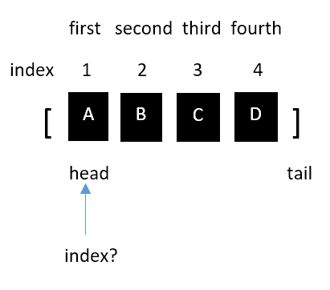
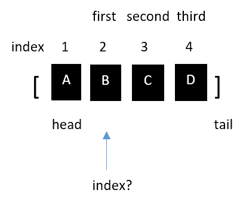
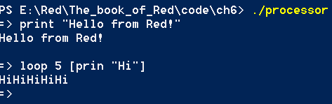

# 使用序列和块

正如你现在所知，Red 中几乎所有内容都写在 `[]` 内。这些表示块，它们是一种系列。块和系列构成了 Red 代码的基础；事实上，如果你查看 第 3 章 中的类型层次结构，`Using Words, Values, and Types`，块也是一种 `series!` 类型。`series!` 类型除了块之外还包含许多其他常见类型，例如字符串、文件、二进制值、标签、电子邮件、图像等。这就是为什么用于块系列的函数和操作可以应用于其他类型的值。例如，字符串本质上是字符的系列，因此用于操作块系列的技术也可以用于字符串操作。

在本章中，我们将学习如何使用系列。我们将学习如何将系列视为具有头部和尾部以及移动索引的东西。我们将学习如何从系列中获取信息，如何遍历它、搜索、排序和更改它。这些操作是 Red 开发人员的核心工作，掌握系列的使用是获得 Red 熟练度的核心技能！

本章将涵盖以下主题：
* 系列和块
* 导航和遍历系列
* 从系列获取信息
* 更改系列
* 复制系列
* 字符串作为系列

## 技术要求

你可以在 [`github.com/PacktPublishing/Learn-Red-Fundamentals-of-Red/tree/master/Chapter05`](https://github.com/PacktPublishing/Learn-Red-Fundamentals-of-Red/tree/master/Chapter05) 找到本章的代码。如果你已在 Windows、OS X 或 Linux 上安装了 Red，如 第 2 章 中所述，`Setting Up for Development`，你就可以开始了。你可以在 Red 控制台中输入或粘贴任何代码以查看其结果，或者你可以使用编辑器，例如 Visual Studio Code。

## 序列和块

让我们看一个例子。字母 `A B C D` 包含在块 `[A B C D]` 中。来自其他编程语言的人可能更习惯于 *lists* 或 *arrays* 这样的术语。这些与系列非常相似。在 Red 中，多维数组可以用嵌套块表示。如果你想要更正式的定义，我们可以说系列是 *一组有序的项目*，可以是值（数据）或词（代码）。在前面的例子中，项目是词 `A B` 等（它们不是字符串或字符），并且它们必须在程序运行时获得一个值。在 Red 中，你可以像操作数据一样轻松地操作代码。

=> 现在回答 `Questions` 部分的问题 1。

由于系列是有序的，其中的每个项目都可以通过一个数字来引用——它的 `index`。Red 中的索引从 `1` 开始计数，因此前面系列中索引为 `3` 的项目是 `C`。在字符串系列 `"Good dog!"` 中，索引 `4` 的项目是 `#"d"` 字符。还有 `empty series`，它没有任何元素——`[]` 或 `""`。


我们可以给我们的系列命名——`data: \[A B C D\]`；它的类型是 `block!`。但它也是一个 `series?`，如果你查看 *类型系统* 部分中的 *类型图*，在 第三章 中，*使用单词、值和类型*。该图表还显示 `any-block?` 是 `series?` 的子类型：

```
type? data    ;== block!
block? data   ;== true
series? data  ;== true
```

这里有一些系列的更多示例：

```
:-- see Chapter05/series-and-blocks.red:
names: ["John" "Dave" "Jane" "Bob" "Sue"]
codes: [2804 9439 2386 9823 4217]
files: [%employees %vendors %contractors %events]
sales: ["Saturday" 56 "Sunday" 11]
some-code: [print "Hello"]
```

现在让我们看看如何在系列中移动。

# 在序列中导航和循环

在系列中导航并不是火箭科学，但你必须习惯它。在控制台中跟随操作，并为了真正理解它，画一些图，比如我们将向你展示的那些。

## 一步一步——head、tail、index? 和 next

上一节中的 `data` 词不仅仅是系列的名称——它也是指向我们在特定时刻在系列中的位置的指针。你可以称该位置为 *当前索引*，它由 `index?` 函数给出。系列创建后立即，我们有 `index? data ;== 1`。这里有一张图，以便你能快速了解正在发生的事情：



请记住，在 Red 中，索引从 `1` 开始，而不是像大多数其他（基于 C 的）语言那样从 `0` 开始。

当当前索引为 `1` 时，我们也在系列的 *头部*：

```
;-- see Chapter05/navigating-and-looping.red:
head? data   ;== true
```

`head data` 短语返回整个 `\[A B C D\]` 系列，从索引 `1` 开始。`tail` 总是指向系列最后一个元素之后的位置，因此现在它是一个空列表：

```
tail data ;== []
```

我们处于头部，而不是尾部，所以 `tail? data ;== false`。你也可以询问系列的 `first`、`second`（一直到 `fifth`）等项目：

```
first data   ;== A
second data  ;== B
last data    ;== D
```

我们可以使用 `next` 操作向前移动系列——例如，`next data ;== \[B C D\]`。

现在当前索引已向右移动一个位置（系列的末尾）。

`next` 之后 `data` 词没有改变——它仍然是 `\[A B C D\]`——因此多次应用 `next` 不会改变任何东西。如果你想让 `data` 改变，你必须创建一个新的绑定。不要使用 `next data`，而是执行以下操作：

```
data: next data ;== [B C D]
data            ;== [B C D]
```

这里有一张图来清楚地说明 `next` 之后发生了什么：



`next` 词递增当前索引。`index? data` 现在是 `2`，`head? data` 返回 `false`（我们不再在头部，`tail` 函数给出相同的结果，并且 `first data` 现在是 `B`。

当我们超出系列末尾时会发生什么？

=> 通过回答 *问题* 部分中的第 2 个问题来找出答案。

我们可以看到 `data` 已变成 `\[\]`，并且 `tail? data` 现在返回 `true`。也许令人惊讶的是，`first data` 返回 `none`，并且 `index? data` 是 `5`——我们只是超出了系列范围而没有出现错误。

你也可以通过使用 `back` 来实验在系列中向后移动，其效果相反。要一次移动更多步，使用 `skip data n`，其中 `n` 是一个整数，表示要移动的步数。另外，找出使用 `data: skip data -2` 时会发生什么。

=> 现在尝试 *问题* 部分中的第 3 和第 4 个问题。

你可能会想完整的系列在哪里。它仍然完整地保存在内存中，就在你面前：

```
head data          ;== [A B C D]
```

要重新开始系列，只需使用 `head` 并将其赋给 `data`：

```
data: head data   ;== [A B C D]
```

这是有意的——Red *大量重用系列* 以允许脚本更快运行并节省内存。

## 在序列中循环——foreach 和 forall

在许多情况下，你希望遍历整个系列，对系列中的每个项目执行代码，使用比 `next` 更简单的方法。Red 有 `foreach` 和 `forall` 词来实现这一点。

`foreach` 词对系列中的 *每个项目* 执行代码块：

```
names: ["John" "Dave" "Jane"]
foreach name names [print name]
```

这会打印出以下内容：

```
John
Dave
Jane
```

你应该为迭代变量选择一个描述性的词（这里我们使用了 `name`）。它按顺序逐个取项目的数值。

`forall` 词也遍历系列，但它对 *所有项目一起* 执行代码块，并在每次迭代中结合 `next`：

```
forall names [print names]
```

这随后会打印出以下内容：

```
John Dave Jane
Dave Jane
Jane
```

=> 现在回答 *问题* 部分中的第 5 个问题。

假设我们有一个名为 `contacts` 的系列，用于存储我的联系人的姓名、地址和电话，每行一个以提高可读性：

```
contacts: [
    "John Smith" "123 Tomline Lane Forest Hills, NJ" "555-1234"
    "Paul Thompson" "234 Georgetown Pl. Grove, AL" "555-2345"
    "Jim Persee" "345 Pickles Pike Orange Grove, FL" "555-3456"
    "George Jones" "456 Topforge Court Mountain Creek, CO" ""
    "Tim Paulson" "" "555-5678"
]
```

系列是组织数据的一种直接方式，空字符串表示缺失的数据。

`foreach` 词可以进行一些非常方便的 *模式匹配*，按需提取项目：

```
foreach [name address phone] contacts [print [name "/" phone]]
```

这会打印出以下内容：

```
John Smith / 555-1234
Paul Thompson / 555-2345
Jim Persee / 555-3456
George Jones /
Tim Paulson / 555-5678
```

当你需要更多灵活性时，上一章的 `while` 或 `repeat` 循环始终可以使用。例如：

```
colors: [red green blue yellow orange]
while [not tail? colors] [
    print first colors
    colors: next colors
]
```

这会打印出以下内容：

```
red
green
blue
yellow
orange
```

## 从序列获取信息

系列可以包含任何类型的数值，甚至是混合类型。经常需要知道系列包含多少个项目。这由 `length?` 属性给出：

```
;-- see Chapter05/getting-info.red:
data: [A B C D]
length? data ;== 4
```

如果系列没有项目，则为空——`empty?` 函数返回 `true`：

```
empty-lst: []
length? empty-lst ;== 0
empty? empty-lst  ;== true
```

## 选择项目 – pick 和 /

我们可以使用 `data: \[A B C D\]` 系列以两种方式选择项目：

*   通过所谓的 *路径* 记法指定项目索引，例如 `data/3 ;== C`
*   使用 `pick` 指定项目索引，例如 `pick data 3 ;== C`

=> 现在回答 *问题* 部分中的第 6 个问题。

如果项目索引是一个变量，这里用 `i` 表示，你需要使用 `:i` `get-word` 记法：

```
i: 3
data/:i      ;== C
data/(i)     ;== C   ; this alternative works also
```

这很重要，因为 `data/i` 不会产生任何错误，但会返回 `none`。当指定的索引超出范围时，不会生成错误，结果也为 `none`，例如，`pick data 100 ;== none`。

字符串也是系列，因此 `pick` 和 `/` 也适用于字符串，结果为字符（`#`）：

```
s: "I'm enjoying Red"
s/4         ;== #" "
pick s 5    ;== #"e"
```

需要注意的是，对于 `pick` 和 `/` 函数，给定的索引从当前索引 `index?` 值开始计数：

`data: next data ;== \[B C D\]`

`pick data 3 ;== D`

`data/3 ;== D`

这个 `/` 路径记法通常用于执行以下操作：

*   从嵌套的 *系列* 访问项目（参见 *更改项目 – poke、replace 和 change* 部分）
*   使用 `pick` 从字符串获取字符
*   在 *对象* 中访问变量，例如 `system/console/prompt`（它为 `>>`）


# 路径值和基本操作
* 为 `functions` 添加细化以改变其工作方式
* 描述文件和目录的路径

`a/b/c` 短语是路径值的示例：
```
type? 'a/b/c    ;== path!
```
`path!` 词甚至在类型系统中是一种类型。因为路径是一种系列的类型（参见 第 3 章 中 *类型系统* 部分的类型图，*使用词、值和类型*），你对系列能做的任何事，也都能对路径值做。例如：
```
second system/console/prompt    ;== #">
```
⇒ 现在尝试 *问题* 部分的第 7 题。

要快速获取从给定索引开始的系列的一部分，请使用 `at`：
```
at data 3 ;== [C D]
```
另一个方便的操作是 `extract`。它有一个整数参数 `n`，允许你从系列中获取每个第 `nth` 项，从第一项开始。这里，我们使用之前的 `contacts` 系列仅获取名称——`extract contacts 3`。

这给出了以下结果：
```
[
    "John Smith" 
    "Paul Thompson" 
    "Jim Persee" 
    "George Jones"
    "Tim Paulson"
]
```
规则很简单：从第一项开始计数（包括该项）到给定数字，然后取该项，以此类推。

如果你想从系列中的某个位置开始——例如，仅获取电话号码——请使用细化指定，例如 `extract/index series n position`：
```
phones: extract/index contacts 3 3
;== ["555-1234" "555-2345" "555-3456" "" "555-5678"]
```

# 搜索项目 – select 和 find

对于搜索项目，有两个特定的词——`select` 和 `find`。起初，它们的运算似乎很奇怪。`select` 词 *返回搜索匹配后系列中的下一项*：
```
data1: [1 2 3 4]
select data1 2 ;== 3
select data1 99 ;== none
```
如果未找到项目，则返回 `none`。如果搜索的词没有值，请将其作为块使用以防止其求值，或使用 `'` 将其作为字面词使用：
```
data2: [A B C D]
select data2 [B]    ;== C
select data2 'B     ;== C
```
另一方面，`find` 词从 *匹配处* 开始，一直延伸到尾部，将该部分作为系列返回：
```
find data1 2 ;== [2 3 4]
```
\=> 现在回答 *问题* 部分的第 8 题。

`select` 和 `find` 都有几个细化，你可以用 `? select` 和 `? find` 查阅。这里，我们将重点介绍其中几个重要的细化。

如果你不想在 `find` 中包含匹配项，请使用 `/tail`：
```
find/tail data1 2 ;== [3 4]
```
/part 词允许你仅搜索系列的一部分，由要搜索的项目数给出：
```
blk: [11 12 13 14 [22 33 44] 15]
select blk 14          ;== [22 33 44]
select/part blk 12 3   ;== 13
select/part blk 14 3   ;== none
```
以下结果可能会让你感到惊讶：
```
select blk [22 33 44] ;== none
```
出现此结果的原因是，为了将系列 *作为单个值* 进行搜索，我们必须使用 `/only` 细化，从而得到短语 `select/only blk \[22 33 44\] ;== 15`。

`/only` 细化也与许多其他词一起使用，含义相同。

当需要进行区分大小写的搜索时，使用 `/case`。

\=> 现在回答 *问题* 部分的第 9 题。

# 排序

在很多情况下，先 *排序* 系列可以使搜索更快，就像使用 `sort` 所做的那样：
```
codes: [2804 -9439 2386 9823 -4217]
sort codes               ;== [-9439 -4217 2386 2804 9823]
codes                    ;== [-9439 -4217 2386 2804 9823]
sort/reverse codes       ;== == [9823 2804 2386 -4217 -9439] 
```
排序是就地进行的，排序后的 `codes` 系列也会被返回。`/reverse` 选项按降序对系列进行排序，从高到低。`sort` 词也接受 `/part` 细化；使用该词意味着它只会对系列的该部分进行排序：
```
codes: [2804 -9439 2386 9823 -4217]
sort/part codes 4       ;== [-9439 2386 2804 9823 -4217]
```
细化也可以组合，如以下代码所示：
```
codes: [2804 -9439 2386 9823 -4217]
sort/reverse/part codes 4       ;== [9823 2804 2386 -9439 -4217]
```
要反转顺序（最后一个项目变为第一个，依此类推），请使用 `reverse`：
```
codes: [2804 -9439 2386 9823 -4217]
reverse codes
codes     ;== [-4217 9823 2386 -9439 2804]
```
`reverse` 词也会改变原始系列。

# 更改序列

现在我们将查看专门用于以某种方式更改系列的动作词——更改、添加或删除项目。

## 更改项目 – poke、replace 和 change

在系列中更改项目有两种方法。让我们使用 `data: \[A B C D\]`，其中 `A`、`B`、`C` 和 `D` 都是词。假设我们想用词 `X` 替换 `C`。我们可以按如下方式操作：
* 绑定到由项目索引指定的路径——例如，`data/3: 'X ;== X`。现在 `data` 已变为 `\[A B X D\]`。为什么我们需要 `'X` 而不是仅仅 `X`？原因是当你绑定到一个词时，该词会被求值。因此你必须引用 `X` 词以防止求值。如果你不这样做而使用 `data/3: X`，你会得到一个脚本错误：X 没有值。
* 使用 `poke` 指定项目索引，例如 `poke data 3 'X`（位置在前，然后是新值）。

（要将 `C` 替换为字符串 `"X"`，我们只需使用 `data/3: "X" ;== "X"`；然后 `data` 变为 `\[A B "X" D\]`）。

如果我们想更改嵌套系列中的项目，例如 `blk: \[11 12 13 14 \[22 33 44\] 15\]` 呢？假设我们想将 `33` 改为 `108`。最简单的方法是使用路径表示法，例如 `blk/5/2: 108`（嵌套系列是 `blk` 中的第 `5` 项，而 `33` 是嵌套系列中的第 `2` 项）。现在 `blk` 确实已变为 `\[11 12 13 14 \[22 108 44\] 15\]`。

请记住当索引是词时使用获取表示法 `:`——例如，当 `i` 为 `5` 且 `j` 为 `2` 时，我们可以使用 `blk/:i/:j: 108`。

\=> 现在回答 *问题* 部分的第 10 题。

用其他东西替换系列中的项目同样简单：
```
;-- see Chapter05/changing-series.red:
replace [10 11 12] 11 13 ;== [10 13 12]
```
如果需要替换某个项目的全部出现，请使用 `/all`：
```
replace/all [10 11 12 11] 11 13 ;== [10 13 12 13]
```
要在系列的当前索引处将若干项目更改为其他项目，请使用 `change` 词：
```
s: [2 7 13 42]
change s [a b]   ;== [13 42]
s                ;== [a b 13 42]
```
其他可以更改系列的内置词有 `alter` 和 `swap`。请参阅代码文件以获取一些示例。

# 添加新项目 – append、repend 和 insert

要向系列添加新项目，可以使用 `append`、`repend` 和 `insert` 词。

## append

要向系列的 *末尾* 添加新项目，请使用 `append` 词，我们之前已经遇到过几次：
```
append [10 11 12] 13       ;== [10 11 12 13]
append [10 11 12] [13 14]  ;== [10 11 12 13 14]
```
如你所见，要添加的项目也可以是一个系列，在这种情况下它会融入第一个系列。如果你想将其作为系列添加，你必须使用 `/only`：
```
append/only [10 11 12] [13 14]      ;== [10 11 12 [13 14]]
```
如果你只想从系列中添加有限数量的项目，请使用 `/part`：
```
append/part [10 11 12] [13 14 15] 2 ;== [10 11 12 13 14]
```
使用 `?` 查找 `/dup` 细化是做什么用的并试用一下！

这里有一个更完整的代码片段，说明了使用 `append` 与 `foreach` 的用法，使用 `copy` 进行安全初始化：
```
list: ["John" 2804 "Dave" 9439 "Jane" 2386 "Bob" 9823 "Sue" 4217]
names: copy []
foreach [n c] list [append names n]  ; extract the names from list
names   ;== ["John" "Dave" "Jane" "Bob" "Sue"]
```
这里是另一段典型的代码，使用 `repeat`、`length?` 和 `append`：
```
names: ["John" "Dave" "Jane" "Bob" "Sue"]
repeat i (length? names) [
    print append append form i ": " pick names i
]
```


这会打印以下输出：

```
1: John
2: Dave
3: Jane
4: Bob
5: Sue
```

代码的工作方式如下：`repeat` 在系列的长度上循环。对于每个项目，你取其索引 `i`，它通过 `form` 转换为字符串。这与 `": "` 连接成一个字符串，形成 `append form i ": "`。这构成了最左侧 `append` 的第一个参数；第二个是 `pick names i`，即该位置的名称，在本例中为 `"John"`。

如果这段代码对你来说不够清晰，请使用临时变量或括号来澄清：

```
names: ["John" "Dave" "Jane" "Bob" "Sue"]
repeat i (length? names) [
    print append (append form i ": ") (pick names i)
]
```

一般来说，要理解某个求值是如何工作的，请在 REPL 中使用 `? append` 查阅该词（例如 `append`）的文档。从 `USAGE: APPEND series value` 可以看出它接受两个参数。然后找到这些参数，对包含多个词的参数加上 `( )`。在我们的例子中，这会得到 `print append (append (form i) ": ") (pick names i)`。然后你可以开始移除多余的 `( )` 实例，或为其他参数命名变量，使括号不再需要。

也许这听起来对你来说过于复杂。我们想详细展示 Red 如何处理其语法。但在这种情况下，你只需用这个简单的 `print` 块语句替换包含双 `append` 的行：

```
print [form i ":" pick names i]
```

## repend
`repend` 词的工作方式与 `append` 相同，但 `repend` 会先求值（或归约——`re` 来自 `reduce`）要添加的系列：

```
repend [10 11 12] [8 + 5 "pi"] ;== [10 11 12 13 "pi"]
```

与往常一样，使用 `/only` 时，添加的系列仍保持为系列：

```
repend/only [10 11 12] [8 + 5 "pi"] ;== == [10 11 12 [13 "pi"]]
```

## insert
要向系列本身添加新项目，请使用 `insert`，它会在当前索引处插入项目（正如你所知，这由 `index?` 给出，并且可以通过 `at` 更改）。对于新定义的系列，`insert` 将发生在系列的开头：

```
s: [10 11 12]  ;== [10 11 12]
insert s 13    ;== [10 11 12]
s              ;== [13 10 11 12]
```

这里，你可以看到 `insert` 返回插入后的系列。但 `insert` 也会更改系列 `s`，因此你不必使用 `s: insert s 13`！

要指定 `insert` 位置，请使用 `at`：

```
s: [10 11 12]      ;== [10 11 12]
insert at s 2 13   ;== [11 12]
s                  ;== [10 13 11 12]
```

`insert` 词具有与 `append` 相同的 refinements。

## 删除项 – remove 和 take
要删除系列中的第一个项目，请使用 `remove`：

```
remove [10 11 12] ;== [11 12]
```

`take` 词做同样的事，但返回该项目而不是更改后的系列：

```
take [10 11 12] ;== 10
```

要删除特定位置的项目，请使用 `at`，与我们对 `insert` 的做法相同：

```
s: [0 1 2 3 4 5]   ;== [0 1 2 3 4 5]
remove at s 2      ;== [2 3 4 5] 
s                  ;== [0 2 3 4 5]   ; item 1 at position 2 is deleted
```

要删除系列的最后一个项目，你可以使用 `remove at s length? s`，但 `take/last` 做同样的事并且也返回该最后一个项目：

```
take/last [10 11 12] ;== 12
```

要删除一定数量的项目，请使用 `/part`：

```
remove/part [10 11 12] 2    ;== [12]
```

`take/part` 短语对系列有相同的效果，但返回被删除的项目。

使用 `unique` 词可以消除系列中的重复项目：

```
unique [7 13 42 108 2 7 14 42 109] returns [7 13 42 108 2 14 109]
```

如果需要在某个条件为真时移除系列中的每个项目，请使用 `remove-each` 词，如以下示例所示：

```
ser: [7 13 42 108]
remove-each item ser [even? item]    ; (1)
ser  ;== [7 13]
remove-each item ser [item < 10]     ; (2)
ser  ;== [13]
```

正如你所见，条件被放在一个块中。在第 `(1)` 行，所有偶数都被移除，在第 `(2)` 行，所有小于 `10` 的数字都被移除。

所有这些函数都会更改其系列参数！

## 移动项 – move 和 swap
要将第一个项目从一个系列移动到另一个系列，请使用 `move` 词：

```
s: ["A" "B" "C"]
move [1 2 3] s    ;== [2 3]
s                 ;== [1 "A" "B" "C"]
```

它返回更改后的第一个系列，但正如你所见，第二个系列也被更改。要移动多个项目，请在代码短语 `move/part series1 series2 number` 中再次使用 `/part`。

\=> 现在回答 *Questions* 部分的第 11 题。

使用 `swap` 交换两个系列的第一个元素（们）。它返回第一个系列，但会更改两者：

```
swap [A B C][1 2 3] ;== [1 B C]
```

## 序列作为集合
Red 有一些基本操作，可以使其将系列作为集合使用。例如，假设我们有两个集合 `s1` 和 `s2`，包含 `s1: \[7 13 42 108\]` 和 `s2: \[2 7 14 42 109\]`（代码可在 `Chapter05/sets.red` 中找到）：

*   `union s1 s2` 返回 `\[7 13 42 108 2 14 109\]`：系列被合并在一起，并且重复项被消除
*   `intersect s1 s2` 返回 `\[7 42\]`：仅保留共同元素
*   `difference s1 s2` 返回 `\[13 108 2 14 109\]`：仅保留不共同于两者的元素
*   `exclude s1 s2` 返回 `\[13 108\]`：所有来自第二个集合的元素都从第一个集合中移除

## 复制序列
Red 尽可能在内存中重用系列和对象，以提高性能。这意味着使用变量指向同一系列通常是个坏主意，并且是代码中难以找到的 bug 的原因。我们已经在 *Assigning and copying* 部分的 第 3 章，*Using Words, Values, and Types* 中告诉你，使用 `copy` 是确保你的变量指向不同内存位置的最安全方法。这样，对一个变量的更改不会影响另一个变量。

为了理解这一点，请检查并尝试预测以下代码的输出：

```
;-- see Chapter05/copying.red:
not-expected: [
    var1: ""
    append var1 "*"
    print var1
]

loop 3 [do not-expected]
```

`do` 词执行 `not-expected` 代码块，而 `append` 将 `var1` 字符串与 `\*` 连接。

你可能期望打印出三行 `\*`。但实际输出如下：

```
*
**
***
```

这是为什么？因为 `var1` 是一个字符串，而字符串也是一个系列，并且它会保留其在内存中的值！

`var1: ""` 短语不是像大多数其他编程语言中的初始化——它是一个绑定，并且 `var1` 词所绑定的值不会被它擦除。

事实上，使用 `var1: ""` 时会发生以下情况：

1. 分配新的内存存储
2. 该存储被初始化为空字符串
3. 然后该存储被永久分配给 `var1` 变量

我们看到的结果可以应用于一个函数来实现本地缓存。

但如果你不想要那样，解决方案是什么？只需使用 `copy ""` 短语进行适当的初始化！

```
expected: [
    var1: copy ""
    append var1 "*"
    print var1
]

loop 3 [do expected]
```

产生的输出是在三行连续行上各有一个 `\*`，正如预期的那样。

`copy` 词有效地 *复制* 系列、字符串或其他对象中包含的数据，并且几乎总是应该用于此类值。要创建空块，请使用以下内容：  
`copy \[\]`

要创建空字符串，请使用以下内容：  
`copy ""`

你现在可能会觉得这很奇怪，但持久系列是 Red 工作方式的重要组成部分，并且它们使语言中的许多其他有价值的功能成为可能。

出于同样的原因，删除系列中所有项目（从当前索引开始）最安全的方法是使用内置动作词 `clear`：

```
data: [A B C D]
clear data
data  ;== []
```

如果你只想复制值的一部分，请使用 `/part` refinement:  
`copy/part "Red herring" 3 ;== "Red"`


# 浅拷贝与深拷贝
`copy/part \[A B C D\] 3 ;== \[A B C\]`

我们到目前为止使用的 `copy` 词有时被称为 *浅拷贝*。原因如下：

```
nblk: [11 12 13 14 [22 33 44] 15]
blk: copy nblk   ;== [11 12 13 14 [22 33 44] 15]
nblk/3: 108
nblk             ;== [11 12 108 14 [22 33 44] 15]
blk              ;== [11 12 13 14 [22 33 44] 15]
```

复制的 `blk` 系列在原始系列发生变化时不会改变——这正是我们期望的。但现在看看当我们在嵌套系列中更改某些内容时会发生什么：

```
nblk/5/2: 108
nblk   ;== [11 12 108 14 [22 108 44] 15]
blk    ;== [11 12 13 14 [22 108 44] 15]
```

复制的 `blk` 块也显示了更改！拷贝是浅层的，因为对于 *嵌套系列*，仍然分配对该系列的引用，因此其值不会被复制，并且更改可能发生在拷贝中。

为避免这种情况，无论嵌套层级有多深，你都必须使用 `/deep` 修饰符进行深拷贝。让我们在同一个示例上使用它：

```
nblk: [11 12 13 14 [22 33 44] 15]
blk: copy/deep nblk   ;== [11 12 13 14 [22 33 44] 15]
nblk/3: 108
nblk                  ;== [11 12 108 14 [22 33 44] 15]
blk                   ;== [11 12 13 14 [22 33 44] 15]
nblk/5/2: 108
nblk                  ;== [11 12 108 14 [22 108 44] 15]
blk                   ;== [11 12 13 14 [22 33 44] 15]
```

现在无论原始系列发生什么变化，`blk` 都不会改变。

# 字符串作为序列

因为字符串是字符的系列，本章中讨论的所有函数也适用于字符串。以下是它们与字符串一起使用的一些示例，展示了更高级的可能性，这些可能性也适用于文件、URL、标签和电子邮件：

```
str: "Red"    ;== "Red"
type? str     ;== string!
string? str   ;== true
series? str   ;== true
```

# 分割字符串 – split

你可以在空格、其他字符甚至字符串上分割字符串——所有这些都称为 *定界符*，分割的结果是一个系列。以下是一些示例：

```
;-- see Chapter05/strings-as-series.red:
s1: "The quick brown fox jumps over the lazy dog"
split s1 " " ;== ["The" "quick" "brown" "fox" "jumps" "over" "the" "lazy" "dog"]
s2: "bracadabra"
split s2 "a" ;== ["br" "c" "d" "br"]
s3: "abracadabra"
split s3 "a" ;== ["" "br" "c" "d" "br"]
```

从最后一行可以看出，如果字符串以定界符开头，找到的第一个分割项将是一个空字符串 `""`。 `split` 词在文本文件的分析和处理中非常有用。

# 将序列转换为字符串 – form

系列可以使用 `form` 转换为字符串。我们在 第 3 章 中看到，*使用词、值和类型*，`form` 将每个值转换为字符串。对于系列而言，它会去掉括号并在项目之间添加空格：

```
s: ["Red" "world" 13 42 4 * 8 ["a" "bee" "cee"]]
form s          ;== "Red world 13 42 4 * 8 a bee cee"
form/part s 15  ;== "Red world 13 42" ; limits the number of characters to take
```

原始系列不会被更改。 `form` 词在将包含 `\[ \]` 的一堆数据转换为文本时很有用。

# 重新连接块 – rejoin

在 第 3 章 中 *使用词、值和类型* 的 *使用 do 和 reduce 进行求值* 部分，我们看到了 `reduce` 如何在块内求值表达式并返回该块。 `rejoin` 词更进一步——它不仅减少块，还会 *将块中的项目连接成一个字符串*，中间没有空格。它返回重新连接的项目，但原始系列不会被更改。它类似于 `form`，但带有求值。以下是一些示例：

```
ser: ["Product is: " 7 * 42]
rejoin ser   ;== "Product is: 294"
ser          ;== ["Product is: " 7 * 42]
```

因为 `rejoin` 将块转换为字符串，所以它经常用于输出打印语句，例如 `print rejoin \[newline "Total Images: " count\] `。

# 清除字符串的一部分 – clear 和 trim

假设我们想在字符串 `s: "American politics"` 中删除 `"American"` 之后的所有内容。我们可以应用 `clear`，跳过 `"politics"` 之前的字符，使短语变为 `clear skip s 8`。或者我们可以让 Red 使用 `find` 来完成工作，使短语变为 `clear find s " politics"`。在这两种情况下，`s` 都变为 `"American"`。

如果你只是想从字符串中删除空格，请使用 `trim`。此方法非常通用，可以包含很多修饰符：

```
str: " No more war ! "
trim/head str       ;== "No more war ! "
trim/tail str       ;== "No more war !"
; trim str          ; same as both /head and /tail
trim/all str        ;== "Nomorewar!" ; removes all spaces
trim/with str "!"   ;== "Nomorewar"   ; removes a specific string
```

`trim` 词在处理输入或文本文件时非常有用。

这里我们也提到 `pad` 词，它类似于 `trim` 的相反操作。它在字符串右侧添加空格（使用 `/left` 则在左侧），使字符数和空格数等于给定数字：

```
s: "Red"
pad s 5
s ;== "Red  "
pad/left s 7
s ;== "  Red  "
```

`pad` 词对于生成对齐的输出很有用。

# 向字符串添加内容 – append 和 insert

要在字符串开头插入内容，请使用 `insert`：

```
str: "painting"
insert str "beautiful "
str ;== "beautiful painting"
```

以下是如何在特定位置将子字符串插入字符串的方法：

```
str: "abcdefg"
insert at str 3 "ONE"     ;== "cdefg"
str ;== "abONEcdefg"
; the same can be done with:
insert find str "c" "ONE" ;== "cdefg"
str                       ;== "abONEcdefg"
```

为了可读性，你可以写成 `insert (find str "c") "ONE"`。

到目前为止，你已经知道如何使用 `append` 将内容添加到字符串的尾部，换句话说，就是连接两个字符串：

```
str: "Red"           ;== "Red"
append str "100"     ;== "Red100"
append str [1 0 0]   ;== "Red100100"
```

请注意，在最后一个示例中，系列会使用 `form` 自动转换为字符串。

# 其他有用技巧

在本节中，我们将查看一系列示例，为你提供如何对字符串应用某些操作的思路。

使用 `find` 在字符串中 *查找字符或子字符串*。请记住，它返回从匹配字符或字符串开始的子字符串：

```
s1: "The quick brown fox jumps over the lazy dog"
find s1 "fox"   ;== "fox jumps over the lazy dog"
```

使用 `poke s 3 #"S"` 在 `s: "abcde"` 字符串中 *更改一个字符*，这样 `s` 就变为 `"abSde"`。

你也可以使用 `replace` 来完成此操作，使 `replace s "c" "S" ;== "abSde"`。

要 *获取字符串的左侧部分*，请提供字符计数，如短语 `copy/part str n` 中所用：

```
str: "beautiful"
copy/part str 4    ;== "beau"
```

要 *删除字符串的左侧部分*，从而有效地更改字符串，请使用 `remove/part`，如短语 `remove/part str 4 ;== "tiful"` 中所用。

同样，要 *获取字符串的右侧部分*（`n` 个字符），请使用 `at tail str -3`，在这种情况下它返回 `"ful"`。

要从字符串中 *获取子字符串*（换句话说，中间部分），从特定位置开始并指定长度，`copy/part` 和 `at` 就能解决问题：

```
str: "mnopqrst"
copy/part at str 2 4 ;-- start at position 2, get 4 items
;== "nopq"
```

使用 `exclude` 从字符串中 *删除所有元音*：

```
exclude "The United Kingdom" "aeiou" ;== "Th ndKgm"
```

要将字符串转换为小写或大写，请使用以下词：

```
str: "Red"
lowercase str        ;== "red"
uppercase str        ;== "RED"
lowercase/part str 1 
str                  ;== "rED"
```

\=> 现在回答 *问题* 部分的第 12 题。

# 摘要


恭喜！你现在能够使用 Red 的基本数据结构。你已经学习了 Red 中序列的概念，其 `head`、`tail` 和 `next` 单词用于在序列中移动索引位置。我们已经了解了如何使用 `pick` 或 `/` 语法选择一个项目，以及如何使用 `find` 和 `select` 搜索项目，以及如何更改、添加、删除和移动项目。最后，我们看到了如何 `copy` 序列的值，以及如何在字符串上使用序列操作。

起初用于操作序列的单词数量可能看起来有点 overwhelming，但它们在代码中经常使用，所以很快就会变得熟悉。也将变得清楚，结合这些单词可以产生一些强大的代码。

# 问题

1. 如何将序列 `data: [A B C D]` 变成字符序列？是通过表述为 `data: ["A" "B" "C" "D"]` 吗？

2. 我们现在有一个包含 `[B C D]` 的 `data` 序列。通过三次应用 `next` 移动到尾部，同时将结果绑定到 `data`。使用 `head?`、`tail?` 和 `index?` 获取每个下一阶段的信息。绘制一个示意图。

3. 使用上一个问题末尾的序列，应用带绑定的 `back` 并获取信息。

4. 找出使用 `data: skip data -2` 时会发生什么。

5. 给定序列 `[323 2498 94321 31 82`，打印出大于 1,000 的数字。

6. 从空序列中选择一个项目时结果是什么？

7. 给定序列 `s: ["A" "B" [42.1 42.2 42.3] red]`，如何使用路径表示法访问项目 `42.2`？尝试使用 `pick` 做同样的操作。

8. 给定上一个问题中的 `s` 序列，`length? find s "B"` 的结果是什么？

9. 给定值为 `[[3 7][13 42][108 666]]` 的 `ser` 序列，`ser/1/2` 的值是什么？如何选择项目 `108`？如何将 `666` 改为 `999`？

10. 以下两个表达式的结果是什么：

```
select/part ["Red" "Crystal" "Ruby" "Java" "Go" "Rust"] ["Java"] 4
find/part ["Red" "Crystal" "Ruby" "Java" "Go" "Rust"] ["Java"] 4
```

如果将 `4` 改为 `3` 会怎样？

11. 使用 `move` 将序列头部项目移动到尾部。首先移动一个项目，然后使用 `/part` 移动几个项目。

12. 给定序列 `names: ["John" "Dave" "Jane" "Bob" "Sue"]`，编写一段代码片段遍历序列并打印出包含字符 `a` 的名字。然后同时查找字母 `a` 和 `e`。

# 使用函数和对象

本章关于通过使用函数和对象来模块化代码。

我们已经遇到了很多内置函数，例如 `print` 和 `cd`，当然你也可以编写用户自定义函数。当程序代码变得更长更复杂时，你希望能够为某些代码段命名。例如，在处理来自文件或网络的数据流时，你希望有一个 `process-request` 或 `process-record` 函数，其中包含处理一个数据块的逻辑。这样，你就可以在需要时每次调用此函数。这导致代码更少、结构更好、更易读。代码越少意味着 bug 越少！函数可以接受参数、局部变量和细化，我们将在本章后面探索如何使用这些。

另一种对代码进行分组的方式是定义对象。Red 不是基于类的，像今天常用的大多数面向对象语言，如 Java、Python、C# 或 Ruby，它采用更基于原型的[content]
恭喜！你现在能够使用 Red 的基本数据结构。你已经学习了 Red 中序列的概念，其 `head`、`tail` 和 `next` 单词用于在序列中移动索引位置。我们已经了解了如何使用 `pick` 或 `/` 语法选择一个项目，以及如何使用 `find` 和 `select` 搜索项目，以及如何更改、添加、删除和移动项目。最后，我们看到了如何 `copy` 序列的值，以及如何在字符串上使用序列操作。

起初用于操作序列的单词数量可能看起来有点 overwhelming，但它们在代码中经常使用，所以很快就会变得熟悉。也将变得清楚，结合这些单词可以产生一些强大的代码。

# 问题

1. 如何将序列 `data: [A B C D]` 变成字符序列？是通过表述为 `data: ["A" "B" "C" "D"]` 吗？

2. 我们现在有一个包含 `[B C D]` 的 `data` 序列。通过三次应用 `next` 移动到尾部，同时将结果绑定到 `data`。使用 `head?`、`tail?` 和 `index?` 获取每个下一阶段的信息。绘制一个示意图。

3. 使用上一个问题末尾的序列，应用带绑定的 `back` 并获取信息。

4. 找出使用 `data: skip data -2` 时会发生什么。

5. 给定序列 `[323 2498 94321 31 82`，打印出大于 1,000 的数字。

6. 从空序列中选择一个项目时结果是什么？

7. 给定序列 `s: ["A" "B" [42.1 42.2 42.3] red]`，如何使用路径表示法访问项目 `42.2`？尝试使用 `pick` 做同样的操作。

8. 给定上一个问题中的 `s` 序列，`length? find s "B"` 的结果是什么？

9. 给定值为 `[[3 7][13 42][108 666]]` 的 `ser` 序列，`ser/1/2` 的值是什么？如何选择项目 `108`？如何将 `666` 改为 `999`？

10. 以下两个表达式的结果是什么：

```
select/part ["Red" "Crystal" "Ruby" "Java" "Go" "Rust"] ["Java"] 4
find/part ["Red" "Crystal" "Ruby" "Java" "Go" "Rust"] ["Java"] 4
```

如果将 `4` 改为 `3` 会怎样？

11. 使用 `move` 将序列头部项目移动到尾部。首先移动一个项目，然后使用 `/part` 移动几个项目。

12. 给定序列 `names: ["John" "Dave" "Jane" "Bob" "Sue"]`，编写一段代码片段遍历序列并打印出包含字符 `a` 的名字。然后同时查找字母 `a` 和 `e`。

# 使用函数和对象

本章关于通过使用函数和对象来模块化代码。

我们已经遇到了很多内置函数，例如 `print` 和 `cd`，当然你也可以编写用户自定义函数。当程序代码变得更长更复杂时，你希望能够为某些代码段命名。例如，在处理来自文件或网络的数据流时，你希望有一个 `process-request` 或 `process-record` 函数，其中包含处理一个数据块的逻辑。这样，你就可以在需要时每次调用此函数。这导致代码更少、结构更好、更易读。代码越少意味着 bug 越少！函数可以接受参数、局部变量和细化，我们将在本章后面探索如何使用这些。

另一种对代码进行分组的方式是定义对象。Red 不是基于类的，像今天常用的大多数面向对象语言，如 Java、Python、C# 或 Ruby，它采用更基于原型的[content]
恭喜！你现在能够使用 Red 的基本数据结构。你已经学习了 Red 中序列的概念，其 `head`、`tail` 和 `next` 单词用于在序列中移动索引位置。我们已经了解了如何使用 `pick` 或 `/` 语法选择一个项目，以及如何使用 `find` 和 `select` 搜索项目，以及如何更改、添加、删除和移动项目。最后，我们看到了如何 `copy` 序列的值，以及如何在字符串上使用序列操作。

起初用于操作序列的单词数量可能看起来有点 overwhelming，但它们在代码中经常使用，所以很快就会变得熟悉。也将变得清楚，结合这些单词可以产生一些强大的代码。

# 问题

1. 如何将序列 `data: [A B C D]` 变成字符序列？是通过表述为 `data: ["A" "B" "C" "D"]` 吗？

2. 我们现在有一个包含 `[B C D]` 的 `data` 序列。通过三次应用 `next` 移动到尾部，同时将结果绑定到 `data`。使用 `head?`、`tail?` 和 `index?` 获取每个下一阶段的信息。绘制一个示意图。

3. 使用上一个问题末尾的序列，应用带绑定的 `back` 并获取信息。

4. 找出使用 `data: skip data -2` 时会发生什么。

5. 给定序列 `[323 2498 94321 31 82`，打印出大于 1,000 的数字。

6. 从空序列中选择一个项目时结果是什么？

7. 给定序列 `s: ["A" "B" [42.1 42.2 42.3] red]`，如何使用路径表示法访问项目 `42.2`？尝试使用 `pick` 做同样的操作。

8. 给定上一个问题中的 `s` 序列，`length? find s "B"` 的结果是什么？

9. 给定值为 `[[3 7][13 42][108 666]]` 的 `ser` 序列，`ser/1/2` 的值是什么？如何选择项目 `108`？如何将 `666` 改为 `999`？

10. 以下两个表达式的结果是什么：

```
select/part ["Red" "Crystal" "Ruby" "Java" "Go" "Rust"] ["Java"] 4
find/part ["Red" "Crystal" "Ruby" "Java" "Go" "Rust"] ["Java"] 4
```

如果将 `4` 改为 `3` 会怎样？

11. 使用 `move` 将序列头部项目移动到尾部。首先移动一个项目，然后使用 `/part` 移动几个项目。

12. 给定序列 `names: ["John" "Dave" "Jane" "Bob" "Sue"]`，编写一段代码片段遍历序列并打印出包含字符 `a` 的名字。然后同时查找字母 `a` 和 `e`。

# 使用函数和对象

本章关于通过使用函数和对象来模块化代码。

我们已经遇到了很多内置函数，例如 `print` 和 `cd`，当然你也可以编写用户自定义函数。当程序代码变得更长更复杂时，你希望能够为某些代码段命名。例如，在处理来自文件或网络的数据流时，你希望有一个 `process-request` 或 `process-record` 函数，其中包含处理一个数据块的逻辑。这样，你就可以在需要时每次调用此函数。这导致代码更少、结构更好、更易读。代码越少意味着 bug 越少！函数可以接受参数、局部变量和细化，我们将在本章后面探索如何使用这些。

另一种对代码进行分组的方式是定义对象。Red 不是基于类的，像今天常用的大多数面向对象语言，如 Java、Python、C# 或 Ruby，它采用更基于原型的[content]
恭喜！你现在能够使用 Red 的基本数据结构。你已经学习了 Red 中序列的概念，其 `head`、`tail` 和 `next` 单词用于在序列中移动索引位置。我们已经了解了如何使用 `pick` 或 `/` 语法选择一个项目，以及如何使用 `find` 和 `select` 搜索项目，以及如何更改、添加、删除和移动项目。最后，我们看到了如何 `copy` 序列的值，以及如何在字符串上使用序列操作。

起初用于操作序列的单词数量可能看起来有点 overwhelming，但它们在代码中经常使用，所以很快就会变得熟悉。也将变得清楚，结合这些单词可以产生一些强大的代码。

# 问题

1. 如何将序列 `data: [A B C D]` 变成字符序列？是通过表述为 `data: ["A" "B" "C" "D"]` 吗？

2. 我们现在有一个包含 `[B C D]` 的 `data` 序列。通过三次应用 `next` 移动到尾部，同时将结果绑定到 `data`。使用 `head?`、`tail?` 和 `index?` 获取每个下一阶段的信息。绘制一个示意图。

3. 使用上一个问题末尾的序列，应用带绑定的 `back` 并获取信息。

4. 找出使用 `data: skip data -2` 时会发生什么。

5. 给定序列 `[323 2498 94321 31 82`，打印出大于 1,000 的数字。

6. 从空序列中选择一个项目时结果是什么？

7. 给定序列 `s: ["A" "B" [42.1 42.2 42.3] red]`，如何使用路径表示法访问项目 `42.2`？尝试使用 `pick` 做同样的操作。

8. 给定上一个问题中的 `s` 序列，`length? find s "B"` 的结果是什么？

9. 给定值为 `[[3 7][13 42][108 666]]` 的 `ser` 序列，`ser/1/2` 的值是什么？如何选择项目 `108`？如何将 `666` 改为 `999`？

10. 以下两个表达式的结果是什么：

```
select/part ["Red" "Crystal" "Ruby" "Java" "Go" "Rust"] ["Java"] 4
find/part ["Red" "Crystal" "Ruby" "Java" "Go" "Rust"] ["Java"] 4
```

如果将 `4` 改为 `3` 会怎样？

11. 使用 `move` 将序列头部项目移动到尾部。首先移动一个项目，然后使用 `/part` 移动几个项目。

12. 给定序列 `names: ["John" "Dave" "Jane" "Bob" "Sue"]`，编写一段代码片段遍历序列并打印出包含字符 `a` 的名字。然后同时查找字母 `a` 和 `e`。

# 使用函数和对象

本章关于通过使用函数和对象来模块化代码。

我们已经遇到了很多内置函数，例如 `print` 和 `cd`，当然你也可以编写用户自定义函数。当程序代码变得更长更复杂时，你希望能够为某些代码段命名。例如，在处理来自文件或网络的数据流时，你希望有一个 `process-request` 或 `process-record` 函数，其中包含处理一个数据块的逻辑。这样，你就可以在需要时每次调用此函数。这导致代码更少、结构更好、更易读。代码越少意味着 bug 越少！函数可以接受参数、局部变量和细化，我们将在本章后面探索如何使用这些。

另一种对代码进行分组的方式是定义对象。Red 不是基于类的，像今天常用的大多数面向对象语言，如 Java、Python、C# 或 Ruby，它采用更基于原型的[content]
恭喜！你现在能够使用 Red 的基本数据结构。你已经学习了 Red 中序列的概念，其 `head`、`tail` 和 `next` 单词用于在序列中移动索引位置。我们已经了解了如何使用 `pick` 或 `/` 语法选择一个项目，以及如何使用 `find` 和 `select` 搜索项目，以及如何更改、添加、删除和移动项目。最后，我们看到了如何 `copy` 序列的值，以及如何在字符串上使用序列操作。

起初用于操作序列的单词数量可能看起来有点 overwhelming，但它们在代码中经常使用，所以很快就会变得熟悉。也将变得清楚，结合这些单词可以产生一些强大的代码。

# 问题

1. 如何将序列 `data: [A B C D]` 变成字符序列？是通过表述为 `data: ["A" "B" "C" "D"]` 吗？

2. 我们现在有一个包含 `[B C D]` 的 `data` 序列。通过三次应用 `next` 移动到尾部，同时将结果绑定到 `data`。使用 `head?`、`tail?` 和 `index?` 获取每个下一阶段的信息。绘制一个示意图。

3. 使用上一个问题末尾的序列，应用带绑定的 `back` 并获取信息。

4. 找出使用 `data: skip data -2` 时会发生什么。

5. 给定序列 `[323 2498 94321 31 82`，打印出大于 1,000 的数字。

6. 从空序列中选择一个项目时结果是什么？

7. 给定序列 `s: ["A" "B" [42.1 42.2 42.3] red]`，如何使用路径表示法访问项目 `42.2`？尝试使用 `pick` 做同样的操作。

8. 给定上一个问题中的 `s` 序列，`length? find s "B"` 的结果是什么？

9. 给定值为 `[[3 7][13 42][108 666]]` 的 `ser` 序列，`ser/1/2` 的值是什么？如何选择项目 `108`？如何将 `666` 改为 `999`？

10. 以下两个表达式的结果是什么：

```
select/part ["Red" "Crystal" "Ruby" "Java" "Go" "Rust"] ["Java"] 4
find/part ["Red" "Crystal" "Ruby" "Java" "Go" "Rust"] ["Java"] 4
```

如果将 `4` 改为 `3` 会怎样？

11. 使用 `move` 将序列头部项目移动到尾部。首先移动一个项目，然后使用 `/part` 移动几个项目。

12. 给定序列 `names: ["John" "Dave" "Jane" "Bob" "Sue"]`，编写一段代码片段遍历序列并打印出包含字符 `a` 的名字。然后同时查找字母 `a` 和 `e`。

# 使用函数和对象

本章关于通过使用函数和对象来模块化代码。

我们已经遇到了很多内置函数，例如 `print` 和 `cd`，当然你也可以编写用户自定义函数。当程序代码变得更长更复杂时，你希望能够为某些代码段命名。例如，在处理来自文件或网络的数据流时，你希望有一个 `process-request` 或 `process-record` 函数，其中包含处理一个数据块的逻辑。这样，你就可以在需要时每次调用此函数。这导致代码更少、结构更好、更易读。代码越少意味着 bug 越少！函数可以接受参数、局部变量和细化，我们将在本章后面探索如何使用这些。

另一种对代码进行分组的方式是定义对象。Red 不是基于类的，像今天常用的大多数面向对象语言，如 Java、Python、C# 或 Ruby，它采用更基于原型的[content]
恭喜！你现在能够使用 Red 的基本数据结构。你已经学习了 Red 中序列的概念，其 `head`、`tail` 和 `next` 单词用于在序列中移动索引位置。我们已经了解了如何使用 `pick` 或 `/` 语法选择一个项目，以及如何使用 `find` 和 `select` 搜索项目，以及如何更改、添加、删除和移动项目。最后，我们看到了如何 `copy` 序列的值，以及如何在字符串上使用序列操作。

起初用于操作序列的单词数量可能看起来有点 overwhelming，但它们在代码中经常使用，所以很快就会变得熟悉。也将变得清楚，结合这些单词可以产生一些强大的代码。

# 问题

1. 如何将序列 `data: [A B C D]` 变成字符序列？是通过表述为 `data: ["A" "B" "C" "D"]` 吗？

2. 我们现在有一个包含 `[B C D]` 的 `data` 序列。通过三次应用 `next` 移动到尾部，同时将结果绑定到 `data`。使用 `head?`、`tail?` 和 `index?` 获取每个下一阶段的信息。绘制一个示意图。

3. 使用上一个问题末尾的序列，应用带绑定的 `back` 并获取信息。

4. 找出使用 `data: skip data -2` 时会发生什么。

5. 给定序列 `[323 2498 94321 31 82`，打印出大于 1,000 的数字。

6. 从空序列中选择一个项目时结果是什么？

7. 给定序列 `s: ["A" "B" [42.1 42.2 42.3] red]`，如何使用路径表示法访问项目 `42.2`？尝试使用 `pick` 做同样的操作。

8. 给定上一个问题中的 `s` 序列，`length? find s "B"` 的结果是什么？

9. 给定值为 `[[3 7][13 42][108 666]]` 的 `ser` 序列，`ser/1/2` 的值是什么？如何选择项目 `108`？如何将 `666` 改为 `999`？

10. 以下两个表达式的结果是什么：

```
select/part ["Red" "Crystal" "Ruby" "Java" "Go" "Rust"] ["Java"] 4
find/part ["Red" "Crystal" "Ruby" "Java" "Go" "Rust"] ["Java"] 4
```

如果将 `4` 改为 `3` 会怎样？

11. 使用 `move` 将序列头部项目移动到尾部。首先移动一个项目，然后使用 `/part` 移动几个项目。

12. 给定序列 `names: ["John" "Dave" "Jane" "Bob" "Sue"]`，编写一段代码片段遍历序列并打印出包含字符 `a` 的名字。然后同时查找字母 `a` 和 `e`。

# 使用函数和对象

本章关于通过使用函数和对象来模块化代码。

我们已经遇到了很多内置函数，例如 `print` 和 `cd`，当然你也可以编写用户自定义函数。当程序代码变得更长更复杂时，你希望能够为某些代码段命名。例如，在处理来自文件或网络的数据流时，你希望有一个 `process-request` 或 `process-record` 函数，其中包含处理一个数据块的逻辑。这样，你就可以在需要时每次调用此函数。这导致代码更少、结构更好、更易读。代码越少意味着 bug 越少！函数可以接受参数、局部变量和细化，我们将在本章后面探索如何使用这些。

另一种对代码进行分组的方式是定义对象。Red 不是基于类的，像今天常用的大多数面向对象语言，如 Java、Python、C# 或 Ruby，它采用更基于原型的[content]
恭喜！你现在能够使用 Red 的基本数据结构。你已经学习了 Red 中序列的概念，其 `head`、`tail` 和 `next` 单词用于在序列中移动索引位置。我们已经了解了如何使用 `pick` 或 `/` 语法选择一个项目，以及如何使用 `find` 和 `select` 搜索项目，以及如何更改、添加、删除和移动项目。最后，我们看到了如何 `copy` 序列的值，以及如何在字符串上使用序列操作。

起初用于操作序列的单词数量可能看起来有点 overwhelming，但它们在代码中经常使用，所以很快就会变得熟悉。也将变得清楚，结合这些单词可以产生一些强大的代码。

# 问题

1. 如何将序列 `data: [A B C D]` 变成字符序列？是通过表述为 `data: ["A" "B" "C" "D"]` 吗？

2. 我们现在有一个包含 `[B C D]` 的 `data` 序列。通过三次应用 `next` 移动到尾部，同时将结果绑定到 `data`。使用 `head?`、`tail?` 和 `index?` 获取每个下一阶段的信息。绘制一个示意图。

3. 使用上一个问题末尾的序列，应用带绑定的 `back` 并获取信息。

4. 找出使用 `data: skip data -2` 时会发生什么。

5. 给定序列 `[323 2498 94321 31 82`，打印出大于 1,000 的数字。

6. 从空序列中选择一个项目时结果是什么？

7. 给定序列 `s: ["A" "B" [42.1 42.2 42.3] red]`，如何使用路径表示法访问项目 `42.2`？尝试使用 `pick` 做同样的操作。

8. 给定上一个问题中的 `s` 序列，`length? find s "B"` 的结果是什么？

9. 给定值为 `[[3 7][13 42][108 666]]` 的 `ser` 序列，`ser/1/2` 的值是什么？如何选择项目 `108`？如何将 `666` 改为 `999`？

10. 以下两个表达式的结果是什么：

```
select/part ["Red" "Crystal" "Ruby" "Java" "Go" "Rust"] ["Java"] 4
find/part ["Red" "Crystal" "Ruby" "Java" "Go" "Rust"] ["Java"] 4
```

如果将 `4` 改为 `3` 会怎样？

11. 使用 `move` 将序列头部项目移动到尾部。首先移动一个项目，然后使用 `/part` 移动几个项目。

12. 给定序列 `names: ["John" "Dave" "Jane" "Bob" "Sue"]`，编写一段代码片段遍历序列并打印出包含字符 `a` 的名字。然后同时查找字母 `a` 和 `e`。

# 使用函数和对象

本章关于通过使用函数和对象来模块化代码。

我们已经遇到了很多内置函数，例如 `print` 和 `cd`，当然你也可以编写用户自定义函数。当程序代码变得更长更复杂时，你希望能够为某些代码段命名。例如，在处理来自文件或网络的数据流时，你希望有一个 `process-request` 或 `process-record` 函数，其中包含处理一个数据块的逻辑。这样，你就可以在需要时每次调用此函数。这导致代码更少、结构更好、更易读。代码越少意味着 bug 越少！函数可以接受参数、局部变量和细化，我们将在本章后面探索如何使用这些。

另一种对代码进行分组的方式是定义对象。Red 不是基于类的，像今天常用的大多数面向对象语言，如 Java、Python、C# 或 Ruby，它采用更基于原型的[content]
恭喜！你现在能够使用 Red 的基本数据结构。你已经学习了 Red 中序列的概念，其 `head`、`tail` 和 `next` 单词用于在序列中移动索引位置。我们已经了解了如何使用 `pick` 或 `/` 语法选择一个项目，以及如何使用 `find` 和 `select` 搜索项目，以及如何更改、添加、删除和移动项目。最后，我们看到了如何 `copy` 序列的值，以及如何在字符串上使用序列操作。

起初用于操作序列的单词数量可能看起来有点 overwhelming，但它们在代码中经常使用，所以很快就会变得熟悉。也将变得清楚，结合这些单词可以产生一些强大的代码。

# 问题

1. 如何将序列 `data: [A B C D]` 变成字符序列？是通过表述为 `data: ["A" "B" "C" "D"]` 吗？

2. 我们现在有一个包含 `[B C D]` 的 `data` 序列。通过三次应用 `next` 移动到尾部，同时将结果绑定到 `data`。使用 `head?`、`tail?` 和 `index?` 获取每个下一阶段的信息。绘制一个示意图。

3. 使用上一个问题末尾的序列，应用带绑定的 `back` 并获取信息。

4. 找出使用 `data: skip data -2` 时会发生什么。

5. 给定序列 `[323 2498 94321 31 82`，打印出大于 1,000 的数字。

6. 从空序列中选择一个项目时结果是什么？

7. 给定序列 `s: ["A" "B" [42.1 42.2 42.3] red]`，如何使用路径表示法访问项目 `42.2`？尝试使用 `pick` 做同样的操作。

8. 给定上一个问题中的 `s` 序列，`length? find s "B"` 的结果是什么？

9. 给定值为 `[[3 7][13 42][108 666]]` 的 `ser` 序列，`ser/1/2` 的值是什么？如何选择项目 `108`？如何将 `666` 改为 `999`？

10. 以下两个表达式的结果是什么：

```
select/part ["Red" "Crystal" "Ruby" "Java" "Go" "Rust"] ["Java"] 4
find/part ["Red" "Crystal" "Ruby" "Java" "Go" "Rust"] ["Java"] 4
```

如果将 `4` 改为 `3` 会怎样？

11. 使用 `move` 将序列头部项目移动到尾部。首先移动一个项目，然后使用 `/part` 移动几个项目。

12. 给定序列 `names: ["John" "Dave" "Jane" "Bob" "Sue"]`，编写一段代码片段遍历序列并打印出包含字符 `a` 的名字。然后同时查找字母 `a` 和 `e`。

# 使用函数和对象

本章关于通过使用函数和对象来模块化代码。

我们已经遇到了很多内置函数，例如 `print` 和 `cd`，当然你也可以编写用户自定义函数。当程序代码变得更长更复杂时，你希望能够为某些代码段命名。例如，在处理来自文件或网络的数据流时，你希望有一个 `process-request` 或 `process-record` 函数，其中包含处理一个数据块的逻辑。这样，你就可以在需要时每次调用此函数。这导致代码更少、结构更好、更易读。代码越少意味着 bug 越少！函数可以接受参数、局部变量和细化，我们将在本章后面探索如何使用这些。

另一种对代码进行分组的方式是定义对象。Red 不是基于类的，像今天常用的大多数面向对象语言，如 Java、Python、C# 或 Ruby，它采用原型为基础的方法，其中新的对象可以基于已存在的对象——其原型——创建。在本章中，我们将深入探讨 Red 中对象可以做什么。

在本章中，我们将涵盖以下主题：

* A fauna of functions
* Function attributes
* Working with functions
* Code is data and data is code
* Using objects

## 技术要求

你可以在 `https://github.com/PacktPublishing/Learn-Red-Fundamentals-of-Red/tree/master/Chapter06` 找到本章的代码。如果你已按照 `Chapter 2` 中的 `Setting Up for Development` 安装了 Red，那么你就可以开始了。你可以在 Windows、OS X 或 Linux 上工作。你可以在 Red 控制台中输入或粘贴任何代码以查看其结果，或使用编辑器，例如 Visual Studio Code。

## 函数群

Red 的内置函数可以分类如下。类型在 `()` 内标示：

* `operators` (`op!`)，可使用中缀记法，如 `a + b`、`a / b` 等。
* `native` (`native!`) 函数，如 `if`、`either`、`while`、`throw`、`all`、`wait` 等；你可以在控制台中使用 `? op!` 查看完整列表。
* `routine` (`routine!`) 函数，如 `exists?`、`write-clipboard` 等；你可以使用 `? routine!` 查看列表。它也在 Red 中用于定义调用 Red/System 函数的函数（参见 `Chapter 10`、`Advanced Red`）。
* `action` (`action!`) 函数，如 `copy`、`move`、`clear`、`to`、`form` 等；你可以使用 `? action!` 查看完整列表。

原生、例程和动作函数是用 Red/System 编写的。动作函数是特殊的，因为它们是多态的——为多个数据类型定义。执行的动作代码取决于其第一个参数的类型。

* `mezzanine` (`function!`) 函数，是用 Red 编写的高级函数；你可以使用 `? function!` 查看完整列表。

在本节中，我们将介绍定义自己的函数的各种方式。

### do 单词

我们将通过给代码块命名（标签）开始，这样你就可以通过其名称调用该代码并使用 `do` 单词对其求值，我们在 `Chapter 3`、`Using Words, Values, and Types` 中的 `Evaluation with do and reduce` 部分已经见过它的作用。这里，单词 `pri5` 被绑定到一段代码，该代码打印由破折号分隔的五个数字：

```
;-- see Chapter06/do-does-has-func.red:
pri5: [ repeat i 5 [prin i prin "-"] ]
do pri5 ;== 1-2-3-4-5- ; evaluate code block with label pri5
type? pri5 ;== block!
```

然而，`pri5` 尚未成为真正的函数；它仍然是一个块，你必须用 `do` 调用它。

该块也可以包含交互式代码，如以下示例所示：

```
do [
    pass: ask "Enter Password: "
    either pass = "secret" [
        print "Welcome back."
    ][
        print "Incorrect password."
    ]
]
```

我们甚至可以在程序运行时要求用户交互式输入代码，然后执行该代码以获得简单的元编程形式，如以下代码所示：

```
do [
    code: ask "Enter some code: "
    do append {print "Here's your running code..."} code
]
```

这可能会给我们如下输出：

```
Enter some code:
loop 3 [prin "Hi!"] ;<-- input from user to ask
Here's your running code...
Hi!Hi!Hi!
```

在此示例的基础上，我们可以用一行代码制作一个非常原始的 REPL：

```
;-- see Chapter06/processor.red:
; #include %../../../red-source/environment/console/CLI/input.red
forever [print do ask "=> "]
```

这是一个可能的交互：



如果编译，请记得取消注释 `#include` 行并根据你的机器调整 `input.red` 的路径。这开始展示了 Red 中元编程的可能性！

当然，交互式输入的代码中的任何错误只有在程序运行时才会显现。

=> Now answer question 1 from the `Questions` section.

### does 单词

在 Red 中创建自己的函数最简单的方法是使用 `does` 单词。考虑以下代码：


```
;-- see Chapter06/do-does-has-func.red:
cls: does [ loop 100 [print newline] ] ; == func [][loop 100 [print newline]]
cls ; call function cls
```

The `newline` phrase is the character that prints a new line.

在前面的示例中，我们创建了一个名为 `cls` 的函数，它在被调用为 `cls` 时通过打印 `100` 行空白来清除输出屏幕。它是一个函数（`func`），我们可以在定义 `cls` 时从返回值中看到这一点。当你需要一个没有参数且没有局部变量的函数时，使用 `does`。

=> 现在回答 *问题* 部分的第 2 题。

重要区别应在于以下两种变量之间：

* 局部变量，仅在函数体本身中已知
* 全局变量，在函数内部以及外部都已知

# has 关键字

要定义一个没有参数但具有局部变量的简单函数，这些局部变量在代码块之前的块中定义，请按如下方式使用 `has`：

```
calc-hours-year: has [number] [
    number: 365 * 24 ; number is local
    print number
]   ;== func [/local number][...]
calc-hours-year ;== 8760
number   ; *** Script Error: number has no value 
```

`calc-hours-year` 的返回值表明它是一个函数（`func`），具有一个在函数外部未知的局部 `number` 变量。另一种看待方式是，`has` 将其第一个块中的单词变成了局部变量。

=> 现在回答 *问题* 部分的第 3 题。

# func 关键字

要定义一个带参数（们）的函数，请使用 `func` 关键字，如下所示的执行递增的函数：

```
inc: func [n][n + 1] ;== func [n][n + 1]
inc   ; *** Script Error: inc is missing its n argument
inc 7 ;== 8
```

请注意，`func` 需要其参数由调用代码作为参数传递；否则，你会得到错误 `... is missing its ... argument`。但是，与大多数其他编程语言不同，调用函数时你不需要用括号 `()` 将参数括起来。

顺便说一下，通过函数示例你会更好地理解 `:` 或 `get` 关键字。`inc` 词（或更好 `inc n`）调用（求值）函数，但 `:` 返回其自身的值：

```
:inc          ;== func [n][n + 1]
get 'inc      ;== func [n][n + 1]
```

下面的 `func` 将其两个参数 `a` 和 `b` 求和：

```
sum: func [a b][
    number: a + b
    print number ; global variable
]                ;== func [a b][...]
sum 3 5 ;== 8
print number + 1    ;== 9  ; number is a global variable
a                   ; *** Script Error: a has no value
```

重要的是要记住，在 Red 中，函数必须始终在被使用之前定义；否则，在调用 `fname` 函数时你会得到 `*** Script error: fname has no value`。始终在程序开始时定义你的函数，并在之后调用它们。然而，函数定义的顺序无关紧要；在另一个函数内部，可以在函数被定义之前调用它。

请注意，在 `func` 中定义的所有变量（如示例中的 `number`）都是 *全局* 的：它们在函数外部已知。如果该变量已在函数外部存在，其值将被函数更改；我们说它是在遮蔽全局变量（试试看）。这几乎肯定会导致错误。为了避免该冲突，你可以在函数中将 `number` 变量定义为局部变量，如 `sum` 函数中所示：

```
number: 108                      ; global
sum: func [a b /local number][
    number: a + b
    print number                 ; local 
]                                ;== func [a b][...]
sum 3 5                          ;== 8
print number + 1                 ;== 109 ; global
```

最好的解决方案可能是完全给它起另一个名字。

# function 关键字

`function` 关键字允许最完整的函数定义。我们将在下一节中描述并展示所有可能属性的示例。它与其他形式的一个关键区别是 `function` 自动使其变量为局部变量，因此不需要 `/local`。从前面的示例中省略 `/local` 给我们 `function sum`：

```
number: 108               ; global
sum: function [a b][
    number: a + b         ; local
    print number          ; local 
]                         ;== func [a b /local number][...]
sum 3 5                   ;== 8
print number + 1          ;== 109 ; global
```

从 `sum` 定义后的返回值中，我们可以看到 `number` 被自动设为局部变量——全局值和局部值之间不再可能发生冲突。

如果你真的需要，可以使用 `/extern` 强制变量为全局。应用此操作会将我们的 sum 函数更改为 `sum: function [a b /extern number][...]`，并且 `number + 1` 现在的值将为 `9`。

下表将帮助你清楚地理解不同类型的函数：

| 它做什么？ | `does` | `has` | `func` | `function` |
| --- | --- | --- | --- | --- |
| 指定参数 | N | N | Y | Y |
| 指定局部变量 | N | Y | With `/local` | Default |
| 引用全局变量 | Y | Y | Default | With `/extern` |

`function` 体中的所有内容都是局部的，而 `func` 体中的所有内容都是全局的。这就是为什么在更复杂的代码中使用 `function` 更好，因为 `function` 的代码与周围代码更加隔离。

=> 现在回答 *问题* 部分的第 4 题。

# 复制局部序列

我们已经在 第 5 章 的 *复制序列* 部分中提到过这一点，*使用序列和块*，但由于这是新 Red 程序员的一个陷阱，我们在这里再次强调——函数局部的序列（也称为 `string`）应使用 `copy` 初始化。如果不这样做，序列将在后续函数调用中保持其值，这对新手来说是一个意外的结果。以下是如何使用函数正确初始化局部序列的正确示例：

```
correct: function[] [
    data: copy []             ; correct initialization!
    append data 108
    data
]

correct ;== [108]
correct ;== [108]
correct ;== [108]
```

使用 `data: []` 运行该片段，自己看看！

# 函数属性

在本节中，我们将学习如何为参数指定类型，如何从函数返回值，如何定义细化，如何记录函数，以及如何使用函数进行错误处理。

# 传递参数

这里，我们必须在单个、所谓的 `scalar!` 值（如数字、日期、字符等）和所有其他值之间做出区分（参见 第 3 章 中的 *类型系统* 部分，*使用词、值和类型*）：

* 标量值按 *值* 传递，这意味着值的副本被发送到函数
* 其他值按 *引用* 传递，这意味着对值的引用被发送到函数

其结果是标量值不能被函数更改，而其他值（如序列和对象）会被更改。这可以在下面的代码片段中看到：

```
;-- see Chapter06/function-attributes.red:
passing-ref: function [data][
    append data 108
]

data: [2 3 7 42]
passing-ref data

data    ;== [2 3 7 42 108]
```

# 为参数指定类型

之前，我们看到了一个递增 `inc: func [n][n + 1]` 函数。该函数接受一个 `n` 参数，但未为 `n` 指定类型。`inc` 对数字有效（`inc 3.14` 返回 `4.14`），但例如对字符串无效，因为 `+` 操作未为字符串定义。因此，当我们使用 `inc "abc"` 时，它会显示 `*** Script Error: + does not allow string! for its value1 argument` 错误。


# Red 函数 – 类型、返回值和错误处理

## 可选类型

这种动态类型，你或许从 Python、Ruby 或 JavaScript 中了解过，使函数非常灵活且通用，但也容易受到这些运行时错误的影响。

在 Red 中，类型是可选的，这意味着你可以这样工作，但也可以像以下截图所示那样指定参数的类型：

```
inc: func [n [integer!]][n + 1]
```

这里我们看到你可以将参数 `n` 的类型限制为 `integer!`。原因可能仅仅是你不需要一个通用函数。在此示例中，这强制参数为某种数据类型：

* `inc 3.14` 给出 *** Script Error: inc does not allow float! for its n argument 错误
* `inc "abc"` 返回 *** Script Error: inc does not allow string! for its n argument 错误

这告诉我们在测试时函数调用出了什么问题。

现在想要使用你的函数的开发者也能看到这里需要一个整数参数，所以这是一种隐式文档的形式。

为参数指定类型还能让编译器生成更高效的原生代码。

在之前的示例中，我们可以按如下方式为函数指定类型：

```
passing-ref: function [ data [block!] ] [ ... ]
```

你可以指定多种类型，如以下示例：

```
inc: func [n [integer! float!]][n + 1]
inc 3.14     ;== 4.14
```

你也可以指定这些类型的一个超类型（`typeset!`）：

```
inc: func [n [number!]][n + 1]
```

=> 现在回答 *问题* 部分的第 5 题。

## 返回值 – return 和 exit

当函数中的代码执行完毕后，控制权返回到调用函数之后的那一行，并返回一个值。这个值只是函数中计算的最后一个值，例如 `inc` 示例中的值 `n + 1`。

如果你想更早返回一个值，可以使用 `return` 关键字。然后控制权也会返回到函数被调用的地方。看下面的示例，这是一个 `search-val` 函数，用于在给定的序列中搜索值。它在找到时使用 `return series` 返回匹配项和序列的剩余部分；如果未找到匹配项，则 `none` 值作为函数的最后一个值返回：

```
search-val: func [series value] [
    forall series [
        if (first series) = value [
            return series
        ]
    ]
    none
]

search-val [10 20 30 40] 30    ;== [30 40]
search-val [10 20 30 40] 9     ;== none 
```

要从函数返回多个值，请返回一个已被缩减的块，如 `search-val` 的以下版本中所示：

```
search-val: func [series value] [
    forall series [
        if (first series) = value [
            return reduce [series index? series]
        ]
    ]
    none
]

search-val [10 20 30 40] 30         ;== [[30 40] 3]
```

你还可以指出返回值必须为某种类型，如以下示例所示，其中我们断言 `double` 函数返回一个 `integer` 值：

```
double: function [
    n [integer!] 
    return: [integer!]
][
    2 * n 
]
```

如果你想在不返回值的情况下离开函数，使用 `exit` 关键字。

为了可读性，在指定类型时最好将第一个块的内容拆分为多行。当添加细化项和文档字符串时，这会变得更加自然。

## 细化项

用户定义的函数也可以有细化项，它们就像在调用函数时可以可选指定的开关。在下面的示例中，我们定义了一个带有 `/avg` 细化项的 `sum` 函数：

```
sum: func [arg1 arg2 /avg][
    either avg [arg1 + arg2 / 2][arg1 + arg2]
]
sum 3 5       ;== 8
sum/avg 3 5   ;== 4
```

细化项被测试为一个布尔值，其名称相同，但不带 `/`。另外，在调用 `sum/avg` 时，不要在函数名和细化项之间留空格。

细化项也可以有一个值，如以下示例所示：

```
div-sum: func [arg1 arg2 /div n][
    either div [arg1 + arg2 / n][arg1 + arg2]
]

div-sum 3 5             ;== 8
div-sum/div 3 5 4       ;== 2
```

请注意，细化项的值跟在参数之后。最好不要过度使用这一点，因为它会影响可读性。

=> 现在回答 *问题* 部分的第 6 和 7 题。

## 代码风格和文档字符串

当函数开始变得更复杂，包含参数、细化项、返回值等时，其代码必须保持可读性，遵循标准布局。此外，在生产中使用时，函数及其所有部分都应有文档。我们可以用 `docstrings` 提供此功能。

这是一个通用函数应如何样式化的示例：

```
func-name: func [
        "Comments for the function itself"
        arg1    [type1!] "Describe 1st argument"
        arg2    [type2!] "Describe 2nd argument"
        /ref1            "Describe refinement"
                argref1 [type1] 
        return: [type3!] "Describe return value" 
][
     ; function body
]
```

这是标准布局中的一个完全记录的函数：

```
max: function [
        "Return the maximum of 2 numbers"
        arg1 [number!] "First number argument"
        arg2 [number!] "Second number argument"
][
        either arg1 > arg2 [
            arg1
        ][
            arg2
        ]
]
max 42 7    ;== 42
```

当你输入 `help max` 或简单地输入 `? max` 时，这些文档注释会在 REPL 中显示：

```
>> help max
 USAGE:
 MAX arg1 arg2
 
 DESCRIPTION:
 Return the maximum of 2 numbers.
 MAX is a function! value.
 
 ARGUMENTS:
 arg1 [number!] "First number argument".
 arg2 [number!] "Second number argument".
```

## 使用函数

在本节中，我们将讨论如何使函数对可能的错误具有抵抗力。

### 错误处理

在上一节中，我们看到向函数传递错误类型的参数会导致程序以错误消息终止。有没有办法在防止错误类型同时仍让程序继续运行来保护函数？我们知道如何用 `type?` 测试类型，所以我们可以改用它。这里是一个未类型化但已针对 `n` 可能不是整数的情况进行保护的 `inc` 函数版本：

```
inc: func [n][
    if not integer? n [ 
        print ["n must be an integer, not a" (type? n)]
        exit
    ]
    n + 1
]

inc 9      ;== 10
inc pi     ;== n must be an integer, not a float
inc "abc"  ;== n must be an integer, not a string
```

除了 `if not type? n` 测试之外，我们也可以让它更易读一些：

```
inc: func [n][ 
    unless integer? n [ 
        print ["n must be an integer, not a " (type? n)]
        exit
    ]
    n + 1
]
```

这样，我们可以用多个测试来保护函数的开始，确保当主逻辑开始时，输入是可靠的：

```
guarded-func: function [arguments][
    unless condA [ print "error-message" exit]
    unless condB [ print "error-message" exit]
    ; main logic
]
```

Red 提供了一些方便的函数来进行这种保护性测试。以下是一些示例：

* `zero?` 如果值为零（`0`、`0.0`、`#"0"`、`0x0`）则返回 `true`。
* `none?` 如果值为 `none` 则返回 `true`。
* `positive?` 和 `negative?` 如果数值 > `0` 或 < `0` 则返回 `true`。
* `integer?`、`float?` 和 `number?` 用于测试数字的类型。事实上，这种类型的测试适用于所有类型和内置类型集！

使用这些，我们可以将之前的保护语句简化为 `if not integer? n` 或 `unless integer? n`。

只有当保护条件无法表示为 `if` 测试时，才应使用 `if error? try` 测试危险代码。

将其应用于我们的 `inc` 示例，会变成以下内容：

```
inc: func [n /local result][ 
    if error? try [result: n + 1][
        print ["n must be an integer, not a " (type? n)]
        exit 
    ]
    result
]

inc 9       ;== 10
inc "Red"   ;n must be an integer, not a string
```


另一种做法是让函数在特定条件下生成错误，但只在函数被调用时捕获错误。例如，这里有一个在 `count` 为 `0` 时出错的 `average` 函数：

```
average: function [
    total [number!] count [integer!]] [
    if zero? count [
        cause-error 'math 'zero-divide []
    ]
    total / count ; might cause an error
]

average 354 6    ;== 59
average 354 0    ;*** Math Error: attempt to divide by zero
```

我们可以用 `error?` `try` 调用此函数，并按如下方式打印结果或错误信息：

```
either error? result: try [average 354 0] [
    print ["Error id: " result/id]
][
    print ["No error, the result is: " result]
]
;== Error id: zero-divide
```

对于这个简单示例来说有点过度，但在某些情况下可能很有用。与其在函数外部引发错误并捕获它，通常更简单的做法是直接测试错误条件、报告它，然后在函数之后继续执行程序，如下所示：

```
average: function [
    total [number!] count [integer!]] [
    if zero? count [return "Divide by zero"]
    total / count ; might cause an error
]

average 354 0 ;== "Divide by zero"
```

如果你只是想在不发出任何消息的情况下退出函数，只需使用 `exit`：

```
if zero? count [exit]
```

=> 现在回答 *问题* 部分的第 8 题。

# 递归函数

当函数用参数的另一个值调用自身时，该函数就是递归的。在多次递归调用之后，必须达到一个结束递归的基本情况（否则它将无限进行下去）。一个常见的例子是计算一个数的阶乘，其过程如下：

`4! = 4 x 3 x 2 x 1 = 4 x 3! = 4 x 3 x 2! = 4 x 3 x 2 x 1! = 4 x 3 x 2 x 1 x 0! = 24` 基本情况为—0! = 1。

这可以很容易地翻译成 Red 的 `fact` 函数：

```
fact: func [n][
        if n = 0 [ return 1]
        n * fact n - 1
]

fact 4 ; 24
```

这里我们使用了 `func`，但有时递归可能需要局部变量，而此时 `function` 会更有用，因为对于 `function` 来说，局部变量是默认的。

现在评估以下内容：

```
fact 4.0     ;(1) == 24.0
fact -4      ;(2) == *** Internal Error: stack overflow
fact "abc"   ;(3) *** Script Error: - does not allow string! for its value1 argument
fact 21      ;(4) *** Math Error: math or number overflow
```

所以你可以看到可以做很多事情来使这个函数更安全！让我们看看一些有用的规则：

* 参数应为整数
* 参数不能为负数
* 参数不能为字符串
* 因为 `fact 21` 对整数来说太大了，计算应停止在 `fact 20`

将此函数记录并实现保护测试作为练习留给你（*问题* 部分的第 9 题）。

# 使用 do 导入函数

在项目启动后不久，你会开始拥有大量函数，并且可能会问，*我应该把它们的代码放在哪里*？你很可能希望有一个紧凑的 `main.red` 文件，它启动你的程序并可以调用存储在其他文件中的函数。

假设这些文件中的一个名为 `useful-functions.red`，并且包含上一节中的 `fact` 函数和 `check` 函数：

```
;-- see Chapter06/useful-functions.red:
check: func [list] [
    answer: "safe"
    foreach l list [
        if find l "--" [answer: "unsafe"]
    ]
    answer
]
```

这里它具体做什么并不重要。它遍历一个 `list` 中的名称，并返回 `safe` 字符串，但如果列表中任何名称包含 `\--`，`check` 将返回 `unsafe` 字符串。

这通过以下示例来说明：

```
names1: ["Joe" "Dan" "Sh--" "Bill"]
names2: ["Paul" "Tom" "Mike" "John"]
check names1 ;==  unsafe
check names2 ;==  safe
```

我们如何从 `main.red` 中调用 `check`？

如果 `main.red` 中没有任何对 `check` 的引用，我们显然会得到 `Script Error: check has no value`。

也许你的第一个想法是使用 `#include %useful-functions.red`，正如我们在猜数字游戏中看到的那样，在 第 4 章*，代码控制结构*。这种函数包含方式有效；`main.red` 中的代码现在可以正确执行：

```
print append "names1 is " check names1
print append "names2 is " check names2 
```

我们将得到以下输出：

```
names1 is unsafe
names2 is safe
```

我们多功能的 `do` 词也可以通过在 `main.red` 开头使用 `do` `%useful-functions.red` 来实现这一点。请注意，以这种方式使用的 `do` 仅在解释时有效，而在脚本编译时无效。这是在代码中导入 Red 脚本的两种方式。

# 代码即数据，数据即代码

现在我们回到 Red 强大的内省和元编程特性——即 Red 如何像处理数据一样处理代码。

# 对函数使用反射

在 Red 中，函数是第一类对象。你可以为自己的函数，甚至内置函数，给出另一个名称，如下所示：

```
;-- see Chapter06/reflection-functions.red:
pr: :print           ;== make native! [[
pr ["Hello" "Red"]   ;== Hello Red
```

`:` 阻止函数执行；`pr: get` `'print` 做同样的事情。

这展示了 Red 的灵活性和强大功能；不仅可以更改名称，甚至可以更改内置词的含义。正如常言所说，能力越大责任越大。谨慎使用这些和其他即将出现的元编程特性，最重要的是明智地使用！

函数可以包含其他局部于该函数的函数，并且可以访问其所有变量。

函数也可以将函数作为结果返回，如以下代码示例所示：

```
make-timer: func [code] [
    func [time] code
]

timer: make-timer [wait time]
timer 3 ;== none
```

`code` 变量获得一个 `wait time` 值，而 `time` 变量获得一个 `3` 值。

# source 词

你可以使用 `source` 词查看用户定义和中层函数的 Red 源代码。

例如，在 REPL 中输入 `source replace` 会显示我们在上一章遇到的 `replace` 函数的源代码。这是该命令的输出：

```
replace: func [
       series [series!]
       pattern
       value
       /all
 ...
 ]
```

它大约有 30 行，但我们在这里只展示了开头；请在控制台中输入该命令以查看完整输出。

这也适用于你自己的函数——例如，在 REPL 或代码文件中定义 `fact` 后，输入 `source fact`，你就可以看到它的代码！你甚至可以使用 `source source`。

通过查看这段代码你可以学到很多东西；也许你可以将其中的部分用于自己的函数或现有函数的新版本。

# body-of 函数

`body-of` 函数顾名思义，返回已定义函数的主体。例如，使用上一节中的 `check` 函数时，我们得到 `body-of :check`，它返回以下内容：

```
[   
    answer: "safe"
    foreach l list [
            if find l "--" [answer: "unsafe"]
    ] 
    answer
]
```

它也适用于内置函数，例如 `body-of :replace`。

起初这可能看起来没什么用。但请想想——函数的主体只是一系列代码行。这一系列行可以用为 `series!` 定义的所有词来操作，就像它是数据一样。这开启了大量新的可能性！

# 通过代码更改函数头和主体

只是为了说明 Red 的灵活性有多高，请考虑这个 `fp1` 函数：

```
fp1: function [x [integer!] y [string!]] [
    prin [x "- "]
    print y
]
```

让我们命名头（这是参数声明的部分）和主体：

```
header: [x [integer!] y [string!]]
body: [
    prin [x "- "]
    print y
]
```

现在我们可以将函数重写为 `fp1-alt: function header body`。


# 函数体放置

`body` 短语必须与 `function` 和 `header` 在同一行；否则，你会得到 `Script Error: function is missing its body argument` 错误（仅在 `Red` 控制台中）。

两个函数仍然以相同的方式工作，如以下代码片段所示：

```
fp1 108 "Red"      ;== 108 - Red
fp1-alt 108 "Red"  ;== 108 - Red
```

现在让我们操作 `body` 来反转输出中的第二个参数：

```
fp2: function header replace copy body 'y [reverse y]
fp2 109 "Red"    ;== 109 - deR
```

注意你需要将 `y` 视为字面单词 `'y`；否则，你会得到 `Script Error: y has no value` 错误。

这里是另一个示例，我们在其中构造函数的参数和主体部分：

```
params: []
body: []
append params load {message}
append body load {print message}
prn: function params body   ;-- function definition
prn "Hello World"           ;== Hello World
source prn                  ;== prn: func [message][print message]
```

再次，消息必须在这里用 `{ }` 括起来作为字符串，以防止求值。我们也可以使用字面 `'` 单词表示法，用以下内容替换两个 `append` 语句：

```
append params 'message
append body [print message]
```

这产生完全相同的结果。

# 代码即数据 – load

`Red` 中的代码行只是数据结构。让我们从一些非常基础的代码开始，例如算术表达式——例如 `3.14 ** 2`，计算 `3.14` 的平方，结果为 `9.8596`。你在编辑器中编写代码，所以它基本上是一个字符串，对吧？

```
;-- see Chapter06/code-data.red:
calc: "3.14 ** 2"
type? calc     ;== string!
calc           ;== "3.14 ** 2"
```

这里，`:calc` 或 `get 'calc` 返回的结果与 `calc` 相同。

现在我们必须将这个字符串表达式转换为 `Red` 可以处理的东西——即块中的一个序列。这可以通过 `load` 单词来完成，它将字符串加载到内存中，解析它并将其转换为 `Red` 值：

```
code: load calc    ;== [3.14 ** 2]
code               ;== [3.14 ** 2]
type? code         ;== block!
length? code       ;== 3     ; code is only a series at this point
```

使用 `code` 单词目前还没有任何作用。我们的 `do` 单词来救援：

```
do code    ;== 9.8596
```

所以我们需要 `load` 将表达式转换为 `Red` 可以理解的数据，并且由于数据即代码，`do` 可以运行该数据。

现在让我们操作我们的 `code`，毕竟它只是数据。让我们用 `pi` 替换 `3.14` 并计算它的三次方：

```
code/1: pi          ;== 3.141592653589793
code/3: 3           ;== 3
code                ;== [3.141592653589793 ** 3]
do code             ;== 31.00627668029982
```

更改运算符同样容易，但我们必须在这里使用字面 `'` 语法，以便 `\-` 不会被求值，如下所示：

```
code/2: -      ;*** Script Error: - operator is missing an argument
; solution:
code/2: '-     ;== -
code           ;== [3.141592653589793 - 3]
do code        ;== 0.1415926535897931
```

`\-` 的类型只是 `word!`；你必须使用 `get` 来获取其值，即一个操作 `op!`。

我们可以使用 `/2` 表示法或使用 `second` 来查看这一点：

```
code/2                 ;== -
second code            ;== -
type? code/2           ;== word!
type? second code      ;== word!
:code/2                ;== -
type? get second code  ;== op!
```

我们可以随意扩展代码表达式，例如参考以下代码：

```
append code [- pi]      ;== [3.141592653589793 - 3 - pi]
code                    ;== [3.141592653589793 - 3 - pi]
do code                 ;== -3.0
```

现在很清楚，直到你求值代码（使用 `do`），它只是数据。

与我们在前面的代码中将 `print` 重命名为 `pr` 相同，我们甚至可以更改 `\-` 单词使其表示 `+` 操作：

```
-: :+         ;== make op! [[ "Returns the sum of the two values" ...
code          ;== [3.141592653589793 - 3 - pi]
do code       ;== 9.283185307179586
```

表达式看起来仍然相同，但现在它具有完全不同的含义！当然，你不应该对内置单词这样做；这只是为了展示 `Red` 的反射能力。

现在让我们以同样的方式探索我们的 `inc` 函数，使用 `inc: func [n][n + 1]`：

```
fun: "inc: func [n][n + 1]"        ;== "inc: func [n][n + 1]"
type? fun                          ;== string!
code: load fun                     ;== [inc: func [n] [n + 1]]
code                               ;== [inc: func [n] [n + 1]]
type? code                         ;== block!
```

在这个阶段，`code` 仍然是 `block!`，`inc 7` 返回 `*** Script Error: inc has no value` 错误，并且 `load` 不运行任何内容。我们需要 `do` 将该数据转换为函数：

```
do code      ;== func [n][n + 1]
inc 7        ;== 8
type? :inc   ;== function!
```

具有 `[inc: func [n] [n + 1]]` 值的 `code` 块需要被求值，以便在内存中构造 `function!` 值，这正是 `do` 所做的。

让我们使用 `foreach item code [print [type? item mold item]]` 检查 `code` 的每个项目的类型。

这会打印以下输出：

```
set-word inc:
word func
block [n]
block [n + 1]
```

如你所注意到的，我们的 `code` 块包含四个 `set-word!` 和 `word!` 类型的 值以及两个 `block!` 实体。`Red` 中的每个值都有其数据类型！

总之，`Red` 中的所有代码也是数据，因此代码可以在执行的任何阶段非常容易地被操作。从另一个角度来说，当我们指示 `Red` 解释它时，数据就变成了代码。

其他动态语言，例如 `JavaScript` 和 `Ruby`，有类似的 `eval` 关键字，但 `eval` 会立即运行源代码字符串；字符串不会被加载并转换为数据，就像 `Red` 中那样。

这种代码即数据的理念使代码的序列化和持久化变得非常容易；在 `Red` 中，远程发送代码或将运行程序的代码快照保存到磁盘都是单行操作，正如我们在下一章中将看到的那样。这也可以应用于代码热交换和运行程序的实时调试等功能。

# 使用对象

现在我们将发现 `Red` 如何处理对象，这可能与你在经典面向对象语言中习惯的不同，例如 `Java`、`C#`、`Python` 和 `Ruby`。但首先，我们认识 `make` 单词。

# make 单词

在 *代码控制结构,* 中的 *使用 error?* 部分 第 4 章 中，我们使用 `probe` 来获取特定错误的更多详细信息，这返回的输出以 `make error! [ ... ]` 开头。`error!` 实际上是一个使用 `make` 构造的对象。

事实证明，`make` 可用于为任何数据类型构造新值。它需要类型，以及作为第二个参数的该类型的规范。这可以是一个值或内存分配，或者在 `datatype!`、`native!`、`action!`、`routine!` 和 `event!` 的情况下是另一个规范

以下是一些示例：

```
;-- see Chapter06/objects.red:
i: make integer! 5              ; == 5    ; (1)
output: make string! 1000       ; == ""   ; (2)
blk: make block! 20             ; == []   ; (3)
```

在第 `(1)` 行，规范是整数本身，在第 `(2)` 行，是字符串中的字符数，在第 `(3)` 行，是块的初始大小。

`make` 单词很有用，当你知道你的代码需要某种类型和大小的值，但最初也不知道其内容时。在这种情况下，出于性能考虑，使用 `make` 动态构造序列比使用 `copy ""` 这样的字面量更好。

# 处理对象

在诸如 `Java` 或 `Ruby` 之类的语言中，你首先创建一个具有属性和方法 的类，像一种模板，然后你可以从该类创建对象，通常使用 `new` 构造函数，如

`new ClassName(...)`.


Red 不知道类。相反，它只使用对象，对象包含数据（属性或字段）和/或函数（方法）。你可以通过克隆现有对象或从基础 `object!` 值开始来创建对象。这就是为什么 Red 具有基于原型的对象模型（而不是基于类的模型）——对象是通过重用现有对象创建的。这种模型具有简单高效的优点。JavaScript 和 Lua 就是以相同方式处理对象的其他语言。

Red 系统也具有内部对象。一个重要的例子是我们 在 第 3 章 中探索的 `system` 对象，*使用单词、值和类型*。

# 创建对象

创建对象的第一种方式是在基础 `object!` 数据类型上使用 `make`。让我们按如下方式创建一个具有 `length` 值和 `display` 函数的 `square1` 对象：

```
square1: make object! [
    length: 10
    display: does [ print ["Length of square1 is" length] ]
]   ;== make object! [ ... ]
```

其次，除了 `make object!` 之外，你还可以使用更简短的 `object` 或 `context`。

要检查一个词是否引用对象，使用 `object?`：

```
object? square1     ;== true
ser: [2 7 42 108]
object? ser         ;== false
```

# 使用字段和函数

在对象内访问变量或函数是通过 `/`（路径）表示法完成的，我们之前已将其作为通过索引访问序列元素或使用文件路径表示法的方式遇到：

```
square1/length    ;== 10
square1/display   ; Length of square1 is 10
```

这与在其他语言中使用 `square1.length` 和 `square1.display()` 的 `.`（点）表示法 相同。

同样，你可以更改对象中的数据：

```
square1/length: 5   ;== 5
square1/length      ;== 5
```

另一种方法是使用 `get in` 或 `set in` 通过字面 `'` 词表示法 访问字段：

```
get in square1 'length      ;== 10
set in square1 'length 5    ;== 5
```

`set` 词也可以用来将所有字段初始化为 `none`，或为一个或多个字段赋予新值：

```
set square1 none         ;== none
square1                  ;== make object! [length: none display: none]
set square1 [3 "Red"]    ;== [3 "Red"]
square1                  ;== make object! [length: 3 display: "Red"]
```

对象可以在其函数之外包含可执行代码。此代码在构造对象时执行，且仅在此执行：

```
square1: make object! [
    print "Entering square1"
    length: 10
    display: does [ print ["Length of square1 is" length] ]
]   ;== make object! [ ... ]
; output:
; Entering square1 ;== make object! [ ... ]

square1/length     ;== 10
```

如果在对象创建期间字段的值未知，只需将其值设为 `none`：

```
person: object [
    name: none
    show: does [print name]
]   ;== make object! [ ... ]

person/name: "Johnson"
person/show ;== "Johnson"
```

对象可以在其自己的代码中使用 `self` 引用自身：

```
creature: object [
    name: "Amygdala"
    show: does [print self]
]   ;== make object! [ ... ]

creature/show
; name: "Amygdala"
; show: func [][print self]
```

这与其它语言中的 `self` 或 `this` 类似。

对象可以嵌套——也就是说，一个对象可以包含其他对象。例如，`person` 对象可以包含一个 `address` 字段，而该字段又可以包含 `street`、`city`、`state` 和 `postal-code` 字段：

```
person1: object [ 
    name: "Mueller" 
    tel: none 
    address: object [
        street: "Kensington Street 28"
        postal-code: 86512
        city: "Burmington"
        state: "OH"
    ]
 ]

person1/address/state    ;== "OH"
```

嵌套字段通过复合 `/` 表示法 访问。

# 复制对象和继承

让我们从一个非常简单的 person 对象开始——`person1: object \[ name: "Mueller" tel: ""\]`。

以下代码应用了我们在 第 3 章 的 *分配和复制* 部分中学到的内容，*使用单词、值和类型*——即 `""`：

```
person1: object [ name: "Mueller" tel: none ]
person2: person1
person1/tel: "108-4271"
person2/tel  ;== "108-4271"
person3: copy person1
person3 ;== make object! [ name: "Mueller" tel: "108-4271"]
person1/tel: "333-4271"
person3 ;== make object! [ name: "Mueller" tel: "108-4271"]
```

`person2` 词引用与 `person1` 相同的对象，因此只要 `person1` 发生变化，它也会发生变化。`person3` 词是一个 *新对象*，其所有值都从 `person1` 复制而来（克隆），因此它独立于 `person1`，但也会消耗额外的内存。

在面向对象的语言中，你可以让一个类从超类继承所有属性和方法，并添加一些自己的新属性和方法。这在 Red 中可以非常轻松地完成——使用 `make` 并指定起始对象，然后添加新的属性和/或方法。示例如下：

```
person4: make person1 [id-number: #MFG-932-741-A]
person4 
;== make object! [name: "Mueller" tel: "333-4271" id-number: #MFG-932-741-A]
person4/name: "Johnson"
person1 ;== make object! [name: "Mueller" tel: "333-4271"] 
```

`person4` 对象是一个新对象，它继承了 `person1` 的内容，但可以独立更改。你也可以在创建新对象时更改字段值，示例如下：

```
person4: make person1 [name: "Johnson" id-number: #MFG-932-741-A]
```

现在我们明白，`person1` 对象的 `copy` 也可以写成 `make person1 \[\]` 。

\=> 现在回答 *问题* 部分的第 10 题。

此机制也可以用于合并两个或多个对象，这是一种多重继承：

```
a: object [x: 5]
b: object [y: 10]
c: make a b             ;== make object! [x: 5 y: 10]
d: object [x: 3 y: 10]
c: make a d             ;== make object! [x: 3 y: 10]
```

如果起始对象包含相同的字段，则最后一个对象具有优先权。

通过复制和继承，很容易创建大量对象。对象是消耗内存的数据类型，如果对象很大且你保留了许多对象，则会消耗大量内存。在这种情况下，最好将克隆对象保持在最低限度，而改用对象引用。此外，给不再需要的对象赋予 `none` 值。

所以你可以看到，从现有对象创建对象非常灵活！

在当前版本（0.6.3）中，Red 没有 `garbage collector`（`GC`）来清理和收回未使用的内存。这可能会限制长时间运行的程序，或进行大量数据操作的程序。GC 的简单版本将在 0.6.4 版本中提供，而完整版本将在 0.8.5 版本中集成到正常的 master 分支中。

# 查看对象内部

有时，你需要查明某个对象是否具有某个字段（或函数）。`find` 短语如果字段存在则返回 `true`，如果不存在则返回 `none`：

```
find person1 'tel         ;== true
find person1 'id-number   ;== none
```

同样，你必须使用 `'` 字面词语法。一旦你知道字段存在，就可以使用熟悉的路径表示法访问其值，例如 `person1/tel ;== "333-4271"`。不过，你也可以使用 `select` 并使用相同的表示法：

```
select person1 'tel          ;== "333-4271"
select person1 'id-number    ;== none
```

一些反射词存在于获取内容、字段列表或对象的值列表，如以下代码段所示：

```
person1: object [ name: "Mueller" tel: "333-4271" ]
body-of person1      ;== [name: "Mueller" tel: "333-4271"]
words-of person1     ;== [name tel]
values-of person1    ;== ["Mueller" "333-4271"]
```

可以在对象内部定义一个强大的 `on-change*` 函数，它检测对象中字段何时被更改（使用 `/` 语法）。更改的字段包含在 `word` 中；`old` 和 `new` 包含前一个值和更改后的值。以下是一个示例，显示某人的姓名已被更改：


```
person1: object [ 
    name: "Mueller" tel: "333-4271" 
    on-change*: func [word old new /local msg][
        if word = 'name [
            msg: "The person's name is changed!"
            print ["Warning:" msg] 
        ]
    ]
]

person1/name: "Johnson" ;== Warning: The person's name is changed!
```

\=> 现在请回答 *问题* 部分的第 11 题。

# 摘要

现在你可以使用函数使代码更简洁、可读。我们探讨了存在的不同函数形式（`does`、`has`、`func` 和 `function`），以及 `do` 用于求值和导入代码的强大功能。我们学习了如何声明函数参数、细化以及返回值，并在适当时为它们指定类型。函数应有文档记录，我们也看到了如何做到这一点。我们还探讨了一些执行错误处理和编写递归函数的重要技术。最后，我们演示了如何将 `Red` 中的代码视为数据，从而实现元编程。

我们还学习了如何创建具有字段和方法的对象，以及如何从现有对象创建新对象并探索对象的内容。

在下一章中，你将学习如何读取和存储文件中的数据，从而实现大量新的应用程序。

# 问题

1. 运行以下代码，解释执行和编译执行。

```
      mycode: [prnt "Hello" halt]
      do mycode
```

解释结果。

2. 使用 `does` 重写本章中第一个 `do` 示例。

3. 以下代码中 `has1` 和 `has2` 函数有什么区别？

```
      has1: has [][
          num: 108 - 42
          print num
      ]

      has2: has [num][
          num: 108 - 42
          print num
      ]
```

4. 执行以下代码后 `num1` 和 `num2` 的值是多少？解释。

```
      ex-glob: function [
          /extern num1 ] 
      [
          num1: 13 
          num2: 42
      ]

      num1: 100 ;== 100
      num2: 200 ;== 200
      ex-glob
```

5. 定义一个 `sum` 函数，对两个数字 `n` 和 `m` 求和。使用参数类型。

6. 编写一个 `testref` 函数，接受两个数字参数。函数应具有返回其和的 `/add` 细化，以及返回其差的 `/sub` 细化。

7. 编写一个 `average` 函数，接受一系列数字并返回其平均值。

8. `Red` 有一个内置的 `sqrt` 函数用于计算数字的平方根。对于负参数，数学结果是复数。在 `Red` 中，该函数返回 `NaN`（非数字）：`sqrt -4 ;== 1.#NaN`。编写自己的 `mysqrt` 函数，使用 `sqrt`，但使用 `unless` 防御负输入参数。还要确保输入是数字！测试各种输入。

9. 完全实现递归函数部分中提到的 `fact` 函数的所有保护。

10. 创建一个 `car` 对象，包含诸如 `brand`、售价、增值税（或折扣）百分比以及库存车辆数量等字段。对象还应包含一个计算含增值税总价的函数，以及一个计算总库存价值的函数。创建一个更具体的对象，例如 `bmw` 或 `tesla`，并通过调用函数测试该对象。

11. 修改 `person1` 中的 `on-change` 函数，使名称值无法更改。
