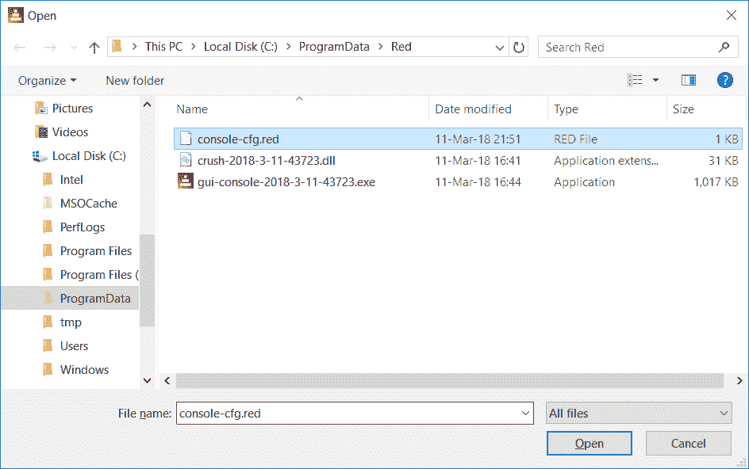
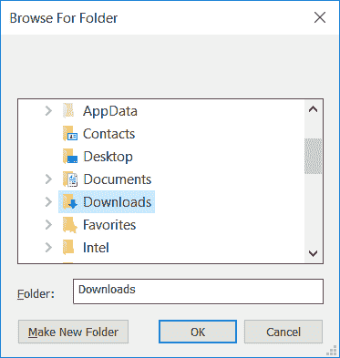

# 使用文件

`Red` 非常适合轻松地处理和操作文件和文件夹。

早在 第 3 章，*使用单词、值和类型* 中，我们看到了 `file!` 类型的第一个示例，其语法为 `%` 和 `/`。从类型层次结构可以看出，`file!` 是 `string!` 的子类型，进而是 `series!` 的子类型，因此我们见过的系列函数也适用于文件。

我们将在本章中遇到此类示例。但最重要的是，我们将学习如何将文件用作数据存储。我们将研究读写文件，无论是数据文件还是代码文件。我们将通过一个持续的示例来发展对该主题的了解。到本章结束时，你将知道如何从互联网下载股票报价或其他文件并将其保存到本地文件。

我们将探讨以下主题：

* 选择文件或文件夹
* 处理路径和目录
* 读写数据文件
* 加载和保存文件
* 下载货币汇率

## 技术要求

你可以在 `https://github.com/PacktPublishing/Learn-Red-Fundamentals-of-Red/tree/master/Chapter07` 找到本章的代码。如果已按照 第 2 章，*设置开发环境* 的说明安装了 `Red`，你就可以开始了。你可以在 Windows、OS X 或 Linux 上工作。对于本章中较大的示例，最好使用 Visual Studio Code 等编辑器。

## 选择文件或文件夹

在 第 3 章，*使用单词、值和类型* 中的 *从用户获取输入* 部分，我们看到了如何使用 `ask` 获取用户控制台输入。`Red` 还有一些特殊单词可用于请求文件或文件夹。

在 REPL 或脚本中使用 `request-file` 会弹出一个对话框，提示用户从本地文件系统中选择文件：



在此屏幕中，你可以导航到所需的文件。按下 Open 按钮会以 `file!` 的形式返回文件名的完整路径；选择 Cancel 会返回 `none`。脚本的结果如下：

```
;-- see Chapter07/ask-file.red:
file: request-file
probe file          ;== %/E/Red/red.bat   ; this file was chosen in File Explorer
```

同样，我们有 `request-dir`：



当选择 Program Files 映射并按下 OK 按钮时，结果如下：

```
dir: request-dir
probe dir         ;== %/C/Program%20Files/
```

`%20` 字符代表字符串 `Program Files` 中的空格。

这些单词带有一些方便的细化：

* 你可以使用 `/title` 来更改弹出窗口标题（对于 `request-file`）或在窗口标题下方显示文本（对于 `request-dir`）。例如，`request-file/title "Browse to the application:"`。
* 你可以使用 `/file` 来填写要浏览的文件名。例如，`request-file/file %"app1.exe"`。
* 类似地，`/dir` 设置起始目录——`request-dir/dir %"/C/Windows"`。
* 如果要在保存对话框窗口中写入文件，请使用 `/save`——`request-file/file/save %data1.txt`。
* 要搜索特定文件，请使用 `/filter`。例如，`request-file/filter \["data files" "\*.dat" "executables" "\*.exe"\]`。
* 你甚至可以使用 `/multi` 让用户选择多个文件；它们的名字以块的形式返回。例如，`request-file/multi ;== \[%/E/Red/red.bat %/E/Red/todo.txt\]`。

这两个单词都可以在非图形控制台应用程序或图形应用程序中使用。此外，还存在 `request-font` 单词，让用户选择字符字体。

## 处理文件路径和目录

`Red` 默认使用正斜杠 `/` 作为某种通用路径表示法。`/` 字符表示当前驱动器的根目录，`./` 表示当前文件夹，`../` 指向文件层次结构中上一级的文件夹。正如我们在 第 4 章，*代码控制结构* 中的 `guess-number.red` 脚本中所见，这种 `../` 表示法用于表示相对于当前文件夹的路径。绝对路径以驱动器字母或根驱动器 `/` 开头。

使用相对路径而不是绝对路径使你的脚本与机器无关。还要确保你的程序可以在 Windows 以及 Linux 或 OS X 上运行。


将字符串转换为文件使用 `to-file` 完成，但仅语法发生变化，并未进行其他检查。

如果需要将文件路径转换为特定平台的表示形式（如 Windows），请使用 `to-local-file` 函数，例如如下所示：

```
;-- see Chapter07/working-with-files-directories.red:
to-local-file %/E/Red/red.bat    ;== "E:\Red\red.bat"
```

相反，要将特定路径表示法转换为平台无关格式，请使用 `to-red-file`，如下代码所示：

```
to-red-file "E:\Red\red.bat"    ;== %/E/Red/red.bat
```

前述两个函数都有 `/full` 修饰符，可在需要时将文件路径转换为绝对路径。

```
to-local-file/full %red.bat     ;== "E:\Red\red.bat"
```

请注意，如果将路径用 `""` 包围，Red 会自动将使用 `\\` 的平台特定路径转换为标准表示法：

```
write %"C:\ProgramData\Red\test.txt" "test"
```

以下是一些方便函数的简要概述，供您参考：
* `pwd` 和 `what-dir` 都返回当前工作文件夹，初始时为当前程序执行的所在文件夹——例如 REPL——`pwd ;== %/C/ProgramData/Red/`，`get-current-dir` 以字符串格式返回相同的值——`"C:\\ProgramData\\Red"`。
* `cd` 和 `change-dir` 都会更改当前目录，并随之更改上一条要点中函数的返回值——`cd %/E/test`，`;== %/E/test/`，且 `pwd ;== %/E/test/`。
* `dir`、`ls` 和 `list-dir` 这些词都会给出当前或指定文件夹的内容。
* 字符 `file?` 和 `dir?` 分别测试其参数是否为文件或文件夹：
```
file? %/E/Red/red.bat ;== true
dir? %/E/Red/         ;== true (trailing / is needed)
```
* 短语 `make-dir` 创建一个新文件夹，如果已存在则不会报错：`make-dir %scripts`。
* 要测试文件或文件夹是否真正存在，请使用 `exists?`：
```
exists? %/E/Red/red.bat    ;== true
exists? %/E/Red/red2.bat   ;== false
exists? %/E/NotExist/      ;== false
```
* `suffix?` 短语返回文件的扩展名——`suffix? %/E/Red/red.bat ;== %.bat`。
* `size?` 短语返回文件的大小（字节），如果不存在则返回 `none`——`size? %red.bat ;== 22`。
* 要删除文件，只需使用 `delete %file`。成功时返回 `true`。

# 读写数据文件

`read` 和 `write` 词是 Red 词通用工作方式的良好示例。它们用于读写各种文件（文本和二进制数据），但也可以与网络端口或 URL 一起使用（请参阅本章后面的股票报价示例）。如果你在其他语言中使用过文件，会欣赏它们易于使用；在使用 Red 时，无需以特定模式打开文件然后再关闭！

让我们使用与我们在 第 5 章 中的 `contacts` 序列示例完全相同的数据，*使用序列和块*：

```
;-- see Chapter07/reading-and-writing-files.red:
contacts: [
     "John Smith" "123 Tomline Lane Forest Hills, NJ" "555-1234"
     "Paul Thompson" "234 Georgetown Pl. Grove, AL" "555-2345"
     "Jim Persee" "345 Pickles Pike Orange Grove, FL" "555-3456"
     "George Jones" "456 Topforge Court Mountain Creek, CO" ""
     "Tim Paulson" "" "555-5678"
]
```

我们第一个联系人的数据如下：

```
name: "John Smith"
address: "123 Tomline Lane Forest Hills, NJ"
phone: "555-1234"
```

让我们将其写入名为 `contacts1` 的文件。一般语法是 `write %filename data`，其中 `data` 可以是任何类型。但是，每次写入同一文件时，都会覆盖之前的内容。如果使用 `/append`，数据会追加到文件末尾：

```
write %contacts1 name
write/append %contacts1 address
write/append %contacts1 phone
```

文件写入 `pwd` 指定的文件夹。如果需要将其存储在不同文件夹中，请在文件名中使用完整的文件路径（相对或绝对）——例如 `%/E/Red/Tests/contacts1`。诸如 `.txt` 的后缀不是必需的，但如果需要可以添加。

如果在编辑器中打开 `contacts1`，你会看到 `John Smith123 Tomline Lane Forest Hills, NJ555-1234`。使用 Red 读取此文件会将内容作为一个字符串返回：

```
read %contacts1   ;== {John Smith123 Tomline Lane Forest Hills, NJ555-1234}
```

如果尝试读取不存在的文件，例如 `read %contacts99`，你会得到 `*** Access Error: cannot open: %contacts99` 错误。

不同字段现在无法再分隔。让我们将所有数据写入一行，用分号（`;`）分隔每个字段（我们也可以选择任何想要的分隔符）：

```
write %contacts1 rejoin [name ";" address ";" phone newline]
```

`contacts1` 文件现在包含 `John Smith;123 Tomline Lane Forest Hills, NJ;555-1234`。

现在我们想将所有 `contacts` 数据存储在文本文件 `contacts2` 中，每个联系人占一行。我们可以通过遍历序列、模式匹配字段并将每个联系人写入一行来实现，如下所示：

```
foreach [name address phone] contacts [
    write/append %contacts2 rejoin [name ";" address ";" phone newline]
]
```

要将此数据读回，我们可以使用 `contents: read %contacts2`，但此时 `contents` 字符串包含整个文件。我们必须先对换行符使用 `split`（请参阅 第 5 章，*使用序列和块*）来分隔联系人，然后对 `;` 使用 `split` 来获取每个联系人的单独字段。

但我们可以使用以下方法将每个联系人作为单独的字符串取回，所有内容都收集在一个块中：

```
contents: read/lines %contacts2
```

这给出了以下结果：

```
;== [{John Smith;123 Tomline Lane Forest Hills, NJ;555-1234} {Paul Thompson;234 Georgetown Pl. Grove, AL;555-2345} {Jim Persee;345 Pickles Pike Orange Grove, FL;555-3456} {George ...   ]
```

如果你只想将数据块写入文件，只需一行——即 `write %contactsw contacts`——此时 `contactsw` 文件包含以下内容：

```
[
     "John Smith" "123 Tomline Lane Forest Hills, NJ" "555-1234"
     "Paul Thompson" "234 Georgetown Pl. Grove, AL" "555-2345"
     "Jim Persee" "345 Pickles Pike Orange Grove, FL" "555-3456"
     "George Jones" "456 Topforge Court Mountain Creek, CO" ""
     "Tim Paulson" "" "555-5678"
 ]
```

要将序列中的每个项目写入文件的不同行，请使用 `write/lines`，如果需要向现有文件添加内容，请使用 `write/lines/append`。请在 *问题* 部分的第 1 题中尝试此操作。顺便也做第 2 题和第 3 题。

使用 `read %.` 将当前文件夹中的所有文件和文件夹名称存储在一个块中，返回值类似于 `[%apps/ %articles/ %benchmarks/ %blockchain/ %books/ %build/ %cinfo %contactss ...]`。

# 处理二进制文件

如果处理的文件仅包含字节（不可读文本），如多媒体文件（图片、音频、电影），请添加 `/binary` 修饰符，如下例所示，其中 `png` 图像加载到临时变量 `tmp` 中：

```
tmp: read/binary %red.png

;== #{
89504E470D0A1A0A0000000D49484452000002EE000002ED08060000007789E1
64000078C34944415478DAECDD079C645599F7F1E739F75655E7389DD3040686
0C8A202220028AB8200883AEBB20418220023A8489...}
```

现在我们将 `tmp` 写入另一个文件 `red-copy.png`：

```
write/binary %red-copy.png tmp
```

为了更好地遵循 Red 的惯用写法，消除 `tmp` 并直接写入——`write/binary %red-copy2.png read/binary %red.png`。

# 图像! 数据类型

事实上，Red 为图片文件提供了一个特殊的 `image!` 数据类型。假设我们有一个包含 Red 标志图像的二进制文件，名为 `logo.png`。那么我们可以按如下方式将其读入程序：


```
img: load %logo.png
; == make image! [120x124 #{
; FFFFFFFFFFFFFFFFFFFFFFFFFFFFFFFFFFFFFFF

img/size ;== 120x124
pick img 10 ;== 255.255.255.0                     (1)
poke img 10 150.125.100.0 ;== 150.125.100.0       (2)
```

我们可以看到内部它是一个 `image!` 对象，并且图像数据是 `binary!` 类型。我们可以获取像素 `10` 的 RGB（颜色）值，如第 `(1)` 行所示，甚至可以更改它，如第 `(2)` 行所示。`image!` 是一种 `series!` 类型，因此适用于序列的所有操作都可用于图像。

同样，如果你有二进制数据，可以在代码中构造一个图像对象，如下所示：

```
img2: make image! [30x40 #{ ; binary image data...}]
```

将其保存到 `picture.png` 文件与使用 `write/binary %picture.png img2` 一样简单。

*Faces 漫游* 部分，在 第 9 章 中，*组合视觉界面*，向你展示如何在屏幕上的 `image` 面板中显示图片文件。

# 从互联网下载文件

有时你的应用程序需要从网站获取文件。目前，`read` 可以使用 HTTP 协议为你完成此操作：

```
read http://www.red-lang.org/index.html
```

这会返回以下字符串作为返回值：

```
;== {<!DOCTYPE html>^/<html class='v2' dir='ltr' xmlns='http://www.w3.org/1999/xhtml' xmlns:b='http://www.google.com/2005/gml/b' xmlns:data='http://www.google.com/2005/gml/data' xml
```

该字符串可以捕获到 `data` 变量中以便进一步处理：

```
data: read http://www.red-lang.org/index.html
```

如果你只对网页的一部分感兴趣，请使用 `copy/part`：

```
data: copy/part read http://www.red-lang.org/index.html 15
; == "<!DOCTYPE html>"
```

你也可以将其写入本地文件，一行即可完成：

```
write %redhome.html read http://www.red-lang.org/index.html
```

一般来说，`read` 和 `write` 主要用于向存储介质读写字符串，但正如我们在示例中所示，它们也可以用于二进制文件和块结构。

0.7 版本将带来更多通过网络进行数据交换的可能性。

# 加载和保存文件

Red 还提供了 `save` 和 `load` 词，可以与 `write` 和 `read` 互换使用。然而，`save` 和 `load` 通常用于存储更复杂的数据结构，特别是用于存储和加载 Red 代码。但我们已经知道在 Red 中，代码可以被视为数据。

要亲眼确认 `save` 和 `load` 可用于数据，请在 *问题* 部分回答第 4 题。

`save` 词也可以用于将数据写入字符串或二进制值。

特别是，如果你有一个数据项以空格分隔的文件，`load` 将其转换为包含这些项的序列。假设我们有一个 `names` 文件，其内容如下：

```
"John" "Dave" "Jane" "Bob" "Sue" "Sarah" "Mikhail" "Rudolf" "Nenad"
```

如果我们使用 `load` 读取该文件，我们会得到以下结果：

```
;-- see Chapter07/saving-and-loading.red:
names: load %names
probe names
== ["John" "Dave" "Jane" "Bob" "Sue" "Sarah" "Mikhail" "Rudolf" "Nenad"]
type? names ;== block!
```

由于代码可能具有复杂结构，你应该使用 `save` 将代码存储到文件中。该文件随后可以用 `do` 立即执行。以下是一个简单示例：

```
save %code.red [ Red[] print "Hello from saved Red" ]
do %code.red
;== Hello from saved Red
```

文件可以用 `do` 立即解释，或者你可以先将其加载到变量中进行操作，然后再 `do` 它：

```
code: load %code.red
do code
```

以下示例定义一个函数，将其存储到文件中，然后加载并执行它：

```
code: [appin: func [input /local str] [str: "-" append str input]]
save %codef.red code
blk: load %codef.red
;== [appin: func [input /local str] [str: "-" append str input]]
do blk
;== func [input /local str][str: "-" append str input]
appin "a"
;== "-a"
appin "b"
;== "-ab"
:appin
;== func [input /local str][str: "-ab" append str input]
```

`do` 词解释代码并在程序内存中定义函数。本地 `str` 变量未使用 `copy` 初始化，因此对 `appin` 函数的后续调用会使其累积输入。`:appin` 词获取 `appin` 词的值，即函数的定义。

\=> 现在在 *问题* 部分回答第 5 题。

# 保存和加载控制台历史记录

有时，当你在控制台尝试了一些东西后，你可能想保留一个文件记录，记录你所尝试的内容，或许以后可以将其中部分保存到源文件中。这可以通过以下简单的控制台命令完成：

```
save %history system/console/history
```

这里，`history` 只是你想要存储它们的名称（可以是任何其他名称）。

从 0.6.4 版本开始，`history` 命令在会话之间得以保留，但如果你想使用旧的命令文件开始一个会话，可以这样检索历史记录：

```
system/console/history: load %history
```

# 下载货币汇率

在 *读写文件* 部分的结尾，我们学习了如何从互联网下载文件。让我们利用这一知识从 Floatrates ([`www.floatrates.com/`](http://www.floatrates.com/)) 下载一些货币汇率数据。作为其众多服务之一，该网站提供任何货币相对于最常见货币的当前汇率。这些汇率可以以 XML 或 JSON 格式获取。例如，URL [`www.floatrates.com/daily/USD.xml`](http://www.floatrates.com/daily/USD.xml) 显示了与美元（USD）相比的货币电子表格布局：


例如，今天（2018 年 3 月 23 日）显示 1 美元价值 0.81191502 欧元（EUR）。这个漂亮网页的资源是一个 XML 文件，其中存储了所有汇率数据，在我们的例子中是 `USD.xml`。

我们现在知道如何下载这些数据并将其存储在本地 `rates.xml` 文件中以便进一步处理：

```
;-- see Chapter07/currency-rates.red:
write %rates.xml read http://www.floatrates.com/daily/USD.xml
```

你可以在任何文本编辑器中检查 `rates.xml` 文件的格式。标题行 `<?xml version="1.0" encoding="utf-8"?>` 确认它采用 XML 格式。

同样的信息也以 JSON 格式提供（[`www.floatrates.com/daily/USD.json`](http://www.floatrates.com/daily/USD.json)），尽管布局不太精美。

# 使用查询字符串参数

如果我们想知道过去某一天的汇率，比如 3 月 15 日怎么办？网站显示这些汇率可以在 [`www.floatrates.com/historical-exchange-rates.html?currency_date=2018-03-15&base_currency_code=USD&format_type=xml`](http://www.floatrates.com/historical-exchange-rates.html?currency_date=2018-03-15&base_currency_code=USD&format_type=xml)[.](http://www.floatrates.com/historical-exchange-rates.html?currency_date=2018-03-15&base_currency_code=USD&format_type=xml.) 获取。该 URL 使用查询字符串参数将日期、货币代码和格式类型传递给 FloatRates Web 服务。

我们可以通过将这些参数存储在变量中并询问用户感兴趣的具体值，使脚本更灵活。然后我们通过对块应用 `rejoin`，将 URL 的所有部分填入并连接起来，构建完整的 URL：

```
;-- see Chapter07/currency-rates2.red:
url-base: http://www.floatrates.com/historical-exchange-rates.html?
curr-code: ask "Rates for which currency (format like USD)? "
curr-date: ask "Rates from which date (YYYY-MM-DD)? "
url: rejoin [url-base "&currency_date=" curr-date "&base_currency_code=" curr-code      "&format_type=xml"]
rates: read url
write %rates_hist.xml rates
```

\=> 现在在 *问题* 部分回答第 6 题。


Both XML and JSON, as well as other formats, can be handled quite easily with the Red `parse` dialect. In the next chapter, we'll analyse this data to extract the relevant information.

# 摘要

在本章中，我们学习了如何从 REPL 以及 Red 代码内部处理文件和文件夹。我们看到了如何交互式地向用户请求文件或文件夹，以及 `read` 和 `write` 文件是多么容易，即使是二进制格式或来自互联网。在处理代码时，更推荐使用 `save` 和 `load`。我们以下载货币汇率数据结束本章，该数据将在下一章中进行处理。

# 问题

1. 使用 `/lines` 将 `contacts` 系列的内容写入 `contacts3.txt` 文件。有什么不同？
2. 尝试使用 `20` 作为参数的 `write/part`。它做了什么？
3. `write/seek %file new-text n`（其中 `n` 为数字）用于从位置 `n`+1 开始替换 `%file` 中的文本。针对 `contacts` 系列尝试此操作，并将第一项中的 `John` 替换为 `Adam`。
4. 使用 `save` 和 `load` 将我们的 `contacts` 系列存储到文件中并读取。
5. 使用 `copy ""` 重写 `appin` 函数，并多次调用它以查看差异。
6. 编写一个脚本，询问用户感兴趣的货币和格式类型（XML 或 JSON）。这里，你必须使用 [`http://www.floatrates.com/daily/USD.xml`](http://www.floatrates.com/daily/USD.xml) 格式，该格式不使用查询字符串参数。尝试通过获取 JSON 格式的数据来测试。提示：使用 `probe` 来查看你的 URL 是否正确！
