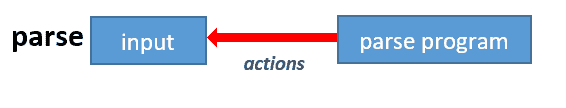
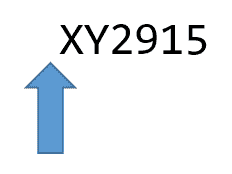
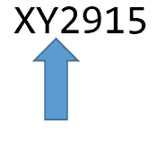
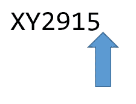

# 解析数据

当今软件开发的一个关键重点是处理和分析（大型）数据流。每种编程语言都需要对这类任务提供某种支持。大多数语言使用 `regular expressions`（简写为 `regex`（[`www.regular-expressions.info/examples.html`](https://www.regular-expressions.info/examples.html)））来执行此类任务。这些表达式使用专门的正式语法匹配字符串数据中的模式，这通常显得像是代码中笨拙的附加部分。

Red 采用不同的方法。虽然 Red 提供了处理数据所需的所有系列操作，但它还拥有自己的 `domain-specific language`（`DSL`）或称为 `parse` 的 `dialect`，专门用于文本和数据处理。解析引擎在 `Red/System` 中实现。它有自己特定的单词和语法，但在其他 Red 代码中嵌入时感觉非常自然。Parse 代码本身比 regex 更易于人类阅读和维护。它更强大，不仅限于字符串解析，而且性能更好。

在本章中，我们将探讨如何使用 `parse`，它是任何 Red 开发人员不可或缺的工具。

以下主题将被涵盖：
* `bitset!` 数据类型
* `parse` 的工作原理
* 搜索、提取和更改
* 更多功能和示例

## 技术要求

你可以在 [`https://github.com/PacktPublishing/Learn-Red-Fundamentals-of-Red/tree/master/Chapter08`](https://github.com/PacktPublishing/Learn-Red-Fundamentals-of-Red/tree/master/Chapter08) 找到本章的代码。如果已按照 第 2 章 中所述安装了 Red，*Setting Up for Development*，你就可以开始了。你可以在 Windows、macOS 或 Linux 上工作。你可以在 Red 控制台中输入或粘贴任何代码以查看其结果，或使用 Visual Studio Code 等编辑器开始使用。

## `bitset!` 数据类型

该数据类型专门设计，使 `parse` 能够高效地处理由 Unicode 值组成的字符串。它用于将任意字符集存储为布尔值，即作为一组位。

`bitset!` 类型的值使用 `make bitset!` 创建，接受字符、字符串、整数（在 Unicode 代码点范围内）或这些值的系列，例如：

```
;-- see Chapter08/bitsets.red:
make bitset! #"R"              ;== make bitset! #{0000000000000000000020}
make bitset! "Red"             ;== make bitset! #{0000000000000000000020000C}
make bitset! [108 "Red" #"R"]  ;== make bitset! #{0000000000000000000020000C08}
```

请注意，bitset 值以十六进制格式表示。一个方便的快捷函数 `charset` 执行相同的操作。因此，例如，最后一条语句也可以写成 `charset [108 "Red" #"R"]`（比较 bitset 二进制值可知它们相等）。

现在我们可以创建一个 bitset 来存储所有元音：

```
vowel: charset "aeiou" ;== make bitset! #{000000000000000000000000444104}
```

我们可以利用它高效地搜索字符串中的第一个元音，如下所示：

```
str: "dog"
find str vowel     ;== "og"
```

（请记住，这里 `find` 返回从匹配值开始的系列。）

以下是存储所有数字的 charset：

```
digit: charset "0123456789"
```

另一种表示方法是使用 `range`，在两个字符或两个整数值之间使用 `\-`：

```
digit: charset [#"0" - #"9"]
```

=> 现在回答 `Questions` 部分的问题 1。

如果你找到了这个问题的答案，这里是如何存储所有字母。我们可以以两种方式完成。第一种是：

```
letter: charset [#"a" - #"z" #"A" - #"Z"]
```

我们也可以使用 `union` 词：

```
letter: union lower upper
```

其中 `lower` 和 `upper` 分别定义为：

```
lower: charset [#"a" - #"z"]
upper: charset [#"A" - #"Z"]
```

=> 现在回答 `Questions` 部分的问题 2 和 3。

其他集合函数也可以使用。

以下 `ws` bitset 存储空白字符——`ws: charset reduce [space tab cr lf]`。使用 `not` 来创建补集 bitset——`non-digit: charset [not "0123456789"]`。

要创建一个内存分配为 100 位的空 bitset，请执行以下操作：

```
make bitset! 100 ;== make bitset! #{00000000000000000000000000}
```

这是因为大小会四舍五入到 8 的倍数，并且 104 个字符有 26 个十六进制数字。

bitset 可以通过使用 `append` 来扩展，如以下示例所示：

```
bs1: make bitset! "A"   ;== make bitset! #{000000000000000040}
append bs1 "Z"          ;== make bitset! #{000000000000000040000020}
```

`bs1` 的内存分配会自动扩展到其新大小。

## 理解 parse 的工作原理

`parse` 的工作原理相当直接。它是一个函数，接受要解析的输入，以及用于解析输入的规则集——`parse input [rules]`

输入是需要处理的数据；它可以是 `any series` 值。在大多数情况下它是 `a string`，可能来自网页、XML 或 JSON 或其他类型的文件，或电子表格，但它也可以是包含值的块、二进制值，甚至是代码。

Parse 搜索输入并尝试从头到尾使用规则对其进行模式匹配。如果完整的输入直到末尾都匹配规则，则返回 `true`；如果不匹配，则返回 `false`。事实上，规则块可以是一个完整的子程序，从输入中提取信息并进行处理：



### 第一个 parse 示例

让我们从一些简单示例开始，其中我们有一个产品代码，以字母组合 `XY` 开头，后跟一个数字，我们在上一节中将其定义为 bitset `digit`，例如 `"XY6"`。我们可以使用规则块 `["XY" digit]` 解析此输入：

```
;-- see Chapter08/how-parse-works.red:
parse "XY6" ["XY" digit]      ;== true
```

其工作原理如下。从左到右查看 `"XY6"`，找到 `"XY"`，如果找到，则找到一个数字。如果找到并且我们在输入的末尾，则返回 `true`。但在代码 `"XY67"` 中有两个数字。未到达输入的末尾，parse 返回 `false`：

```
parse "XY67" ["XY" digit]    ;== false
```

我们可以通过指定数字的数量使其匹配，如下所示：

```
parse "XY67" ["XY" 2 digit] ;== true
```


除了数字之外，也可以使用像 `2 4 digit` 这样的范围进行指定，表示可能存在两到四位数字。如果使用 `0` 作为起始值，则范围后的项目是可选的。

请注意，解析默认情况下不区分大小写

```
parse "xy67" ["XY" 2 4 digit] ;== true
```

如果希望输入和模式具有完全相同的情况，请使用 `/case` 修饰符：

```
parse/case "xy67" ["XY" 2 4 digit] ;== false
```

如果只需要解析输入的一部分，请使用带有解析长度的 `/part`：

```
parse/part "xy67" ["XY"] 2 ;== true
parse/part "xy67" ["XY"] 3 ;== false
```

# 使用 some 和 any

如果未指定数字的数量（但至少有一位数字），我们可以使用 `some`：

```
parse "XY67" ["XY" some digit]      ;== true
parse "XY" ["XY" some digit]        ;== false
parse "XY2915" ["XY" some digit]    ;== true
```

`any` 可以代替 `some` 使用，即使输入中没有数字也能匹配模式：

```
parse "XY67" ["XY" any digit]   ;== true
parse "XY" ["XY" any digit]     ;== true
```

总之，`some` 表示 1 个或更多，`any` 表示 0 个或更多。

`any` 和 `some` 仅适用于它们之后的第一项。例如：

```
parse "XXY" [some "X" "Y"]      ;== true
parse "XYXY" [some "X" "Y"]     ;== false
```

在最后一行，第二个 `"X"` 没有被匹配。要使其工作，我们可以使用以下方法：

```
parse "XYXY" [some ["X" "Y"]]    ;== true
```

或者更简单：

```
parse "XYXY" [some "XY"]         ;== true
```

对于如此简单的示例来说这有点过度，但在更复杂的示例中，使用词语可以使代码更易读且更灵活，例如：

```
input: "XY2915"
rules: ["XY" some digit]
parse input [rules]        ;==true
```

# 匹配位置

解析 *模式匹配*（或一般地 *评估规则*）从左到右进行。你可以用一个位置箭头来可视化它，该箭头在规则块开始时指向输入之前：



当规则匹配时，解析位置会被移动。第一个模式之后我们得到：



然后 `some digit` 模式处理输入的其余部分，解析位置位于输入的末尾，并返回 `true`：



如果输入包含一个（或多个）空格，则没有匹配：

```
parse "XY 2915" ["XY" some digit]         ;== false
```

要使其再次匹配，请使用 `space`：

```
parse "XY 2915" ["XY" space some digit]   ;== true
```

或者你可以使用 `skip` 直接跳过空格字符（或任何字符）：

```
parse "XY 2915" ["XY" skip some digit]    ;== true
```

如果想要跳过多个字符或一个范围，请在 `skip` 之前使用数字或数字范围：

```
parse "XYabc2915" ["XY" 3 skip some digit]    ;== true
parse "XY2915" ["XY" 0 3 skip some digit]     ;== true
```

当你只对输入中的一个模式感兴趣（例如以下示例中的 `ID`）时，可以这样使用 `skip`：

```
program: {
    ID: 121.34
    Version: 1.2.3-5.6
    Description: "This program calculates ..."
}
id: [3 digit dot 2 digit]
parse program [some [ id | skip]]   ;== true
probe value    ;== "121.34"
```

请注意 `dot` 是一个内置字符—`dot ;== #"."`。

正如我们在下一节中将看到的，如果我们需要 `ID` 的值，可以按如下方式将其复制到变量 `value`：

```
parse program [some [copy value id | skip]] ;== true
probe value ;== "121.34"
```

# 使用 | 进行选择

如果起始字符是 `X` 或 `Y`，例如 `X123` 或 `Y108`，我们可以使用 `"X" | "Y"`，其中 `|` 代表或，因此表达式读作 `"X"` 或 `"Y"`：

```
xy: ["X" | "Y"]
parse "X123" [xy some digit]    ;== true
parse "Y108" [xy some digit]    ;== true
```

`|` 可以用于少量选择，但如果选择多于几个，最好创建一个 `charset` 并在模式中使用它：

```
uz: charset "UVWXYZ"
parse "X123" [uz some digit]    ;== true
parse "V456" [uz some digit]    ;== true
```

=> 现在回答 *Questions* 部分的第 4 和第 5 个问题。

# 搜索、提取和更改

让我们现在尝试一些比仅仅示例更多的内容。在上一章中，我们读取了一些货币汇率，特别是 `USD`（`US Dollar`）在其他货币中的价值。在本节中，我们将提取汇率和货币，学习如何使用变量、复制数据，并在匹配时执行代码。

# 使用变量 – to、thru 和 copy

汇率文件名为 `rates.xml`，当我们在编辑器中查看其内容时，它由多个 `<item>` XML 标签组成，每个标签包含一个汇率，例如：

```
<item>
    <title>1 USD = 0.81191502 EUR</title>
    <link>http://www.floatrates.com/usd/eur/</link>
    <description>1 U.S. Dollar = 0.81191502 Euro</description>
    <pubDate>Fri, 23 Mar 2018 00:00:01 GMT</pubDate>
    <baseCurrency>USD</baseCurrency>
    <baseName>U.S. Dollar</baseName>
    <targetCurrency>EUR</targetCurrency>
    <targetName>Euro</targetName>
    <exchangeRate>0.81191502</exchangeRate>
</item>
<item>
    <title>1 USD = 0.70675954 GBP</title>
     ...
</item>
```

我们可以看到它包含了我们需要的所有信息；事实上，只有 `<title>` 就足够了。

让我们看看如何解析该字符串：

```
 rate: "<title>1 USD = 0.81191502 EUR</title>"
```

要将解析位置指针移动到字符串 `str` 之前，请使用 `to` 规则—`to str`。

我们可以通过插入一个变量 `pos` 来展示这一点，该变量表示该点处的系列剩余部分（不要忘记 `:`）。系列中的位置由 `index? pos` 给出：

```
;-- see Chapter08/searching-and-changing.red:
parse rate [to "<title>" pos:] ;== false
pos                            ;== "<title>1 USD = 0.81191502 EUR</title>"
index? pos                     ;== 1
```

要将解析位置指针移动到字符串 `str` 之后，请使用 `thru` 规则—`thru str`。

如果我们将其应用于 `rate`，我们得到以下结果：

```
parse rate [thru "<title>" pos:]   ;== false
pos                                ;== "1 USD = 0.81191502 EUR</title>"
index? pos                         ;== 8
```

在我们的例子中，我们想要的汇率信息在 `<title>` 标签内。因此我们希望在 `"<title>"` 之后、 `"</title>"` 之前进行解析。

让我们尝试以下操作：

```
parse rate [thru "<title>" to "</title>"]
```

但这会得到 `false`，因为我们没有解析到输入的末尾。要一直解析到末尾使 `parse` 返回 `true`，请使用专用的 `end` 词：

```
parse rate [thru "<title>" to "</title>" to end]
```

结合 `thru` 和 `to`，我们也可以获取位置：

```
parse rate [thru "<title>" pos1: to "</title>" pos2: to end] ;== true
pos1                       ;== "1 USD = 0.81191502 EUR</title>"
index? pos1                ;== 8 
pos2                       ;== "</title>"
index? pos2                ;== 30
```

然而，这还不是很有用。我们如何获取 `<title>` 和 `</title>` 标签之间的数据？这是通过 `copy` 词完成的：

```
parse rate [thru "<title>" copy data to "</title>" to end]    ;== true
```

现在 `data` 包含我们需要的内容：

```
print data   ;1 USD = 0.81191502 EUR
```

（使用 `probe` 代替 `print` 来查看 `data` 的类型；在这里，它是一个简单的字符串。）

`copy` 总是跟在一个变量之后（这里是 `data`）并位于一个匹配规则之前（这里是 `to "</title>"`）。

`copy` 提取整个匹配的字符串。当你只需要第一个字符时，使用 `set`：

```
parse rate [thru "<title>" set data to "</title>" (print data) to end]
; 1 ;== true
```

现在尝试自行解析 `data` 字符串以提取汇率 `0.81191502`（参见 *Questions* 部分中的第 6 个问题）。如果没有找到，请确保你理解解决方案。

# 在匹配时执行代码


# 解析方言示例

## 匹配时执行代码

在解析规则内部，我们可以提供仅在找到匹配时才会执行的代码。此代码必须用括号 `( )` 括起来。

例如，这里我们简单地打印出 `data` 变量，在 `to` 规则找到匹配之后：

```
parse rate [thru "<title>" copy data to "</title>" (print data) to end]
;1 USD = 0.81191502 EUR ;== true
```

现在让我们再次转向完整的汇率文件——`rates: read %rates.xml`。

为了遍历完整文件并从每个 `<title>` 标签中提取信息，我们可以使用上一节中的 `any`，如下所示：

```
any [thru "<title>" copy data to "</title>"]
```

每次找到 `<title>` 标签时，条件变为 `true` 且数据被复制。请自行验证 `all` 在这里不起作用；为什么会这样？

为了存储每个数据项，我们需要使用代码将该项追加到之前声明的序列 `usd` 中：

```
usd: copy []
parse rates [ any [thru "<title>" copy data to "</title>" (append usd data)] ]
usd    ;== [{XML Daily Foreign Exchange Rates for U.S. Dollar (USD)} "1 USD = 0.81191502 EUR" "1 USD = 0.70675954 GBP" "1 USD = 0.94840517 CHF" "1 USD = 1.29753098 CAD" "1 USD = 1.294292...
```

我们看到 `usd` 现在包含字符串形式的汇率。第一个字符串是 XML 文件本身的标题，我们可以通过将其定位在第一个可用数据项之前来消除它：

```
parse rates [
    thru </lastBuildDate>
    any [thru "<title>" copy data to "</title>" (append usd data)] 
]
```

现在 `usd` 如下：

```
["1 USD = 0.81191502 EUR" "1 USD = 0.70675954 GBP" "1 USD = 0.94840517 CHF" "1 USD = 1.29753098 CAD" "1 USD = 1.29429260 AUD" "1 USD = 105.59598315 JPY" "1 USD = 114.07517952 ...
```

这并不是包含此数据的最有效形式。也许我们希望数据采用以下形式：

```
[ "EUR" 0.81191502 "GPB" 0.70675954 ... ]
```

我们可以看到这些信息包含在 `<targetCurrency>` 和 `<exchangeRate>` 标签中。有了你现在掌握的工具，这很容易做到。

\=> 然后回答 `Questions` 部分中的第 8 题，再回答第 9 题。

提取数据到序列后，我们现在可以使用所有其他 `Red` 工具来处理这些数据。

变量可以以更灵活的方式一起使用；它们在其他解析代码片段中已知，如本例所示：

```
parse "xxxyyy" [copy letters some "x" (n: length? letters) n "y"] ;== true
letters        ;== "xxx"
```

`some "x"` 的匹配被复制到 `letters` 中。`letters` 词的长度决定了将要匹配的后续 `y` 字符的数量。

`copy` 也可以用于其他类型。以下是 `copy` 用于二进制值的示例：

```
parse #{FFFFDECAFBAD000000} [
    2 #{FF}
    copy data to #{00}
    some #{00}
] ;== true
data ;== #{DECAFBAD}
```

## 更改数据 – change、remove 和 insert

假设我们想将 `rate` 字符串中的 `<title>` 标签更改为 `<rate>`。这也是你可以使用 `parse` 完成的，使用 `change` 词：

```
parse rate [to "<title>" change "<title>" "<rate>"]      ;== false
rate      ;== "<rate>1 USD = 0.81191502 EUR</title>"
```

尽管 `parse` 没有执行到末尾（它返回了 `false`），但 `rate` 字符串已被更改！

只是为了展示你可以通过定义新词使解析程序更灵活，我们重写同一个示例：

```
start-tag: "<title>"
change-tag: "<rate>"
find-tag: [to start-tag]
replace-tag: [change start-tag change-tag]
parse rate [find-tag replace-tag]

do-action: [find-tag replace-tag]
parse rate do-action
rate ;== "<rate>1 USD = 0.81191502 EUR</title>"
```

\=> 现在通过使用两个规则更改原始字符串中的两个标签 `<title>` 和 `</title>`（参见 `Questions` 部分中的第 7 题）。

除了更改之外，你还可以删除输入的一部分或在解析位置插入内容。以下是一些示例：

```
rate: "<title>1 USD = 0.81191502 EUR</title>"
parse rate [to "<title>" remove "<title>"]   ;== false
rate                                         ;== "1 USD = 0.81191502 EUR</title>"

rate: "<title>1 USD = 0.81191502 EUR</title>"
parse rate [to "<title>" insert "NEW"]       ;== false
rate                                ;== "NEW<title>1 USD = 0.81191502 EUR</title>"
```

## 更多功能和示例

`parse` 方言有更多有用的特性和功能。在本节中，我们讨论一些更多示例，以便你对可能实现的功能有所了解。

## 使用 end

还记得 *The bitset! datatype* 部分中的元音示例吗？

```
;-- see Chapter08/more-features.red:
vowel: charset "aeiou" 
str: "dog"
find str vowel   ;== "og"
```

使用 `parse` 我们可以这样写：

```
parse str [ to vowel to end]    ;== true
parse "xyz" [ to vowel to end]  ;== false
```

`end` 词仅存在于 `parse` 方言中，当当前位置指针位于输入末尾时返回 `true`。

## 构建特殊语言

电子邮件地址的形式为 `host@domain`，其中 `domain` 是 `"."` 后跟三个字母的域名，而 `host` 可以包含字母、数字和一个或多个 `"-"`，例如 `dtrump@whitehouse.org`。我们可以从头开始构建一个模式来描述电子邮件模式的组件，如下所示：

```
digit: charset "0123456789"
letter: charset [#"a" - #"z" #"A" - #"Z"]
dash: charset "-"
email-char: union union letter dash digit
email-word: [some email-char]
host: [email-word]
domain: [email-word some [dot email-word]]
email: [host "@" domain]

parse "dtrump@whitehouse.org" email        ;== true
parse "john-locke@lost.island.org" email   ;== true
```

你可以看到 `parse` 如何被用来逐步构建一种迷你语言或 DSL（领域特定语言）来搜索模式。例如，这里有一个很好的教程，构建了一个用于执行计算器表达式的解析语言（[`www.red-by-example.org/parse.html#1`](http://www.red-by-example.org/parse.html#1)）。

## 动态更改规则

解析规则可以在应用过程中被更改，如以下示例所示：

```
rule: ["x" | "y"]
parse "xyyxqyyxz" [
    some [
        rule
    |
        "q" (append rule [ | "z" ])
    ]
]   ;== true
```

当找到字母 `q` 时，规则会被增强以便也匹配字母 `z`。这就是为什么在这种情况下 `parse` 返回 `true`。

## 解析块和代码

解析不仅用于字符串数据，还可以应用于块，包括 `Red` 代码。让我们在这里集中讨论块所特有的内容，特别是匹配规则中使用词和类型的情况。

以下解析语句返回 `true`：

`parse \["x"\] \["z" | "x" | "y"\] ;== true`, 但此语句 `parse \[x\] \[z | x | y\]` 给我们一个 `Script Error: PARSE - invalid rule or usage of rule: z`。为什么会这样？`Red` 不知道 `x`、`y` 和 `z` 的类型；它必须将它们视为词，当它们没有值时 `Red` 会返回错误。

然而，我们可以这样使其工作：

```
parse [x] ['z | 'x | 'y] ;== true
```

通过用 `'` 标明 `x`、`y` 和 `z` 是词，`Red` 就可以理解该语句。

\=> 现在回答 `Questions` 部分中的第 10 题。

解析块时，你可以在匹配规则中使用类型指示，如以下示例所示：

```
parse [hi Red world] [3 word!]    ;== true
```

`collect` 和 `keep` 词可用于将 `keep` 匹配到的项收集到一个块中。例如，在以下块中我们保留所有整数，而 `collect` 将它们作为块返回：

```
input: [13 "Red" 42 a-word %file 108 3.14]
parse input [ collect[ some[ keep integer! | any-type!] ] ]
;== [13 42 108]
```

最后，这里有一个完整的示例，其中 `parse` 作用于代码片段。假设我们有以下代码片段：


```
code: [
    if x < n [
        print {x is smaller than n}
    ]
    print {in the middle of the code}
    probe "true"
    probe n
    if n = y [
        probe "n and y are equal"
    ]
]
```

我们想要提取到一个 `result` 系列中，所有单词后跟字符串的出现情况，例如 `print {...}` 或 `probe "true"`。我们可以通过以下规则实现：

```
result: []
;-- if word-string match, append to result
rule: [ start: word! string! finish: 
      ( append result copy/part start finish )
]
```

注意 `start` 和 `finish` 如何用于界定单词/字符串组合。下面的 `parse` 代码实现了我们想要的功能：

```
parse code [
    some [
        rule          ; (1)
    |
        ahead block!  ; (2)
        into rule     ; (3)
    |
        skip          ; (4)
    ]
]
```

第 `(1)` 行中，我们尝试匹配单词/字符串规则。匹配成功时，单词和字符串会被追加到 `result` 中。如果没有匹配，并且在第 `(2)` 行找到一个块 `\[ \]`，我们将在第 `(3)` 行进入它并应用规则。`ahead` 会查找右侧的匹配，但不会推进解析指针。

如果没有单词/字符串匹配也没有块，我们只需使用第 `(4)` 行 `skip` 到下一个位置。

 resulting series `result` 包含代码中所有单词后跟字符串的出现情况——`probe result` 显示如下：

```
[
    print "x is smaller than n"
    print "in the middle of the code"
    probe "true" 
    probe "n and y are equal"
]
```

这甚至是可执行的代码——`do result` 给出以下输出：

```
x is smaller than n
in the middle of the code
"true"
"n and y are equal"
; == "n and y are equal"
```

# 调试 parse

有时，你需要一些帮助来了解 `parse` 过程的工作方式。一个简单的方法是在某些匹配时包含 `print` 或 `probe` 语句，例如在 *搜索、提取和更改* 部分解析 `rate` 字符串时：

```
rate: "<title>1 USD = 0.81191502 EUR</title>"
parse rate [thru "<title>" copy data to "</title>" (probe data) thru ">"]
;"1 USD = 0.81191502 EUR"
;== true
```

或者你可以简单地打印输出：

`(print "found a ``</title>")`，以指示找到匹配项。

让我们将此应用于上一节的最后一个示例：

```
rule: [start: word! string! finish:
    ( 
        print ["-->" start]
        print ["<--" finish]
        append result copy/part start finish 
    )
]
```

这会打印出以下内容：

```
--> print x is smaller than n
 <--
 --> print in the middle of the code probe true probe n if n = y probe n and y are equal
 <-- probe true probe n if n = y probe n and y are equal
 --> probe true probe n if n = y probe n and y are equal
 <-- probe n if n = y probe n and y are equal
 --> probe n and y are equal
 <--
 ;== true
```

我们可以通过将 `parse` 替换为 `parse-trace` 来获得类似但更详细的每个匹配的输出：

```
parse-trace rate [thru "<title>" copy data to "</title>" (probe data) thru ">"]

-->
match: [thru "<title>" copy data to "</title>" (probe dat
input: "<title>1 USD = 0.81191502 EUR</title>"
-->
==> matched
<--
match: ["<title>" copy data to "</title>" (probe data) th
input: "1 USD = 0.81191502 EUR</title>"
-->
-->
==> matched
<--
<--
match: [data to "</title>" (probe data) thru ">"]
input: "</title>"
"1 USD = 0.81191502 EUR"
match: [to "</title>" (probe data) thru ">"]
input: "</title>"
-->
==> matched
<--
return: true
== true
```

```
 
```

使用 `/trace` 修饰符可以做更多事情：

```
parse/trace input rules callback
```

`callback` 是一个响应解析过程中事件的函数，可用于提供跟踪、统计和调试信息。

# 总结

现在你已经学会了使用 `parse` 执行简单和更复杂的识别、分析和操作数据的任务。我们首先了解了 `bitset!` 数据类型及其方便的字符集等价物。然后，我们学习了如何使用 `to` 和 `thru` 进行 `parse`、提取数据（使用 `copy`）和更改数据。我们看到了如何将代码附加到 `rule` 上以便在匹配时执行。最后，我们探讨了如何 `parse` 块和代码，以及如何获取 `parse` 在特定情况下工作原理的详细输出。

本章并不详尽，`parse` 中还有一些我们没有谈到的其他词。事实上，`parse` 方言本身就值得一本书。

# 问题

1. 创建一个 `bitset` 来存储所有小写字母，另一个存储所有大写字母。

2. 使用 `union` 创建一个存储所有字母数字字符的 `bitset`。

3. 使用 `union` 创建一个存储十六进制数字中使用的所有字符的 `bitset`。

4. 创建一个规则模式 `integer` 来匹配整数，前面可选择性地带 + 或 - 号。

5. 创建一个匹配以下产品代码的模式：`"#ABC-nnnn"` 或 `"#XYZ-nnnn"`，其中 `nnnn` 为四位数字模式。

6. 自己尝试 `parse` `data` 字符串以提取汇率 `0.81191502`。（提示：使用 `some` 和 `letter` 字符集。）

7. 从 `rate: "<title>1 USD = 0.81191502 EUR</title>"` 开始，使用两个规则将两个标签都更改为 `<rate>` 标签。

8. 使用 `parse` 及其内部的代码以以下形式获取汇率信息：`\[ "EUR" ``0.81191502 "GPB" 0.70675954 ... \]`

9. 解析包含两个不同字母（随机顺序）和数字的字符串。`parse` 必须返回 true 并打印出找到的每个字母。

10. 重写以下代码，使其适用于块 `\[x x x y y y\]`：

```
parse "xxxyyy" [copy letters some "x" (n: length? letters) n "y"] ;== true
letters        ;== "xxx"
```
