# 组合视觉界面

Red 内置了名为 `View` 的跨平台图形功能。这在当前编程语言中是独一无二的。对于大多数语言来说，这不是优先事项，而且即使可行，也很繁琐且导致代码冗长。在这里，Red 真正闪耀。你会被其构建复杂交互屏幕的优雅所惊叹，这种方式简单且声明式。

截至 0.6.3 版本，Windows 和 macOS 已完全支持，其他平台（Linux、Android、iOS）部分就绪并计划在不久的将来推出。

Red 依赖于 *原生小部件*。它在每个平台上绑定到可用的默认原生 GUI API，以便用户看到熟悉的图形。在 Linux 上，`Visual Interface Dialect` (`VID`) 将依赖于众所周知的 GTK 图形工具包。

我们将基于前几章的多个示例进一步构建，以下载汇率并开发一个交互式联系人维护应用。

本章将涵盖以下主题：

* 构建界面

* Faces 漫游

* 事件和参与者

* 基础联系人应用

* draw 方言简介

# 技术要求

您可以在 [`github.com/PacktPublishing/Learn-Red-Fundamentals-of-Red/tree/master/Chapter09`](https://github.com/PacktPublishing/Learn-Red-Fundamentals-of-Red/tree/master/Chapter09) 找到本章的代码。如果您已按照 第 2 章 中所述安装了 Red，*设置开发环境*，那么您就可以开始了。您可以在 Windows、macOS 或 Linux 上工作。您可以在 Red 控制台中输入或粘贴任何代码以查看其结果，或开始使用编辑器，例如 Visual Studio Code。

# 构建界面

`View`，图形界面引擎，完全用 Red 和 Red/System 编写。下面的图表更详细地展示了 `View` 如何借助另外三个部分构建：

* `VID`: The `Visual Interface Dialect`

* `Draw`: The dialect to draw two-dimensional shapes

* `React`: This is an engine that makes the whole system automatically and fully reactive to the user or system events

您可以在以下截图中查看它们的关系：

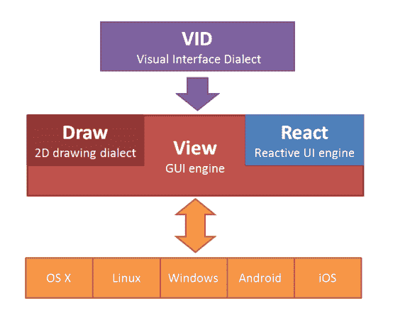


VID 方言包含大量词汇，我们将系统地介绍它们，以免你感到困惑。本节中，我们将讨论基本窗口、容器和布局设置。但为了让你入门一些基础知识，我们将为我们在 第 7 章 中制作的 *下载货币和汇率* 脚本 *使用文件* 构建一个屏幕界面。

# 第一个示例 – 下载汇率的屏幕

将 第 7 章 中的 `currency-rates2.red` 脚本 *使用文件* 转换为屏幕应用非常容易。我们绘制小部件（`text`、`input fields` 和 `button`）并提供在按钮按下时执行的代码。我们将向你展示名为 `currency-rates-gui.red` 的完整脚本，然后详细解释其工作原理。

## 运行示例

按照以下步骤运行程序：
* 首先运行应用以查看其工作原理——从 Red 控制台进入脚本所在的文件夹，例如 `cd %/E/Red/code/ch9`，然后输入以下内容——`do %currency-rates-gui.red`
* 或者，先使用 `red -r currency-rates-gui.red` 编译脚本，然后使用 `./currency-rates-gui` 运行它

（在 Windows 中双击 EXE 会在黑色控制台背景上显示应用窗口。要避免这种情况，请使用 `red -r -t Windows` 或 `red -c -t Windows` 编译。）

以下屏幕出现：

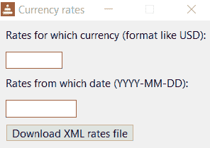

例如填写 USD 和汇率、日期（用鼠标光标单击以进入下一个字段），单击下载 XML 汇率文件按钮，几秒钟后文本 SUCCESS! 出现，并且 XML 文件被下载：

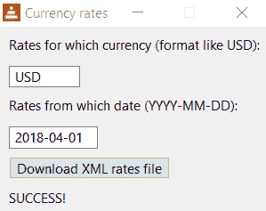*TAB* 键在 Windows 中尚未实现从一个字段跳转到另一个字段的功能，因此用户目前必须使用鼠标。这将在即将发布的 0.6.4 版本中解决。

## 检查代码

以下是完整的脚本，我们现在将讨论它：

```
;-- see Chapter09/currency-rates-gui.red:
Red [
    title: "Downloading currency exchange rates"
    needs: 'view                          (1)
]

url-base: http://www.floatrates.com/historical-exchange-rates.html?
download-rates: does [                    (2)
    url: rejoin [url-base "&currency_date=" curr-date/text "&base_currency_code=" curr-code/text "&format_type=xml"] 
    rates: read url
    write %rates-hist.xml rates
    out/text: "SUCCESS!"                  (3)
]

view [                                    (4)
    title "Currency rates"                (5)
    below                                 (6)
    text "Rates for which currency (format like USD):"   (7)
    curr-code: field                      (8)
    text "Rates from which date (YYYY-MM-DD):" 
    curr-date: field 100x25               (9)
    button "Download XML rates file" [download-rates]    (10) 
    out: text ""                          (11)
]
```

在第 `(1)` 行，我们看到在 Red View 应用的头中必须始终存在的一段代码，`needs: 'view`，它告诉解释器加载 View 引擎，或在编译期间由编译器包含它（`'` 是可选的）。在 Red GUI 控制台内部，View 已经存在，因此你可以粘贴 `view` 块到其中，窗口将被显示。

在第 `(5)` 行，我们指定窗口的 `title`。在第 `(6)` 行，`below` 指定所有小部件要彼此下方放置。在第 `(7)` 行，第一个要在屏幕上显示的 `text` 被声明为字符串。

在第 `(8)` 行，`curr-code: field`，一个输入 `field`，被定义并命名为 `curr-code`。第 `(9)` 行中的日期字段指定了大小 `100x25`。第 `(10)` 行声明了一个 `button` 小部件。请注意，`text` 或 `button` 等小部件上的文本只是其后面的字符串。该按钮还具有一个 `\[download-rates\]` 块，这是一段在按钮被单击时（其默认事件）执行的代码。最后，在第 `(11)` 行，一个输出字段被声明为空并命名为 `out`。

`download-rates` 是在第 `(2)` 行定义的简单 `does` 函数。它包含我们之前的下载代码，但请注意输入字段的内容是如何通过 `/text` 获取的——`curr-code/text` 和 `curr-date/text`。输出字段的内容在第 `(3)` 行通过 `out/text: "SUCCESS!"` 设置。

在 Red 中组合屏幕并附加事件代码就是这么简单！

\=> 现在解决 *问题* 部分中的第 1 题。

## 构建布局

UI 代码从第 `(4)` 行的 `view \[ ... \]` 开始。`view` 是一个期望窗口描述作为参数的函数。请注意，此窗口描述只是一个使用 VID 词的代码块。你可以给它一个名称，例如 `win`，使用 `append` 或其他代码构建此块，并在准备好时执行 `view win`。`view \[\]` 显示一个最小的 GUI 窗口：

```
win: []
; build up win with statements like append win [title "Currency rates"]
view win
```

这允许根据用户输入或事件动态构建屏幕。VID 中还有一个内置的 `layout` 词。给你的 `layout` 一个名称，并在其后的块中定义它，如下所示：

```
lay1: layout [a: area cyan 200x200]
```

`layout` 从指定它们的块构建 `face!` 对象的树。然后，你使用 `view` 显示它，`view` 在这些对象树上工作，`view lay1`。实际上，`view \[...\]` 只是 `view layout \[...\]` 的缩写。

在我们的大多数示例中，我们将坚持静态构建屏幕的方式，但对于定义菜单，我们将使用这种工作方式。

## 面和动作

`text`、`field` 和 `button` 等小部件在 Red 中称为 *面*。面的细节，如其大小、颜色或文本，称为其 *面片*。例如，在 `field 100x25` 中，成对值 `100x25` 是一个描述字段大小（宽度 x 高度）的面片（Red 知道这一点，因为与字段一起出现的成对值始终是大小）。面片的书写顺序无关紧要。面可以被命名，以便在代码中使用或操作其属性，正如我们对 `curr-code`、`curr-date` 和 `out` 面所看到的那样。

`view` 显示的内容实际上也是一种面类型，即 `window`。一个程序可以包含多个视图，默认情况下它们会在前一个窗口关闭时作为连续的窗口出现。

面被放置在 *容器* （*在这种情况下，窗口*）内部，并且它们按照一定的 *布局* 放置。在我们的示例中：
* `title "Currency rates"` 是描述容器窗口的 *容器* 命令
* `below` 是 *布局* 命令，规定所有后续面将彼此下方显示

可选择附加到面上的命令块称为 *动作面片*，简称为 *动作体*。这是在发生特定 *事件* 时执行的代码，例如，单击按钮会启动 XML 文件的下载。事件带有前缀 `on`，例如 `on-click`。大多数面响应默认事件，例如 `button` 的 `on-click`。对于默认事件，你不需要指定其名称，但如果想要其他事件，你必须指明这些。

一个面可以是 `visible` 或不可见，当它可见时，可以是 `enabled` 或禁用。你可以使用函数 `face/visible?` 和 `face/enabled?` 获取该状态（参见 *问题* 部分中的第 4 题）。

面被实现为 *对象*。要查看其复杂性，请将其内容打印到控制台。例如，当 `bt` 是 `button` 的名称时，在其动作面片中使用 `print bt` 或 `probe bt`（参见 *问题* 部分中的第 2 题）。

## 双向绑定


用户界面屏幕及其包含的所有内容在属性更改时会自动实时更新。面板和方面之间存在 *双向绑定*。当其中一方发生变化时，另一方会相应跟随。我们在示例中不会使用它，但如果你作为开发者想要控制屏幕更新的时机，需要执行以下操作：

*   关闭 `auto-sync` 选项—`system/view/auto-sync?: off`
*   使用 `show` 函数，例如 `show face` 来更新控件

\=> 在 *问题* 部分的第 3 个问题中了解如何编写代码以关闭窗口的按钮。

# 容器设置 – view

这些是描述容器方面（窗口）外观和感觉的设置。我们已经使用了 `title`。以下是一些可以按任意顺序组合的常见设置（将代码粘贴到 Red 控制台中，并尝试使用）：

*   `view [ size 350x125]` 允许具有不同尺寸（宽 x 高）的窗口
*   `view [ backdrop blue]` 创建一个具有蓝色背景的窗口

# 更改应用程序图标

默认的 Red 窗口 *图标*（显示汉诺塔）可以用你自己的 `.ico` 文件替换，如下所示：

```
;-- see Chapter09/icon.red:
Red [
    needs: 'view
    icon: %gaming.ico
]
view []
```

该窗口显示如下：

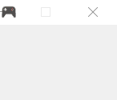

但要看到这个新图标，应用程序必须编译为 `red -r icon.red`。这也适用于在应用托盘中显示的非 GUI 应用程序的图标。

# View 的细化

`view` 还可以有一个或多个细化。它们的细节在主 `view` 块之后出现的块中描述，如下一般 `view` 块的模式所示：

```
view/refine1/refine2 [
    container settings
    layout commands
    face1 facets [action facet]
    face2 facets [action facet]
    ...
][details refine1][details refine2]
```

要确定窗口在屏幕上出现的位置，请使用带有提供 `offset` 值的块的 `options` 细化，如下所示：

```
;-- see Chapter09/container-layout.red:
view/options [
][offset: 400x100]
```

你可能已经注意到标准窗口不可调整大小或最大化。要实现这一点，我们需要带有 `resize` 词的 `flags` 细化：

```
view/flags [
][resize]
```

这些标志可以像本示例中那样组合，其中窗口可调整大小且为模态：

```
view/flags/options [
][modal resize][offset: 400x100]
```

模态意味着窗口显示在父窗口之上，只要模态窗口显示，父窗口就被禁用。换句话说，模态窗口需要你的注意。

还有其他标志，如 `no-title`、`no-border`、`no-min`、`no-max` 和 `no-buttons`。它们的名字说明了它们的作用。适当时将它们组合以创建最小化窗口。

以下是这些标志的使用示例：

```
;-- see Chapter09/digital-clock.red:
time-now: to string! now/time
view/flags [ 
    title "Red Time"
    show-time: text font-size 14 font-color red time-now
]
[modal popup]
```

这显示了以下窗口：

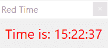

它还展示了 `font-size` 和 `font-color` 对 `text` 的使用。要使时钟运行，我们只需要一行代码，但为此我们需要一个事件，请参阅后面的 *事件和参与者* 和 *计时器事件* 部分。

# 在 view 中使用 do

在 `view` 代码块内部，像 `n: 2 ** 3` 和 `print n` 这样的普通绑定语句 *必须* 放在 `do` 块中，如下所示：

```
;-- see Chapter09/container-layout.red:
view [
    text "Use of do block"
    do [n: 2 ** 3 print n]
]
```

`do` 块可用于在布局显示之前评估代码并初始化或更改 GUI。

所有其他代码必须出现在 action 方面代码块中，例如我们的按钮点击代码 `[download-rates]`。

# 布局命令

Red 使用正常的 *坐标系统*，原点 `0x0` 在左上角：

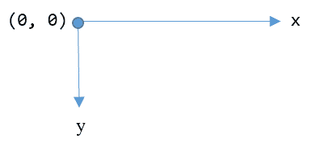

坐标为 (`n`, `m`) 的点记为 `nxm`。这样的 `pair!` 值也可以用于 `face/offset` 属性，该属性描述了面相对于原点的左上角位置，在本例中为左侧 `n` 像素，向下 `m` 像素。它也可以用于将面移动到新位置：

```
;-- see Chapter09/offset.red:
t: text "I will not stay here"
button "Move text" [t/offset: 20x30] 
```

默认情况下，Red 使用一种用 `across` 词表示的流式布局。面从左到右放置，直到屏幕行填满，然后填充下一行，依此类推。

除了 `across` 和 `below` 之外，还有一些词可以微调此过程：

*   `return` 在 `across` 模式下将下一个面水平放置在下一行，或在 `below` 模式下垂直放置在其旁边
*   `at nxm` 将下一个面（仅此一个）的左上角放置在绝对位置 (`n`, `m`)
*   `origin nxm` 从位置 (`n`, `m`) 而不是 (0, 0) 开始窗口布局
*   `pad wxh`，其中 `w` 为宽度，`h` 为高度，指定下一个面从右侧开始 `w` 像素，向下 `h` 像素
*   `space wxh`，其中 `w` 为宽度，`h` 为高度，指定下一个面之间在宽度和高度上的新间距（换句话说，就是偏移量）

为了了解这些命令的工作原理，请在 *问题* 部分的第 4 个问题中尝试使用它们。

# 面板概览

VID 方言包含约 20 种不同的面板（图形控件），每个面板都有其特定的属性（*方面*）。该值的类型指定了方面的作用。例如，字符串将用作面板的显示文本，或一对值将确定其大小。大多数面板还具有默认的 *动作方面*，即在特定事件（如点击按钮或从列表中选择）触发时执行的命令块。

我们不可能详细讨论所有内容，相反我们将对可用的面板类型进行概览，说明你可以做什么，并突出一些重要属性。鼓励你在阅读过程中（与问题一起）尝试这些内容。

# 基础、框和图像

我们从最基本的类型开始：

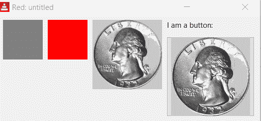

这是 VID 代码：

```
;-- see Chapter09/base-box-image.red:
view [
    base
    box red
    image 140x140 %heads.jpg
    below
    text "I am a button:"
    button %heads.jpg [quit]
]
```

`Base` 是其中最原始的。它显示一个灰色矩形，但可以响应点击（`on-down`）事件；它可以显示图像，并且可以在其内部绘制。`box` 类似于 base，但默认情况下是透明的，因此我们为其指定颜色以使其显示。

`image` 是一个默认大小为 100 x 100 的 base 面板，用于显示图片。每当一个面板的方面为图像文件时，它将被用作该面板的背景图像。参见按钮示例。`camera` 方面也可用，当硬件可用时（如移动设备）可捕获视频流。

# 文本面板 – h1、text、field 和 area

这是一个使用文本面板的窗口：

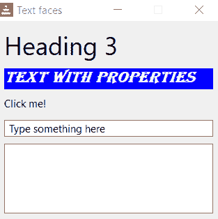

这是生成该窗口的代码（请注意，在真正的应用程序中，我们必须为控件提供有意义的名称，而不是 `t1` 和 `f1`！）：

```
; see Chapter09/text-faces.red:
view [
    title "Text faces"
    below
    h3 "Heading 3"
    t1: text 300x30 bold italic blue font-name "algerian" 
        font-color ivory font-size 14 "Text with properties"
    text "Click me!" [face/color: orange face/text: "FIRE!"]
    f1: field 300 "Type something here" [ print [f1/data] ]
    a: area 300x100 [print a/text]
]


要在窗口中显示文本，请使用 `text` 面板。一些基本的 `h1`、`h2` 到 `h5` 文本样式可用于标题，如 `h3 "Heading 3"`。文本可以置于 `bold`、`italic`、`underline` 或 `strike` 模式，如果提及颜色，则将其用作背景色。对于文本字体，可以使用系统所知的任何 `font-name`。`font-size` 和 `font-color` 也可以指定。

颜色可以指定为预定义名称，例如 red、aqua、navy 或 orange。但你也可以通过其 RGB 值作为 `tuple!` 来指定颜色，例如 `40.100.130`，或 `40.100.130.A`，其中 `A` 是透明度值，范围从 `0` 到 `255`。你可以通过在控制台输入 `? tuple!` 来获取命名颜色的列表。

点击某些文本会激活其 action facet。如 Click me! 文本所示，面板可以在其自己的 action 块内通过 `face` 词来引用。

使用 `field` 从用户获取输入文本并存储在其词 `f1` 中，更准确地说，存储在其文本 facet `f1/text` 中。整数指定字段的长度（以像素为单位），如果需要，可以使用字符串来显示一些预定义文本。字段内的文本也包含在 `/data` 属性中。`field` 的默认操作是在字段中按下 `Enter` 键时触发。这就是 `on-enter` 事件。我们使用它将字段的输入打印到控制台。

如果需要多行文本空间，请使用 `area`。其内部的文本包含在面板的 `/text` facet 中。`area` 内的任何按键都会激活其 action 块（`on-change` 事件），这里同样会打印到控制台。

由于 action 代码块很短，我们没有费心给它们命名。在真正的应用中，如果 action 代码超过一行，你应该将该代码放在一个函数中（在 `view` 之前声明），并在 action facet 中调用该函数。这样的函数可以通过名为 `face` 和 `event` 的参数引用触发操作的面板和事件。这就是我们在下载汇率示例中使用 `download-rates` 函数所做的。将 GUI 与代码逻辑分离有助于程序的后期维护。

# 按钮、复选框和单选按钮

这里有一个使用按钮面板的窗口：

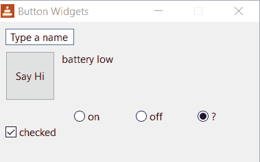

这里是其代码：

```
; see Chapter09/button-faces.red:
view [
    title "Button Widgets"
    below 
    name: field 100 "Type a name"
    across
    button 70x70 "Say Hi" center [t1/text: append "Hi " name/text]
    t1: text ""
    return
    ch1: check 90x70 "Check me" [
            either ch1/data 
                [ch1/text: "checked"]
                [ch1/text: "unchecked"]
    ]
    r1: radio "on"  [t1/text: "too loud!"]
    r2: radio "off" [t1/text: "that's better"]
    r3: radio "?"   [t1/text: "battery low"]
]
```

`button` 面板专门用于它们被点击时产生的操作。这里我们将文本内容更改为 `name` 字段的输入。默认事件是 `on-click`，对于 `button` 而言它与 `on-down` 相同。注意用于定位文本的 `center` 词。为此，你也可以使用 `top`、`middle`、`bottom`、`left`、`right` 以及它们的组合。

复选框是一个 `check` 面板，通常用于询问是/否问题。它具有可选文本 `/text`。其值包含在其 `/data` 属性中，可以为 true（复选框已选中）或 false（未选中）。然而，`check` 有默认的 `on-change` 事件，这里我们使用它来显示复选框的状态。

单选按钮是一个 `radio` 面板，其属性与 `check` 完全相同。当用户必须在两个以上可能性中选择一个（且仅一个）时使用它。

\=> 现在从 *问题* 部分解答第 5 题。

# 列表面板 – text-list、drop-list 和 drop-down

通常一个数据项可以取存储在序列中的离散值中的任意一个。为此，我们需要使用某种列表面板。这里有一个使用列表面板的窗口，从左到右依次为 `text-list`、`drop-list` 和 `drop-down`：

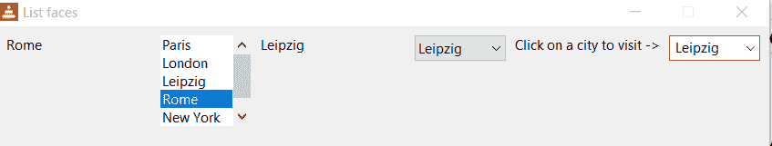

这里是代码：

```
;-- see Chapter09/list-faces.red:
city-trip: copy ["Paris" "London" "Leipzig" "Rome" "New York" "Beijing"]
view [    
    title "List faces"
    t1: text "Click on a city to visit ->"
    text-list 100x100 data city-trip [t1/text: pick face/data face/selected]
    t2: text "Click on a city to visit ->"
    drop-list data city-trip [t2/text: pick face/data face/selected]
    t3: text "Click on a city to visit ->"
    drop-down data city-trip [t3/text: pick face/data face/selected print t3/text]
    ;              on-change [t3/text: pick face/data face/selected print t3/text]
]
```

要以列表形式显示字符串，请使用 `text-list` 面板。这里，我们通过 `text-list` 的 `data` 属性显示城市列表。从列表中选择一个项目（`on-select` 事件）使用代码 `pick face/data face/selected` 完成。这之所以可行，是因为 `face/selected` 是所选项目的索引，而 `face/data` 是一个序列。请注意，滚动条在需要时会自动出现。

`drop-list` 以折叠列表的形式显示值。点击向下箭头即可查看数据项。选择一个项目会触发 `on-change` 事件。

`drop-down` 也同样工作，但其默认事件是 `on-enter`，因此你必须使用上下箭头选择一个值，然后按 `ENTER`。如果你希望它像另外两个列表一样工作，你必须说明你的意思是哪个事件，像这样，`on-change \[t3/text: pick face/data face/selected\]`。

（要查看此效果，请添加类似 `print t3/text` 的 `print` 语句，它会将结果打印到控制台。）

你也可以在顶部的文本框中输入内容，这会进入 `/text` 属性。

\=> 现在从 *问题* 部分解答第 6 和 7 题。

# 面板、分组框和标签面板

为了将应用屏幕表面划分为不同的区域，你可以使用 group-boxes、panels 或 tab-panels。这里有一个展示全部的示例：

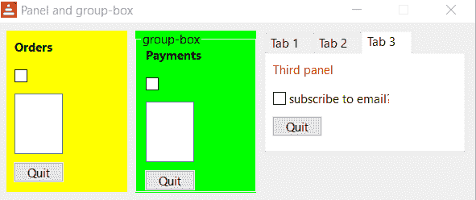

这里是代码：

```
;-- see Chapter09/panels.red:
view [
    panel yellow bold [ size 150x200 below 
                        text bold "Orders"
                        check
                        area 60x75
                        button "Quit" [quit]
    ]
    group-box green "group-box" bold 
                      [ size 150x200 below 
                        text bold "Payments"
                        check 
                        area 60x75
                        button "Quit" [quit]
    ]
    tbp: tab-panel 250x150 [
         "Tab 1" [h4 "In panel 1!" button "Click in 1" [print tbp/data] ] 
         "Tab 2" [text "Second panel" button "Click in 2" [print tbp/pane] ]
         "Tab 3" [below text font-color red "Third panel" 
                  check "subscribe to email?"
                  button "Quit" [print tbp/selected quit] 
         ]
    ] 
]
```

`panel` 和 `group-box` 非常相似，仅用于在矩形区域中包含其他相关的面板。它们本身不能响应事件，但它们包含的面板可以。`group-box` 具有可见的边框，可选文本。你可以根据需要使用任意多个。

`tab-panel` 真正将屏幕划分为子屏幕，但一次只有一个可见；其他子屏幕可以通过点击其标签标题来访问。有用的细节如下：

*   `/data` 给出一个包含标签名称的块，这里—Tab 1、Tab 2 和 Tab 3
*   `/pane` 给出面板及其属性的列表
*   `/selected` 给出所选标签的索引（1 为 Tab 1，以此类推）

我们将在联系人应用中使用 `panel`。

# 进度条和滑块


正如其名称所示，这些面用于指示某个数量的增加或减少。进度条是被动的，仅显示状态。滑块可以被移动来指示进度或减少，这是一个 `on-change` 事件。两个面都将数量保存在 `/data` 中，作为 `percent!` 值（如 25 %）。如果将其指定为 0.0 到 1.0 之间的浮点数，则需要使用 `to-percent` 将该值转换。

以下是它们使用的一些示例：

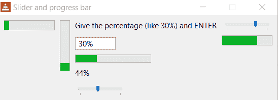

实现此功能的代码如下：

```
;-- see Chapter09/progress-slider.red:
view [
    across
    p1: progress 100x20 10%    ;-- horizontal progress bar:
    p2: progress 20x100 15%    ;-- vertical progress bar:
    ;-- bar following input:
    below
    text "Give the percentage (like 30%) and ENTER"
    field [p3/data: face/data]
    p3: progress
    ;-- slider showing status in text:
    t: text "25%"
    slider 100x20 data 25% [t/text: to-string face/data]
    return
    ;-- slider displayed in a progress bar:
    slider 100x20 data 10% [p4/data: face/data]
    p4: progress 100x20 10% 
]
```

进度条也可以像你所看到的那样垂直使用。第三个中，进度与字段的输入保持同步。滑块在被移动时有一个默认的 `change` 事件；在这里它将状态显示在文本字段中。在最右边的示例中，此事件使进度条与滑块保持同步。

# 样式

如果你的应用需要多个具有相同属性和行为器的面实例，例如棋盘游戏的方块或计算器的按钮，你可以将其定义为一个具有名称的 `style` 并使用该名称代替。以下来自 Nick Antoniacci 的方块游戏（仅 10 行！）对此进行了说明：

```
;-- see Chapter09/tile.red:
view [
    title "Tile Game"
    backdrop silver
    style tl: button 100x100 [
        temp: face/offset
        face/offset: empty/offset 
        empty/offset: temp
    ] 
    tl "8" tl "7" tl "6" return 
    tl "5" tl "4" tl "3" return 
    tl "2" tl "1" empty: base silver
]
```

我们为所需的全部八个按钮定义了一个样式 `tl`。点击一个方块按钮会将其移动到空位 `empty`，方法是将其 `offset` 设置为 `empty` 的 `offset`。然后 `empty` 通过将其 `offset` 设置为 `temp`（即该按钮的 `offset`）移动到方块的位置。它看起来像这样：

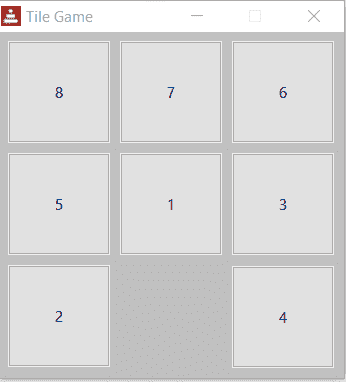

因此，`style` 用于创建自定义面，且 `style` 的属性可以在具体控件中被覆盖。

# 事件和行为器

在之前的示例中，我们看到大多数面都可以拥有行为器，它们是事件处理程序，当该面发生特定事件时执行。例如，我们刚刚探索的代码中的滑块有一个默认的 `on-change` 行为器，即最后一个块中的代码：

```
slider 100x20 data 25% [t/text: to-string face/data]
```

并非所有面都能响应所有类型的事件。但很多面也可以响应多种事件。

Red 定义了一些 40 个事件，你可以在你的面上为其定义行为器。你可以在这里找到完整列表：[`doc.red-lang.org/en/view.html#\_events`](https://doc.red-lang.org/en/view.html#_events)。

行为器都有简短的名称，例如 `move`、`over` 或 `down`。如果我们将其分类，可以区分以下几种：

* 鼠标事件，例如 `down`、`up`、`drag`、`drop`、`click`、`dbl-click`、`over`、`wheel` 等，包括三个按钮、鼠标滚轮以及悬停在面上的事件
* 窗口事件，例如 `move` 和 `resize`
* 键盘事件，例如 `key`、`key-down`、`key-up` 和 `enter`
* 触摸事件，例如 `zoom`、`pan`、`rotate` 和 `tapping`
* 一个计时器事件（`time`）
* 通用事件，例如 `focus`、`select`、`change` 和 `menu`

要在面上实现一个行为器，请在其代码块前指定一个 `on-event` 名称。这仅对额外的行为器必要，而对默认行为器则不需要。在以下各节中，我们将查看一些典型示例并了解更多其内部原理。

## 多个事件

实现多个事件很容易。以下是一个为按钮定义了四个行为器的示例：

```
;-- see Chapter09/multiple-events.red:
view [
    below
    message: text 100x25 green "Nothing"
    button "Different things happen" 
        [message/text: "A click!"]               ; default event
        on-over [message/text: "Hovering!"]  ; hovering cursor over face
        on-dbl-click [message/text: "A double click!"]
        on-wheel [message/text: "Wheeling!"]     ; turning mouse wheel
]
```

显示如下：

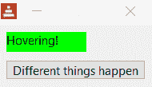

请注意，左鼠标按钮点击仅对按钮控件称为 `on-click`，对于所有其他面，它是 `on-down`，随后是 `on-up` 事件。

=> 现在回答 *Questions* 部分的第 8 个问题。

## 计时器事件

此类事件有一个 `on-time` 行为器。该行为器与面的 `rate` 方面一起工作，该方面设置事件发生的速率，可以表示为：

* 每秒速率，例如每秒一次：`rate 1`，因此 `rate` 50 比 `rate` 1 快 50 倍
* 作为一个 `time!` 值，例如 `rate` 0:00:03 表示每 3 秒一次

每次滴答时，`on-time` 行为器都会执行。以下是一些简单的示例。请注意，我们如何通过在 `on-time` 行为器中更改 `offset` 来实现一些原始的动画效果：

```
;-- see Chapter09/timers.red:
view [
    size 400x400
    b: button 80x30 green "Catch me" rate 50 
        on-time [b/offset: b/offset + 1x1]
        on-down [quit]
    t1: text txt rate 5
        on-time [either t1/text = "" [t1/text: txt][t1/text: ""]]
    t2: text txt rate 0:00:03
        on-time [either t2/text = "" [t2/text: txt][t2/text: ""]]
]
```

现在是时候让 *Container settings* 部分中的数字时钟工作了。为此，我们只需要添加一行（以粗体显示）来定义 `on-time` 行为器，该行为器每秒执行一次：

```
;-- see Chapter09/digital-clock2.red:
time-now: to string! now/time
view/flags [ 
    title "Clock"
    show-time: text font-size 13 font-color red time-now
    rate 1 on-time [show-time/text: to string! now/time]
]
[modal popup] 
```

## 行为器是对象

如果你解决了第 2 题，你会知道面是一个具有多个方面的复杂对象。它包含的行为器存储在一个方面中，该方面是一个对象，每个事件一个字段。假设我们有以下按钮代码：

```
;-- see Chapter09/faces-are-objects.red:
bt: button "Print me!" [print bt]
```

点击按钮，然后滚动到控制台输出的末尾，你会找到以下内容：

```
actors: make object! [
     on-click: func [face [object!] event [event! none!]][print bt]
]
```

我们将在接下来的两个部分中应用它。

## 检测键盘

行为器实际上是事件名称和一个函数的组合，该函数接受一些参数，主要是在其上发生事件的控件和事件本身。以下代码片段展示了如何检测何时按下某些键：

```
;-- see Chapter09/key-detecting.red:
view/options [     
    t: text "hit 'space', 'a', or '?' keys !"][
    actors: object [on-key: func [key event] [
            if event/key = #"a" [t/text: "'a' key pressed."]
            if event/key = #"?" [t/text: "'?' key pressed."]
            if event/key = #" " [t/text: "'space bar'pressed."] 
        ]
    ]
]
```

## 菜单

演员是对象的事实在我们看到 Red 中菜单事件是如何定义时变得非常明显。菜单的定义首先通过声明一个 `layout` 对象开始。然后，通过 `/menu` 字段，菜单标题和子菜单被定义为一个列表。每个子菜单在列表中都是更深的嵌套层级，例如：


# 菜单示例

```
; see Chapter09/menu.red:
mex: layout [title "Menu example" ar: area cyan 400x400]
mex/menu: [
    "File" [ "Load" load --- "Save" sv --- "Save As" svas --- "Print" prnt ]
    "Sub-menus" [
        "Submenu1" s1
        "Submenu2" s2
        "Submenu3" [
            "Submenu4" s4
            "Submenu5" s5
        ]
    ]
    "Tools" [ "Text Size" txts ]
    "Help" [ "Some Help" hlp ]
    "Quit" [ "Close all" qt]
]
```

每个菜单项都有一个字符串作为标题和一个单词，用于存储单击该菜单项时发生的事件。例如，退出菜单中的 `"全部关闭"` 和 `qt`。

然后，我们使用 `/actors` 定义菜单参与者，它是一个包含 `on-menu` 参与者的对象，该参与者是一个具有 `face` 和 `event` 参数的函数。触发事件对应的单词位于 `event/picked` 中，因此我们可以使用简单的 `if`，或在菜单较多时使用 `switch` 来附加相应的代码块：

```
mex/actors: make object! [
    on-menu: func [face [object!] event [event!]][
        switch event/picked [
            load [print "load" ar/text: "Load !"]
            sv [print "save" ar/text: "Save !"]
            svas [print "save as" ar/text: "Save As !"]
            s4 [print "submenu4 selected" ar/text: "Submenu 4"]
            txts [print "Tools tab !" ar/text: "Tools tab !"] 
            hlp [print "help tab !" ar/text: "Help tab !"]
            prnt [print "print menu selected" ar/text: "Print tab !"]
            qt [quit] 
       ]
   ] 
] 

view mex
```

# 基本通讯录应用

现在让我们结合迄今为止学到的一些内容，开始构建一个用于维护我们在使用 第 5 章 *使用序列和块*，以及 第 7 章 *使用文件* 中使用的联系人的应用程序。我们的存储是一个名为 `contacts` 的文本文件。每行包含联系人姓名、联系人地址和电话号码，所有字段均以分号 (`;`) 分隔。

这是一个示例：

```
John Smith;123 Tomline Lane Forest Hills, NJ;555-1234
Paul Thompson;234 Georgetown Pl. Grove, AL;555-2345
```

这是应用程序屏幕：

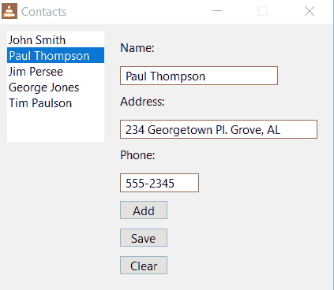

我们的联系人姓名显示在 `text-list` 面板中。当选择一个姓名时，该联系人的详细信息会出现在右侧面板的字段中。可以填写新联系人并将其添加到列表中。按下保存按钮时，所有联系人都会保存到 `contacts` 文件中。

这是代码。到目前为止，你应该明白发生了什么，但我们添加了一些注释以便在需要时提供帮助：

```
;-- see Chapter09/contacts-app.red:
extract-info: func [] [
    clear names
    clear addresses
    clear phones
    foreach contact contacts [
        arr-contact: split contact ";"
        append names arr-contact/1
        append addresses arr-contact/2
        append phones arr-contact/3
    ]
]

clear-fields: func [] [
    name/text: copy ""                                   ; (1)
    address/text: copy "" 
    phone/text: copy ""
]

if not find read %. %contacts [write %contacts ""]       ; (2)
contacts: read/lines %contacts                           ; (3)
names: copy []                                           ; (4)
addresses: copy []
phones: copy []
extract-info                                             ; (5)
view [
    title "Contacts"
    tl: text-list data names [
        name/text: pick tl/data tl/selected              ; (6)
        address/text: pick addresses tl/selected
        phone/text: pick phones tl/selected
    ]
    panel [
        below
        text "Name:"
        name: field 200
        text "Address:"
        address: field 250
        text "Phone:"
        phone: field 100
        button "Add" [                                   ; (7)
            new-contact: rejoin [ name/text ";" address/text ";" phone/text]
            append contacts new-contact                  ; (8)
            clear-fields
            extract-info
        ]
        button "Save" [
            write/lines %contacts contacts               ; (9)
            clear-fields
        ]
        button "Clear" [clear-fields]
    ]
]
```

### 代码说明

1. 我们在这里使用 `copy`，请参阅 第 5 章 *使用序列和块*。

2. 查看当前目录 (`%`.) 是否已存在联系人文件，如果不存在，则创建一个空文件。

3. `read/lines` 将 `contacts` 文件读入为字符串块，每个字符串是一个联系人（要查看这一点，请插入 `probe contacts`）。

4. 需要此声明，因为单词 `names` 已出现在函数 `extract-names` 中；`names` 必须在调用 `extract-names` 之前声明。同样，我们在这里使用 `copy`，请参阅 第 5 章 *使用序列和块*。

5. 在此处调用的 `extract-info` 函数中，我们将姓名、地址和电话信息提取到三个单独的列表中，但每个联系人的信息在每个列表中的索引相同。

6. 因此，我们可以在此处使用相同的索引 `tl/selected`，以在适当的字段中显示每个数据项。

7. 在下一行中，我们创建了一个包含新联系人信息的字符串。

8. 新的联系人字符串被追加到 `contacts` 系列中。

9. 新的 `contacts` 系列被写入 `contacts` 文件，每个联系人占一行。

# 绘图方言简介

Draw 是 Red 的一种方言，旨在便于绘制二维几何形状，如圆形、矩形和动画。它使用 VID，因此 `needs 'view` 必须出现在头部。作为一个简单的示例，以下是如何绘制一个圆：

```
;-- see Chapter09/first-draw-example.red:
view [ 
    base 100x100 cyan draw [
        line 20x0 75x50
        pen red 
        circle 35x50 20
    ]
]
```

我们在 `base` 面上绘制并开始一个 `draw` 块。在其中，我们从起点 20 x 0 绘制一条 `line` 到终点 75 x 50。然后，我们定义一个颜色为红色的 `pen`，并用它绘制一个半径为 20、中心在 35 x 50 的 `circle`：

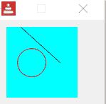

\=> 现在回答 *问题* 部分的第 9 题。

除了使用 `base` 之外，你也可以在现有的 `image` 上添加绘图。

绘图方言非常完善，以下是你可以尝试的一些内容：

* 绘制矩形（`box`）、三角形、多边形、椭圆、曲线、弧线、特殊字体等

* 设置笔的 `line-width` 以绘制更粗的线（例如，`line-width 10`）

* 通过设置 `fill-pen` 的颜色来填充形状（例如，`fill-pen yellow`）

* 如果不需要边框，输入 `pen off`

* 文本可以在特定点绘制，例如 `text 40x30`

* `pen` 和 `fill-pen` 可以使用不同种类的渐变

* 你可以使用变换，例如平移、缩放和旋转

* 通过将 `draw` 与 `on-time` 参与者结合，可以运行动画

在 第 10 章 的 *响应式编程* 部分，*高级 Red*，我们将展示当所有这些功能结合起来时可以实现的一些非常酷的示例。

如果想深入了解，请参阅 *进一步阅读* 部分中关于 draw 的链接。

# 总结

在本章中，你对用于制作图形应用程序的 VID 方言有了概述。首先，我们制作了下载汇率应用的 VID 版本，以了解如何在 `view` 块中使用不同的面板。我们讨论了 `view` 的不同 `options` 以制作特殊窗口，以及 `layout` 命令，如 `below`、`return` 和 `at`，用于构建你的屏幕。


然后，我们带你参观了可用的面孔，例如 `text`、`field`、`button`、`check`、`drop-list`、`panel`、`tab-panel`、`slider`、`menus` 等。要真正构建动态屏幕，你必须在这些不同的面孔上使用 `actors`。你学会了如何编写它们，在一个面孔上组合多个 actors，检测按键，并创建定时事件。我们还举例说明了如何开始构建更复杂的维护应用程序。最后，你对功能非常强大的 `draw` 方言进行了介绍，它使你能够绘制 2D 形状和动画。

## 问题
1. 重写 `currency-rates-gui.red` 中的 `download-rates`，使其接受代码和日期作为参数。
2. 将 `button` 对象的内部结构打印到 `Red` 控制台。注意 `button` 有一个 `window` 父级面孔。
3. 你可以通过在其 `action` `facet` 中使用 `quit` 或 `unview` 词来编写按钮以关闭其窗口。两者都试一下。注意当有多个窗口需要关闭时使用 `unview/all`。
4. 创建一个窗口，显示具有不同颜色的方形 `base` 面孔，例如 `base yellow 25x25`。尝试几种布局命令。
5. 创建一个包含按钮和复选框的窗口。通过点击按钮更改复选框的状态和文本。点击三次后禁用该按钮（提示：使用 `face/enabled?`）。
6. 创建一个窗口，显示按 `text-list` 排序的系列的数据值。你可以通过两种方式实现——使用按钮 `action`，或使用 `do` 块。
7. 从系列 `\["Dave" 1804 "Peter" 9439 "Viviane" 2386 "Marcus" 9423``\]` 中提取名称并在 `text-list` 中显示。当选择一个名称时，在 `text` 字段中显示对应的数字。此外，将该名称在原始列表中的索引打印到控制台。
8. 创建一个窗口，显示文本，当鼠标光标悬停其上时背景颜色会改变。还定义一个字符串列表，例如城市。定义一个 `on-wheel` actor，按顺序显示每个城市。
9. 在宽度为 500、高度为 300、背景为白色的矩形 `base` 上，在矩形内绘制红色对角线和蓝色垂直线。

## 进一步阅读
你可以在这里找到有关 `VID` 的一些额外信息：[`www.red-by-example.org/vid.html`](http://www.red-by-example.org/vid.html)。
有关绘图方言的更多信息可以在这里找到：[`www.red-by-example.org/draw.html`](http://www.red-by-example.org/draw.html)。
目前关于 GUI 系统的官方文档比较正式，可以在这里找到：[`doc.red-lang.org/en/gui.html`](https://doc.red-lang.org/en/gui.html)。它包含有关 `View` 引擎、`VID` 和 `draw` 方言的深入信息。
