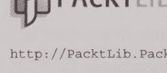
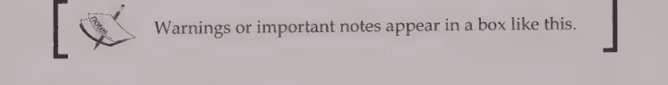
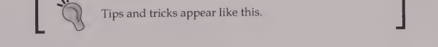

# Adobe Muse 学习：无需编写任何代码创建精美网站的书籍与电子书

Digitized by the Internet Archive
in 2023

## Learning Adobe Muse

## Credits

Author
Jennifer Farley

Copy Editor
Alfida Paiva

Reviewers
Corey Gutch
Ben Harrison
Cristian Radu

Project Coordinator
Leena Purkait

Proofreader
Chris Brown

Acquisition Editor
Wilson D'souza

Indexer
Hemangini Bari

Lead Technical Editor
Unnati Shah

Graphics
Aditi Gajjar

Technical Editors
Joyslita D'Souza
Ankita Meshram
Unnati Shah
Zinal Shah

Production Coordinator
Nilesh R. Mohite

Cover Work
Nilesh R. Mohite

## About the Author

**Jennifer Farley** has over 12 years experience working in the graphic and web design industry. In 2002, she became a full time educator, teaching Adobe Photoshop, Illustrator, Dreamweaver, and Design Theory. She runs her own design business, called Laughing Lion Design but now divides her time equally between teaching design and freelance illustration work.

Thanks to my husband Jason for his support and love, and for sometimes staying up very late with me while I wrote this book.

Thanks to my parents for their support and love and for introducing me to books at a very, very young age.

## About the Reviewers

**Corey Gutch** has worked with various web technologies at Adobe Systems since 1996, and is an Adobe Certified Expert in Dreamweaver and Illustrator. He is currently the Interactive Director for creative agency Dumb Eyes, designing and developing standards-compliant websites, the Lead Instructor for the Web Design with Creative Suite certificate program at the University of Washington, and Community Manager for Adobe Muse at Adobe Systems. Along with his knowledge of Adobe products, he is proficient in authoring HTML, XHTML, CSS, PHP, and JavaScript, and working with open source frameworks such as Wordpress and Drupal. He has deep knowledge and insight into real-world web design and development scenarios with both corporate and boutique clients.

**Ben Harrison** is also known as Mr. Fuddlebunker of Kelso, WA. He is married to a wonderful woman, has four kids and works at Swanson Bark & Wood Products. His current responsibilities are Digital Marketing and Brand Management. He loves to play with his kids, travel with his wife, volunteer in his community, build websites in his spare time as Fuddlebunker Design, and when he has a free weekend, he plays paintball.

**Cristian Radu** is a technically astute IT professional with strong experience providing support to corporate clients across diverse industries, recognized for his ability to coordinate special projects, his excellent analytical and problem solving skills, and his willingness to rise to any challenges. He started his career working for small local companies then moved to large corporations.

## www.PacktPub.com

## Support files, eBooks, discount offers and more

You might want to visit www.PacktPub.com for support files and downloads related to your book.

Did you know that Packt offers eBook versions of every book published, with PDF and ePub files available? You can upgrade to the eBook version at www.PacktPub.com and as a print book customer, you are entitled to a discount on the eBook copy. Get in touch with us at service@packtpub.com for more details.

At www.PacktPub.com, you can also read a collection of free technical articles, sign up for a range of free newsletters and receive exclusive discounts and offers on Packt books and eBooks.

http://PacktLib.PacktPub.com

Do you need instant solutions to your IT questions? PacktLib is Packt's online digital book library. Here, you can access, read and search across Packt's entire library of books.

## Why Subscribe?

- Fully searchable across every book published by Packt
- Copy and paste, print and bookmark content
- On demand and accessible via web browser

## Free Access for Packt account holders

If you have an account with Packt at www.PacktPub.com, you can use this to access PacktLib today and view nine entirely free books. Simply use your login credentials for immediate access.

## 第 6 章：排版、Muse 与网络 117
- 文字之力 118
  - 字体的解剖结构 118
- 创建文本框 123
  - 清晰、有说服力且正确的文案 124
- 编辑文本 124
- 创建和应用段落样式 127
- 创建和应用字符样式 131
  - 在字符和段落样式面板中使用上下文菜单 132
- 标题 132
  - 内容组织与层级 133
  - 标题与可访问性 133
  - 标题与 SEO 134
- 创建标题 134
  - 更改文本大小写 136
  - 文本环绕 137
  - 网页安全字体 139
- 元数据 – 页面上的隐藏文本 140
- 总结 141

## 第 7 章：处理图像 143
- 你好，网页友好型图像 144
- 选择最佳文件格式 144
  - JPEG 145
  - GIF 146
  - PNG 147
- 网页安全颜色 – 过去的事物？ 147
- 将图像添加到页面 149
  - 放置图像 149
  - 添加替代文本 150
  - 图像上下文菜单 151
- 操作图像 152
  - 调整图像大小 152
  - 旋转图像 154
  - 定位图像 154
  - 复制图像 155
  - 裁剪图像 155
- 为图像添加效果 157
- 从其他程序粘贴图像 158
- 处理背景图像 158
- 添加徽标 158
  - 为徽标添加链接 159
- 使用平铺图像作为背景 160
- 使用摄影图像作为背景图像 161
- 固定图像 164
- 使用资源面板管理站点文件 165
- 将对象组合在一起以作为单个对象工作 166
  - 分组对象 166
- 总结 166

## 第 8 章：使用小部件自定义——菜单和面板 167
- 处理小部件 168
  - 向页面添加小部件 168
- 菜单小部件的工作原理 169
  - 添加菜单栏 169
  - 选择小部件及其子元素 171
  - 设置小部件选项 172
  - 格式化每个菜单项 174
  - 添加状态 176
  - 转移样式 178
  - 水平菜单 179
  - 垂直菜单 179
  - 手风琴面板 180
  - 添加面板 180
  - 编辑手风琴小部件元素 182
  - 编辑手风琴小部件选项 183
- 选项卡面板 183
- 删除面板 185
- 总结 185

## 第 9 章：更多小部件——组合和幻灯片 187
- 组合小部件 187
  - 使用空白组合创建简单的照片库 189
  - 向目标区域添加内容 190
  - 更改组合小部件选项 191
    - 使用多张图像创建触发器和目标的另一种方法 193
- 幻灯片小部件 194
  - 创建幻灯片演示 196
  - 插入任意 HTML 199
- 向页面添加 Google 地图 199
- 向网站添加 Twitter（或其他类型）动态 202
- 总结 204

## 第 10 章：Muse，认识 Adobe Creative Suite 205
- 添加 Photoshop 悬停按钮 205
- 状态 206
- 在 Photoshop 中创建具有多种状态的悬停按钮 207
- 放置 Photoshop 按钮 210
- 添加不是按钮的 Photoshop 图像 212
- 从其他程序粘贴图像 215
- 嵌入富媒体内容 216
- 总结 216

## 第 11 章：预览和测试您的网站 217
- 预览页面 217
- 完成网站 218
- 在 Muse 中预览页面 218
- 在浏览器中预览页面 219
- 在浏览器中预览整个网站 219
- 导出 HTML 以进行浏览器测试 219
- 在已安装的浏览器中查看主页 221
- 测试什么？ 221
- 在多个浏览器和平台上测试您的网站 222
- 测试哪些浏览器和平台？ 222
- 测试页面优化 223
- 在各种显示器上查看页面 224
- 在不同屏幕分辨率下查看页面 224
- 检查颜色对比度是否充足 224
- 测试所有小部件的功能 225
- 测试所有链接，包括导航 225
- 测试所有下载 225
- 测试网站的可访问性合规性 225
- 校对所有内容 225
- 可用性测试 225
- 创建设备友好的网站 226
- 总结 227

## 第 12 章：发布您的网站 229
- Adobe ID 229
- 发布临时网站 230
- 再提醒我一下 .muse 文件是什么 230
- 编辑和更新网站 233
- 升级和发布 234
- 注册域名 235
- 升级为已发布网站 235
- 将域名与您的 Muse 网站关联 237
- 重新委托您的域名 238
- 替代托管 239
- 文件传输协议（FTP） 239
- FTP 客户端 240
- 总结 240
- 索引 241

## 前言

Adobe Muse 是来自全球领先的软件设计公司的令人兴奋的新工具，它允许用户在不编写任何代码的情况下创建精美且功能齐全的网站。它为平面设计师提供了将印刷设计技能应用到网络上的能力。

本书将帮助网页设计师以及平面设计师快速掌握 Adobe Muse。它将提供逐步说明，指导您使用 Adobe Muse 构建网站。

学习 Adobe Muse 将教会您如何使用 Adobe Muse 规划、设计和发布网站。它首先介绍该程序的工具和界面，然后介绍您为布局网页所需的概念。您将学习如何使用可重用的样式格式化文本、添加图像、创建干净的导航系统，以及向页面添加面板和幻灯片等交互元素，而且这一切都不需要编写一行代码！

到本书结束时，您将创建一个设计精良、功能齐全的网站。

## 本书涵盖内容

第 1 章，欢迎来到 Muse，讨论了 Muse 如何让我们在不编写代码的情况下创建网站。我们将熟悉 Muse 工作区、其工具、面板和文档窗口。我们将查看每个工具的快捷键，值得花一些时间学习。

第 2 章，Muse 工作流程，解决了设计师在创建网页时面临的一些挑战。这些包括使设计在多种浏览器和各种分辨率下看起来良好，以及使其快速加载。我们将了解 Muse 工作流程以及将网站从想法转变为已发布网站所涉及的步骤。

第 3 章，规划您的网站，讨论了网页设计中使用的一些基本布局。我们将了解使用笔和纸进行线框图的想法，以及如何在 Muse 中设置网站结构和线框图。

第 4 章，强大的页面，[content]

## 第 6 章：排版、Muse 与网络 117
- 文字之力 118
  - 字体的解剖结构 118
- 创建文本框 123
  - 清晰、有说服力且正确的文案 124
- 编辑文本 124
- 创建和应用段落样式 127
- 创建和应用字符样式 131
  - 在字符和段落样式面板中使用上下文菜单 132
- 标题 132
  - 内容组织与层级 133
  - 标题与可访问性 133
  - 标题与 SEO 134
- 创建标题 134
  - 更改文本大小写 136
  - 文本环绕 137
  - 网页安全字体 139
- 元数据 – 页面上的隐藏文本 140
- 总结 141

## 第 7 章：处理图像 143
- 你好，网页友好型图像 144
- 选择最佳文件格式 144
  - JPEG 145
  - GIF 146
  - PNG 147
- 网页安全颜色 – 过去的事物？ 147
- 将图像添加到页面 149
  - 放置图像 149
  - 添加替代文本 150
  - 图像上下文菜单 151
- 操作图像 152
  - 调整图像大小 152
  - 旋转图像 154
  - 定位图像 154
  - 复制图像 155
  - 裁剪图像 155
- 为图像添加效果 157
- 从其他程序粘贴图像 158
- 处理背景图像 158
- 添加徽标 158
  - 为徽标添加链接 159
- 使用平铺图像作为背景 160
- 使用摄影图像作为背景图像 161
- 固定图像 164
- 使用资源面板管理站点文件 165
- 将对象组合在一起以作为单个对象工作 166
  - 分组对象 166
- 总结 166

## 第 8 章：使用小部件自定义——菜单和面板 167
- 处理小部件 168
  - 向页面添加小部件 168
- 菜单小部件的工作原理 169
  - 添加菜单栏 169
  - 选择小部件及其子元素 171
  - 设置小部件选项 172
  - 格式化每个菜单项 174
  - 添加状态 176
  - 转移样式 178
  - 水平菜单 179
  - 垂直菜单 179
  - 手风琴面板 180
  - 添加面板 180
  - 编辑手风琴小部件元素 182
  - 编辑手风琴小部件选项 183
- 选项卡面板 183
- 删除面板 185
- 总结 185

## 第 9 章：更多小部件——组合和幻灯片 187
- 组合小部件 187
  - 使用空白组合创建简单的照片库 189
  - 向目标区域添加内容 190
  - 更改组合小部件选项 191
    - 使用多张图像创建触发器和目标的另一种方法 193
- 幻灯片小部件 194
  - 创建幻灯片演示 196
  - 插入任意 HTML 199
- 向页面添加 Google 地图 199
- 向网站添加 Twitter（或其他类型）动态 202
- 总结 204

## 第 10 章：Muse，认识 Adobe Creative Suite 205
- 添加 Photoshop 悬停按钮 205
- 状态 206
- 在 Photoshop 中创建具有多种状态的悬停按钮 207
- 放置 Photoshop 按钮 210
- 添加不是按钮的 Photoshop 图像 212
- 从其他程序粘贴图像 215
- 嵌入富媒体内容 216
- 总结 216

## 第 11 章：预览和测试您的网站 217
- 预览页面 217
- 完成网站 218
- 在 Muse 中预览页面 218
- 在浏览器中预览页面 219
- 在浏览器中预览整个网站 219
- 导出 HTML 以进行浏览器测试 219
- 在已安装的浏览器中查看主页 221
- 测试什么？ 221
- 在多个浏览器和平台上测试您的网站 222
- 测试哪些浏览器和平台？ 222
- 测试页面优化 223
- 在各种显示器上查看页面 224
- 在不同屏幕分辨率下查看页面 224
- 检查颜色对比度是否充足 224
- 测试所有小部件的功能 225
- 测试所有链接，包括导航 225
- 测试所有下载 225
- 测试网站的可访问性合规性 225
- 校对所有内容 225
- 可用性测试 225
- 创建设备友好的网站 226
- 总结 227

## 第 12 章：发布您的网站 229
- Adobe ID 229
- 发布临时网站 230
- 再提醒我一下 .muse 文件是什么 230
- 编辑和更新网站 233
- 升级和发布 234
- 注册域名 235
- 升级为已发布网站 235
- 将域名与您的 Muse 网站关联 237
- 重新委托您的域名 238
- 替代托管 239
- 文件传输协议（FTP） 239
- FTP 客户端 240
- 总结 240
- 索引 241

## 前言

Adobe Muse 是来自全球领先的软件设计公司的令人兴奋的新工具，它允许用户在不编写任何代码的情况下创建精美且功能齐全的网站。它为平面设计师提供了将印刷设计技能应用到网络上的能力。

本书将帮助网页设计师以及平面设计师快速掌握 Adobe Muse。它将提供逐步说明，指导您使用 Adobe Muse 构建网站。

学习 Adobe Muse 将教会您如何使用 Adobe Muse 规划、设计和发布网站。它首先介绍该程序的工具和界面，然后介绍您为布局网页所需的概念。您将学习如何使用可重用的样式格式化文本、添加图像、创建干净的导航系统，以及向页面添加面板和幻灯片等交互元素，而且这一切都不需要编写一行代码！

到本书结束时，您将创建一个设计精良、功能齐全的网站。

## 本书涵盖内容

第 1 章，欢迎来到 Muse，讨论了 Muse 如何让我们在不编写代码的情况下创建网站。我们将熟悉 Muse 工作区、其工具、面板和文档窗口。我们将查看每个工具的快捷键，值得花一些时间学习。

第 2 章，Muse 工作流程，解决了设计师在创建网页时面临的一些挑战。这些包括使设计在多种浏览器和各种分辨率下看起来良好，以及使其快速加载。我们将了解 Muse 工作流程以及将网站从想法转变为已发布网站所涉及的步骤。

第 3 章，规划您的网站，讨论了网页设计中使用的一些基本布局。我们将了解使用笔和纸进行线框图的想法，以及如何在 Muse 中设置网站结构和线框图。

第 4 章，强大的页面，讨论了主页面概念以及我们如何使用它们在多个页面上应用外观和风格。我们将学习如何在单个网页上添加简单文本以及如何添加链接。我们使用 Muse 的一些布局工具，即指南和网格叠加层来对齐内容。

第 5 章，矩形的乐趣，教授如何设置灵活的背景矩形。我们向页面添加矩形并操作其大小、填充颜色和描边，并学习如何添加诸如投影之类的效果。

第 6 章，排版、Muse 与网络，讨论了如何在网页上添加和设置文本样式。我们将研究如何将图像与文本框中的环绕文本结合起来。我们讨论标题从组织和 SEO 角度的重要性，并了解如何向页面添加对人类访客隐藏的元数据。

第 7 章，处理图像，教授如何向页面添加图像以及如何通过更改其位置、旋转、复制和裁剪来操作它们。我们讨论了适合在网络上使用的图像文件格式类型以及如何选择合适的格式。

第 8 章，使用小部件自定义 – 菜单和面板，讨论了如何为整个网站创建菜单栏。我们对菜单和网站结构中每个页面出现的各个菜单项进行样式设置。我们将使用手风琴面板作为一种方式，在不占用太多空间的情况下在页面上放置大量文本。

第 9 章，更多小部件 – 组合和幻灯片，讨论了组合和幻灯片小部件，它们允许我们在几乎没有编码的情况下向页面添加非常有用的交互性和功能。我们还将了解如何从其他网站（例如 YouTube、Google 地图或 Twitter）获取代码并将其嵌入到 Muse 网页中。

第 10 章，Muse，认识 Adobe Creative Suite，探讨了我们如何在 Photoshop 中创建分层图像，然后将其作为 Photoshop 按钮放置在 Muse 中。这使我们能够创建具有多种状态的按钮，这是一种向网站访客提供反馈的有用方法。我们还将看到将另一程序中创建的图像复制并粘贴到 Muse 中是多么容易。

第 11 章《预览和测试你的网站》介绍了如何在 Muse 中以及在浏览器中预览页面，如何在浏览器中预览整个网站，以及如何将网站导出为 HTML 及其相关资源。我们还讨论了测试以及设计师应检查的内容，并提供了使网站对移动设备友好的一些技巧。

第 12 章《发布你的网站》讨论了如何发布和上线你的网站。你可以使用 Adobe 自家的 Business Catalyst 主机进行发布，也可将网站导出为 HTML，然后上传到你选择的托管服务商。

## 本书所需
- Adobe Muse
- Adobe Photoshop（可选）

## 本书适合谁
本书面向初级网页设计师以及有兴趣将平面设计技能应用于网络的平面设计师。它将教你如何快速构建网站，而无需学习 HTML 或 CSS。

## 约定
在本書中，你会找到多种文本样式来区分不同类型的信息。以下是这些样式的示例及其含义。

代码词在正文中显示如下："You can see an example of this in the previous screenshot where the site name windsrf has an asterisk beside it."

新术语和重要词语以粗体显示。你在屏幕上看到的词语，例如菜单或对话框中的词语，在文本中如下所示：" Notice that the Prototype thumbnail shows us the content of that page."

## 读者反馈
我们始终欢迎读者的反馈。请告诉我们你对本书的看法——你喜欢什么或可能不喜欢什么。读者反馈对我们开发你能充分受益的书名非常重要。

如需发送一般反馈，只需发送电子邮件至 feedback@packtpub.com，并在邮件主题中提及书名即可。

如果你在某个主题方面有专业知识，并且有兴趣撰写或为一本书做出贡献，请参阅我们位于 www.packtpub.com/authors 的作者指南。

## 客户支持
现在你已成为 Packt 书籍的自豪拥有者，我们有许多方法可以帮助你充分利用你的购买。

## 下载示例文本和图像
你可以在 http://www.packtpub.com 上从你的账户下载本书的示例文本和图像文件。如果你是在其他地方购买本书，你可以访问 http://www.packtpub.com/support 并注册，以便将文件直接发送到你的电子邮件。

## 勘误
尽管我们已尽一切努力确保内容的准确性，但错误难免。如果你在我们的书籍中发现错误——可能是文本或代码中的错误——我们将非常感激你向我们报告。通过这样做，你可以为其他读者节省挫败感，并帮助我们改进本书的后续版本。如果你发现任何勘误，请访问 http://www.packtpub.com/support，选择你的书籍，点击勘误提交表单链接，并输入勘误详情。一旦你的勘误得到验证，你的提交将被接受，勘误将被上传到我们的网站，或添加到该书名现有勘误列表中，在勘误部分下。

## 盗版
互联网上版权材料的盗版是一个持续存在的问题，涉及所有媒体。在 Packt，我们非常重视对版权和许可的保护。如果你发现我们作品的任何非法复制品，无论在互联网上的何种形式，请立即提供位置地址或网站名称，以便我们采取补救措施。

请通过 copyright@packtpub.com 联系我们，并附上疑似盗版材料的链接。

我们感谢你保护我们的作者，以及我们为你提供有价值内容的<|message|>。

## 问题
如果你在本书的任何方面遇到问题，可以联系我们 questions@packtpub.com，我们会尽力解决。

## 1