## 欢迎来到 Muse
欢迎朋友们，来到 Adobe Muse！在我们学习本书的过程中，我们将学习如何使用 Adobe 最新网页设计软件创建引人注目的网站。全部无需编写任何代码。

人们使用 Muse 的有趣方式示例包括摄影师、插画师和设计师的作品集风格网站，以及各种服务提供商的交互式宣传册风格网站。如果你想看看其他设计师如何使用 Muse 创建他们的网站，请查看 Muse Showcase，网址为 http://www.adobe.com/products/muse/showcase.html。

在本章中，你将学习：
- Muse 是什么
- 如何在工作区中导航
- 如何保存你的网站
- 如何选择工具
- 如何使用面板

## 你说的这个 Muse 是什么？
Muse 是软件设计公司 Adobe 的全新产品。其理念是让设计师能够像创建印刷版面一样轻松地创建网站。被称为所见即所得 WYSIWYG 网页设计工具，Muse 允许我们在不担心 HTML、CSS、JavaScript 或 jQuery 的情况下构建整个网站——所有这些都可能让设计师冷汗直流。

如果你是平面设计师，并且使用过 Adobe InDesign、Illustrator 或 Photoshop，你会发现自己对 Muse 有一定的熟悉程度。界面与 Adobe 家族的其他产品相似，而能够将元素拖放到版面中的能力正是 Muse 的特别之处。你可以专注于外观和感觉，而 Muse 在幕后创建代码。

以下是 Muse 的一些功能：
- **规划、设计和发布**：从计划开始你的网站始终是一个好主意，而这是 Muse 工作流程的第一步。
- **轻松布局文本和图像**：你不必担心添加 DIV 标签、Padding 和 Margin 属性以便在页面上放置设计元素。你可以拖放到想要的位置并精确控制你的版面。
- **添加交互性**：Muse 让你可以使用 Photoshop 图层添加悬停效果和按钮状态。任意 HTML 和 Muse 小部件允许你设置更高级的交互功能，例如手风琴面板、自定义灯箱和菜单。
- **自动生成的菜单**：当你向网站添加页面时，Muse 会即时更新导航菜单。
- **发布很简单**：当你专注于创建引人注目且设计精美的网站时，Muse 会自动生成使其正常运行所需的所有 HTML、CSS 和脚本。如果你使用 Adobe 主机，可以在 Muse 中发布你的网站，也可以导出网站并使用你选择的任何服务提供商托管。

那么让我们开始吧。

## 在哪里找到 Muse
为了跟上进度并使用该程序，第一步是将软件下载到你的电脑。有两种购买 Muse 的方式：要么作为 Adobe Creative Suite 的一部分按月或按年付费，要么作为三十天试用版试用。无论哪种方式，你都可以从 http://www.adobe.com/products/muse.html 下载软件并安装到你的系统。Muse 可用于 Mac 和 Windows。

## Muse 工作区
一个好的工作者了解自己的工具，所以我们将花一点时间熟悉构成 Muse 工作区的工具和面板。

Muse 工作区让你可以规划、设计、预览和发布网页和网站资源。工具栏和面板让我们可以快速访问创建和编辑文档的最常用操作。可以在工作区中显示多个文档，我们可以通过点击标识该页面的标签在页面之间跳转。

## 欢迎屏幕
第一次打开 Muse 时，你会看到欢迎屏幕。该屏幕提供对最近打开的网站的快速访问，并可轻松创建新网站。它还提供与 Adobe Muse 网站的直接连接，在那里你可以了解更多关于该程序的信息。链接提供有关最新可用版本的信息。

每次从 Windows 或 Mac OS 中的应用程序图标启动 Muse 时，欢迎屏幕都会继续出现。如果你直接从电脑上的文件夹打开 Muse 文件，则网站将在不显示欢迎屏幕的情况下打开。

- 1. 要禁用欢迎屏幕，请选择 **Don't Show Again** 并关闭它。
- 2. 要重新启用欢迎屏幕，请在 **Edit** 菜单中启用 **Show Welcome Screen** 选项。

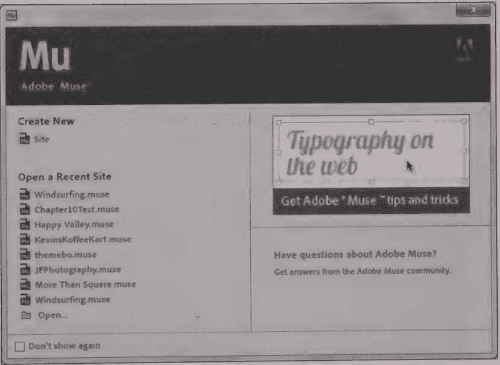

## 打开最近的站点

点击欢迎屏幕左侧的站点名称。如果您要处理的站点未列在其中，请点击打开图标并浏览文件夹以找到 Muse 站点。

## 创建新站点

创建站点，请按以下步骤操作：

- 1. 在欢迎屏幕的创建新站点下点击站点图标，或从主菜单中选择文件 | 新建站点。
- 2. 新建站点对话框打开，允许我们设置站点的尺寸、列数以及边距和内边距设置。

如果您是一名习惯使用毫米、厘米、英寸、点或派卡等单位的平面设计师，您可能会想知道这里使用的是什么单位。所有单位均为像素，因为 Muse 完全用于屏幕设计工作。

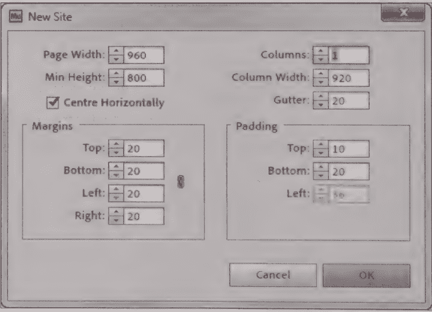

屏幕截图中的字段可描述如下：

- **页面宽度**：这指定了容纳网页内容的容器的宽度。
- **最小高度**：这指定了页面的最小高度。随着您添加内容，页面会拉伸，但此值可确保每个页面始终具有最小高度。
- **列数**：这指定了在设计模式下用于对齐对象的指南的列数。
- **列宽**：这是每列的宽度。
- **间距**：这指定了列之间的间隙。
- **水平居中**：请保持选中状态，这样容纳网页内容的容器无论用户屏幕分辨率如何，都会位于用户屏幕的中央。这是设计网站时的标准做法。
- **边距**：这定义了页面容器边缘与其他外部元素之间的空间。
- **内边距**：这定义了页面容器边缘与容器内部内容之间的空间。

您在新建站点和站点属性对话框中指定的设置适用于新站点中的所有页面和母版页。然而，您可以自定义单个页面和母版页的属性。我们稍后会介绍如何操作。设置站点尺寸时，最好在项目开始时就进行设置，就像您为印刷页面设计时一样，但如果您发现需要稍后更改设置也不必担心。您可以通过选择文件 | 站点属性，或在计划视图中右键单击（Windows）/Ctrl + 单击（Mac）页面或母版页来随时访问此对话框。

- 3. 对于本示例，我们将**宽度**设为 **960** 像素，**高度**设为 **800** 像素，所有**边距**设为 **20** 像素，**顶部内边距**设为 **10** 像素，**底部内边距**设为 **20** 像素。在字段中输入数字，或点击每个字段旁的上下箭头以增加或减少当前值。
- 4. 点击 **确定** 完成初始站点设置。

## 视图

点击确定后，您将看到的下一个屏幕是计划视图。计划视图显示您的站点计划——网站组织的概览。当您首次创建新站点时，Muse 会自动生成一个主页，也称为索引页，该页链接到母版页设计。计划视图是打开 Muse 站点时的默认视图。

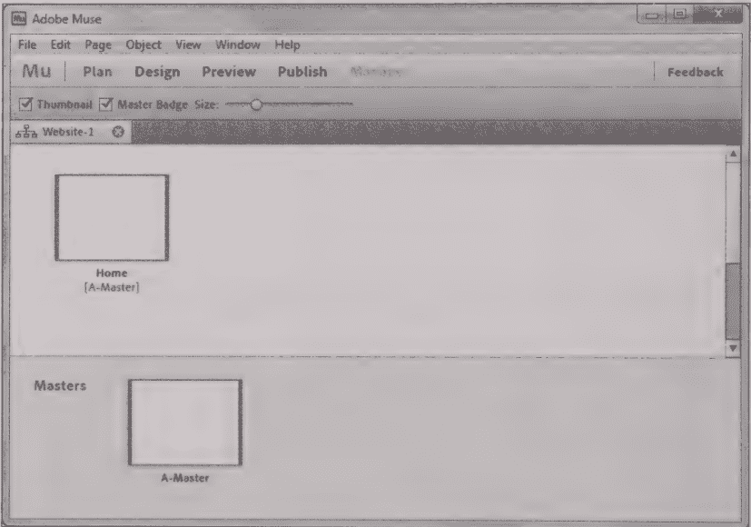

在此阶段，您的计划视图将只有一个页面：主页，它显示为计划视图上部的一个缩略图。在其下方，您应该可以看到您的母版页。在本例中，您将有一个名为 A-Master 的母版页。母版页充当模板，用于共享在多个网页上所需的通用设计元素，如页眉、页脚和标志。

Muse 站点有五个视图：计划、设计、预览、发布和管理。您可以通过点击界面顶部的链接在任意视图之间切换。第四个链接发布会打开登录窗口，开始发布过程。我们将在后面的章节中更详细地讨论这些视图。

## 保存您的站点

在继续之前，最好先保存我们的站点。

- 1. 选择文件 | 保存。保存 Muse 文件为对话框打开。为您的站点输入一个名称；我们将其命名为 MyFirstWebSite.muse。
- 2. 导航到计算机上要保存示例项目的[content]

## 打开最近的站点

点击欢迎屏幕左侧的站点名称。如果您要处理的站点未列在其中，请点击打开图标并浏览文件夹以找到 Muse 站点。

## 创建新站点

创建站点，请按以下步骤操作：

- 1. 在欢迎屏幕的创建新站点下点击站点图标，或从主菜单中选择文件 | 新建站点。
- 2. 新建站点对话框打开，允许我们设置站点的尺寸、列数以及边距和内边距设置。

如果您是一名习惯使用毫米、厘米、英寸、点或派卡等单位的平面设计师，您可能会想知道这里使用的是什么单位。所有单位均为像素，因为 Muse 完全用于屏幕设计工作。

屏幕截图中的字段可描述如下：

- **页面宽度**：这指定了容纳网页内容的容器的宽度。
- **最小高度**：这指定了页面的最小高度。随着您添加内容，页面会拉伸，但此值可确保每个页面始终具有最小高度。
- **列数**：这指定了在设计模式下用于对齐对象的指南的列数。
- **列宽**：这是每列的宽度。
- **间距**：这指定了列之间的间隙。
- **水平居中**：请保持选中状态，这样容纳网页内容的容器无论用户屏幕分辨率如何，都会位于用户屏幕的中央。这是设计网站时的标准做法。
- **边距**：这定义了页面容器边缘与其他外部元素之间的空间。
- **内边距**：这定义了页面容器边缘与容器内部内容之间的空间。

您在新建站点和站点属性对话框中指定的设置适用于新站点中的所有页面和母版页。然而，您可以自定义单个页面和母版页的属性。我们稍后会介绍如何操作。设置站点尺寸时，最好在项目开始时就进行设置，就像您为印刷页面设计时一样，但如果您发现需要稍后更改设置也不必担心。您可以通过选择文件 | 站点属性，或在计划视图中右键单击（Windows）/Ctrl + 单击（Mac）页面或母版页来随时访问此对话框。

- 3. 对于本示例，我们将**宽度**设为 **960** 像素，**高度**设为 **800** 像素，所有**边距**设为 **20** 像素，**顶部内边距**设为 **10** 像素，**底部内边距**设为 **20** 像素。在字段中输入数字，或点击每个字段旁的上下箭头以增加或减少当前值。
- 4. 点击 **确定** 完成初始站点设置。

## 视图

点击确定后，您将看到的下一个屏幕是计划视图。计划视图显示您的站点计划——网站组织的概览。当您首次创建新站点时，Muse 会自动生成一个主页，也称为索引页，该页链接到母版页设计。计划视图是打开 Muse 站点时的默认视图。

在此阶段，您的计划视图将只有一个页面：主页，它显示为计划视图上部的一个缩略图。在其下方，您应该可以看到您的母版页。在本例中，您将有一个名为 A-Master 的母版页。母版页充当模板，用于共享在多个网页上所需的通用设计元素，如页眉、页脚和标志。

Muse 站点有五个视图：计划、设计、预览、发布和管理。您可以通过点击界面顶部的链接在任意视图之间切换。第四个链接发布会打开登录窗口，开始发布过程。我们将在后面的章节中更详细地讨论这些视图。

## 保存您的站点

在继续之前，最好先保存我们的站点。

- 1. 选择文件 | 保存。保存 Muse 文件为对话框打开。为您的站点输入一个名称；我们将其命名为 MyFirstWebSite.muse。
- 2. 导航到计算机上要保存示例项目的位置，然后点击保存。

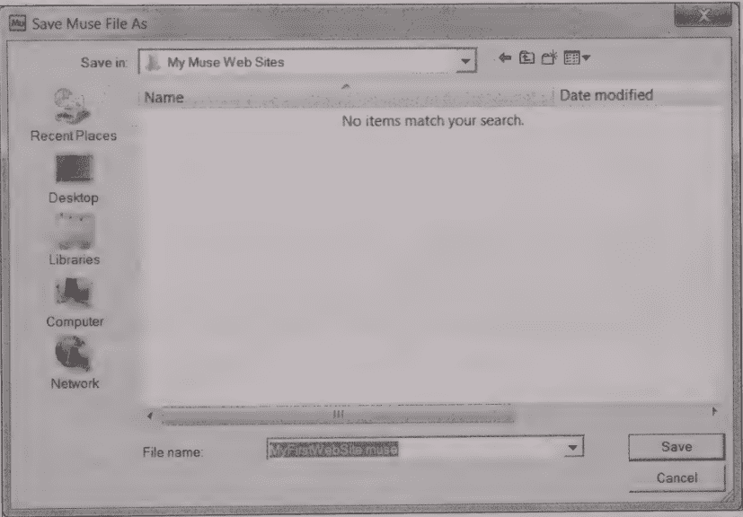

## 在设计视图中打开页面

站点保存后，我们可以进入设计视图并查看 Muse 工作区的其余部分。在计划视图中，双击主页缩略图以打开该页面。

> 您也可以通过点击 Muse 窗口顶部的设计来切换到设计视图。

设计视图是进行大部分设计工作的场所。这里是我们向网页添加文本、图像和多媒体小部件的地方。

设计视图工作区包括打开或创建新文档时看到的所有内容：

- 视图
- 工具箱
- 文档窗口
- 面板
- 菜单
- 控制面板

主页打开后，注意为所选页面和站点计划出现了选项卡。您可以在 Muse 中打开多个页面，每个页面都会显示其自己的选项卡。要从一个页面跳转到另一个页面或站点计划，只需点击页面名称选项卡即可。

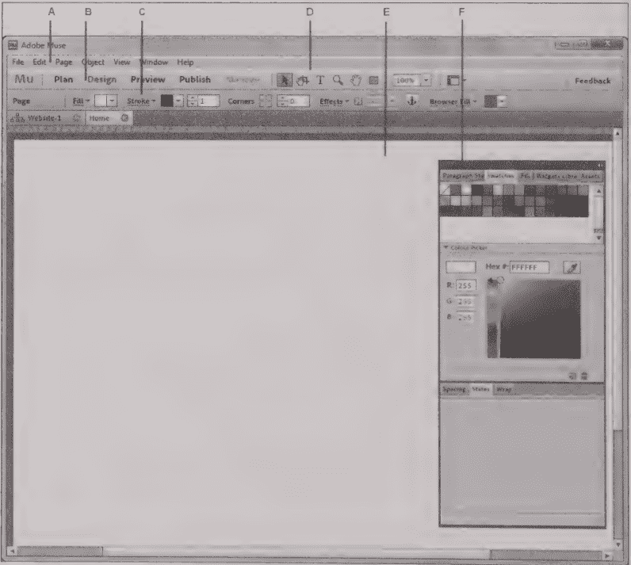

如上图所示的截图中，字母指示了 Muse 工作区的不同组件，如下所示：

- A: 菜单
- B: 视图
- C: 控制面板
- D: 工具栏
- E: 文档窗口
- F: 面板

## 工具栏

工具栏包含用于选择对象、处理文字、裁剪和绘制矩形的工具。它位于屏幕顶部，视图部分右侧。它包含一些如果您使用过其他 Adobe 程序可能会熟悉的工具。

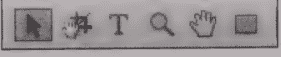

以下是每个工具功能的简要概述：

- **选择工具**：它让您在页面上选择对象
- **裁剪工具**：它让您在页面上裁剪图像
- **文字工具**：它让您创建可添加文字到页面的文字区域
- **缩放工具**：它让您放大或缩小页面
- **手形工具**：它让您通过拖动在页面上平移
- **矩形工具**：它让您创建可填充颜色或图像的矩形、圆角矩形或圆形对象

## 使用工具

要使用工具，只需用鼠标点击工具或按相应的快捷键。您可以通过将鼠标悬停在工具图标上找到每个工具的快捷方式。会出现工具提示，显示工具的名称及其快捷方式。例如，请按以下步骤操作：

- 1. 将鼠标悬停在缩放工具上。
- 2. 点击缩放工具以选择它，如以下屏幕截图所示：

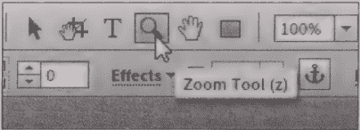

- 3. 将鼠标在每个工具上滚动并暂停，以查看每个工具的名称和快捷方式。记住每个快捷方式。

即使在这个早期阶段，值得花点努力记住每个工具的快捷方式（与 Adobe 的其他程序相比，这里只有少数几个工具）。您会发现，随着您一只手在鼠标上，另一只手准备在键盘上按下快捷键，您的工作流程会显著加快。

## 控制面板

控制面板（窗口 | 控制）为您提供与当前页面项目或所选对象相关的选项和命令的快速访问。控制面板是上下文相关的，因此根据您选择的工具或在文档窗口中点击的对象，显示的选项会有所不同。要获取有关每个选项的更多信息，将鼠标悬停在图标或选项标签上以查看工具提示。

点击文字工具（T）。注意控制面板上的选项如何发生变化。

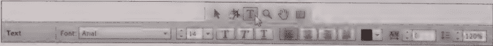

## 面板

面板为我们提供了快速访问额外工具和功能的途径。默认情况下，面板会一起停靠在屏幕右侧的停靠区中。这并不是永久位置；面板实际上是浮动的，并且独立于文档窗口。我们可以通过更改每个面板的位置并重新组织它们来定制工作区以满足自己的需求。在下面的屏幕截图中，色板、字符样式和间距面板当前处于活动状态。通过点击任意面板标签中的名称，该面板就会变为活动状态。与您可能使用过的其他 Adobe 软件不同，单个面板无法分离；它们是“粘”在一起的。

点击文本标签、段落标签和环绕标签以激活它们。

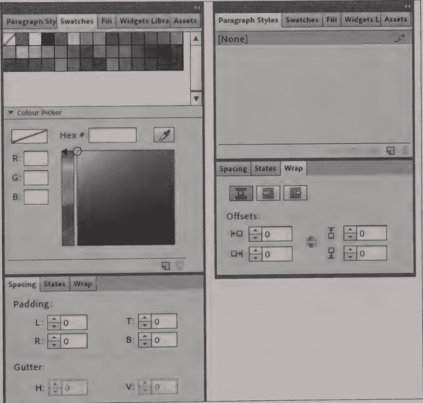

## 展开和折叠面板

面板占用了屏幕上的一小块空间，不过，您可能并不总是希望它们完全展开。我们可以通过将它们折叠以仅显示图标而不显示名称来减少它们占用的空间。以下步骤展示了如何展开和折叠停靠区中的所有面板：

- 1. 点击面板名称右侧的双箭头以折叠面板，如下图所示：

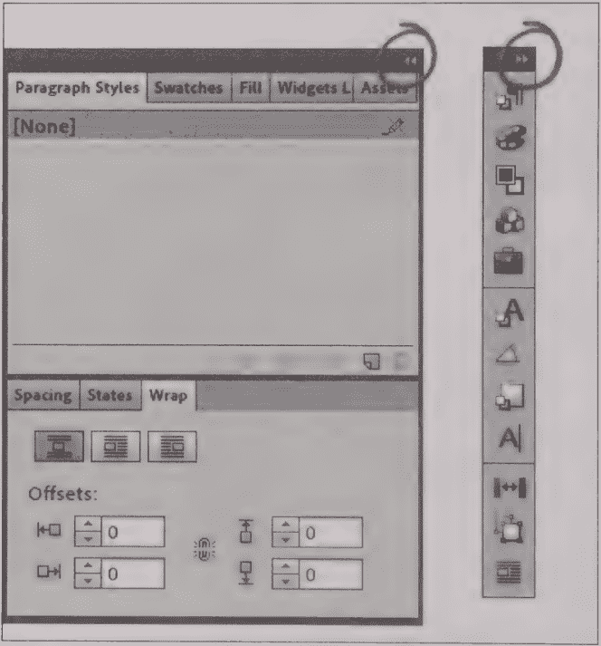

- 2. 要展开面板，请再次点击图标顶部的双箭头。

另一种节省空间的方法是将面板折叠，使其仅显示标签和面板名称。执行以下步骤即可：

- 1. 点击标签名称。标签本身会被高亮，但面板中的控件和功能将被隐藏。

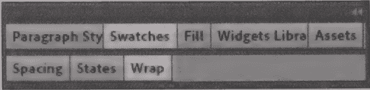

- 2. 再次点击标签名称以再次展开面板。

- 3. 要调整面板大小，请拖动展开面板的底部边缘。

## 隐藏所有面板

在设计时，您可能不想看到任何面板。要隐藏所有面板，请选择窗口 | 隐藏面板。准备好后，您可以通过选择窗口 | 显示面板再次显示它们。

## 打开面板

如果您在面板组中看不到某个特定面板，可以在窗口菜单下找到完整的面板列表。要打开工作区中未显示的面板，请选择窗口 | 填充以打开填充面板。

如果面板名称在窗口菜单下带有复选标记，这意味着它已在屏幕上处于活动状态，并且该特定面板将在其面板组中高亮显示。

## 重新排列面板

要将面板移至另一组，请拖动面板的标签。在拖动时，您会看到面板的 ghosted 版本，并且在组中会出现蓝色高亮的放置区域，表示可以放置面板的区域。您可以通过将其拖动到窄的蓝色放置区域来在停靠区中上下移动面板。

作为练习，尝试将填充面板向下拖动以加入其下方的组。

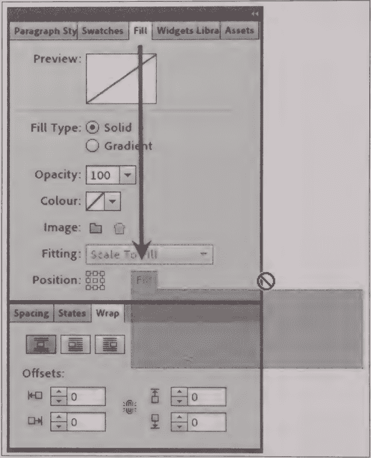

## 文档窗口

文档窗口是屏幕中央的白色页面，当然，这就是所有操作发生的地方。我们可以看到蓝色参考线，指示列数、栏间距和边距的大小。在下面的屏幕截图中，我们可以看到一个使用三列的设置，列之间有间隔（称为栏间距），以及内容区域边缘周围的边距：

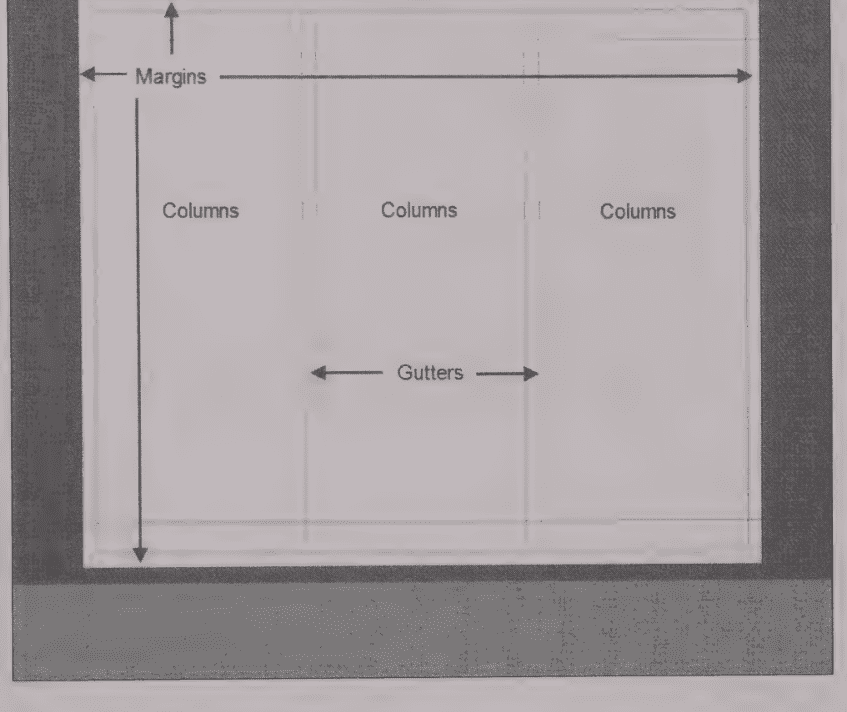

## 标尺、参考线和网格

无论您从事印刷还是网页设计，标尺和参考线都是设计师的最佳助手。默认情况下，Muse 在工作区的顶部和左侧显示标尺。如前所述，所使用的度量单位为像素。要显示或隐藏标尺，请选择视图 | 显示/隐藏标尺。

Muse 还显示了五个参考线，用于定义页面大小、页眉和页脚。我们尚未定义页眉和页脚高度，因此您应该会看到用于拖动页面顶部、页面底部和浏览器底部的参考线的手柄。

当您使用鼠标悬停在工作区左侧的参考线上时，您会看到有关每个参考线用途和功能的工具提示。

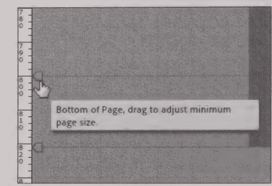

顶部和两个底部的参考线有助于您确定整体页面大小。如果您想在不返回站点属性对话框的情况下更改页面大小，可以将第一个参考线向上拖动，或将第四个参考线向下拖动以扩展页面的内容区域。要显示或隐藏页面参考线，请选择视图 | 显示/隐藏参考线。

## 页眉和页脚参考线

页面上的第二个和第三个参考线分别定义页眉的底部和页脚的顶部。这些参考线只有在您在母版页中定义了页眉和页脚后才可编辑。我们将在未来的章节中更详细地讨论这一点。在普通页面上，页眉和页脚参考线仅用于视觉参考，但不能拖动到新位置。要显示或隐藏页眉和页脚参考线，请选择视图 | 显示/隐藏页眉和页脚或 Ctrl + Shift + /；Cmd + Shift + ,。

## 网格叠加

许多人以列的形式思考网页设计布局。三列和两列布局非常流行，但重要的是要记住，将行和列一起思考会给我们一个网格——这是一个帮助设计师创建优雅和有吸引力的布局的重要工具。Muse 提供了网格叠加。

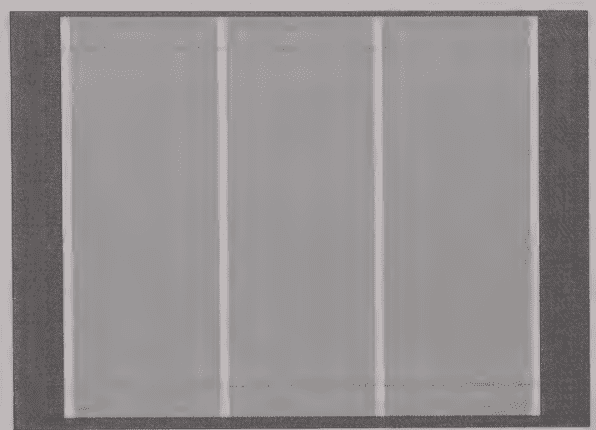

要显示或隐藏网格叠加，请选择视图 | 显示/隐藏网格叠加或按 Ctrl + ' / Cmd + '。

## 缩放

在文档窗口中查看内容时，在设计时能够放大和缩小非常重要。

## 更改放大倍率

有多种方法可以更改放大倍率或缩放级别。您可以执行以下任一操作：

- - 选择缩放工具 (Z)。光标会变为带有 + 符号的放大镜。点击文档窗口以在点击点放大。继续点击以放大至最高 4000%。
- - 使用缩放工具时要缩小，请在点击时按住 Alt 键 (Win)/Option 键 (Mac)。光标将变为带有 – 符号的放大镜。
- - 直接从工具栏旁边的下拉框中选择放大倍率。下拉框提供 50% 到 400% 的值，但您可以输入 10% 到 4000% 之间的任意放大倍率。
- - 选择视图 | 放大或视图 | 缩小。
- - 使用快捷键 Ctrl + = (Win)/Cmd + = (Mac) 放大和 Ctrl + - (Win)/Cmd + - (Mac) 缩小。

- 使用 Ctrl + 0 (Win)/Cmd + 0 (Mac) 将页面适配到窗口内，并使用 Ctrl + 1 (Win)/Cmd + 1 (Mac) 以实际大小查看页面。

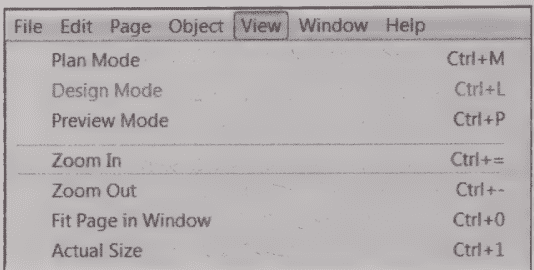

## 撤销操作

在理想的世界里，我们可以在不犯任何错误的情况下组装网站。不幸的是，我们并不生活在那个世界，有时我们需要回溯或撤销一些操作。值得庆幸的是，Muse 允许我们后退并撤销多个操作。事实上，您可以撤销多达最后 20 个操作。如果您犯了错误，可以执行以下任一操作：

- 选择编辑 | 撤销 (操作) 或

- 按 Ctrl + Z (Win)/Cmd + Z (Mac)

如果您想重做刚刚撤销的内容，可以执行以下任一操作：

- 选择编辑 | 重做 (操作) 或

- 按 Ctrl + Shift + Z (Win)/Cmd + Shift + Z (Mac)

## 获取帮助和更多资源

有关使用 Muse 面板、工具和其他应用程序功能的完整和最新信息，请访问 Adobe 网站。要在 Muse 帮助和支持文档以及与 Muse 用户相关的其他网站中搜索信息，请选择帮助 | Muse 帮助。您还可以将搜索结果缩小为仅查看 Adobe 帮助和支持文档。

有关更多资源，例如技巧和技术以及最新的产品信息，请查看位于 http://forums.adobe.com/community/muse 的 Muse 社区反馈页面。

## Muse 更新

随着 Adobe 更新软件，你将在 Muse 欢迎屏幕上看到一条消息，告知有新版本可用。此消息仅在你拥有活跃的互联网连接时出现。

## 摘要

在本章中，我们讨论了 Muse 如何让我们无需编写代码即可创建网站。我们还熟悉了 Muse 工作区、其工具、面板和文档窗口，并查看了每个工具的快捷键。请记住，学习这些快捷键以加快工作流程是值得的。

在下一章中，我们将了解 Muse 工作流程，该流程基于典型的网页设计师从初始概念到最终网站的工作流程。我们将查看规划、创建、设计和发布步骤。

## 2
