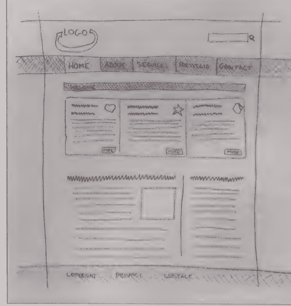
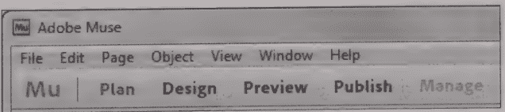
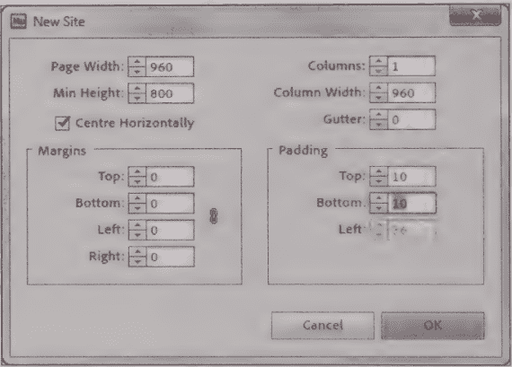
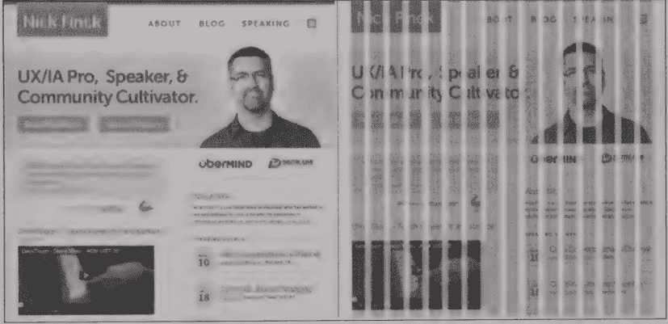
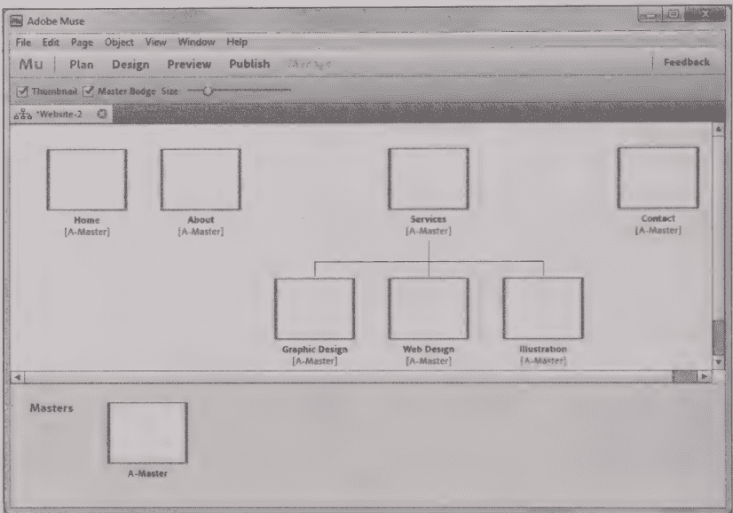
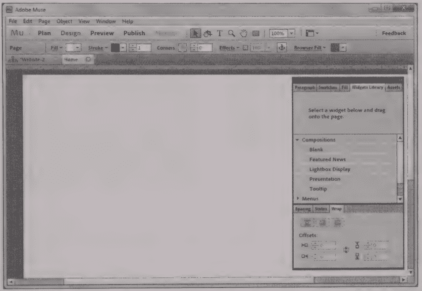
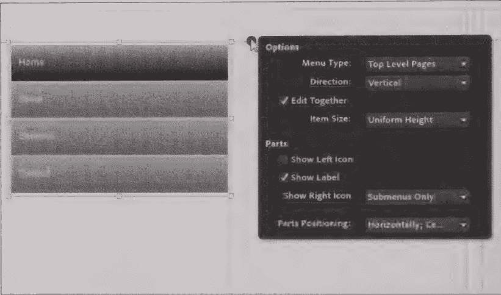
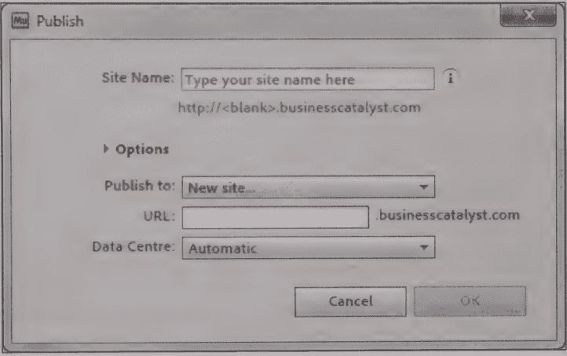

## Muse 工作流程

在本章中，我们将从初始概念到最终网站了解 Muse 工作流程。Muse 工作流程与可描述为典型网页设计师工作流程的内容非常接近，即规划、创建、预览和测试，最后发布你的网站。

在本章中我们将涵盖：
- 网页设计与印刷设计之间的差异
- 网页设计规划阶段需要考虑的事情
- Muse 工作流程 – 创建网站、设置网站计划、设计和发布
- 域名和托管

在上一章中，我们熟悉了 Muse 工作区、其工具栏和面板。在我们重新回到 Muse 之前，让我们先来看看印刷设计与网页设计之间的一些差异。我们将查看可能影响网站用户体验的因素，其中包括使用的网页浏览器类型和用户屏幕的分辨率。

## 印刷工作流程与网页工作流程

在理想的世界里，印刷设计将永远占据重要的地位。然而，现实是，在世界许多地区，人们都在网上寻找信息和娱乐。如果受众在网上，设计师就需要与时俱进。 从纸张到屏幕的平稳过渡可能具有挑战性，但这正是 Muse 登场的地方。

Muse 允许你以与创建印刷版面相似的方式创建网站。它主要面向平面设计师和新手设计师，他们希望为网页创建引人注目的设计，但又不想学习编码来创建网站。

在印刷工作流程中，平面设计师可能会先用铅笔和纸张制作快速的初始 mockup。设计师会使用 Adobe InDesign（或类似的 Quark Express 等软件）来排版页面，并使用 Illustrator 或 Photoshop 等软件来创建和编辑页面内容的图像和图形。混合设计知识的调味，结果就是一个美丽的印刷品。

使用 Muse 的网页工作流程与印刷工作流程相当。无论媒介如何，在打开电脑之前先草拟一些想法都是一个好主意。五分钟内你就可以在纸上画出几个草图。在相同的时间内，你不太可能在设计软件中产生相同数量的想法。这就是第一步：把你的想法从脑海中转移到纸上。虽然我们每个人的设计师都想创造视觉杰作，但首要任务是满足网站访客的需求。

## Muse 前规划

必须了解，在早期阶段（甚至在你双击 Muse 图标之前）投入在研究、探索和规划上的努力至关重要，这样当你启动 Muse 时，工作流程就会变得简单灵活。许多参数会影响设计布局如何转化为有效的网页设计。这些包括用户环境、用户计算机显示器的分辨率，以及在较小程度上，他们的互联网连接速度。

## 浏览器之战

如果你来自印刷背景，你会知道为纸质项目设计的一部分乐趣在于能够选择媒介的大小甚至形状。例如，你可以选择厚纸板、再生纸板、薄纸或编织饰面。你的纸质设计可能包括镂空、压花或折叠。你的纸质图形设计的可能性多种多样。然而，当谈到印刷设计时，你可以绝对确定的是，无论你选择什么大小或形状，对所有看到它的人来说都完全相同。如果你打印在 A4 纸上，我们所有人都以相同的方式看到那张纸。这对于网页设计来说并非如此，这可能是网页设计师面临的最大挑战。

当我们为网页设计时，我们的设计在浏览器窗口中查看。该浏览器可能位于 28 英寸显示器、15 英寸笔记本电脑屏幕或 3 英寸手机屏幕上，或介于两者之间。如你所想，如果我们不考虑网站在这些设置下的外观，这可能会导致问题。

有许多网页浏览器可用，最受欢迎的是 Firefox、Internet Explorer、Safari 和 Google Chrome。这些浏览器中的每一个都以不同的方式显示代码的结果，因此每个浏览器都以不同的方式显示你的网页。大多数时候，差异很小，作为网页设计师，我们有时必须做出小的妥协，以确保我们的设计在任何浏览器上看起来都很棒且尽可能相似。截至撰写本文时，w3schools.com 的统计数据显示以下浏览器使用情况：

| Internet Explorer | Firefox | Chrome | Safari | Opera |
|---|---|---|---|---|
| 16.7% | 34.4% | 41.7% | 4.1% | 2.2% |

W3C 提供的数据收集自 W3Schools 的日志文件，仅应作为参考使用。

## 分辨率

我们知道，访问我们网站的访客可能使用众多浏览器中的任何一个来查看我们的网页。添加到网页设计方程中的下一个变量是他们计算机显示器或移动设备的分辨率。网页设计师经常问的一个问题是“我们应该为哪种屏幕分辨率设计？”。

要回答这个问题，了解当前最常用的屏幕分辨率会有所帮助。以下是根据 www.w3schools.com 去年的数据。同样，此信息最好作为参考，而不是一成不变。

| Higher | 1024x768 | 800x600 | 640x480 | Other |
| --- | --- | --- | --- | --- |
| 85% | 14% | 0% | 0% | 1% |

我们可以看到，从表中可以看出，大多数计算机分辨率现在为 1024×768 或更高，因此我们应该为此大小优化我们的页面。

可用性专家 Jacob Nielsen 将优化定义为确保：

> "..你的页面应在使用最常见的尺寸时看起来和工作最好。在其他尺寸下，它仍然应该看起来不错并且工作良好"

由于许多用户具有高于 1024x768 的屏幕分辨率，大多数网页设计师会设计他们的页面，使内容位于页面居中的容器中。居中对齐的布局在大屏幕上看起来更好。网页设计通常在两侧有相等量的空白时看起来更好。

## 下载速度

在为印刷设计时，通常对作品中可使用的图形或图像数量没有限制。它可能会在通过电子邮件发送给打印机时因文件大小而造成一定的麻烦，但你可以将作品放在 CD 或 DVD 上邮寄。

然而，当谈到网页设计时，我们需要仔细考虑图像的使用。下载速度在互联网上至关重要，访客不会等待缓慢加载的网站。Google 重视速度，并在其搜索排名中考虑网站速度（http://googlewebmastercentral.blogspot.com/2010/04/using-site-speed-in-web-search-ranking.html）。

在全世界每个人都拥有超高速宽带连接之前，我们必须始终注意网页加载的速度。许多用户现在使用蜂窝数据网络访问网站，而这些网络比典型的互联网连接慢得多。提高下载速度的一种方法是使用优化的图像文件：JPG、GIF 和 PNG，它们是在图像质量和文件大小之间的一种折中。我们将在后面的章节中更详细地讨论这些文件格式，但现在只需记住，我们网站的速度是在规划网站设计和构建时一个非常重要的因素，甚至对搜索引擎优化也有影响。

## 在哪里可以找到更多信息？

那么，我们如何得知谁在使用什么？如前所述，W3C 是一个互联网组织，其使命是制定网络标准。除了提供有关网页设计各个方面的建议和教程外，他们还跟踪访问和使用情况的统计数据。要了解有关浏览器、屏幕分辨率和网络用户操作系统的更多信息，请查看以下链接：

- www.w3schools.com/browsers/browsers_stats.asp：提供浏览器统计信息
- www.w3schools.com/browsers/browsers_display.asp：提供（相对）最新的屏幕分辨率信息
- www.w3schools.com/browsers/browsers_os.asp：提供操作系统的细分

## Muse 工作流程

Muse 包含五个不同的视图或部分。它们是：

- Plan
- Design
- Preview
- Publish
- Manage

这些视图代表了设计师在不使用 Muse 的情况下设计和构建网站时所采取的步骤。我们将依次查看这些视图，但让我们先快速回顾一下如何在 Muse 中创建网站。

## 创建站点

在第一章中，我们查看了 Muse 界面并了解了如何在 Muse 中创建新站点。选择 File | New。此过程与在 InDesign 中创建新文档非常相似。它会创建一个 .muse 文件，该文件类似于 .indd（InDesign）文件，因为它保存了有关网页和母版页的信息。

我们可以设置页面的宽度，并且根据常见的屏幕分辨率（1024x768）的知识，默认宽度 960 像素是合适的。

通过输入页面宽度值，我们正在创建一个固定宽度（有时称为静态宽度）布局。这意味着即使浏览器窗口变窄或变宽，布局的宽度也不会改变。固定宽度的替代方案是流体宽度布局。这意味着内容会拉伸以适应浏览器窗口的宽度。在撰写本文时，我们只能选择固定页面宽度选项。默认情况下，容纳内容的容器位于页面中央。

固定宽度页面的典型值在 960 到 1010 像素之间，留出一些空间用于浏览器 chrome、Web 浏览器的边框和滚动条。在设计网页时，必须加上浏览器 chrome 来确定页面的宽度。固定宽度网页最常用的宽度是 960 像素。这种尺寸允许页面在屏幕分辨率为 1024 x 768 像素的显示器上的浏览器中显示。

## 为什么是 960 而不是 1024？

平面设计师使用网格进行布局的时间比网络存在的时间还要长。基于 960 的网格被网页设计师用作一种方法，可以快速在任意数量的列中原型化布局：9 x 3、3 x 3 x 3、4 x 4 x 4 x 4、10 x 2 列等等。

在下面的屏幕截图中，你可以看到左边是 Nick Finck 的网站，右边是同一网站叠加了网格。网格有助于设计师整齐地对齐页面上的对象。

要了解有关基于 960 像素的网格的更多信息，请访问 http://960.gs/。

## 规划你的站点

一旦你在“新建站点”对话框中单击“确定”，Muse 就会打开“计划”视图。在使用 InDesign 等页面布局程序时，你可以设置想要多少页。你还可以设置母版页，母版页保存设计元素或内容，这些元素或内容将在许多页面中一致出现。我们可以在 Muse 中做完全相同的事情。每个 Muse 站点都从 Plan 视图的上半部分代表主页的单个缩略图和 Plan 视图的下半部分代表母版页的缩略图开始。在下面的屏幕截图中，我们可以看到我们已为“关于”、“服务”和“联系”添加了页面。在“服务”页面下，有三个子页面，称为“平面设计”、“网页设计”和“插图”。

“计划”视图让我们可以通过拖放缩略图轻松添加和组织页面。站点地图描述了页面如何相互连接，并为我们提供了站点的一个很好的概览。此外，计划模式中的布局决定了菜单的自动布局。

## 设计你的站点

在完成所有研究、探索和规划之后，我们现在进入了过程的真正有趣的部分：设计！对于“传统”网站设计，我们会编写 HTML 代码，HTML 代码保存页面的结构。然后我们会使用层叠样式表（CSS）对其进行样式设置。

以房屋为例，我们可以认为 HTML 是地板、墙壁、屋顶和窗户，而 CSS 可能是地毯、壁纸和天花板的油漆。

然而，与其自己编写代码和样式表，Muse 在这里介入并保护我们免受编码黑暗底层的困扰。

要进入“设计”视图，只需双击“预览”中的任何缩略图即可。你的页面将打开，你会看到工具栏、面板和文档窗口。我们可以通过拖放将文本、图像和大量非常酷的功能添加到页面上。

如果你使用过 Adobe 的 Dreamweaver 软件，你会知道，即使它试图通过可视化网页设计方法来迎合设计师，你也不能像在 Muse 中那样精确地将设计元素拖放到文档中。这对于习惯于 Photoshop、Illustrator 或 InDesign 的人来说一直是一个令人沮丧的来源。

放置图像和格式化文本的便捷性使这个程序的使用变得愉快。Muse 与 Photoshop 和 Fireworks 集成良好，使从这些程序复制和粘贴图形到网页变得简单。幻灯片和灯箱都可以毫不费力地添加；这些设计元素在几年前需要广泛的编程技能才能实现。

下面的屏幕截图显示了一个通过从小部件面板拖出创建的垂直菜单系统。面板的选项允许我们随心所欲地自定义它，更改文本和背景颜色、大小和位置。

## 预览你的站点

作为设计过程的一部分，我们需要定期检查我们的网站在浏览器中会是什么样子。我们可以通过单击屏幕顶部的“预览”链接在 Muse 内部进行检查。

预览使用 WebKit 作为其渲染引擎。这是为 Apple Safari 浏览器、Google Chrome 浏览器和大多数手机浏览器提供动力的同一引擎，因此它为我们的设计在大多数浏览器中的外观提供了相当准确的表示。

要在 Muse 中预览页面：

- 1. 在“设计”视图中打开你想要预览的页面。
- 2. 单击 Muse 界面左上角的“预览”链接。

虽然这为我们提供了方便的“程序内”预览，但非常重要的是要在真正的浏览器中测试你的页面，即尽可能多的浏览器。这可能是一个繁琐的过程，但值得确保页面加载时不会出现意外。

## 获取浏览器

为了在浏览器中进行测试，你需要确保在计算机上安装了最新版本，以便测试你的网站。你可以使用以下链接进行操作：

- Firefox：http://www.getfirefox.com
- Opera：http://www.opera.com
- Safari：http://www.apple.com/safari/download/
- Google Chrome：http://www.google.com/chrome/
- Internet Explorer（IE）v7：http://www.microsoft.com/download/en/details.aspx?id=2
- Internet Explorer（IE）v8：http://www.microsoft.com/download/en/details.aspx?id=43
- Internet Explorer（IE）v9：http://www.beautyoftheweb.com/

要在浏览器中预览页面，请使用以下步骤：

- 1. 在“设计”视图中打开你想要预览的页面。
- 2. 选择 File | Preview Page in Browser。

我们将在下一章认真开始构建新站点，但现在，让我们继续 Muse 工作流程的下一步。

## 发布你的站点

当所有艰苦的工作完成后，是时候将你精彩的设计作品在线上供全世界观看了，但等等！在点击“发布”按钮之前，我们需要考虑一个子步骤。

## 审查和测试网站

可以说，审查和测试应该从设计和开发过程的开始就进行。正如我们已经看到的，Muse 提供了一个“预览”视图，它让我们对网站在浏览器中的外观有一个相当好的了解，但在你进行网页项目时，有一些问题你可以问自己：

- 我的目标受众是谁？
- 我是否给了他们想要的东西？
- 页面布局是否一致？我们将在后面的章节中看到，Muse 的母版页可以帮助我们保持一致性。

- 是否有平衡感和秩序感？网站是否易于浏览？
- 所有链接是否都正常工作？
- 网站是否在所有主流（以及较旧的）浏览器中都能正常运行并正确显示？
- 网站是否已进行拼写检查？拼写错误和语法不良已被证明是电子商务网站访客的主要反感因素。不要因拼写错误而流失访客。
- 如果你的网站包含多媒体内容，它是否能正常工作？
- 你的联系方式是否易于找到？

这些问题只是你在网页设计之旅中需要考虑的一些问题。

请让个人和团体来测试你的网站。作为设计师，你对网站过于熟悉，从设计到功能的一切对你来说都显而易见。但对新访客来说显而易见吗？新鲜的目光能发现令人惊讶的问题。尽可能多地获取反馈。

当你对设计感到满意，并且已将其调整并测试到精密运行的机器状态时，你就可以发布它并与世界分享。为此，你需要将网站发布到主机上。

发布网站意味着让它对访客可用。这需要你将网站及其所有资源上传到服务器。一旦上传到服务器，所有页面都应重新测试，以防某个文件未正确上传。

使用 Muse 发布时有两种选择。你可以由 Adobe 使用 Business Catalyst 来托管你的网站，也可以导出 HTML 文件并使用你选择的任何主机。

## Adobe Business Catalyst

Business Catalyst 是 Adobe 用于构建和管理在线业务的托管应用程序。它与 Muse 紧密集成，可以被视为将网站上线最简单的方式。Business Catalyst 基础托管的价格从每月 $5.99 起。你可以在 http://www.adobe.com/products/muse/buying-guide.html 找到完整的价格清单。需要说明的是，未来 Muse 可能会包含内容管理系统（CMS）功能，这些功能在导出 HTML 时不可用，并且需要使用 Business Catalyst。

你也可以免费将用 Muse 构建的网站临时发布到 Adobe Business Catalyst，试用期为 30 天。这允许你向客户发送实时 URL 以供审阅。Business Catalyst 上所有试用模式的网站都将包含 Business Catalyst 域名，例如，http://mysite.businesscatalyst.com。如果你稍后决定通过支付月度托管费用将网站“上线”，你可以将其转移到自己的域名并移除 .businesscatalyst.com 子域名。

Business Catalyst 的替代方案是导出文件并使用 FTP 程序将网站文件上传到主机。从 Muse 输出网站为 HTML 非常容易，但这种方法需要使用 FileZilla 等额外软件将文件传输到主机的服务器。你还需要安排托管并购买域名。

## 发布简要概述

如果你决定自行安排托管，有一些概念你需要熟悉。你的网站只有在你获取服务器空间、获得域名并上传网站后，其他人才可在网上查看。

## 域名

为了让访客找到你的网站，你需要获取一个域名。你的域名有点像你的邮寄地址。没有邮寄地址也可能找到你的房子，但有了地址会容易得多。访客通过 IP 地址或域名访问网站。

IP地址（Internet Protocol 地址）是唯一标识连接到互联网的每台计算机或设备的数字。域名是 IP 地址的文本版本，对我们人类来说更容易记住。

域名系统（DNS）是一种互联网服务，它将域名翻译成相应的 IP 地址。

统一资源定位符（URL）也是一种网络地址，它告诉浏览器你的网页位于哪个服务器上。它通过使用通信协议，例如超文本传输协议（HTTP）加上域名来实现。例如，一个典型的网络地址可能类似于 http://www.nytimes.com。

域名是唯一的。这就是为什么只有一个 amazon.com、一个 microsoft.com 和一个 facebook.com。域名必须注册。大多数托管服务提供商都会提供域名注册服务，因此很容易注册域名。困难的部分是找到一个你想要的且尚未被注册的域名。域名也很便宜。你应预期为一个域名支付 $5 到 $30 一年。

## 获取服务器空间

互联网服务提供商（ISP）托管你的网站。他们的业务是提供连接到主机以便你保存网页和网站所有文件的连接。

许多 ISP 免费或收费提供网络空间。有些人发现免费网络空间在学习过程中很有用，并且在测试时可以上传文件。然而，许多提供免费空间的提供商会在你的网站上放置广告和弹出窗口，这非常令人厌烦且看起来很不专业。使用 Muse 的一个优势是，你可以免费使用 Business Catalyst 发布 30 天。

如果你想看起来专业并获得良好的服务，支付域名费用和一些体面的托管是值得的。做一些研究也很值得，看看哪些提供商是其他开发者推荐的，以及哪些 ISP 他们会避开。

## 上传你的网站

一旦你安排好托管和域名，就该上传你辛苦设计的那些网页文件了。一些 ISP 提供上传或文件管理系统来将你的文件上传到其服务器。将文件上传到主机服务器最有效的方法是使用文件传输协议或 FTP。使用 FileZilla（http://filezilla-project.org/）或 Smart FTP（http://www.smartftp.com/）等 FTP 软件，你可以快速在创建网页的计算机与访客可以查看网站的主机或远程计算机之间建立链接。这两个应用程序都可以免费下载。

## 总结

在本章中，我们讨论了设计师在创建网页时面临的一些挑战。这些包括使设计在多种浏览器和各种分辨率下看起来良好，以及使其快速加载。我们还查看了 Muse 工作流程以及将网站从想法转变为已发布网站所涉及的步骤。

在下一章中，我们将使用 Muse 强大的线框工具来创建网站地图和网站的工作原型。

## 3
