## 规划你的网站

网站是一组包含图像或 Flash 等资源网页的集合。在本章中，我们将了解如何规划新网站并使用 Muse 优秀的线框工具来制作网站的模拟图。

*Fail To Plan, Plan To Fail*

是的，这可能是一个老套的陈词滥调，但就我们的网站而言，这个陈词滥调确实是正确的。如果你提前花时间规划网站，你将避免在后续过程中出现很多麻烦。

在上一章中，我们查看了 Muse 工作流程以及规划是网站开发不可或缺的一部分。现在我们将看看在规划网站时了解网页布局的一些基础知识。

## 页面布局

你的网站布局可能是决定访客是否会留在你的网站上还是不耐烦地离开的关键因素。你可以把布局想象成一张地图。如果访客很容易“阅读”这张地图，他们更有可能留下并找到你提供的内容。让我们来看看我们在网络上今天看到的一些典型布局。

## 主食式布局

当我们为网页设计布局时，需要包含若干部分。这些部分可以分为以下几类：

- **一致性内容**：这在整个网站中不会改变。此类内容的示例有标志、导航栏和页脚。
- **变化内容**：这是页面中在网站各处发生变化的部分，通常是主要内容。在某些情况下，侧边栏的内容也可能发生变化。

网页设计师的工作是创建一种布局，使访客在浏览网站时保持对内容的关注，同时保持导航简便易行。以下图示展示了一些常规或主食式网站布局的示例：

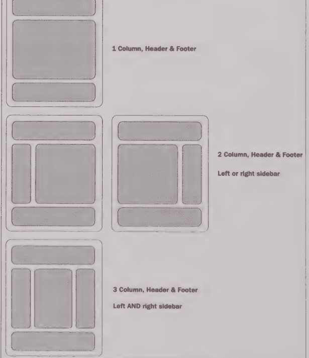

你只有很短的时间来吸引访客的注意力。因此，选择其中一种基本布局，就等于使用了经过验证的设置，许多网页用户会感到熟悉。不要担心这些布局看起来“方方正正”。你可以使用图像、颜色和字体来配合网站的目的，完全掩盖每个网页本质上都是由方块组成的事实。

> 之前介绍的主食式布局是经过充分测试的指南；然而，你完全没有义务使用其中一种。

## 典型的网页上会出现什么？

我们已经看到了一些基本布局。现在我们来看看几乎每个网页上都会出现的一些元素。

## Logo

Logo 是公司整体品牌和身份的一部分，出现在网站每个页面的顶部，与公司名称和标语一起，就像在印刷的营销材料上一样，例如名片、宣传册和信头。此身份区块提高了品牌认知度，并确保用户知道他们正在查看的页面属于同一个网站。经常，Logo 也是一个链接回网站主页的链接。

## 导航栏

你的网站导航应该易于使用且易于找到。就像 Logo 一样，它应出现在页面的顶部。你可以决定在页面顶部使用水平菜单、在侧边栏中使用垂直菜单，或两者结合。无论哪种方式，你的主要导航都应“在折叠线之上”可见，也就是说，访客无需滚动即可查看的网页区域。

## 内容

内容为王。这是访客前来寻找的东西。如果访客找不到他们想要的东西，他们会很快离开。主内容是你设计中的一个重要焦点；不要浪费时间在其中填充不必要的“东西”。

## 页脚

位于页面底部，页脚通常包含版权信息、联系链接信息以及网站的法律条款。一些设计师对页脚非常有创意，并利用这一区域放置额外的链接、推文和“关于我”的信息。

页脚清楚地将主要内容与页面末尾分隔开，并提示用户他们已到达页面底部。

在下面的屏幕截图中，你可以看到苹果网站的一个页面，该网站以其美学设计而闻名。每个部分都清晰地划分。

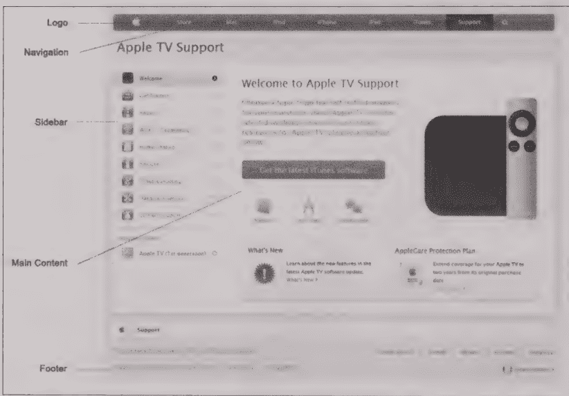

如果你牢记将网站布局视为地图的想法，那么你就可以确定希望在网站上引导访客前往何处。

## 线框图

线框图是简单和复杂项目设计过程中的重要组成部分。如果你为客户创建网站，线框图是早期以视觉方式传达你的想法的绝佳工具，而不是仅有口头描述。

如果你为自己创建网站，线框图有助于明确网站每个页面所需的内容。它可以被视为规划过程与设计过程之间的重叠。

创建简单的线框图可确保你的页面设计考虑到你将添加到页面上的所有元素以及它们的位置。线框图具有成本效益，因为在初始阶段花费的时间有可能节省你在后期修改设计时花费的更多时间。

线框图可以通过多种方式创建，包括纸笔和基于计算机的工具。

在上一章中，我们提到了规划过程中使用纸笔。这是一种快速且经济的方法来制作线框图。许多设计师使用带有细微方格的方格纸，作为现成的网格。网格线有助于按比例创建元素。

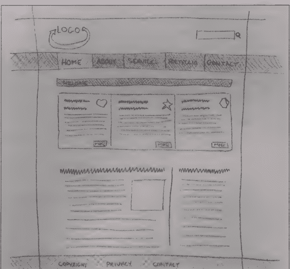

当谈到用于线框图的计算机应用程序时，有许多选择。一些设计师使用 Photoshop、Illustrator 或甚至 InDesign 来制作他们的线框图。深受网页设计师欢迎的专用线框图软件包包括 Balsamiq 和 OmniGraffle。

## 线框图、Mockup 和原型。哦天！

你可能会听到网页设计师提到线框图、Mockup 和原型。虽然这些术语有时被互换使用，但重要的是要理解它们是三种不同的东西。

线框图是对网页结构和组件的基本说明。

Mockup 是一个专注于网站设计元素的图像文件。它包含构成网页的图形和其他页面元素，但可能包含占位文本和图像。

原型是一个几乎完整或半功能的网页，使用 HTML 和 CSS 构建。原型使客户（或你自己）能够点击查看并检查最终网站的工作方式。

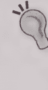

## 线框图应包含什么？

思考哪些设计元素会出现在你网站的每个页面上。如前所述，大多数网站将在整个网站中保持 Logo、导航、搜索栏和页脚等元素的一致位置。

接下来，思考任何可能特定于单个页面的额外元素。这些包括图形和动态小部件。一旦你知道需要什么，你就可以基于这些元素开始创建线框图。

一些设计师喜欢以“大局观”创建线框图。一旦基本布局就位，他们会从客户那里获得反馈，并在必要时修改线框图。

其他人喜欢为网站上的每个页面创建非常详细的线框图，在向客户展示之前列出每个设计元素。

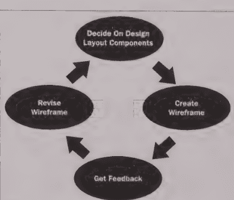

线框图让我们可以在确定最喜欢的设计之前尝试几种不同的想法，然后将其带到 Mockup 阶段。

显然，本书的重点是使用 Muse，但我强烈建议你不要排除使用纸质草图。这是一种快速将想法从脑海中提取出来并形成有形、可视布局的好方法。

Web.without.words (www.webwithoutwords.com) 是一个有趣的网站，专门展示流行且知名的网站的线框图。每个网站上的文本和图像都被遮挡，这是一种不错的方式来看待网页并了解它们如何被分解为简单的方块，而不会被内容所困扰。

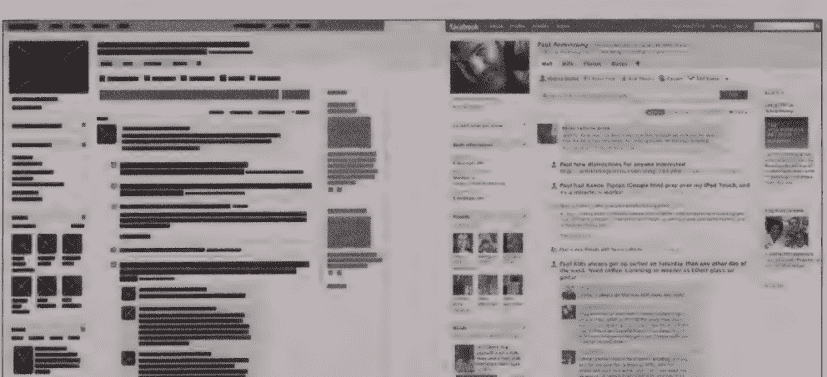

## 使用 Muse 的线框图

那么使用 Muse 创建线框图的优势是什么呢？好吧，Muse 不仅让你创建线框图，还允许你使用这些线框图快速创建原型。这意味着你可以向客户展示网站的功能以及基本布局。Muse 制作的原型可以在任何网络浏览器中查看，让客户很好地了解网站的外观。这种早期测试可以帮助缓解设计过程中后期可能耗时的难题。

我们现在将为一个关于冲浪风帆的虚构网站准备一个网站和线框图。首先，我们将创建一个新站点，然后在 Plan 视图中添加页面。

## 使用 Plan 视图的站点结构

让我们开始创建新站点。

- 1. 打开 Muse。选择 File | New Site。在 New Site 对话框中，将 Page Width 设置为 960，Min Height 设置为 800 像素。将 Margins 设置为四周均为 0，Padding Top 和 Bottom 各设置为 10 像素。将 Columns 数量设置为 16。列会作为页面上的指南出现，我们用它们来帮助我们对齐布局上的设计元素。请注意 Gutter 默认设置为 20，保持不变。Column Width 由 Muse 计算，你应该会在该字段中自动看到 41 的值。记住，所有这些值如果必要以后都可以更改。

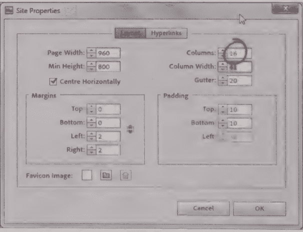

+   2. 点击 **OK**。**Plan** 视图打开，你会在左上角看到代表主页的缩略图，底部窗格中会看到代表 A-Master 页面的缩略图。
+   3. 立即保存你的站点，选择 **File | Save Site**。为其取一个你能识别的描述性名称，例如 `Wind surf.muse`。
+   4. 要创建新页面，点击现有页面右侧或下方的加号 (+) 标志，然后点击页面的名称字段输入其名称。

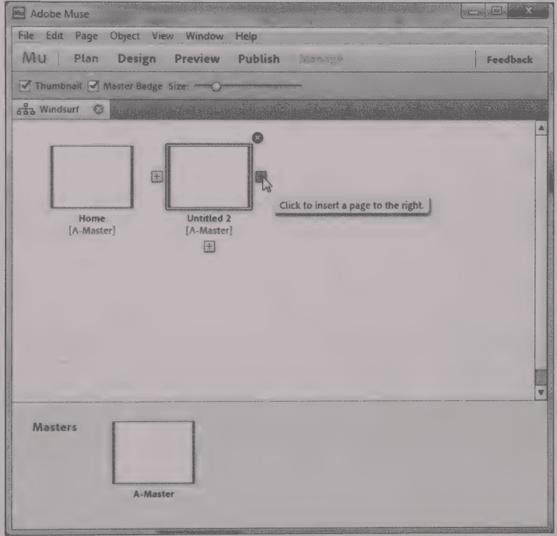

+   5. 点击 **Home** 页面右侧的加号，并将新页面命名为 `Gear`。点击 `Gear` 页面下方的加号添加一个子页面，并将该页面命名为 `Sails`。点击 Sails 页面右侧的加号并将新页面命名为 `Boards`。

+   6. Sails 和 Boards 现在处于同一层级，并且是 Gear 页面的子页面。
+   7. 点击 Gear 页面右侧的加号并将新页面命名为 Learning。
+   8. 点击 Learning 右侧的加号并添加一个名为 Contact 的页面。你的 Plan 视图现在应如下图所示：

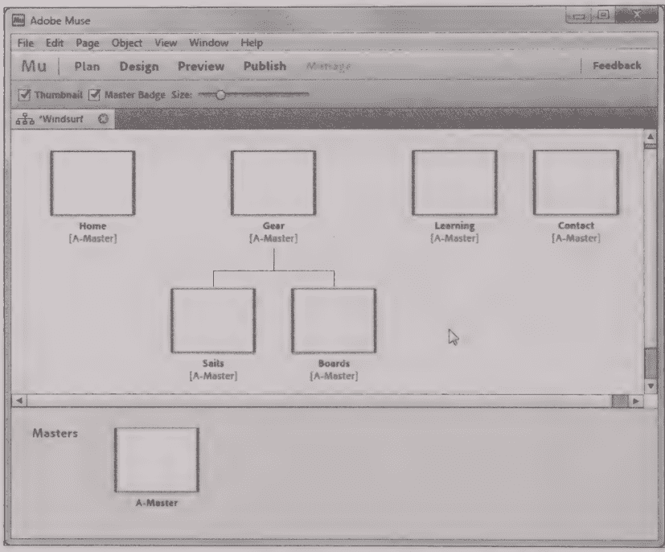

## 在 Plan 视图中使用缩略图

在 Plan 视图中工作时，添加、删除、重新定位或复制页面非常容易。右键单击（Win）或 Ctrl + 单击（Mac）缩略图即可查看上下文菜单。此菜单提供了管理页面的所有选项。

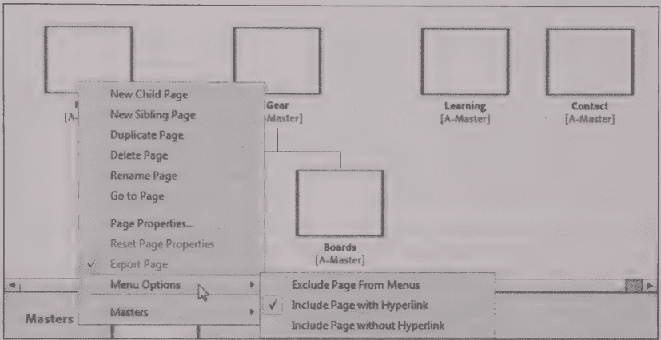

在上一个屏幕截图中，你可以看到右键单击/ Ctrl + 单击时出现的菜单。

- **New Child Page**：此选项会在当前缩略图的更低层级创建一个新的空白页面。
- **New Sibling Page**：此选项会在与当前缩略图相同层级创建一个新的空白页面。
- **Duplicate Page**：此选项会制作当前页面的精确副本。当你已添加内容并应用了一些格式时，这最有用。
- **Delete Page**：此选项会删除该页面。
- **Rename Page**：此选项允许我们更改页面的名称。
- **Go to Page**：此选项会在 Design 视图中打开当前页面。
- **Page Properties**：此选项会打开 Page Properties 对话框，允许你仅为当前页面设置属性。
- **Reset Page Properties**：此选项会将页面恢复为原始设置。

- **Export Page**：此选项允许你将页面导出为 HTML 和 CSS。
- **Menu Options**：此选项允许你选择页面是否（或如何不）包含在自动创建的菜单中。
- **Masters**：此选项让你选择将应用到该页面的 Master 设计。

上下文菜单并不是获取这些选项的唯一方法，例如 **Plan** 视图中最常见的任务可以按如下方式完成：

- 你可以通过双击页面名称来重命名页面
- 你可以通过将鼠标悬停在缩略图上，然后点击右上角出现的 x 图标来删除页面

要重新定位站点地图层次结构中的页面，可以将缩略图拖放到同一层级或子层级。

花几分钟时间添加、删除和重新定位页面，以便熟悉创建站点结构。你会发现 **Plan** 视图直观易用，并且非常快速地创建站点地图。你可以选择 **Edit | Undo** 来撤消已采取的任何步骤。

Muse 会跟踪所有页面名称，并在设计过程中稍后允许我们使用菜单小部件快速创建菜单。**Plan** 视图中创建的所有链接都会得到维护，如果我们更改站点结构，它们会自动更新。你可以在网页设计过程的任何时候返回到 **Plan** 视图。

## 使用线框图

现在我们已经设置了站点结构并可以看到站点如何流动，我们下一步是使用 Muse 的工具绘制简单的线框图。

Muse 提供了多个功能来帮助我们创建线框图，包括：

- 用于创建图形和文本占位符的矩形工具
- 用于在 **Design** 视图中对齐布局元素的列网格
- 资源面板，其中包含用于更新占位符图像的功能

对于冲浪网站，我们将使用一列布局，顶部有一个页眉，中间是主要内容区域，页面底部有一个页脚。页眉将包含网站名称及标语、Facebook、Twitter 和 YouTube 的链接，以及包含指向我们层次结构顶层页面链接的导航栏。

主要内容区域是页面在整个站点中会发生变化的部分。

页面底部的页脚将包含版权信息。

让我们开始向我们的站点添加一个页面。这将是我们线框图原型页面。请按照以下步骤操作：

+   1. 通过点击加号 (+) 图标，在 Contact 页面右侧添加一个新缩略图。将页面命名为 Prototype。这不会成为我们最终站点的一部分，但它允许我们留出一个页面，在其中尝试不同的布局并制作可工作的线框图。
+   2. 在 Plan 视图中双击 Prototype 页面缩略图。Prototype 页面将在 Design 视图中打开。你会看到一个空白白页，上面有许多垂直参考线。垂直参考线代表我们在 Site Properties 对话框中之前设置的列数。它们仅用于帮助我们对齐，最终网页上不会显示。
+   3. 我们现在将使这些列更加明显，方法是右键单击/ Ctrl + 单击页面上的任意位置。从弹出菜单中选择 Show Grid Overlay。粉色区域是列，中间的白色条是间距。你的页面现在应如下图所示：

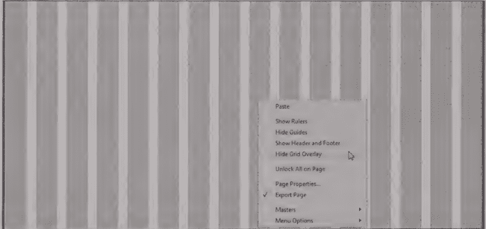

如果你发现粉色覆盖层太分散注意力，可以再次右键单击/ Ctrl + 单击并选择 Hide Grid Overlay 来关闭它。

4. 选择 Rectangle 工具并从第一个白色条的左侧绘制一个大矩形到最后一个白色条的右侧。高度约为 150 像素。当你拖动矩形时，工具提示会告诉你形状的宽度和高度。矩形的尺寸和 X、Y 位置也会显示在页面顶部的栏中，如下图所示：

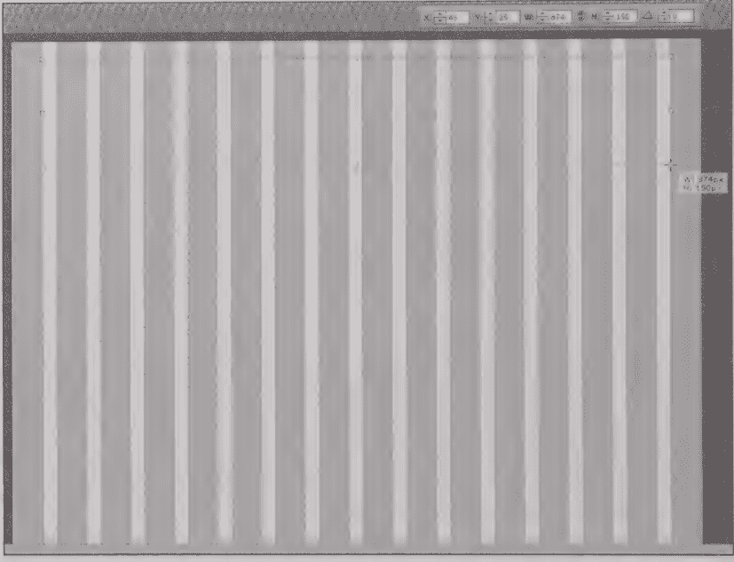

5. 绘制矩形后，你可以通过在页面顶部的 Control Panel 中输入值来精确放置它或更改其大小。

6. 在矩形仍处于选中的情况下，你可以设置描边颜色、填充颜色、更改不透明度，并添加发光、斜角和投影等效果。对于此练习，将矩形设置为白色填充、2 像素黑色描边，且不应用任何效果，如下图所示：

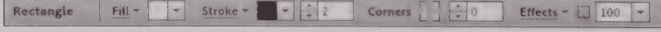

这是一种简单样式，非常适合用于线框图。在 Muse 中，我们可以将矩形的设置保存为图形样式，然后在绘制线框图时重复使用。

## 保存图形样式

如果你以前使用过 InDesign，你会熟悉用于字符和段落的可重用样式的概念。我们使用图形样式来快速格式化对象并在我们的线框图和设计中保持一致的外观。如果客户要求更改，我们可以非常轻松地快速更新一组站点资源。

+   1. 在矩形被选中的情况下，点击 Graphic Styles 面板底部的 Create new style from the attributes applied 图标。如果看不到 Graphic Styles 面板，请选择 Window | Graphic Styles 打开它。该样式会保存在面板中，并基于所选矩形的格式。

+   2. 双击新的图形样式以在 Style Options 对话框中为其命名一个好的描述性名称，例如 Wireframe Rectangle。点击 OK。

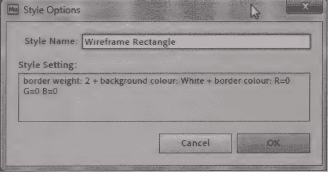

要将此样式应用于以后绘制的任何其他形状，请选择该形状，然后点击样式名称。

+   3. 现在，为了继续我们线框图的页眉部分，请选择 Type 工具并在第一个矩形内部左侧拖出一个大约 245 x 45 像素的矩形。

4. 当你松开鼠标时，光标会闪烁在矩形内部。输入单词 Logo。要增大字号，使用文字工具，点击并拖动覆盖 Logo 单词，使其以蓝色高亮显示（表示当前已选中）。在页面顶部的控制面板或文字面板中，从下拉菜单中选择 36 号字体大小，并通过点击大小下拉框旁边的粗体 T 图标将文字样式设为粗体，如以下屏幕截图所示：

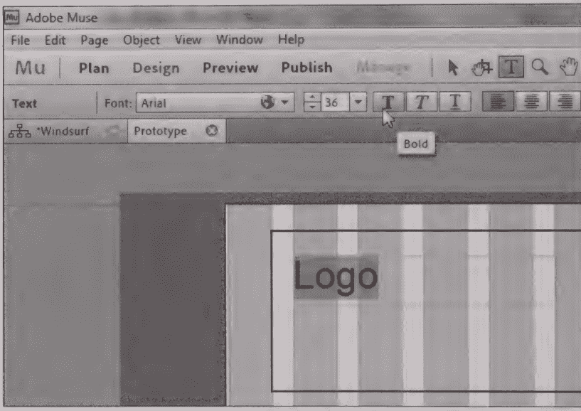

5. 再次使用文字工具，绘制出一个相同大小的第二个矩形并将其放置在 Logo 矩形下方。在此矩形中添加文字 Tagline goes here。

6. 从工具栏中选取选择工具（黑色箭头），然后按住 Shift + 点击你绘制的两个文字矩形以选中它们。在图形样式面板中，点击我们之前创建的圆角矩形样式。这样我们的所有矩形看起来就保持一致了。

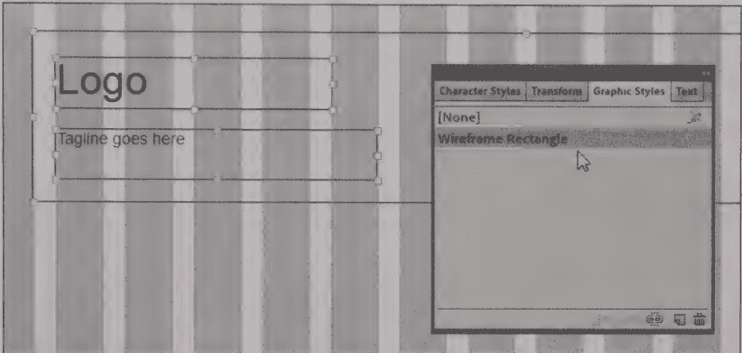

7. 我们将为 Logo 矩形添加一个链接。通过选择 编辑 | 取消全选 或如果选择工具处于活动状态，点击页面区域外，确保页面上没有任何被选中项。使用选择工具点击 Logo 矩形，然后点击控制面板上超链接旁边的下拉菜单。从控制面板的下拉菜单中选择 Home。这会为 Logo 矩形应用到主页的链接。

8. 下一步是添加我们的导航栏。这正是 Muse 为我们承担大部分工作的地方。点击小部件库标签以激活该面板。如果屏幕上看不到该面板，请选择 窗口 | 小部件库。在菜单下，选择水平。点击并从面板拖动到页面上。小部件会出现，其中包含我们在网站结构中创建的顶级页面的名称。

9. 为了使菜单在页眉下方横跨整个页面，点击菜单右侧蓝色圆圈中的白色箭头。在项目大小下拉菜单中，选择统一宽度。然后将光标悬停在菜单小部件边界框的右下角手柄上，使其变为双箭头，然后拖动以增加框的宽度。

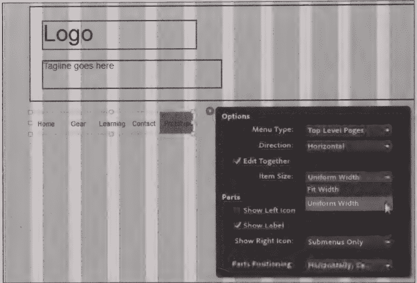

10. 再次选中菜单矩形后，点击图形样式面板并选择我们之前创建的圆角矩形图形样式。

11. 你的线框图现在应该类似于以下屏幕截图：

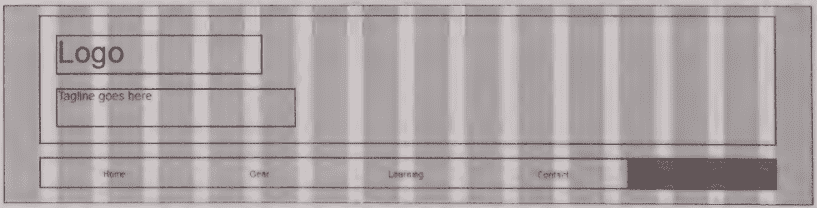

使用网格叠加层使我们能够非常轻松地对齐布局中的各个元素。

12. 继续创建一个全宽矩形来表示主要内容，并在其下方创建一个全宽文字矩形来表示页脚区域。在页脚部分添加文字 Copyright 后跟你的姓名。

13. 通过按住 Shift + 使用选择工具点击来选择这两个矩形。应用圆角矩形图形样式。完成后，你的原型页面应类似于以下屏幕截图：

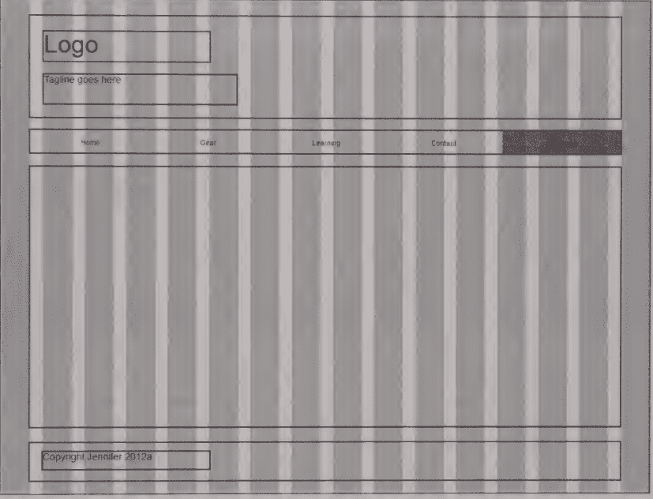

## 使用占位图像

在规划你的网站并创建线框图时，你可能还没有网站上使用的最终图像，但你可以在线框图上放置占位图像。

假设在你的主页上你知道将要有一张著名风筝冲浪冠军的照片，但在早期阶段你还不确定是哪一位。你可以在 Photoshop 或 Fireworks 中制作一个空白图像并以适当的名字保存，例如 WindsurfingChamp.jpg。

对于此示例和布局，图像文件为 300 x 170 像素并保存在 Windsurfing 网站文件夹中。将你网站的所有资源保持在一起非常重要。

要将临时占位图像添加到页面，请选择 文件 | 放置 并浏览找到图像。选中图像后，它将被加载到“枪”中。这仅仅意味着将光标移动到页面上你想要放置图像的位置，然后点击将其放置在页面上。将它放置在页面主要内容区域的右侧。

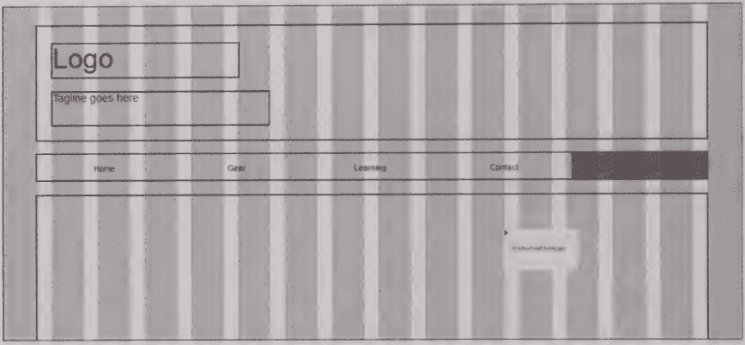

这是一个预览我们线框图的良好时机。点击控制面板上的预览链接。我们的页面打开，我们看到没有网格叠加层的漂亮线框图。

与在纸上或在 Photoshop 或 Illustrator 中创建的线框图相比，此线框图的真正好处是它具有交互性。将鼠标悬停在导航栏上并注意悬停状态。Logo 文字上的链接也是活动的。当你点击 Logo 链接时，它会带你到主页，目前该页是空白的。这是我们可以在此阶段与客户分享以获取他们对进展的反馈的东西。在此阶段修复功能比在整个网站构建完成后要容易得多。

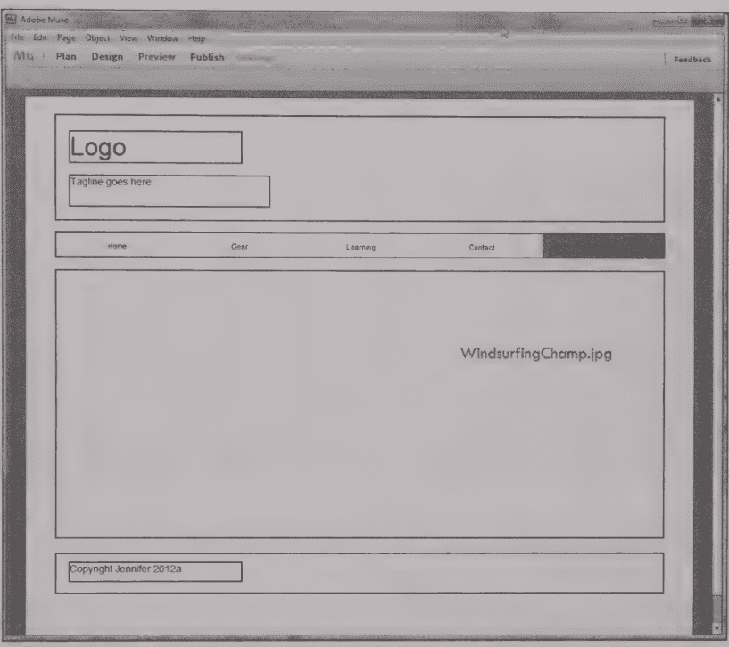

预览页面完成后，点击设计视图返回编辑页面。

## 使用最终网站图形更新占位图像

让我们假装我们的客户已经批准了此页面的线框图，并且印象深刻，于是他匆忙带来了我们风筝冲浪冠军的正确照片。由于我们使用了图像占位符，现在我们可以轻松快速地更新网站以使用实际图像文件：

- 1. 在 Photoshop 或 Fireworks 中打开原始图像，将照片粘贴在上方，并在必要时调整大小使其适合我们的原始图像。保存文件，替换原始文件。
- 2. 在 Muse 中，选择页面上的图像占位符。
- 3. 打开资源面板以定位选中的页面元素；在本例中它是名为 WindsurfingChamp.jpg 的图像。
- 4. 右键单击页面元素。在出现的菜单中，选择重新链接资源。你的图像将立即在网页上更新。

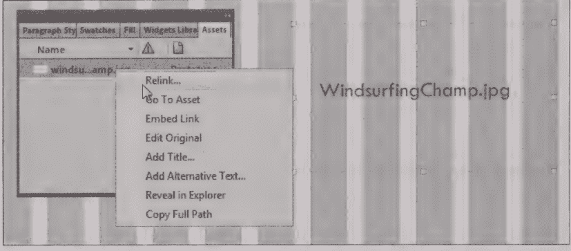

## 添加虚拟文本和段落样式

在构建线框图网站时，你可以使用文字工具创建文字框并添加占位符或虚拟文本，这些内容以后可以轻松替换。创建文字元素后，你可以使用文字面板或控制面板对文字应用格式。文字标题和段落样式帮助你创建结构化页面并轻松更改文字格式。

> What Is Lorem Ipsum?
> Lorem Ipsum is simply dummy text used by the printing and typesetting industry. Lorem Ipsum has been the industry's standard dummy text ever since the 1500s. It is a long established fact that a reader will be distracted by the readable content of a page when looking at its layout. The point of using Lorem Ipsum is that it has a more-or-less normal distribution of letters, as opposed to using "Content here, content here", making it look like readable English. Today Lorem Ipsum is used by web designers for the same reason.
> Some paragraphs of Lorem Ipsum text have been supplied in a .txt file.

使用段落样式，你可以定义标题文字和段落标签来构建页面的文字内容并保持一致性。让我们向我们的原型页面添加一些文字：

- 1. 在计算机上的文本编辑器中打开 Loremipsun.txt 文件。选择文件中的所有文字并通过选择 编辑 | 复制 复制它。
- 2. 在 Muse 的设计视图中，选择文字工具并在页面主要内容区域的左侧拖出一个矩形文字框。确保矩形的左侧与页眉中 Logo 和标语文本框的左侧对齐。
- 3. 你可以输入或粘贴文字到文字框中以填充它，但在我们的例子中，我们将通过选择 编辑 | 粘贴 粘贴 Lorem Ipsum 文字。
- 4. 文字添加后，点击 Lorem ipsum dolor 之后。你会看到光标闪烁。在键盘上按 Enter/Return 将剩余文字推到新行并创建新段落。我们将使用 Lorem ipsum dolor 作为主标题。
- 5. 通过点击并拖动选择除 Lorem ipsum dolor 之外的所有文字，然后使用文字面板或设计视图工作区顶部控制面板中的选项设置格式选项。你可以选择字形、大小、颜色和其他与类型相关的属性。
- 将字体设为 Arial，大小 12，深灰色，左对齐，行高为 100%。行高是行与行之间的间距。根据字形和大小，增加行高可以使文字块更易于阅读。
- 6. 点击段落样式面板底部“从已应用的属性创建新样式”以创建新的段落样式。如果看不到段落样式面板，请选择 Windows | 段落样式 以打开它。双击新样式的名称为其指定描述性名称。对于此示例，我们称之为正文段落。

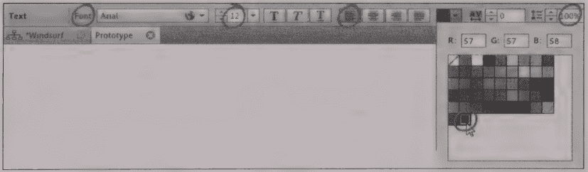

7. 我们使用段落标签菜单将段落样式设置为目标特定的 HTML 标签，例如 P、H1、H2 或 H3。在本例中我们希望使用 Default（p）：

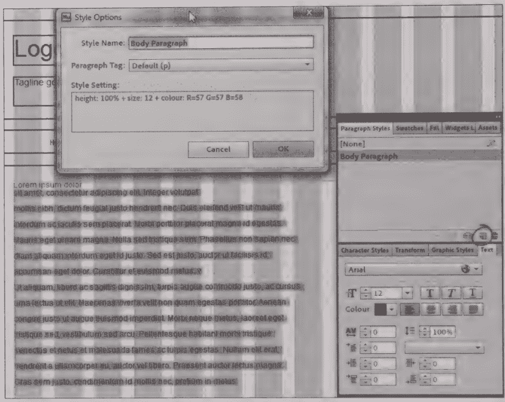

8. 现在选择单词 Lorem ipsum dolor，我们将将其设置为标题。在文本面板中，选择此字体的属性。将字体设置为 Georgia，大小为 24 且为 Bold，并将 Space After 设置为 10。Space After 是面板右下角的图标，它设置将应用于您正在格式化的文本下方的间距。

9. 再次点击段落样式面板底部的 Create a new style from the attributes applied 以根据所应用的属性创建新的段落样式用于我们的标题。双击新样式的名称以赋予其描述性名称。将其命名为 Heading H1 并将段落标签菜单设置为目标 Heading（h1），如下图所示：

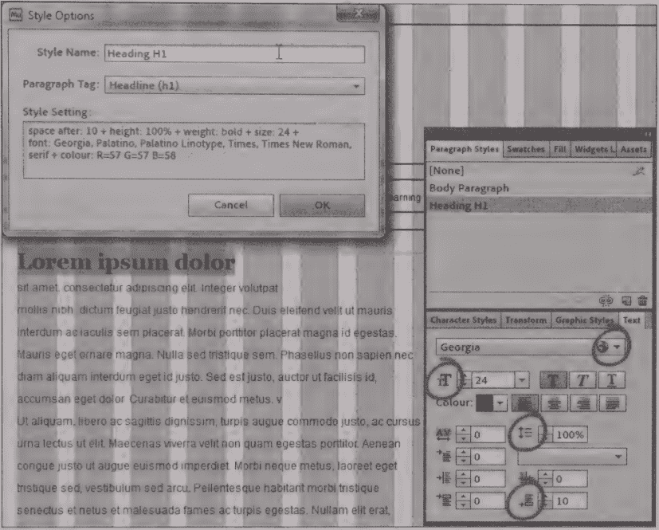

10. 通过这种方式设置段落样式，您可以确保页面之间样式的一致性。这与平面设计师设置其印刷样式表的方式非常相似。

11. 您可能希望为页眉的 Tagline 部分和页脚的 Copyright 部分设置样式。重复步骤 8 - 10，为 Tagline 和页脚文本选择您自己的字体大小、样式和颜色。

12. 完成样式设置后，通过点击 Preview 选项卡测试线框图。

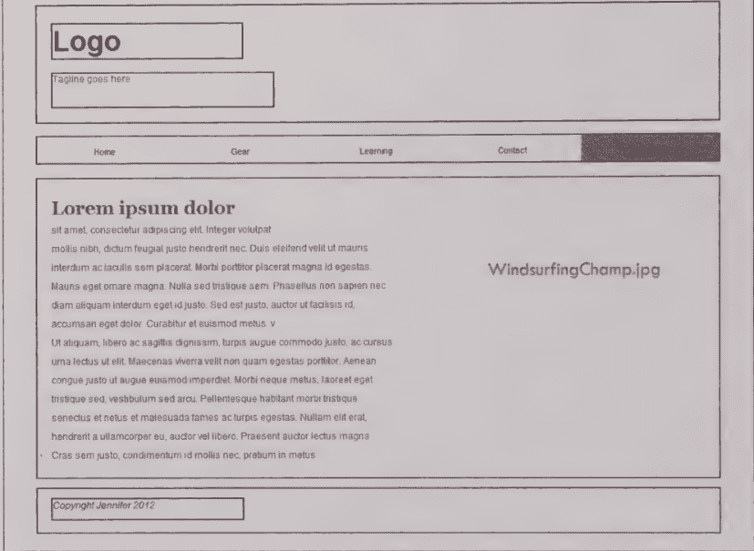

这个过程的好处在于，我们不仅创建了一个交互式线框图，而且还拥有一个可工作的原型；基础但可工作。我们还创建了许多样式，可以在整个网站中重复使用。

## Where are the files generated by Muse?

当您完成线框图的创建并准备好与客户分享时，您可以通过点击 Publish 链接直接使用 Adobe Business Catalyst 发布它们。为此，您需要一个 Adobe ID，您应该在首次安装 Muse 时已创建。这是一种轻松将网页上线的方式。

Business Catalyst 的替代方案是将您的 Muse 网站发布到您自己的托管服务器，您可能已经设置了。要获取网站的文件，您需要导出整个站点。Muse 将生成站点运行所需的 HTML、CSS 和图像文件夹。

- 1. 选择 File | Export As HTML。Export to HTML 对话框出现。
- 2. 选择要导出站点文件到的计算机上的位置，然后点击 OK，如下图所示：

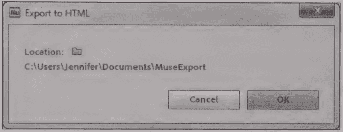

完成此操作后，Muse 会导出文件并将其保存在您指定的本地文件夹中。导航到该文件夹并打开图像文件夹以访问优化的图像文件。您可以重新利用这些图像文件来创建新闻通讯、移动应用、社交网络页面和其他相关项目。

## Exercise

现在我们已经创建了一个新站点以及相应的线框图，您最好练习在 Muse 中模拟一个站点。

为您最喜欢的电影创建一个虚构网站的线框图和站点地图。该站点应包括主页、演员页、图库页、链接页和联系页。导航栏应允许您只需一次点击即可前往站点的任何部分。

在纸上创建您设计的简单线框图，然后在 Muse 中重新创建该线框图。预览您的线框图。

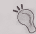

## Downloading the example text and images

您可以从您在 http://www.packtpub.com 的账户下载本书您购买的示例文本和图像文件。如果您在其他地方购买了本书，您可以访问 http://www.packtpub.com/support 并注册以将文件直接发送到您的电子邮件。

## Summary

在本章中，我们讨论了网页设计中使用的一些基本布局。我们研究了使用笔和纸进行线框图的想法，以及如何在 Muse 中设置站点结构和线框图。

在下一章中，我们将研究单个页面和主页面。
