## 4
### Powerful Pages

在 Muse 中，我们有两种不同类型的页面——Master 页面和网页。本章中我们将使用这两种类型。我们还将研究帮助我们布局和对齐页面内容以及如何添加链接的工具。

到本章结束时，您将知道如何：

- Create web pages and Master pages
- Add content to the pages
- Use rulers, guides, and the grid overlay to align the content
- Zoom into and fit pages
- Add links

## Pages

绝大多数网站至少由两个相互链接的页面组成。同样，在这些网站的大多数中，构成站点的页面之间会有共享或一致的属性。正如我们在上一章中看到的，Muse 让我们可以轻松创建站点结构，在其中我们可以组织和维护我们的页面。

在创建网站时，遵循站点中所有页面的样式或标准格式是一种良好的做法。虽然内容，即您提供的信息，会因页面而异，但某些元素（如徽标或导航栏）将保持不变，在页面上的大小和位置相同。

在本章中，我们将继续使用我们在 Windsurfing 站点中设置的站点结构进行构建，并对 master 页面进行更改，以便这些设计元素会出现在我们站点的每个页面上。以下屏幕截图显示了在 Muse 的 Plan 视图中看到的站点地图：

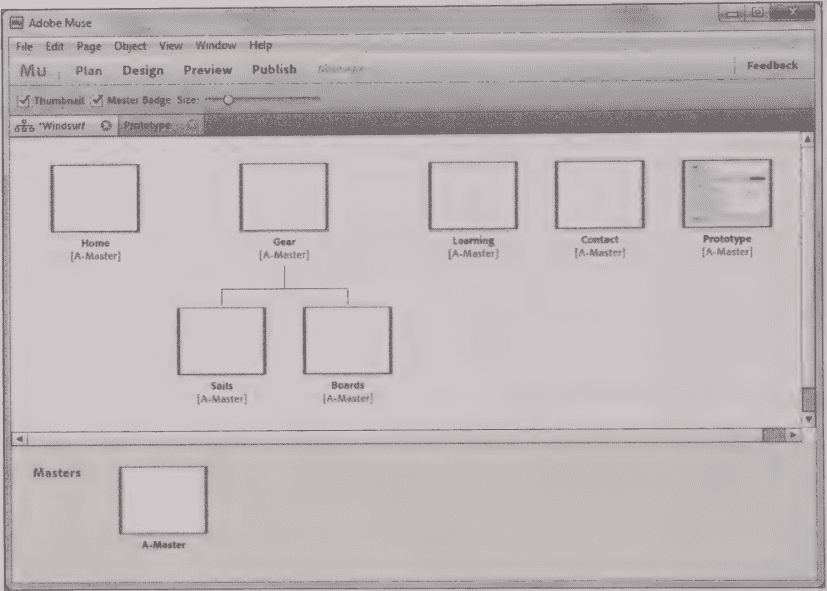

请注意，Prototype 缩略图向我们展示了该页面的内容。我们可以使用 Plan 视图中的 Size 滑块放大和缩小。我们的主页，通常称为 Index 页面，包含指向 Gear 页面、Learning 页面和 Contact 页面的链接。Gear 页面包含指向另外两个页面——Sails 和 Boards 的链接。这种站点结构让我们能够以逻辑顺序向用户呈现信息，使其易于从网站内的任何位置始终返回主页。

> 请注意，在每个缩略图下方我们可以看到 [A-Master] 为蓝色。这告诉我们 A-Master 页面（或第一个 Master 页面）已应用于我们的每个网页。

## Master pages

让我们看看 Master 页面以及它们如何帮助我们在网站中创建一致性。如果您以前使用过 Adobe InDesign 或 QuarkXpress，您将熟悉这个概念。页面一致性对于多页印刷文档也至关重要。即使您以前从未使用过这类程序，您也肯定见过杂志，其中重复的元素如页码、文章标题或杂志名称出现在每页的角落。

使用印刷版面程序时，放置在 Master 页面上的项目会在每份文档页面上出现在完全相同的位置。对 master 页面的更改会通过整个文档传播，从而节省时间并减少出错的可能性。这与您在 Muse 中创建的网站完全相同。

正如我们在上一章中看到的，Muse 在每次创建新站点时都会默认创建一个空白主页和一个空白 Master Page。无论您制作的是单页还是多页网站，这种初始设置都是任何网站的起点，并为您的站点提供有用的概述或站点地图。

有两种使用 Master 页面的方法：

- 通过使用空白页面规划您的站点地图（如我们在上一章中所做的），然后稍后应用主页面
- 在开始时将主页面应用于您的主页，然后基于该设计创建新页面

## Working with pages within your site

在上一章中，我们使用 Muse 的 Plan 视图创建了一个新站点、一个站点地图和一个可工作的线框图原型。我们快速为我们的站点创建了六个页面。现在我们将看看如何使用 Plan 视图快速添加、复制、删除和重命名页面。

有两种基本页面类型：

- **Sibling pages**：这些是共享同一父页面的页面；在我们的 Windsurfing 站点中，所有顶级页面（Home、Gear、Learning 和 Contact）都是兄弟页面。
- **Child pages**：这些页面出现在站点组织层级中特定页面下方。在我们的示例中，Sails 和 Boards 是 Gear 的子页面。您站点中任何层级的页面都可以有兄弟页面或子页面。

## 添加一个同级页面

要在网站的任何层级添加一个额外的同级页面，请执行以下任一操作：

- 在 Plan 视图中，将光标悬停在您感兴趣的页面缩略图上。您会在页面的左侧或右侧看到加号出现。
- 右键单击（Ctrl + 单击）一个页面的缩略图，从出现的上下文菜单中选择 New Sibling Page。单击页面右侧或左侧的加号按钮。输入新页面的标题，然后按 Enter（Windows）或 Return（Mac OS）。

## 添加一个子页面

要在网站中现有页面的下方添加一个子页面，请执行以下任一操作：

- 在 Plan 视图中，将光标悬停在任何页面的缩略图上，直到在页面底部看到一个加号出现。
- 右键单击（Ctrl + 单击）一个页面的缩略图，从出现的上下文菜单中选择 New Child Page from the context menu that appears。单击页面底部的加号按钮。输入新页面的标题，然后按 Enter（Windows）或 Return（Mac OS）。

## 创建一个重复页面

如果您已向页面添加了一些内容，或者您希望重用以某种方式设置样式的页面，您可以轻松地通过执行以下步骤制作一个重复页面：

- 在 Plan 视图中，使用 Alt + 拖动（Windows）或 Option + 拖动（Mac）拖动现有页面的缩略图

## 删除一个页面

有时您会发现自己不需要创建的页面并希望将其删除。

在 Plan 视图中，将光标悬停在要删除的页面上，直到删除图标（X）在页面右上角出现。

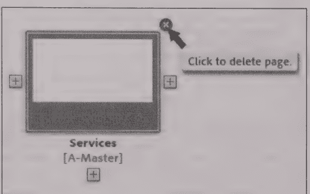

单击删除图标，您的页面就消失了。

## 重命名一个页面

不小心将页面命名为“Portfolio”但更希望将其称为“Gallery”？Muse 轻松处理任何页面名称更改而不会破坏任何链接。要在 Plan 视图中重命名页面，请双击页面标题（页面下方），并输入新的页面标题。

## 重新排列页面

在 Plan 视图中，将页面拖动到站点计划中的不同位置（例如，另一个页面的右侧）。当您看到蓝色放置区域时，释放鼠标。

要获得我们讨论过的全部范围的选项，只需单击一下即可将光标移至页面的缩略图上，然后右键单击（Ctrl + 单击）并从出现的上下文菜单中选择选项，如以下屏幕截图所示：

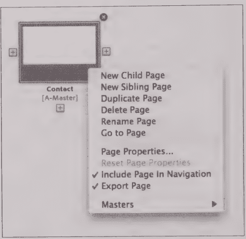

## 编辑页面属性

您会记得在第 2 章《The Muse Workflow》中，当您首次创建网站时，您会填写 Site Properties 对话框。这使我们能够设置页面高度、间距、列数和边距的测量值。这些值并非一成不变，您可以返回到任何单个页面并在 Plan 视图中更改这些属性。

首先，让我们确保我们理解 Site Properties 下指定的页面属性、Master 页面属性以及我们普通网页之间的关系：

- 1. Master 页面继承其属性来自 Site Properties 中的设置——我们在创建网站时最初设置的那些。
- 2. 网页继承其属性来自所应用的 Master 页面。如果一个普通页面应用了 None 主页，它将继承其属性来自 Site Properties 设置。

要更改网站中所有页面和主模板的页面属性，请选择 File | Site Properties。

如果您想自定义页面，使其与所应用的 Master 页面的设置不同，请选择 Page | Page Properties。这使您可以仅将设置应用于此单个页面。

例如，我们在上一章中制作的 Prototype 页面不应包含在每个页面的导航菜单中。我们将通过执行以下步骤更改该特定页面的属性：

- 1. 在 Plan 视图中，双击 Prototype 页面。这将在 Design 视图中打开该页面。
- 2. 选择 Page | Page Properties。Page Properties 对话框打开。
- 3. 在 Menu Options 下拉框中，选择 Exclude page from menus 并单击 OK。

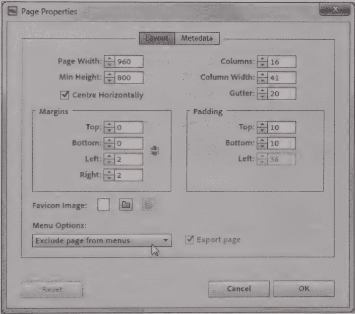

- 4. 虽然它们非常相似，但我们可以注意到 Site Properties 和 Page Properties 对话框之间存在一些细微差异。其中一个主要区别是 Page Properties 对话框中有两个类别：Layout 和 Metadata。

5. 在 **Layout** 类别中，让我们将列数从 16 改为 2。我们可以看到，一旦您做出该更改，列宽会自动更改为 468。

6. 单击 **OK** 应用更改。

以下列表提供了 **Page Properties** 对话框中 **Layout** 类别下其他字段的简要说明。我们将在下一章中查看 **Metadata** 类别。请记住，所有单位均以像素为单位。

- **Page Width** 设置页面的宽度。
- **Minimum Height** 设置页面的高度。这不是一个绝对值，因为 Muse 支持基于页面内容的动态页面高度。用通俗的话说，这意味着您向页面添加的内容越多，页面就会变得越长。
- **Center Horizontally** 将页面水平放置在浏览器中。如果未启用此选项，页面将在浏览器中左对齐。
- **Columns** 设置页面上的垂直列数。设计师喜欢列！它们让我们创建网格，然后可以轻松布局我们的文本、图像和其他内容。
- **Column width** 设置每列的宽度。
- **Gutter** 设置列之间的空间。
- **Margins** 指定放置页面内容的页面安全区域。Muse 中的边距、列和间距就像 InDesign 中使用的边距和列一样。您可以通过选择 **View | Hide Guides** 或 **Ctrl+:**（Win）或 **Cmd+:**（Mac）来隐藏边距和列导向线。
- **Padding** 控制浏览器窗口边缘与网页边缘之间的空间（以像素为单位）。
- **Favicon image** 让我们选择一个图像，该图像将显示为浏览器地址栏中的微小图标。Favicon 可以被视为我们整体网站品牌的一部分。
- **Include Page in Navigation** 确保包含页面会添加到您添加到页面的任何菜单小部件中。

有关使用小部件的更多信息，请参阅 Add and edit widgets。

- **Export page** 在您将网站作为 HTML 发布或导出时包含该页面。

## 页面尺寸

Muse 中的页面具有固定宽度但高度动态。假设您有一个页眉占用多达 150 像素和一个页脚占用多达 200 像素。这些值是使用页面导向线设置的。现在假设您将最小高度设置为 600 像素。如果您的内容长度仅为 150 像素，我们得到 150 + 150 + 200 = 500 像素。我们的页面呈现为 600 像素，因为这是指定的最小高度。

如果我们有占用 500 像素的内容并将其添加到页眉和页脚的值中，我们的页面将扩展以显示添加到每个页面的内容。最小高度确保在内容可能不多的页面上保持一定程度的一致性。

## 打开、保存和关闭页面

要打开网站中的任何页面进行编辑，只需在 Plan 视图中双击该页面即可。页面将在 Design 视图中打开。您可以一次打开任意多个页面。每个页面都作为界面顶部的标签出现。当前打开页面的标签会高亮显示，如以下屏幕截图所示：

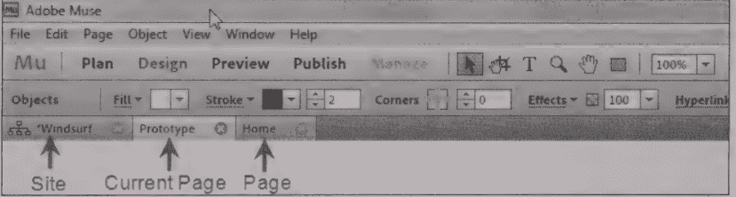

当您对页面进行任何更改时，您可以通过选择 File | Save Site 来保存它们。这会一次性保存您对所有页面和站点计划的更改。谨慎的做法是定期保存您的工作，以防计算机崩溃。

当您完成对页面的工作时，您可以通过单击页面标签上的关闭图标（X）来关闭它。

站点 Plan 标签中的一个星号表示 Muse 站点（.muse 文件）包含未保存的更改。您可以在前面的屏幕截图中看到此示例，其中站点名称 Windsurf 旁边有一个星号。

## 使用主页面

我们现在将打开主页面并添加一些简单的设计元素，这些元素将通过执行以下步骤应用于每个页面。请记住，在我们的计划视图中，我们可以看到网站中的每个页面都应用了 A-Master 页面。

- 1. 通过在计划视图中双击其缩略图来打开 A-Master 页面。
- 2. 在设计视图中，单击选项栏中填充下拉框旁边的色板。选择一种中等蓝色，十六进制值为 # 29ABE2，然后按键盘上的 Enter/Return。

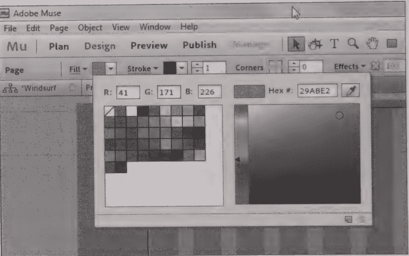

瞬间，你会看到蓝色被应用于页面整个背景。页面外的区域保持深灰色。

- 3. 现在要在页面顶部添加一些文字，选择文本工具并在标题指南正上方拖出一个矩形。标题指南是第二条蓝色水平线。
- 4. 你会看到光标在文本边界框内闪烁。输入文字 Windsurf Wild。然后单击工具栏上的选择工具以将文本提交到页面。你的默认文本可能很小且为黑色，在页面上不突出，因此我们将对其进行编辑并选择不同的字体和颜色。

5. 再次选择文本工具并单击刚添加的文本之间的任意位置。你的光标将在两个字母之间闪烁。双击此处以选择两个词，或按键盘上的 Esc，然后单击 T 以选择整个文本框以应用格式。

6. 对于字体，从字体下拉框中选择 Web Safe Fonts | Century Gothic，将大小设置为 48，并通过单击色板下拉框将颜色设置为白色。单击粗体图标（大小字段右侧的第一个 T）。

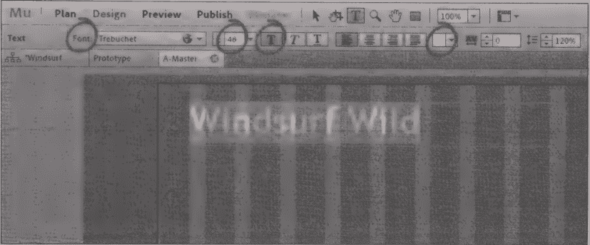

7. 单击选择工具以提交你的文字更改。要精确放置文本，请使用控制面板并将 X 设置为 42，Y 设置为 20。这将使每个字母的底部位于标题指南上。

8. 让我们返回计划视图，看看主页面中的更改如何影响我们网站中的所有页面。单击屏幕顶部的计划按钮。瞧，你应该会看到所有缩略图都显示为蓝色，并且 Windsurf Wild 标题出现在每个页面的顶部。

## 创建新的主页面

现在，假设我们希望我们的某些页面具有蓝色背景，而某些页面具有红色背景。我们可以通过创建具有红色背景的新主页面轻松实现这一点，我们将通过复制现有的 A-Master 来实现。

- 1. 在计划视图中，通过右键单击（或 Ctrl + 单击）A-Master 页面缩略图来复制主页面。从菜单中选择复制页面。
- 2. 出现一个重复的页面，其下方以蓝色突出显示的文字为 A-Master copy。

- 3. 为新页面输入标题；将其命名为 Red Background 并按 Enter（Windows）或 Return（Mac OS）。
- 4. 双击 Red Background 主页面并使用前面概述的步骤将页面的背景更改为红色。
- 5. 返回计划视图。你的两个主页面缩略图现在应该看起来不同——一个红色，一个蓝色。

## 将主页面应用于网页

为了尝试我们新的主页面，将 Red Background 主页面从主页面区域拖到文档窗口中的 Sails 页面。你会看到主页面标题已应用于 Sails 页面。

重复此过程并更改应用于 Boards 页面的主页面。你的计划视图现在应类似于以下屏幕截图：

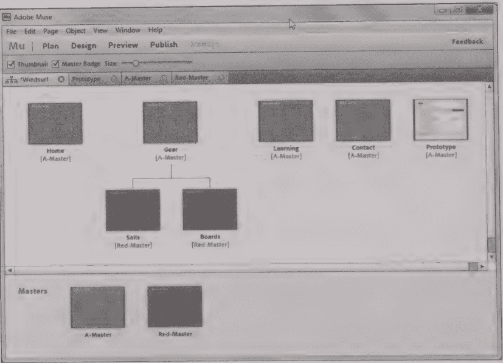

正如你所见，很容易对一个主页面进行更改，然后快速将其应用于多个页面。

如果你不想应用任何主页面，即你只想在特定页面上保留原始站点设置，请右键单击该页面的缩略图，然后从下拉菜单中选择 Masters | No Master。

## 标题和页脚指南

Muse 提供了一个选项，可在工作区的顶部和左侧显示标尺。标尺上的单位为像素，这是一个有用的布局工具。至于标尺，Muse 可以显示五个页面指南，我们现在将对其进行查看。

> 当你在页面左侧悬停这些指南时，你会看到一个工具提示，描述每个指南的功能。

第一个、第四个和第五个指南为我们提供了整体页面大小。将第一个指南向上拖动会增加页面顶部与浏览器之间的填充量。将第四个指南向下拖动会扩展页面的大小。将第五个指南拖动会扩展页面底部以下的填充量。

第二个指南定义了标题的底部。当你将它向下拖动时，你正在增加标题的高度。

第三个指南定义了页脚的顶部。如果您想要更小的页脚，请将此指南向下拖动。如果您想要更大或更高的页脚，请将此指南向上拖动。

标题和页脚指南只能在主页面上移动。在普通页面上，你会发现无法将它们拖到新位置，它们仅用于视觉参考。

要显示或隐藏标题和页脚指南，请选择 View | Show/Hide Header and Footer，Ctrl + Shift+:（Win）或 Cmd + Shift+:（Mac OS）。

要显示或隐藏标尺，请选择 View | Show/Hide Rulers，Ctrl + r（Win）或 Cmd + r（Mac OS）。

要显示或隐藏网格叠加层，请选择 View | Show/Hide Grid Overlay，Ctrl + '（Win）或 Cmd + '（Mac OS）。

要显示或隐藏页面指南，请选择 View | Show/Hide Guides 或 Ctrl + ;（Win）或 Cmd + ;（Mac OS）。

## 向页面添加文本

在下一章中，我们将花费大量时间讨论网页上的文本和排版，但现在让我们在其中一个页面上练习添加一些文本：

- 1. 通过在计划视图中双击缩略图打开 Learning 页面。
- 2. 如果尚未可见，请通过选择 View | Show Grid Overlay，Ctrl + `（Win）或 Cmd + `（Mac OS）打开网格叠加层。
- 3. 通过选择 View | Show/Hide Rulers，Ctrl + r（Win）或 Cmd + r（Mac OS）打开标尺。
- 4. 在你选择的文本编辑器中打开提供的文本文件 Learning.txt。选择所有文本并复制它。
- 5. 返回 Learning 页面并选择文本工具。
- 6. 从左侧拖出一个矩形，在标题 Windsurf Wild 出现的列下方并与之对齐。当你拖动时，工具提示会提供文本框宽度的信息。拖出宽度为 631 像素的框。在横向拖动的同时，开始向下拖动页面，直到矩形与页脚指南相遇。当你拖动时，你会感觉到矩形的边缘吸附到网格和页脚指南上。
- 7. 当你释放鼠标时，光标在矩形的左上角闪烁。通过选择 Edit | Paste 粘贴你复制的文本。你的文本现在将出现在框中。要在将文本框添加到页面后精确放置它，请选择它然后使用控制面板并将 X 设置为 42，Y 设置为 105。

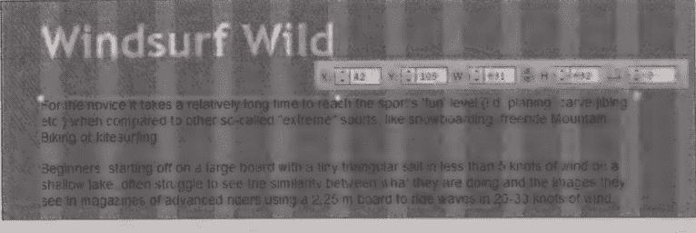

- 8. 使用前面描述的步骤将新添加的文本颜色改回白色。将文本设置为 Arial，颜色为白色，大小为 12。
- 9. 通过选择 View | Hide Grid Overlay，Ctrl + `（Win）或 Cmd + `（Mac OS）关闭网格叠加层。
- 10. 保持 Learning 页面打开。

## 创建链接

如果没有链接，网络将不仅仅是一个“网络”，而是一个庞大的孤立的单个页面的集合。为了连接网站中的页面，我们创建链接。链接，也称为超链接，是通往另一文档、同一文档的另一部分或其它媒体（如图像或电影）的路径。

链接通常显示为与正文不同的彩色和/或带下划线的文本。除了从文本链接之外，你还可以从图像或其他对象链接。

单击链接会在浏览器窗口中打开相应的文档或网页。链接还可以打开 PDF 文档等文档，或在同一文档内跳转到另一位置。

当你将光标悬停在链接上时，光标会变为指向的手指，链接的网络地址会出现在浏览器窗口底部的状态栏中。

## 创建指向我们站点中页面的链接

我们现在将通过执行以下步骤向我们的 Learning 页面添加几个链接：

- 1. 选择我们最近添加到 Learning 页面的第二段文字中的单词 board。
- 2. 在控制面板中单击超链接弹出菜单并从列表中选择目标页面，在本例中选择 Gear:Boards。

请注意，除了设置此链接将带访客前往的位置外，您还可以使用超链接下拉菜单根据需要设置定义的超链接在新的浏览器窗口中打开。在这种情况下，不要勾选“在新窗口或标签页中打开链接”复选框。

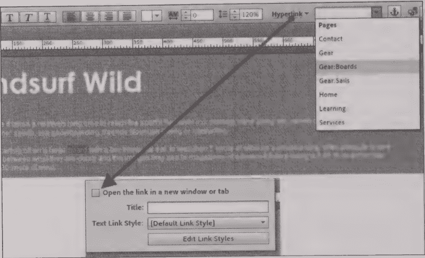

3. 重复步骤 1 和 2，并在同一段落中突出显示单词 sail 并添加指向 sails 页面的链接。现在您已从此页面创建了两个文本链接，分别指向网站内的另外两个页面。

## 创建指向外部网页的链接

添加指向其他网站的链接同样简单。以下步骤展示了我们是如何操作的：

- 1. 选择 Learning 页面第一段中的单词 Kitesurfing。
- 2. 在 Control panel 中，点击 Hyperlink 文本框内——这就是我们之前选择 boards 和 sails 链接时使用的同一个文本框。在这里，我们输入要链接到的页面的地址。
- 3. 输入 http://www.internationalkiteboarding.org/ 并按 Enter（Windows）或 Return（Mac OS）。
- 4. 您会看到 Learning 页面上现在已添加了第三个链接。

## 创建链接锚点

当您像在之前的练习中那样添加指向另一页面或另一个网站的链接时，链接会在页面顶部打开。有时您可能希望链接到页面中的特定部分。您可能访问过包含大量文本的长网页，设计者会在页面下方多个位置提供返回顶部的链接。

链接锚点经常使用的另一个例子是在 **常见问题解答 (FAQ)** 页面上，页面顶部列出了多个问题。当访客点击一个问题时，页面会跳转或平滑滚动到页面下方对应的答案。

您还可以从一个页面创建指向另一个页面上的链接锚点的链接；指向其他页面的链接会直接跳转，不使用平滑滚动效果。以下步骤展示如何向页面添加链接锚点：

- 1. 在 **Design** 视图中打开您的页面，点击 **Control** 面板中的 **Link** 锚点按钮。点击此按钮后，它会加载一个锚点名称。
- 2. 将光标移动到您希望用户查看的内容的左上角，然后点击放置锚点。

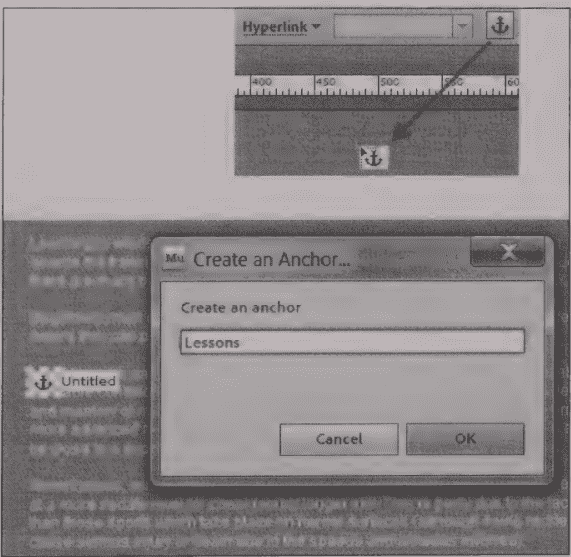

- 3. 在 **Create an Anchor** 对话框中输入链接锚点的名称。
- 4. 要链接到链接锚点，请选择您想要链接的任何文本或图像，然后在 Control 面板中的 **Hyperlink** 选项中选择正确的链接锚点名称，就像我们之前将链接到网站内其他页面时所做的那样。如果您觉得小的锚点图标令人讨厌或不舒服，可以通过选择 **View | Hide Anchors** 来隐藏它。

## 创建电子邮件链接

电子邮件链接只是一个链接，点击后会打开用户的电子邮件程序，并自动在收件人字段中填入链接中的电子邮件地址。以下步骤展示如何添加电子邮件链接：

- 1. 选择您想要链接的文本或图像。
- 2. 在 **Control** 面板中，点击 **Hyperlink** 文本框内。
- 3. 以 myemail@email.com 的格式输入电子邮件地址。Muse 识别 @ 符号并知道这是一个电子邮件链接而不是普通链接。

## 理解两种不同类型的链接

在我们刚刚完成的练习中，我们处理了两种不同类型的链接路径：

- Absolute
- Relative

绝对链接提供了您要链接到的文档的完整 URL。这种类型的链接也称为外部链接。绝对链接通常包含协议（如 http://）并且主要用于链接到其他服务器上的文档。在我们的示例中，我们使用绝对地址 http://www.internationalkiteboarding.org/ 链接到国际冲浪板协会的外部网站。

相对链接用于本地链接。这种类型的链接称为文档相对链接，或内部链接。我们创建了指向 sail 页面和 board 页面的相对链接。Muse 会为我们处理代码，我们只需告诉程序在点击链接时前往何处。

## 更改链接颜色

链接的默认颜色为蓝色，已访问链接为紫色。您可以轻松更改这些默认设置，并选择与网页背景和其他颜色相协调的颜色，执行以下步骤即可。

1. 点击 **Hyperlinks** 按钮或点击 **Hyperlink** 下拉菜单后，选择 **File | Site Properties**。然后点击 **Edit Link Styles**。

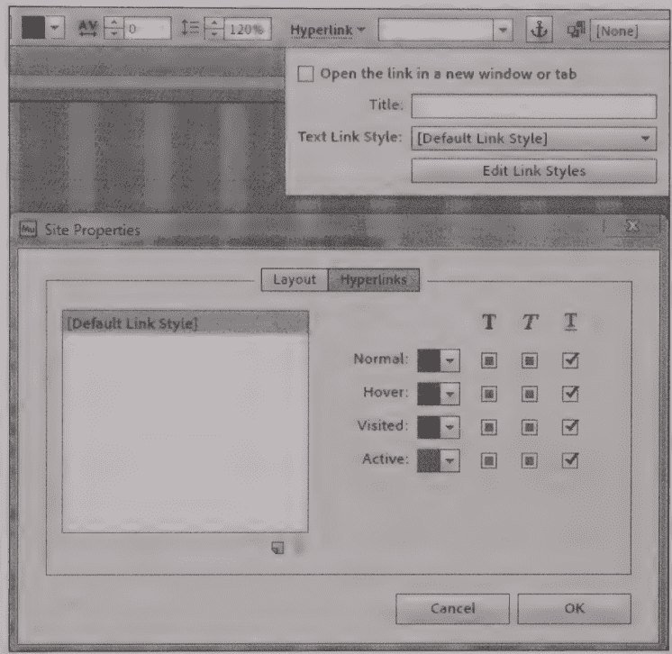

2. 第一次设置链接样式时，列表中会有一个默认的链接样式，称为 **Link Style**。

3. 请注意有四个颜色样本框。这些代表每种链接的颜色和文本样式选项：

- **Normal** 定义普通未访问链接的样式。
- **Hover** 定义悬停链接的样式。当鼠标移至其上方时，链接即为悬停状态。
- **Visited** 定义已访问链接的样式。
- **Active** 定义活动链接的样式。点击链接后，链接变为活动状态。

- 4. 从 **Normal** 链接开始，点击颜色样本并将链接颜色设置为白色，并保持下划线复选框被勾选。
- 5. 将 **Hover** 链接设置为浅蓝色且无下划线。
- 6. 将 **Visited** 链接设置为深蓝色并带下划线。
- 7. 将 **Active** 链接设置为海军蓝并带下划线
- 8. 完成链接颜色的更改后，您可以将其保存为链接样式。要向列表中添加新的链接样式，请点击 **New Link Style** 按钮（位于垃圾桶图标旁边）。

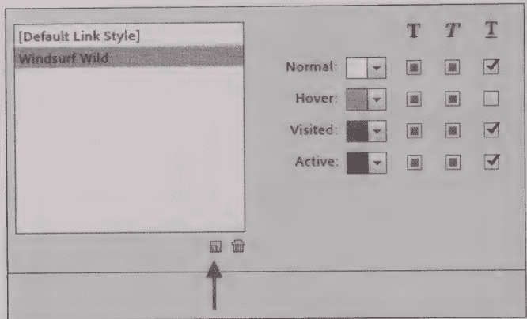

- 9. 要重命名样式，请双击它使其可编辑。
- 10. 要删除链接样式，请选择它并点击垃圾桶图标。
- 11. 点击 **OK** 并关闭对话框后，您的更改将被保存。您将能够将自定义样式应用于任何页面上的任何链接，就像将任何字符样式应用于文本一样。
- 12. 点击 **Preview** 选项卡，即可在 **Learning** 页面上查看新的链接颜色效果。

## 编辑和删除链接

网页开发是一个不断变化的过程。有时您需要编辑或删除链接。外部网站的 URL 可能会更改，电子邮件地址可能会更改，或者您可能会发现包含错误的链接。

### 编辑链接

选择链接，然后只需在 Options bar 上的 Hyperlink 字段中重新输入正确的 URL 或电子邮件地址即可。

### 删除链接

选择链接，然后在 Hyperlink 字段中突出显示 URL、内部页面链接或电子邮件地址，然后按键盘上的 Delete/Backspace。

## 创建导航栏

大多数网站在页面顶部包含一个导航栏。出于一致性考虑，导航应位于每个页面的相同位置。这可以避免访客的混淆，让他们能够自由轻松地浏览您的网站。

在传统的网页设计中，我们需要通过编写代码手动链接导航栏中想要的每个页面，然后将导航栏添加到每个页面的顶部。

然而，使用 Muse，我们可以非常快速地添加智能且强大的网站导航，该导航会自动反映我们的站点地图布局。

让我们回到我们的 A-Master 并使用一个菜单小部件，该小部件会自动获取站点地图中的站点结构和页面名称。我们将菜单添加到页面页眉中。在上一章中，我们为我们的线框 Prototype 页面设置了菜单。在这种情况下，我们使用以下步骤将菜单添加到我们的 Master 页面，以便它在应用该 Master 的每个页面上重复显示：

- 1. 在 Design 视图中打开您的 A-Master 页面。
- 2. 我们将通过将页眉指南线向下拖动到垂直标尺上的 100 像素标记来增加页眉高度。

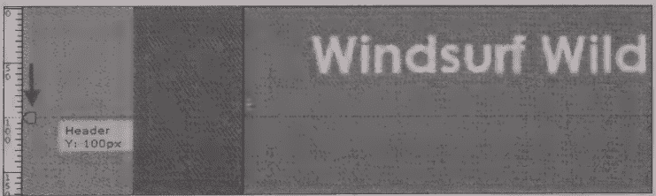

- 3. 转到 Widgets Library 面板（屏幕右侧）并点击 Menus，或选择 Object | Insert Menu。Menus 列表展开并提供三种不同类型的菜单。

4. 选择水平小部件并将其拖到页面的页眉部分。你会看到菜单项会自动显示站点地图中页面的名称。

5. 使用选择工具，将水平菜单与 Windsurf Wild 文本下方对齐，使菜单文本看起来正好位于页眉参考线上。注意出现的智能参考线，它们可以帮助你将菜单文本与 Windsurf Wild 文本对齐。

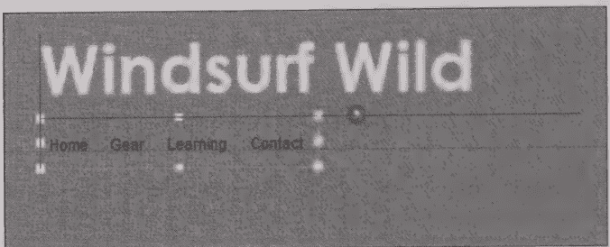

6. 当菜单栏正确对齐并放置后，点击菜单右侧的蓝色箭头。这将打开水平菜单的选项面板。

7. 将菜单类型设置为全部页面。这样可以确保我们的子页面或子菜单页面出现在导航栏中。

8. 将项目大小设置为统一宽度。这样我们就可以在保持菜单项均匀分布的同时更改菜单的整体宽度。

9. 将鼠标移到菜单右侧的中心手柄上并向外拖动，直到菜单宽度与上方 Windsurf Wild 文本的宽度相匹配。使用智能参考线帮助将其很好地对齐。

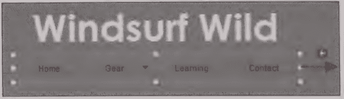

10. 使用选择工具选择菜单，然后点击文字工具，或按 T。通过使用文本选项，将菜单字体设置为 Century Gothic，大小 12，加粗，并使用颜色选择器将文本设置为浅蓝色 #00FFFF。

11. 点击 **Preview** 链接来测试你的菜单效果。你会发现只需几次点击，你就创建了一个完全功能齐全的菜单，并在 Gear 下有一个下拉子菜单。

我们将在下一章回到我们的菜单进行进一步的格式设置。

## 导航链接的技巧

访问你网站的访客将使用你提供的链接在网站中导航。任何使用网络超过一周的人都期望导航包含以下内容：

- **链接到主页**：大多数网站都是围绕主页组织的，因此你应该始终从网站上的每个其他页面包含一个链接到主页。
- **链接到主要主题**：对于讨论主要主题的每个网页，请包含指向其他主要主题网页的链接。
- **描述性链接**：你的页面名称和文本链接应该对访客有意义。你将花费大量时间在你的网站上工作，所以对你来说一切都会有意义。确保对之前访问过你网站的人也有意义。在你的链接中使用简单但描述性的文本。
- **链接到联系页面**：如果你提供服务或销售产品，人们会想要联系以获取更多信息。通过提供指向联系页面的链接让他们更轻松。

## 放大、缩小和关于

当你在 **Design** 视图中工作时，不要害怕放大，以便你能清楚地看到自己在页面上放置对象的位置。完成更改后，缩小以获得全貌。以下各节展示了如何在 Design 视图中更改网页的放大倍率。

### 放大

在对齐或放置页面上的对象时，重要的是要非常接近，因此我们需要放大。点击 **Toolbox** 中的 **Zoom** 工具，然后点击页面以放大，或按 Ctrl（Windows）或 Cmd（Mac OS）+ 等号/加号。

### 缩小

放大完成后，你需要再次缩小。点击工具箱中的缩放工具。按住 Alt + 点击（Windows）或 Option + 点击（Mac OS）页面，或按 Ctrl（Windows）或 Cmd（Mac OS）+ 减号。

### 适应窗口大小

当你将页面适应窗口时，页面会调整大小以适应你的工作区尺寸。选择 View | Fit Page to Window，或按 Ctrl + 零（Windows）或 Cmd + 零（Mac OS）。

### 使页面恢复实际大小

如果你放大了很多，或者在工作区中更改了页面的尺寸，你始终可以通过选择 View | Actual Size 或按键盘上的 Ctrl + 1（Windows）或 Cmd + 1（Mac OS）将页面恢复到实际大小。

## 总结

在本章中，我们研究了母版页面的概念以及我们如何使用它们在多个页面上应用外观和感觉。我们学习了如何在单个网页上添加简单文本以及如何添加链接。我们使用了 Muse 的一些布局工具，即参考线和网格叠加层来对齐我们的内容。

恭喜，你现在可以构建一个完全功能齐全的网站！是的，这是一个基本站点，只包含文本和一些链接，但这些是每个网页的基本构建块。

在下一章中，我们将研究 Muse 中的另一个重要构建块——矩形。
