## 5

## 矩形的乐趣

在上一章中，我们简要介绍了如何向页面添加一些文本，以及如何添加链接以便在浏览器中从页面跳转到页面。这是网站构建的重要组成部分。在本章中，我们讨论 Muse 网站的另一个重要基本构建块——矩形。

矩形正如其名，就是一个形状。当我们绘制矩形时，我们是在页面上创建形状以布局对象。矩形可以包含文本或图像，可以填充颜色并用描边勾勒边缘。尽管它们被称为矩形，但它们可以是正方形形状，我们也可以将它们的角圆化，使其呈圆形形状。

在本章中我们将学习如何执行以下操作：

- 设置背景矩形
- 创建矩形
- 选择或调整矩形
- 剪切/复制/粘贴矩形
- 定位和旋转矩形
- 复制矩形

## 使用矩形

矩形在 Muse 中的主要目的是充当页面上的布局对象。它们让我们定义页面上的各个部分。一旦创建了某个部分或矩形，它就可以填充颜色和/或在边缘应用描边。我们还可以将背景图像填充到矩形中。虽然每个网页本质上都是由框组成的（无论你使用的是 Adobe Muse 还是其他网页设计工具），但对背景图像的巧妙使用可以消除网站的方框感。我们将在未来的章节中更详细地讨论图像。

消除网页方框感的另一种方法是使矩形的角变圆。我们实际上可以将正方形的角完全圆化，使其成为圆形。

在下面的屏幕截图中，你可以看到左侧的矩形具有直角，而右侧的矩形大小完全相同，但具有圆角。

网格叠加层已通过选择 View | Grid Overlay 打开，以帮助对齐这些矩形。

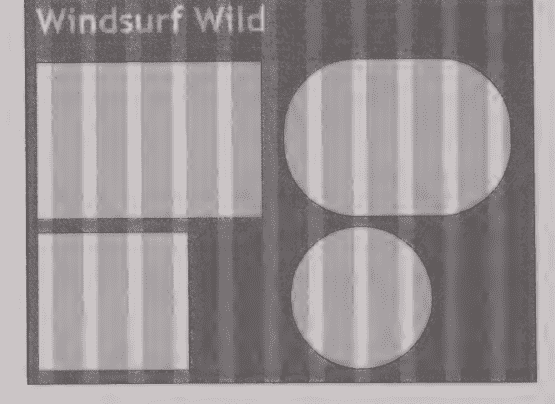

如果你回想一下第 3 章《规划你的网站》，你会记得我们在主页上使用矩形创建了一个线框布局，这些矩形代表了我们页面上的不同部分，使用了圆角矩形。我们使用矩形来划分页面的区域，这些区域将代表页眉、导航栏、主要内容区域和页脚。在传统的网页设计中，这种设置是使用 HTML 
 标签创建的。我们的原型看起来与以下屏幕截图类似：

在上一章中，我们通过选择文本工具然后点击并拖动出一个矩形形状来向页面添加文本。这创建了一个文本框。文本框和其他对象，如小部件和图像，在设计方面与矩形非常相似。例如，如果你想为文本框添加斜面或描边，你将遵循相同的操作步骤。

> 你可以通过使用文本工具双击它将任何矩形转换为文本框。

那么让我们开始在页面上创建一些矩形吧。如果你一直在跟随操作，请在 Plan 视图中打开 Windsurfing 网站，以便你可以看到你的站点地图。

## 设置主背景矩形

主背景矩形，简单来说就是我们在主页面上定义的一个区域。这个区域可以容纳图像或一块颜色。该矩形的高度是灵活的，其高度会随着每个页面上出现的内容量而变化。要设置主背景矩形，请执行以下步骤：

- 1. 双击 A-Master 页面以在设计视图中打开它。注意我们页面的主区域是蓝色的，周围有一片深灰色区域。当我们最初以 960 x 800 像素的宽度和高度值设置网站时，我们创建了一个用于容纳内容的容器。该容器位于浏览器窗口的中间——这就是蓝色区域。当我们第一次开始处理 A-Master 时，我们使用选项栏上的填充选项设置了页面颜色。周围的深灰色区域是我们内容在浏览器中两侧留下的空间。这在 Muse 中称为浏览器填充。使用浏览器填充，我们可以营造出一个无缝的大背景的印象，该背景在任何屏幕上都贯穿页面的全宽，或者我们可以创建一个具有明显边缘的背景。

- 2. 我们将把浏览器填充区域设置为与主内容区域相同的颜色。在选项栏上，单击浏览器填充按钮。会出现一个下拉菜单。将颜色设置为 #29ABE2。您可以通过输入之前的十六进制值来设置颜色，也可以使用吸管工具单击主内容区域中的蓝色。这消除了输入错误的可能性，并确保我们拾取了完全相同的颜色。

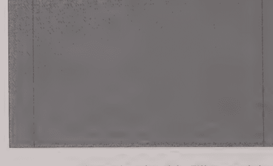

- 3. 现在我们将更改填充区域的颜色并更改圆角半径以创建圆角矩形，该矩形将作为容器的背景。单击选项栏上的填充按钮。在下拉菜单上，将颜色设置为白色并将不透明度设置为 50。

- 4. 在选项栏上，将 **Stroke** 值设置为 0。这会移除主容器周围的任何描边。

- 5. 再次在选项栏上，将 **Corners** 设置为 20。您可以输入数字 20，也可以反复单击选项栏上的向上箭头，直到达到 20。输入这些值后，您的主页面应类似于以下屏幕截图：

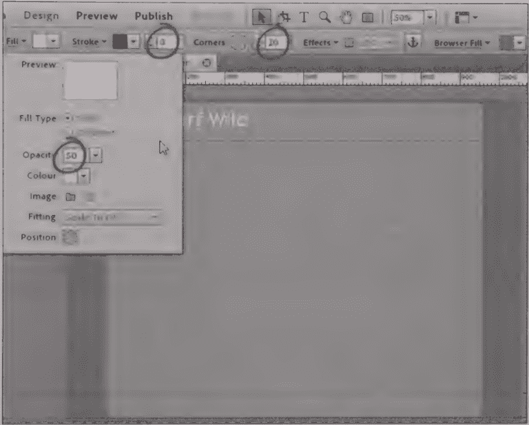

正如我们从关于主页面的早期讨论中所知，我们刚刚所做的更改现在将影响应用了此主页面的网站中的任何页面。在计划视图中，注意我们所有的页面，除了红色主页面外，都将看起来相同。

- 6. 通过在计划视图中双击我们在上一章中创建的 **Learning** 页面，测试更改如何影响该页面。当页面在设计视图中打开时，单击 **Preview** 按钮，以很好地了解页面在浏览器中的外观。

设置背景的真正好处是，我们创建的圆角矩形将拉伸以容纳我们所有的内容。

## 在单个页面上创建矩形

现在让我们看看如何向其他页面添加和操作矩形。

- 1. 从计划视图中，双击 Gear 页面以在设计中打开它。
- 2. 单击工作区顶部工具箱中的矩形工具。
- 3. 在页面的右侧，拖动以绘制一个新矩形。拖动使矩形大约宽 300 像素，高 320 像素。如果不是完全正确也没关系，因为我们在下一节中会修复尺寸。

我们可以使用矩形每一侧和每个角上出现的调整大小手柄来更改尺寸。矩形在您单击其他位置绘制另一个矩形之前保持可调整。

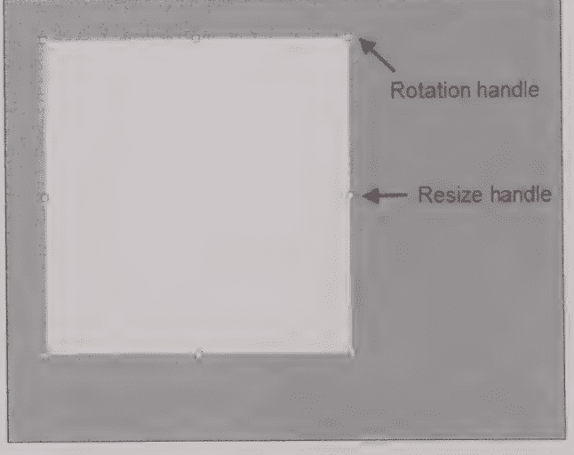

> 您可以通过按 Ctrl（Windows）或 Cmd（Mac OS）来调整任何矩形的大小——这会切换到选择工具——然后单击矩形，调整大小手柄会重新出现。单击并按住拖动手柄以调整大小。

## 删除矩形

假设我们向页面添加了一个矩形，然后决定不再想要它，很容易将其删除。只需使用选择工具单击矩形进行选择，然后按键盘上的 Del 键即可。

## 调整矩形

一旦矩形被添加到页面，我们可以随时返回并修改它，执行以下步骤：

- 1. 在设计视图中，单击工作区顶部工具箱中的选择工具。
- 2. 单击您刚刚创建的矩形。一旦选择矩形，其尺寸就变得可调整。要更改矩形的尺寸，单击并拖动所选矩形上的任何调整大小手柄。
- 3. 要设置所选矩形的确切宽度和高度，请在控制面板中添加值。宽度由 W 表示，高度由 H 表示。输入 300 作为宽度，320 作为高度。
- 4. 您还可以通过输入 X 和 Y 位置值来指定矩形在页面上的精确位置。X 是从页面左侧的像素距离。Y 是从页面顶部的像素距离。分别输入 610 和 130 像素作为 X 和 Y，如以下屏幕截图所示：

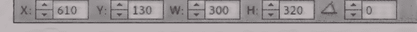

> 要在首次绘制矩形时创建完美的正方形而不是矩形，请在拖动时按住 Shift 键。在调整现有矩形大小时按住 Shift 会限制形状的比例，使矩形变大或变小。

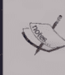

## 旋转矩形

通过旋转矩形，我们可以创建有趣的设计效果。一个例子是矩形包含图像，我们将其稍微旋转以赋予图像随意掉落在页面上的外观。执行以下步骤以旋转矩形：

- 1. 在设计视图中，选择要旋转的矩形。
- 2. 将鼠标移至矩形周围的任何角手柄上。光标将变为旋转图标，现在您可以手动围绕其中心点旋转矩形。

之前的步骤可以执行，或者我们也可以在控制面板中增加或减少旋转角度。旋转角度选项出现在 X、Y 坐标和宽度与高度值字段旁边。它是控制面板中最右边的选项。

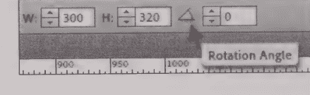

## 剪切、复制和粘贴矩形

因此您创建了一个矩形，现在希望在其他地方重用它。以下步骤展示了如何操作：

- 1. 在设计视图中，使用选择工具在页面上选择一个矩形。
- 2. 通过选择编辑 | 复制，或按 Ctrl + C（Windows）、Cmd + C（Mac OS）复制矩形。按 Ctrl + X（Windows）Cmd + X（Mac OS）剪切。
- 3. 通过选择编辑 | 粘贴或按 Ctrl + V（Windows）、Cmd + V（Mac OS）粘贴矩形。矩形将出现在页面上。使用编辑 | 粘贴在您希望确保复制的对象在从一个页面移动到另一个页面时放置在完全相同的位置时。

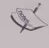

剪切和复制有什么区别？
复制命令会复制所选内容的副本，当您将其粘贴到其他位置时，原来的选择会保留在原位。现在内容在原始位置和新位置都可用
剪切命令会删除所选内容，当您将其粘贴到其他位置时，原来的内容就会消失。它只会出现在新位置。

## 复制矩形

在同一页面上复制和粘贴的替代方法是复制现有矩形。以下步骤向我们展示了如何操作：

- 1. 在设计视图中，选择要复制的矩形。
- 2. 选择编辑 | 复制，或按住 Alt（Windows）、Option（Mac OS）并拖动以创建副本。
- 3. 要创建在水平或垂直方向上与原始矩形保持对齐的副本，请在拖动时按住 Alt + Shift / Option + Shift。

## 添加颜色 – 填充和描边

虽然我们经常将矩形用作容纳文本或图像的“不可见”容器，但我们也可以使用填充和描边为其应用颜色。

## 添加描边

执行以下步骤以添加描边：

- 1. 在设计视图中，选择一个矩形。
- 2. 矩形仍处于选中状态时，通过单击控制面板中的描边颜色选择器，然后选择描边颜色来添加描边颜色。我们可以使用吸管工具从颜色字段、或网页上的其他区域选择颜色，或者您可以指定 RGB 值。对于此练习，选择白色作为描边颜色。

## 选择和保存颜色

无论是用于描边、填充还是浏览器填充，每当你使用颜色选择器时，都可以结合颜色选择器创建一个新的颜色样本。在指定新颜色后，点击颜色选择器右下角垃圾桶图标旁边的“新建样本”图标，即可为你保存该样本。

在填充颜色选择器中双击一个样本，可以为颜色分配一个友好的名称，例如 Lime Green，而不是 #DBD820。一旦你为其指定了更易于用户理解的名称，该名称会在鼠标悬停在该颜色样本上时以工具提示的形式显示。

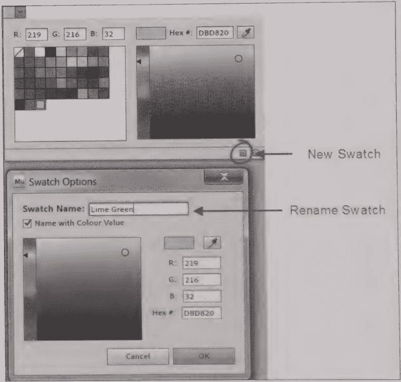

- 3. 通过增加或减少颜色选择器右侧“描边宽度”框中的数字来更改描边宽度。将描边宽度设置为 5 像素。
- 4. 要为此矩形创建圆角，请将“圆角”值设置为 15 像素。
- 5. 可选：点击“描边”菜单（控制面板中的“Stroke”一词）以指定其他选项，如以下各节所述

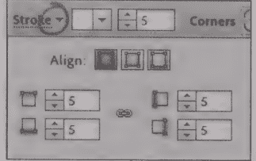

## 描边对齐

此选项让我们可以选择描边在矩形上的确切位置。选项为矩形的中心、内部或外部。点击每个选项以查看其对矩形描边产生的影响。

## 描边宽度

这允许你单独指定顶部、底部、左侧和右侧描边的宽度。默认情况下，这些数字是分组的，因此当我们增加或减少描边宽度时，矩形的各边会一起变化。我们可以通过点击链接图标来取消分组描边。当链接图标看起来像是断开时，描边即为未分组。现在我们可以一次更改任一边的宽度。

## 更改矩形填充

正如我们可以更改矩形的描边颜色一样，我们也可以更改填充颜色。填充颜色覆盖矩形的整个宽度和高度。当你向矩形添加文本时，文本会显示在填充颜色的前面。以下步骤向我们展示如何操作：

- 1. 在设计视图中，确保你的矩形已选中。
- 2. 通过点击控制面板中的“填充”颜色选择器，然后选择填充颜色，如选择描边颜色所述，来更改所选矩形的填充。你可以指定 RGB 值、十六进制值，或从颜色字段或网页上的其他区域选择颜色。

如果你不想在矩形中填充任何颜色，请点击“无”样本。那是带有红色斜线的第一个样本。

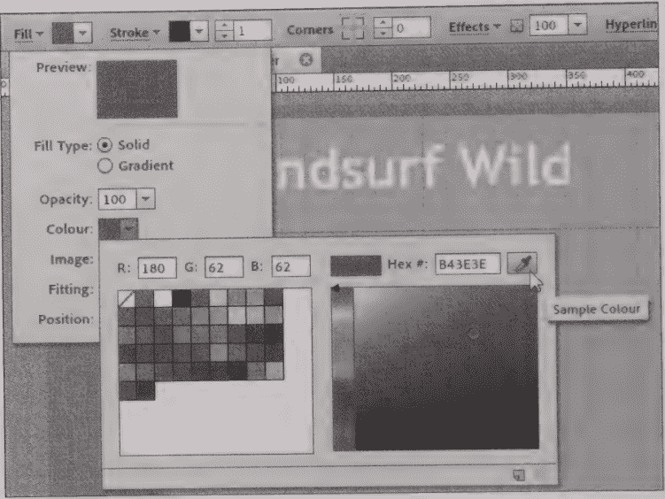

3. 如果你想为矩形背景选择颜色，请点击“填充”菜单（控制面板中的“Fill”一词）以指定以下实心填充选项：

- **不透明度：** 此选项指定不透明度（或背景颜色的透明程度）。
- **颜色：** 此选项设置填充颜色并调出与控制面板中可访问的颜色选择器相同的颜色选择器。
- **图像：** 此选项让你选择一个图像作为矩形的背景。
- **适配：** 此选项让你根据多个选项将图像适配到矩形内，包括“缩放以填充”、“缩放以适应”以及多种平铺选项。当你将“适配”选项设置为“平铺”时，平铺图像仅下载一次，从而减少页面下载时间。
- **位置：** 此选项指定背景图像在矩形内的位置，相对于你的选择。

## 设置渐变填充

除了使用纯色作为矩形的背景外，我们还有使用渐变的选项。以下步骤向我们展示如何操作：

- 1. 点击控制面板上的“填充”菜单。
- 2. 点击“渐变”单选按钮以显示渐变选项。
- 3. 通过点击左侧的颜色选择器设置起始颜色。选择一种与主页面背景相似的浅蓝色。
- 4. 将结束颜色设置为深海军蓝。
- 5. 将方向设置为垂直，并保持其他选项不变。随着你进行更改，矩形填充的变化会立即显示。

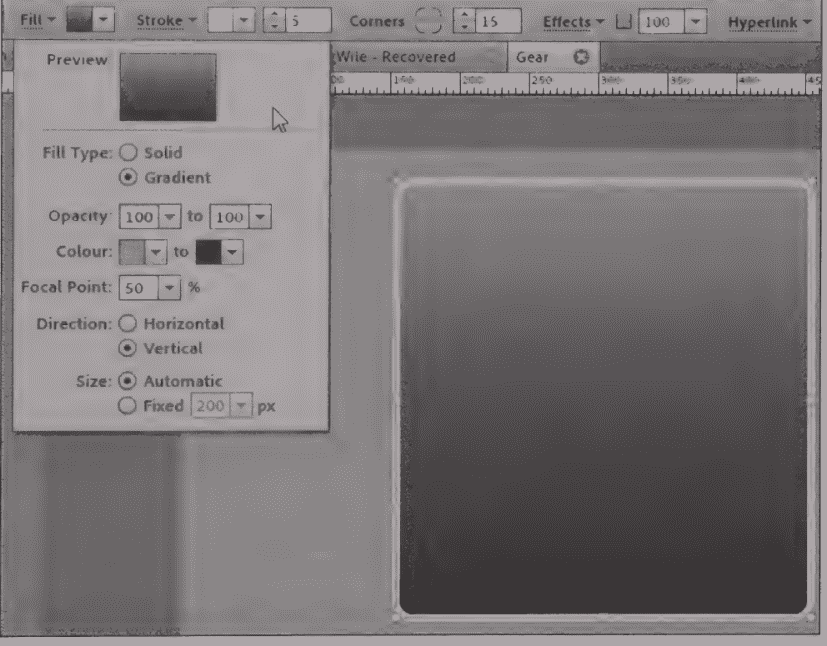

6. 渐变填充的选项与我们选择纯色时的选项有些相似。以下内容简要解释了每个选项：

- **不透明度**：此选项允许我们在渐变的开始和结束处指定不透明度。这对于逐渐将矩形与主页面背景融合非常有用
- **颜色**：此选项让我们选择将构成渐变的两种颜色。
- **焦点**：此选项指定背景颜色中渐变开始的点。50% 或中间是默认值。
- **方向**：此选项让我们选择渐变运行的方向——水平或垂直。
- **大小**：此选项允许我们指定所选的两种颜色如何融合。设置 **自动** 会创建从起始颜色到结束颜色的渐变，以适应渐变填充的对象的高度或宽度。另一种选择是输入像素值，这会导致渐变在指定的像素数内从起始颜色融合到结束颜色。

## 向矩形添加图像

让我们向现有的矩形添加一张两名风筝冲浪者的图片。请记住，我们创建的矩形尺寸为 300 x 320 像素。我们将把一张大约是此尺寸两倍的图像放入矩形中，并使用可用选项使其很好地适配。以下步骤向我们展示如何操作：

- 1. 在页面上选中矩形后，点击控制面板上的 **填充** 菜单。
- 2. 我们现在要替换渐变填充，因此点击 **填充** 菜单上的 **纯色** 单选按钮。这为我们提供了信息框中概述的纯色和图像选项。
- 3. 点击“图像”一词旁边的文件夹图标以选择要放入矩形的背景图像。操作系统文件浏览器打开，因此导航到你的图像文件夹并选择 Gear-Windsurf.jpg 文件，然后选择 **打开**。
- 4. 图像出现在矩形内。请注意，图像看起来被裁剪了。我们可以通过点击 **适配** 下拉选项来更改图像在矩形内的适配方式。选择 **缩放以填充**。

5. 现在点击“位置”图标以选择图像的定位方式。根据你的图像，选择定位时可能需要一定的试错。点击图标上的每个空点以查看图像在矩形内的位置如何变化。对于此示例，中心点似乎效果相当不错。

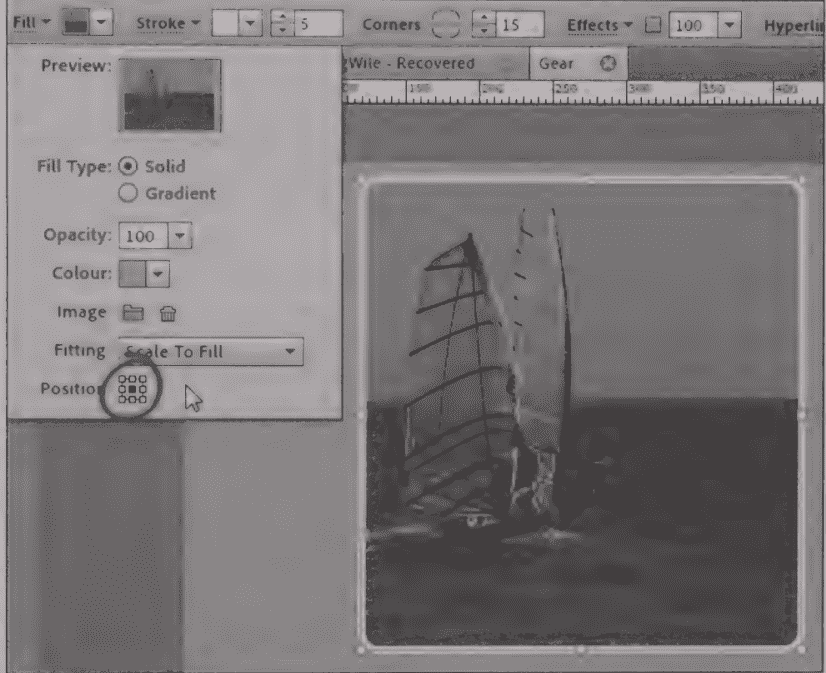

## 向矩形添加效果

在 Muse 中，你可以向矩形、图像、文本框或任何其他对象添加诸如投影、斜面和发光等效果。以下各节展示了我们如何操作。

## 添加投影

投影无疑是设计师使用最广泛的效果之一。它允许我们为页面增添深度，并给人一种物体略微从页面上浮起的感觉。与大多数设计效果一样，适度是关键。以下步骤向我们展示如何操作：

- 1. 在设计视图中，选择要添加投影的矩形。
- 2. 在控制面板上，点击“效果”菜单。
- 3. 点击“阴影”类别并选择“开”。
- 4. 设置阴影的 **颜色**。请记住，并非每个投影都需要是黑色。我们可以通过选择与主页面背景颜色较暗的色调来创建更微妙的效果。对于本次练习，选择深海军蓝色。
- 5. 将阴影的不透明度设置为 60，如以下屏幕截图所示：

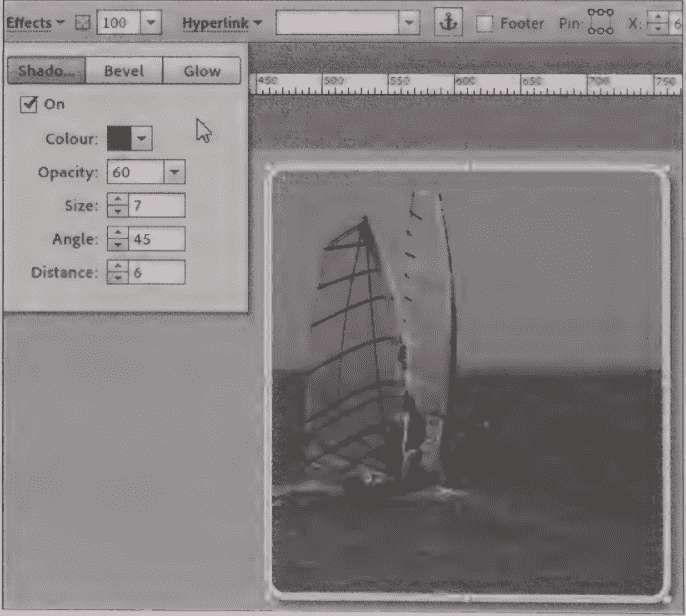

+   6. 将 **Size** 设置为 8。
+   7. 将 **Distance** 设置为 8 并保持其余值不变。
+   8. 以下是对选择 Drop Shadow 时可用选项的简要说明：
+       - **Color：** 设置投影的颜色。
+       - **Opacity：** 设置投影的不透明度。
+       - **Size：** 让你设置投影的厚度。
+       - **Angle：** 设置投影相对于矩形的所在位置。默认值为 45 度角，这会将投影放置在矩形的右侧和底部边缘。角度数值越高，投影在矩形周围移动的位置就越靠后。
+       - **Distance：** 指定投影与矩形之间的距离。
+   9. 要移除投影，请清除 **On** 复选框。

## 添加斜角效果

斜角效果通过添加明暗边缘为对象增加深度。以下步骤展示如何添加该效果：

+   1. 在设计视图中，再次选择矩形。请注意，当矩形上有描边时，斜角效果会很难看到，因此你可能需要先暂时移除矩形的描边。

2. 在控制面板中，点击 Effects 菜单以显示如下所示的窗口：

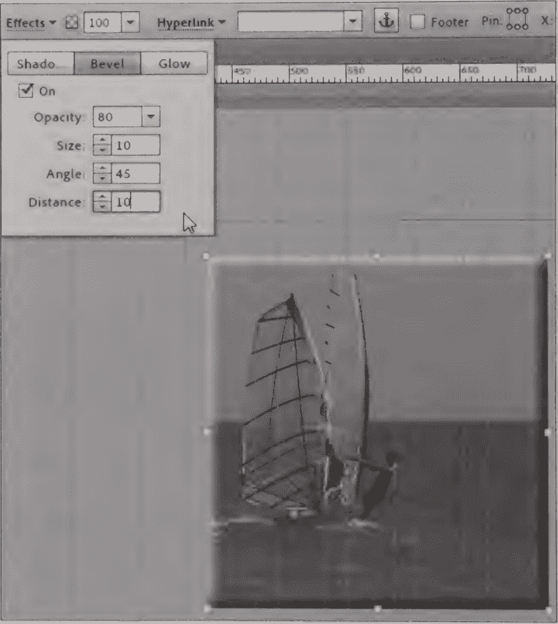

3. 点击 Bevel 类别并选择 On 以激活斜角选项。

4. 要移除斜角，请取消选中 On 框。

## 添加发光效果

第三个也是最后一个效果是发光，它让我们可以为任何矩形应用发光边缘。以下步骤展示如何添加发光效果：

+   1. 在设计视图中，确保选择要添加发光效果的矩形。
+   2. 在控制面板中，点击 Effects 菜单以显示类似以下截图的窗口：

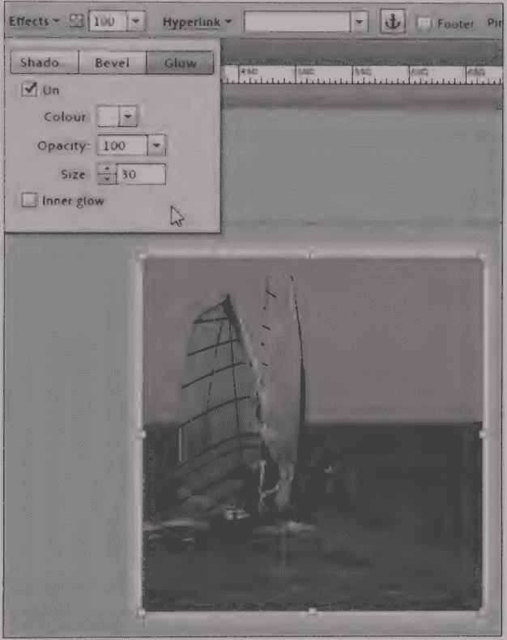

+   3. 点击 Glow 类别，选择 On 以激活选项。
+   4. 要移除发光效果，请取消选中 On 框。

## 更改矩形的堆叠顺序

经常你会发现页面上有不止一个矩形。当你将一个矩形移动到另一个矩形上方时，你可能会得到意外的结果，即你希望在上方的矩形现在却在下方。这是因为 Muse 在创建矩形时会创建所谓的堆叠顺序。幸运的是，更改堆叠顺序非常容易，并且该技术也适用于页面上的其他对象。

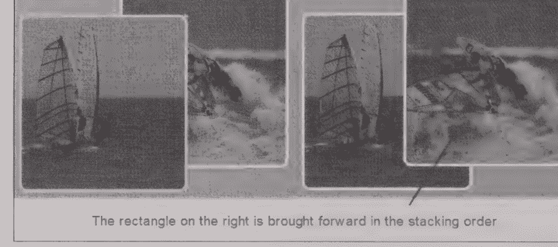

以下步骤展示如何操作：

+   1. 要将矩形在堆叠顺序中向前移动（或置于上方），选择该矩形并选择 Object | Bring Forward。
+   2. 要将矩形在堆叠顺序中向后移动，选择该矩形并选择 Object | Send Backward。
+   3. 要将矩形置于堆叠顺序的最顶层，选择该矩形并选择 Object | Bring to Front。
+   4. 要将矩形移至堆叠顺序的最底层，选择该矩形并选择 Object | Send to Back。

> 上述所有堆叠选项都可以通过右键单击/Ctrl + 单击矩形来使用。

## 创建圆角和直角混合的矩形

我们可以通过调整矩形各个角的圆角半径来实现一些不错的效果。假设我们想要创建一个形状，其中有 3 个圆角和一个位于右上角的直角。以下步骤展示如何操作：

+   1. 在设计视图中，绘制一个新的矩形或选择页面上已有的矩形。
+   2. 在控制面板中为左上角、右下角和左下角选择圆角。点击控制面板上的右上角，使其显示直角图标。
+   3. 将圆角半径增加到 50，以在三个圆角上获得戏剧性的圆角效果；这会使直角更加突出。

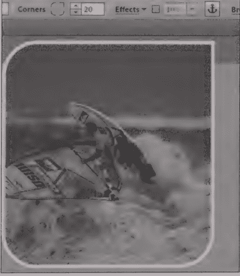

我们可以随时将任意四个角从圆角更改回直角，效果会立即显现。

## 创建全宽矩形

大多数情况下，当我们使用矩形工具创建矩形时，我们通过在控制面板的 Width 和 Height 字段中输入值，或通过拖动变换手柄来指定矩形的大小。

我们还可以将矩形设置为以浏览器窗口的 100% 全宽显示。这意味着矩形会根据访客浏览器窗口的宽度自动调整大小以填充页面。

全宽矩形可以填充纯色、渐变或图像背景填充。如果你设置了平铺背景图像填充，平铺图像将无缝重复以扩展并填充页面的 100% 宽度。

以下步骤展示如何设置全宽矩形：

+   1. 在 Gear 页面，在设计视图中，使用矩形工具在页面底部附近绘制一个矩形。
+   2. 在矩形仍被选中的情况下，设置你的 Fill 和 Stroke 选项，如前所述。
+   3. 使用选择工具拖动矩形的左右两侧，使其与整个页面宽度的左右边缘对齐。矩形将跨越页面的整个水平宽度。
+   4. 你会注意到页面左右边缘会出现红色高亮，并且在将矩形两侧与边缘对齐时，你会感觉到矩形被吸附到位。

使用平铺图像时，图像会重复以填充矩形。这样做的好处是浏览器只需下载一次图像，从而减少下载速度。凭借巧妙选择的背景图像，设计师可以营造出跨越页面宽度的超大图像的错觉。

## 总结

在本章中，我们学习了如何设置灵活的背景矩形。我们向页面添加了矩形并调整了其大小、填充颜色和描边，并学习了如何添加诸如投影等效果。

在下一章中，我们将深入探讨如何在 Muse 中处理文字以及如何在网络上处理排版。
