## 6
排版、Muse
和网络

在上一章中，我们研究了矩形如何成为 Muse 网页的构建块，以及如何将它们用于内容和设计元素。任何网页的另一个绝对基本元素是文本。网站都是关于沟通的，自然地，文本是其中的重要部分。

在本章中，我们将添加文本并学习如何编辑它、应用样式以及使用框架来控制其在网页上的显示位置。我们还将讨论排版在制作引人注目且有趣的设计中的作用，以及我们对网络字体选择的重要性。

到本章结束时，你将知道如何：

+   - 创建文本
+   - 编辑文本
+   - 创建和编辑字符样式
+   - 创建和编辑段落样式
+   - 添加标题
+   - 对文本应用间距和格式
+   - 使文本环绕图像
+   - 为网页添加元数据
+   - 选择“网络安全”字体

## 文本的力量

当我们谈论文本和设计时，我们不仅仅是指我们想要使用的字体类型。我们需要以清晰、有条理的方式呈现文本，以便访客能够快速、轻松地找到所需的信息。

排版本身就是一个庞大的主题，一些设计师和排版师会花费数年时间来研究。虽然我们无法深入探讨字体的设计，但了解字体的解剖结构和类别对于我们做出明智的字体选择非常重要。

## 字体的解剖结构

字体是任何设计中出现的至关重要的元素。它不仅是可阅读的文本，还可以被视为形状或视觉元素。在开始向设计中添加文字之前，了解一些排版知识和排版术语是个好主意。以下图像展示了一些你在学习和工作中会遇到的术语的简短视觉词汇表：

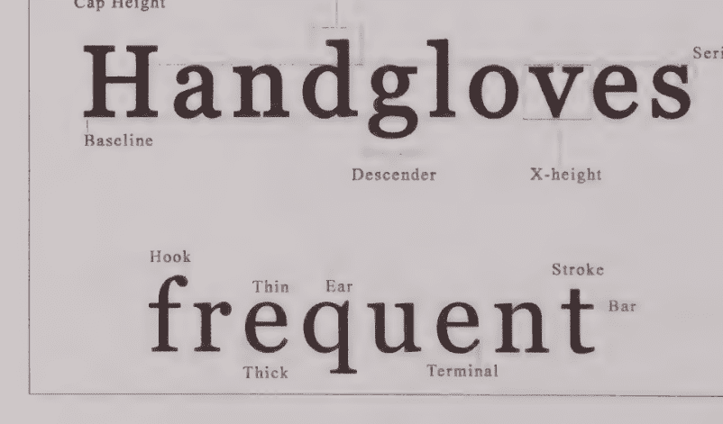

以下是排版术语及其解释：

- **基线**：这是文本所坐的虚线。

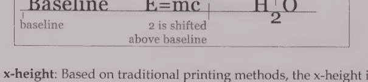

- **x 高度**：基于传统印刷方法，x 高度是小写字母 x 的高度。然而，作为一般规则，x 高度可以描述为字体中小写字母的高度，不包括上伸部和下伸部。

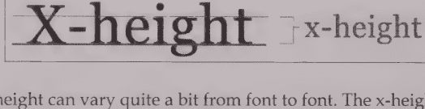

x 高度在不同字体之间可能有很大差异。x 高度决定了字体大小的整体印象。在下面的插图中，所有文本都设置为 21 磅，但正如你所见，每个词在高度和粗细上看起来都大不相同。

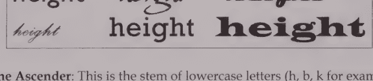

- **上伸部**：这是小写字母的茎干（例如 h、b、k），其上伸超出字体的其他小写字母的 x 高度。

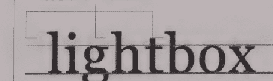

- **下伸部**：这是小写字母（例如 g、q、y）的部分，其向下延伸到基线以下。通常大写字母 Q 和 J 也会下伸到基线以下。
- **罗马/常规**：字体的直立样式。
- **斜体**：字体的倾斜或类似手写体的版本。
- **粗体**：以更重、更粗的笔画呈现的字体，用于使文本突出。
- **大写字母高度**：从基线到字体中大写字母顶部的高度。这并不总是与上伸部的高度相同。
- **字符**：单个元素，如字母、数字或标点符号。
- **压缩字体**：这是字体的较窄版本。它用于在给定空间内容纳更多字符。

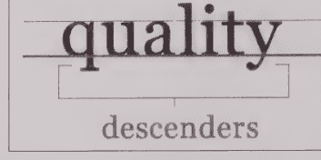

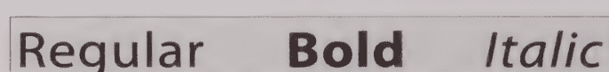

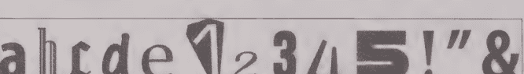

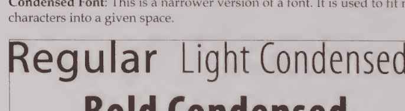

- **首字放大**：这是一种流行且有效的设计风格，其中第一个字母（大写字母）以更大的磅值设置并与第一行的顶部对齐。它常用于表示章节或文档新部分的开始。

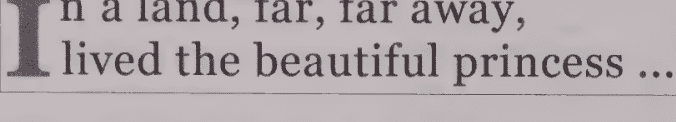

- **抬高大写字母**：这是一种设计风格，其中第一个大写字母以更大的磅值设置并与第一行文本的基线对齐。

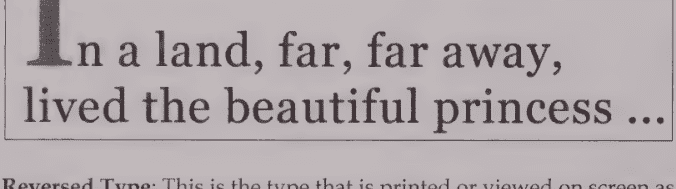

- **反白字**：这是在屏幕上以白底黑字或浅色底深色背景打印或显示的文字。

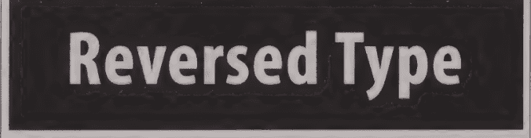

- **左对齐文本**：文本左对齐，段落右边缘参差不齐。
- **居中对齐文本**：文本居中对齐，段落两边缘均参差不齐。
- **右对齐文本**：文本右对齐，段落左边缘参差不齐。

Justified：文本在左右两边均齐时称为对齐。

| 左对齐文本 | 右对齐文本 |
|---|---|
| John F. Kennedy's memorable inaugural address is famous for his use of the word "ask" five times in three sentences: "And so, my fellow Americans: ask not what your country can do for you, ask what you can do for your country." | John F. Kennedy's memorable inaugural address is famous for his use of the word "ask" five times in three sentences: "And so, my fellow Americans: ask not what your country can do for you, ask what you can do for your country." |
| Center Text
John F. Kennedy's memorable inaugural address is famous for his use of the word "ask" five times in three sentences: "And so, my fellow Americans: ask not what your country can do for you, ask what you can do for your country." | Justified Text
John F. Kennedy's memorable inaugural address is famous for his use of the word "ask" five times in three sentences: "And so, my fellow Americans: ask not what your country can do for you, ask what you can do for your country. My" |

字距调整：这是对字母对之间水平间距的调整。它用于创造均匀性的视觉效果。

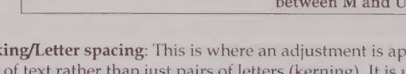

字距/字母间距：这是对整块文本而不是仅字母对（字距调整）应用的调整。它用于提高可读性并在特定空间内容纳更多或更少的文本。在下面的插图中，第一行的字距设置为 0（或正常），第二行的字距设置为 -100，因此所有字母都被拉得更紧，第三行的字距设置为 +70，因此字母之间有更多空间。

Around the ragged rocks the ragged rascal ran
Around the ragged rocks the ragged rascal ran
Around the ragged rocks the ragged rascal ran

## 创建文本框

在第 3 章《规划你的网站》中，我们在创建线框模型并添加多个矩形（包括一个文本框）来容纳占位文本时，首次接触到文本框。

在第 4 章《强大的页面》中，我们将网站标题"Windsurf Wild"添加到主页面中，并在第 5 章《矩形的乐趣》中，我们向学习页面添加了一些文本内容。现在我们将继续向我们的冲浪网站添加文本内容。

在 Muse 中，如果尚未打开，请通过从菜单中选择 文件 | 打开站点 或点击 Muse 欢迎页面上冲浪网站的名称来打开你的网站。

添加文本到页面有多种方法。我们可以执行以下任何操作：

- 绘制一个文本框然后直接在框中输入
- 绘制一个文本框然后从其他来源复制文本，例如文字处理文档或互联网站点，并将其粘贴到文本框中
- 通过从菜单中选择 文件 | 置入 来放置 .txt（基本文本文件）

我们在第 4 章《强大的页面》和第 5 章《矩形的乐趣》中已经看到如何首先绘制文本框来添加文本，但对于此练习，我们将选择第三个选项，即放置文本文件以向我们的装备页面添加一些文本：

- 1. 在计划视图中，双击装备页面以在设计视图中打开它。你会记得在上一章中，我们在此页面上添加了一个矩形来容纳图像，并调整了圆角以创建三种圆角和一个直角的混合。
- 2. 选择 视图 | 显示参考线，以便你可以使用参考线作为对齐图像和文本的辅助。
- 3. 选择 文件 | 置入，然后浏览到第 6 章文件夹并选择 Gear.txt。你会立即注意到你的光标发生变化以显示已加载图标——它看起来类似于附着在光标上的迷你页面。

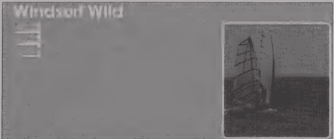

4. 在 Windsurf Wild 文本下方单击，一个新的文本框将被添加，其中包含 Gear.txt 文档的内容。请注意页面会自动拉伸以容纳文本框。

5. 在上一章中我们看到如何选择一个矩形，添加填充颜色，添加描边颜色，调整大小，添加圆角，并为其添加背景颜色。碰巧的是，文本框的行为方式相同。我们可以对文本框执行所有这些操作。

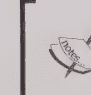

> 如果你在矩形顶部创建文本框，随着你在文本框中添加文本，矩形会为你自动调整大小。这确保了 Muse 创建的网页会自动垂直拉伸以适应变化。

## 清晰、有说服力且正确的內容

虽然本章是关于排版的，但重要的是要提到实际内容至关重要，无论你选择什么字体。许多网站尽管设计精致度不足却能蓬勃发展，原因在于其内容出色。执行以下步骤以获得完美的内容：

- 清晰、正确且有说服力。
- 不要犯愚蠢的拼写错误，因为 Muse 没有拼写检查器，不要犯事实错误，也不要离题啰嗦。

## 编辑文本

现在我们在装备页面上有了一些文本，让我们回去编辑它。以下步骤向我们展示如何操作：

- 1. 在设计视图中，选择 文本 工具。
- 2. 选择你想要更改的文本。

3. 我们可以使用屏幕顶部的控制面板（在选择文本工具后）或文本面板来编辑文本，通过选择 Window | Text 打开文本面板，如下图所示，如果它尚未可见：

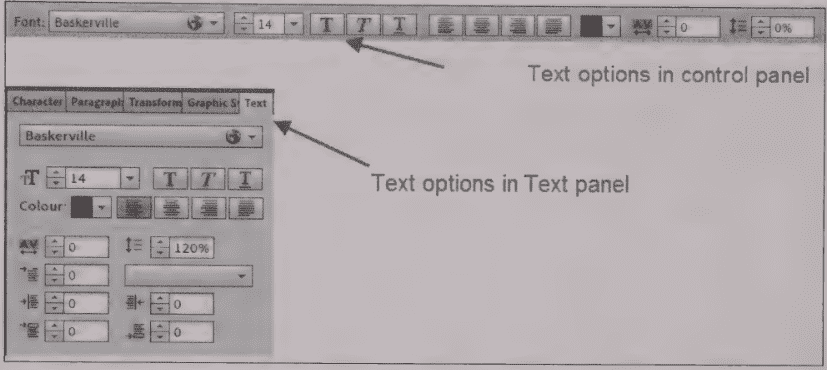

以下是在两个面板中都可用的选项：

- **Font:** 你可以从网络安全字体列表（我们稍后会更详细地讨论网络安全字体）、网络字体或系统字体列表中选择一种字体。Muse 会将非网络安全的系统字体导出为图像。网络安全字体和网络字体在它们旁边会有一个小地球图标。如果选择需要导出的字体，则在控制面板或文本面板的字体列表中以及工作区中文本旁都会出现一个小图像图标。
- 如果你想在工作区中隐藏该图标，请选择 View | Hide Rasterized Text Frame Indicators。
- **Font size:** 字体大小指定字体的大小，以像素为单位。有少量预定义的大小可供选择，或者你可以通过输入数字来指定特定的字体大小。
- **Bold/Italic/Underline:** 使所选文本变为粗体、斜体或下划线。
- **Align:** 将文本段落设置为左对齐、居中、右对齐和两端对齐。

- **Color:** 这让你可以设置文本颜色。要选择文本颜色，可以使用吸管工具，也可以使用颜色色块选择颜色，或通过输入 RGB 值或十六进制值来选择。
- **Letter Space:** 又称为跟踪，字母间距可以增加或减少所选文本字母之间的间距。
- **Leading:** 这指定了文本行上方和下方之间的空间。行距是一个段落属性，这意味着在此处所做的任何更改都会影响所选段落中的每一行。行距字段接受百分比值（字体大小的百分比）或像素值。
- **Paragraph style:** 此值让你可以选择要应用于文本的预定义段落样式。通过使用段落样式，我们可以在网站上实现一致性并加快文本格式化速度。

大多数情况下，我们使用段落样式，因为我们倾向于处理文本行。然而，创建可应用于单个文本字符或少量单词的字符样式也是可能的。

- **Character style:** 让你可以选择要应用于文本的预定义字符样式。

仅在文本面板中可用的以下选项：

- **Indent:** 让你缩进所选文本的第一行。此字段中可以使用正值和负值（减号）。
- **Links:** 让你使用预定义的链接样式为文本设置样式。
- **Left/Right margin:** 在所选文本的左侧或右侧边距中留出空间（类似于填充）。
- **Space before/after:** 指定所选段落之前（上方）或之后（下方）的空间量。

> 将正文文本导出为图像并不是一个好的做法。图像文件与 HTML 文本一样不可调整大小或选择，并且对搜索引擎不友好。导出为图像文件的文本在浏览器中查看时不可选择或调整大小。

Web Fonts 在网络安全字体之上提供了数百种额外的字体。网络字体让你可以使用未安装在访客计算机上的字体。这为我们设计师打开了一个全新的排版世界。当你选择使用网络字体时，Add Web Fonts 对话框会打开，如下图所示，提供所有可用字体的视觉概览。网络字体由 Typekit 服务提供。

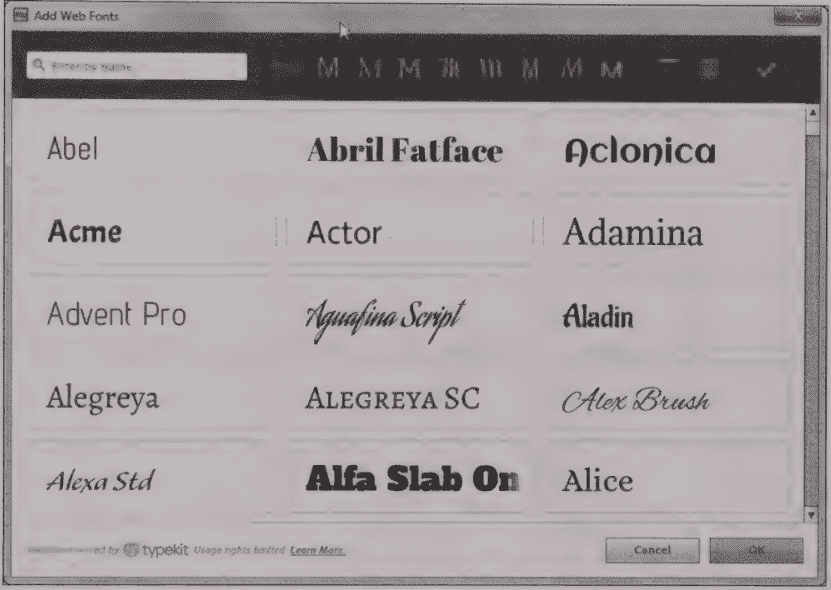

## Creating and applying paragraph styles

使用段落样式允许我们为较大的文本块保存一组定义或规则，然后可以快速将其应用于我们选择的任何文本块。

假设例如，你希望你的块引用始终看起来相同，使用 Georgia、斜体、大小 12 且颜色为红色。你将选择一些文本，应用格式然后将其保存为段落样式。然后你可以通过将其应用于页面上的其他块引用来重用该段落样式。

你在任何页面上创建的任何段落或字符样式都可在整个网站中使用，而不仅仅是在创建样式的页面上。让我们现在创建一个段落样式，它将定义我们主正文文本的外观：

- 1. 在 Design 视图中，突出显示一段文本——比如段落中的一行——然后在文本面板中设置以下值：
  - Font: Arial
  - Size: 12
  - Left Alignment
  - Colour: Dark Navy or Hex 000090
  - Line Spacing: 140%
- 2. 在段落样式面板中（如果看不到面板，请选择 Window | Paragraph Styles），点击右下角的 Create New Styles 按钮。
- 3. 通过双击它并在文本框中输入描述性名称来重命名新样式。在本例中将其命名为 Body Copy。

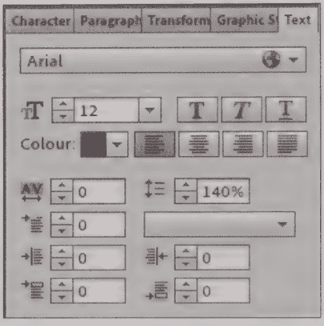

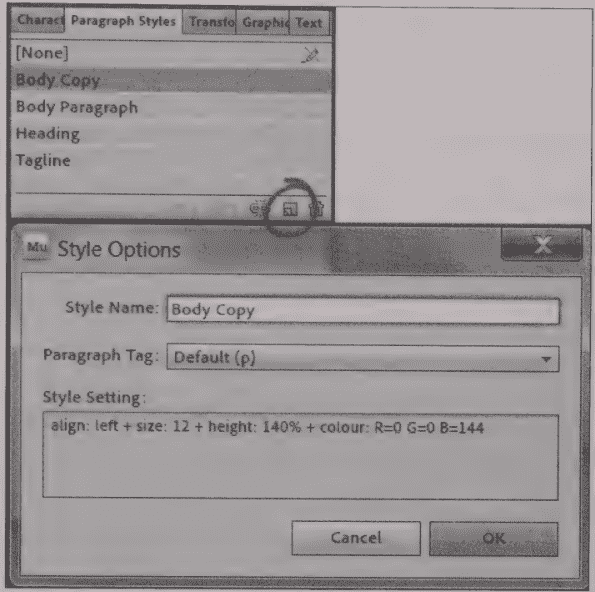

你会注意到已经列出了一些段落样式。这些是我们创建网站线框模型时在第 3 章 Planning your Site 中创建的样式。你可以创建任意数量的样式。

- 4. 若要将段落样式应用于你在 Gear 页面上放置的所有文本，请使用文本工具单击一次文本框中的任意位置，使光标在文本中闪烁。然后快速单击三次以选择文本框中的所有文本。

> 单击一次文本框即可在该文本框内的任何位置放置光标。双击可选择一个单词，三击可选择整行文本，四击可选择文本框中的所有文本。

- 5. 现在让我们将新创建的 Body Copy 段落样式应用于我们在上一章中添加到 Learning 页面的文本。转到 Plan 视图，然后双击 Learning 页面以在 Design 视图中打开它。
- 6. 在 Learning 页面上，使用 Select 工具，简单地单击一次以选择页面上的文本框。

7. 在选择文本框后，单击你刚刚创建的 Body Copy 样式，你会看到 Learning 页面上的文本格式立即发生变化。文本应显示与你在 Gear 页面上应用的格式相同的格式。请注意，Learning 页面上的链接仍然是白色的。

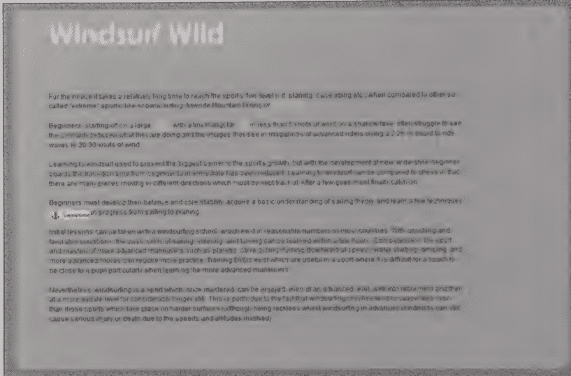

8. 若要编辑段落样式，请在段落样式面板中选择该样式，进行编辑，然后单击面板右下角的 Redefine Selected Styles 按钮。

试试看，将正文中的文本颜色更改为亮黄色。注意文本在 Learning 页面和 Gear 页面上的颜色如何变化。尝试更改文本大小、行距和字体。当你完成实验后，将正文恢复到原始设置，并不要忘记单击段落样式面板底部的 Redefine Selected Styles 按钮。

9. 如果你想从一段文本中删除特定样式，可以选择已应用样式的文本片段，然后从段落样式面板中选择 None。

## Creating and applying character styles

正如我们所见，段落样式非常适合多行或文本块，但如果我们想创建样式并仅将其应用于某些单词会怎样？这就是字符样式发挥作用的地方。使用字符样式允许我们为特定的一组字符或单词保存一组定义或规则。

假设例如，你想在页面上突出显示某些单词，我们是这样做的：

- 1. 在 Design 视图中，在 Learning 页面上突出显示第一行中的单词 novice。然后在文本面板中设置以下值：
  - Font: Arial
  - Size: 12
  - Bold and Italic
  - Color: Bright Yellow
- 2. 在字符样式面板中（Window | Character Styles），单击右下角的 Create New Styles 按钮。
- 3. 通过双击它并在文本框中输入描述性名称来重命名新样式。将其命名为 Bold Yellow。
- 4. 现在你已创建字符样式，可以将其应用于页面上的任何其他文本。在 Learning 页面上，找到单词 Beginner 或 Beginners。突出显示该单词的每个实例并通过在字符样式面板中单击其名称来应用新样式。
- 5. 若要编辑字符样式，请在字符样式面板中选择该样式，进行更改，然后单击面板右下角的 Redefine Selected Styles 按钮。
- 6. 如果你想取消文本中特定字符样式的链接，请单击字符样式面板右下角的 Unlink Style 按钮。

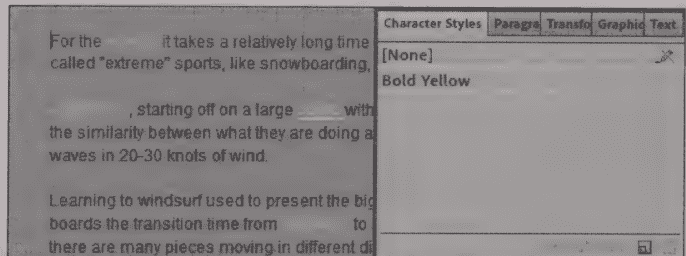

## 在“字符和段落样式”面板中使用上下文菜单

当你在操作样式面板时，可以通过右键单击或 Ctrl + 单击任意样式来查找额外选项。你会看到以下选项：

- New Paragraph Style
- Duplicate Style
- Delete Style
- Unlink Style
- Clear Overrides
- Redefine Style
- Rename Style
- Style Options
- Delete Unused Styles

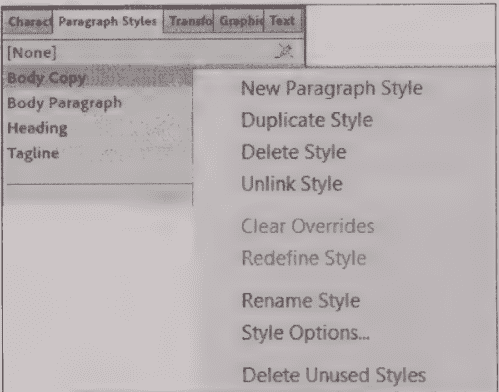

## 标题

在网页设计中，我们使用标题有几个原因，其中一些原因如果你是新手可能并不完全明显。标题让我们能够组织内容，在每个页面上传达逻辑层次，有助于无障碍访问，并作为搜索引擎优化（SEO）的辅助。让我们逐一查看这些。

## 内容组织和层次结构

HTML 标题标签被创建出来为网页提供结构。H1 或标题 1 是最重要的标题。它通常是页面上最大、最粗的文字。标题从 H1 到 H6，越往后越小，从 H1 到 H6 逐渐变小。重要的是始终从 H1 开始，然后一次一个级别地向下移动。你可能会发现我们不需要超过 H3，但为了创建有组织的网页，我们可能需要这样做。这就是 HTML 标题标签被使用的特定目的——为你的文档结构化。你应该始终从 H1 元素开始，然后一次一个级别地移动到其他级别。例如：

- H1
- H2
- H2
- H3
- H4
- H5
- H6
- H6
- H5
- H4
- H3
- H2

重要的是在每个页面上使用 H1 或标题 1。如果你认为你的网站中的每个页面都应只关注一个主题，那么该主题的名称或标题将是页面上最高级别最重要的标题。每个页面上真的只能有一个 H1。

## 标题与无障碍访问

使我们的网页无障碍意味着使我们的网站可供残疾人士使用。这可能包括：

- 使用屏幕阅读器的视力障碍人士
- 使用无声音浏览器的听力障碍人士
- 身体障碍人士
- 色盲人士

通过正确使用标题，我们可以使使用辅助设备的用户更容易阅读页面。因为标题表示文档中重要文本的开始，屏幕阅读器使用标题作为锚点。页面变得更容易阅读，因为相关内容可以在不必阅读页面上每个单词的情况下访问。

## 标题与 SEO

这是正确使用标题的一个经常被忽视的好处。搜索引擎对标题中的文本给予额外的强调或重要性。标题标签越高，该文本被认为越重要。H1 标题在搜索结果中的权重高于 H6 标题。

## 创建标题

如前所述，我们使用标题为页面提供结构，我们可以使用段落或字符样式来定义这些标题的外观。这就是我们现在要做的：

1. 如果尚未打开，请在设计视图中打开 Learning 页面。
2. 选择文本工具并在 Windsurf Wild 文本标志下方拖出一个文本框。
3. 输入文字 Learn How to Windsurf。
4. 突出显示你刚刚输入的文字，然后通过控制面板或文本面板应用以下格式：
5. Font: Arial
6. Size: 36
7. Bold
8. Color: Navy (#000090)。
9. 在段落样式面板中，单击“创建新样式”按钮。
10. 双击新的段落样式并在样式选项对话框中将其命名为 Heading 1。从段落标记下拉菜单中选择 Headline (H1)。这就是我们告诉 Muse 这段特定文本是页面上最重要的文本的方式。

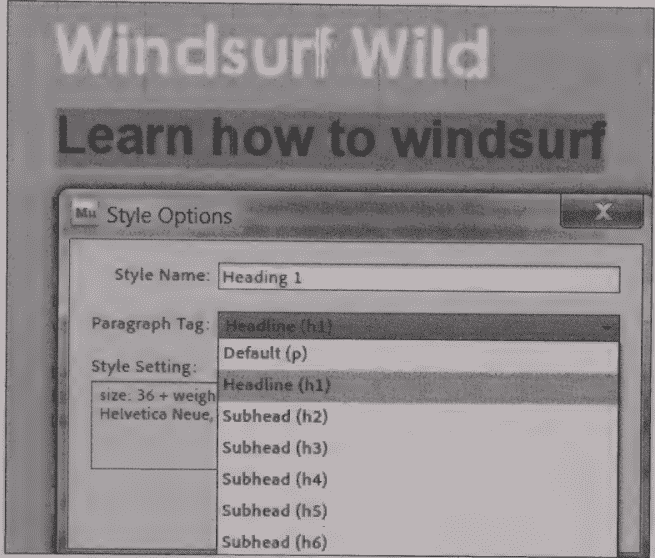

于是我们的标题 1 样式就创建好了。让我们在 Gear 页面上应用它：

1. 在设计视图中打开 Gear 页面。
2. 在 Windsurf Wild 文本标志下方添加一个文本框。使用你的 X 和 Y 坐标确保新的文本框与 Learning 页面上的位置相同。

> 在添加新的文本框之前，你可能需要先将正文向下移动。

3. 输入文字 Windsurf Gear。
4. 突出显示文字（或文字的任何部分，因为我们正在应用段落样式），然后单击你创建的 Heading 1 段落样式。

你的文字现在应按段落样式中定义的格式完全格式化。

## 更改文本大小写

假设我们希望标题 1 全部为大写，我们可以按如下方式更改文本大小写：

1. 在设计视图中，确保已选择文本工具。
2. 选择文字 Windsurfing Gear。
3. 选择 Edit | Change Case | UPPERCASE。这会将所选文本更改为全部大写，如以下屏幕截图所示，但它并未更改我们的段落样式。我们需要手动选择希望更改为大写的任何文字。

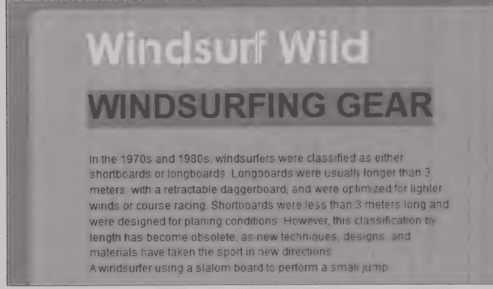

## 文本环绕

在网页的文本内容中看到信息框或图像出现并不罕见。文本框内的文本框有时被称为标注，它们用额外信息补充主要文本。

Muse 通过让我们环绕矩形、另一个文本框或图像等对象来环绕文本，从而轻松创建标注。在以下步骤中，我们将剪切 Gear 页面上当前存在的图像并将其粘贴到本章开头创建的文本框内。然后我们将使文本环绕图像，使其流畅。

1. 在设计视图中打开 Gear 页面。目前它由一个标题、一个文本框和一个包含两名风筝冲浪者图像的矩形组成。
2. 使用选择工具选择页面右侧的图像。
3. 选择 Edit | Cut，将图像从页面剪切到剪贴板。
4. 使用选择工具单击文本框，然后拖动文本框右侧的其中一个手柄，使框架几乎填满页面的宽度。
5. 然后，使用文本工具在文本框中定义文本插入点。在第一段第一行的单词 In 之前单击一次。粘贴之前复制的元素（Edit | Paste）以将对象作为内联元素插入文本框中。

图像现在位于文本框内，但看起来有点别扭，因为所有文本都已降到其下方。查看屏幕顶部控制面板中的环绕选项。

6. 在以下环绕选项之间进行选择：
   - Inline in text
   - Position left
   - Position right

7. 单击每个环绕选项，以便你可以看到图像位置如何变化以及文本如何环绕它。

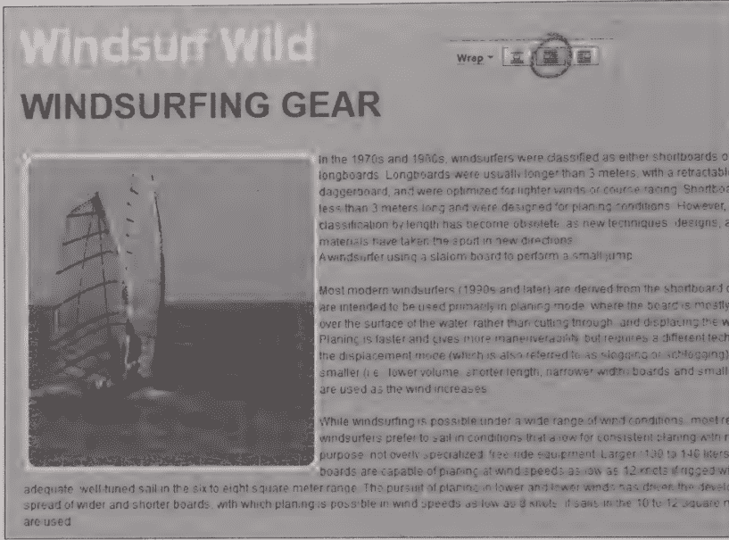

文本紧贴图像边缘，使其没有呼吸空间。为了在内联元素（图像）周围留出一些填充，我们将添加偏移值。

8. 单击控制面板上的环绕下拉框。在图像右侧添加 10 像素的填充，在底部添加 5 像素。

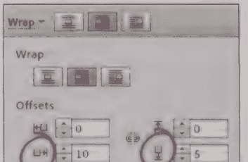

> 每当文本环绕元素时，请确保该元素不要太宽以至于使文本区域过窄。这会使文本变得非常难以阅读。

## 网页安全字体

存在一个字体族列表，这个列表被称为安全列表。它由一系列默认受 Windows PC 和 Apple Mac 计算机支持的字体族组成。

使用这些字体在你的网站上是安全的，因为基本上每个人都已在他们的计算机上安装了它们。这意味着如果你使用 Georgia 等字体（在列表中），可以安全地假设访问你网站的每个人都会看到你打算让他们看到的漂亮排版。

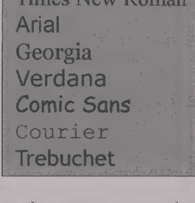

现在假设你创建了自己非常、非常、非常想使用的漂亮字体，但只有你和世界上另外两个人拥有它，那么问题是其他所有人访问你的网站时都看不到该字体。他们会看到替换字体或默认字体（可能是 Times New Roman 之类的），你选择字体的所有辛苦工作都将付诸东流。

因此，作为 Muse 设计师，你有三个选择。你可以坚持使用网页安全字体，这样你就知道访客会按你预期的方式看到网站的字体。你可以使用 Typekit 或（我们真的希望尽可能避免这个选项）你可以将文本替换为图像。这意味着如果你想使用其他人没有的独特字体，Muse 会将文本转换为图像，该图像将在你发布网站或导出 HTML 时导出。

安全列表的缺点是它在字体数量和每种字体类别内的样式（粗体、斜体、常规）种类方面都有限。

使用图像代替文字的缺点是搜索引擎无法像读取文字那样读取图像。因此，如果你想使用这种方法，只使用在标题上。不要将其用于正文内容。

## 元数据 – 页面上的隐藏文本

在上一节中，我们研究了标题与 SEO 相关的的重要性。另一个需要考虑的重要因素是页面的元数据。

元数据是关于数据的数据。简单来说，它是关于网页的信息。它对你的访客不可见，但对访问你网站的搜索引擎可见。元数据存储在隐藏在 HTML 文档的 <head> 中的 meta 标签中。由于我们使用的是 Muse，我们不需要担心 <head> 和 <body> 标签，但我们仍需要在每个页面中添加元数据。

在 SEO 中使用的两个最重要的 Meta 标签是 description 和 keywords。以下是我们如何添加它们的方法：

- 1. 在设计视图中打开 Gear 页面，选择 Page | Page Properties。页面属性对话框打开。
- 2. 单击 Metadata 选项卡以查看类似于以下屏幕截图的窗口：

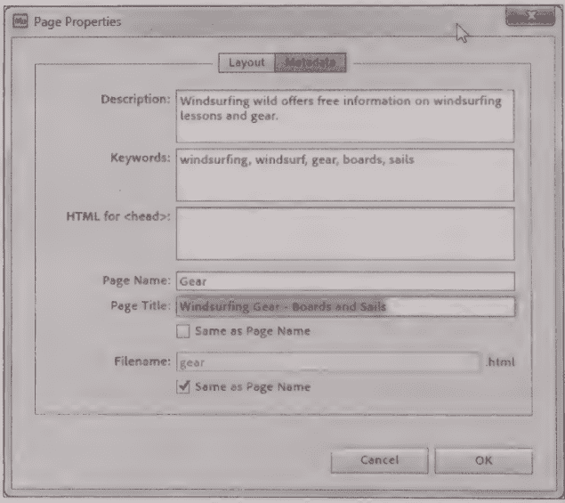

以下是 Metadata 类别中选项的简要说明：

- - **Description** 指定页面的描述。
- - **Keywords** 指定页面的关键词。
- - **HTML for <head>** 允许我们将 HTML 代码放置到 Muse 页面中。一个例子是添加 Google Analytics 代码来跟踪页面的访问者数量。
- - **Page Name** 是页面在 Muse 中显示的名称。
- - **Page Title** 是在浏览器中显示的页面标题。如果希望 Muse 也使用页面名称作为页面标题，请选择 **Same as Page Name** 选项。 （这是默认选择。）使用描述性的页面标题可以帮助你的 SEO 工作，同时为访客提供页面内容的快速概览。
- - **File Name** 是在浏览器中加载的文件名。Muse 默认会在文件名后附加 `.html` 文件扩展名。如果希望 Muse 也使用页面名称作为文件名，请选择 **Same as Page Name** 选项。 （这是默认选择。）
- - 你需要单独为网站中的每个页面添加元数据。每个页面只需一两分钟，是整体 SEO 工作的重要组成部分。

## 总结

在本章中，我们研究了如何在网页上添加和设置文本样式。我们看到了如何将图像和文本结合起来，包裹在文本框中。我们讨论了标题从组织和 SEO 角度的重要性，以及如何向页面添加对人类访客隐藏的元数据。

在下一章中，我们将学习如何在 Muse 中处理图像以及如何从 Photoshop 导入图像。
