## 7

## 处理图像

在设计网页时，我们使用引人注目且有趣的图像作为访客的视觉焦点。图像用于从背景图像到项目符号等一切内容。在本章中，我们将向网站添加图像，转换它们，改变它们的透明度，并了解 Muse 如何与 Photoshop 紧密集成。

在本章中，你将学习以下主题：

- - 为图像选择合适的格式
- - 放置图像
- - 复制图像
- - 调整图像大小、旋转、裁剪和定位
- - 为图像添加效果
- - 设置图像不透明度
- - 固定图像
- - 从其他程序粘贴图像
- - 使用图像作为背景
- - 将多个对象组合在一起作为单个对象处理

在内容中使用图像可以成为吸引访客注意力和传达信息的有力方式。图像可以将人们引导到他们在快速浏览时可能没有注意到的页面部分。如果使用得当，它们是引导访客视线到你希望他们关注的地方的有力工具。

## 你好，网页友好图像

在设计网站时，我们需要记住， destined for the Web 的图像需要相应地准备。与印刷世界中可以使用非常大文件大小和非常高分辨率不同，在 Web 上我们需要在图像文件的小尺寸和高质量图像之间做出权衡。在我们甚至打开 Muse 之前，我们通过以下步骤做出这种权衡：

- 1. 设置图像的正确尺寸和分辨率：你需要决定图像应该有多大，并在将其带入 Muse 之前以该尺寸保存。虽然可以在 Muse 中调整图像大小（我们很快就会研究），但在 Photoshop、Illustrator 或你使用的任何图形编辑器中以正确尺寸保存图像是良好的做法。
- 2. 决定要使用的文件格式：Web 上使用的图像文件保存为 JPEG、GIF 或 PNG。几乎所有网络浏览器都识别并兼容这些文件格式。 （每个文件格式已在 Choosing the best file format 部分中解释。）
- 3. 保存并压缩文件：如果你使用 Photoshop 或 Illustrator 创建图像，请选择 File | Save for Web & Devices 将图像缩放到尽可能小的同时保持质量合理地高的文件大小。如果你使用其他图形编辑器，请选择 File | Save As 以 JPEG、GIF 或 PNG 格式保存文件。

遵循这些步骤将产生看起来不错且下载速度快的图像。

## 选择最佳文件格式

在开始在网站上疯狂使用图像之前，我们需要了解一些关于可在 Web 上使用的图像文件格式类型的基础知识，以及如何为任务选择最佳格式。如前所述，有三种图像格式几乎被所有网络浏览器支持。你选择的格式取决于图像中有多少颜色以及是否具有透明区域。

它们如下：

- 1. JPEG
- 2. GIF
- 3. PNG

以下是每种图像文件格式的概述：

## JPEG

JPEG (.jpg) 代表联合摄影专家组，开发用于存储摄影图像。该格式支持数百万种颜色，但被称为有损格式，意味着它丢弃精细细节以将图像压缩为更小的文件。

好消息是我们可以在保存图像为 JPEG 格式时选择压缩级别。可以将压缩量设置为 0-100 的比例（0 是最高压缩和最低质量；100 是最低压缩和最高质量）。

与 GIF 和 PNG 图像不同，JPEG 图像可以在 24 位颜色下提供相当小的文件大小。这使它们非常适合任何类型的摄影或具有重质感或长渐变的图形。

为了避免保存 JPEG 图像时可能出现的视觉伪影，请仔细考虑要应用的压缩量。如果图像看起来很糟糕，那么拥有极小的文件大小毫无意义。在下一个屏幕截图中，你可以看到一个图像面板，显示图像在无压缩时（左上角）、70% 质量、35% 质量和 17% 质量时的外观。质量越低，压缩越大。你可以看到图像在较低质量时开始出现像素化。

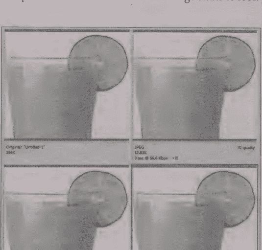

## GIF

图形交换格式（GIF）是处理纯色块、例如徽标或没有渐变的线条艺术时不错的选择。假设你希望网站上的徽标无缝融入网页背景，你可以将图像保存为无背景并保存为 GIF。JPEG 在这种情况下不起作用，因为所有图形编辑器都会在 JPEG 中任何空白处自动粘贴纯色背景。

GIF 仅支持 256 种颜色，因此不适用于需要数百万种颜色的摄影图像。

GIF 也可以是有损格式，如果你希望它有损的话。奇怪的是，质量刻度与 JPEG 相反，即 0 是无损，100 是完全有损。如果你不想使用有损压缩，可以通过将图像中包含的颜色数量限制在 2 到 256 之间来改变文件大小。颜色越少，文件大小越小。

GIF 格式最重要的功能之一是它支持透明度。这意味着你可以透过图像的某些部分，去除保存为 JPEG 时会出现的那种方形外观或周围的白色框。在以下屏幕截图中的图像中，棋盘格代表图像的透明区域：

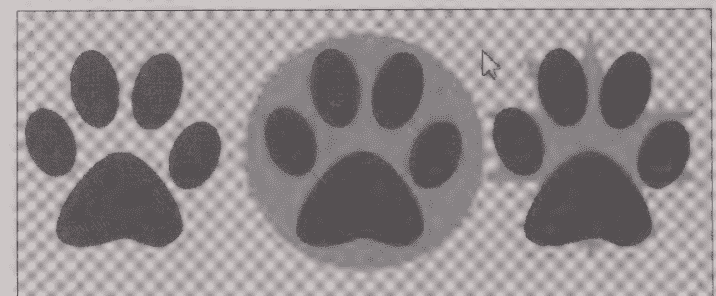

GIF 的另一个不错功能是它们支持动画。你可以使用动画 GIF 创建迷你幻灯片或简单的广告。动画 GIF 只是一个循环播放一系列图像的文件，创造出动画的错觉。

## PNG

便携式网络图形（PNG）格式几乎可以被视为 JPEG 和 GIF 格式的后代。它由 W3C 开发，作为 GIF 的替代方案，并且同时支持透明度和数百万种颜色。

PNG 图像有两种类型。它们是 PNG 8 和 PNG 24。数字反映了每种格式中保存的位数。PNG 24 支持数百万种颜色并产生超高质量的图像，但文件大小往往相当大。PNG 8 支持 256 种颜色。两种文件格式都支持透明度。PNG 是一个相对较新的格式。如果您知道您的网页受众正在使用旧版本的 Internet Explorer，那么最好坚持使用 GIF，否则在最新的浏览器上使用 PNG 是安全的。

在下一个屏幕截图中，您可以看到一件 T 恤的照片以 PNG 格式保存，左侧背景透明，右侧背景为渐变：

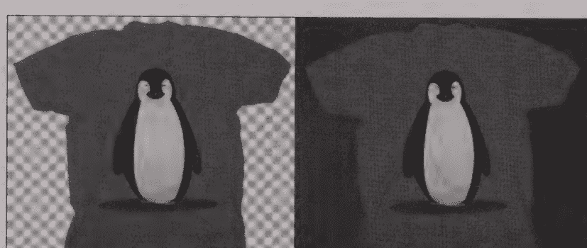

## Web 安全颜色——过去的事物？

在第 6 章《排版》中，我们讨论了网页安全字体这个概念以及网络在这一点上已经有所发展。网页安全颜色的概念也在走向灭绝，除非您知道目标受众使用的是只能显示 256 种颜色的古老显示器，否则它并不是一个真正需要考虑的问题。

为了简要地上一堂历史课，网页安全颜色是少于 256 种颜色的小调色板，可以在 Windows 电脑和 Mac 电脑显示器上正确显示。今天的显示器可以显示数百万种颜色；甚至您口袋里的手机今天处理的颜色也比那些旧显示器多。

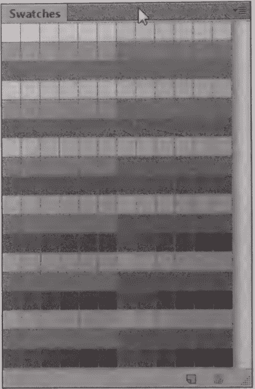

如果您使用 Photoshop 或 Illustrator 创建图形，您会看到当您选择 **另存为 Web 所用 & 设备** 时，您仍然可以通过使用 **颜色表** 部分将图像中的颜色转换为其网页安全等效颜色。您也可以通过在两个程序中的 **色板** 面板上使用上下文相关菜单来查看网页安全颜色调色板。然而，对于网页图形，我们几乎不可能再需要使用该选项。

## 将图像放到页面上

现在我们知道了哪些类型的图像适合网页，我们就可以将它们放到我们的页面上了。在 Muse 中，图像的行为与矩形相同。

### 放置图像

在第 5 章《矩形的乐趣》中，我们看到了如何通过绘制矩形并向其添加图像来插入图像。现在我们将通过执行以下步骤了解如何将图像放置到我们的 Windsurfing 页面之一中：

- 1. 打开我们一直在处理的 Windsurfing 网站。
- 2. 在计划视图中，双击 Sails 页面以在设计视图中打开它。打开标尺和参考线以帮助您在页面上定位图像。
- 3. 在设计视图中，选择 文件 | 放置。
- 4. 浏览并选择您想要放置在页面上的图像或图像，然后单击 打开（Windows）或 选择（Mac OS）。您可以通过按住 Ctrl 键（Windows）或 Cmd 键（Mac OS）同时单击来一次选择多个图像。在本练习中，我们将先添加一张图像。
- 5. 从本章的文件夹中选择 sails.jpg 图像。

> 注意：如果您一直按照书中的练习进行操作，您的 Sails 页面将具有红色背景，我们在第 4 章《强大的页面》中设置了它。我们将很快将其改回，以便与网站其余部分的蓝色背景相匹配。

- 6. 光标变为放置枪，我们用它将图像或图像放置在页面上。如果您在装填枪时选择了多个图像，只需单击相同次数即可一次一个地将每个图像放置在页面上。

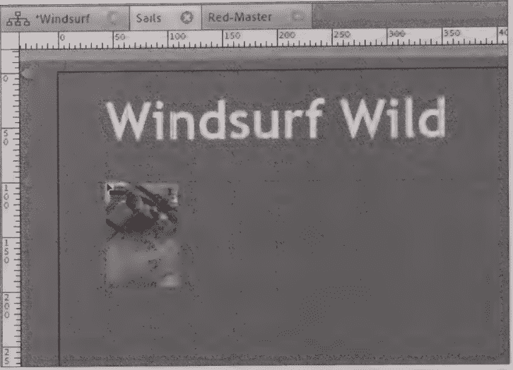

- 7. 现在，单击一次以按原始大小（100%）将图像放置在页面上，使其与 Windsurf Wild 文本下方对齐，大约距离页面顶部 150 像素。我们稍后会更精确地定位图像。一旦您单击，您的图像就会被放置在页面上。

### 添加替代文本

为网站上的所有图像添加替代文本标签非常重要。它有助于使网站对每个人都更易于访问。替代文本会在浏览器无法显示图像时出现，并会被屏幕阅读器读取。为了添加替代文本，请执行以下步骤：

- 1. 右键单击或控制单击您已添加到页面的图像。
- 2. 从出现的上下文菜单中，选择 替代文本。图像属性对话框打开。
- 3. 填写文本标题和替代文本。

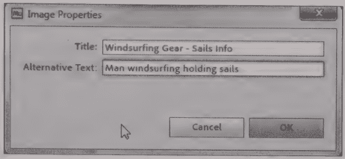

图像标题应提供有关图像的附加信息。标题在使用某些浏览器时会在您将鼠标悬停在图像上时弹出。

替代文本主要用于可访问性目的，并会被爬虫读取。

### 图像上下文菜单

当我们将图像添加到页面时，除了替代文本和添加标题之外，您还可以通过上下文菜单获得许多其他选项。

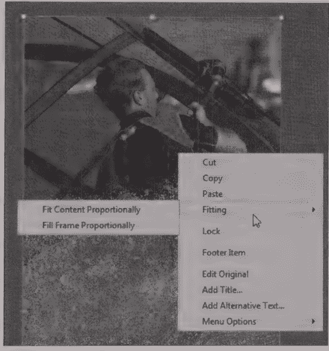

右键单击（或 Control 单击）页面上的图像以查看上下文菜单出现。以下选项可用：

- - **适配：** 这里有两个选择：**按比例适配内容** 和 **按比例填充框架**。**按比例适配内容** 选项按比例缩放图像，使其在显示区域内保持纵横比。**按比例填充框架** 选项在需要时裁剪图像，以确保显示区域完全填满。
- - **编辑原件：** 如果您在页面上使用了 Photoshop PSD 文件或 Fireworks PNG 文件，这是一个很棒的选项。这些文件可以被视为主源图像文件，您可以单击 **编辑原件** 并对文件的主版本进行更改，以保持两个副本同步。如果您将图像复制并粘贴到页面上，则此选项不可用。
- - **锁定：** 这会将图像锁定在页面上的位置，这意味着图像在解锁之前无法被选中。这与稍后我们将要查看的固定不同。

### 操作图像

在本节中，我们将了解图像放置在页面上后如何操作它。我们将查看调整大小、旋转、定位、复制和裁剪。所有这些功能在 Muse 中都非常简单。

### 调整图像大小

调整图像大小最好通过在图形编辑器中更改图像的实际大小然后再次上传到网站来完成。但是，如果由于某种原因您无法访问图形编辑器，可以使用 Muse 调整其大小。以下是执行此操作的步骤：

- 1. 在 **设计** 视图中，单击图像以选择它。
- 2. 拖动调整大小手柄以调整图像的宽度或高度。您会注意到无论您选择从哪个手柄拖动，Muse 都会按比例约束图像。

- 3. 调整大小的另一种方法是使用控制面板中的 **宽度** 和 **高度** 选项输入图像的精确宽度和高度值。

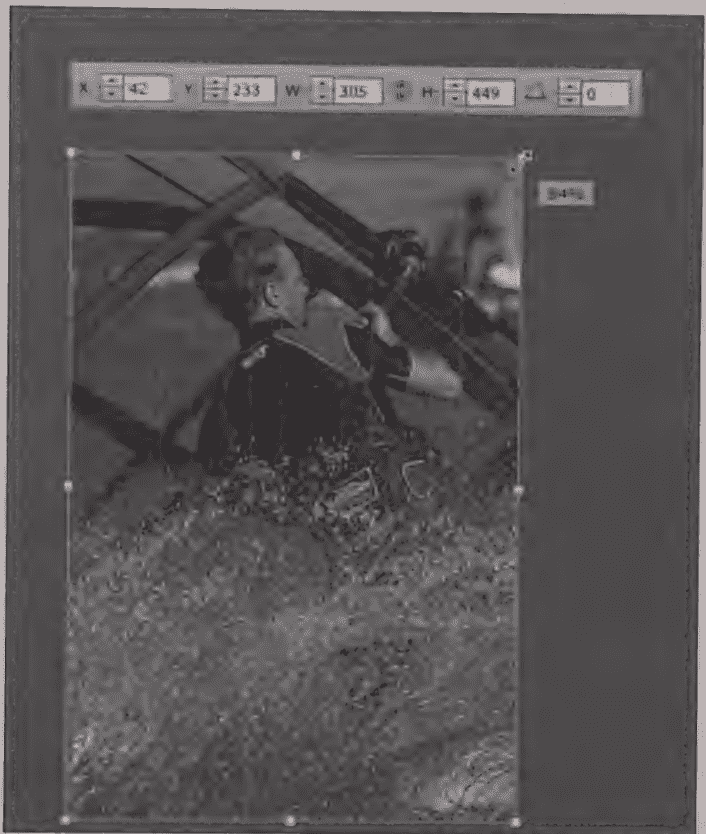

### 旋转图像

旋转图像很容易。有两种方法可以做到。它们如下：

- 1. 通过单击选择要旋转的图像，然后将鼠标悬停在图像角落直到看到旋转图标，然后单击并拖动以手动旋转图像。

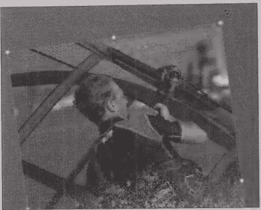

- 2. 在选择图像的情况下，在控制面板中增加或减少旋转角度。（旋转角度选项是控制面板中最右边的选项。）

### 定位图像

同样，将图像定位到您想要的任何位置也非常容易，再次有两种方法可以做到。它们如下：

- 1. 选择要定位的图像，然后简单地将图像拖到适当的位置。

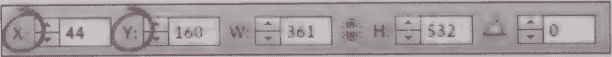

- 2. 您可以使用控制面板中的 X 和 Y 选项为图像设置精确的 X 和 Y 坐标。将 X 值设置为 44，将 Y 值设置为 160。

## 复制图像

如果你想制作图像的精确副本，可以通过以下两种方法之一来完成：

- 1. 如果你使用的是 Windows，单击图像，按住 Alt 按钮并拖动它。对于 Mac OS 用户，单击图像，按住 Option 按钮并拖动图像。

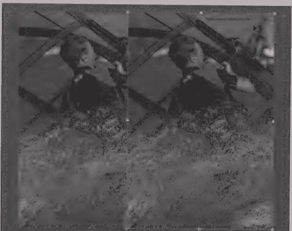

- 2. 选择 编辑 | 复制。 如果复制到不同页面，则复制并粘贴是另一个选项。 如果你想将图像放置在第二页的完全相同位置，请选择 编辑 | 放置在原位。

## 裁剪图像

在某些情况下，通过裁剪照片我们可以创建更有趣的图像。通过减少图像中不必要的背景，我们可以营造出更强烈的戏剧感，或者通过改变图像的焦点使其更引人注目。理想情况下，你应该在图形编辑器中进行裁剪，然后将图像导入 Muse，但有时为了节省时间，我们可以在 Muse 中全部完成。

> 在其他情况下，背景提供了重要的上下文感，绝对不应被移除。

在下面的练习中，我们将向 **Boards** 页面添加一张图像，然后通过执行以下步骤裁剪掉部分背景：

- 1. 在 **设计** 视图中打开 **Boards** 页面。 使用 *放置图像* 部分概述的步骤，将 Boards.jpg 图像添加到页面中。
- 2. 这是一张相当大的图像，当你将其放置在页面上时，右侧会重叠页面的边缘。 你会发现将缩放比例缩小到约 75% 放大很有用，这样当我们使用 **裁剪** 工具时可以看到图像上的手柄。
- 3. 在图像仍处于选中的状态下，单击 **工具** 面板中的 **裁剪** 工具。
- 4. 拖动图像左侧和右侧的手柄，将原始图像裁剪为较窄的图像，宽度约为 420 像素。 拖动图像顶部和底部的手柄，将其垂直裁剪为高度约为 600 像素。

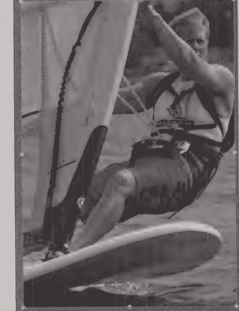

- 5. 将顶部调整大小手柄向下拖动以裁剪掉板子上面的天空。 在拖动时检查控制栏上的高度，并将图像裁剪为高度 450 像素。

6. 如果你愿意，可以重新定位裁剪区域内的图像。 为此，将鼠标悬停在图像上，直到在图像中心看到圆形图标。 抓住圆圈并在裁剪蒙版内移动图像，直到它看起来像下一个屏幕截图：

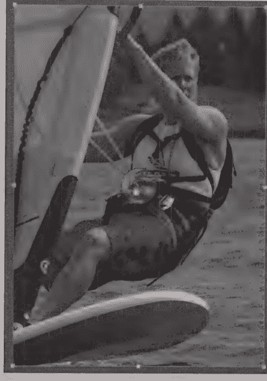

7. 最后，使用屏幕顶部控制栏中的字段，将新裁剪的图像定位在 X 坐标设置为 44，Y 坐标为 160 像素。

## 为图像添加效果

你可以以与我们在第 5 章《矩形的乐趣》中将它们添加到矩形相同的方式，为图像添加诸如投影、浮雕和发光等效果。 请参阅有关向矩形添加效果的部分。

## 从其他程序粘贴图像

假设你一直在另一个程序（如 Adobe Photoshop 或 Illustrator）中处理图像，并且想快速将其导入 Muse，这只是一个简单的复制和粘贴操作。

你需要执行以下步骤：

- 1. 在另一个程序中，例如 Photoshop，使用菜单选项复制你的图像，或按键盘上的 Ctrl + C（Windows）或 cmd + C（Mac OS）。
- 2. 在 Muse 中以设计视图打开你想要放置图像的网页，并通过选择 编辑 | 粘贴，或使用计算机键盘上的 Ctrl + V（Windows）或 cmd + V（Mac OS）粘贴图像。

## 使用背景图像

我们将返回并对蓝色母版页进行一些更改，然后将该母版应用于我们的两个红色齿轮页面。 蓝色母版页目前包含临时标志文字 Windsurf Wild，我们将用半透明的标志图像替换它。

## 添加标志

大多数网站在每个页面的顶部都包含相同位置的标志。 通常标志也是通往主页的链接。 在以下步骤中，我们将在我们的网站上实现这一点。

- 1. 在计划视图中，双击蓝色 A-Master 页面。
- 2. 在页面上任意位置右键单击并从上下文敏感菜单中选择 显示页眉和页脚。 你会看到水平指南出现，表示页面顶部和底部的页眉和页脚区域。
- 3. 单击文字 Windsurf Wild 以选择它，然后按键盘上的 Delete 键删除文字。
- 4. 选择 文件 | 放置 并浏览选择 logo.png 图像。 单击一次放置图像。

5. 使用控制栏，将 X 位置设置为 44，Y 位置设置为 0。

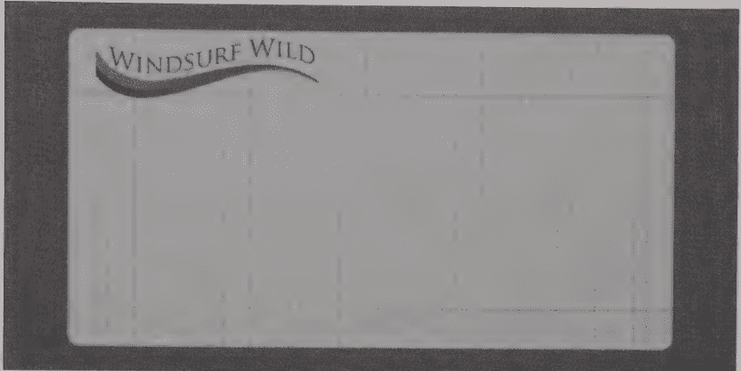

## 为标志添加链接

我们希望我们的标志成为返回主页的链接。 当有人单击标志时，他们将始终被带到主页。 这为每个页面提供了连贯性。

在标志仍处于选中的状态下，单击控制栏上 旁边的下拉菜单。 从页面列表中选择 主页。

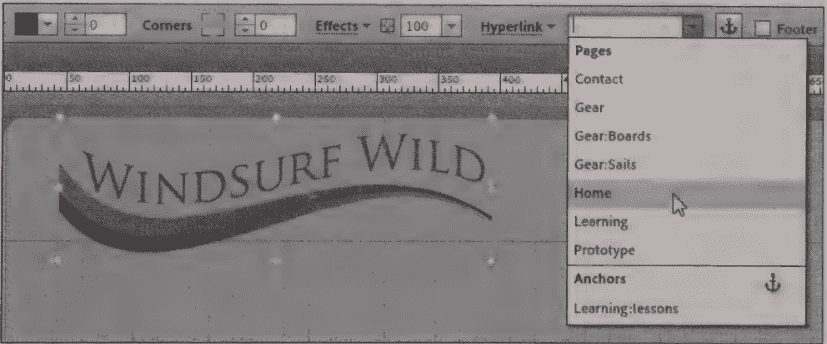

## 使用平铺图像作为背景

要将图像用作对象或页面的背景，我们需要将对象或页面的填充设置为图像。 在此练习中，我们将向 A-Master 页面的背景添加一个小的渐变图像。 这里的技巧是水平平铺图像以呈现大型背景图像的视觉效果。 步骤如下：

- 1. 如果尚未打开，请在设计视图中打开 A-Master 蓝色页面。

- 2. 确保页面上没有任何内容被选中。 单击控制栏上的文字 浏览器填充。 在下拉菜单上，单击文件夹图标并浏览找到 Background-Gradient.png 图像，然后单击 打开。

- 3. 将 适配 选项设置为 水平平铺。 这会导致小图像在整个页面上重复。 现在的问题是渐变图像只有 400 像素高，渐变图像结束处颜色变化非常突然。 为了解决这个问题，我们必须将背景颜色设置为与渐变底部相同的颜色。

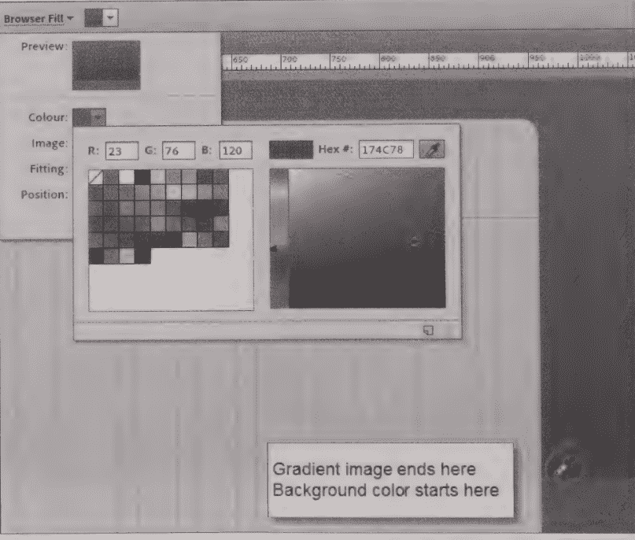

- 4. 单击 **颜色** 样本。 颜色选择器面板打开。
- 5. 单击面板右上角的 眼滴管 工具，然后单击背景渐变图像的底部。 一旦你单击，背景颜色就会改变，我们就获得了渐变图像继续向下延伸的错觉。 这种方法的优点是，我们使用了一个小图像，宽 30 像素，高 400 像素，现在却呈现出一个填充页面背景的更大图像的视觉效果。

## 使用摄影图像作为背景图像

摄影图像作为背景在网络上已流行多年。 作为额外练习，我们将通过执行以下步骤添加一张宽 1280 像素的大图像：

- 1. 在 **A-Master** 页面上，确保没有任何内容被选中，然后单击控制栏上的 **浏览器填充** 按钮。
- 2. 单击文件夹图标选择图像。 选择 `1280RobbieNaish.jpg` 图像并单击 **打开**。
- 3. 单击 **位置** 网格中的中心点。 尝试顶部居中、中间居中和底部居中，看看图像位置如何变化。

4. 如果你希望图像保持不动，同时允许其余内容在其上方滚动，请关闭 滚动 复选框。

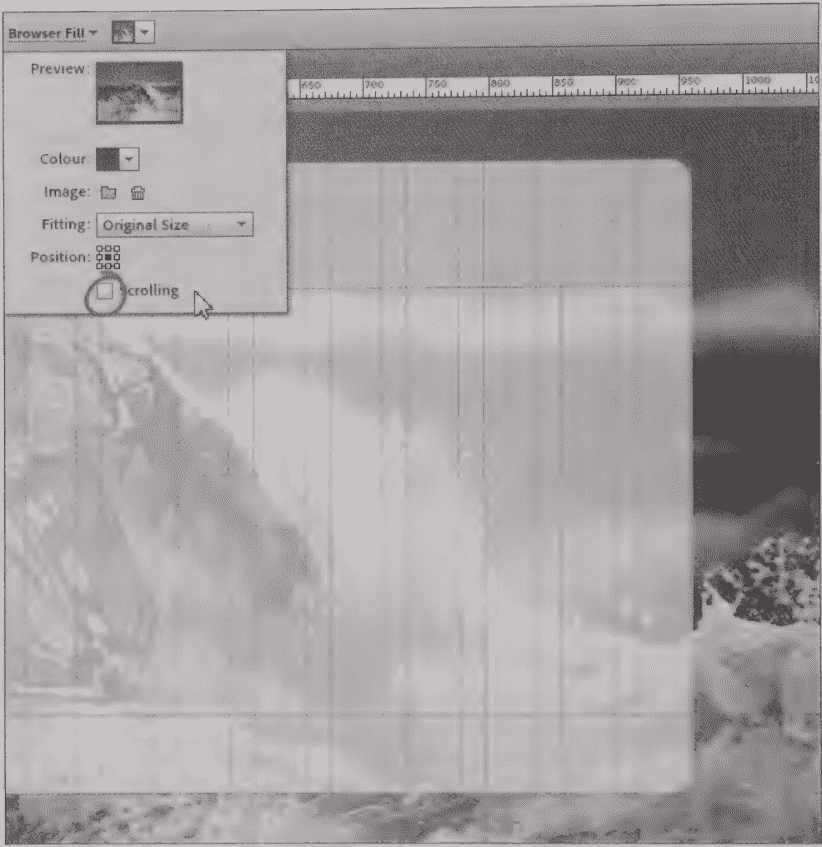

就这么简单地添加一张大摄影图像。

现在你已经知道如何添加摄影背景，作为练习尝试使用你自己的一些图像作为背景，看看效果如何。

查看以下有关使用背景图像的提示：

- - **确保你的背景不会分散内容的注意力。** 当你为网站创建固定宽度设计时（这目前是 Muse 中创建的所有网站的情况），浏览器窗口的一部分将显示背景。 你可以选择纯色背景或添加背景图像。
- 选择背景颜色时，确保背景与正文文字之间有足够的对比度。 这意味着使用较暗的背景颜色配浅色文字，或使用浅色背景配非常深色的文字。 下表左侧显示了对比度不佳的示例，右侧显示了对比度良好的示例：

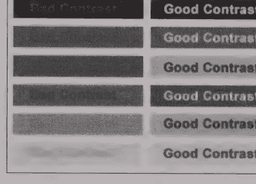

我们还可以设置背景，使其完全或部分填充图像。 除非另有指定，否则背景图像会自动由浏览器一遍又一遍地重复。 这称为平铺，通过选择合适的图案或图像，我们可以给人一种巨大的图像填充网站背景的印象，而实际上我们只是反复使用一个小图像。

如果你想为网站背景使用复杂图像或照片，请仔细考虑它对上方文字的影响。 问问自己，使用图像是否会造成杂乱。 背景中的图案如果细微或褪色且仅使用一两种色调，通常效果很好。 全彩图案可能非常分散注意力，因此请谨慎使用。

为了让本网站保持简单明了，请将 Windsurfer 的背景图像替换为我们之前应用的蓝色渐变。

## 固定图像

在某个阶段，你可能访问过一个网站，该网站上有一个小徽章或丝带浮动在特定位置并且不会移动。它会持续地停留在页面上。这种效果是通过将图像固定在原地创建的。固定功能是设计师工具箱中的一个强大工具。它使我们能够跳出网格，让内容围绕固定的图像流动。

要将图像固定到特定位置，请使用以下步骤中解释的固定工具：

1. 在设计视图中，打开蓝色的 A-Master 页面。
2. 将 PinningWind surfer.png 图像放置在页面上并保持图像被选中。
3. 在控制面板上，单击固定工具中的一个位置，以指定你希望相对于浏览器如何固定图像。选择顶部居中的固定点将使图像相对于浏览器顶部居中进行固定。选择右下角的固定点将使图像相对于浏览器右下角进行固定。预览内容页面在浏览器中的最佳方式是查看固定效果如何工作。

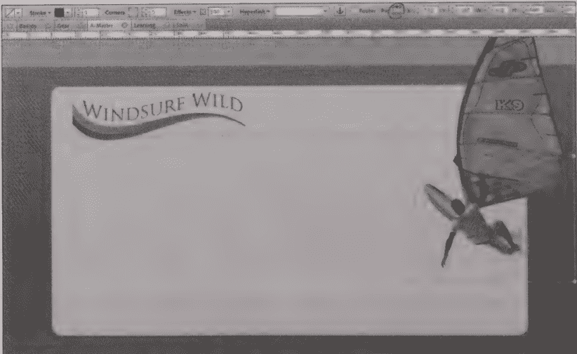

## 使用资源面板管理网站文件

资源面板显示我们在网站上使用的任何图像文件的名称，而不仅仅是当前页面上的图像。你可以通过选择窗口 | 资源来打开资源面板。右键单击（或按住 Ctrl 并单击）资源面板中的文件名以使上下文菜单出现。如果你使用过 Adobe InDesign，此面板称为链接面板。

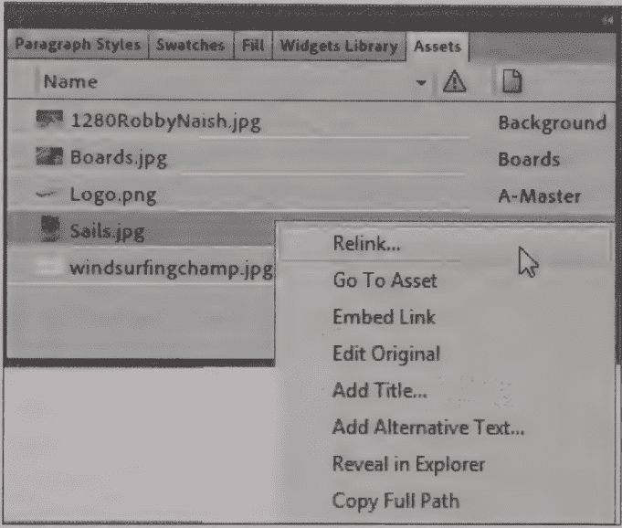

资源面板上下文菜单包含以下选项：

- 重新链接：此选项允许你重新连接在页面上放置后已被移动的文件。当你单击此选项时，使用出现的重新链接窗口导航到文件，并选择它以指定其新的位置给 Muse。
- 转到资源：单击此选项将带你到图像或资源所在的页面。
- 嵌入链接：添加一个链接图标，其中包含资源在本地计算机上的位置路径。
- **编辑原始文件**：如果你在页面上使用了 Photoshop PSD 文件或 Fireworks PNG 文件，这是一个很棒的选项。这些文件可以被视为主源图像文件，你可以单击**编辑原始文件**并对文件的 master 版本进行更改，以保持两个副本同步。如果将图像复制并粘贴到页面上，则此选项不可用。
- **在资源管理器中显示**：这将打开**文件资源管理器**（Windows）或**查找器**（Mac）并显示包含网站资源的目录，从而轻松找到特定文件。
- **复制完整路径**：将资源在本地计算机上的路径复制到计算机的剪贴板。

## 将对象分组以作为单个对象一起操作

你可以将多个选中的对象（包括图像、矩形和文本框）分组为单个组，以便轻松控制页面上一组项目的位置。

1. 使用**选择**工具选择两个或多个对象。按住 *Shift* 键可一次选择多个对象。
2. 右键单击（或按住 Ctrl 并单击）并从上下文菜单中选择**分组**选项。你也可以选择对象 | 分组（或按 Cmd + G 用于 Mac OS）。

## 分组对象

一旦一组对象被分组，一个边界框就会围绕整个组。 要取消分组对象，请右键单击（或按住 Ctrl 并单击）并从出现的上下文菜单中选择**取消分组**选项。或者，选择**对象 | 取消分组**（或按 Shift + Command + G）。

## 总结

在本章中，我们学习了如何向页面添加图像，并了解了如何通过更改其位置、旋转、复制和裁剪来操作它们。我们讨论了适合在 Web 上使用的图像文件格式类型以及如何选择合适的格式。

在下一章中，我们将利用 Muse 的小部件为我们的页面添加额外功能。
