## 8
使用小部件自定义——菜单和面板

欢迎来到小部件的世界。 不久前，如果你想为网站添加额外的功能或交互性，你需要一名网页开发人员或程序员为你创建。现在事情变得容易多了，Muse 中的额外交互性以小部件的形式出现。

小部件是交互性的可重用、可自定义的构建块。示例包括幻灯片、面板和菜单。在本章中，我们将了解如何使用小部件添加菜单，使用 Bar、Horizontal 和 Vertical 菜单小部件。我们还将查看面板。这些是节省空间的面板，可以以标签方式工作或像手风琴一样工作。

在本章中你将学习如何：

- 添加和编辑小部件
- 创建菜单栏
- 创建水平菜单
- 创建垂直菜单
- 构建手风琴面板
- 使用标签面板

## 使用小部件

所有小部件都可以在小部件库中找到。选择窗口 | 小部件库以查看完整内容。小部件库面板包含组合，其中包括特色新闻和灯箱显示。小部件库中还包括菜单，分为 Bar、Horizontal 和垂直菜单。面板选项包括标签面板和手风琴，而幻灯片选项为基本、空白、灯箱和缩略图。我们将在下一章中查看组合和幻灯片。尽管每种类型的小部件提供非常不同的功能，但你在操作小部件时使用的许多概念是相同的。

## 向页面添加小部件

在小部件库面板中，通过单击小部件类别左侧的三角形来展开小部件类别。选择列表中所需的小部件，如以下屏幕截图所示，并将其拖到设计视图中的页面上：

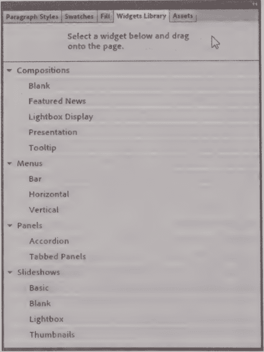

## 菜单小部件的工作原理

菜单小部件在网页上显示网站导航。我们可以选择让 Muse 使用我们在计划视图中设置的结构，用我们每个页面的名称填充菜单，也可以手动向菜单添加链接。我们可以将菜单设置为水平或垂直方向。

自动填充的菜单项会显示与计划视图中页面名称相同的名称。一旦我们创建了菜单，我们仍然可以安全地更改网站结构，并且这些更改将自动更新到菜单中以匹配网站计划。

当我们手动填充项目时，会出现一个加号（+）符号，允许我们添加新的菜单项或子菜单项。要删除菜单项，请选择它然后按键盘上的 Delete 键。手动菜单项可以通过单击并拖动来重新排列，以在菜单内重新定位项目。

## 添加菜单栏

让我们通过添加菜单栏开始我们的 widget 之旅。菜单栏是将在我们网站的每个页面上出现的元素，因此我们可以将其添加到我们的主页面。正如我们在第 4 章《强大的页面》的页面部分所看到的，我们可以使用主页面来保存我们希望在整个网站中一致出现的任何图像、文本或对象。

在上一章中，我们通过添加图像并将其固定到页面右上角，进一步更改了**A-Master**面板。在下一个练习中，我们将使用鼠标的几次点击添加一个导航菜单。Muse 跟踪我们在计划视图中添加的所有页面，并允许我们快速添加一个功能齐全的菜单栏，其中包含指向每个页面的链接。执行以下步骤以添加菜单栏：

1. 在 Muse 的计划视图中打开**Windsurfing**面板：

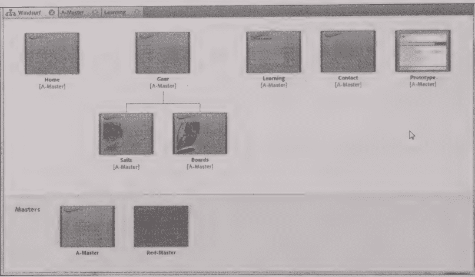

2. 双击**A-Master**缩略图以在设计视图中打开主页面。

3. 从小部件库面板中，展开菜单列表并拖出 Bar 小部件。将其放置在页面上，X 坐标为 410 像素，Y 坐标为 62 像素，使其看起来像坐在标题指南上，如以下屏幕截图所示：

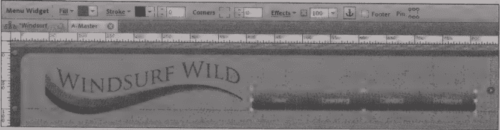

## 选择小部件及其子元素

我们将设置和格式化使用菜单小部件选项创建的主菜单：

1. 要选择整个小部件，请使用选择工具单击它。查看控制面板，你会看到它在左侧显示“菜单小部件”字样。

2. 将鼠标悬停在各个菜单项上以查看其轮廓。再次单击以选择单个菜单项。

3. 再次单击小部件内部以选择容器的子元素和文本。注意，当你单击时，每个子元素的名称如何在控制面板中出现，以及小部件上的边界框指示当前选中的元素，如以下屏幕截图所示。每次单击时，你都在选择小部件的额外嵌套子元素，从而允许你编辑每个项目：

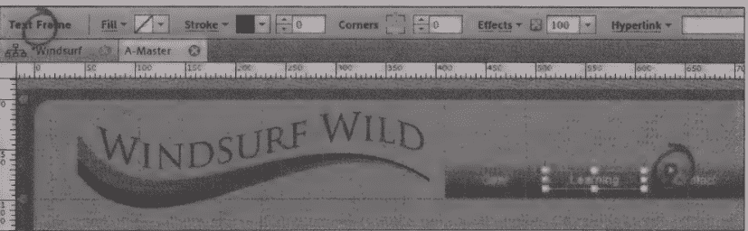

当小部件的子元素被选中时，你可以通过在小部件本身的边界内更改文本、矩形的颜色或背景来格式化其内容。

按 Escape 键可向上返回嵌套元素层级。你可以一直按 Escape 键，直到再次选中整个小部件。或者点击页面上的任意其他位置以取消选择所有子元素和整个小部件。

- 4. 再次选中整个小部件。我们将对小部件进行格式化，并为导航栏赋予新的外观和感觉。

## 设置小部件选项

在处理小部件时，我们有多个菜单选项可用。让我们现在来看一下它们：

- 1. 点击 Menu Widget 面板右侧的蓝色圆形图标，以打开小部件的 Options 菜单，如以下屏幕截图所示：

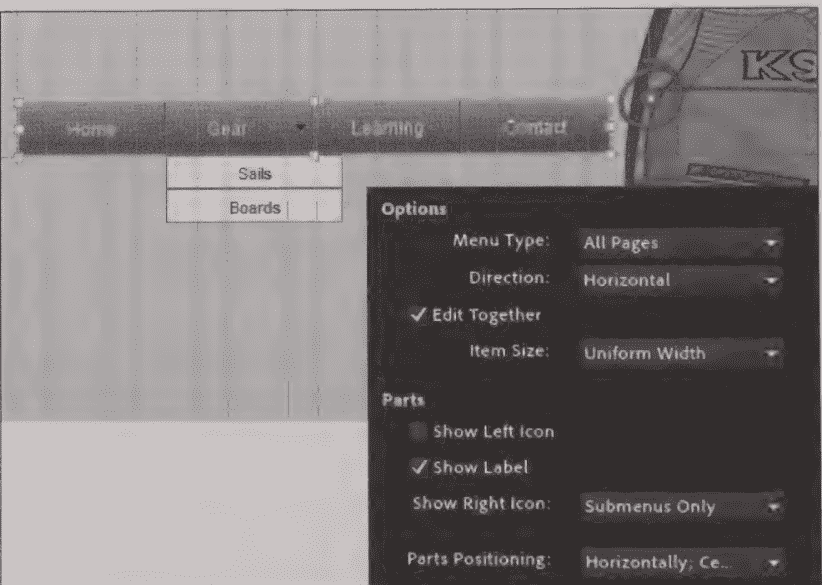

2. 将 Menu Type 设置为 All Pages，将 Direction 设置为 Horizontal，保留 Edit Together 勾选，将 Item Size 设置为 Uniform Width，其余选项保持默认设置。

以下是每个选项的解释：

- - Menu Type：这指定了 Muse 将用于构建菜单的项目。选择 Top Level Pages 表示站点计划顶层每个页面的菜单项都会出现。选择 All Pages 表示站点计划顶层每个页面的菜单项，以及任何子页面的子菜单项都会出现。手动菜单类型允许你在 Design 视图中手动添加菜单项。
- - Menu Direction：这让你可以选择菜单的水平或垂直方向。
- - Edit Together：当选择 Edit Together 选项时，你所做的任何更改都将应用于 Menu Bar 小部件中的所有项目。取消选择此选项以单独更改 Menu Bar 项目。
- - Item Size：这里的选项让你可以指定菜单项的宽度类型。Fit Width 为每个菜单项设置矩形，其大小仅足以包含各自的文字。Uniform Width 创建大小统一的菜单项，基于菜单栏中最大的文字。
- - Left Icon：勾选此框会在每个菜单项左侧设置一个图像框。你可以使用 Fill 和 Stroke 或向其添加背景图像来更改图像框中的图标。未勾选时，图像框不显示。
- - Label：勾选时，菜单项标签会显示。禁用时，标签不显示。标签是链接按钮的页面名称。
- - Right Icon：这与 Left Icon 的工作原理相同，只是图像框出现在显示的菜单项右侧。禁用时，图标不显示。
- - Parts Positioning：这让你可以指定菜单项的水平和垂直对齐方式。

3. 在整个小部件仍被选中的情况下，点击 Spacing 选项卡。如果不可见，请选择 Window | Spacing。向左右添加内边距并增加 Gutter 的大小。Gutter 是每个菜单项之间的空间。在 Control Panel 将 Fill 颜色设置为 None。以下屏幕截图显示了 Spacing 面板中的更改如何使菜单看起来：

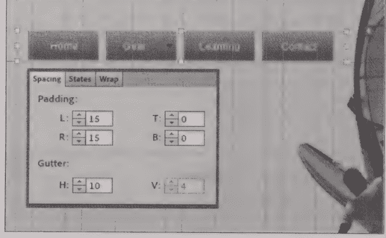

## 格式化每个菜单项

现在我们已经对小部件容器进行了更改，需要选择一个菜单项来更改背景颜色，因为当前的深灰色渐变是菜单项上的背景图像。

- 1. 在小部件容器被选中的情况下，再次点击任意一个菜单项。我们现在向下钻取了一级。你会注意到在 Control Panel 上，选择器变为 Menu Item。你还会看到菜单项的 Fill 设置为深灰色。

2. 点击文字 Fill 并从下拉菜单中将 Fill Type 设置为 Solid，并从 Color Swatch 选择器中选择 None。这会移除背景颜色：

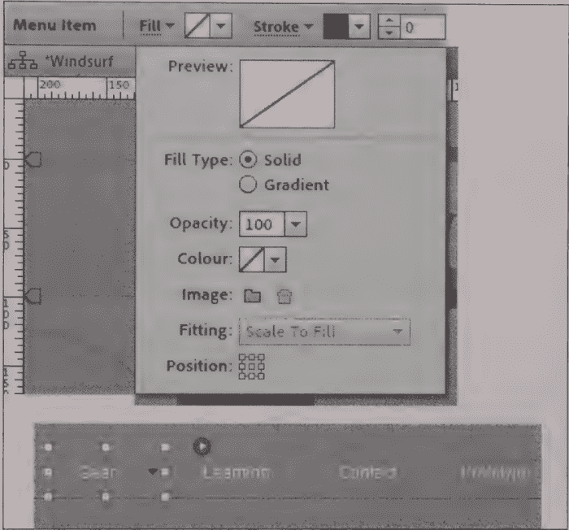

3. 选择 Text 工具，将 Font Family 设置为 Arial，Bold，Size 设置为 14。将 Colour 设置为 #174C78。由于我们之前将 Menu Widget 选项设置为 Edit Together，所有菜单项会一起更改。

## 添加状态

我们可以使用 States 面板来格式化小部件中链接在访客与之交互时的外观。

- 1. 在菜单项仍被选中的情况下，点击 States 面板。
- 你会看到列出四个状态：
- - Normal：页面加载时链接的外观
- - Rollover：鼠标悬停时链接的外观
- - Mouse Down：点击时链接的外观
- - Active：当前页面上链接的外观

我们已经设置了 Normal 状态，接下来我们将处理 Rollover 状态。

- 2. 在 States 面板中点击 Rollover 状态并更改菜单项的背景颜色和文字颜色。将背景颜色设置为亮蓝色，文字颜色设置为白色，移除任何描边，并将 Corners 设置为 15，如以下屏幕截图所示：

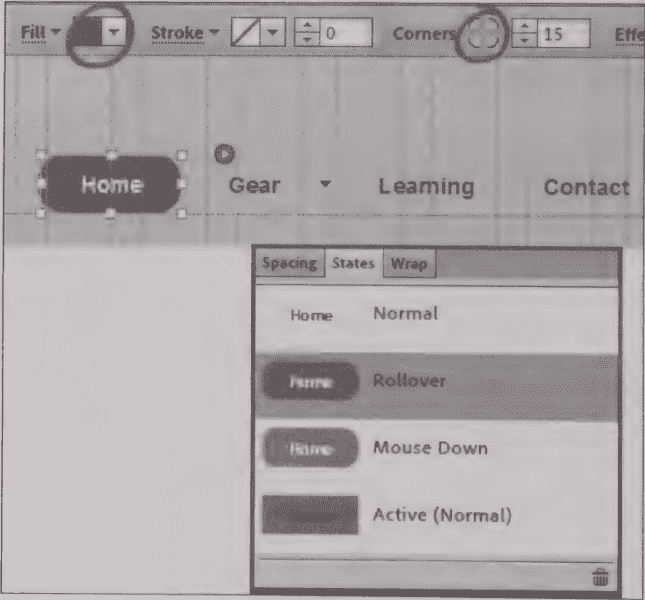

3. 对 Mouse Down 和 Active 状态重复上一步。使每个状态看起来彼此略有不同。这里的重点是为网站访客提供视觉反馈。以下屏幕截图显示了 Mouse Down 和 Active 状态：

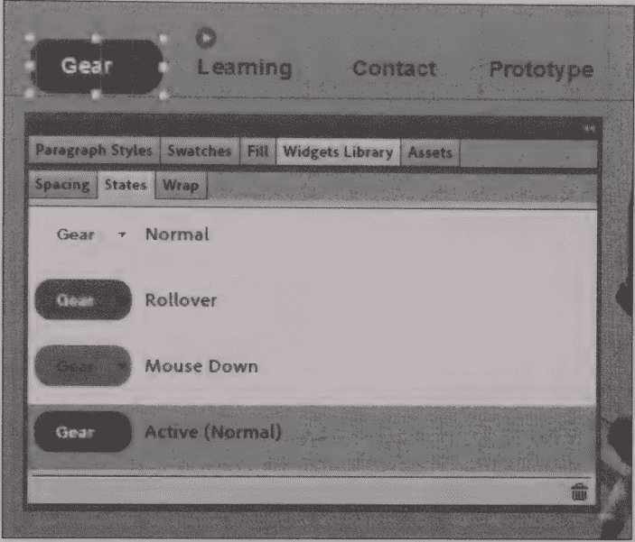

4. 我们需要测试菜单是否正常工作。由于我们将其应用于 Master Page，它现在应该出现在应用了该主版的所有页面上。点击 Preview 视图并测试你的菜单系统，查看每个状态的工作方式。你应该能够在站点中逐页点击。

5. Gear 页面有两个子页面，称为 Boards 和 Sails。我们需要为这些页面的子菜单应用样式。再次打开 Master Page 并点击一次菜单栏以选中它，再次点击 Gear 以选中该单个菜单项。这将显示子菜单项。

6. 点击一次 Sails 子菜单项。这里的概念与顶级菜单项完全相同。我们可以为每个子菜单项设置四个状态。请注意，即使在以下屏幕截图中选中了 Sails 项目，Boards 项目也会改变样式。这再次是因为我们在 Menu 选项中选择了 Edit Together：

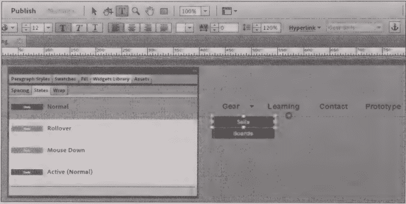

7. 为每个状态应用样式。使用我们迄今为止使用的蓝色、海军蓝和白色颜色，以保持一致性。

8. 在 Preview 视图中再次测试你的菜单。

## 转移样式

当你创建了一种样式后，可以将其复制并在其他地方应用。假设例如，你想在页面的页脚中重复我们在页面顶部创建的菜单的外观和感觉，使用类似的菜单。以下是我们的做法：

当你对小部件的外观进行了样式设置后，确保先选中已样式设置的小部件，然后右键单击（或 Ctrl + 单击）未样式设置的小部件，并从出现的上下文菜单中选择 Transfer Widget Skin，如以下屏幕截图所示。一秒或两秒内，新菜单将被样式化为与第一个菜单完全相同的方式：

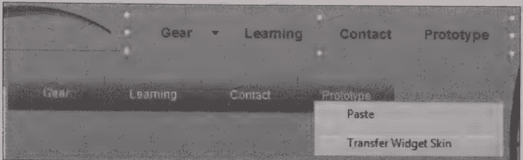

## 水平菜单

我们关于 Bar Menu 所查看的一切也适用于 Horizontal 和 Vertical 菜单。

要创建水平菜单，只需从 Widgets Library 面板中的 Menus 部分点击并拖拽即可。一旦菜单在页面上，你就可以使用与 Bar Menu 相同的选项对其进行样式设置。

## 垂直菜单

要创建垂直菜单，请从 Widgets Library 面板中的 Menus 部分点击并拖拽。明显的差异是菜单项一个在另一个之下显示。子菜单水平弹出，如以下屏幕截图所示：

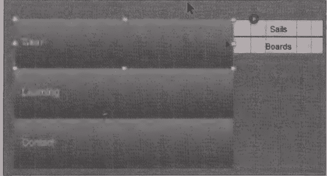

## 手风琴面板

我们小部件列表中的下一个是 Accordion 面板。它由多个面板堆叠在一起组成。当网站访客点击 Accordion 选项卡时，该选项卡会打开一个更大的面板显示内容。

此小部件允许我们在小区域中显示大量文本，并为我们的网站增加交互性。

## 添加面板

执行以下步骤以添加面板：

- 1. 在 Design 视图中打开 Boards 页面。

- 2. 在 Widgets Library 面板上，点击并拖拽出一个 Accordion 小部件。将它放置在 Boards 标题下方。

- 3. 将面板右侧拖动到大约 500 像素的宽度。你可以通过选中 Accordion 面板然后在 Control Panel 上填写宽度字段来精确设置宽度，如以下屏幕截图所示：

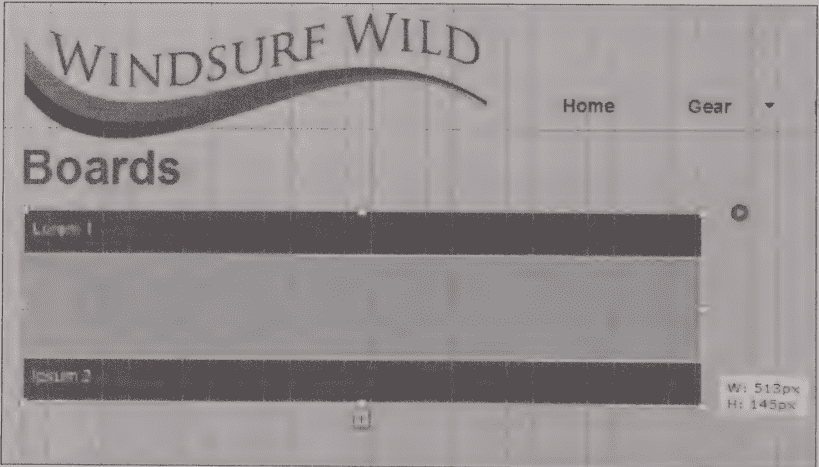

- 4. 点击小部件底部出现的加号 (+) 图标。这会在组中添加另一个面板。我们现在在小部件内有三个面板。

- 5. 点击第一个面板的名称——目前为 Lorem 1。使用 Text 工具，将文字更改为 Freeride。

6. 在面板下方的较大浅灰色区域中单击以选择它并添加内容。再次使用文本工具，绘制一个矩形。将 Boards-Panel1.txt 文件中的文本粘贴进去。在这种情况下，我们添加的是文本，但我们也可以在面板内添加图像或其他类型的内容。

7. 选择预览视图，以便您可以准确地看到面板小部件的工作方式。单击每个面板名称，注意每个面板如何以手风琴的方式平滑地折叠和展开，如以下屏幕截图所示：

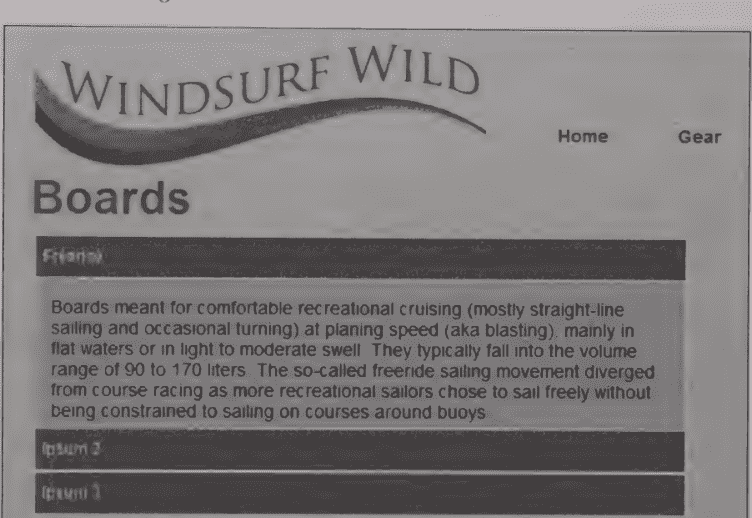

8. 单击第二个面板的名称——目前为 Ipsum 2。使用文本工具，将文本更改为 Wave。

9. 在该面板下方的较大浅灰色区域中单击以选择它并添加内容。再次使用文本工具，绘制一个矩形。将 Boards-Panel2.txt 文件中的文本粘贴进去。

10. 单击第三个面板的名称——目前为 Ipsum 3。使用文本工具，将文本更改为 Freestyle。

11. 在该面板下方的较大浅灰色区域中单击以选择它并添加内容。再次使用文本工具，绘制一个矩形。将 Boards-Panel3.txt 文件中的文本粘贴进去。

这样我们就把内容放好了。在预览视图下查看，观看面板打开和关闭的流畅动作。小部件会动态调整其大小以适应放置其中的内容。你会看到你刚刚在每个面板中放置的文本框在你添加文本时变大了。每个面板垂直增长以容纳你放置在其中的额外内容。

## 编辑手风琴小部件元素

您可以选择整个小部件、整个面板（包括其标签）或单个标签以进行编辑。在以下练习中，我们将对面板的颜色进行一些更改：

- 1. 在设计视图中，单击一次手风琴小部件以选择整个小部件。
- 2. 在状态面板中，单击活动状态。我们将面板标签的颜色更改为中等蓝色，以突出当前活动的面板。
- 3. 单击第一个面板的名称标签以选择该面板名称。注意控制面板选择器显示为文本框。将填充颜色设置为 #174C78：

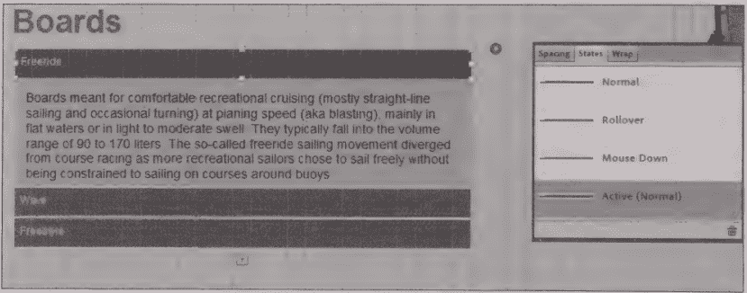

- 4. 在预览视图中测试这些更改。你会看到当你单击每个面板时，它会随着变为活动状态而变为蓝色。

## 编辑手风琴小部件选项

整个手风琴小部件可用的选项很少。要查看它们，请选择要编辑的手风琴小部件，然后单击蓝色的编辑选项图标，如以下屏幕截图所示：

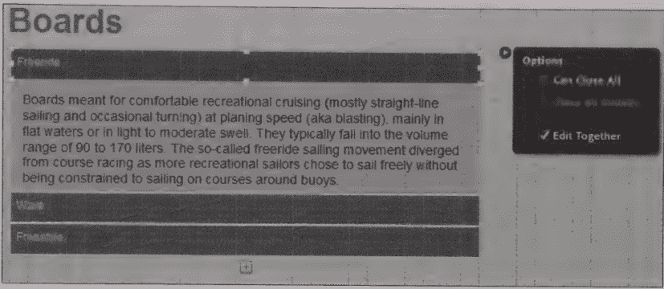

可以全部关闭：这允许用户一次性关闭所有面板。当未选择此选项时，手风琴面板始终保持一个打开。

一起编辑：这意味着对面板特定部分的任何更改都将反映在手风琴小部件中的相同项目中。取消选择此选项以单独更改小部件项目。

编辑手风琴小部件状态：此选项允许您编辑手风琴小部件面板的各种状态。

## 选项卡式面板

选项卡式面板与手风琴面板类似，因为它们提供了一种在页面上的小区域中放置大量信息的方法。当用户单击选项卡时，该选项卡的关联内容会出现在下面的框中。执行以下步骤以使用选项卡式面板：

- 1. 首先从小部件库面板拖出一个选项卡式面板。通过使用选择工具拖动它或使用控制面板上的 X 和 Y 坐标将其定位在页面上。

2. 默认情况下，内容区域顶部有三个选项卡。要更改选项卡上的名称，请单击一次以选择小部件，然后再次单击选项卡，再次单击以编辑选项卡文本，如以下屏幕截图所示：

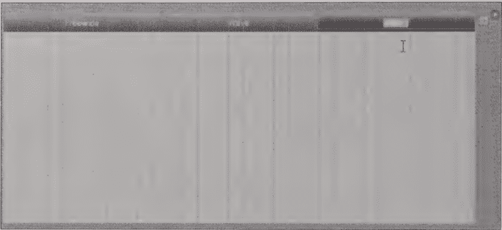

3. 要向已知为选项卡下容器的较大区域添加内容，请先单击小部件选择容器，然后单击要添加内容的选项卡，然后最后单击容器。

4. 我们可以通过单击文本工具然后键入或粘贴文本来添加文本。

5. 我们可以通过使用文件 | 放置放置图像来添加图像。Muse 会自动调整图像大小以适应容器内。

6. 我们可以通过从小部件库将其拖入容器来添加幻灯片。

7. 要添加或删除选项卡，请右键单击/ Ctrl + 单击并从上下文菜单中选择，如以下屏幕截图所示：

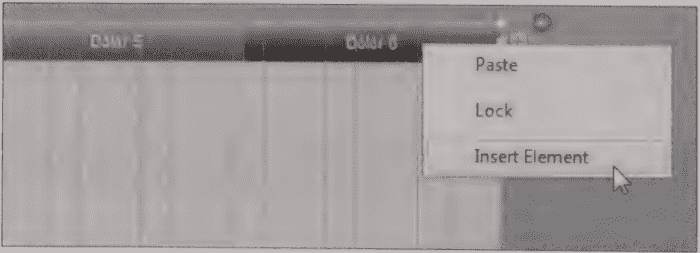

## 删除面板

如果您添加了面板并想完全删除它，只需选择它并按计算机键盘上的 Delete 键即可。

## 总结

在本章中，我们研究了如何为整个网站创建菜单栏。我们设置了菜单和网站结构中每个页面出现的各个菜单项的样式。我们还使用手风琴面板作为一种方法，在页面上放置大量文本而不占用太多空间。

在下一章中，我们将再次研究小部件，特别是如何使用组合以及如何创建幻灯片。
