## 9

## 更多小部件——组合和幻灯片

在上一章中，我们使用 Muse 的小部件快速轻松地为所有页面添加菜单或导航系统，并使用手风琴面板在小区域内显示大量文本。在本章中，我们将继续使用小部件为网页添加额外的功能和交互性。

我们将使用幻灯片小部件创建一个优雅的幻灯片，并使用组合小部件创建一个简单的照片库。除了使用小部件添加功能外，我们还将使用任意 HTML 为页面添加交互元素。

到本章结束时，您将知道如何：

- - 使用组合小部件
- - 使用幻灯片小部件创建幻灯片
- - 使用任意 HTML 添加交互式 Google 地图和 feed

## 组合小部件

Muse 中有几个交互式小部件属于组合小部件的 umbrella 术语。它们由一个称为“触发器”的小容器和一个称为“目标”的较大容器组成。当您单击触发器时，目标中会发生某些事情。一个例子是照片库，用户单击缩略图图像，完整大小的版本会在容器中显示。例如，您可以使用基本组合小部件创建照片库，其中缩略图触发器在用户单击触发器时显示全尺寸照片。

**小部件库**菜单的 **组合** 部分包括以下内容：

- - **空白**：此小部件由多个小缩略图组成，您可以手动将其链接到较大的容器区域。当单击缩略图时，大容器的内容会相应更改。
- - **精选新闻**：此小部件与我们在上一章中看到的手风琴和选项卡式小部件 somewhat 相似。当单击文本触发器时，主要内容会更改，主要内容可以由文本和图像组成。
- - **灯箱显示**：当单击缩略图时，其余页面变暗，而目标的内容处于活动状态。
- - **演示**：此小部件由链接到较大幻灯片或图像的小编号缩略图组成。默认情况下，幻灯片水平滑动。
- - **工具提示**：当用户将鼠标悬停在触发器上时显示文本作为工具提示。

每种小部件类型都有不同的显示行为，允许您轻松地为网站添加复杂的功能，如以下屏幕截图所示。与 Muse 中所有可用的小部件一样，组合小部件完全可编辑和可定制：

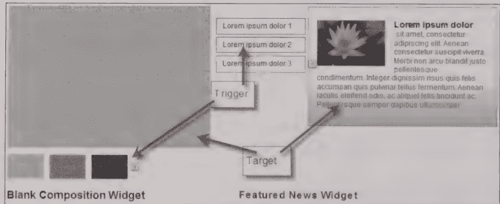

## 使用图像与小部件

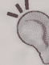

添加到幻灯片或组合小部件的图像应以适合 Web 的格式保存，即 GIF、JPEG 或 PNG。也可以使用原生 Photoshop 文件 .psd，因为 Muse 会将其转换为正确的 Web 格式。提前以您希望在幻灯片中显示的大小保存图像。Muse 会自动生成较小的缩略图，并在您完成网站并准备上传时创建图像文件夹。图像可以链接到计算机上的任何位置。

## 使用空白合成创建简单的照片库

我们将创建一个由三张图片组成的照片库。使用空白合成，我们可以“告诉” Muse 哪个触发器对应于目标区域中出现的较大图像。按照以下步骤创建简单的照片库：

- 1. 在设计视图中打开页面，并从部件库菜单中拖出空白合成部件。
- 2. 单击一次合成部件以选择整个部件。现在你可以将其放置在页面上的任何位置。
- 3. 单击目标区域下方的第一个浅灰色触发器缩略图以选择它。
- 4. 单击控制栏上的填充链接。从下拉菜单中，单击图像图标并浏览以在合成部件图像面板中选择第一个冲浪图像。将适配设置为缩放以填充，如以下屏幕截图所示：

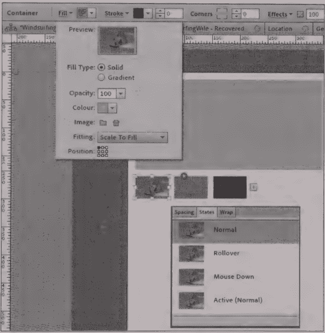

请注意，状态部件中状态列表中的缩略图现在都相同了。如果你想创建悬停效果，可以单击该部件中的悬停状态，然后像之前那样更改图像。对于本示例，我们保持一切简单，因此我们将对所有四个可用状态使用相同的缩略图。

- 5. 通过重复步骤 4 向剩余的触发器添加另外两个缩略图图像。从合成部件图像文件夹中选择图像。
- 6. 如果你想添加额外的缩略图，单击触发器元素右侧出现的加号 (+) 图标。如果你想删除一个触发器，选择它并按下计算机键盘上的 Delete 键。

## 向目标区域添加内容

我们的下一步是使用以下步骤将较大的图像添加到目标区域，这样当我们单击缩略图时，正确的图像就会出现：

- 1. 在设计视图中，再次单击一次合成部件以选择整个部件。
- 2. 单击一次第一个缩略图以选择触发器。
- 3. 单击较大的内容区域以选择它。通过先单击触发器然后单击目标，我们是在告诉 Muse 这两者是关联的。
- 4. 在内容区域被选中的情况下，单击下拉填充菜单并添加第一张图像。再次将适配设置为缩放以填充。

> 在本示例中，我们添加的是图像，但你可以向目标中添加任何类型的你喜欢的内容。

5. 重复步骤 1 到 4 为第二个和第三个缩略图的目标添加内容。当你将图像添加到触发器和目标后，它应该看起来像以下屏幕截图：

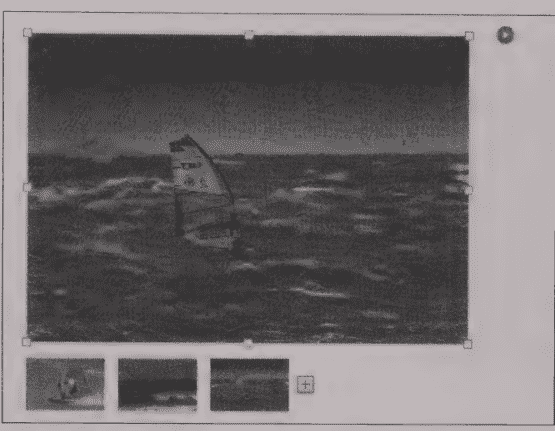

6. 在预览视图中测试你的照片库，并确保大图像与缩略图图像匹配。

> 你可以单独更改每个缩略图和每个目标区域的大小。只需单击一次以选择整个部件，再次单击以选择触发器（缩略图）或目标。一旦元素被选中，一个带有角落手柄的边界框就会出现。拖动手柄可以调整元素大小。

## 更改合成部件选项

每个合成部件都提供多个设置部件功能方式的选项。要访问选项，请单击编辑选项图标——蓝色箭头。在下面的列表中，你将找到我们刚刚添加到页面上的空白合成可用的每个选项的说明：

- **位置**：这设置目标区域在页面上的位置。通过选择**堆叠**，所有内容都会重叠，例如目标内容出现在网页的同一位置。通过选择**分散**，可以让你将每个目标容器放置在页面上的不同位置。选择**灯箱**会使网页的其余部分变暗并将焦点放在目标内容上。

- **事件**：我们可以选择在用户单击缩略图时更改目标区域中的内容 – **单击时** 或在用户将鼠标悬停在缩略图上时 – **悬停时**，如以下屏幕截图所示：

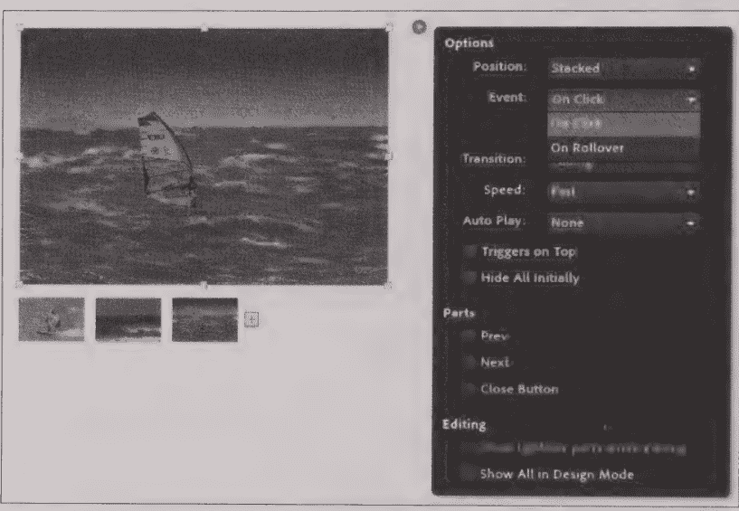

- **过渡**：我们可以指定在触发器被单击或悬停时内容如何变化。动画过渡的选项有：

  - **淡入淡出**：这会在同时淡出之前目标的同时淡入新的目标内容。
  - **水平**：这会使新的目标内容以水平滑动的方式滑入。
  - **垂直**：这会使新的目标内容以垂直滑动效果滑入。
  - **速度**：这里的选项指定过渡的速度。如果你想要即时过渡，请选择**无**。

- **自动播放**：此选项创建无需用户交互的幻灯片。
- **初始隐藏全部**：此选项在页面首次加载时隐藏所有目标区域。为了查看内容，用户需要单击触发器。
- **部件**：如果你想添加额外的用户交互，可以使用这些选项在部件中显示上一个、下一个或关闭按钮。
- **编辑时显示灯箱部件**：如果你在**位置**下选择了**灯箱**选项，你就可以在**设计**视图中编辑时隐藏或显示目标区域的内容。
- **设计模式下显示全部**：此选项让你在**设计**视图中同时显示所有目标内容区域。默认情况下此选项未选中，意味着在**设计**视图中只显示所选触发器元素的目标内容。

## 使用多张图片创建触发器和目标的另一种方法

在之前的示例中，我们手动先将图像添加到触发器，然后添加到目标区域。我们单独设置每个触发器和目标。还有另一种方法可以同时向目标区域添加多张图像，Muse 会自动为你创建相应的触发器元素，按以下步骤操作：

- 1. 在**设计**视图中，将一个新的空白**合成**部件添加到页面。
- 2. 单击一次**合成**部件以选择整个部件。
- 3. 再次单击以选择较大的目标区域。
- 4. 选择**文件 | 放置**。
- 5. 选择你想要放置的多个图像。按住 *Ctrl*（Windows）/*Cmd*（Mac OS）键以从文件夹中选择多个图像。
- 6. 单击**选择**（Windows）或**打开**（Mac OS）。

7. 通过单击目标的内容区域内放置图像组，如以下屏幕截图所示。Muse 会自动为每张图像添加触发器元素：

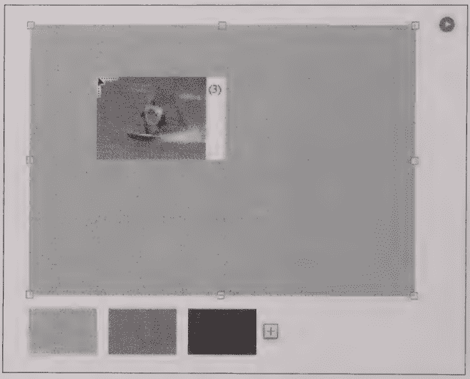

8. 不幸的是，它不会将相应的图像添加到缩略图触发器中。如果你想这样做，那么选择每个触发器元素并放置与对应目标区域匹配的图像以创建缩略图图像触发器。

## 幻灯片部件

幻灯片部件的工作方式与合成部件非常相似，主要区别在于幻灯片部件专门用于图像，而合成部件可以处理任何类型的内容。部件库菜单中可用的幻灯片部件类型有：

- **基础**：基础幻灯片部件由一个大内容区域组成，四周环绕着深灰色边框。在内容区域下方有标题区域、幻灯片或图像的数量以及下一个和上一个按钮。当你拖出部件时，它预装了三张幻灯片。

- **空白**：**空白幻灯片**部件与**基础幻灯片**部件类似，只是当你将其拖放到页面上时它是空的。
- **灯箱**：**灯箱幻灯片**部件会在画廊元素处于活动状态时使页面的其余部分变暗。这是网络上非常流行的一种幻灯片类型，因为它使访客的注意力集中在画廊元素上，同时减少了页面上的其他干扰。
- **缩略图**：**缩略图幻灯片**部件显示缩略图，默认情况下缩略图位于较大内容区域的左侧。随着用户单击缩略图，图像会变大。

以下屏幕截图显示了不同类型的幻灯片：

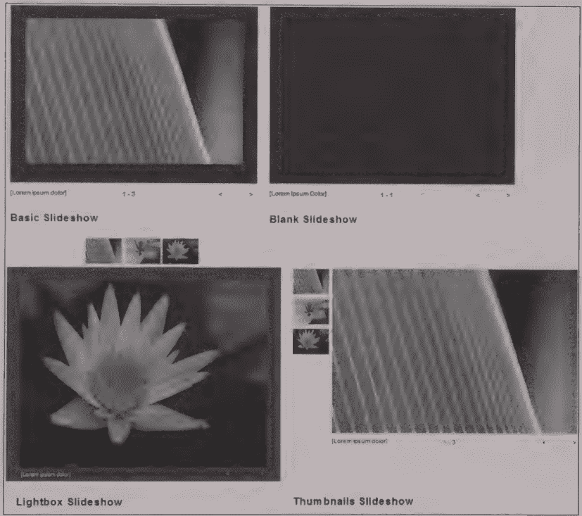

与 Muse 中的其他部件一样，幻灯片部件完全可编辑和可定制。

## 创建幻灯片演示

本章前面我们创建了一个照片库，需要用户点击缩略图才能看到大图。这种功能也可以使用 Lightbox Slideshow 小部件或 Thumbnails Slideshow 小部件来实现。它们的工作方式与我们已创建的照片库非常相似，因此与其重现那些步骤，在下一个示例中我们将使用 Blank Slideshow 小部件创建一个幻灯片。我们将更改设置，使幻灯片自动播放，循环播放一系列图像。我们将指定过渡效果和幻灯片播放的速度。执行以下步骤创建幻灯片演示：

- 1. 在 Design 视图中打开你的页面。
- 2. 在 Widgets Library 菜单中，选择 Blank Slideshow 小部件并将其拖到页面上。
- 3. Blank Slideshow 小部件由一个深灰色矩形组成，用于容纳我们的 large 图像、一个标题区域、一个图像计数器，以及用于导航的下一张和上一张图像按钮。
- 4. 点击蓝色箭头以访问 Options 菜单。点击顶部 Add Images... 选项旁边的文件夹图标。
- 5. 导航到你的图像文件夹并选择要添加到幻灯片中的任意数量的图像。按住 Ctrl/Cmd 选择多个图像，然后点击 Open。
- 6. 你的图像将被添加到内容区域，图像计数器中的数字将增加以反映幻灯片中的图像数量。Muse 的默认图像仍保留在幻灯片中。我们在添加自己的图像后只需删除这些图像。

7. 再次点击蓝色箭头以打开小部件的 Options 菜单，如以下屏幕截图所示：

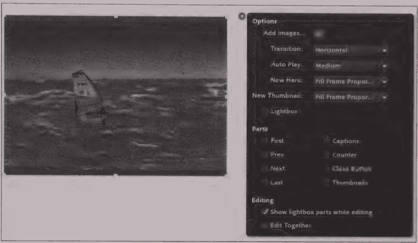

8. 设置以下选项：

- Transition: Horizontal
- Auto Play: Medium
- New Hero: Fill Frame Proportionally (Hero 只是主图像的名称)
- New Thumbnail: Fill Frame Proportionally – 这里无关紧要，因为我们不使用缩略图
- Lightbox: Deselected
- Parts: 取消选择所有选项以隐藏标题、计数器、下一个和上一个按钮

设置这些选项后，页面上只剩下一张图像。

9. 选择 Preview 以查看幻灯片在浏览器中的工作方式。当所有图像都显示完毕后，幻灯片将循环回到第一张图像并继续播放。

10. 如果你想更改幻灯片的大小，请返回 Design 视图并拖动 Hero 图像框架的其中一个角柄。拖动时按住 Shift 以限制幻灯片的比例。随着拖动，你会看到深灰色区域增大，以及图像本身。

在当前设置下，此幻灯片不需要用户交互。如果你决定想让用户控制幻灯片，再次点击蓝色箭头以打开小部件的选项。

11. 要为大图像提供对应的缩略图，请在 Parts 部分选择 Thumbnails。

12. 要提供下一张和上一张图像控制器按钮，请在 Parts 部分选择这些选项。

13. 你可以将小部件的每个部分放置在页面的不同位置。记住先单击一次以选择整个小部件，然后单击小部件的各个部分将其定位到你想要的位置。

14. 选择并将缩略图定位在主图像区域下方。

15. 选择并将下一个和上一个按钮定位在主图像的顶部和右侧，如以下屏幕截图所示：

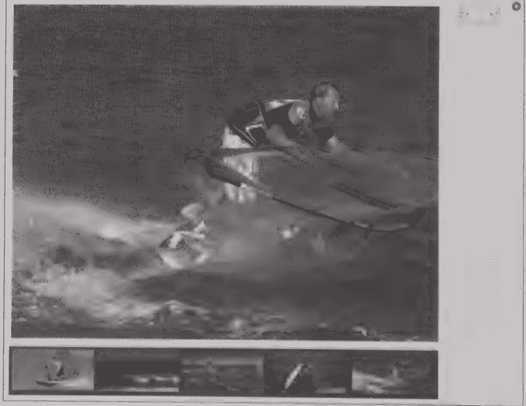

## 插入任意 HTML

虽然 Muse 为我们在本书中看到的所有内容编写了 HTML 和 CSS，但有时你可能需要自己添加一点 HTML。别担心；你也不必编写这段代码。假设例如你想在网站上添加一个 Google 地图，以向客户或感兴趣的各方展示你的位置。Google 会为你提供代码，你只需复制它，然后将其粘贴回 Muse 中的页面即可。

另一个例子是如果你想添加一个 YouTube 视频。你不需要托管视频，只需粘贴 YouTube 提供的一些代码，视频就会出现在你的页面中嵌入。 使用此类服务的一个巨大优势是，你不必担心托管视频内容，它仍然由 YouTube 托管，看起来就像在你的网站上一样。

在网站页面上使用任意 HTML 允许你在页面上设置一个窗口，供第三方内容出现。正如你所能想象的，这为你在无需编写自己的代码的情况下可以添加到页面上的内容打开了巨大的可能性。你可以让访客知道天气会如何，展示你家乡的地图，用音频和视频给他们留下深刻印象，或为他们提供股市报价。

## 向你的页面添加 Google 地图

让我们使用以下步骤向新页面添加地图：

- 1. 在 Plan 视图中，点击 Home 页面下方的加号符号 (+) 添加新页面。
- 2. 将新页面重命名为 Location。请注意，新页面自动采用 A-Master 页面，因为它是子页面或使用 A-Master 页面的 Home 页面。
- 3. 双击新的 Location 缩略图以在 Design 视图中打开它。向 Location 添加一个标题并使用你在上一个练习中创建的 Heading 样式对其进行样式设置。
- 4. 打开一个 Internet 浏览器并前往 Google Maps，地址为 maps.google.com。
- 5. 输入地址或搜索词以找到你希望出现在地图上的位置。
- 6. 点击界面左上角出现的 Link 按钮。
- 7. 点击界面右上部分出现的 Link 按钮。再次点击 Customize And Preview Embedded Map 选项。

8. 一个新的 Customize 窗口出现，允许你更改将在页面上嵌入的地图大小。选择 Map size 中的 Custom 单选按钮，将 Width 设置为 800 像素，Height 设置为 400 像素，如以下屏幕截图所示：

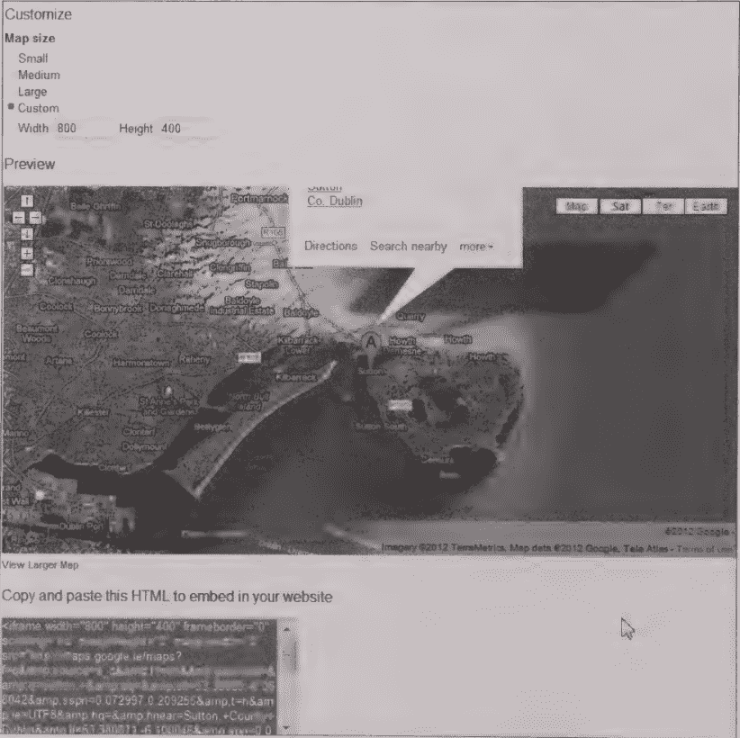

9. 你可能需要重新定位窗口内的地图，以确保图钉和地址文本完全可见。你可以通过简单地点击并拖动地图，直到图钉和地址位于你想要的位置来实现。

- 10. Google 会即时生成地图的代码，你可以选择并复制它。
- 11. 返回 Muse。选择 Object | Insert HTML 以打开 HTML 代码窗口。使用键盘快捷键粘贴代码（Windows 为 Ctrl + V，Mac 为 Cmd + V）将你复制的代码粘贴进去。
- 12. 使用 Selection 工具将地图定位到页面上的所需位置，如以下屏幕截图所示：

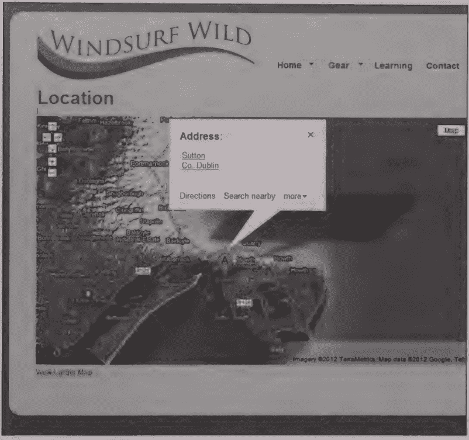

在 Design 视图中，你将能够了解 Google 地图对访客的外观。为了查看地图如何交互工作，请点击 Preview 以查看它在实时网站上的外观。你可以放大、缩小并在嵌入在页面上的地图上移动。

## 向你的网站添加 Twitter（或其他类型）feed

除非你一直生活在山洞里，否则你很可能听说过或使用过 Twitter。许多 Twitter 用户将其“tweets”feed 添加到其网站或博客中，这可能是你想对自己的 Muse 构建的网站所做的。无论你添加的是 Twitter feed 还是 RSS feed 或任何其他类型的动态数据到你的网站，过程本质上是相同的。以下步骤展示了如何为 Twitter feed 执行此操作：

- 1. 你需要有一个 Twitter 账户。Twitter 注册免费，使用也免费。注册后，前往 twitter.com/goodies/widgets，你可以在那里获取一个小部件以添加到你的网页。
- 2. 你可以选择希望 Twitter 小部件如何工作。你可以仅显示你的 tweets、你喜欢的 Twitter 配置文件的 tweets、你喜欢的 tweets，或关于你选择的主题的话题 tweets 流。
- 3. 一旦做出选择，你就可以设置你的小部件。你可以使用 Settings、Preferences、Appearance 和 Dimensions 菜单进行更改。选择一种与你自己的网站配色方案相匹配或互补的配色方案。

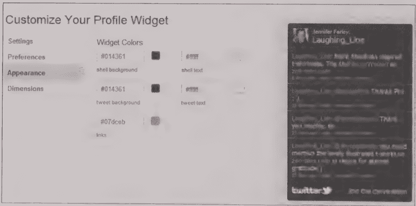

4. 当你设置好 Twitter 小部件的“外观”后，点击 Finish And Grab Code 按钮。你会看到一段可以复制的 HTML 代码。选中所有代码，使用 Ctrl + C/Cmd + C 复制，然后返回 Muse。

5. 在 Muse 中的 Design 视图中，选择 Object | Insert HTML 并通过按 Ctrl + V/Cmd + V 将你复制的代码粘贴到对话框中。点击 OK。

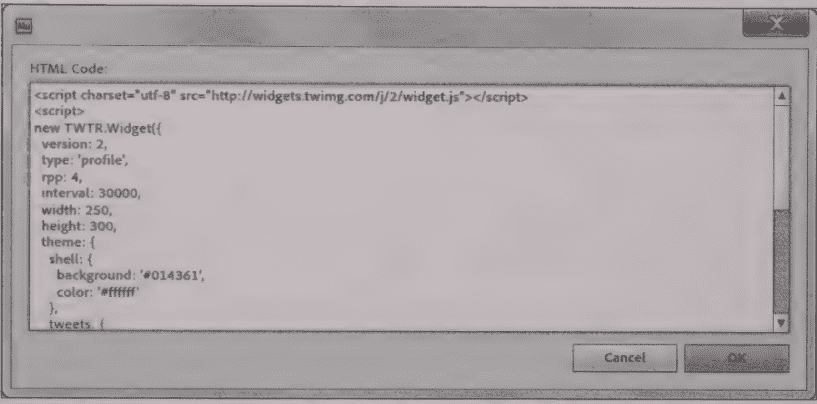

6. 你的小部件现在会出现在页面上。通过使用 Preview 视图进行测试。

## Summary

在本章中，我们讨论了 Composition 和 Slideshow 小部件，它们允许我们在几乎没有任何编码的情况下为页面添加非常有用的交互性和功能。我们还看到了如何从其他网站（如 YouTube、Google Maps 和 Twitter）获取代码并将其嵌入到我们的 Muse 网页中。

在下一章中，我们将了解 Muse 如何与 Photoshop 和 Fireworks 等其他 Adobe 产品良好协作。
