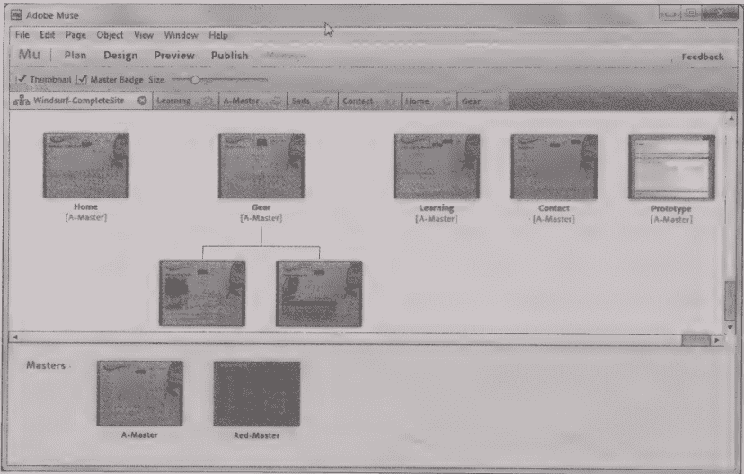
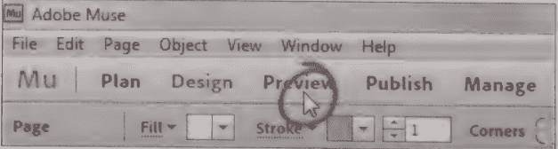
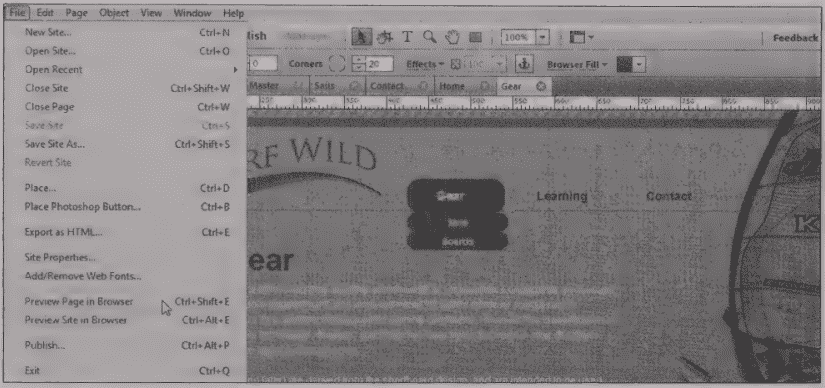
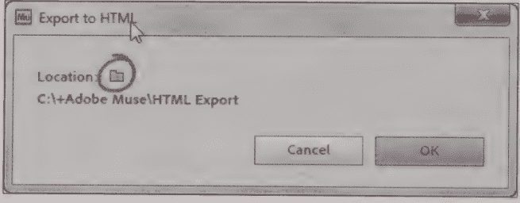
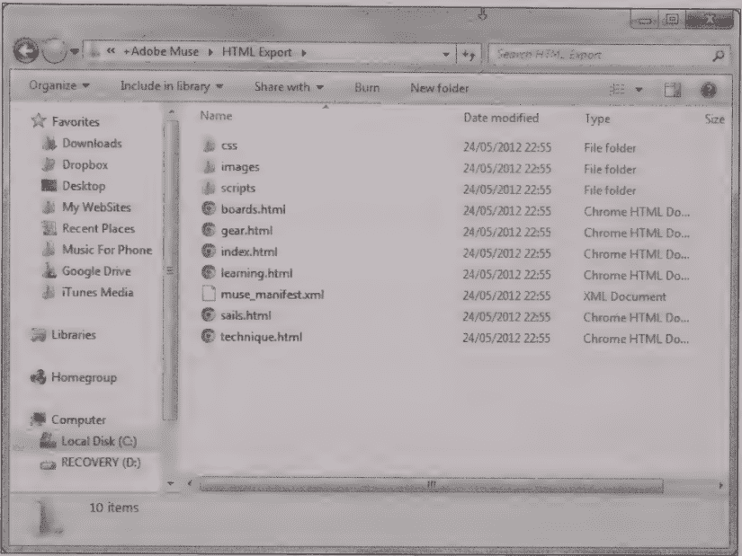
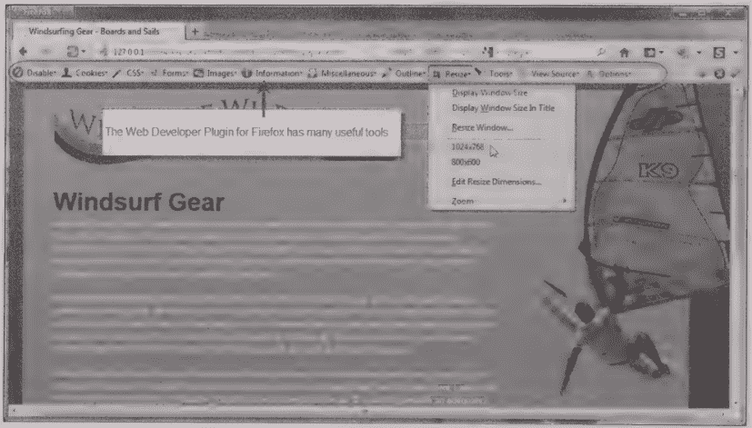

## 11
## 预览和测试你的网站

一旦你完成了组建网站的所有艰苦工作，最后的障碍就是测试、测试、再测试。这是网页设计过程中非常重要的一部分，涉及在各种浏览器中预览你的网站，以确保一切正常工作。你在制作网站的过程中已经通过边做边预览页面进行了一些测试。

在本章中，我们将了解 Muse Preview 如何使用 WebKit 来渲染预览，并讨论如何严格测试你的网站。我们将研究如何：

- 在 Muse 中预览单个页面
- 在浏览器中预览单个页面
- 在浏览器中预览整个网站
- 导出 Muse 网站的 HTML 及所有相关资源
- 遵循一套测试网站的步骤

## 预览页面

Adobe Muse 使用 WebKit 作为预览的渲染引擎。WebKit 是一个开源布局引擎，创建目的是让网络浏览器能够渲染网页。它驱动了 Apple Safari 和 Google Chrome 浏览器。它也被用作亚马逊 Kindle 电子书阅读器中包含的实验性浏览器的基础，以及 iOS、Android、BlackBerry Tablet OS 和 webOS 移动操作系统的默认浏览器。

这意味着当你在 Muse 内部预览页面或网站时，你将对它在前面提到的所有浏览器上的显示效果有一个相当好的了解。

## 完成网站

要完成我们迄今为止构建的网站，请将文本添加到 Home 和 Sails 页面，这些文本以 .txt 文件提供。向 Contact 页面添加一个虚构的地址和电子邮件链接。

完成的冲浪网站也以 Windsurf-CompleteSite.muse 的形式提供，如以下屏幕截图所示：

## 在 Muse 中预览页面

如果你一直跟着做，你现在已经多次做过这个操作，但这里快速回顾一下如何在 Muse 中预览页面的方法：

- 1. 在设计视图中打开你想要预览的页面。
- 2. 点击 Muse 界面左上角的 Preview 链接。

## 在浏览器中预览页面

虽然从 Muse 中预览显然非常方便快捷，但作为你测试流程的一部分，你应该在外部浏览器中预览在 Muse 中创建的网页。请按照以下步骤操作：

- 1. 在设计视图中打开你想要预览的页面。
- 2. 选择 File | Preview Page in Browser，如以下屏幕截图所示：

## 在浏览器中预览整个网站

如果你想在预览时测试链接，你需要让 Muse 为整个网站创建预览文件。

要从主页开始预览整个网站，请选择 File | Preview Site in Browser。

## 导出 HTML 以便在浏览器中测试

在第 12 章《发布你的网站》中，我们将了解如何发布我们的网站以及可用的各种选项。然而，作为测试的一部分，我们可以导出 HTML 文件并检查 Muse 创建的资源。导出 HTML 文件意味着文件存储在我们的计算机本地，我们可以访问并查看 Muse 生成的内容。

## 预览和测试你的网站

当你导出网站时，Muse 会切片和优化图像，并创建一个文件夹来保存这些图像、HTML、层叠样式表以及使网站发挥魔力的脚本。

如果你对代码感兴趣，可以在任何文本编辑器中打开 HTML 文件，查看构建页面的标签。如果你对代码不感兴趣，而大多数使用 Muse 的人不会感兴趣，你只需在机器上安装的任何浏览器中打开 index.html（你的主页）并在本地测试即可。

要将整个网站导出为 HTML，请按照以下步骤操作：

- 1. 选择 File | Export as HTML 或按 Ctrl + E（Windows）或 Command + E（Mac）。
- 2. 在 Export to HTML 对话框中，通过点击文件夹图标指定文件将保存到计算机上的位置，然后点击 OK。

你的文件将出现在你指定的文件夹中，应与以下屏幕截图类似：

> 在拍摄此屏幕截图的计算机上，Chrome 设置为默认浏览器；这就是为什么在每个生成的 HTML 文件旁边都出现 Chrome 图标。

## 在已安装的浏览器上查看你的主页

你可以通过右键单击（Windows）/ Command + 单击（Mac）并从菜单中选择 Open With，然后选择你想要查看 HTML 页面的浏览器，来在计算机上安装的任何浏览器中打开主页。

## 测试什么？

测试应在网站开发的每个阶段完成。新设计师常犯的两个错误是等到发布前才测试，或根本不测试。

如果你一直跟着书本进行，你会在每次创建页面后通过点击 Preview 链接进行一些测试。通过在过程中进行测试，我们减少了如果留到发布前可能出现的错误和 bug。信息是，在整个 Muse 项目中持续测试和预览。

那么我们需要测试什么呢？

## 在多个浏览器和平台上测试你的网站

即使你的网站在 Muse 中看起来不错并且运行良好，也并不意味着它在其他浏览器和/或平台上看起来一样好或功能一样好。Adobe 创建了一个产品，应该能创建在所有浏览器和平台上看起来都好的网页，但检查和测试它们是否确实如此是你的工作的一部分。

## 测试哪些浏览器和平台？

在第 2 章《Muse 工作流程》中，我们讨论了网页设计与印刷设计相比的挑战。主要挑战是访问你网站的访客可能使用多个平台和许多互联网浏览器。有许多流行的操作系统和浏览器你可以测试你的网站。

以下是操作系统的列表：

- Macintosh OS X
- Macintosh OS 9
- Windows 7
- Windows XP SP1 和 SP2
- Windows 2000
- Windows 98
- Linux
- Android
- iOS
- Windows Mobile

以下是流行浏览器的列表：

- Safari
- Mozilla
- Firefox
- Chrome
- Opera
- Internet Explorer
- 移动设备浏览器

有几个在线工具可帮助进行跨浏览器测试，因为你不太可能拥有所有类型的平台上的所有浏览器。查看以下网站，了解如何一次在多个浏览器上测试你的网站：

- Browsershots: http://www.browsershots.org/
- Browsercam: http://www.browsercam.com/
- Browserlab: http://browserlab.adobe.com/

只有 Adobe Browserlab 提供免费服务。

## 测试页面优化

从一开始就优化你的页面可以帮助确保你的网站设计和图像支持快速的页面加载时间，并且网站的开发顺畅高效。我们已在第 7 章《处理图像》中讨论过图像优化的重要性，在最佳质量与最低文件大小之间取得平衡。

还有一些免费的在线工具可以计算文档权重、构成和页面加载时间，甚至提供优化网页文档的建议。查看 Website Optimization 的网页分析器：http://www.websiteoptimization.com/services/analyze/。

## 在各种显示器上查看页面

访客将从台式电脑、笔记本电脑、平板电脑和智能手机访问你的网站。你的精美设计可能无法在每种显示器上都经受住考验，因此在尽可能多的这些显示器上尝试你的页面非常重要。

## 在不同的屏幕分辨率下查看页面

与印刷设计不同，并非每个人都会以相同的分辨率查看你的网站。Firefox 的 Web Developer 插件是测试不同屏幕分辨率下网站的有用工具。它包含一个可自定义的窗口调整大小工具。

## 检查足够的颜色对比度

确保人们能够轻松看到你的内容，通过在文本和背景之间提供良好的对比度。一个有助于检查设计颜色对比度的有用工具是 Vischeck（http://www.vischeck.com/），它模拟色盲视觉，让你看到页面就像色盲用户看到的那样。

## 测试所有小部件的功能

如果你添加了 Muse 提供的便捷小部件功能，请确保它能正常工作。它应该可以工作，但不要忘记进行测试。如果出现问题，通常是由于旧版浏览器不支持某些功能。如果发现有大量访客使用旧版浏览器（你可以通过网站日志或 Google Analytics 随着时间的推移发现这一点），那么你可能需要为该功能提供替代方案。

## 测试所有链接，包括导航

确保所有链接都能正常工作。主导航中的链接是由 Muse 自动创建的，因此请检查它是否包含了你想要的所有页面，并且没有包含你不想要的页面。

检查所有指向外部网站的链接，并检查你的锚点链接，确保它们能将访客带到正确的位置。

## 测试所有下载

如果你添加了指向 PDF 文件等下载的链接，请确保你的下载链接指向正确的文件，并且下载文件确实存在。

## 测试网站的无障碍合规性

使用至少两种不同的无障碍评估工具。W3C 无障碍倡议网站上提供了有用的工具列表：http://www.w3.org/WAI/RC/tools/complete。

## 校对所有内容

拼写错误是网站访客的主要反感点。确保你进行拼写检查并通读网站的每个页面，以检查所有文本是否清晰、简洁且适合你网站的目标受众。

## 可用性测试

迄今为止列出的测试和检查是你自己可以完成的，但要真正测试你的网站，你需要一双新鲜的眼睛；理想情况下是几双眼睛。可使用性测试的主要目标是确保你的最终版本，即你的实时网站，对访客友好且运行良好。

你需要测试以下内容：

- **有效性**：测试用户是否能够完成期望的任务
- **效率**：测试完成期望任务所需花费的精力
- **满意度**：测试用户是否拥有令人满意的体验并且会再次光临

你可能会惊讶于对你来说似乎完全显而易见的事情，可能会让独立的测试人员抓耳挠腮，不知道在你的网站上该做什么。

> 要获取大量关于网站可用性的信息，请访问雅各布·尼尔森的网站：http://www.useit.com/。
> 
> 尼尔森先生被公认为网站可用性测试的先驱之一。你也可能会惊讶于该网站的简洁。

其中一些测试只有在你将网站上传到服务器后才可能进行（我们将在下一章介绍），但许多测试可以通过在本地机器上测试来完成。

如果你正在创建一个非常大的网站，你需要进行额外的测试，但对于使用 Muse 创建的小型个人网站，测试到目前为止提到的所有内容就是一个良好的开端。

## 创建设备友好的网站

虽然 Adobe 在 Muse 版本 1 中并未正式支持移动设备设计，但设计网站时可以考虑以下几点使其对移动设备友好：

- Adobe Flash 技术在 iPhone 和 iPad 上不受支持。这是苹果与 Adobe 之间产生一些敌意的来源。如果你将 Flash 放在你的网站上，iPhone 或 iPad 用户将无法看到它。
- 苹果也不喜欢固定图像。在 iPhone 和 iPad 上，你的固定图像将不会停留在你想要的位置。
- 使用 对象 | 插入 HTML 添加到页面的某些嵌入式 HTML 可能在智能手机和平板电脑上产生意外结果。你应该在移动设备上测试网站，如果有问题，应删除嵌入式 HTML，看看其余页面是否表现正常。
- 触摸设备上没有悬停/悬停状态。在许多设备上，第一次触摸被视为悬停，第二次触摸则作为单击或按下状态。同样，需要在移动设备上测试，以确保你的菜单小部件和其他链接能正确工作。
- 为所有访客提供良好的用户体验。此时，很难甚至不可能在移动设备上复制桌面或笔记本电脑上的体验。因此，保持你的网站简单易用是确保你的网站在移动设备上表现良好的方法之一。

## 总结

在本章中，我们了解了如何在 Muse 和浏览器中预览页面，如何在浏览器中预览整个网站，以及如何将网站导出为 HTML 及其相关资源。我们还讨论了测试以及作为设计师你应该检查的内容，并了解了一些使你的网站对移动设备友好的技巧。

在下一章也是最后一章中，我们将学习如何将网站发布到网络上。
