## 12

## 发布你的网站

你从零开始构建了网站，添加了文本、图像和交互性，现在是时候将你的辛苦成果发布到网络上了。最后一步也是令人兴奋的一步就是发布你的网站。在本章中，我们将了解如何将你的网站发布到网络上，让所有人都能看到。有两种方法可以托管你用 Muse 创建的网站，我们将介绍这两种方法。在本章中，你将学习以下主题：

- 发布临时网站
- 使用 Business Catalyst 发布你的网站
- 将你的网站发布到第三方托管提供商

## Adobe ID

当你首次下载并安装 Muse 时，需要创建一个 Adobe ID。如果你之前已创建过 Adobe ID（在 www.adobe.com 上访问其他 Adobe 服务），你可以使用相同的密码登录你的 Muse 账户。以下屏幕截图显示了一个登录窗口。

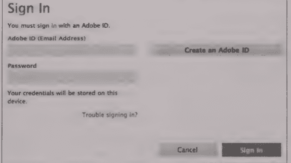

如果你购买了 Adobe Creative Cloud 订阅，首次安装 Muse 时登录时将使用相同的密码。

如果你之前创建了 Business Catalyst 账户并使用相同的登录电子邮件创建了 Adobe ID，系统将检测到你输入的电子邮件地址与 Business Catalyst 数据库中的记录匹配。

无论你如何首次设置 ID，在发布网站时你都需要知道该用户名和密码。

## 发布临时网站

使用 Muse 时，你可以创建并发布任意多个临时网站。你创建的每个临时网站都有效期为 30 天。这给了你充足的时间上传你的网站、测试它们，并在最终发布前与客户分享。如果愿意，你可以发布网站的原始版本，将第二个版本作为临时网站发布，并对其进行更改。这允许你和你的客户比较同一网站的修改前后的迭代。

如果一个临时网站活跃超过 30 天，你只需从你的 .muse 文件再次发布该网站即可延长其使用寿命。

## 再提醒一下 .muse 文件是什么

当你在 Muse 中设计、构建并保存你的网站时，会创建一个扩展名为 .muse 的单个文件。这与你可能手工编码或使用 Dreamweaver 等程序创建网站的情况非常不同。在那种情况下，你将有一个文件夹，其中包含以下文件：

- 每个页面的 HTML 文件
- 至少一个用于设置页面样式的 CSS 文件
- 所有图像文件
- 你可能在网站上使用的任何其他文件，例如 Flash 电影。

单个 .muse 文件的优点是你的所有链接、页面、样式和图像都包含在此文件中。如果你进行协作工作，你可以向工作伙伴发送 .muse 文件以及放置的图像，他们可以安全地打开它，并确信所需的一切都在这个文件中。

当你发布到临时网站时，你上传的就是这个单个 .muse 文件。

让我们现在看看如何发布临时网站；稍后我们将学习如何将你的网站永久发布到网络上的最终位置。


当你发布一个站点时，它会自动采用项目开始时使用的站点名称，并加上 Business Catalyst 域名。例如，我们的冲浪站点临时站点的 URL 将如下所示：

```
http://windsurfing.businesscatalyst.com
```

请记住，这只是临时的，因此当你准备进行最终站点发布时，你可以为其分配你选择的域名。以下步骤需要在 Muse 中发布临时站点时执行：

- 1. 点击 Muse 工作区顶部 **Publish** 链接。
- 2. **Publish** 对话框出现。在 **Site Name** 字段中输入临时站点的名称。这应该是一个描述性的名称，有助于你识别站点。例如，你可以输入 My windsurfing site。

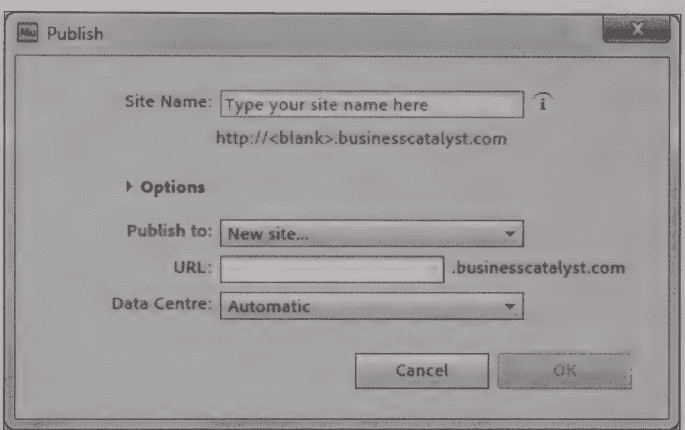

- 3. 如果尚未显示，点击 **Options** 链接以查看临时站点的更多选项。
- 4. 将 **Publish to** 保留为 **New site**....
- 5. **Options** 部分中的站点 **URL** 字段将自动删除在 **Site Name** 字段中输入的空格和特殊字符，并为你的实时临时站点创建一个建议的 URL。如果你愿意，可以编辑 **URL** 字段的内容来更改自动生成的 URL。
- 6. **Data Centre** 字段选择站点文件将被托管的数据中心。Muse 会自动检测此项，但如果你想指定，可以从美国、欧盟或澳大利亚中选择。

7. 如果你不住在这三个选项中的任何一个，你可以选择离你客户位置最近的数据中心。

8. 完成后，对话框应如下所示的屏幕截图：

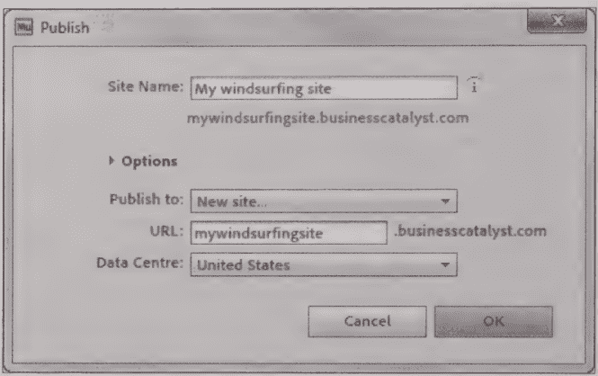

9. 点击 OK 发布你的新临时站点。

10. Muse 将上传你的所有页面和资源，上传完成后，你会收到一条确认消息，告知你的临时站点现已托管。点击 OK。

11. 你的 Web 浏览器将自动在临时站点地址打开。你同时也会收到一封发送到你的 Adobe ID 地址的电子邮件，祝贺你发布了临时站点，并附带临时 URL 的链接。

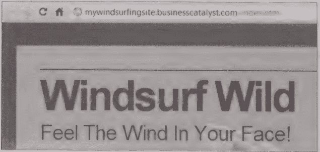

如果你想对 Muse 站点进行更多更改并上传到同一位置，再次点击 Muse 中的 Publish 链接。你会看到临时站点的链接会自动显示在 Site Name 字段下方。点击该链接在新的浏览器窗口中启动你的临时站点并测试它。

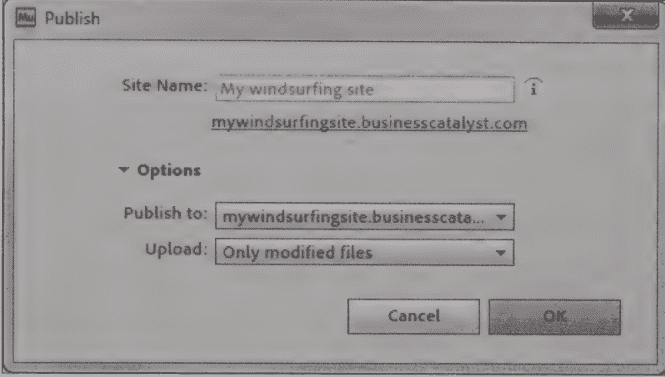

临时站点的 URL 可以复制并发送给你的客户以供审阅。你现在有了一个绝佳的机会，可以通过我们之前章节讨论的所有测试进行检查。而且，你将测试一个正在运行的在线网站，但无需担心公众会误入该站点。

一旦你发布了临时站点，Manage 链接现在将可用并处于活动状态。我们稍后将使用它来发布最终站点。

## 编辑和更新站点

你现在已经发布了站点并与客户进行了沟通，但你可能会发现需要进行一些更改。为了编辑和更新你的站点，请应用以下步骤：

- 1. 在 Muse 中打开同一个 .muse 文件。
- 2. 你现在有两个选项：
  - 在现有的 .muse 文件中进行更改，然后选择 File | Save 并再次点击 Publish 链接。
  - 选择 File | Save As 创建站点的副本。在 Muse 工作区中进行所需的更改，然后再次点击 Publish 链接。

3. 你现在可以通过在 Publish 对话框中保持选项不变来覆盖现有的临时站点，也可以创建一个新的临时站点。这使得你的客户可以轻松比较更改前后的情况。

- 通过选择 File | Save As，你可以确保原始站点安全。

4. 当你发布临时站点时，它会在 Publish 对话框中的 Publish to 菜单中列出。你可以从列表中选择现有站点，也可以选择创建新站点。

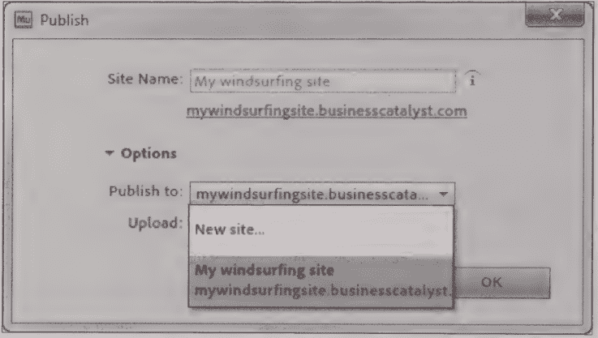

5. 你可以上传所有文件，或仅上传已修改的文件。如果你的网站非常庞大，最好只上传修改过的文件。当 Muse 升级时，最好重新发布整个站点。

6. 重复此过程，直到你和客户对站点满意为止。希望这不会花费太多迭代。

## 升级和发布

最后的步骤涉及“升级”你的站点并发布它。当你到达此阶段时，你需要支付托管费用。你还需要为你的站点注册一个域名，这需要通过第三方完成。

## 注册域名

你需要联系域名注册商以购买你想要用于网站的域名。网上有许多提供此服务的网站，你应该能够以不到 10 美元的价格在线购买 .com 域名。购买域名非常简单，通常会很快完成。我们将在完成更多步骤后返回域名注册商。

## 升级为已发布站点

以下步骤将告诉你如何升级站点并发布它：

- 1. 在 Muse 中，使用你之前发布的临时站点打开，点击 Manage 链接。Manage 链接只有在你发布临时站点后才可用。

- 2. 点击 Manage 链接后，Business Catalyst 管理控制台将在你的 Web 浏览器窗口中打开。你将看到 Dashboard，在这里你可以管理由 Business Catalyst 托管的 Muse 站点。你还将能够查看站点的统计信息。

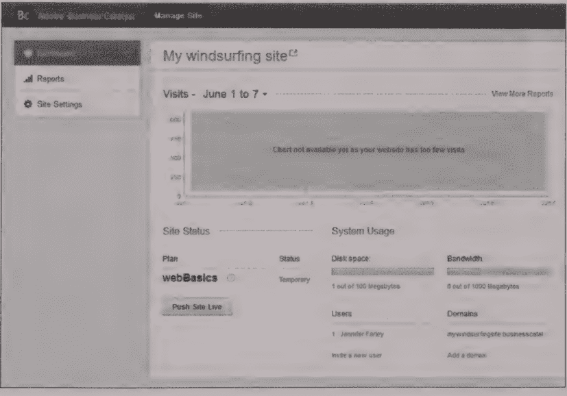

- 3. 点击 **Dashboard** 上的 **Push Site Live** 按钮。
- 4. **Site Upgrade** 窗口出现。点击 **Proceed to checkout**。你需要输入信用卡信息以完成升级。
- 5. 保留前两个选项的默认设置：
  - Site hosting plan: **webBasics**
  - Billing option: **Invoice Me Directly**

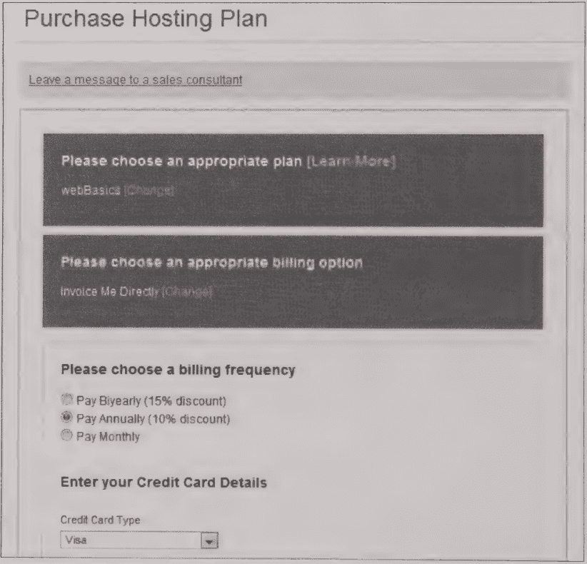

- 6. 选择你希望计费的频率，填写你的信用卡详细信息并点击 **Make Payment**。
- 7. 你的信用卡付款将根据你的选择立即处理。

8. 你将被返回到 Dashboard，站点状态现在为 Live。

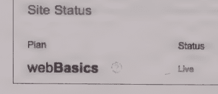

## 将域名与你的 Muse 站点关联

我们的临时站点现在已升级并由 Business Catalyst 商业托管。此次升级意味着我们可以将从域名注册商购买的域名与站点名称关联。

在从临时站点升级之前，站点地址看起来像这样：

```
http://my_site.businesscatalyst.com
```

例如，http://mywindsurfingsite.businesscatalyst.com

在站点升级和发布后，我们可以添加我们的域名，使其看起来更像这样：

```
http://my_domain_name.com
```

例如，mywindsurfingsite.com

在本节中，你将使用管理控制台 Dashboard 中的界面。

- 1. 点击 Dashboard 中的选项，然后点击 Add a domain。

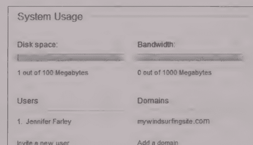

- 2. 当 **Site Domains** 对话框出现时，点击 **New Domain** 选项。
- 3. 在 **Domain** 字段中输入你注册的域名。不要在域名前包含 www. 前缀，但要包含域名的扩展名（如 .com、.org 或其他）；例如：`my_domain_name.com`。
- 4. 在 **Start Page** 菜单上选择 **Home Page**。为站点设置 **Country** 和 **Culture**。保留所有其他默认设置并点击 **Save**。

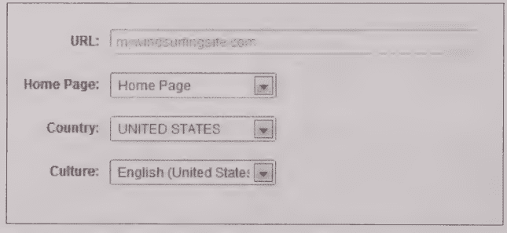

- 5. 你会看到一条确认消息。点击 **Close** 关闭 **Add a New Domain** 对话框并返回管理控制台。你添加到站点的域名现在已列出。
- 6. 点击左侧边栏中的 **Dashboard** 链接返回到 **Dashboard**。
- 7. 在 **Domains** 部分，你输入的域名现在已列出。

## 重新委派你的域名

你几乎完成了。只剩下最后一件事，那就是重新委派你的域名。这只是意味着确保当你在浏览器中输入你的域名时，它会转到正确的位置。

不幸的是，这不是你可以通过 Muse 或通过 **Business Catalyst** 仪表板完成的事情。操作方法如下：

- 1. 前往你购买域名的注册商的网站。
- 2. 大多数注册商都有一个控制面板，你可以使用它来重新委派你的域名。你需要注册商提供的用户名和密码。


3. 使用您的账户信息登录注册商的网站。您需要找到更新域名系统(DNS)设置的选项。您需要将注册商上的名称服务器更新为以下内容：
- ns1.worldsecuresystems.com
- ns2.worldsecuresystems.com
- ns3.worldsecuresystems.com

4. 此过程因注册商而异。如果您在查找更改 DNS 设置的位置时遇到问题，请直接联系他们。

5. 更改名称服务器后，您可能需要等待 24 小时才能使设置生效。生效后，您的域名将直接带您进入由 muse 创建的网站。恭喜！

## 替代托管

您并非必须使用 Adobe 的 Business Catalyst 托管服务。您可以使用您选择的任何托管服务。唯一的区别是，首先您需要将网站导出为 HTML，如第 11 章《预览和测试您的网站》中所述，然后使用 FTP 程序将文件夹和文件上传到您的主机。

## 文件传输协议 (FTP)

文件传输协议 (FTP) 是一种将文件上传到托管网站的方法。在将网站导出为 HTML 后，您可以使用 FTP 软件将文件传输到您的主机。

您需要为托管和域名付费。市场上有很多托管和域名套餐的惊人优惠，因此在购买您看到的第一个托管套餐之前请先做一些调查。

当您为您的网站安排好主机后，您会收到一封包含 FTP 详细信息的电子邮件，或一个链接到他们网站上可找到 FTP 详细信息的页面。最低限度，您需要用户名、密码和 FTP 地址。您无法猜测这些；它们需要由托管公司提供。FTP 是一种验证您是否输入了正确的用户名和密码以连接到特定站点的验证方法。

## FTP 客户端

网上有大量免费的 FTP 客户端（软件）可用，它们工作得非常完美。对于简单的上传或下载，您无需购买一个。以下是一些知名 FTP 客户端：
- FileZilla 用于 Linux、Mac OS X 和 Windows 操作系统
- SmartFTP 仅用于 Windows 操作系统
- SimpleFTP 仅用于 Mac OS X 操作系统
- CuteFTP 用于 Mac OS X 和 Windows 操作系统

使用 FTP 时，您可以从本地计算机上传文件到主机服务器，并从主机服务器下载文件到本地计算机。

将您的 FTP 详细信息输入客户端后，单击“连接”按钮。如果所有详细信息都正确，FTP 客户端将与主机计算机连接。FTP 客户端界面的其中一侧会显示您本地计算机上的文件；另一侧会显示您远程或主机计算机上的文件。

按照托管提供商的说明，您将能够将本地文件（您已导出为 HTML）上传到远程主机。上传与从 Business Catalyst 仪表板发布文件相同。

文件上传完成后，您的网站已在互联网上上线。如果您需要对网站进行更改，请在 Muse 中进行这些更改，然后再次导出文件。仅上传已更改的文件。上传完成后，单击“断开连接”。

## 摘要

在本章中，我们讨论了如何发布和启动您的网站。您可以使用 Adobe 自己的 Business Catalyst 托管服务进行发布，也可将网站导出为 HTML，然后上传到您选择的托管服务。

至此，我们一起完成了对 Adobe Muse 的探索之旅。我希望您喜欢学习该程序，并将继续制作出精美的网站。
