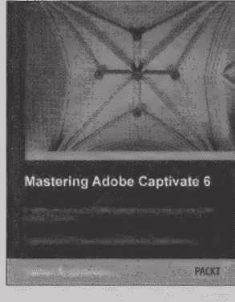
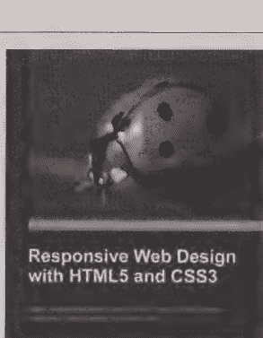
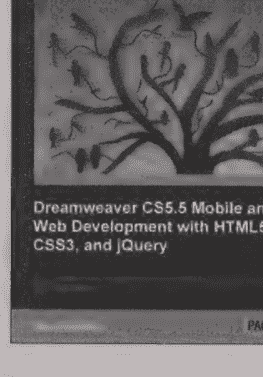
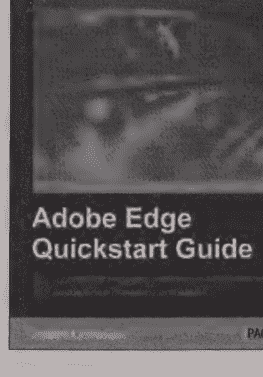
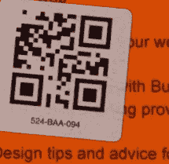
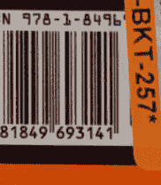

## 索引

## 符号
- .muse 文件
  - 关于 230
  - 优势 230-233

## A
- absolute link 88
- Accordion panels 180
- actions
  - undoing 24
- Adobe Business Catalyst 38, 39
- Adobe ID 229
- Adobe Muse. See Muse
- alternate text
  - adding, to images 150, 151
- A-Master panels 170
- Android 222
- arbitrary HTML
  - inserting 199
- Ascender 119
- Assets panel 165
- Assets panel context menu
  - Copy Full Path 166
  - Edit Original 166
  - Embed Link 165
  - Go To Asset 165
  - Relink 165
  - Reveal in Explorer 166

## B
- background images
  - working with 158
- Baseline 119
- Basic Slideshow widget 194
- bevel effect
  - adding, to rectangle 111, 112
- Blank Composition widget 188
- Blank Slideshow widget 195
- Boldface 120
- bread and butter layouts
  - about 44
  - changing content 44
  - consistent content 44
- Browsercam
  - URL 223
- Browserlab
  - URL 223
- Browsershots
  - URL 223

## C
- callouts 137
- Cap Height 120
- Centre Align Text 121
- Character 120
- character styles, text
  - applying 131
  - creating 131
- child page
  - adding 74
- Chrome 223
- color
  - adding, to rectangle 103, 105
- Composition widget options
  - auto play 193
  - event 192
  - fading 192
  - hide all initially 193
  - horizontal 192
  - parts 193
  - position 191
  - Show All in Design Mode 193
  - Show Lightbox Parts While Editing 193
  - speed 192
  - transitions 192
  - vertical 192
- Composition widgets
  - about 187
  - Blank 188
  - content, adding to target area 190, 191
  - Featured News 188
  - Lightbox Display 188
  - options, changing 191-193
  - Presentation 188
  - simple photo gallery, creating 189, 190
  - targets, creating 193
  - Tooltip 188
  - triggers, creating 193
- Condensed Font 120
- content
  - about 45
  - adding, to target area 190, 191
- Control Panel
  - about 16
  - panels 17
  - panels, collapsing 19
  - panels, expanding 18
  - panels, hiding 19
  - panels, opening 19
  - panels, rearranging 19
- crop tool 15
- CSS 7
  - generating 69

## D
- Descender 120
- Design view 12-14
- device-friendly website
  - creating 226
- document window
  - about 20
  - grid overlay 22, 23
  - guides 21
  - header and footer guides 22
  - magnification, changing 23
  - rulers 21
  - zooming 23
- domain name
  - associating, with Muse site 237
  - re-delegating 238
  - registering 235
- Domain Name System (DNS) 40, 239
- Drop Cap 121
- drop shadow effect
  - adding, to rectangle 110, 111
- duplicate page
  - creating 74

## E
- effects
  - adding, to images 157
- effects, adding to rectangles
  - about 109
  - bevel effect 111, 112
  - drop shadow 110, 111
  - glow 113
- e-mail link
  - about 88
  - creating 88
- external web page link
  - creating 86

## F
- Featured News Composition widget 188
- file formats, images
  - GIF 146
  - JPEG 145
  - PNG 147
- File Transfer Protocol (FTP) 239
- FileZilla
  - URL 41
- Firefox
  - about 223
  - URL 37
- footer 46
- Frequently Asked Questions (FAQ)
  - pages 87

## FTP clients 240
- full width rectangles
  - creating 116

## G
- GIF 146
- glow effect
  - adding, to rectangle 113
- Google Chrome
  - URL 37
- Google Map
  - adding, to web page 199-201
- gradient fill, rectangle
  - setting 107
- Graphics Interchange Format. See GIF
- Graphic Styles panel 57

## H
- H1 133
- hand tool 15
- headings
  - about 132
  - accessibility 133
  - and SEO 134
  - creating 134, 135
  - text case, changing 136
  - text wrapping 137, 138
  - using 132
  - web-safe fonts 139
- Hello web-friendly images 144
- home page
  - viewing, on installed browser 221
- horizontal menu
  - creating 179
- HTML 7
  - exporting, for browser testing 219
  - generating 69
- HTML heading tags
  - about 133
  - H1 133
- Hypertext Transfer Protocol (HTTP) 40

## I
- image
  - adding, to rectangle 108, 109
- image context menu
  - about 151
  - Edit Original 152
  - Fitting 152
  - Lock 152
- images, Muse
  - alternative text, adding 150, 151
  - background images, working with 158
  - cropping 155-157
  - dimensions, setting 144
  - duplicating 155
  - effects, adding 157
  - file, compressing 144
  - file format, deciding 144
  - file format, selecting 144
  - file, saving 144
  - getting, onto page 149
  - image context menu 151, 152
  - logo, adding 158
  - manipulating 152
  - pasting, from another program 158
  - photographic image, using as background 161-163
  - pinning 164
  - placing 149, 150
  - positioning 154
  - resizing 152
  - resolution, setting 144
  - rotating 154
  - tiled image, using as background 160, 161
- Internet Explorer 223
- Internet Explorer (IE) v9
  - URL 37
- Internet Service Provider (ISP) 40
- iOS 222
- IP address (Internet Protocol address) 40
- Italic 120

## J
- JavaScript 7
- Joint Photographic Experts Group. See JPEG
- JPEG 145
- jQuery 7
- Justified 122

## K
Kerning 122
## L
Left Align Text 121
Lightbox Display Composition widget 188
Lightbox Slideshow widget 195
link anchor
creating 87, 88
links
about 85
color, changing 88-90
creating 85
deleting 91
editing 90
e-mail link, creating 88
external web page link, creating 86
link anchor, creating 87, 88
navigation bar, creating 91, 92
navigation links 93
web page link, creating 85
Linux 222
logo
about 45
adding 158
link, adding 159
Lorem Ipsum 64
## M
Macintosh OS 9 222
Macintosh OS X 222
Manage view 12
master background rectangle
about 98
setting up 98, 99
Master pages
about 73
applying, to web page 82, 83
creating 81
header and footer guides 83
opening 80
text, adding 84
using 73
working with 80, 81
Menu Widget panel 172

menu widgets
about 169
Accordion panels 180
Accordion widget elements, editing 182
Accordion widget options, editing 183
horizontal menu, creating 179
menu bar, adding 169, 171
menu item, formatting 174, 175
panel, adding 180, 181
sheets, adding 175
states panel, adding 176, 177
style, transferring 178
subelements, selecting 171
vertical menu, creating 179
widget options, setting 172
widget, selecting 171
Metadata 140
Metadata category, options
Description 141
File Name 141
HTML 141
Keywords 141
Page Name 141
Page Title 141
Meta tags
adding 140, 141
mockup 48
Mozilla 223
multiple selected objects
grouping 166
Muse
about 7
Assets panel 165
automatically generated menus 8
Composition widgets 187
CSS, generating 69
design 8
downloading 8
easy laying out of text and images 8
features 8, 31
Hello web-friendly images 144
HTML, generating 69
image, pasting from another program 215
images, working with 143
interactivity, adding 8
links, creating 85
Master pages 73

menu widgets 169
Metadata 140
page properties, editing 76-78
pages 71, 72
Photoshop rollover button, adding 205, 206
plan 8
publish 8
publishing 8
rectangles, working with 96
rich media content, embedding 216
Slideshow widgets 194
temporary site, publishing 230
text, editing 124-127
text frames, creating 123
updates 25
widgets 167
workspace 8
Muse site
960 based grid, using 33
about 43
accessibility conformance, testing 225
actions, undoing 24
adequate color contrast, checking 224
alternative hosting 239
completing 218
content, proofreading 225
Control Panel 16
creating 10, 32
designing 34-36
Design view 12
device-friendly website, creating 226
document window 20
domain name, associating with 237, 238
domain name, re-delegating 238
domain name, register 235
domain names 40
downloads, testing 225
editing 233, 234
File Transfer Protocol (FTP) 239
FTP clients 240
help 24
launching 234
layouts 43
links, testing 225
Manage view 12
page, opening in Design view 13-15
page optimization, testing 223
page, previewing in browser 219
page, previewing in Muse 218
pages, previewing 217
pages, viewing on different screen resolutions 224
pages, viewing on variety of displays 224
planning 33, 34
Plan view 12
previewing 36, 37
previewing, in browser 219
Preview view 12
Publish view 12
resources 24
reviewing 37
saving 13
server space, acquiring 40
site structure 50
testing 38, 222
testing, on browsers 223
testing, on operating systems 222
toolbar 15
tools, using 16
updating 233, 234
upgrading 234-236
uploading 41
usability testing 225
web page 45
widget functionality, testing 225
wireframes 47
zooming 23
Muse site settings
center horizontally 11
columns 11
column width 11
gutter 11
margins 11
min height 11
padding 11
page width 11
Muse web page
Google Map, adding 199-201
Twitter, adding 202, 203
Muse workflow
about 27
print workflow, versus web workflow 27, 28
site, creating 32

site, designing 34-36
site, planning 33, 34
site, previewing 36, 37
site, publishing 37, 38
Muse workspace
about 8
recent site, opening 10
site, creating 10
Welcome screen 9
## N
navigation bar
about 45
creating 91, 92
navigation links
tips 93
## O
objects
grouping 166
Opera
about 223
URL 37
## P
page layouts, Muse site
about 43
bread and butter layouts 44, 45
page properties
editing 76-78
page, closing 79
page, opening 79
page, saving 79
page sizes 79
pages
about 71
child page 73
child page, adding 74
deleting 75
duplicate page, creating 74
fit page to window 94
making, to actual size 94
rearranging 75
renaming 75
sibling page 73
sibling page, adding 74
zooming in 93
zooming out 94
panel
about 17
adding 180, 181
collapsing 19
deleting 185
expanding 18
hiding 19
opening 19
rearranging 19
paragraph styles, text
applying 129, 130
creating 127, 128
photographic image
using, as background 161-163
Photoshop file
editing 214
Photoshop image
adding 212
Photoshop rollover button
about 205
adding 206
creating, with multiple states 207-210
Photoshop button, placing 210-212
Photoshop file, editing 214
Photoshop image, adding 212, 213
states 206
Plan view
about 12
site structure 50
thumbnails, working with 53, 54
PNG
about 147
PNG 8 147
PNG 24 147
Portable Networks Graphics. See PNG
Pre-Muse planning 29
Presentation Composition widget 188
Preview view 12
print workflow 28
print workflow, versus web workflow
about 27
browser battles 29
download speed 30, 31

pre-Muse planning 29
resolution 30
prototype 48
published site
upgrading 235, 236
Publish view 12

## Q

Quark Express 28

## R

Raised Cap 121
recent site
opening 10
rectangle
about 95
adjusting 101
color, adding 103
copying 102
creating, on individual pages 100
cutting 102
deleting 101
drawing 95
duplicating 103
effects, adding 109
full width rectangles, creating 116
image, adding 108, 109
master background rectangle,
setting up 98, 99
pasting 102
rotating 102
round and square corners mixture,
creating 115
stacking order, changing 114
working with 96, 97
rectangle fill
changing 105, 106
gradient fill, setting 107, 108
rectangle fill, options
color 106
fitting 106
image 106
opacity 106
position 106
rectangle tool 15
relative link 88

Reversed Type 121
rich media content
embedding 216
Right Align Text 121
rollover button. See Photoshop
rollover button
Roman/Regular 120
Round Rectangle style 59

## S

Safari
about 223
URL 37
safe list 139
Search Engine Optimization (SEO) 132
selection tool 15
sibling page
adding 74
simple photo gallery
creating, blank composition used 189, 190
site structure 50, 51
slideshow presentation
creating 196, 198
Slideshow widgets
about 194
arbitrary HTML, inserting 199
Basic Slideshow widget 194
Blank Slideshow widget 195
Lightbox Slideshow widget 195
slideshow presentation, creating 196, 197
Thumbnails Slideshow widget 195
Smart FTP
URL 41
stacking order 114
stacking order, rectangle
changing 114
States
about 206
active 206
down 206
over 206
up 206
stroke, adding to rectangle
about 103
Stroke alignment 105
Stroke widths 105

Stroke alignment 105
Stroke widths 105
Styles panels, text
using 132

## T

Tabbed Panels
about 183
using 183, 184
target
about 187
creating 193
temporary site
publishing 230
testing
about 222
testing, Muse site
accessibility conformance, testing 225
adequate color contrast, checking 224
content, proofreading 225
downloads, testing 225
effectiveness, testing 226
efficiency, testing 226
links, testing 225
on multiple browsers 222
on multiple platforms 222
page optimization, testing 223
pages, viewing on different screen resolutions 224
pages, viewing on variety of displays 224
satisfaction, testing 226
usability testing 225
widget functionality, testing 225
text
character styles, applying 131
character styles, creating 131
editing 124-127
headings 132
paragraph styles, applying 129, 130
paragraph styles, creating 127, 128
Styles panels, using 132
text frames
creating 123
text options, control panel
about 125
align 125

Bold/Italic/Underline 125
Character style 126
color 126
font 125
font size 125
Indent 126
leading 126
Left/Right margin 126
letter space 126
Links 126
paragraph style 126
Space before/after 126
text tool 15
text wrapping 137
thumbnails, Plan view
working with 53, 54
Thumbnails Slideshow widget 195
tiled image
using, as background 160, 161
tips
navigation links 93
toolbar
about 15
crop tool 15
hand tool 15
rectangle tool 15
selection tool 15
text tool 15
zoom tool 15
tools
using 16
Tooltip Composition widget 188
Tracking/Letter spacing 122
triggers
creating 193
Twitter
about 202
adding, to web page 202, 203
type 118
typographic terms
Ascender 119
Baseline 119
Boldface 120
Cap Height 120
Centre Align Text 121
Character 120
Condensed Font 120

Descender 120
Drop Cap 121
Italic 120
Justified 122
Kerning 122
Left Align Text 121
Raised Cap 121
Reversed Type 121
Right Align Text 121
Roman/Regular 120
Tracking/Letter spacing 122
x-height 119
typography 118

U

Uniform Resource Locator (URL) 40

V

Vertical menu
creating 179
Vischeck
URL 224

W

W3C accessibility
URL 225
web page
about 45
content 45
footer 46
logo 45
navigation bar 45
web-safe colors 147, 148
web-safe fonts 139
Web.without.words 49
web workflow 28
Welcome screen 9
widget options
Edit Together 173
Item Size 173
Label 173

Left Icon 173
Menu Direction 173
Menu Type 173
Parts Positioning 173
Right Icon 173
Widgets Library panel 171
widgets, Muse
about 167
adding, to page 168
working with 168
Windows 7 222
Windows 98 222
Windows 2000 222
Windows Mobile 222
Windows XP SP1 and SP2 222
Windsurfing panel 170
Windsurfing site
URL 231
wireframes
about 47
creating 47
creating, Muse used 50
design elements 48
dummy text, adding 64
elements 48
graphic style, saving 57-61
paragraph styles, adding 64-68
placeholder images, updating with final site graphics 63, 64
placeholder images, using 61-63
working with 54, 56
wireframing 47, 48
WYSIWYG (What You See Is What You Get)
web design tool 7

X

x-height 119

Z

zoom tool 15

# 感谢您购买《Learning Adobe Muse》

# 关于 Packt Publishing

Packt 发音为 'packed'，于 2004 年 4 月出版了首本图书 “Mastering phpMyAdmin for Effective MySQL Management”，随后继续专注于出版关于特定技术和解决方案的高度聚焦的书籍。

我们的书籍和出版物分享了您的同行 IT 专业人士在适应和定制当今系统、应用程序和框架方面的经验。我们的解决方案型书籍为您提供定制您正在使用的软件和技术以完成工作的知识和能力。Packt 的书籍比您过去看到的 IT 书籍更具体、更少泛化。我们的独特商业模式使我们能够为您提供更聚焦的信息，让您获得所需了解的更多内容，而非不需要的内容。

Packt 是一家现代而独特的出版公司，专注于为开发者、管理员和新手社区生产高质量的前沿书籍。如需了解更多信息，请访问我们的网站：www.packtpub.com。

# 为 Packt 撰稿

我们欢迎所有有兴趣撰稿的人士的咨询。书稿提案请发送至 author@packtpub.com。如果您的书稿创意仍处于早期阶段，您希望在撰写正式书稿提案前先进行讨论，请联系我们；我们的约稿编辑会与您联系。

我们不仅寻找已出版的作者；如果您拥有强大的技术技能但没有写作经验，我们经验丰富的编辑可以帮助您发展写作事业，或为您提供专业知识的额外回报。

# Mastering Adobe Captivate 6

ISBN: 978-1-849692-44-1        Paperback: 476 pages

Create professional SCORM-compliant eLearning content with Adobe Captivate

+   1. Step by step tutorial to build three projects including a demonstration, a simulation and a random SCORM-compliant quiz featuring all possible question slides.
+   2. Enhance your projects by adding interactivity, animations, sound and more
+   3. Publish your project in a wide variety of formats enabling virtually any desktop and mobile devices to play your e-learning content
+   4. Deploy your e-Learning content on a SCORM or AICC-compliant LMS

# Responsive Web Design with HTML5 and CSS3

ISBN: 978-1-849693-18-9        Paperback: 324 pages

Learn responsive design using HTML5 and CSS3 to adapt websites to any browser or screen size

+   1. Everything needed to code websites in HTML5 and CSS3 that are responsive to every device or screen size
+   2. Learn the main new features of HTML5 and use CSS3's stunning new capabilities including animations, transitions and transformations
+   3. Real world examples show how to progressively enhance a responsive design while providing fall backs for older browsers

# Dreamweaver CS5.5 Mobile and Web Development with HTML5, CSS3, and jQuery

ISBN: 978-1-849691-58-1        Paperback: 284 pages

Harness the cutting edge features of Dreamweaver for mobile and web development

+   1. Create web pages in Dreamweaver using the latest technology and approach
+   2. Add multimedia and interactivity to your websites
+   3. Optimize your websites for a wide range of platforms and build mobile apps with Dreamweaver
+   4. A practical guide filled with many examples for making the best use of Dreamweaver's latest features

# Adobe Edge Quickstart Guide

ISBN: 978-1-849693-30-1        Paperback: 136 pages

Quickly produce engaging motion and rich interactivity with Adobe Edge Preview 4 and above

+   1. Learn to use Adobe's newest application to create engaging motion and rich interactivity
+   2. Familiarize yourself with the Edge interface and unleash your creativity through standard HTML, CSS, and JavaScript
+   3. Add motion and interactivity to your websites using Web standards
+   4. A quickstart guide for creating engaging content with Adobe Edge

# Learning Adobe Muse

Adobe Muse 是世界领先的设计软件公司推出的一款令人兴奋的新工具，它允许用户无需编写任何代码即可创建精美且功能齐全的网站。它为平面设计师提供了将印刷设计技能应用到网络上的能力。

本书将帮助网页设计师以及平面设计师快速掌握 Adobe Muse。

《Learning Adobe Muse》将教您如何使用 Adobe Muse 规划、设计和发布网站。它首先介绍程序的工具和界面，然后介绍您为布局网页所需理解的概念。您将学习如何使用可重用的样式格式化文本、添加图像、创建干净的导航系统，并向页面添加交互元素，如面板和幻灯片，所有这些都不需要编写一行代码！

到本书结束时，您将创建一个设计精良、功能齐全的网站。

# 本书面向对象

本书面向初级网页设计师以及有兴趣将印刷设计技能应用于网络的平面设计师。它将教您如何快速构建网站，而无需学习 HTML 或 CSS。

# 您将从本书中学到什么

+   - 从零开始规划一个网站。
+   - 创建一个功能性网站原型
+   - 使用主页面在整个网站上应用统一的外观和风格
+   - 应用诸如投影、斜面和发光等效果
+   - 向网站添加交互元素，包括图像幻灯片
+   - 面向新设计师以及从印刷转向网络的平面设计师的设计技巧和建议
+   - 面向新设计师的设计技巧和建议

$ 44.99 US
£ 27.99 UK

Prices do not include local sales tax or VAT where applicable

Visit www.PacktPub.com for books, eBooks, code, downloads and PacktLib.

