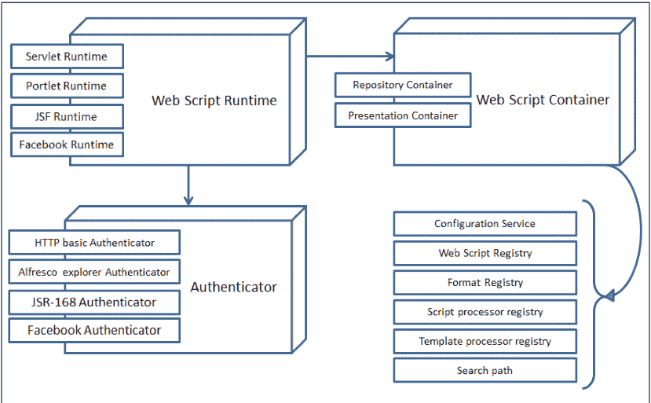

# 第3章：深入理解Web脚本框架
Understanding the Web Script Framework

在本章中，我们将涵盖以下主题：

- Web 脚本的端到端执行流程
- 共同构成 web 脚本框架的组件
- Web 脚本的部署架构

Alfresco 中的 web 脚本框架功能强大，其基本目标是确保：

- Alfresco 中的 web 脚本易于开发
- Web 脚本可以支持各种有用功能，例如支持国际化以在多种语言中呈现输出，为 web 脚本公开配置选项，类似于 servlet 的 ServletConfig

Alfresco 中的 web 脚本框架是按照 **模型-视图-控制器模式 (MVC 模式)** 设计的，使得开发新的 web 脚本以暴露 RESTful API 来与 Alfresco 后端存储库交互变得容易。

在本章中，我们将深入探讨 Alfresco 中的 web 脚本框架，以了解共同使其成为强大框架的各种组件。它是 Alfresco web 脚本注册和执行的骨干引擎。

## Execution flow of web scripts

让我们首先了解 web 脚本的执行流程，以便了解 Alfresco web 脚本框架。

### Overall flow for a web script

一旦 web 脚本 URI 的请求被命中，web 脚本的执行流程就开始了，并一直持续到请求以请求的响应格式提供服务为止。让我们了解一个由 JavaScript 支持的控制器的 web 脚本的整体执行流程。整个执行流程如下：

1. Web 脚本 URI 的请求到达 Alfresco 中的 web 脚本请求调度器。
2. 请求调度器将请求发送到 Web Script Runtime。
3. Web Script Runtime 将请求委托给 Web Script Container，后者将首先找到适合请求的 URI 和请求的 HTTP 方法的 web 脚本。
4. 下一步是在执行 web 脚本之前，如果需要，先对用户进行身份验证。
5. Web Script Container 然后执行控制器实现（如果可用）。脚本处理器将执行请求 web 脚本的 JavaScript 控制器。

## 幕后实现

我们已经对 Web 脚本的整体执行流程有了概览，现在让我们深入技术细节，逐步了解实现过程，以理解当 JavaScript 控制器支持的 Web 脚本通过来自 HTTP 客户端（例如 Web 浏览器）的 HTTP 请求被调用时，Web 脚本请求是如何得到处理的。你会在本节中看到大量技术细节，所以在开始阅读之前，你可能想先来杯咖啡。

> 由于我们将在本节中进行详细的技术性讲解，你可能需要访问源代码，以便在阅读本节时更容易跟上。为了方便快捷地访问代码，我们只需浏览 Alfresco 安装中可用的 JAR 文件。你可以下载并安装 Java 反编译工具，例如 JD-GUI（可在 `http://jd.benow.ca/` 获取），它可以反编译 JAR 文件。我们在本节中将熟悉的类主要位于 `spring-webscripts-*.jar`、`alfresco-remote-api-*.jar` 和 `spring-surf-core-configservice-*.jar` 中。这些 JAR 文件可以在 Alfresco 安装目录下的 `tomcat\webapps\alfresco\WEB-INF\lib` 中找到。在 JD-GUI（反编译器）中打开 JAR 文件后，你可以使用 `Ctrl + Shift + T` 打开类文件并提供类名。

那么，让我们开始吧：

- 1. 对于 Alfresco Web 脚本，RequestDispatcher servlet（`org.springframework.extensions.webscripts.servlet.WebScriptServlet`）在 web.xml 中配置，并映射到 `/service/*` URL 模式。
- 2. 在对 `/alfresco/service/*` URL 模式的第一次请求时，servlet 容器将调用 WebScriptServlet 的 init 方法，并使用配置服务（`org.springframework.extensions.config.xml.XMLConfigService`）、Web 脚本容器（`org.alfresco.repo.web.scripts.TenantRepositoryContainer`）和根据 servlet init-param — authenticator（`webscripts.authenticator.basic`）及所需服务器属性获取的身份验证工厂（`org.alfresco.repo.web.scripts.servlet.BasicHttpAuthenticatorFactory`）来实例化它。
- 3. 在第一次请求完成初始化后，以及后续对 `/alfresco/service/*` URL 模式的请求中，为了执行 Web 脚本，会调用 WebScriptServlet 的 `service()` 方法。

- 4. `WebScriptServlet` 在处理 Web 脚本请求时，每次都会执行以下操作：
  - 它会使用 Web 脚本容器、身份验证工厂（第二步中提到的相关类）、服务器属性、请求（`javax.servlet.http.HttpServletRequest`）和响应（`javax.servlet.http.HttpServletResponse`）创建一个新的 Web 脚本 Servlet 运行时（`org.springframework.extensions.webscripts.servlet.WebScriptServletRuntime`）实例。
  - 它会调用 `WebScriptServletRuntime` 的 `executeScript` 方法。
- 5. `WebScriptServletRuntime` 没有为 `executeScript()` 方法提供实现，因此其父类 `AbstractRuntime`（`org.springframework.extensions.webscripts.AbstractRuntime`）中的方法实现会被执行。
- 6. 在 `AbstractRuntime` 中执行 `executeScript()` 方法期间，它首先获取 Web 脚本方法和 Web 脚本 URI，并调用 Web 脚本容器中定义的注册表（`org.springframework.extensions.webscripts.DeclarativeRegistry`）的 `findWebscript(methodName, uri)` 方法。
- 7. 注册表（`DeclarativeRegistry`）将通过调用 `UriIndex` 实现（`org.springframework.extensions.webscripts.JaxRsUriIndex`）的 `findWebscript(methodName, uri)` 来对 Web 脚本 URI 的第一次请求执行 `uriIndex` 查找，并用该 Web 脚本 URI 更新 `uriIndexCache`。这样，在下次对同一 Web 脚本 URI 的请求中，注册表就不会再次进行查找。
- 8. 注册表（`DeclarativeRegistry`）将 Match 对象（`org.springframework.extensions.webscripts.Match`）返回给 `AbstractRuntime`，该对象包含 `templatePath`、`templateVars` 映射以及 WebScript 对象（`org.springframework.extensions.webscripts.DeclarativeWebScript`）。
- 9. 然后，Web 脚本运行时（`AbstractRuntime`）使用 `WebScriptServletRuntime` 中可用的实现创建 `WebScriptRequest`（`org.springframework.extensions.webscripts.WebScriptRequestImpl`）、`WebScriptResponse`（`org.springframework.extensions.webscripts.WebScriptResponseImpl`）和 Authenticator（`org.alfresco.repo.web.scripts.servlet.BasicHttpAuthenticatorFactory.BasicHttpAuthenticator`）。
- 10. 然后，Web 脚本运行时（AbstractRuntime）将调用 Web 脚本容器（`org.alfresco.repo.web.scripts.RepositoryContainer`）的 `executeScript` 方法，并传递 Web 脚本请求、Web 脚本响应和身份验证器。配置的仓库容器是 `TenantRepositoryContainer`；但是，它没有提供 `executeScript` 方法的实现，因此该方法从其父类执行。
- 11. Web 脚本容器（`RepositoryContainer`）将使用在 Web 脚本请求中接收的 Web 脚本对象获取描述对象，首先对用户进行身份验证，创建一个新事务来执行 Web 脚本，然后调用 Web 脚本（`DeclarativeWebScript`）的 `execute` 方法，并传递 Web 脚本请求和响应。
- 12. `DeclarativeWebScript` 将调用 `AbstractWebScript` 的 `getExecuteScript` 方法，该方法将从 Web 脚本缓存中获取脚本。如果是第一次执行该 Web 脚本，它会先将脚本添加到缓存中。
- 13. 然后，`DeclarativeWebScript` 将调用 `AbstractWebScript` 类的 `createScriptParameters` 方法，该方法会使用所需参数填充一个映射，例如 `webscript`、`format`、`args`、`argsM`、`headers`、`headersM`、`guest`、`url`、`msg`、Web 脚本运行时的脚本参数以及 Web 脚本容器的脚本参数。此外，它还会根据为 Web 脚本提供的 `config.xml` 创建 `TemplateConfigModel` 和 `ScriptConfigModel`。
- 14. 在进一步处理中，`AbstractWebscript` 的 `executeScript` 方法将被调用，该方法进而会调用 `ScriptProcessor` 类（`org.alfresco.repo.jscript.RhinoScriptProcessor`），该类将首次编译 JavaScript 控制器并解析脚本的导入，然后最终执行控制器。
- 15. 然后，`DeclarativeWebScript` 将使用 Web 脚本容器（`AbstractRuntimeContainer`）中配置的 `TemplateProcessor` 来处理模板，以便渲染响应。
- 16. `DeclarativeWebScript` 设置要渲染的响应。
- 17. Web 脚本容器（`RepositoryContainer`）结束事务并重置身份验证。
- 18. Web 脚本运行时（`AbstractRuntime`）完成整个执行过程，并记录 Web 脚本执行和处理所花费的处理时间。
- 19. `WebscriptServlet` 将响应返回给 Web 脚本客户端。

## Web 脚本框架的组件

共同构成强大的 Web 脚本框架的不同高层组件如下：

- Web 脚本运行时
- Web 脚本身份验证器
- Web 脚本容器
- 其他支持组件

让我们逐一了解它们。

## Web 脚本运行时

在详细了解了 Web 脚本执行流程之后，让我们回顾一下 Web 脚本运行时的角色。在执行 Web 脚本时，请求分发器首先将请求发送到 Web 脚本运行时。然后，Web 脚本运行时将控制权传递给 Web 脚本容器以进行进一步处理。因此，它可以被视为请求分发器之后进入 Web 脚本框架的入口点。

## 理解 Web 脚本框架

每一个 Web 脚本都会在 Web 脚本运行时中执行。它基本上将 Web 脚本与其执行环境分离。Web 脚本运行时封装了完整的 Web 脚本执行环境，特别是请求、响应和身份验证，并将 Web 脚本提供给调用它的 Web 脚本客户端。

Alfresco 开箱即用地提供了以下不同的 Web 脚本运行时来执行 Web 脚本：

- Servlet 运行时
- Portlet 运行时
- JSF 运行时
- Facebook 运行时
- SURF Web 框架运行时

### Servlet 运行时

该 Web 脚本运行时负责执行所有通过 HTTP 或 HTTPS 请求访问的 Web 脚本。

> Servlet 运行时是最常用的运行时，基本上通过 HTTP/HTTPS 请求执行 Web 脚本。本书也特别关注 Servlet 运行时。

该运行时的实现可在 `spring-webscripts-*.jar` 中的 `org.springframework.extensions.webscripts.servlet.WebScriptServletRuntime` 中找到。

### Portlet 运行时

该 Web 脚本运行时使 JSR-168 portlet 能够直接执行 Alfresco Web 脚本。每当从 JSR-168 portlet 访问 Alfresco Web 脚本时，在执行该 Web 脚本的过程中，此运行时将被实例化。

该运行时（`PortletRuntime`）的实现以内部类实现的形式存在于 `spring-webscripts-*.jar` 中的 `org.springframework.extensions.webscripts.portlet.WebScriptPortlet` 中。

### JSF 运行时

JSF 组件可以使用 JSF 运行时执行 Alfresco Web 脚本。每当从 JSF 页面调用 Alfresco Web 脚本时，此运行时将被实例化以执行该 Web 脚本。

该运行时（`WebScriptJSFRuntime`）的实现可在 `spring-webscripts-*.jar` 中的 `org.springframework.extensions.webscripts.jsf.UIWebScript` 内作为内部类实现找到。

## Facebook 运行时

Facebook 运行时可在 Alfresco Web 脚本中提供对 Facebook API 的访问。

该运行时的实现在 `alfresco-remote-api-*.jar` 的 `org.alfresco.repo.web.scripts.facebook.FacebookServletRuntime` 中提供。

## SURF 运行时

SURF Web 框架运行时允许通过嵌入 Alfresco Web 脚本组件来构建 Web 层 UI 页面。

SURF 运行时的实现可在 `spring-surf-*.jar` 的 `org.springframework.extensions.webscripts.LocalWebScriptRuntime` 中找到。

## Web 脚本身份验证器

在与任何内容存储库交互时，安全访问内容是必须且非常重要的。Alfresco 在访问内容存储库时也要求经过身份验证的访问。Web 脚本身份验证器的主要任务是对 Web 脚本请求进行身份验证。

如下列表所述，Alfresco 开箱即用地提供了多种身份验证器，它们可以在相应的 Alfresco Web 脚本运行时中进行配置，以便通过 Alfresco Web 脚本提供对 Alfresco 存储库的安全访问：

- HTTP 基本身份验证器
- Alfresco Explorer 身份验证器
- JSR-168 身份验证器
- 支持 Alfresco Explorer 的 JSR-168 身份验证器
- Facebook 身份验证器

Web 脚本框架默认使用 HTTP 基本身份验证。不过，它可以配置为使用其他形式的身份验证机制。

### HTTP 基本身份验证器

当需要为经过身份验证的用户调用 Web 脚本时，通过 HTTP/HTTPS 请求访问 Web 脚本必须指定用户名和密码或票据。

授权标头中必须包含用户名和密码或票据。

票据可以通过查询字符串参数 `alf_ticket` 来指定。

> 票据基本上代表一个已经成功登录 Alfresco 的经过身份验证的用户。可以通过现成的 Alfresco Web 脚本轻松获得票据，URL 为 `http://localhost:8080/alfresco/service/api/login?u={username}&pw={password}`。调用前，只需在此处占位符中提供用户名和密码。通常，当从自定义前端应用程序或第三方系统访问 Alfresco 存储库时，这是为了继续进一步操作并使用经过身份验证的访问调用其他 Web 脚本而首先要做的事情。

Servlet 运行时使用 HTTP 基本身份验证器来验证请求 Web 脚本的用户。

该身份验证器在 `web-scripts-application-context.xml` 中配置为 ID 为 `webscripts.authenticator.basic` 的 Spring Bean。

> `web-scripts-application-context.xml` 文件可以在 Alfresco 安装目录内的 `tomcat\webapps\alfresco\WEB-INF\classes\alfresco` 中找到。如果您使用的是 Alfresco Community 5，它可以在 `alfresco-remote-api-*.jar` 内的 `alfresco` 包下找到。

### Alfresco Explorer 身份验证器

该身份验证器使用登录 Alfresco Web Client 时所使用的身份验证机制。

如果需要登录，用户将被重定向到 Alfresco Web Client 登录页面。

该身份验证器在 `web-client-application-context.xml` 中配置为 ID 为 `webscripts.authenticator.webclient` 的 Spring Bean。

`web-client-application-context.xml` 文件可以在 Alfresco 安装目录内的 `tomcat\webapps\alfresco\WEB-INF\classes\alfresco` 中找到。对于 Alfresco Community 5，位置也相同。

### JSR-168 身份验证器

JSR-168 身份验证器期望用户已经通过门户进行了身份验证。可以使用 `alfportletusername` 属性从门户会话中找到经过身份验证的门户用户。

该身份验证器在 `web-scripts-application-context.xml` 中配置为 ID 为 `webscripts.authenticator.jsr168` 的 Spring Bean。

### 支持 Alfresco Explorer 的 JSR-168 身份验证器

依赖 Alfresco Web Client 功能的 Alfresco 仓库 Web 脚本，可以使用此身份验证器在门户内进行身份验证和使用。

该身份验证器在 `web-client-application-context.xml` 中配置为 ID 为 `webscripts.authenticator.jsr168.webclient` 的 Spring Bean。

### Facebook 身份验证器

如果需要登录，用户将被重定向到 Facebook 登录页面。

该身份验证器在 `web-scripts-application-context.xml` 中配置为 ID 为 `webscripts.authenticator.facebook` 的 Spring Bean。

## Web 脚本容器

Web 脚本容器是 Web 脚本框架的核心。它作为集成所有其他所需服务的中心点来执行 Web 脚本，起着重要作用。它识别适当的 Web 脚本并向 Web 脚本提供根对象。

Alfresco 开箱即用地提供了两种类型的 Web 脚本容器：

- 仓库容器
- 表示容器

### 仓库容器

该容器在执行所有 Web 脚本方面发挥着关键作用，这些脚本利用 Alfresco 提供的各种服务直接访问 Alfresco 仓库中的内容。

它是一种专用类型的容器，主要仅嵌入在 Alfresco 仓库中。它使用 Alfresco 仓库提供的一些核心服务来支持 Web 脚本的事务和身份验证。

仓库容器做的另一件有用且重要的事情是，它提供了特定于仓库的根对象，可供基于 JavaScript 的控制器和响应模板使用。

仓库容器的配置可以在 Alfresco Web 应用的 `web-scripts-application-context.xml` 中找到，作为一个 ID 为 `webscripts.container` 的 Bean 条目。

在 Alfresco 的近期版本（4 及更高版本）中，实现类是 `org.alfresco.repo.web.scripts.TenantRepositoryContainer`，位于 `alfresco-remote-api-*.jar` 中。

### 表示容器

表示容器是一个轻量级实现，主要用于 Web 脚本渲染用户界面组件，并向远程仓库发出远程调用。它为 Web 脚本提供基本支持，以对远程数据源进行服务调用。

这是 Alfresco 随附的 Spring Web 脚本实现中的普通容器。此容器实现使得在任何环境中托管 Web 脚本变得容易。

表示容器的配置可以在 `spring-webscripts-*.jar` 中的 `web-scripts-application-context.xml` 中作为 ID 为 `webscripts.container` 的 Spring Bean 条目找到。

## 其他支持组件

以下各节将探讨 Web 脚本容器所依赖的其他各种组件，这些组件在 Web 脚本执行期间起着关键作用。

### 配置服务

Web 脚本的所有相关 XML 配置文件均使用配置服务读取和解析。

实现类是 `org.springframework.extensions.config.xml.XMLConfigService`。

### Web 脚本注册表

使用 Web 脚本注册表维护已注册到特定 Web 脚本容器的所有 Web 脚本的索引。

实现类是 `org.springframework.extensions.webscripts.DeclarativeRegistry`。

### 格式注册表

格式注册表是一种注册表，用于获取指定 MIME 类型对应的格式，也用于获取所提及格式对应的 MIME 类型。

`org.springframework.extensions.webscripts.FormatRegistry` 类包含实现细节。

### 脚本处理器注册表

脚本处理器注册表提供了一个脚本处理器，用于执行以 JavaScript 实现的 Web 脚本控制器的后端实现。

脚本处理器注册表的实现可以在 `org.springframework.extensions.webscripts.ScriptProcessorRegistry` 中找到。

用于执行基于 JavaScript 的控制器的脚本处理器是 `org.alfresco.repo.jscript.RhinoScriptProcessor`。

### 模板处理器注册表

模板处理器注册表提供了执行 Web 脚本响应模板的模板处理器。

它的实现可以在 `org.springframework.extensions.webscripts.TemplateProcessorRegistry` 中找到。

默认的 FreeMarker 模板处理器实现可在 `org.springframework.extensions.webscripts.processor.FTLTemplateProcessor` 中找到。

典型的部署架构是将所有数据 Web 脚本托管在 Alfresco 仓库服务器中。使用后端仓库的前端客户端可以使用展示 Web 脚本来构建前端用户界面，而展示 Web 脚本将托管在客户端侧。前端客户端可以通过 HTTP 调用数据 Web 脚本以便与后端仓库交互。Alfresco 仓库服务器将使用 Servlet Runtime 来执行 Web 脚本。

## Summary

在本章中，我们详细学习了 Web 脚本执行流程及其技术细节。此外，我们还了解了共同构成 Web 脚本框架的各个组件。我们还了解了 Alfresco 为这些组件提供的各种开箱即用实现以及 Alfresco Web 脚本最常见的部署架构。

既然我们已经探索了 Alfresco 中的 Web 脚本框架，那么在下一章中，我们将详细了解构建 Web 脚本的各个组件。
