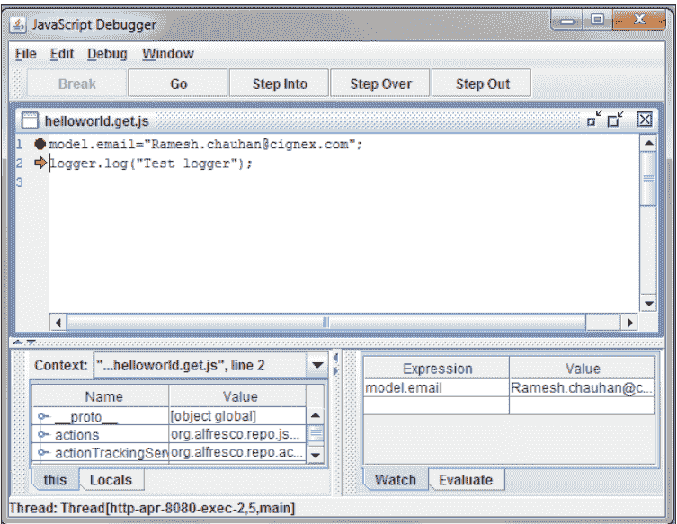
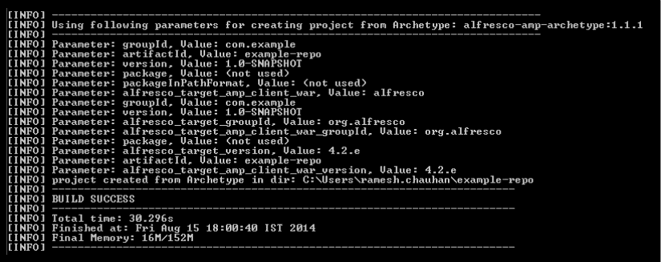
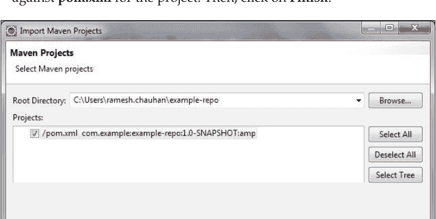
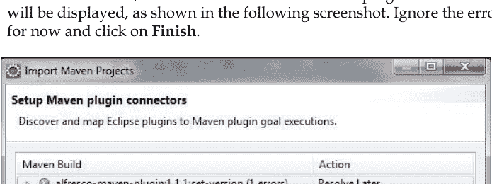
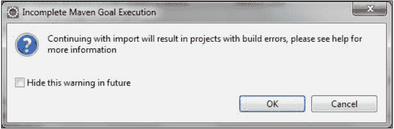
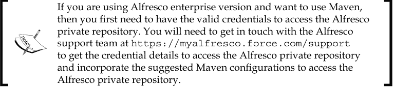

# 第8章：深入理解基于 JavaScript 的 Web 脚本

| 根对象 | 类名 | 描述 |
|---|---|---|
| activities | `org.alfresco.repo.activities.script.Activity` | 这提供了发布活动和 feed 控制的方法 |
| appUtils | `org.alfresco.repo.jscript.ApplicationScriptUtils` | 这提供了一些对外部应用程序可能有用的方法 |

除此之外，如果你在 Alfresco 安装目录中搜索 XML 文件中的 `parent="baseJavaScriptExtension"`，你将获得其他上下文文件中额外的根对象及其相关类的列表。以下是如前所述定义的其它可用根对象：`actionTrackingService`、`groups`、`formService`、`invitations`、`preferenceService`、`ratingService`、`renditionService`、`replicationService`、`siteService`、`slingshotDocLib`、`taggingService`、`thumbnailService`、`transfer`、`webprojects`、`cmisserver`、`commentService`、`bulkFSImport`、`jmx`，和 `adminIndexCheckService`。

要了解更多信息，你应该做一个简短的练习并找到这些根对象相关的 Java 类并阅读它们。这个练习将使你熟悉 JavaScript 后端控制器中可用的方法。

在开发 JavaScript 后端控制器时，基本概念很简单；查看为 JavaScript API 定义的 Java 类中可用的方法，并使用 extensionName 属性下给出的名称访问这些方法。

## 其他可用根对象

我们已经看到了其 API 方法在 Java 类中实现的根对象。Alfresco 中的 web 脚本框架还提供了一些其他默认根对象，你可以在 web 脚本的 JavaScript 控制器中使用。我们在查看 *第 3 章，理解 Web 脚本框架* 中 web 脚本执行的幕后实现时看到了执行 web 脚本时涉及的不同类。你可能想要查看 `spring-webscripts-*.jar` 和 `alfresco-remote-api-*.jar` 中的 web 脚本框架类，以详细了解这些根对象是如何在 JavaScript 控制器中提供的。以下是来自 web 脚本框架不同类的可用根对象：

AbstractWebScript 中的根对象如下表所示：

| 根对象 | 类名/对象名 | 描述 |
|---|---|---|
| webscript | org.springframework.extensions.webscripts.Description | 这提供了有关当前正在执行的 web 脚本的信息 |
| format | org.springframework.extensions.webscripts.FormatModel | 这表示渲染响应的所选格式 |
| args | 这是一个 map 对象 | 这保存传递给 web 脚本的参数 |
| argM | 这是一个 map 对象 | 这保存传递给 web 脚本的多值参数参数 |
| headers | 这是一个 map 对象 | 这保存传递给 web 脚本的请求头值 |
| headersM | 这是一个 map 对象 | 这保存传递给 web 脚本的多值请求头值 |
| guest | 这是一个 Boolean 值 | 这指示当前用户是否为访客用户 |
| url | org.springframework.extensions.webscripts.URLModel | 这提供了对 web 脚本 URL 及其各部分的访问 |
| msg | org.springframework.extensions.webscripts.ScriptMessage | 这提供了对 web 脚本的本地化消息的访问 |
| config | org.springframework.extensions.webscripts.ScriptConfigModel | 这提供了对 web 脚本的配置文档的访问 |
| formdata | object | 这保存为 web 脚本提交的表单数据 |
| requestbody | Content | 这表示请求正文的内容 |
| json | Object, JSONArray, or JSONObject | 这是从发布到 web 脚本的 JSON 请求生成的 |

## 深入理解基于 JavaScript 的 Web 脚本

`DeclarativeWebScript` 中的根对象如下表所示：

| 根对象 | 类名/对象名 | 描述 |
|---|---|---|
| model | 这是一个 map 对象 | 这将由控制器用于将数据传递给响应模板 |
| status | `org.springframework.extensions.webscripts.Status` | 这表示响应状态 |
| cache | `org.springframework.extensions.webscripts.Cache` | 这允许控制缓存 web 脚本的响应 |

`TenantRepositoryContainer` 中的根对象如下表所示：

| 根对象 | 类名/对象名 | 描述 |
|---|---|---|
| cmis | `org.alfresco.repo.cmis.client.CMISLocalConnectionManagerImpl` | 这表示 CMIS 客户端 |
| paging | `org.alfresco.repo.web.util.paging.Paging` | 这是一个分页 API |

`RepositoryContainer` 中的根对象如下：

| 根对象 | 类名/对象名 | 描述 |
|---|---|---|
| roothome | `org.alfresco.repo.jscript.ScriptNode` | 这表示存储库根节点。仅限已认证用户访问。 |
| companyhome | `org.alfresco.repo.jscript.ScriptNode` | 这表示公司主目录对象。仅限已认证用户访问。 |
| person | `org.alfresco.repo.jscript.ScriptNode` | 这表示当前已认证用户。 |
| userhome | `org.alfresco.repo.jscript.ScriptNode` | 这表示当前用户的主空间。 |

AbstractRuntimeContainer 中的根对象如下：

| 根对象 | 类名/对象名 | 描述 |
|---|---|---|
| server | org.alfresco.repo.web.scripts.RepositoryServerModel | 这提供了服务器详细信息 |
| atom | org.springframework.extensions.webscripts.atom.AtomService | 这用于解析和生成 atom 文档 |
| jsonUtils | org.springframework.extensions.webscripts.json.JSONUtils | 这用于解析和生成 JSON 对象 |
| stringUtils | org.springframework.extensions.webscripts.ScriptableUtils | 这是字符串的实用工具 |

Alfresco 中 web 脚本框架提供的大多数根对象也在响应模板中可用。如果你查看 web 脚本框架类，它们有实现可提供脚本根对象和模板根对象。一旦你了解了如何在 JavaScript 控制器中使用根对象，你也可以在响应模板中使用它们。在开发 web 脚本时，始终是一个好的做法在控制器中执行业务逻辑处理并填充 model 对象以在模板上显示输出。然而，在某些场景中，你可能也需要在需要时利用为模板提供的根对象来形成响应。

## 必知的 ScriptNode API

如果你正在创建 web 脚本并通过 JavaScript 控制器在 Alfresco 中访问或操作节点，那么你必须了解 ScriptNode API。这提供了对节点各种属性的访问，并提供了节点在安全、缩略图、所有权、版本控制、标记、转换等方面的不同有用方法。你可以阅读 ScriptNode 的代码来了解不同的方法。它的代码可在 alfresco-repository-*.jar 中找到，其完全限定类名是 org.alfresco.repo.jscript.ScriptNode。

同样，为了在响应模板中访问节点的属性并执行其他各种操作，你应该查看 alfresco-repository-*.jar 中的 org.alfresco.repo.template.TemplateNode。

## 代码示例

现在你已经了解了可在 JavaScript 控制器中使用的不同根对象，让我们看一些代码示例，以更好地理解如何将根对象付诸实践以实现所需功能。我们将介绍一些通用功能的代码示例，每个开发人员在某个时间点都会使用。我们将使用之前介绍的一些根对象。

## 创建文件夹

考虑这样一个场景：你有一个自定义前端应用程序和 Alfresco 作为后端存储库。现在，你希望用户能够从自定义前端在公司主目录下在 Alfresco 中创建文件夹。文件夹创建后，你可能还想在文件夹内创建一些内容或在文件夹上运行某些操作。首先，我们的目标是在公司主目录下创建一个文件夹。

为此，我们将创建一个新的 web 脚本 foldercreation，它将接受参数 foldername 并在公司主目录下创建同名文件夹，并以 XML 格式作为响应返回 noderef 值。你可以进一步使用返回的 noderef 根据需要调用其他 web 脚本，例如运行操作或创建内容。

在后续章节中，你将找到需要在 JavaScript 控制器和响应模板内部实现的核心代码片段，以实现上述场景。你也可以查看本章提供的代码文件，以查看此 web 脚本的 web 脚本实现。

## 检索显式参数

为了实现此场景，作为 JavaScript 控制器中的第一件事，我们需要读取参数 foldername。显式参数可以使用 args 根对象检索。因此，我们将按如下方式读取参数 foldername：

```
if (args.foldername != null && args.foldername != "")
```

> 如果你在 web 脚本 URL 中提供了隐式参数，那么这些参数将无法使用 args 根对象获取。对于它们，你可以使用 url 根对象获取其值，如 url.templateArgs.foldername。


# 在公司主目录下创建文件夹

现在，在公司主目录下创建一个文件夹。如我们之前所见，companyhome 作为根对象可用，我们可以直接使用它。它是 ScriptNode 类型的。因此，我们可以调用 ScriptNode API 中可用的方法来创建文件夹。CreateFolder() 方法返回一个 ScriptNode 对象；将该对象设置在模型中，并在响应模板中使用它，通过 TemplateNode API 获取其中的 noderef 值。

在 JavaScript 控制器中，你将有以下代码行：

```
var folderName = args.foldername;
model.foldernode = companyhome.createFolder(folderName);
```

在响应模板中，你将使用以下代码：

```
${foldernode.nodeRef}
```

我们来讨论一下刚刚完成的操作。我们在 JavaScript 控制器中使用了 args 和 companyhome 根对象，分别用于读取显式参数和创建文件夹。ScriptNode 类中的所有可用方法都可以与 companyhome 对象一起使用。

现在，我们还将了解一些其他功能，以理解根对象和 JavaScript API 的用法。我们还会查看相关的 JavaScript 代码来实现所提到的功能。

## 查找节点

在前面的示例中，Web 脚本在响应中返回了 nodeid。它是 Web 脚本中创建的文件夹的 nodeid。现在，你可能希望将第一个 Web 脚本返回的 nodeid 用作另一个 Web 脚本的输入。在另一个 Web 脚本中，你需要将 nodeid 作为参数传递，并且需要在该节点上执行一些功能，例如确定用户是否对该节点有权限、获取节点的路径、获取节点的某个属性、修改节点的某个属性、检查节点是否应用了某个方面、在其中创建内容、调用操作等等。在进行任何此类操作之前，首先我们需要根据提供的 nodeid 从存储库中找到实际的节点。这可以通过 search 根对象访问的 findNode() 方法来完成，如下所示：

```
var node = search.findNode("workspace://SpacesStore/" + args.nodeid);
```

这里，我们使用了 search 根对象，并调用了 search 根对象的 JavaScript API 中的 findNode() 方法。我们期望 nodeid 作为参数传递；因此，我们使用 args.nodeid 读取它。在调用节点的 findNode() 方法之前，我们必须构造要作为参数传递给该方法的 noderef 字符串；因此，我们将 workspace://SpacesStore/ 与 nodeid 连接起来。如果找到节点，它将返回一个表示所找到节点的 ScriptNode 对象。如果未找到节点，它将直接返回 null。

## 检查用户对节点的权限

现在，一旦找到节点，在对节点执行上一节列出的任何其他操作之前，你首先需要检查用户是否至少对该节点具有读取权限。这可以使用 ScriptNode API 中可用的 hasPermission 方法来完成，如下所示：

```
var permission = node.hasPermission("Read");
```

我们使用了 ScriptNode API 中的 hasPermission() 方法。我们已经有了一个可用的节点对象，只需调用 hasPermission() 方法并传入我们想要检查的权限。如果当前用户具有给定权限，它将返回 true。否则，它将返回 false。

## 获取节点的路径

接下来，你可能希望获取节点的路径，以确定该节点所属的文件夹层级。你可以使用 ScriptNode API 轻松获取节点的显示路径，如下所示：

```
var nodepath = node.displayPath;
```

我们从 ScriptNode 类中访问了一个变量 displayPath。ScriptNode 类中已经实现了一个 getter 方法 getDisplayPath() 来获取节点的路径。该方法将返回给定节点的显示路径。

## 检查节点的属性

现在，你想查看节点的某些属性。例如，你计划修改 description 属性。在此之前，你想在更改值之前了解当前值是什么，并希望将其记录下来以供参考。ScriptNode API 在执行与节点相关的操作时非常有帮助。借助 ScriptNode API，你可以通过以下不同方式轻松获取属性值：

```
var description = node.properties.description;
var description = node.properties["description"];
```

```
var description = node.properties["cm:description"];
var description = node.properties["{http://www.alfresco.org/model/content/1.0}description"];
```

我们刚刚看到了四种不同的读取节点属性的方式。如果你有一些自定义属性，你应该使用最后两种方式之一。

## 记录属性值

现在，在修改 description 属性之前，你想记录旧值以供参考。使用 logger 根对象，你可以简单地调用 logger 根对象的 log 方法，如下所示：

```
logger.log("before change description value : " + description);
```

我们使用了 logger 根对象，并调用 log 方法来记录属性值。每当需要在 JavaScript 控制器中添加日志时，你可以使用 `logger.log()` 方法。

## 修改节点的属性

现在，你想修改 `description` 属性。同样，借助 ScriptNode API，你可以轻松完成，如下所示：

```
node.properties.description = "change in description";
```

我们刚刚为 `description` 属性设置了一个新值。你也可以使用我们看到的其他三种方式来访问该属性并为其设置新值。

## 获取当前用户名和电子邮件

你可能想了解哪个用户调用了 Web 脚本。为此，你可能希望记录执行 Web 脚本的用户的用户名和电子邮件地址，如下所示：

```
logger.log(person.properties.username + " --- " + person.properties.email + "--- executed webscript");
```

我们使用了根对象 `person`，它基本上就是 `ScriptNode`。此外，我们获取了当前正在运行 Web 脚本的用户的用户名和电子邮件属性。你可以通过日志追踪并找出哪些用户执行了 Web 脚本；这在以后某个时候可能非常有用。

## 返回 Guest Home 节点

假设出于某种需求，你需要获取 guest home 文件夹的 noderef。这可以使用 ScriptNode API 中可用的 childByNamePath 方法来完成，如下所示：

```
model.foldernode = companyhome.childByNamePath("Guest Home");
```

在响应模板中，你可以像之前示例中那样，使用 TemplateNode API 从模型对象 foldernode 中获取 noderef 值。

我们使用了 companyhome 根对象和 childByNamePath() 方法。对于任何 ScriptNode 类型的对象，你都可以使用此方法获取其子节点的 noderef。例如，你有一个文件夹层级结构 Company Home > Testing > QA > Performance_Testing。现在，如果你有 Testing 文件夹的节点，并且想要获取 Performance_Testing 的节点，那么你可以在 Testing 文件夹节点上调用该方法，并传入路径 childByNamePath("QA/Performance_Testing")。

## 创建你自己的根对象

我们已经看到了一些在 JavaScript 控制器中使用根对象和 JavaScript API 的通用示例。现在你应该能够探索其他根对象和相关 JavaScript API，并找出哪些可以根据你的业务需求用于开发 Web 脚本。现在，让我们看一些非常有趣的内容。

考虑一个场景，你想以系统用户身份执行 JavaScript 控制器的某些部分。你首先会做的是浏览可用的 JavaScript API，以确定是否有适用于此功能的 API。经过分析，你会发现没有现成的 API 可用。然而，你发现如果 Web 脚本是 Java 后端的 Web 脚本，你可以使用 Java API 来实现。但是，你的是基于 JavaScript 的 Web 脚本。那么，接下来该怎么办？你一定在想是否也可以在 JavaScript API 中实现相同功能？不用担心，在 JavaScript 控制器中同样可以做到。你只需要创建一个自定义 JavaScript 扩展。


## 自定义 JavaScript 扩展

前面你已经了解到，每个 JavaScript API 都以 `baseJavaScriptExtension` 为父类。你可以按照以下步骤创建一个自定义 JavaScript 扩展，它将为你提供相应的 API 方法，使 Web 脚本的某一部分能够以系统用户身份运行，然后再恢复为原始用户身份来执行 Web 脚本的其他部分：

- 1. 创建一个上下文文件，并向其中添加以下 bean 条目：

  ```xml
  <bean id="customAdmin" parent="baseJavaScriptExtension"
        class="com.example.CustomAdminAPI">
      <property name="extensionName">
          <value>customauth</value>
      </property>
  </bean>
  ```

- 2. 创建一个 Java 类 `com.example.CustomAdminAPI`，该类将继承 `org.alfresco.repo.processor.BaseProcessorExtension` 类，并按如下方式声明变量：

  ```java
  net.sf.acegisecurity.Authentication auth;
  ```

- 3. 在该类中实现三个公共方法。第一个方法用于保存当前用户的身份验证信息，第二个方法用于以系统用户身份运行，第三个方法用于清除安全上下文并恢复原始用户的身份验证信息。下面就是我们刚讨论的三个方法的代码片段：

```java
public void saveCurrentUserAuthentication() {
    auth = AuthenticationUtil.getFullAuthentication();
}

public void executeAsSystemUser() {
    AuthenticationUtil.setRunAsUserSystem();
    AuthenticationUtil.setFullyAuthenticatedUser(AuthenticationUtil.
    SYSTEM_USER_NAME);
}

public void setBackOriginalUserAuthentication() {
    AuthenticationUtil.clearCurrentSecurityContext();
    AuthenticationUtil.setFullAuthentication(this.auth);
}
```

- 4. 现在，部署这些文件并重新启动服务器。

在您的 JavaScript 后端控制器中，您现在应该按如下方式使用新创建的自定义 JavaScript 扩展：

```
customauth.saveCurrentUserAuthentication();
customauth.executeAsSystemUser();
//Your piece of code you want to run as system user.
customauth.setBackOriginalUserAuthentication();
```

我们刚刚创建了一个自定义 JavaScript 扩展，并公开了一个根对象，通过该根对象您可以访问为其创建的 API 方法。这就是当您找不到所需的相关 API 时，如何创建自定义 JavaScript 扩展的方法。

## 总结

在本章中，我们全面介绍了在使用可用 JavaScript API 为 Web 脚本编写 JavaScript 控制器时可执行的所有功能。我们了解了如何从 Alfresco 代码库中识别 JavaScript API。我们还浏览了从 Alfresco 代码库中找到的暴露 JavaScript API 的常见根对象列表。

接下来，我们了解了 Alfresco 中 Web 脚本框架提供的各种其他根对象。然后，我们通过一些代码示例，了解了如何在控制器中使用根对象及相关 JavaScript API，对 Alfresco 中的节点执行一些常规操作。最后，您学习了当现有 JavaScript API 无法满足需求时，如何创建自定义 JavaScript 扩展来创建自己的根对象，并为该自定义根对象公开相应的 API 方法。总体而言，您现在已经了解了如何使用各种 JavaScript API 开发 JavaScript 控制器，从而根据业务需求构建 Web 脚本控制器。

在下一章中，我们将了解 Web 脚本开发中一些非常有用且重要的内容，例如 Web 脚本的部署、调试和故障排除。

## Web 脚本的部署、调试与故障排除

在本章中，我们将介绍以下主题：

- - Alfresco Web 脚本的部署选项
- - Web 脚本调试的详细信息
- - 与 Web 脚本相关的常见问题的一些实用故障排除指引
- - 在生产服务器上执行 Web 脚本的一些重要提示

了解两件事非常重要：一是如何部署您已开发的内容，二是当某些功能无法按预期工作时如何进行调试。如果您了解这两件事，那么您的工作就会变得更加轻松，并且可以快速找到您正在处理的项目中一些关键问题的解决方案。

在 Alfresco 中开发 Web 脚本时，Web 脚本开发的第一阶段是创建 Web 脚本，即您需要开发 Web 脚本所需的各种构建块。第二个重要阶段是部署并注册 Web 脚本，以使您创建的 Web 脚本可供 Alfresco 中的 Web 脚本框架使用。这样您就可以使用自己的 Web 脚本了。作为开发人员，了解可用于部署 Alfresco Web 脚本的各种部署选项非常重要。此外，您还应该知道如何在 Alfresco 中调试 Web 脚本。

在本章中，我们将介绍在 Alfresco 中部署 Web 脚本的各种可能方式。同时，我们还会介绍 Web 脚本的调试技巧和一些有用的故障排除指引。我们还将介绍一些非常有用的提示，这些提示在您于生产服务器上为项目执行 Web 脚本时会很有帮助。

## 部署选项

您有两种可能的方式来部署您的 Web 脚本：

- - 使用仓库选项
- - 使用文件系统选项

在 Alfresco 中创建 Web 脚本时，您可能会为项目创建 Java 后端或 JavaScript 后端的 Web 脚本。这两种 Web 脚本都可以以不同的方式进行部署。了解每种部署选项可以将 Web 脚本部署到哪些位置，以及哪种选项更适合您，这一点非常重要。

### 仓库选项

简单来说，使用仓库选项部署 Web 脚本，就是将 Web 脚本的组件文件放入仓库内的特定位置。

首先，我们来看看基于 JavaScript 的 Web 脚本的部署。基于 JavaScript 的 Web 脚本可以部署在 Alfresco 仓库中。基于 JavaScript 的 Web 脚本的所有组件，例如描述文档、JavaScript 后端控制器实现、一个或多个响应模板、任何配置文档以及可选的消息包，都可以部署在 Alfresco 仓库中。

## 理解部署位置

我们刚刚看到，使用仓库选项部署 Web 脚本时，有两个可能的位置。使用文件系统位置部署 Web 脚本时，则有四个这样的可能位置。作为开发人员，您一定想了解这两种部署选项的部署位置是如何确定的。

了解背后的技术细节会很有帮助。在注册 Web 脚本时，`org.springframework.extensions.webscripts.DeclarativeRegistry` 类总是会在注册 Web 脚本之前对 Web 脚本执行一次查找。它使用 `org.springframework.extensions.webscripts.SearchPath`，这基本上是一个 store 的集合。如果您查看 `searchPath` 集合中定义的每个 store，您会发现其中的路径位置基本上就是我们前面看到的六个部署位置。让我们来看看它在 Alfresco 中是如何作为 Spring bean 定义进行配置的。

以下是在您的 Alfresco 安装目录下的 `tomcat\webapps\alfresco\WEB-INF\classes\alfresco` 位置可找到的 `web-scripts-application-context.xml` 中 `SearchPath` 的 bean 条目。如果您使用的是 Alfresco Community 5，它位于 `alfresco-remote-api-*.jar` 内的 `alfresco` 包下。

```xml
<bean id="webscripts.searchpath" class="org.springframework.
    extensions.webscripts.SearchPath">
    <property name="searchPath">
        <list>
            <ref bean="webscripts.store.repo.extension" />
            <ref bean="webscripts.store.repo" />
            <ref bean="webscripts.store.client.extension" />
            <ref bean="webscripts.store.client" />
            <ref bean="webscripts.store.alfresco" />
            <ref bean="webscripts.store" />
        </list>
    </property>
</bean>
```

在上述 bean 定义中，`list` 属性下的前两个 bean 保存的是我们前面看到的仓库部署位置的路径，另外四个 bean 保存的是文件系统部署位置的路径。您可以查看 `web-scripts-application-context.xml` 中的这些 bean 定义，以了解更多详细信息。


你可能会有诸如如果 Web 脚本同时使用存储库部署选项和文件系统部署选项进行部署会怎样，或者如果一个 Web 脚本部署在多个位置会怎样，那么哪个位置会优先等问题。
答案很简单。Web 脚本将根据其在 SearchPath 的 Bean 定义下显示的顺序进行搜索。这意味着它首先会按顺序在存储库位置下进行搜索，然后再按顺序在文件系统位置下进行搜索。

## 选择部署选项

为 Web 脚本部署选择存储库选项或文件系统选项可以根据多个参数来决定，例如为你的项目开发的 Web 脚本数量，是否需要频繁更改 Web 脚本，团队成员是否可以访问安装了 Alfresco 的服务器机器，以及你是否希望将 Web 脚本的代码作为源代码控制树的一部分进行管理。

如果要开发大量 Web 脚本，则应选择文件系统部署选项，并将其作为源代码控制树的一部分进行管理。这样做的优点是，你可以使用用于自定义扩展的相同构建和部署工具，轻松部署构建你的业务解决方案的 Web 脚本以及其他自定义扩展代码。无需在存储库中上传 Web 脚本文件。你还必须确保可以访问安装了 Alfresco 的服务器；否则，当你想要部署并测试对 Web 脚本所做的修复，并且修复需要快速部署到实时生产系统时，你可能会遇到麻烦。

在使用存储库选项进行部署时，Web 脚本文件存在于存储库中，类似于其他内容。如果需要对 Web 脚本进行一些修改，则可以通过编辑相关文件轻松完成。因此，Web 脚本在需要时可以轻松编辑。这种方法的优点是你不需要访问安装了 Alfresco 的服务器。你只需要能够通过用户界面访问存储库。在需要部署一些快速修复以解决一些关键问题的情况下，你可以实现基于 JavaScript 的 Web 脚本，并使用存储库选项部署你的 Web 脚本。

## 调试 Web 脚本

你已经完成了 Web 脚本的开发，成功部署了它们，甚至将你的 Web 脚本注册到 Web 脚本引擎。现在，在测试 Web 脚本功能时，你发现控制器中包含的逻辑没有按预期工作。因此，你的 Web 脚本无法返回所需响应。接下来你想弄清楚出了什么问题以及为什么它们不能按应有的方式工作。现在是时候调试以识别问题，从而为你提供修复问题的线索。我们现在来看看如何启用日志记录，如何在服务器上进行远程调试，以及一些有用的调试技术。

### 启用日志记录

启用日志记录功能在调试问题时将非常有帮助。让我们了解如何在基于 Java 和基于 JavaScript 的 Web 脚本情况下使用日志记录。你应该记住的最重要的文件是 log4j.properties 文件，它位于你的 Alfresco 安装目录中的 tomcat\webapps\alfresco\WEB-INF\classes 位置。

对于调试基于 Java 的 Web 脚本，我们需要执行以下步骤：

- 1. 你可以选择在控制器 Java 实现中添加 org.apache.log4j.Logger 语句。
- 2. 然后，你需要在 log4j.properties 文件中添加你的 Java 类的条目。
- 3. 例如，你的 Web 脚本的 Java 类为 com.example.TestWebScript。在向 Java 控制器类添加适当的记录器语句后，你应该在 log4j.properties 文件中为 Java 控制器添加条目 log4j.logger.com.example.TestWebScript=debug。
- 4. 重启服务器，然后访问你的 Web 脚本；你应该能够在 catalina 日志中看到来自 Web 脚本 Java 控制器的记录器语句。

对于调试基于 JavaScript 的 Web 脚本，你将需要利用 logger 根对象，如下所示：

- 1. 你应该使用 logger.log 方法在 JavaScript 控制器中添加所需的记录器语句，以便在查看日志时获得足够的详细信息。
- 2. 要启用对基于 JavaScript 的 Web 脚本的日志，你应该在 log4j.properties 中设置 log4j.logger.org.alfresco.repo.jscript 为 debug，并且 log4j.logger.org.alfresco.repo.jscript.ScriptLogger 也为 debug。
- 3. 重启服务器，然后访问你的 Web 脚本；你应该能够在 catalina 日志中看到来自 JavaScript 控制器的记录器语句。

### 服务器上的远程调试

有时，仅使用记录器语句可能不足以识别问题，你可能还想逐步执行代码以找到问题。在这种情况下，你需要对部署在服务器上的代码进行远程调试。

为了能够远程调试基于 Java 的 Web 脚本，你应该首先在 Windows 中的 catalina.bat 文件和 Linux 中的 catalina.sh 中设置以下条目：

```
set DEBUG_OPTS=-Xdebug -Xrunjdwp:transport=dt_socket,server=y,suspend=n,address=8888
```

然后，重启服务器。这将使你能够从你的 IDE 例如 Eclipse 远程调试 Web 脚本的 Java 代码。

要调试基于 JavaScript 控制器的服务器端 JavaScript，你可以使用 Alfresco JavaScript 调试器。你可以通过以下两种方式启用调试器：

- 1. 在 log4j.properties 文件中，设置 log4j.logger.org.alfresco.repo.web.scripts.AlfrescoRhinoScriptDebugger 为 on。这将在服务器启动时显示调试器 UI。另请设置 log4j.logger.org.alfresco.repo.jscript.ScriptLogger=debug。
- 2. 访问调试器 Web 脚本 URL，http://localhost:8080/alfresco/service/api/javascript/debugger。它将在屏幕上显示启用按钮。点击它以打开 Alfresco JavaScript 调试器 UI。

使用此调试器调试 JavaScript 控制器代码非常容易。

你只需通过 File | Open 打开控制器文件，并为其添加调试点。现在，访问你想要调试的 Web 脚本。

控制将进入调试器，你现在可以调试代码。调试时有 Step Into、Step Over 或 Step Out 等选项会很有帮助。此外，你还可以监视调试时变量的值。

## 部署、调试和故障排除 Web 脚本

以下是供你参考的 Alfresco JavaScript 调试器用户界面的屏幕截图。要调试 share Web 脚本，只需将之前的 URL 中的 alfresco 替换为 share 即可。



Alfresco JavaScript Debugger UI

Alfresco JavaScript 调试器可以在 Alfresco 作为服务运行时或从控制台运行时访问。要使用它，你需要确保你没有在无头服务器上运行，否则它将不会显示调试器 UI。此外，当 Alfresco 作为服务运行时，你在使用调试器 UI 时可能会遇到问题。一般来说，你应该在通过控制台启动 Alfresco 服务器后使用调试器 UI，而不是让 Alfresco 服务器作为服务启动。这将节省你大量时间，让你专注于调试与 Web 脚本相关的问题，而不是调试当服务器作为服务启动时调试器 UI 的问题。

### 其他调试技术

让我们看看一些可能非常有用的其他调试技术：

- - 当你的 Web 脚本无法工作时，你还应该检查它是否已正确注册到 Alfresco Web 脚本引擎。你可以访问 `http://localhost:8080/alfresco/service/index` 并从可用的各种浏览 Web 脚本的选项中定位你的 Web 脚本，例如按包或按 URI 浏览所有内容。点击它后，它将显示描述符、JavaScript 控制器和响应模板。你可以确保 JavaScript 控制器包含你为修复问题而添加的所有修复或修改。
- - 在你的 Web 脚本中，当你处理节点的某些属性、节点的权限等时，你也可以从 `nodebrowser` 获得帮助。使用 `noderef`，你可以查明节点上设置的属性、其子节点、应用在其上的方面、与其他节点的关联以及节点的权限等详细信息，这在为你的问题修复进行调试时也可能对你有用。你还可以使用 `nodebrowser` 中提供的其他功能，例如执行 lucene 查询的能力，这在你想要验证 Web 脚本控制器使用的 lucene 查询时也可能有所帮助。

## 故障排除指针

在了解了在 Alfresco 中调试 Web 脚本的不同方法后，让我们看看在处理 Alfresco Web 脚本时可能会遇到的一些常见问题的故障排除指针。

### 一个有效的 SecureContext 错误

你有时可能会遇到错误 **A valid SecureContext was not provided in the RequestContext**。出现此错误的原因可能有很多。一些原因如下：

- - 当你在 Web 脚本描述文档中将身份验证设置为 `none`，并且在控制器中尝试调用需要身份验证的 Alfresco 的某些公共服务时，例如调用 `toDisplayPath()` 方法，它将给出上述异常。
- - 如果你的 Web 脚本具有基于 JavaScript 的控制器，并且你使用存储库选项部署了它，并且身份验证设置为 `none`，当你尝试访问你的 Web 脚本时，你将收到上述异常。


## Web Script 格式未注册

在 Alfresco 中开发 Web 脚本时，当你尝试访问 Web 脚本时，可能会遇到如下错误：**Web Script format " is not registered**。

原因是：如果你有一个基于 JavaScript 的控制器，或一个扩展 `DeclarativeWebScript` 类的 Java 控制器，并且在 Web 脚本的描述文档中将默认格式指定为空值（例如 `<format default="">`），就会出现这个错误。

> 如果你使用存储库选项部署基于 JavaScript 的 Web 脚本，请确保 Web 脚本已设置身份验证级别，并且不应将其设置为 none。

> 当你希望在不使用模板的情况下自行控制并返回响应时，应该使用扩展 `AbstractWebScript` 类的基于 Java 的控制器。在这种情况下，在 Web 脚本描述文档中将默认格式指定为空值不会导致上述错误。

## 无法定位模板的模板处理器

对于你的 Web 脚本，你已经创建了描述文档、必需的控制器实现和必需的响应模板。但是，当你尝试执行 Web 脚本时，却收到了如下错误：**Cannot locate template processor for template example/contentlocation.get.xml**。

看到这个错误，你首先会想：模板明明已经放好了，为什么还会出现这个错误？有时，要找出问题所在确实非常棘手。这里的情况也是如此。导致这个错误的原因是模板名称不符合 Web 脚本的命名约定。它应该是 `contentlocation.get.xml.ftl`，而不是 `contentlocation.get.xml`。

> 你必须始终确保遵循 Web 脚本的命名约定，并始终将 Web 脚本文件部署到正确的位置。如果你有基于 Java 的控制器，请确保其 bean ID 已按预期指定。

## 脚本 URL 不支持该方法

简单来说，这个错误通常发生在你没有使用适当的方法调用 Web 脚本时。例如，当你有一个 POST Web 脚本，却用 GET 请求调用它时，就会看到“脚本 URL 不支持该方法”（script URL does not support the method）的错误。为了避免这个错误，你应该始终使用适当的方法来调用 Web 脚本。

## 在生产服务器上运行 Web 脚本

生产服务器听起来很有趣，不是吗？是的，这是最重要的事情。在从事线上项目、为你的客户提供以 Alfresco 作为后端存储库的生产系统支持时，你可能需要根据业务需求编写不同的 Web 脚本。由于生产服务器要处理的内容数量远多于开发服务器，这些脚本的执行时间可能会更长。例如，你可能需要编写一个修补脚本，为现有节点添加额外属性；或者可能需要编写一个 Web 脚本，检索符合某些特定条件的记录。下面我们来看看在生产服务器上运行这类 Web 脚本时需要注意什么。

## 在后台运行 Web 脚本

你编写的 Web 脚本在对大量内容执行时，可能需要更长的处理时间。在这种情况下，你不能从浏览器访问 Web 脚本并一直等待响应返回。对于这类需要在生产服务器上运行的 Web 脚本，可以选择的一种方法是在后台运行 Web 脚本，并直接从服务器本身调用 Web 脚本，这样你就不必担心调用客户端与服务器断开连接。

为了能够在后台运行 Web 脚本，一种方式是通过 shell 脚本调用 Web 脚本。然后，你可以在服务器上以后台方式运行该 shell 脚本。可以使用以下示例命令在后台运行 shell 脚本：

```sh
nohup execute-webscript.sh > webscript.log &
```

该命令会在后台运行 `execute-webscript.sh`（这个 shell 脚本基本上就是用来调用你的 Web 脚本的），并将 shell 脚本的执行日志输出到 `webscript.log` 文件中。你可能还想实现一个电子邮件通知功能，在 Web 脚本执行完成后触发一封电子邮件，这样你就不必频繁监控日志，而可以在 Web 脚本执行完成后收到通知。

现在，你需要备份 Web 脚本的模板。例如，将描述文件和响应模板重命名为 `*.bak`。然后，访问 http://localhost:8080/alfresco/service/index 刷新 Web 脚本。此时，该 Web 脚本即被禁用，你将无法再访问它。

## 小结

在本章中，我们了解了 Alfresco 中 Web 脚本可能的部署选项，并理解了 Alfresco 的 Web 脚本框架在多个位置部署时如何决定 Web 脚本的优先级。我们还了解了一些有助于你按需选择部署选项的因素。我们还了解了如何调试 Web 脚本，以找出 Web 脚本出了什么问题。我们还介绍了一些处理 Web 脚本时可能遇到的常见问题的故障排除要点。最后，我们还介绍了一些在生产服务器上运行 Web 脚本时可能有用的提示和技巧。总的来说，现在你已经很好地理解了如何在 Alfresco 中部署和调试 Web 脚本；下次需要在生产服务器上运行 Web 脚本时，你也可以与其他开发人员或项目经理分享一些想法，说明如何实现在生产服务器上执行 Web 脚本。

现在，当你需要开发大量 Web 脚本时，由于你将在一个团队中工作，如果没有项目结构，就无法完成开发；而且最终所有代码都应放在源代码控制树中。建立用于开发 Web 脚本的开发项目非常重要。在下一章中，我们将了解如何在 Eclipse 中建立一个可以使用 Maven 构建的开发项目。

## Maven 化 Web 脚本

在本章中，我们将介绍以下主题：

- 使用 Maven 搭建开发环境
- 使用 Alfresco Maven SDK 创建默认项目结构
- 使用 Maven 构建 **Alfresco 模块包（AMP）**
- 在 Eclipse 中搭建开发环境
- 理解默认项目结构
- 扩展默认项目结构以创建 Web 脚本
- 使用 Maven 将 AMP 应用到 Alfresco WAR，以便在本地测试开发的 Web 脚本
- 在 Alfresco 企业版中使用 Maven 需要了解的事项

## Maven 化 Web 脚本

到目前为止，在探索 Alfresco Web 脚本的过程中，我们已经了解了如何开发和部署 Web 脚本。在前几章中，我们没有为开发的 Web 脚本使用任何项目结构，也没有使用任何工具来构建 Web 脚本。我们只是在自己选择的编辑器中创建 Web 脚本所需的文件，然后手动将 Web 脚本文件部署到文件系统中的相应位置。由于 Web 脚本数量较少，而且我们只是为了理解 Web 脚本才这样做，所以这种方法是可行的。

但是，请考虑这样一种场景：你必须为项目开发大量 Web 脚本。在这种情况下，单独创建 Web 脚本文件并手动部署就不是合适的选择。此时，你绝对需要遵循一种项目结构来开发 Web 脚本。此外，你还需要一种 Web 脚本部署机制，这样无需手动传输 Web 脚本文件，就能轻松有效地将所有 Web 脚本部署到服务器上。

现在，你可能会有几个问题，例如：如何建立项目结构来开发 Web 脚本？可以使用哪种部署工件（deployment artifact）在 Alfresco 中部署 Web 脚本？可以使用什么工具来构建所需的部署工件？在使用该工具之前，需要考虑并准备好哪些先决条件？我是否需要详细了解该工具？我该如何着手？

不用担心这些问题。我们将在本章中找到解决方案。

首先，我们简要回答一下前面的问题。你应该使用 Alfresco Maven SDK 创建项目。它本质上是一个社区项目，同时得到 Alfresco 的支持，提供了一种非常易用的方式来为 Alfresco 创建扩展。你应该使用 **Alfresco 模块包（AMP）** 作为部署工件。AMP 本质上是一个 ZIP 文件，具有特定的文件夹结构，其中包含你为 Alfresco 项目开发的所有必需文件。通常，在目标服务器上部署时，会使用 **模块管理工具** 将 AMP 文件应用到原版 Alfresco WAR 文件中。你可以使用 Apache Maven 来构建 AMP 文件，将其作为所需的部署工件。Apache Maven 本质上是一个构建管理工具，它能够理解项目的 JAR 依赖项并检索它们。

如果你不熟悉 Maven，或者对 Maven 没有了解，也没关系。本章不会深入探讨 Alfresco Maven SDK、AMP 和 Maven。我们之前已经对它们是什么做了基本介绍，目前这些已经足够让你开始使用了。本章的主要目标是让你基本了解如何使用 Alfresco Maven SDK 创建定义好的项目结构、让项目可在 Eclipse 中使用、构建 AMP 作为 Web 脚本开发的部署工件，以及如何使用 Maven 将 AMP 应用到开箱即用的 Alfresco WAR 中以测试功能。


## 设置开发环境

在开始之前，重要的是要了解 Alfresco Maven SDK 与 Alfresco Community 4.2 及以上版本、Alfresco Enterprise 4.1.2 及以上版本兼容。有趣的是，使用 Alfresco Maven SDK 时，你无需在机器上手动安装 Alfresco。Alfresco Maven SDK 将使你的工作更加轻松，它会根据项目对象模型（POM）XML 中为版本和 groupId 提供的条目，自动在你的机器上下载 Alfresco。

现在，在开始使用 Alfresco Maven SDK 创建项目之前，让我们首先确保开发机器上已经安装了所需的前置条件：

- 你需要在机器上安装并正确配置 JDK 1.7。**Java 开发工具包（JDK）** 基本上是一个使用 Java 编程语言构建应用程序的开发环境。你可以从 `http://www.oracle.com/technetwork/java/javase/downloads/jdk7-downloads-1880260.html` 下载。下载并安装后，请确保设置 JAVA_HOME 环境变量以及 **Path** 变量。

- 你需要安装并正确配置 Apache Maven 3.0.3 或更高版本。你可以从 `http://maven.apache.org/download.cgi` 下载。你还会找到基于你所用操作系统的安装说明。成功下载并安装后，请确保环境变量 M2E_HOME 已正确设置，并且相应修改了 **Path** 变量。

现在，让我们通过运行 `mvn -version` 命令来检查 Maven 是否指向正确的 JDK 安装，并确保你已安装正确版本的 Maven。在 Windows 机器上，从命令提示符运行此命令将显示有关 Maven 版本、Maven 主目录、Maven 使用的 Java 版本以及 Java 主目录的信息：

```
C:\Users\ramesh.chauhan>mvn -version
Apache Maven 3.0.4 (r1232337; 2012-01-17 14:14:56+0530)
Maven home: D:\apache-maven-3.0.4\bin\..
Java version: 1.7.0_51, vendor: Oracle Corporation
Java home: C:\Program Files\Java\jdk1.7.0_51\jre
Default locale: en_US, platform encoding: Cp1252
OS name: "windows 7", version: "6.1", arch: "amd64", family: "windows"
```

## 探索 Alfresco Maven 仓库

Alfresco Maven 仓库基本上是一个公共位置，所有与 Alfresco 相关的依赖 JAR 都保存在那里，你可以在项目的 pom.xml 文件中配置项目以引用仓库中的所需依赖。你可能希望探索 Alfresco Maven SDK 将使用的 Maven 仓库。访问 https://artifacts.alfresco.com/nexus/#view-repositories 并探索包含已发布和稳定工件的公共发布仓库。此外，在 https://artifacts.alfresco.com/nexus/service/local/repo_groups/public/content/archetype-catalog.xml 的 archetype-catalog 下，可以找到不同的可用默认项目模板，这些模板在 Maven 术语中称为原型（archetype）。

## 为 AMP 创建默认项目结构

为了创建 AMP 的项目结构，我们将使用 Alfresco Maven SDK 提供的项目模板。这个默认项目模板基本上被称为 AMP 原型。此项目模板有助于为你将为项目开发的 Alfresco 扩展提供标准化的开发、部署和发布方法。Alfresco AMP 原型可用于在需要时创建 repository 和 share 的 AMP。在本章中，我们将使用 AMP 原型来开发 repository web scripts。

> Alfresco Maven SDK 还提供了另一个有用的原型，称为 All-in-One 原型，它基本上是一个多模块项目，并提供了 Alfresco 平台及其组件的完整安装，无需额外下载。在探索 archetype-catalog.xml 时，你可能已经注意到有很多可用的原型。重要的原型，即 Alfresco AMP 原型和 All-in-One 原型，可以通过 archetype-catalog.xml 中具有 org.alfresco.maven.archetype group ID 来识别。

为了使用 Alfresco AMP 原型创建默认 AMP 项目，请执行以下步骤：

1. 从控制台运行以下命令。这里需要注意，如果 https 链接对你不适用，你可以在以下代码片段中尝试使用 http 代替 https：

```
mvn archetype:generate -DarchetypeCatalog=https://artifacts.alfresco.com/nexus/content/groups/public/archetype-catalog.xml -Dfilter=org.alfresco.maven.archetype:
[INFO] Scanning for projects...
[INFO] Building Maven Stub Project (No POM) 1
[INFO] >>> maven-archetype-plugin:2.2:generate (default-cli) @ standalone-pom >>>
[INFO] <<< maven-archetype-plugin:2.2:generate (default-cli) @ standalone-pom <<<
[INFO] --- maven-archetype-plugin:2.2:generate (default-cli) @ standalone-pom ---
[INFO] Generating project in Interactive mode
[INFO] No archetype defined. Using maven-archetype-quickstart (org.apache.maven.archetypes:maven-archetype-quickstart:1.0)
```

2. 您将看到可用的原型及其简要说明，如下面的屏幕截图所示。系统将提示您选择一个原型。输入 1 并按回车，如下面的屏幕截图所示：

```
Choose archetype:
1: https://artifacts.alfresco.com/nexus/content/groups/public/archetype-catalog.xml -> org.alfresco.maven.archetype:alfresco-amp-archetype [Sample project with full support for lifecycle and rapid development of AMPs (Alfresco Module Packages)]
2: https://artifacts.alfresco.com/nexus/content/groups/public/archetype-catalog.xml -> org.alfresco.maven.archetype:alfresco-allinone-archetype [Sample multi-module project for All-in-One development on the Alfresco platform. Includes modules for Repository, AMP, Share, Solr, Web Quick Start and embedded Jetty run]
Choose a number or apply filter (format: [groupId:artifactId, case sensitive contains]): : 1
```

3. 在下一步中，系统将要求您选择作为项目基础的原型版本。这将列出您所选原型的可用版本。您也可以从 archetype-catalog.xml 文件中找到这些版本。对于 AMP 原型，1.1.1 是目前的最新版本。因此，输入 5 并按回车，如下面的屏幕截图所示：

```
Choose org.alfresco.maven.archetype:alfresco-amp-archetype version:
1: 1.0
2: 1.0.1
3: 1.0.2
4: 1.1.0
5: 1.1.1
Choose a number: 5: 5
```

4. 接下来，系统将提示您为 groupId 提供值，您可以将其视为 Java 术语中的包名。您可以为您的项目提供任何适合的名称。在这里，我们将提供 com.example 作为 groupId，如下面的代码所示：

```
Define value for property 'groupId': : com.example
```

7. 现在，在 Maven 进行一些处理后，它将在控制台上显示 **构建成功** 消息，并显示从原型创建的项目位置作为信息性消息，如下面的屏幕截图所示：



它已为 Alfresco 项目生成所需的示例项目结构，以生成 AMP 文件。现在，您可以转到创建默认项目结构的位置并进行探索。这里项目结构创建在 `C:\Users\ramesh.chauhan\example-repo` 位置。在生成的项目结构中，您会发现的最重要文件是 `pom.xml`，每个 Maven 项目基本上都使用它来向 Maven 指示项目依赖关系。除了 `pom.xml`，生成的项目结构还包含默认配置文件、示例 Java 代码及其支持的单元测试，以及用于测试的运行本地 Alfresco 实例的配置。

## 从默认项目生成 AMP

一旦默认项目结构准备就绪，让我们尝试为其生成 AMP 文件。转到所创建项目结构的位置。要为其创建 AMP 文件，请运行 `mvn package -DskipTests=true` 命令。

在这里，我们在生成 AMP 时并不想运行测试；因此，我们明确将 `skipTests` 设置为 true。如果您也想运行测试，则只需执行 `mvn package` 命令。


运行上述命令应该会在我们创建的项目内的 target 文件夹下生成一个名为 `example-repo-amp` 的 AMP 文件。你可以使用任何 ZIP 解压工具打开该 AMP 文件并进行浏览。

> 你可以使用默认项目结构，不仅可以创建 Web 脚本，还可以对 Alfresco 进行其他自定义，例如自定义操作、自定义内容模型、自定义工作流等，并创建 AMP 以便它们可以部署。

现在，运行 `mvn clean` 命令，它将清理 target 文件夹。因此，生成的 AMP 文件也会被移除。我们这样做是故意的，因为我们希望回到默认项目结构，并将项目结构导入 Eclipse。同时，我们也想了解默认项目结构中包含哪些文件和目录。

## 使用 Eclipse 设置开发环境

在此阶段，由 Alfresco Maven SDK 提供的原型创建的项目结构已经就绪于文件系统中。下一步，我们希望能在 Eclipse 中获得相同的项目结构，以便在 Eclipse IDE 中按照定义好的项目结构开始开发 Web 脚本。你可以根据所用操作系统，从 `http://www.eclipse.org/downloads/packages/` 上提供的不同发行包中下载 Eclipse IDE。只需确保它支持 Maven 插件。

> 在本章中，我们将使用 Luna 发行包中的 Eclipse Java EE IDE，它内置了 Maven 支持。你可能会使用其他版本的 Eclipse，因此需要确保如果它没有内置 Maven 支持，则已为 Eclipse IDE 添加 Maven 插件。为 Eclipse IDE 添加 Maven 插件是一个简单的过程，你应该可以轻松完成。

现在，要将默认项目结构导入 Eclipse，请执行以下步骤：

1. 打开 Eclipse IDE。点击**文件 | 导入 | Maven | 现有 Maven 项目**，然后点击**下一步**。

2. 在显示的屏幕中，导航到本地文件系统上的项目位置，然后点击“确定”。随后，它应该在项目的 pom.xml 前显示一个选中的复选框。然后，点击“完成”。



3. 在下一个屏幕上，将显示一个关于 Alfresco Maven 插件 set-version 的错误，如下面的截图所示。暂时忽略该错误，点击“完成”。



4. 随后会显示一个“不完整的 Maven 目标执行”弹出窗口，如下面的截图所示。点击“确定”。



5. 你可能会看到要求安装构建辅助插件的窗口。如果你愿意，可以继续，或直接点击“取消”。项目 example-repo 现在将出现在 Eclipse 中；但上面的红色标记表示存在一些错误。如果你查看“标记”（Markers）选项卡，就会看到前面忽略的与 Maven 插件相关的错误。右键点击它，然后点击“快速修复”（Quick Fix）。选择“永久将 pom.xml 中的 set-version 目标标记为在 Eclipse 构建中忽略”选项。它会显示一个选择 POM 位置的选项。选择 POM 位置并点击“确定”。

6. 现在，右键点击 example-repo 项目。转到“Maven | 更新项目”，然后点击“确定”。项目现已成功导入，除了默认包中 Java 类的未使用导入警告消息外，没有错误。你可以忽略这些警告。

> 首次在 Eclipse 中导入项目时，如果遇到任何与构建路径相关的错误，请确保像上一步那样更新项目，并确保所有 Maven 依赖项都已下载到本地机器上。

现在，我们已将默认项目结构作为 Maven 项目导入 Eclipse IDE。

## 理解默认项目结构

既然已经在 Eclipse 中导入了项目，现在让我们浏览一下项目结构，以了解其中重要的文件和目录：

| 项目结构中的文件/目录 | 简要说明 |
|---|---|
| `pom.xml` | 对于任何 Maven 项目，pom.xml 都是必需的，以便让 Maven 了解项目依赖关系。pom.xml 文件直接位于项目目录下。如果你查看 pom.xml，就会获得有关项目依赖关系、仓库信息和其他重要信息的所有详情。此外，在我们项目的 pom.xml 中，你应该能够看到我们使用 Maven 原型生成项目时提供的设置。如果你愿意，可以在此处更改这些设置，然后像之前那样更新项目。Maven 随后会考虑这些更新并处理相应事宜。 |
| `src/main/java` | 该目录将用于放置项目的 Java 源代码。你可以将 Java 类组织到此位置下合适的包中。你将为项目开发的 Web 脚本的 Java 控制器应放置在此位置。除了 Web 脚本控制器之外，你还可以放置用于其他自定义（例如自定义操作等）的 Java 类。构建项目时，放置在此处的 Java 类将包含在作为部署工件生成的 AMP 内的 JAR 文件中。当 AMP 应用到 Alfresco WAR 文件时，JAR 文件将部署到 WEB-INF/lib 下。 |
| `src/main/amp` | 所有与 AMP 相关的必要详情都位于此位置。module.properties 文件是 AMP 结构的重要文件。它包含有关 AMP 文件的详细信息，例如 AMP 的 ID、版本、依赖项，以及运行它所需的 Alfresco 最低和最高版本。位置 src/main/amp/config/alfresco/module/example-repo 是 AMP 的核心，将包含 Spring 配置上下文文件、内容模型文件等重要文件。你可以在 src/main/amp/config/alfresco 下创建 extensions、messages 文件夹，以包含 Web 脚本组件文件。 |
| `src/test` | 与单元测试用例相关的实现以及运行单元测试用例的配套配置将放置在此处。只需查看此位置下可用的默认文件夹，你就会了解默认文件夹内部包含什么。 |

## 扩展默认项目以创建 Web 脚本

在前几章开发 Web 脚本时，我们没有遵循任何项目结构，而是在我们选择的编辑器中独立开发 Web 脚本所需的文件，然后手动将它们部署到已安装的 Alfresco 目录中的适当位置。现在，既然已经理解了项目结构和 AMP 部署包，是时候探索如何扩展默认项目结构来创建 Web 脚本了。在开发新的 Web 脚本时，让我们试着了解应该将 Web 脚本相关文件放置在项目结构中的什么位置：

-   Web 脚本描述符文件（\*.desc.xml）、Web 脚本的响应模板（\*.ftl）、Web 脚本的配置文档（\*.config.xml）和消息包（\*.properties）应放置在 src/main/amp 位置下。在 src/main/amp/config/alfresco 中可用的默认结构内，创建一个新的文件夹结构 /extension/templates/webscripts，以存储你将创建的所有新 Web 脚本。然后，你可以在此位置内将 Web 脚本分类到不同的包中，例如，所有与登录相关的自定义 Web 脚本及其描述符、响应模板、配置文档和消息包都可以放在 src/main/amp/config/alfresco/extension/templates/webscripts/login 位置下。
-   对于基于 JavaScript 的 Web 脚本，控制器实现（\*.js）也应与前面提到的其他文件一起放置在同一位置。
-   对于 Java 后端的 Web 脚本，控制器实现（\*.java）应放置在 src/main/java 内合适的包结构下。
-   对于 Java 后端的 Web 脚本，将控制器与 Web 脚本关联的 Spring 配置上下文文件应放置在 src/main/amp/config/alfresco/extension 下。你也可以将来自 Java 控制器的 Spring bean 映射条目放在 src/main/amp/config/alfresco/module/proj-name 下的 module-context.xml 文件中。

> 一旦通过运行 Maven package 为项目生成 AMP，你应该能看到所有 Java 类都被放入一个 JAR 文件，而其他文件则按照我们在项目结构中的放置方式被适当地置于 AMP 文件中。现在，你可以将这个 AMP 文件交给其他服务器进行部署。


## 将 AMP 应用到 Alfresco WAR 以进行测试

在按照前面的项目结构完成项目的 web 脚本开发后，为你的项目创建一个 AMP 文件，并在将 AMP 文件移交到其他服务器部署之前先进行测试。为了在本地测试你的 web 脚本，你首先需要将 AMP 应用到 Alfresco WAR 文件。使用 Alfresco Maven SDK，你无需在本地安装 Alfresco 即可应用 AMP。从控制台进入项目的目录，然后只需执行 `mvn integration-test -Pamp-to-war` 命令即可。

运行上述命令后，你会看到 Maven 正在下载所有必要的依赖项以编译项目。这将为项目创建 AMP 文件，将 AMP 文件应用到开箱即用的 Alfresco WAR，然后将 WAR 部署到嵌入式 Tomcat 服务器，最后启动服务器。你应该能从控制台输出中看到项目的 AMP 模块已成功生成并被 Alfresco 服务器识别。

你可以登录 Alfresco 服务器 `http://localhost:8080/alfresco`，并访问你所开发的 web 脚本的 web 脚本 URL。测试完成后，请确保关闭正在运行的服务器。你可以简单地在运行 Maven integration 命令的控制台上按 `Ctrl + C` 来关闭服务器。

> 如果在运行之前的 integration test 命令时遇到内存不足错误，你需要增加分配给 Alfresco 和 Tomcat 的内存大小。你可以通过为 Maven 提供额外的 JVM 内存设置来做到这一点，例如增加 PermGen 大小。

我们刚刚看到，在开发机器上之前未安装 Alfresco 的情况下，我们能够借助 Alfresco Maven SDK 非常轻松地测试我们的定制开发。我们所做的只是执行了一个命令，Maven 为我们完成了所有必要的工作，使工作变得更容易，让我们可以更专注于开发，而不必担心在本地机器上下载和设置 Alfresco、生成 AMP 以及将其部署到 Alfresco WAR 等事情。



## 摘要

在本章中，我们对如何借助 Alfresco Maven SDK 提供的 Maven 支持，使你的 Alfresco web 脚本开发和部署体验变得简单有了基本的了解。首先，我们介绍了设置先决条件以使用 Maven 设置开发环境。我们了解了如何创建默认的项目结构，以便创建 Alfresco 部署包 AMP，然后我们了解了如何为默认项目结构生成 AMP。之后，我们将项目导入 Eclipse IDE 并设置开发环境，然后了解了默认项目结构中存在的各种文件和目录。

我们随后研究了如何扩展默认项目结构以使用 JavaScript 和 Java 开发项目的 web 脚本。此外，我们还学习了如何使用 Maven 命令将 AMP 应用到 Alfresco WAR，以便在本地机器上未安装 Alfresco 的情况下测试已开发的功能。最后，我们介绍了如何使用 Maven 与你的 Alfresco 企业版一起使用。总的来说，你现在对使用 Maven 支持进行 Alfresco web 脚本开发有了基本的了解，可以开始着手。

在下一章中，我们将研究如何扩展 Alfresco 中的 web 脚本框架。
