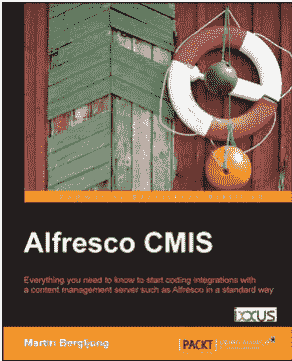
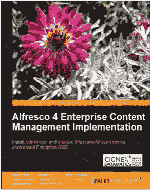
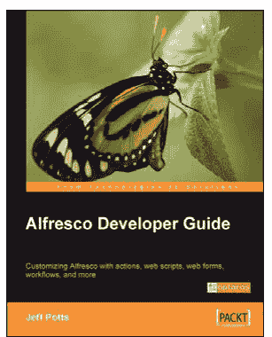
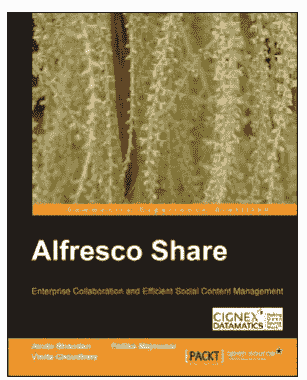

## 索引
## 符号

<args> 元素 60
<authentication> 元素
  admin 值 55
  guest 值 54
  none 值 54
  user 值 55
<cache> 元素
  about 57
  mustrevalidate 值 57
  never 值 57
  public 值 57
<family> 元素 56
<format> 元素
  about 53
  any 值 54
  argument 值 53
  extension 值 53
<formdata> 元素 59
<lifecycle> 元素
  about 58
  deprecated 值 59
  draft_public_api 值 59
  draft 值 59
  internal 值 59
  none 值 58
  public_api 值 59
  sample 值 58
<negotiate> 元素 58
<requests> 元素 60
<responses> 元素 60
<shortname> 标签 51
<transaction> 元素
  about 55
  none 值 55
  required 值 56
  requiresnew 值 56
<url> 标签 52
<webscript> 标签 51

## A

AbstractWebScript
  与 DeclarativeWebScript 对比 92, 93
Alfresco
  JavaScript API 96
  Web 脚本框架 34
  Web 脚本，创建 18-20
Alfresco Explorer 验证器 42
Alfresco Maven 仓库
  关于 128
  URL 128
Alfresco Maven SDK
  Alfresco Maven 仓库 128
  环境设置 127
Alfresco Maven SDK 先决条件
  Apache Maven 3.0.3 127
  JDK 1.7 127
Alfresco 模块包。参见 AMP
Alfresco Share
  Web 脚本，从 Alfresco Share 调用 73-75
Alfresco WAR
  使用 AMP 测试 137, 138
Alfresco Web 脚本 8
AMP
  关于 126
  应用 AMP 到 Alfresco WAR 进行测试 137, 138
  默认项目结构，创建 128-131
  从默认项目结构生成 131

AMP 原型 128
Apache HTTP 组件 72
Apache Maven 3.0.3
  下载 URL 127
参数
  将参数添加到 Web 脚本 21
  为 Web 脚本选择参数 28
  为 Web 脚本指定参数 27

## C

Chrome 网上应用店
  URL 69
客户端限制
  处理 77
客户端 JavaScript
  Web 脚本，从客户端调用 75
CMIS
  与 Web 脚本对比 10, 11
代码示例，JavaScript 控制器
  关于 104
  电子邮件，获取 107
  显式参数，检索 104
  文件夹，创建 104
  文件夹，在 company home 下创建 105
  guest home 节点，返回 108
  节点路径，获取 106
  节点属性，检查 106
  节点属性，修改 107
  节点，搜索 105, 106
  属性值，记录 107
  用户名，获取 107
  用户权限，在节点上检查 106
命令行
  Web 脚本，从命令行调用 76
组件支持，Web Script 容器
  配置服务 45
  格式注册表 45
  脚本处理器注册表 45
  搜索路径 46
  模板处理器注册表 45
  Web 脚本注册表 45
组件，Web 脚本
  配置文档 65
  控制器实现 61
  描述文档 50
  I18N 63
  命名约定 66
组件，Web 脚本框架
  Web Script 验证器 39, 41
  Web Script 容器 39, 43
  Web Script 运行时 39, 40
  连接 46
配置文档
  关于 65
  在控制器中访问 65
  在模板中访问 65
控制器
  添加到 Web 脚本 22, 23
  配置，访问 65
  实现 61
  Java 控制器 62, 80
  基于 JavaScript 的控制器 61, 80
  巧妙使用 93
控制器，MVC 模式 13
cURL
  安装 76
  URL 76
自定义验证器
  实现 145-148
自定义根对象
  创建 108
  自定义 JavaScript 扩展，创建 109, 110
自定义模板处理器
  实现 149
自定义 Web 脚本容器
  关于 143
  创建 144
  实现 143, 144
自定义 Web 脚本运行时
  关于 141
  创建 142
  实现 141

## D

DeclarativeWebScript
  与 AbstractWebScript 对比 92, 93
默认项目结构
  关于 135
  AMP，从默认项目结构生成 131
  为 AMP 创建 128-131
  扩展，用于创建 Web 脚本 136
  导入到 Eclipse 132-134
  pom.xml 文件 135
  src/main/amp 目录 135
  src/main/java 目录 135
  src/test 目录 135
DELETE 请求 26
部署架构，Web 脚本框架 46
部署选项，Web 脚本
  部署位置 114
  文件系统选项 112, 113
  仓库选项 112, 113
  选择 115
描述文档
  关于 50, 51
  创建 82
  必需声明 51
  可选声明 53
开发环境
  使用 Eclipse 设置 132-134

## E

Eclipse
  默认项目结构，导入到 Eclipse 132-134
  开发环境，设置 132-134
执行流程，Web 脚本
  关于 34
  整体执行流程 34, 35
  技术细节 36-38
显式参数
  为 Web 脚本指定 27, 28

## F

Facebook 验证器 43
Facebook 运行时
  关于 41
  实现 41
文件系统选项
  关于 113
  使用 112, 113
Firefox 附加组件
  URL 69
格式注册表 45
格式
  自定义 149

## G

GET 请求 26

## H

hello world Web 脚本
  资源包，添加 64
HTTP 基本验证器 42
HttpClient
  关于 70
  Apache HTTP 组件 72
  RestTemplate 72
  URLConnection 71
  用于调用 Web 脚本 70, 71
HTTP 方法
  注意事项 26, 27
  DELETE 请求 26
  GET 请求 26
  POST 请求 26
  PUT 请求 26
  用于开发 Web 脚本 25, 26

## I

I18N，Web 脚本
  关于 63
  资源包，为 hello world Web 脚本添加 64
  响应模板，为标签使用而修改 64
隐式参数
  为 Web 脚本指定 28

## J

基于 Java 的控制器。参见 Java 控制器
基于 Java 的 Web 脚本
  构建块 81
  组件，识别 81
  调试 116
  部署 88
  描述文档，创建 82
  禁用 122
  功能 81
  注册 88
  响应模板，创建 83
  测试 89
  用例场景 80, 81
Java 控制器
  关于 15, 62, 80
  编码 84-86
  为 Web 脚本配置 87
  创建 83
  实现逻辑 84
  使用注意事项 62
Java 开发工具包 (JDK) 127
java.net.URLConnection
  URL 71
JavaScript API，Alfresco
  关于 96, 97
  使用根对象访问 98-100
  识别 97, 98
  使用 97
基于 JavaScript 的控制器
  关于 15, 61, 80
  使用注意事项 61
基于 JavaScript 的 Web 脚本
  调试 116
JD-GUI
  关于 36
  下载 URL 36
JDK 1.7
  下载 URL 127
JSF 页面
  Web 脚本，从 JSF 页面调用 77
JSF 运行时
  关于 40
  实现 41
JSR-168 验证器
  关于 43
  支持 Alfresco Explorer 43
JSR-168 门户
  Web 脚本，从 JSR-168 门户调用 76

## L

日志记录
  启用 116

## M

必需声明，描述文档
  <shortname> 标签 51
  <url> 标签 52
  <webscript> 标签 51
模型对象 13
模型-视图-控制器模式（MVC 模式），Web 脚本 14, 34
模块管理工具 126
mvn-version 命令 127

## N

命名约定
  用于 Web 脚本文档 66

## O

可选声明，描述文档
  <args> 元素 60
  <authentication> 元素 54
  <cache> 元素 57
  <family> 元素 56
  <format> 元素 53
  <formdata> 元素 59
  <lifecycle> 元素 58
  <negotiate> 元素 58
  <requests> 元素 60
  <responses> 元素 60
  <transaction> 元素 55
  kind 属性 60

## P

pom.xml 文件 135
Portlet 运行时
  关于 40
  实现 40
POST 请求 26
表现层容器 44
生产服务器
  基于 Java 的 Web 脚本，禁用 122
  Web 脚本日志，记录 122
  Web 脚本，在生产服务器上执行 121
项目对象模型 (POM) 127
PUT 请求 26

## R

远程调试
  在服务器上 117, 118
仓库容器 44
仓库选项
  关于 112
  使用 112, 113
表述性状态转移。参见 REST
资源包
  为 hello world Web 脚本添加 64
响应格式
  关于 28
  注意事项 31
  MIME 类型 29
  指定为默认格式 30
  为 Web 脚本指定 29
  通过 URL 作为显式格式参数指定 30
  通过 URL 作为扩展名指定 30
响应模板
  关于 63
  创建 83
  修改以使用标签 64
REST 9
RESTful Web 服务 9
RestTemplate
  使用 72
根对象
  actions 99
  activities 99
  appUtils 100
  avm 99
  classification 99
  crossRepoCopy 99
  imap 99
  logger 99
  people 99
  presence 99
  search 99
  session 99
  test 99
  使用 98, 99
  utils 99
  workflow 99
根对象，AbstractRuntimeContainer
  atom 103
  jsonUtils 103
  server 103
  stringUtils 103
根对象，AbstractWebScript
  argM 101
  args 101
  config 101
  format 101
  formdata 101
  guest 101
  headers 101
  headersM 101
  json 101
  msg 101
  requestbody 101
  url 101
  webscript 101
根对象，DeclarativeWebScript
  cache 102
  model 102
  status 102
根对象，RepositoryContainer
  companyhome 102
  person 102
  roothome 102
  userhome 102
根对象，TenantRepositoryContainer
  cmis 102
  paging 102

## S

ScriptNode API 103
脚本处理器注册表 45
搜索路径 46

执行，带控制器 25
与 CMIS 对比 10, 11
执行，不带控制器 24
使用 13
显式参数，指定 27, 28
## Web 脚本类型
实现 14
关于 15
隐式参数，指定 28
数据 Web 脚本 15
开发者观点 11
展示 Web 脚本 15
调用 68
## Web 脚本 URI
属性 11
关于 20, 21
属性，从业务用户角度看 9
contextPath 21
属性，从开发者角度看 9
host 20
http[s] 20
使用原因 10
port 21
在开发项目中使用 12
scriptArgs 21
在不同环境中使用 13
scriptPath 21
在支持项目中使用 12
servicePath 21

## 感谢购买
## 学习 Alfresco Web 脚本
## 关于 Packt 出版社

Packt（发音为 'packed'）于 2004 年 4 月出版了第一本书《Mastering phpMyAdmin for Effective MySQL Management》，此后一直专注于出版针对特定技术和解决方案的高聚焦度书籍。

我们的图书和出版物分享了你的 IT 同行在适配和定制当今系统、应用和框架方面的经验。我们的解决方案类图书赋予你知识和能力，让你能够定制所使用的软件和技术以完成工作。Packt 的图书比你过去所见过的 IT 书籍更具体、更专注。我们独特的商业模式使我们能够为你带来更聚焦的信息，让你获得更多需要知道的内容，减少无关信息。

Packt 是一家现代而又独特的出版公司，专注于为开发者、管理员和初学者等群体制作高质量、前沿的书籍。如需更多信息，请访问我们的网站：www.packtpub.com。

## 关于 Packt Open Source

2010 年，Packt 推出了两个新品牌：Packt Open Source 和 Packt Enterprise，以继续专注于专业化领域。本书属于 Packt Open Source 品牌，该品牌出版围绕开源许可证构建的软件相关书籍，为从高级开发者到初出茅庐的网页设计师在内的任何人提供信息。该开源品牌还运营着 Packt 的开源版税计划，即每售出一本与某个开源项目相关的书，Packt 都会向该项目支付版税。

## 为 Packt 撰稿

我们欢迎所有对写作感兴趣的人士前来咨询。图书提案请发送至 author@packtpub.com。如果你的图书构思尚处于早期阶段，希望在撰写正式提案前先进行讨论，请联系我们；我们的策划编辑之一会与你联系。

我们不仅仅寻找已出版过作品的作者；如果你有扎实的技术能力但缺乏写作经验，我们经验丰富的编辑可以帮助你开启写作生涯，或者让你的专业知识获得额外的回报。

## Alfresco CMIS

ISBN: 978-1-78216-352-7 平装：272 页

了解以标准方式开始编写与 Alfresco 等内容管理服务器集成代码所需的一切知识。

- 1. 了解 Alfresco 的 CMIS 实现的独特之处，并将所学付诸实践。
- 2. 使用 HTTP、XML、JSON 和 CMIS 以标准方式与内容管理服务器通信。
- 3. 了解以 CMIS 为特色的企业应用集成（EAI），该方案集成了 Drupal 和 Mule ESB。

## Alfresco 4 企业内容管理实现

ISBN: 978-1-78216-002-1 平装：514 页

安装、管理并维护这个基于 Java 的强大开源企业级 CMS。

- 1. 通过内容组织、版本控制、标签、分类、库服务和高级搜索等标准实践管理你的业务文档。
- 2. 使用 Activiti 工作流引擎，利用 Alfresco 的高级工作流概念实现业务流程自动化。
- 3. 使用 Microsoft Office、移动应用、MS Outlook、Lotus Notes 等生产力工具管理你的文档。

## [PACKT] PUBLISHING 开源社区经验精华

## Alfresco 开发人员指南

ISBN: 978-1-84719-311-7 平装：556 页

使用操作、Web 脚本、Web 表单、工作流等自定义 Alfresco。

- 1. 学习自定义整个 Alfresco 平台，包括文档管理和 Web 内容管理。
- 2. 包含大量真实世界、逐步示例，助你快速启动开发。
- 3. 内容建模、自定义操作、Java API、RESTful Web 脚本、高级工作流。

## Alfresco Share

ISBN: 978-1-84951-710-2 平装：360 页

企业协作与高效社交内容管理

- 1. 理解 Share 的概念和优势。
- 2. 利用单次安装管理多个站点。
- 3. 基于案例研究的方法，助你有效理解。
