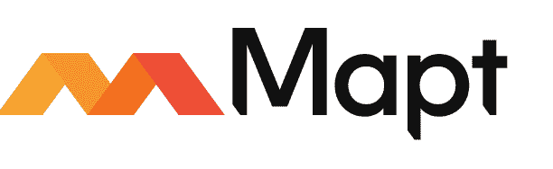

# Azure Cosmos DB 入门指南

[mapt.io](https://mapt.io/)

Mapt 是一个在线数字图书馆，让您完全访问超过 5,000 本书籍和视频，以及行业领先的工具，帮助您规划个人发展并提升职业生涯。欲了解更多信息，请访问我们的网站。

## 为什么要订阅？

*   花更少时间学习，更多时间编码，通过来自 4,000 多位行业专业人士的实用电子书和视频
*   通过专为您打造的技能计划改善学习
*   每月免费获取一本电子书或视频
*   Mapt 支持全文搜索
*   复制粘贴、打印和书签内容

## PacktPub.com

您知道 Packt 为每本出版的书籍提供电子书版本吗？提供 PDF 和 ePub 文件。您可以在 [www.PacktPub.com](http://www.PacktPub.com) 升级到电子书版本，作为纸质书客户，您有权享受电子书副本的折扣。如需更多详情，请通过 `service@packtpub.com` 联系我们。

在 [www.PacktPub.com](http://www.PacktPub.com)，您还可以阅读免费技术文章合集，注册各类免费通讯，并获得 Packt 书籍和电子书的独家折扣和优惠。

## 贡献者

## 作者简介

**Shahid Shaikh** 是一名工程师、出版作家和博主。他在自己的博客上撰写了大量关于 Node.js 和各种数据库的教程。他信奉开源，几乎所有源代码都在 GitHub 上。他还开发并推出了一款名为 Spark 的 SaaS 产品，用于处理内容分享自动化。目前，他正在构建一款名为 Hashmailer 的下一代电子邮件营销工具。

> *我要感谢我的父母在写书阶段一直支持我。我不得不利用周末工作，取消许多计划以按时交付章节，我的家人和朋友因我取消了各种安排，并在写书期间支持我，对此我深表感激。*

## 审阅者简介

**Kasam Ahmed Shaikh** 是一位资深专业人士，拥有“could be”态度，在印度孟买一家领先的 IT 公司拥有 10 年坚定的行业经验。他是一名认证 Azure 架构师，被认可为 C# Corner MVP。他也是一位演讲者，并撰写过一本关于 Azure 认知服务的书。他还是 DearAzure.net 和 Shaikh Academy 的创始人。

> *首先，我要感谢真主安拉、我的家人，特别是我的另一半，在整个过程中激励我。我非常感谢 Packt Publishing 相信并考虑我获得这个机会。*

## Packt 正在寻找像您这样的作者

如果您有兴趣成为 Packt 的作者，请访问 [authors.packtpub.com](http://authors.packtpub.com) 并立即申请。我们已与数千名开发人员和技术专业人士合作，就像您一样，帮助他们与全球技术社区分享见解。您可以提交一般申请，申请我们正在招募作者的特定热门主题，或提交您自己的想法。

