# Microsoft Azure 云与 Cosmos DB 简介

公有云以订阅制向公众提供虚拟专用服务器和托管数据库等服务。一些平台（如 Amazon）按小时收费或提供按需付费（`Lambda`）服务，而其他平台（如 `DigitalOcean`）则按月收取固定费用，等等。`Windows Azure` 公有云平台是 **Microsoft 的云操作系统愿景** 的重要支柱之一，该愿景正在改变传统数据中心环境，帮助企业释放存储在任何位置的数据中的洞察力，支持开发各种现代业务应用程序，并赋能 IT 部门支持在任何设备上随处工作的用户，同时能够以安全一致的方式管理这些设备。

在本章中，我们将介绍与 Microsoft Azure 云和 Cosmos DB 相关的以下要点：

- Azure 特性
- Azure 作为 **服务、平台和基础设施** (**SPI**)
- Azure 组件
- Azure 入门
- Azure Cosmos DB
- Azure Cosmos DB 特性
- Azure Cosmos DB 用例

让我们逐一解释这些主题，开始吧。

## Microsoft Azure 云特性

关于 Azure 最著名也最简单的一句名言如下：

> Windows Azure 可以成为你想要的任何东西

Microsoft Azure 云提供广泛的不同服务。Windows Azure 让您能够构建、部署和管理解决方案，几乎适用于您能想象的任何目的。

Windows Azure 是一个充满无限可能的世界。无论您是跨越多个大洲、需要运行服务器工作负载的大型企业，还是需要具有全球影响力的网站的小型企业，Windows Azure 都提供了一个平台，用于构建可以利用云来满足您业务需求的应用程序。

Microsoft Azure 提供以下关键功能：

* **开放**：Azure 为各种语言提供了大量的**软件开发工具包**（**SDK**）和工具，以构建可扩展的基于云的应用程序。
* **灵活**：无论您是经营小型企业还是大型高端处理系统，Windows Azure 都提供各种服务和可扩展性，帮助您完成业务的所有阶段。
* **Microsoft 托管**：Microsoft 在三大洲——美国、欧洲和亚洲——拥有数据中心。Microsoft 自身管理这些数据中心，而不是像大多数其他提供商那样雇佣第三方人员来运营。
* **兼容**：您可以轻松地将现有的云前提与 Azure 集成，无论是使用支持团队还是工具。
* **CDN**：Azure 提供**内容分发网络**（**CDN**），它由地理位置分布的服务器系统组成，通过缓存来自 Windows Azure 计算实例的数据、图像、图片和视频，使 Windows Azure 能够为性能敏感型客户交付高带宽内容。
* **分布式数据库**：Azure 云提供易于管理的分布式数据库，如 SQL Server 和 Cosmos DB，帮助开发人员扩展并构建全球范围的应用程序。

您可以参考此图了解 Azure Cloud 提供的所有组件：

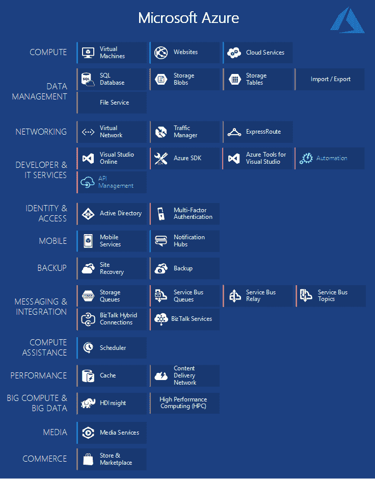

让我们深入了解 Azure 作为**串行外设接口**（**SPI**）能做什么。

## Microsoft Azure 作为 SaaS

不同组织提供了许多云计算平台，例如 Google Cloud、Amazon Web Services 等。Windows Azure 就是其中之一，由 Microsoft Azure 提供。

Azure 被描述为托管数据中心，用于构建、部署和管理应用程序，并通过全球网络提供服务。**平台即服务**（**PaaS**）和**基础设施即服务**（**IaaS**）是 Microsoft Azure 提供的服务。它支持大多数编程语言。

## Azure 作为 PaaS

Azure 为客户提供平台以开发和部署软件，而无需担心服务器基础设施和配置。您可以专注于应用程序的开发，将基础设施的烦恼留给 Azure。

使用 Azure 的主要优势之一是总体成本低，因为资源是按需分配的，且服务器会自动更新。Azure 提供自动更新以避免安全问题，并且这一切都在后台进行，不影响应用程序。

## Azure 作为 IaaS

Azure 提供托管计算服务，使应用程序开发人员能够完全控制操作系统和应用程序平台堆栈。它赋予开发人员对数据中心的控制权，并允许他们对其进行管理。

这是需要完全控制的项目的理想选择。虚拟机可以完全根据项目或业务的要求进行更改。然而，如果管理不善，可能会变得麻烦；所有安全更新随后都成为管理基础设施的开发人员的工作。

由于操作系统和应用程序堆栈的更新，遗留应用程序的维护有时也会变得困难。

## Azure 组件

请参阅以下由 Azure 组件组成的图表：

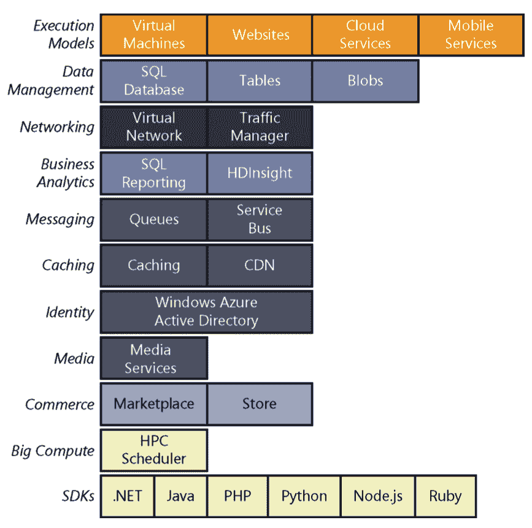

正如您在前面的图表中所见，有不同的执行模型，特别是可用于执行在 Windows Azure 云中运行的应用程序的独特进步。执行模型主要由四个 Windows Azure 计算服务、网站、云服务和移动服务组成。

在底部是不同语言的 SDK，您可以使用它们来构建、发送和监督可在 Windows Azure 上运行的应用程序。

目前支持的 SDK 包括 .NET、Java、PHP、Node.js、Ruby、Swift 和 Python。还有一个通用的 Windows Azure SDK，为任何编程语言（例如 C++）提供基本支持。

理论知识就到这里；让我们开始使用 Azure。

## Azure 入门

要开始使用 Azure，首先您需要访问 Microsoft Azure 并创建一个新的免费帐户，或使用您现有的 Hotmail 帐户。免费帐户附带额度，您可以使用该额度 12 个月。您需要添加信用卡信息并进行验证。如果没有用户侧的必要操作，Microsoft Azure 不会向您收费：

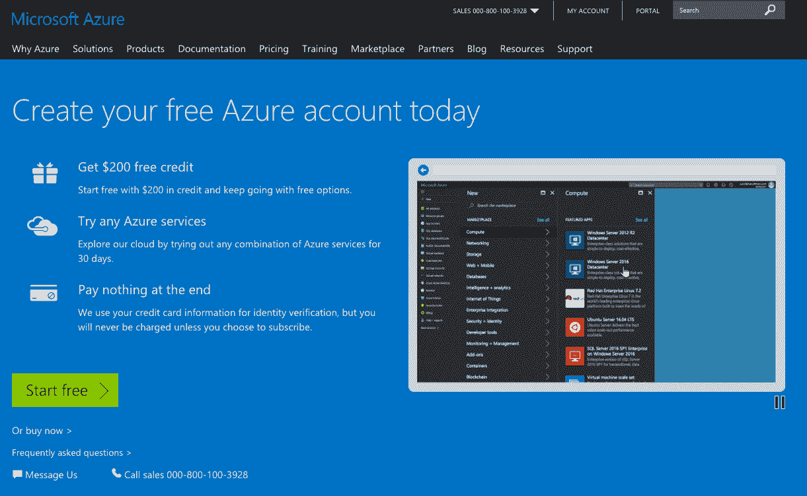

创建帐户后，登录 Azure 门户。登录成功后，您应该会看到类似于以下的屏幕：

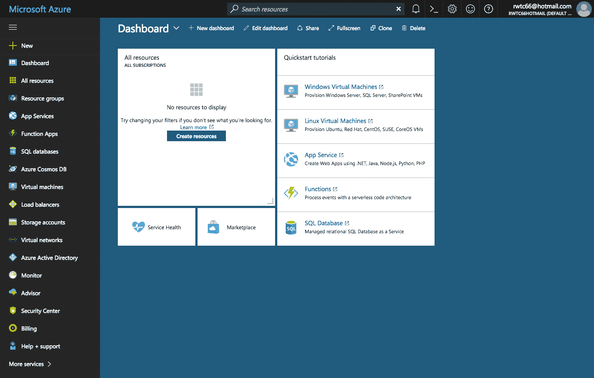

让我们简要了解每个模块的组件和功能。

Azure 组件分为以下主要组件：

* 计算模块
* 数据管理模块
* 网络模块
* 大数据模块
* 缓存和消息传递模块
* 标识模块
* 移动服务模块
* 物联网

让我们逐一了解。

### 计算模块

顾名思义，该模块的工作是提供一组工具和服务来进行计算。以下是在计算模块下提供的服务列表：

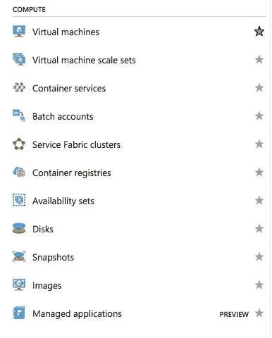

如前面的屏幕截图所示，这些组件主要由虚拟机和容器组成，但根据要求您也可以将它们结合在一起。

例如，带有更多磁盘和快照的虚拟机以及容器用于持续交付。

让我们看看下一个组件，数据管理模块。

### 数据管理模块

数据管理模块包含 SQL Server、Azure Cosmos DB、Redis、PostgreSQL 和数据仓库。您可以部署这些数据管理模块并在您的应用中使用它们。

以下是数据管理模块的完整列表：

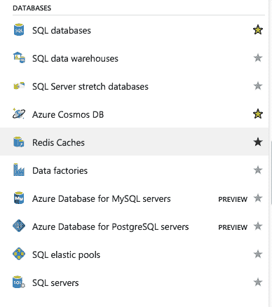

我们将在即将到来的章节中介绍 Azure Cosmos DB。Microsoft Azure 在当前版本中开始支持 MySQL 和 PostgreSQL（仅在撰写本书时）。

让我们看看网络模块。

### 网络模块

Azure 流量管理器负责将用户的请求智能地导向可访问的数据中心。该过程包括找到向 Web 应用程序提出请求的用户最近的数据中心，如果最近的数据中心因各种原因不可访问，流量管理器会将请求转移到另一个数据中心。

但是，应用程序管理员会设置规则，规定流量管理器在这种情况下应如何操作。虚拟网络允许在您本地的机器和 Azure 数据中心的虚拟机之间建立网络。IP 可以分配给虚拟机，用于标识和访问目的。虚拟网络设置需要虚拟专用网络设备。

Azure 还提供应用程序网关，这在微服务应用程序开发中非常有用。

以下是撰写本书时 Azure 支持的网络模块列表：

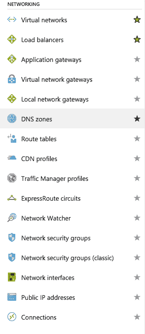

让我们看看大数据和商业智能模块。

### 大数据模块

可以使用 Windows Azure 存储和检索大量数据。Azure 提供 HDInsight，这是一种基于 Hadoop 的服务，用于确定和分析作为大数据存储的海量信息。公司通常需要管理大量信息，这些信息在本质上不一定是关系型的。如今许多组织都在使用 Hadoop，Azure 中也在使用。

因此，Azure 为其客户在其平台上提供 Hadoop 服务。术语 `big compute`（大计算）指的是高性能计算。这是通过同时在许多机器上并行执行代码来实现的。

大数据模块提供的组件如下截图所示：

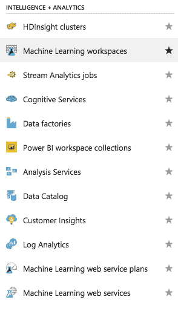

正如您所见，Azure 提供的大数据服务范围很广，从使用 Hadoop 群集进行存储，到对大数据执行分析、执行日志分析以确定错误，以及根据您的数据生成报表。

Azure 还提供机器学习 Web 服务，可用作智能算法来训练数据并从中获取洞察。

让我们看看缓存和消息传递模块。

### 缓存模块

Windows Azure 缓存服务可帮助您为网站构建高端、可扩展且专用的缓存。

Azure 缓存提供三种不同类型：

1. `Basic`：此类型附带小于 1 GB 的缓存大小。
2. `Standard`：此类型附带 1 GB 到 10 GB 范围内的缓存大小。
3. `Premium`：此类型附带大于 5 GB 且小于 150 GB 的缓存大小。

让我们看看消息传递模块。

### 消息传递模块

Windows Azure 为处理两个应用程序之间的交互提供两种选项：

* 消息队列
* 服务总线

通常，面向服务的架构（SOA）应用程序使用服务总线来执行各种服务之间的通信。

分布式且独立的服务（如微服务）使用消息队列来执行它们之间的通信。开发人员可以根据其需求和要求选择其中一种。

让我们看看标识模块。

### 标识模块

该组件主要涉及用户管理、验证以及身份验证/授权。活动目录存储访问应用程序的客户端数据，此外还存储组织内部的关联数据。它可以与驻留在本地的近端机器上的相关数据同步，以实现高效的会话。

以下是 Azure 提供的安全和标识模块：

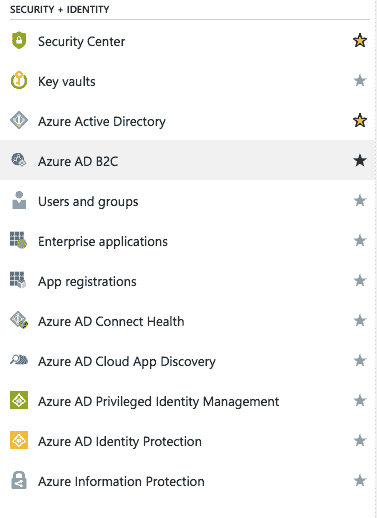

Microsoft Active Directory 是市场上最成熟、最流行的身份验证和授权模块之一。

让我们看看移动服务模块。

### 移动服务模块

Windows Azure 提供一个简单的平台来创建便携式移动应用程序。您可以使用 Azure 移动 SDK 开始开发移动应用。Azure SDK 中已经提供了许多库，例如通知、身份验证等。您可以专注于业务逻辑，Azure SDK 将帮助您处理常规任务，从而更快地发布应用。

Windows Azure 提供了一个非常简单的平台来开发移动应用程序。登录您的帐户后，您可以直接开始使用移动开发工具。如果您使用这项服务，就不必为移动应用程序编写大量自定义代码。推送通知可以发送、数据可以存储、用户可以在更短的时间内完成身份验证。

请参阅以下屏幕截图以获取移动服务模块的完整列表：

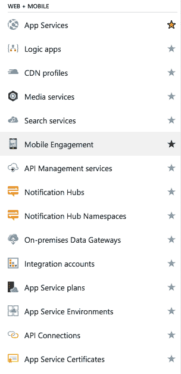

正如您所见，模块列表足以让移动应用开发人员快速、轻松地引导其应用程序。

让我们看看最后一个、也是我最喜欢的模块之一：`internet of things`（`IoT`，物联网）！

### IoT 模块

IoT 目前是一个热门话题，Azure 是云市场中最早提供此类服务的提供商之一。IoT 模块允许开发人员部署诸如 IoT 设备通信、网络和设备分配到中心等服务。

请参阅 Azure 为 IoT 目的提供的以下模块列表：

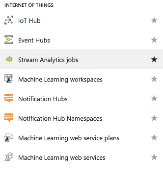

除了开发人员工具、监视工具、Bing Maps `application programming interfaces`（`APIs`，应用程序编程接口）等插件外，还有其他模块。

希望这能为您提供关于 Azure 简短但有用的见解。现在让我们深入了解 Azure Cosmos DB。

## Azure Cosmos DB

Azure Cosmos DB 是 Microsoft 的全球分布式、多模型数据库，可通过单击按钮进行缩放。您可以跨全球分布的 30 多个 Azure 区域缩放 Azure Cosmos DB。

它是多模型的，因此在单个数据库中同时支持文档存储、表存储和图值。Azure 提供卓越的吞吐量、延迟、可用性和一致性保证，并提供全面的 `service level agreements`（`SLAs`，服务级别协议），这是目前其他数据库提供商无法提供的。

`SLAs` 代表书面承诺。这意味着 Microsoft Azure 为您提供延迟、故障转移等各种功能的时间上限。有关更多信息，请访问 `https://azure.microsoft.com/en-us/support/legal/sla/cosmos-db/v1_0/`。

这是 Azure Cosmos DB 的特色和介绍性展示：

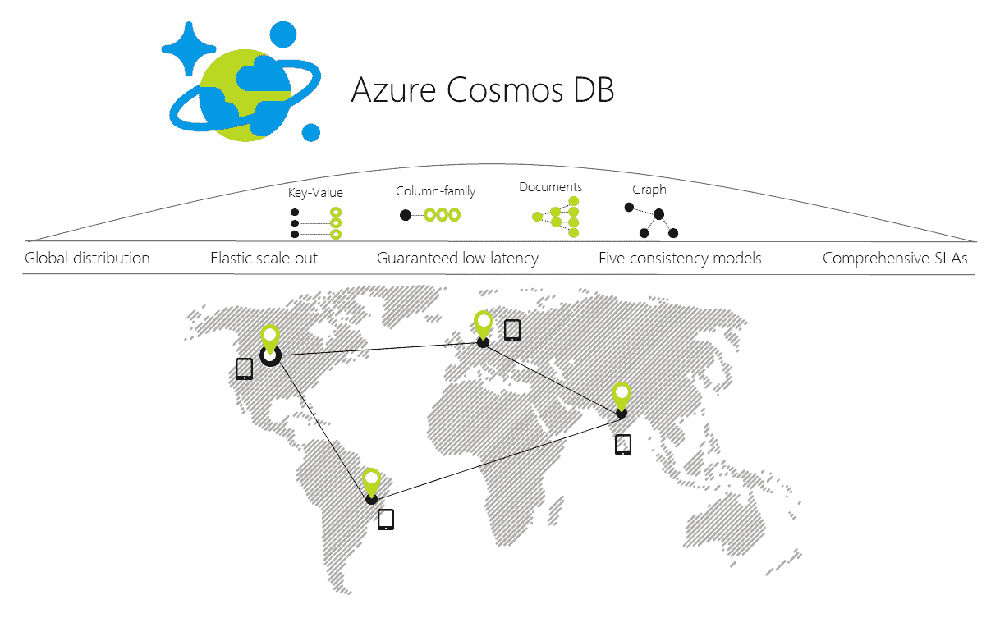

以下是 Microsoft Azure Cosmos DB 提供的关键功能和能力：

* 一站式全球分发
* 多层级数据模型
* 按需缩放
* 低延迟的高响应能力
* 高可用性
* 一致性模型
* SLA 退款保证

让我们简要了解一下其中的每一项。

### 一站式全球分发

Azure Cosmos DB 内置了缩放和分发功能。移动性和云是当前计算使用的两大主要来源，这带来了低延迟高可用性的挑战。

Azure Cosmos DB 提供了一种简便的方法，无需手动工作和配置，即可跨 Azure 数据中心构建和分发您的应用程序。Azure 会自动将您的数据复制到 Azure 网络中可用的多个数据中心。

我们将在下一章详细介绍一站式分发。

让我们看看多层级数据模型。

### 多层级数据模型

Azure Cosmos DB 支持多种数据模型，包括文档存储、键值、图和表。无论数据模型的性质如何，Azure 都能跨所有数据模型提供一致性和高可用性来存储数据。

在撰写本书时，Azure 支持以下模型的 API：

* `Document DB API`
* `MongoDB API`
* `Table API`
* `Graph API`

Microsoft 团队正在努力支持其他数据模型（如果需要）并增强现有模型。

我们将在第 3 章 *Cosmos DB Multi-model Databases* 中详细研究数据模型。

让我们看看 Cosmos DB 的缩放功能。

### 按需缩放

Azure Cosmos DB 引入了全球一站式功能；使用此功能，您可以真正通过单击按钮来部署和缩放您的应用程序。Azure 处理每一个关键技术细节，如基础设施管理、复制、流量转移等。

几乎每个数据库即服务都提供这种缩放，那么有什么新意呢？Azure 为延迟和部署时间提供软件级别协议，如果耗时超过承诺，您将获得退款！

让我们看看 Cosmos DB 的延迟响应能力。

### 低延迟的高响应能力

根据 Azure 文档：

> "Azure Cosmos DB guarantees end-to-end low latency at the 99th percentile to its customers."

### 一致性模型

大多数分布式数据库提供一致性模型，主要是**强一致性**和**最终一致性**。Azure 还提供了三个额外的一致性级别。它们是：

*   **限定过期一致性：** 这保证读取操作可能滞后于写入操作。此一致性模型会增加读取选项的成本，且高于会话一致性和最终一致性。
*   **会话一致性：** 这非常适合所有涉及用户的场景，因为它需要实时读写。
*   **一致性前缀：** 这保证按顺序写入的数据将按执行顺序被看到和读取。

### 退款保证和 SLA

Azure Cosmos DB 承诺您的数据传输迅速，否则退还您的费用。Azure Cosmos DB 为可用性、延迟、吞吐量和一致性提供服务级别协议。

目前，SLA 仅由微软提供。您可以在此处参考完整文档：[`https://azure.microsoft.com/en-us/support/legal/sla/cosmos-db/v1_0/`](https://azure.microsoft.com/en-us/support/legal/sla/cosmos-db/v1_0/)。

### Cosmos DB 用例

您可以在高度分布式、任务关键型、高可用且易于部署的场景中使用 Cosmos DB。以下是微软团队提供的用例：

*   IoT
*   零售与营销
*   游戏
*   Web 和移动应用

#### IoT

IoT 由各种设备组成，这些设备每隔几分之一秒就发出数据。这对来自多个源的高速数据引入提出了需求。可使用 Azure IoT 中心接收来自各种 IoT 设备的数据。

数据引入后，您可以使用 Azure HDInsight 进行处理并获取实时洞察。然后，您可以将这些数据存储在多个源中，例如用于在基于 SaaS 的应用程序中查看的表、用于处理图形和数据处理的 DocumentDB 等。

#### 零售与营销

微软在 Microsoft 电商平台 Windows Store 和 Xbox Live 中使用 Azure Cosmos DB。Azure Cosmos DB 可用于存储产品数据、搜索产品和执行会话，这对电商应用程序非常重要。

Azure Cosmos DB 还可以利用其自身的变更源功能用于事件溯源。变更源提供了惊人的事件生成机制，用于处理微服务通信。

您可以参考以下关于微服务通信的图表：

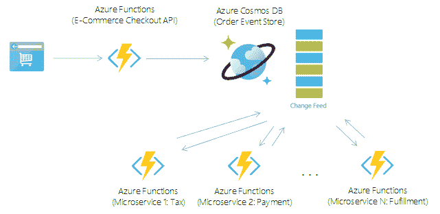

变更源是由 RethinkDB 引入的概念；Packt 出版了一本关于此的书，名为 *Mastering RethinkDB*。

#### 游戏

游戏具有高度的任务关键性，且必须始终保持高可用。这需要快速且高可用的数据库。Azure 已在 *Halo 5*、*The Walking Dead* 等游戏中证明了其价值。Azure Cosmos DB 的性能可用于处理数百万个请求，并展示实时数据源和社交互动。

Azure Cosmos DB 提供的 API 可直接在游戏中使用，借助 Hadoop 等数据库功能，可用于实时分析和数据源。

#### Web 和移动应用程序

Azure 提供各种工具集，如键值存储、流量管理器、网关，当然还有 Cosmos DB。这些可用于使用各种框架构建社交媒体应用程序、新闻源和移动应用程序。

Azure 机器学习和 Hadoop 也可用于生成个性化报告、数据源和推荐，这是任何现代应用程序惊人的组成部分。由于大多数数据以 JSON 格式存储，因此可以跨前端、移动端、后端和数据库等各种场景进行通信和解析。

## 总结

在本章中，我们了解了 Azure 平台及其功能。我们查看了 Azure 云提供的用于开发任务关键型应用程序的服务和基础设施。我们还概览了 Azure Cosmos DB 及其功能和用例。

在下一章中，我们将详细了解 Azure 交钥匙分发功能，这是 Azure Cosmos DB 的关键卖点之一。
