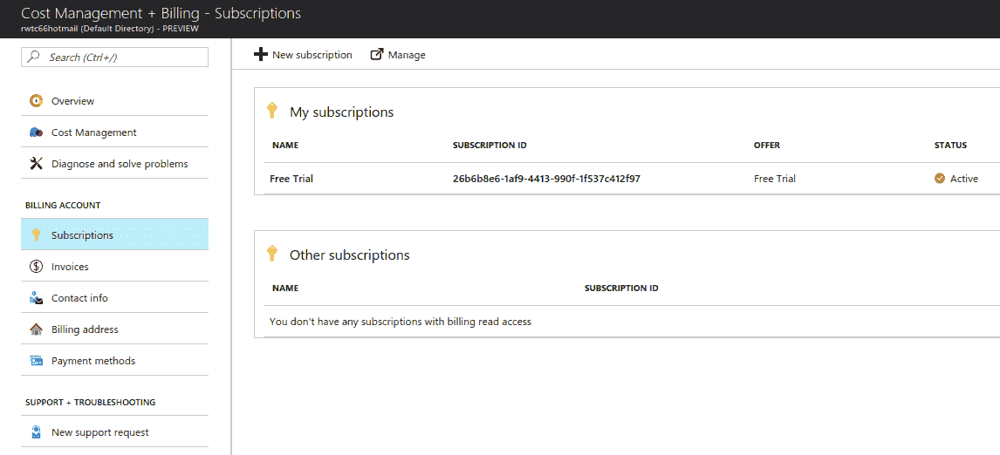
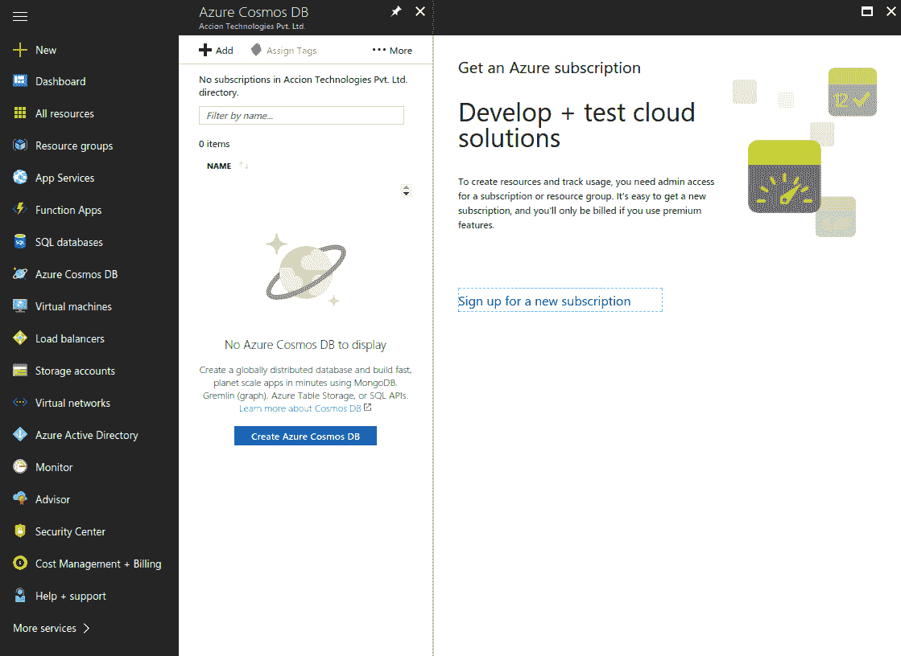
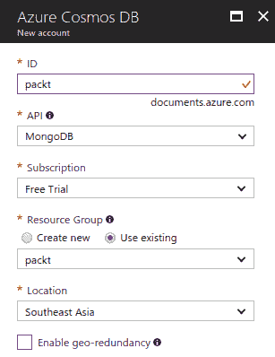
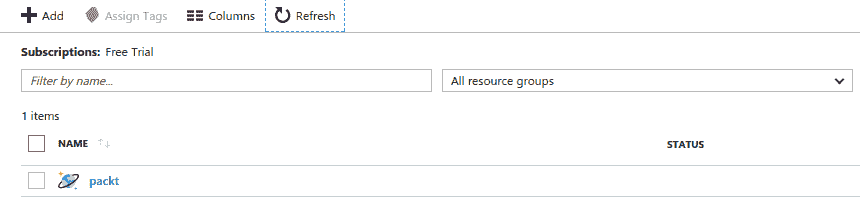
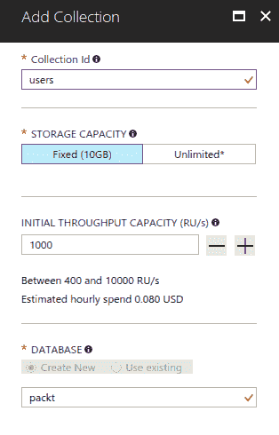
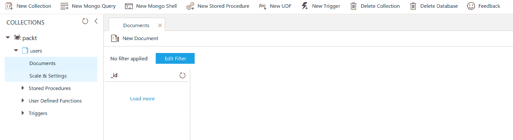
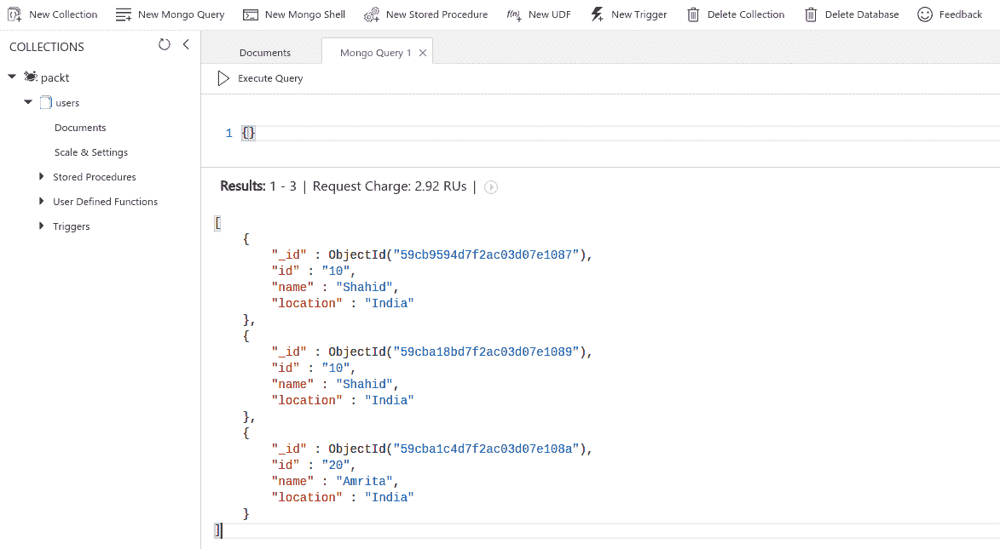
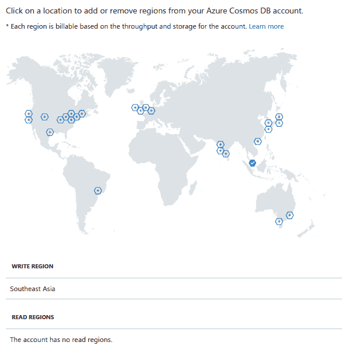
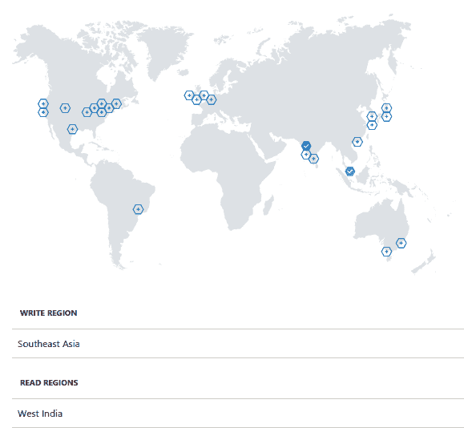

# Cosmos DB 全球交钥匙分发

Cosmos DB 提供多模型数据库、各种一致性级别、安全性和基础设施，但 Cosmos DB 的关键卖点之一是其交钥匙全球分发系统。

Cosmos DB 交钥匙分发系统提供了一项功能，用户只需点击一下按钮，即可将其数据库复制到任何 Azure 数据中心。

在本章中，我们将学习交钥匙分发以及以下主题：

*   设置 Azure 订阅
*   创建 Azure 数据库
*   在 MongoDB 中添加数据
*   使用全球交钥匙分发分发数据
*   故障转移处理

让我们开始吧。

## 设置 Azure 订阅

我相信您已经在 Azure 上创建了帐户。您需要升级帐户才能使用资源，例如 Cosmos DB、虚拟机等。

在撰写本书时，Azure 在首次升级时为我们提供了约 13,000 印度卢比（约合 200 美元）的免费额度，为期一个月，以便试用其服务！

打开 Azure 门户 [`https://portal.azure.com`](https://portal.azure.com/) 并使用您的 Microsoft 帐户登录。登录后，单击任意服务，例如，从左侧菜单单击 Cosmos DB 的图标。

您应该会看到订阅弹出窗口；单击它并填写您的信用卡信息。微软将收取约 2 印度卢比以验证您的身份。他们不会再向您收费。

帐户验证通过后，您可以在帐户部分看到您的订阅。请参考以下屏幕截图：



让我们继续创建 Azure Cosmos DB。

## 创建 Azure Cosmos DB 数据库

让我们创建第一个 Cosmos DB：

1.  打开 Azure 门户 [`https://portal.azure.com`](https://portal.azure.com/) 并单击左侧导航栏中放置的 Azure Cosmos DB 链接：

    

2.  单击 **Create Azure Cosmos DB** 按钮。填写详细信息。给它一个合适的名称；在 API 下拉菜单中选择 MongoDB。

3.  通过提供合适的名称创建新的资源组，以便轻松识别数据和服务，这也有助于备份和恢复。资源组是一个容器，用于保存特定 Azure 解决方案的相关资源。资源组可以包含解决方案的所有资源，或者仅包含您想要作为一组进行管理的那些资源。您可以在该组中部署、删除和管理应用所需的所有资源。

    选择任意位置；完全由您决定。通常，选择位置的决定是基于来自特定区域的请求数量，我们应将服务器的位置设在靠近需求用户的地方，以实现快速处理和低延迟。

4.  如果您想要在不同地理位置自动复制数据库以获得更高的可用性，请勾选 **Enable geo-redundancy** 按钮。

    这是我选择的内容：

    

5.  单击 **Create** 按钮以创建数据库。设置和创建数据库将需要几秒钟。


6. 现在，点击 `Refresh button`（是的，它不是 Ajax）以查看数据库，就像下面截图中显示的那样：



7. 点击该数据库；它将带你进入数据库管理页面。现在，首先我们需要在数据库中存储一些数据，以便查看全球一键分发的方法。

正如你所知，MongoDB 将数据存储在集合中。从大数据术语来看，集合是存放所有对象的地方。

8. 首先我们将创建一个集合。在顶部的导航栏中，找到并点击 `Add Collection button`。

9. 填写那些值，例如名称和数据库名称。请参考下面的截图：



如果你对为什么这里也要创建一个新数据库感到困惑，让我来解释一下。

Cosmos DB 是一个多模型数据库；这意味着其他数据库（例如 MongoDB）运行在 Cosmos DB 之下。MongoDB 确实拥有数据库、集合等，它们保持原样。在 MongoDB 功能之上，Cosmos DB 将为你提供 REST API 来管理这些数据库并高效地扩展它们。

暂时将吞吐量容量保持为 `1000`；这意味着每秒可对 Cosmos DB 发出 1,000 次针对 1 KB 文档的请求，这对于测试目的来说已经足够。

10. 点击 `OK button`，这应该会创建一个新集合。

集合创建完成后，我们可以向其中导入一些数据。

## 在 MongoDB 中添加数据

让我们在 MongoDB 中添加一些数据：

1. 集合创建完成后，你可以向其中添加新文档。从左侧菜单点击 `Data Explorer` 并选择数据库。

2. 如果你难以找到数据库，请参考下面的截图：



3. 点击 `New Document`，它将打开查询编辑器。复制以下文档并粘贴到编辑器中，或者你可以创建自己的文档：

```
{ 
    "id": "10", 
    "name": "Shahid", 
    "location": "India" 
} 
```

4. 你可以添加任意选择的更多字段。点击 `Save button` 将记录添加到 MongoDB 集合中。重复这些步骤以添加多个文档。

5. 你也可以从 `Data Explorer` 界面查询已添加到集合中的数据。点击顶部菜单上的 `New Mongo Query` 按钮，它将打开一个编辑器。添加任何你喜欢的 Mongo 查询，或者只需添加 `{}` 以从 MongoDB 集合中获取所有文档。

6. 参考下面的截图了解其工作原理：



结果可能因你的账户而异。

到目前为止，我们已经创建了 Cosmos DB 实例，创建了一个新的 MongoDB 数据库和集合，并向其中添加了一些虚拟数据。我认为是时候看看一键分发是如何工作的了；它真的是微软承诺的那样吗？感觉充满干劲？我也是；让我们深入了解吧。

## 使用全球一键分发分发数据

让我们开始吧。我们在创建 Cosmos DB 实例时选择了一个数据中心位置。让我们使用微软承诺的 `click of a button` 来复制它：

1. 在 Cosmos DB 管理屏幕的左侧菜单中，转到 `Settings | Replicate Data Globally` 并点击它。

2. 它应该会打开一个类似于下面截图的界面：



看看这张漂亮的星球地图？所有的五边形图标都是 Azure 数据中心的位置，而被勾选的那个是我们的。

目前，我们的数据存储在一个位置；让我们将其分发到 `West India` 位置。你可以选择你喜欢的位置。

3. 那么，如何操作呢？好吧，只需点击五边形图标，然后点击 `Save button`；一切就搞定了！这难道不神奇吗？只需点击一下按钮即可分发数据！

4. 这将需要几秒钟或几分钟，具体取决于数据量。完成后，你将在地图上看到两个勾号，以及一个额外的读取区域，如下面的截图所示：



现在，来自东南亚的流量可以从其最近的数据中心读取数据。你可以根据你的流量在各个位置复制此操作。

每个数据中心位置都有自己的价格范围，你的账户将据此收费。

每个复制节点将只有只读能力。当写入区域发生任何更改时，Cosmos DB 会将其复制到分布在全球的每个节点。

这结束了使用 Cosmos DB 全球一键功能的数据分发。

让我们简要了解一下故障转移处理。

## 故障转移处理

在发生 Azure 数据中心中断的情况下，Cosmos DB 会自动触发受影响区域中所有 Cosmos DB 数据库的故障转移。

支持两种类型的故障转移处理：

1. 自动故障转移处理
2. 手动故障转移处理

让我们简要了解一下它们各自的情况。

### 自动故障转移

如果任何读取区域发生故障，Cosmos DB 会自动将该读取区域与写入区域断开连接，并将其所有流量转移到用户提供的首选区域列表。

如果用户未提供任何区域列表，则流量将被转移到主写入区域以进行进一步处理。

一旦读取区域恢复在线，流量将自动转移回该区域。所有这些都无需更改应用程序中的一行代码。

如果写入区域发生故障，则使用共识协议，另一个读取区域将被提升为写入区域。你也可以指定在发生故障时哪个读取区域应成为写入区域。

### 手动故障转移

如果你想将当前的写入区域更改为另一个读取区域，则可以使用手动故障转移功能来实现。你可以将任意选择的读取区域升级为写入区域并转移写入流量。这也确保了绝无数据丢失。

## 总结

在本章中，我们了解了 Cosmos DB 的核心功能，并使用 MongoDB 作为数据模型创建了一个数据库。我们使用全球一键功能在全球范围内复制了这些数据源。

在下一章中，我们将详细了解更多关于 Cosmos DB 多模型数据库的内容。我们将介绍每种数据库，以及如何创建、查询它们并将其与你的应用程序连接。
