# Cosmos DB 多模型数据库

Cosmos DB 是微软的全球分布式（使用一键分发）、水平分区、多模型数据库即服务。Cosmos DB 允许其用户跨遍布全球的 30 多个区域扩展其数据库吞吐量和存储。

Cosmos DB 是首个为大多数吞吐量和低延迟提供服务级别协议的数据库即服务。Cosmos DB 旨在支持多租户和扩展。

在本章中，我们将涵盖以下主题：

* Cosmos DB 数据模型
* Atom 记录序列数据模型
* DocumentDB API
* MongoDB API
* 表 API
* 图 API
* 一致性模型

让我们开始吧！

## Cosmos DB 数据模型

Cosmos DB 数据模型基于 `Atom record sequence` (`ARS`) 数据模型。`ARS` 旨在支持多种数据模型，例如基于列的、键值的、基于图的和基于文档的。你将在下一节详细了解 `ARS`。

在撰写本书时，Cosmos DB 支持以下数据模型：

* DocumentDB
* MongoDB
* Tables
* Graph
* Cassandra

Microsoft Azure 团队也在致力于其他数据模型，例如基于列的模型；它们很快就会发布！

DocumentDB 是微软自有的基于文档的数据库，也称为 NoSQL 数据库。DocumentDB 为无模式的基于文档的记录提供 SQL 查询功能。Cosmos DB 提供多种语言的 API 和 SDK，以将 DocumentDB 与你的应用集成！你将在后续章节了解相关内容。


MongoDB 是一款非常流行的文档存储，拥有开源版和企业版。`MongoDB` 提供了文档存储数据之上的所有复杂操作，如聚合、过滤和 Map-Reduce。这是我最喜欢的数据库之一，能让我更快地启动并交付任何产品。您将在后续章节中了解更多关于 `MongoDB` 的内容。

`Tables` 或表存储是微软版的 `Redis`，一种基于 `NoSQL` 的键值存储，作为服务部署，可容纳 PB 级数据并即时扩展！您将在后续章节中了解更多相关内容。

`graph`（图）数据库由顶点和边组成，而非键值或列行。图数据库主要用作推荐或建议功能。我相信您一定用过 Facebook 的“你可能认识的人”功能，那就是图数据库！您将在后续章节中了解更多相关内容。

`Cassandra` 是一款开源、Apache 许可的分布式 `NoSQL` 数据库，用于处理任务关键型数据，具有惊人的持久性和可用性。`Cassandra` 经过了验证，并被互联网上一些热门网站使用，如 GitHub、Instagram、Reddit、eBay 和 CERN（虽然 CERN 不是互联网网站）。我们将在后续章节中了解更多相关内容。

我们将深入探讨每种数据模型，但首先让我们看看 `ARS` 到底是什么！

## ARS

为了实现多模型数据库功能，`Cosmos DB` 支持 `ARS` 模型。`ARS` 模型提供了一种非常低级的数据格式，可被任何其他数据库或编程语言使用。

`Atoms`（原子）由一组基本数据类型组成，如数字、字符串和布尔值。`Records`（记录）由结构（一组基本数据类型）和序列组成，序列是包含原子和记录的数组。

以这种方式存储的数据随后会被您的顶层数据库（如 `Document DB`、`MongoDB` 和表）使用。通俗地说，无论您使用任何 `Cosmos DB` API 创建什么数据，都会首先转换为 `ARS` 模型，然后存储在各个区域中。

这种标准的数据存储方式开启了许多机遇。首先，您可以即时迁移或更改数据模型。其次，您可以将其缩放并分发到支持的任何区域，因为从技术上讲，每个数据库的数据模型都是相同的。

如果您想了解更多关于 `ARS` 的深度信息，请参阅此官方技术文档页面 [`azure.microsoft.com/en-in/blog/a-technical-overview-of-azure-cosmos-db/`](https://azure.microsoft.com/en-in/blog/a-technical-overview-of-azure-cosmos-db/)。

让我们继续深入探讨每种数据库模型。首先，您将学习 `DocumentDB API`。

## DocumentDB API

正如我们之前提到的，`DocumentDB` 是微软自家基于文档的 `NoSQL` 数据库。`DocumentDB` 为无模式的基于文档的记录提供 `SQL` 查询功能。

`Cosmos DB` 提供多种语言的 API 和 `SDK`，以将 `DocumentDB` 与您的应用程序集成。让我们看看 `DocumentDB API` 结合 `Cosmos DB` 提供的一些优势和功能：

*   `Elastic scale`（弹性缩放）：有效地扩大或缩小数据库规模以满足应用程序需求。您的信息存储在 `solid state drives`（`SSD`，固态硬盘）上，以实现低延迟。`Cosmos DB` 将数据存储在各个集合中，这些集合可以缩放并用于大量记录。

*   `Replication`（复制）：正如您在上一章所学，`Cosmos DB` 数据库（如 `DocumentDB`）可以跨 Azure 数据中心支持的任意数量的区域进行复制。这使我们能够开发全球可用的应用程序，并将延迟降至最低。`Cosmos DB` 还提供故障转移处理，无论是自动还是手动，正如 第 2 章 `Cosmos DB Global Turnkey Distribution`（Cosmos DB 全球即时分发）中所讨论的。

*   `SQL-like query`（类 SQL 查询）：`DocumentDB` 是 `NoSQL` 数据库，但借助 `Cosmos DB`，您可以使用类 `SQL` 查询来查询那些 `JSON` 文档。您无需像在 `SQL` 数据库中那样指定索引、视图等，即可以极高的速度查询数据。

*   `Multiple consistency levels`（多种一致性级别）：您可以在五个定义明确的一致性级别中进行选择。一致性级别包括：强一致性、有限过期一致性、会话一致性、一致前缀和最终一致性。这使您能灵活地选择并在性能和数据一致性之间进行权衡。在某些应用中，不需要严格的写入，但数据需要实时显示；在其他应用中，数据库需要严格的写入。您可以权衡并选择一致性级别。我们将在后续章节更多地讨论一致性级别。

*   `Complete document indexing`（完整文档索引）：`Cosmos DB` 默认为了性能考虑，会为数据库中的所有文档建立索引。不过，如果您愿意，可以指定为特定文档或键提供索引，但这是默认行为。

*   `Real-time change feed`（实时更改源）：您可以监听数据库中的每一次更改并获取通知。您可以利用此更改源发起 API 调用、进行复制或构建审核日志。

让我们继续创建一个 `DocumentDB` 数据库：

1.  登录 Azure 门户，点击选项栏左侧的 `Azure Cosmos DB` 选项。

2.  点击 `+` 按钮，为您的新数据库指定一个合适的 ID，并从 API 下拉菜单中选择 `SQL` 选项。

您可以创建新资源或使用现有资源。选择写入操作最频繁的位置，然后点击 `Create`（创建）按钮。您可以参考以下屏幕截图获取更多信息：

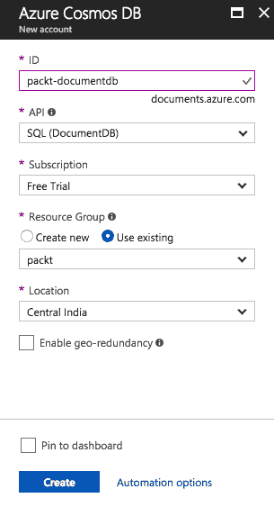

Azure 将创建带有 `DocumentDB API` 的新数据库并通知您。您将收到类似如下的通知：

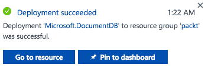

让我们创建一个新集合并在其中存储一些数据：

1.  转到左侧菜单的 `Data Explorer`（数据资源管理器），然后点击 `New Collection`（新建集合）按钮。

2.  为您的数据库和集合指定名称，然后点击 `OK` 按钮。请参考以下屏幕截图获取更多信息：


3.  集合创建完成后，我们可以在其中创建新文档。点击 `New document`（新建文档）按钮并添加以下 `JSON` 对象：

```
{ 
    "id": "10", 
    "name": "Shahid", 
    "location": "Mumbai", 
    "job": "Engineer" 
} 
```

4.  点击 `Save`（保存）按钮，新文档将被创建。

5.  文档创建完成后，我们可以使用标准的类 `SQL` 查询对其进行查询。点击 `New SQL Query`（新建 SQL 查询）按钮并粘贴此查询：

```
SELECT * FROM users 
```

6.  您可以将 `users` 替换为您提供的集合名称。请勿添加分号，否则会报错。

7.  点击 `Execute Query`（执行查询）按钮运行此查询，您将看到如下屏幕截图所示的记录。结果可能与您的不同：

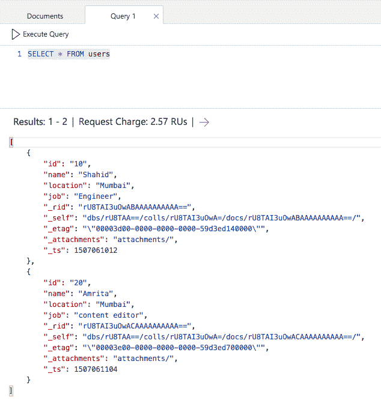

8.  您可以从 `Data Explorer` 创建新触发器和存储过程。为了演示，让我们创建一个名为 `helloworld` 的简单存储过程，执行时返回消息 `Hello, World`。

9.  在 `Data Explorer` 中，点击存储过程并创建一个新的存储过程。将其命名为 `helloworld`，粘贴以下代码并保存：

```
function storedProcedure(){ 
    var context = getContext(); 
    var response = context.getResponse(); 
    response.setBody("Hello, World"); 
} 
```

10. 在左侧菜单中，点击 `Script Explorer`（脚本资源管理器），它将列出我们创建的脚本以及存储过程。

11. 点击 `helloworld` 过程并点击 `Execute`（执行）按钮。这将运行存储过程并显示如下输出：

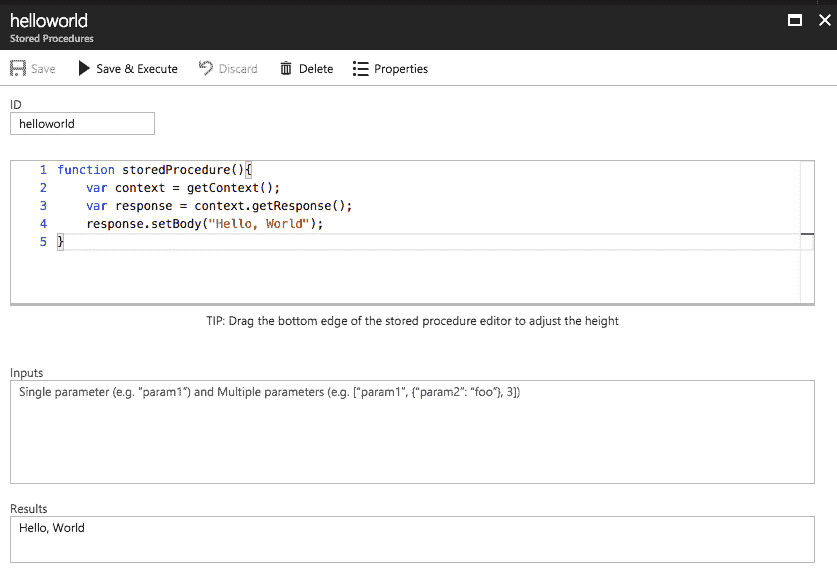

同样，您也可以创建触发器并从 `Script Explorer` 进行测试。


12. 您可以从默认的一致性设置中更改一致性级别。从以下屏幕截图所示的五个一致性级别中任选其一：

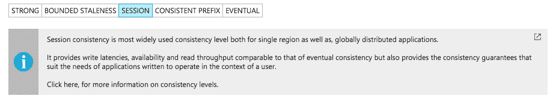

当我们在第 5 章 *Integrating Cosmos with Node.js* 中尝试编程 Cosmos DB 的 SDK 时，您将了解更改源功能。

让我们继续了解下一种数据库模型，即 MongoDB。

## MongoDB 数据模型

MongoDB 是世界上最流行的开源 NoSQL 数据库之一。MongoDB 是微软 DocumentDB 的主要竞争对手之一。MongoDB 为组织提供社区许可证和企业版。

您可以在 Cosmos DB 中将 MongoDB 用作数据模型。如果您现有的应用程序已经在使用 MongoDB，那么您只需更改连接参数，应用程序即可正常工作！就是这么顺畅。

Cosmos DB 提供多种语言的 API 和 SDK，用于将 MongoDB 与您的应用程序集成。让我们看看 MongoDB API 结合 Cosmos DB 提供的几个优势和功能：

*   **弹性伸缩**：高效地纵向扩展或缩减数据库，以满足应用程序需求。您的信息存储在 SSD 上，以实现低延迟。Cosmos DB 支持 MongoDB 格式，即可扩展且可用于大量记录的集合。
*   **复制**：正如您在上一章所学，Cosmos DB 数据模型（如 MongoDB）可以跨 Azure 数据中心支持的任意数量的区域进行复制。这使我们能够开发延迟尽可能低的全球可用应用程序。Cosmos DB 还提供故障转移处理，无论是自动还是手动，正如第 2 章 *Cosmos DB Global Turnkey Distribution* 中所讨论的。
*   **兼容性**：Cosmos DB 尽可能保持 MongoDB API 和 SDK 的独立性。您可以使用现有的 MongoDB 专业知识、代码和 API 来使用 MongoDB 并对其进行扩展。Cosmos DB 提供完全托管的 MongoDB 以及其他功能，帮助您妥善扩展和管理它。
*   **完全托管**：您无需再安装或运行 MongoDB 守护进程或服务器。它由微软完全托管。不再担心重启、崩溃和内存溢出！
*   **自动索引**：Cosmos DB 为 MongoDB 的所有文档建立索引，以实现更快的响应时间和低延迟。

让我们继续在 Cosmos DB 中创建 MongoDB 数据模型：

1. 登录 Azure 门户，单击选项栏左侧的 Azure Cosmos DB 选项。
2. 单击 **+** 按钮，为新数据库指定一个合适的 ID；从 API 下拉菜单中选择 MongoDB 选项。
3. 您可以创建新资源或使用现有资源。选择写入操作最多的位置，然后单击“创建”按钮。您可以参考以下屏幕截图以获取更多信息：

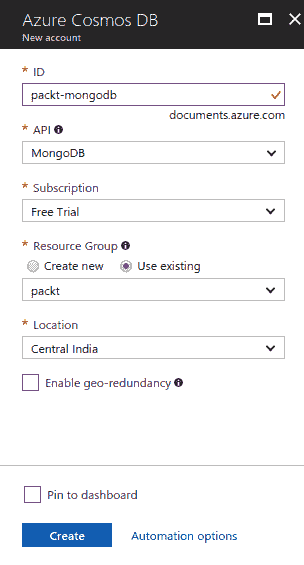

Azure 将创建带有 MongoDB API 的新数据库并通知您。

4. MongoDB 数据模型创建完成后，我们可以在其中创建新集合并存储数据。
5. 转到左侧菜单上的“数据资源管理器”，单击“新建集合”按钮。为您的数据库和集合指定名称，然后单击“确定”按钮。请参考以下屏幕截图以获取更多信息：

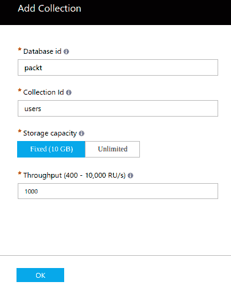

6. 集合创建完成后，我们可以在其中创建新文档。单击“新建文档”按钮并添加以下 JSON 对象：

```json
{ 
    "id": "10", 
    "name": "Shahid", 
    "location": "Mumbai", 
    "job": "Engineer" 
}
```

7. 单击“保存”按钮，新文档将被创建。

文档创建完成后，我们可以使用标准 MongoDB 查询对其进行查询。

8. 单击“新建 Mongo 查询”按钮并粘贴上述提到的查询。
9. 单击“执行查询”按钮运行此查询，您将看到如下一屏幕截图所示的记录。结果可能与您的不同：

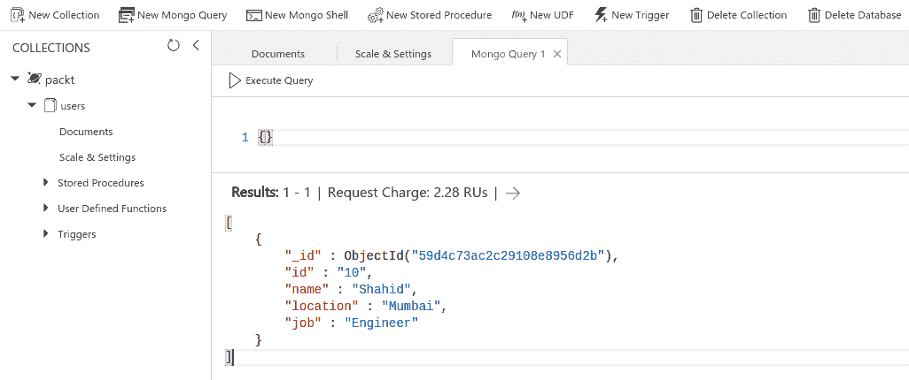

同样，我们也可以使用数据资源管理器删除或更新这些文档。您也可以像在前一节 *DocumentDB API* 中讨论的那样创建存储过程和触发器。

MongoDB 是 Cosmos DB 中关键的数据库模型之一。核心原因之一是其普及度。大多数开发人员和企业已经在使用它，如果它们迁移到 Cosmos，将构成一个巨大的客户群。这就是为什么他们将其描述为易于迁移的模型的关键原因；否则，微软为什么要提供竞争对手作为选项！

您将在第 6 章 *Building High-Performance Link Shortening and Tracking System using Cosmos DB* 中了解 SDK 以及如何将它们与我们的自定义应用程序集成。

至于一致性和复制，您可以在 MongoDB 中使用 Cosmos DB 提供的五个一致性级别中的任意一个。

您还可以将其分布在 Azure 提供的任意数量的区域中，正如第 2 章 *Cosmos DB Global Turnkey Distribution* 中所讨论的。

让我们继续看看第三种数据模型，即表！

## 表数据模型

Cosmos DB 提供表数据模型作为 API，您可以使用标准表查询模型来构建分布式键值存储。

表 API 是市场上首批提供托管分布式键值存储的产品之一。让我们看看表 API 提供的功能：

*   **低延迟**：Cosmos DB 的表 API 为读取和写入提供个位数延迟，并有 SLA 保障
*   **可变吞吐量**：表 API 具有可变吞吐量模型。您可以随着业务增长更改可伸缩性限制
*   **弹性伸缩**：您可以跨 Azure 支持的任意数量的区域扩展数据库
*   **自动索引**：Cosmos DB 结合表 API 为所有属性创建索引，以实现更快的读写操作
*   **高级查询支持**：Cosmos DB 在表 API 之上提供高级查询，如聚合、地理空间查询和排序
*   **多重一致性**：您可以根据需要从 Cosmos DB 提供的五个一致性级别中选择一致性级别

让我们继续在 Cosmos DB 中创建表数据模型：

1. 登录 Azure 门户，单击选项栏左侧的 Azure Cosmos DB 选项。
2. 单击 **+** 按钮，为新数据库指定一个合适的 ID，从 API 下拉菜单中选择表（键值）选项。
3. 您可以创建新资源或使用现有资源。选择写入操作最多的位置，然后单击“创建”按钮。您可以参考以下屏幕截图以获取更多信息：

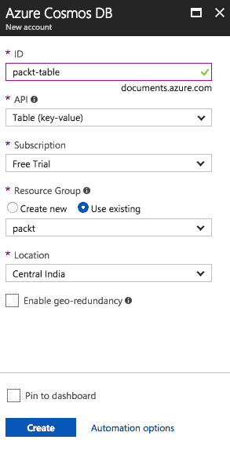

4. Azure 将创建带有表 API 的新数据库并通知您。表数据模型创建完成后，我们可以在其中创建新集合并存储数据。转到左侧菜单上的“数据资源管理器”，单击“新建表”按钮。为您的表指定名称，然后单击“确定”按钮。请参考以下屏幕截图以获取更多信息：

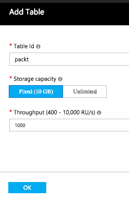

5. 表创建完成后，我们可以在其中创建键值对。单击“新建实体”按钮并添加以下值：

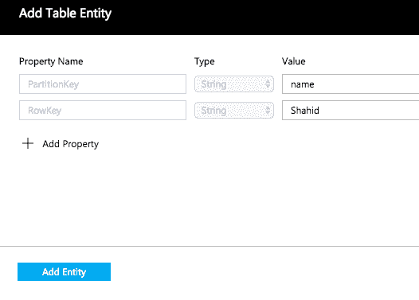

您可以根据需要使用查询资源管理器创建任意数量的实体。如果需要，您始终可以为应用程序创建存储过程和触发器。

让我们继续了解 Cosmos DB 中最后但同样重要的数据模型，即图数据模型。

## 图数据模型

在 SQL 数据库中，我们有行和列；在 NoSQL 中，我们有基于键和值的文档；在大数据中，我们有列和数据。


## Cosmos DB 数据模型：图和 Cassandra

然而，这些模型都没有直接映射到现实世界的对象。图数据库的构建正是为了弥合这一差距。

图数据模型是一种由顶点和边组成的结构。顶点和边都可以拥有一组属性。顶点代表离散的对象，例如一个人、一个地点或一个事件。边代表顶点之间的关系。例如，一个人可能认识另一个人、参与某个事件，并且最近可能曾到访过某个地点。属性表示关于顶点和边的详细信息。Azure Cosmos DB 支持属性图模型。

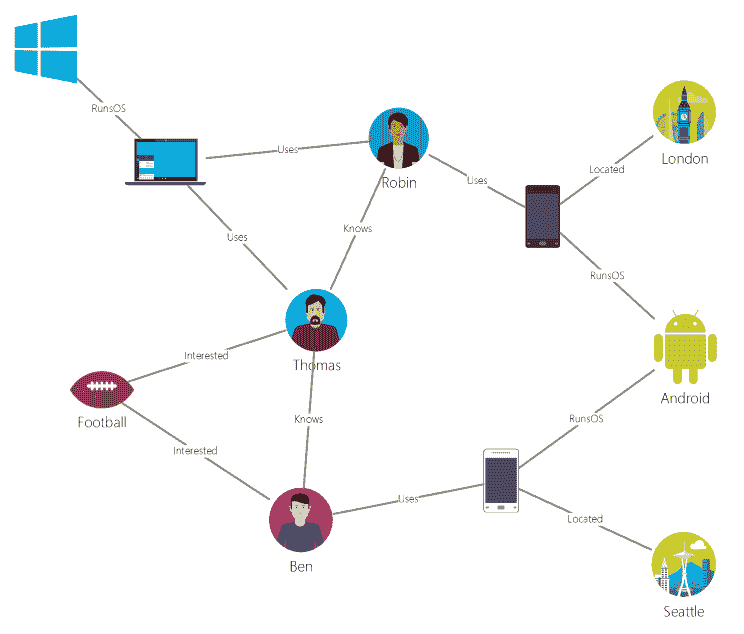

图的一个重要用例是查找实体之间的关系。例如，如果我和某人是朋友，那么利用顶点，我们可以向彼此推荐对方的朋友，这类似于 Facebook 的 `People You May Know`（你可能认识的人）功能。

图在主要的数据科学探索中也非常有用。复杂的算法构建在图数据库之上，以从海量数据中获取洞察。

### 图数据库功能

让我们看看 Cosmos DB 中图数据库提供的一些功能：

*   `Elastic scale`（弹性缩放）：有效地扩大或缩小图数据库以满足应用程序需求。您的信息存储在 `SSD` 上，以实现低延迟。Cosmos DB 支持 `Gremlin` API 格式。

*   `Replication`（复制）：正如您在上一章所学，Cosmos DB 数据模型（如图）可以跨 Azure 数据中心支持的任意数量的区域进行复制。这使我们能够开发具有尽可能低延迟的全球可用应用程序。Cosmos DB 还提供故障转移处理，无论是自动还是手动，正如 `Chapter 2`（第 2 章）`Cosmos DB Global Turnkey Distribution`（Cosmos DB 全球即时分发）中所讨论的。

*   `Fast query traversal`（快速查询遍历）：您可以使用 `Gremlin` 语法来创建和存储图，并使用 Cosmos DB 以个位数毫秒延迟对其进行查询。

*   `Fully managed`（完全托管）：您无需再安装或运行图守护进程或服务器。它由 Microsoft 完全托管。无需再担心重启、崩溃和内存溢出！

*   `Automatic indexing`（自动索引）：Cosmos DB 为图中节点和边内的所有属性建立索引，以获得更快的响应时间和低延迟。

### 在 Cosmos DB 中创建图数据库

让我们继续在 Cosmos DB 中创建一个新的图数据库：

1.  登录到 Azure 门户，点击左侧选项栏上的 `Azure Cosmos DB` 选项。

2.  点击 `+ button`（+ 按钮），为您的新数据库提供一个合适的 ID，从 `API` 下拉菜单中选择 `Gremlin (graph)` 选项。

3.  您可以创建一个新资源或使用现有资源。选择写入操作最频繁的位置，然后点击 `Create button`（创建按钮）。

4.  一旦创建了图数据模型，我们就可以在其中创建新的数据库和图并存储数据。

5.  转到左侧菜单上的 `Data Explorer`（数据资源管理器），点击 `New Graph button`（新建图按钮）。

6.  为您的数据库和图 ID 命名，然后点击 `OK button`（确定按钮）。

7.  数据库创建完成后，您可以创建一个新顶点。点击 `New Vertex button`（新建顶点按钮）并给它一个标签，例如 `laptop`（笔记本电脑）。

8.  再次点击 `New Vertex` 创建一个新顶点，例如 `John`。在关系中，我们将设定 John uses `Laptop`（John 使用笔记本电脑）。您可以通过点击图中的第二个顶点来打开属性。

9.  转到 `Targets`（目标），选择 `laptop` 顶点作为目标。

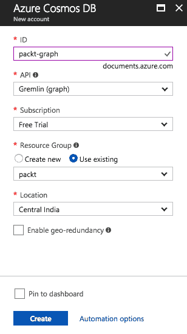
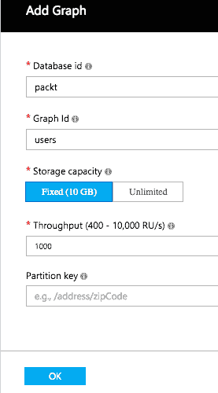
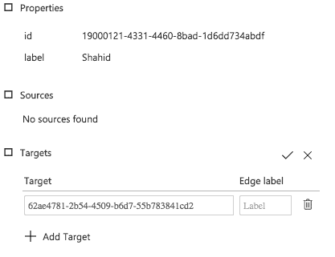

创建完成后，您将看到如下图所示的连接图：

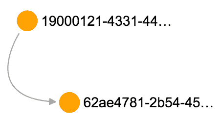

太棒了！我们确实可以创建更多顶点并将它们连接起来，然后查询以获取一些有用的信息。

我们将在接下来的章节中进行更多图查询，即 `Chapter 4`（第 4 章）`Querying Cosmos DB`（查询 Cosmos DB）。

### Cassandra API

Cassandra 是一个开源的高度分布式 `NoSQL` 数据库，拥有经过行业验证的性能和持久性。以下是 Cassandra 的一些功能。

*   `Highly scalable:`（高度可扩展）Cassandra 允许弹性缩放，它允许即时管理系统的硬件需求。您可以根据流量和需求添加/移除硬件。

*   `No single point of failure:`（无单点故障）Cassandra 被证明是一个高可用性数据库，其架构核心内置了无单点故障特性。

*   `Linear scalability:`（线性可扩展性）随着新 Cassandra 节点的添加，Cassandra 会提高系统的吞吐量，因此它始终能提升系统性能，并快速在硬件层面复制这种效果。

*   `Data variety support:`（数据多样性支持）Cassandra 支持各种数据格式，如 `SQL`、`NoSQL`、非结构化数据，并根据系统需求动态适应数据结构的变化。

*   `Transaction support:`（事务支持）Cassandra 支持原子操作的事务。

通过在 `Cosmos DB` 中使用 `Cassandra API`，您可以获得上述所有功能，以及 Cosmos DB 提供的以下优势。

*   `No management:`（无需管理）Cosmos DB 为您提供管理数据的 API，其余基础设施由 Cosmos DB 管理。

*   `Automatic Indexing:`（自动索引）Cosmos DB 默认为数据库中的所有列创建索引，从而大幅提高读取速度。

*   `Global Distribution:`（全球分发）Cosmos DB 允许您通过单击按钮将数据库分发到全球 30 多个区域。

*   `Multiple consistency:`（多种一致性）您可以从 `strong`（强一致性）、`bounded-staleness`（有界过期一致性）、`session`（会话一致性）、`consistent prefix`（一致前缀一致性）和 `eventual`（最终一致性）中选择一致性级别。

这涵盖了 Cosmos DB 支持的所有五种数据模型。让我们继续简要了解 Cosmos DB 的一致性级别。

### Cosmos DB 一致性级别

在分布式数据库中，一致性是一个非常重要的因素。您需要根据应用程序中数据的紧急程度和重要性来决定一致性级别。

Cosmos DB 提供五种一致性级别：

1.  `Strong`（强一致性）：此一致性级别保证写入操作仅在大多数副本提交后，才对数据的应用程序或使用者可见。这会增加读取操作的成本。

2.  `Bounded staleness`（有界过期一致性）：在此一致性级别下，读取操作可能滞后于写入操作。简单来说，由于低成本的读取操作和低延迟，这是最适合分布式数据库的一致性级别。

3.  `Session`（会话一致性）：顾名思义，会话一致性绑定到客户端会话。每个会话，具体来说是每个用户会话，都保证单调的读取和写入。

4.  `Consistent prefix`（一致前缀一致性）：在此级别，读取操作将按写入顺序返回数据。如果写入顺序为 A、B、C，则读取将返回 A、AB 或 ABC，但不会返回 BA 或 BC。

5.  `Eventual`（最终一致性）：这是最弱的一致性级别。在此级别，客户端可能会看到无序的旧版本数据。这非常具有成本效益，但不适用于任务关键型应用程序。

您始终可以从 `Data Explorer`（数据资源管理器）菜单为每个 Cosmos DB 选择一致性级别。

#### 总结

在本章中，您学习了 Cosmos DB 支持的所有四种数据模型。您还学习了如何使用每种模型创建数据库并向其中放入一些数据。您也了解了一致性级别。

在下一章中，我们将深入探讨，在每种数据模型中执行一些优秀的查询，并尝试了解更多关于 Cosmos DB 数据模型的信息。


