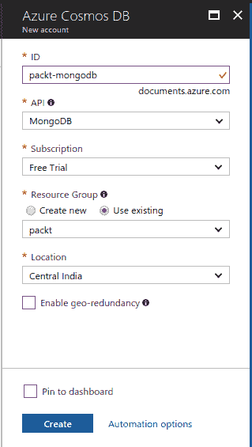
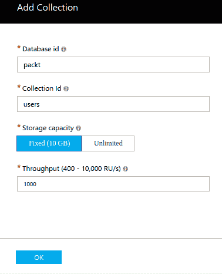
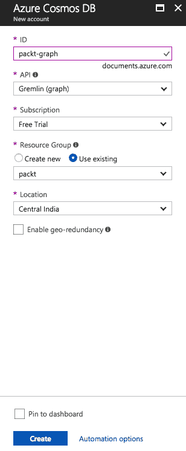
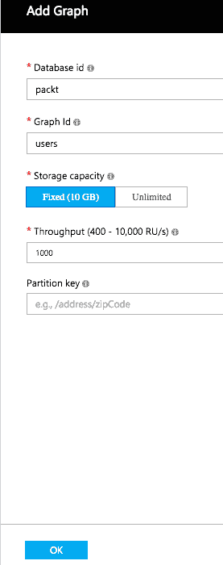
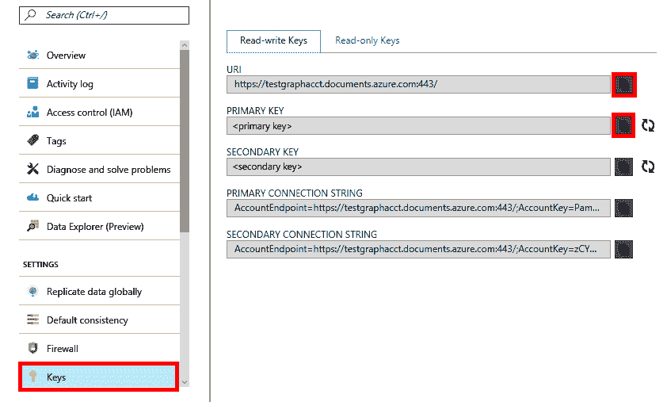
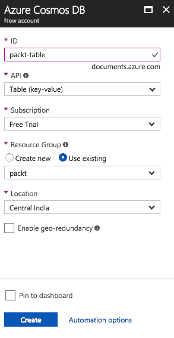
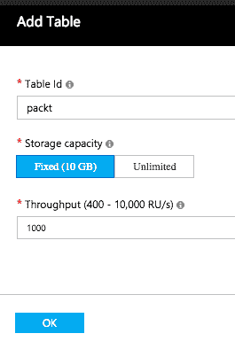
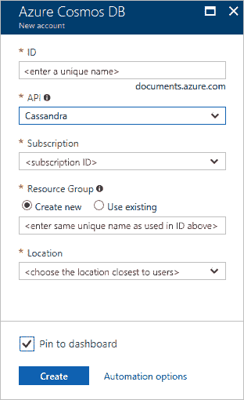
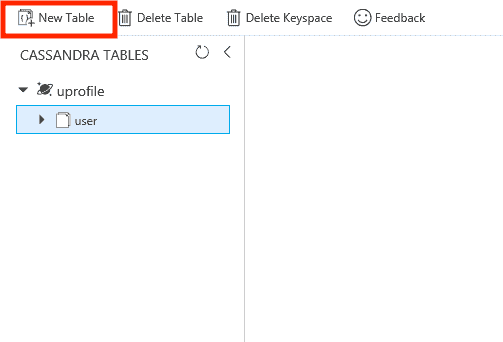

# 查询 Cosmos DB

在上一章中，我们了解了各种数据模型，并在这些数据模型中创建了数据库和表或集合。现在是时候在这些数据模型中引入一些数据并进行查询，以查看其效果如何。

在本章中，我们将涵盖以下主题：

*   在 DocumentDB 中执行 CRUD 操作。
*   在 MongoDB 中执行 CRUD 操作。
*   在图数据库中执行 CRUD 操作。
*   在表（键值存储）中执行 CRUD 操作。
*   在 Cassandra 中执行 CRUD 操作。

让我们从 Document DB 查询开始。

## 在 DocumentDB 中执行 CRUD 操作

DocumentDB 是微软自家的 NoSQL 数据库，具有类 SQL 查询功能。当我说“类 SQL”时，意思是它允许我们使用我们最喜爱的 SQL 查询来查询 JSON 文档。

在开始查询之前，让我们先了解 DocumentDB 查询的基础知识。

### DocumentDB 查询基础

根据 ANSI-SQL 标准，每个 DocumentDB 查询都包含一条 `SELECT` 语句，以及可选的 `FROM` 和 `WHERE` 子句。

对于每个查询，`FROM` 子句中的源会被搜索和遍历。然后将 `WHERE` 子句中的筛选部分应用于源，以检索 JSON 文档的子集。

最后，使用 `SELECT` 子句来填充选择列表中请求的 JSON 值。

语句的顺序可以如下所示：

```
SELECT <select_list> 
[FROM <from_specification>] 
[WHERE <filter_condition>]
[ORDER BY <sort_specification]  
```

让我们开始查询吧。

### 在 Cosmos DB 中创建数据

要执行查询操作，我们需要添加一些数据。你可以添加任意数量的文档，但为了示例方便，我将添加两个嵌套的 JSON 文档。

第一个文档如下所示：

```
{ 
  "id": "100", 
  "lastName": "Doe", 
  "parents": [ 
     { "firstName": "John" }, 
     { "firstName": "Mary"} 
  ], 
  "children": [ 
     { 
         "firstName": "Emily",  
         "gender": "female",  
         "grade": 5, 
         "pets": [{ "givenName": "Fluffy" }] 
     } 
  ], 
  "address": { "state": "WA", "county": "King", "city": "seattle" }, 
  "creationDate": 1431620472, 
  "isRegistered": true 
} 
```

这是第二个文档，有一些细微差别：

```
{
   "id": "200",
   "parents": [
       { "familyName": "Wakefield", "givenName": "Robin" },
       { "familyName": "Miller", "givenName": "Ben" }
   ],
   "children": [
       {
         "familyName": "Merriam", 
         "givenName": "Jesse", 
         "gender": "female", "grade": 1,
         "pets": [
             { "givenName": "Goofy" },
             { "givenName": "Shadow" }
         ]
       },
       { 
         "familyName": "Miller", 
          "givenName": "Lisa", 
          "gender": "female", 
          "grade": 8 }
   ],
   "address": { "state": "NY", "county": "Manhattan", "city": "NY" },
   "creationDate": 1431620462,
   "isRegistered": false
 }
```

要使用 Azure 门户创建这些文档，请执行以下步骤。

1.  登录到 Azure 门户，单击选项栏左侧的 **Azure Cosmos DB** 选项。
2.  从左侧菜单转到 **Data Explorer**（数据资源管理器），并选择我们在上一章中创建的集合。
3.  单击 **New Document**（新建文档）按钮，并添加上述 JSON。

文档创建完成后，我们就可以对它们进行查询了。

### 从 DocumentDB 读取数据

让我们使用 SQL 查询结构来查询数据：

1.  单击 **New SQL Query**（新建 SQL 查询）按钮，并粘贴此查询：

```
SELECT *  
FROM Families f  
WHERE f.id = "100" 
```

2.  这将产生以下结果：

```
[{ 
  "id": "100", 
  "lastName": "Doe", 
  "parents": [ 
     { "firstName": "John" }, 
     { "firstName": "Mary"} 
  ], 
  "children": [ 
     { 
         "firstName": "Emily",  
         "gender": "female",  
         "grade": 5, 
         "pets": [{ "givenName": "Fluffy" }] 
     } 
  ], 
  "address": { "state": "WA", "county": "King", "city": "seattle" }, 
  "creationDate": 1431620472, 
  "isRegistered": true 
}] 
```

3.  你也可以执行传统的 `ORDER BY` 查询，类似于以下查询：

```
SELECT c.givenName  
FROM Families f  
JOIN c IN f.children  
WHERE f.id = '200' 
ORDER BY f.address.city ASC
```

4.  这将产生以下结果：

```
[ 
  { "givenName": "Jesse" },  
  { "givenName": "Lisa"} 
]
```

5.  你还可以运行子查询，即从主文档中获取子文档。你可以参考以下查询：

```
SELECT *  
FROM Families.children 
```

6.  这将产生以下结果：

```
[ 
  [ 
    { 
        "firstName": "Emily", 
        "gender": "female", 
        "grade": 5, 
        "pets": [ 
          { 
              "givenName": "Fluffy" 
          } 
        ] 
    } 
  ], 
  [ 
    { 
        "familyName": "Merriam", 
        "givenName": "Jesse", 
        "gender": "female", 
        "grade": 1 
    }, 
    { 
        "familyName": "Miller", 
        "givenName": "Lisa", 
        "gender": "female", 
        "grade": 8 
    } 
  ] 
] 
```

因此，我们现在知道了如何创建和查询文档。让我们执行 `UPDATE`（更新）和 `DELETE`（删除）操作。

### 更新和删除文档

Azure 门户不允许运行这些查询，即使用查询来更新和删除文档，但你可以使用你选择的 SDK 或通过 Azure 门户 UI 来执行。

要编辑文档，你可以直接运行 `SELECT` 查询，实时编辑文档，然后单击 **Save**（保存）按钮使更改生效，或者单击 **DELETE**（删除）按钮来移除文档。

我们将在 第 5 章 *将 Node.js 与 Cosmos DB 集成* 中介绍如何使用 Azure SDK 进行更新和删除。

让我们看看 MongoDB 查询操作。

## 在 MongoDB 中执行 CRUD 操作

MongoDB 是流行的 NoSQL 数据库之一。你需要创建一个 MongoDB 数据库和集合，并且可以在浏览器中的 Azure 终端中执行基本的 CRUD 操作，或者获取连接字符串并将其连接到你的 Node 应用。

1.  打开 Azure 门户并创建一个新的 MongoDB 实例；请参考以下屏幕截图：



2.  创建完成后，你可以向其中添加一个新集合。请参考以下屏幕截图：



3.  现在你需要检索连接字符串。转到 **Settings | Connection String**（设置 | 连接字符串）选项并复制连接字符串。

请将其妥善保管，切勿共享。

现在你可以使用连接字符串将 Node.js 应用程序连接到这个 MongoDB 实例。

我们将在 第 5 章 *将 Node.js 与 Cosmos DB 集成* 中介绍 Node.js。

不过，你可以直接在 Azure 浏览器终端中执行 CRUD 操作。

4.  单击顶部栏上的 **New document**（新建文档）按钮，并添加以下 JSON 以创建文档：

```
{ 
    "id": "10", 
    "name": "Shahid", 
    "location": "Mumbai", 
    "job": "Engineer" 
} 
```

5.  文档创建后，你可以使用查询查看它，或通过单击包含文档列表的左侧栏来查看。你可以通过单击那个小叉号按钮来删除它。

我们将在下一章介绍如何使用代码进行 CRUD 操作。

让我们看看如何在图数据库中执行 CRUD 操作。

## 在图数据库中执行 CRUD 操作

正如 第 3 章 *Cosmos DB 多模型数据库* 中所讨论的，图数据模型是一种由顶点和边组成的结构。顶点和边都可以有一组属性：

*   **顶点** 代表离散对象，例如人、地点或事件。
*   **边** 代表顶点之间的关系。例如，一个人可能认识另一个人、参与一个事件，并且最近曾到访过某个地点。


### 图数据库 (Gremlin API) CRUD 操作

属性表示关于顶点和边的详细信息。Azure Cosmos DB 支持属性图模型。

#### 创建图数据库

让我们首先创建一个新数据库：

1. 单击 **新建数据库** 并选择 **Gremlin** 作为 API。请参考以下屏幕截图：

   

2. 现在，创建一个新的图数据库和 **图 ID**。请参考以下屏幕截图：

   

3. 现在，你需要生成密钥以通过任何编程接口进行连接。转到 **设置 | 密钥**，然后单击主密钥和辅助密钥以生成它们。请参考以下屏幕截图：

   

我们可以使用这些密钥通过代码连接到你的图数据库。

现在，进入 CRUD 部分，我们可以使用 Azure 门户以及代码创建新的顶点和边。我们在 第 3 章 *Cosmos DB 多模型数据库* 中也介绍了 Azure 门户。

一旦你创建了一些顶点和边并为它们添加了一些属性，就可以对图执行查询。

最简单的方法之一是通过 Azure 终端。

4. 运行此查询以返回图的顶点：

```
g.V().count()
```

实际上，你可以使用门户 UI 从图中删除顶点并动态编辑它们。

图是一个非常广泛的主题，你可以在其中做更多事情。

以下是参考链接，你可以在其中阅读关于图的更多详细信息：

[Gremlin 支持文档](https://docs.microsoft.com/en-us/azure/cosmos-db/gremlin-support)

## 在表 (键值存储) 中执行 CRUD 操作

表存储 API 为我们提供了高效且轻松地存储键值对数据的能力。你需要在 Cosmos DB 内创建一个新的表数据库来执行 CRUD 操作。

### 创建表数据库

1. 登录到你的 Azure 门户，然后单击选项栏左侧的 **Azure Cosmos DB** 选项。

2. 单击 **+** 按钮，为你的新数据库指定一个合适的 ID，然后从 API 下拉菜单中选择 **表 (键值)** 选项。

3. 你可以创建一个新资源或使用现有资源。选择大多数写入操作将发生的位置，然后单击 **创建** 按钮。你可以参考屏幕截图：

   

4. 现在你可以在其中创建一个表来存储你的数据。请参考以下屏幕截图：

   

### 使用实体

我们可以对同一数据执行 CRUD 操作。我们需要创建表实体以该格式存储数据。单击 **添加新实体** 并添加行键和分区键。有关详细信息，请参阅 第 3 章 *Cosmos DB 多模型数据库*。

创建实体后，我们可以在其中添加数据。此外，你可以从 Azure 门户复制连接字符串并粘贴以在自定义应用程序中进一步使用。

你可以添加任意数量的实体，完成后，可以从数据资源管理器中删除、编辑或查询它们。

## 在 Cassandra 中执行 CRUD 操作

Cassandra API 为我们提供了在 Cassandra 中高效且轻松地存储 NoSQL 数据的能力。你需要在 Cosmos DB 内创建一个新的 Cassandra 数据库来执行 CRUD 操作。

### 创建 Cassandra 数据库

1. 登录到你的 Azure 门户，然后单击选项栏左侧的 **Azure Cosmos DB** 选项。

2. 单击 **+** 按钮，为你的新数据库指定一个合适的 ID，然后从 API 下拉菜单中选择 **Cassandra** 选项。

3. 你可以创建一个新资源或使用现有资源。选择大多数写入操作将发生的 **位置**，然后单击 **创建** 按钮。你可以参考屏幕截图：

   

4. 现在，单击 **数据资源管理器 | 新建表** 按钮并创建一个新表来存储数据。请参考下面的屏幕截图：

   

### 使用表和数据

5. 现在，我们可以使用标准 SQL 命令插入数据，如下所示。

```
INSERT INTO uprofile.user
(first_name, last_name)
VALUES ('Shahid', 'Shaikh');
```

6. 你可以使用 `SELECT` 查询从 `Cassandra` 表中读取数据。

```
SELECT * from uprofile.user;
```

同样，可以分别使用 `UPDATE` 和 `DELETE` 命令来更新和删除 Cassandra 表中的记录。

这涵盖了使用各种数据模型执行 CRUD 操作的内容。

## 总结

在本章中，我们学习了如何对 Cosmos DB 支持的每个数据库 API 执行 CRUD 操作。我们还学习了如何使用连接字符串和密钥从代码连接到数据库。

在下一章中，我们将学习 Node.js 与各种 Cosmos DB 数据库的集成。
