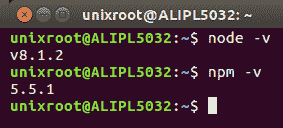
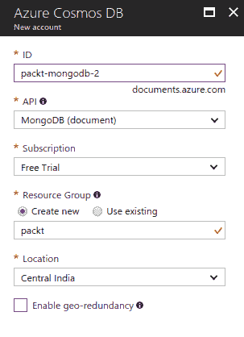
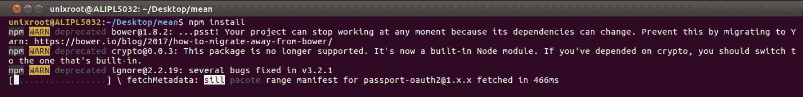
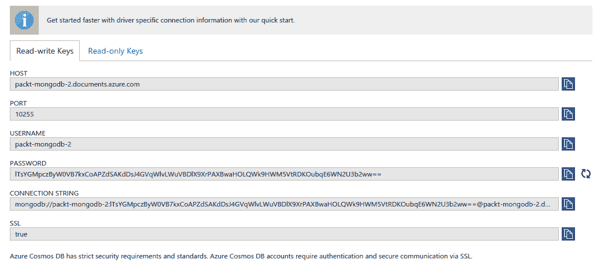
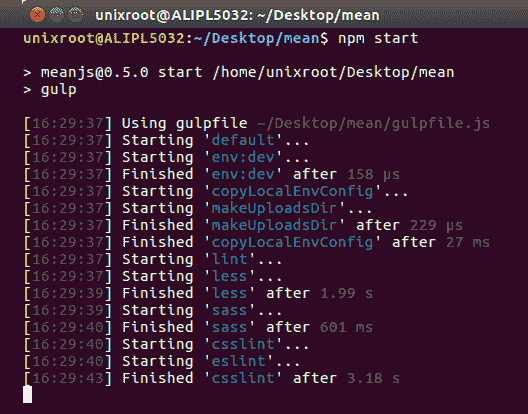
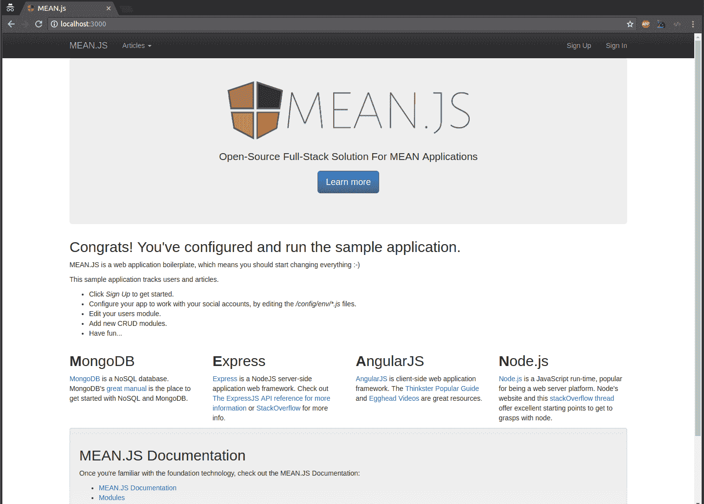
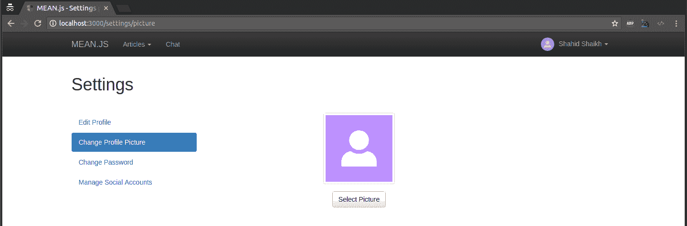
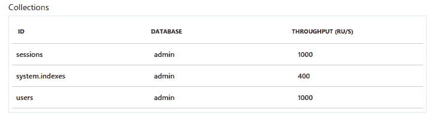
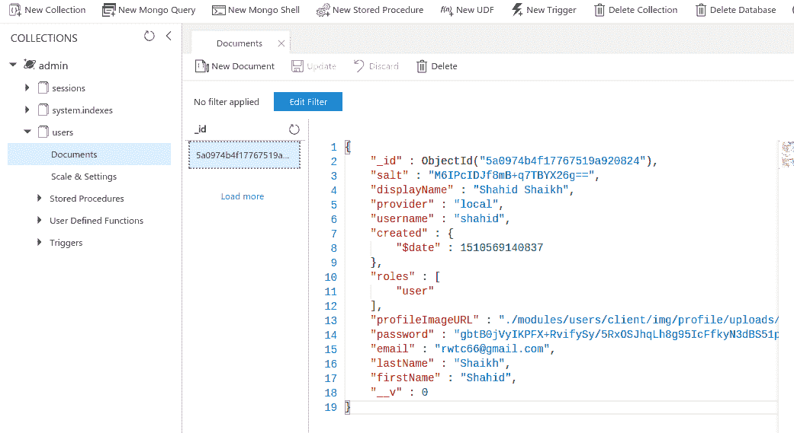

# 将 Cosmos DB 与 Node.js 集成

Cosmos DB 支持多种编程语言，如 Java、.NET、Python 和 Node.js。Node.js 实际上不是一种编程语言，而是 JavaScript 的运行时框架。

我是一名 Node.js 爱好者，更习惯使用 Node.js 开发后端系统，因此我们将在本章以及后续章节中进行 Cosmos DB 与 Node.js 的集成。

以下是我们将在本章中介绍的主题：

- Node.js 设置
- Cosmos DB MongoDB 设置
- 将 Cosmos DB 与 Node.js 应用连接
- 在 Cosmos DB 中探索应用数据
- 将 DocumentDB API 与 Node.js 集成
- 将表 API 与 Node.js 集成
- 将图 API 与 Node.js 集成

那么，让我们开始吧。

## Node.js 设置

你需要在你的机器上安装并设置 Node.js。访问 Node.js 官方网站 ([`nodejs.org/en/download/`](https://nodejs.org/en/download/)) 并根据你的操作系统下载最新版本。

我在这里介绍 Ubuntu 的安装。让我们逐步进行：

1. 打开终端并运行此命令：

```
curl -sL https://deb.nodesource.com/setup_8.x | sudo -E bash -
```

这将为 Node.js 8+ 版本添加 Ubuntu 存储库条目。

2. 现在，运行此命令安装 Node.js：

```
sudo apt-get install -y nodejs
```

片刻后，Node.js 连同 `npm` 将设置完成。

3. 要检查 Node.js 和 `npm` 的版本，请运行以下命令：

```
node -v
npm -v
```

输出如下：



你也可以在 macOS 以及 Windows（使用 PowerShell 或 Windows 命令提示符）中运行类似的命令。

这应该能确保 Node.js 正确设置，我们可以继续进行 Cosmos DB MongoDB 的创建。

## Cosmos DB MongoDB 设置

MongoDB 是最流行的 NoSQL 数据库之一。你需要创建一个 MongoDB 数据库和集合，并生成访问密钥。

打开你的 Azure 门户并创建一个新的 MongoDB 实例。请参考以下屏幕截图：



单击 **创建** 按钮，将创建一个新的 MongoDB API。接下来，我们需要将 Node.js 应用与 Cosmos DB 的 MongoDB API 连接。

## 将 Cosmos DB 与 Node.js 应用连接

Cosmos DB 的设计使你能够轻松地将其与应用集成，而无需做太多额外工作。也就是说，你不需要处理配置和管理部分，这在 NoSQL 数据库中通常是一大痛点；你可以使用现有的 Node.js 模块轻松连接到 Cosmos DB MongoDB。

我们将使用与正常 MongoDB 开发相同的 Node.js 模块集，无需额外的东西！

让我们通过配置用 Node.js 和 MongoDB 编写的现有项目来使用我们的 Cosmos DB Mongo API，以证明这一点。


## 示例应用部署与 Cosmos DB 集成指南

### 示例代码获取

演示使用的开源示例代码托管于：[`github.com/prashanthmadi/mean`](https://github.com/prashanthmadi/mean)

#### 步骤

1.  **下载代码**  
    可使用 `git` 或直接访问 GitHub 仓库下载 ZIP。此处使用 `git`。

2.  **克隆项目**  
    在终端运行：
    ```
    git clone https://github.com/prashanthmadi/mean
    ```

3.  **安装依赖**  
    ```
    cd mean && npm install
    ```
    此命令会安装项目运行所需的依赖。参考截图：
    

4.  **配置 MongoDB 连接**  
    复制 MongoDB URI。进入连接字符串界面复制连接字符串。参考截图：
    

5.  **修改配置文件**  
    进入项目文件夹，编辑 `config/env/local-development.js`，修改连接 URI：
    ```
    module.exports = { 
      db: { 
        uri: '===== paste your URL here =====' 
      }, 
      sessionSecret: process.env.SESSION_SECRET || 'youshouldchangethistosomethingsecret', 
      facebook: { 
        clientID: process.env.FACEBOOK_ID || 'APP_ID', 
        clientSecret: process.env.FACEBOOK_SECRET || 'APP_SECRET', 
        callbackURL: '/api/auth/facebook/callback' 
      } 
    };
    ```

6.  **启动应用**  
    保存配置后运行：
    ```
    npm start
    ```

7.  **访问应用**  
    构建完成后，可在 `localhost:3000` 查看项目。参考截图：
    

8.  **浏览器效果**  
    

应用已启动。需执行操作以生成 MongoDB 数据。创建新账号测试功能！

9.  **注册账号**  
    点击**注册**填写详情。账号创建后可登录、查看/编辑个人资料。预期效果：
    

Node 应用已连接 MongoDB，接下来在 Cosmos DB 数据资源管理器中查看数据。

## Cosmos DB 中的应用数据

应用已连接 Cosmos DB 并创建用户。查看 Cosmos DB MongoDB 集合中的数据：

1.  登录 Azure 门户，进入数据库概览界面，可见集合列表。参考截图：
    

2.  点击 `users` 集合查看其中数据。

3.  双击任意集合数据的 **ID** 查看完整数据。参考截图：
    

确认了使用 Node.js 的应用与数据库连接。接下来介绍如何将 Node.js 与 DocumentDB 及 Azure Cosmos DB 支持的其他数据库 API 配合使用。

## 将 DocumentDB API 与 Node.js 集成

DocumentDB 是 Azure Cosmos DB 支持的另一个重要数据库 API。若要将其与 Node.js 集成，需安装 `documentdb` Node 模块。步骤如下：

1.  **安装模块**  
    ```
    npm install documentdb@latest
    ```

2.  模块安装后，可使用其函数连接 DocumentDB 并执行 CRUD 操作与查询。

3.  首先创建 DocumentDB API 并复制连接 URL。

4.  **创建配置文件**  
    新建 `config.js` 并添加代码：
    ```
    var config = {}
        
    config.endpoint = "paste the document db URI";

    config.primaryKey = "paste the primary key";
       
    config.database = {
    "id": "packt-users-2"
    };
        
    config.collection = {
    "id": "users"
    };
        
    module.exports = config;  
    ```

5.  **编写连接代码**  
    将示例代码存为 `app.js`：
    ```
    var documentClient = require("documentdb").DocumentClient;
    var config = require("./config");
    var url = require('url');
        
    var client = new documentClient(config.endpoint, { "masterKey":     
    config.primaryKey });
        
    var HttpStatusCodes = { NOTFOUND: 404 };
    var databaseUrl = `dbs/${config.database.id}`;
    var collectionUrl = `${databaseUrl}/colls/${config.collection.id}`;
        
    /**
     * Get the database by ID, or create if it doesn't exist.
     * @param {string} database - The database to get or create
     */
    function getDatabase() {
        console.log(`Getting database:\n${config.database.id}\n`);
        
        return new Promise((resolve, reject) => {
            client.readDatabase(databaseUrl, (err, result) => {
                if (err) {
                    if (err.code == HttpStatusCodes.NOTFOUND) {
                        client.createDatabase(config.database, (err, created) => {
                            if (err) reject(err)
                            else resolve(created);
                        });
                    } else {
                        reject(err);
                    }
                } else {
                    resolve(result);
                }
            });
        });
    }
        
    /**
     * Get the collection by ID, or create if it doesn't exist.
     */
    function getCollection() {
        console.log(`Getting collection:\n${config.collection.id}\n`);

        return new Promise((resolve, reject) => {
            client.readCollection(collectionUrl, (err, result) => {
                if (err) {
                    if (err.code == HttpStatusCodes.NOTFOUND) {
                        client.createCollection(databaseUrl, config.collection, {    
    offerThroughput: 400 }, (err, created) => {
                                if (err) reject(err)
                                else resolve(created);
                            });
                    } else {
                        reject(err);
                    }
                } else {
                    resolve(result);
                }
            });
        });
    }
        
        
    /**
     * Cleanup the database and collection on completion
     */
    function cleanup() {
        console.log(`Cleaning up by deleting database ${config.database.id}`);
        
        return new Promise((resolve, reject) => {
            client.deleteDatabase(databaseUrl, (err) => {
                if (err) reject(err)
                else resolve(null);
            });
        });
    }
        
    /**
     * Exit the app with a prompt
     * @param {message} message - The message to display
     */
    function exit(message) {
        console.log(message);
        console.log('Press any key to exit');
        process.stdin.setRawMode(true);
        process.stdin.resume();
        process.stdin.on('data', process.exit.bind(process, 0));
    }
        
    getDatabase()
        .then(() => getCollection())
        .then(() => cleanup())
        .then(() => { exit(`Completed successfully`); })
        .catch((error) => { exit(`Completed with error ${JSON.stringify(error)}`) });  
    ```

6.  **运行代码**  
    ```
    node app.js
    ```
    此代码将连接数据库、获取集合详情，若有错误则退出并报错。

涵盖了使用 Node.js 模块集成 DocumentDB 的内容。接下来看如何将 Node.js 与 Table API 集成。

## 将表 API 与 Node.js 集成

Azure 表存储是基于键值的高性能 NoSQL 数据库。要将其与 Node.js 集成，需安装所需模块。Microsoft 提供了官方 Node 模块用于 Table API：[Azure Storage Node.js 官方模块](https://www.npmjs.com/package/azure-storage)


### Azure 表 API 集成

1. 首先，在 Azure 门户中创建表 API 并复制连接字符串。将其导出为环境变量。在基于 Linux 的系统中，可以运行此命令将连接字符串导出为环境变量：

```
export.AZURE_STORAGE_CONNECTION_STRING = <Your connection string>
```

2. 接下来，安装所需的依赖项。命令如下：

```
npm install azure-storage
```

3. 安装完成后，您可以在代码库中引入该模块并开始使用 `Table storage`，例如：

```
var azure = require('azure-storage');
var tableObject = azure.createTableService();
tableObject.createTableIfNotExists('demoTable', function(error, result, response) {
  if (!error) {
    // 表已存在或已创建
  }
  console.log(result);
});
```

这将使用连接字符串连接到您的 Azure 表存储。接下来，让我们继续将 Graph API 与 Node.js 集成。

## 将 Graph API 与 Node.js 集成

Cosmos DB 通过 `gremlin` 支持图数据库，而 `gremlin` 在 Node.js 中已支持很长时间。

我们可以使用以下命令安装 `gremlin` Node 模块：

```
npm install gremlin@latest
```

在生产环境中始终锁定依赖版本。

您可以在 Azure 门户中创建一个新的 Graph API 并复制连接详细信息。我将展示连接到该图数据库的示例代码。

我们已经安装了 Node 模块。让我们将配置详细信息放在一个文件中：

```
var config = {};

config.endpoint = "graph api end point";
config.primaryKey = "primary key";
config.database = "database name";
config.collection = "collection name";

module.exports = config;
```

现在，我们可以使用以下代码连接到 `Graph DB`：

```
var Gremlin = require('gremlin');
var config = require("./config");

var client = Gremlin.createClient(
    443,
    config.endpoint,
    {
        "session": false,
        "ssl": true,
        "user": `/dbs/${config.database}/colls/${config.collection}`,
        "password": config.primaryKey
    }
);
```

您可以使用 `node <filename.js>` 运行代码，如果连接字符串错误，它将抛出错误并退出。

您可以使用 `execute(query)` 函数在图数据库中执行查询，例如：

这段代码将返回图中顶点的数量：

```
client.execute("g.V().count()", {}, (err, results) => {
  if (err) return console.error(err);
  console.log("Result: %sn", JSON.stringify(results));
});
```

同样，您也可以执行其他查询。

这也涵盖了 Node.js 与 Graph DB 的集成。

## 总结

在本章中，我们涵盖了大量内容。我们使用现有代码库与著名的 MongoDB 进行了集成，以证明关于迁移或从传统 MongoDB 迁移到托管 MongoDB 的观点，且无需更改任何代码（当然，除了配置 URI）。

我们还学习了将 Node.js 与 `DocumentDB`、`Table` 和 `Graph DB` 集成。

在下一章中，我们将使用 Node.js 和 Cosmos DB 构建一个高性能链接编码和重定向服务。这类似于 `bit.ly` 服务。
