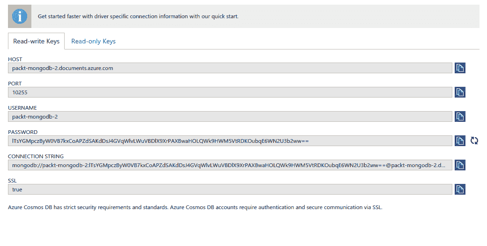
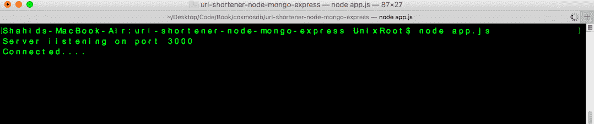
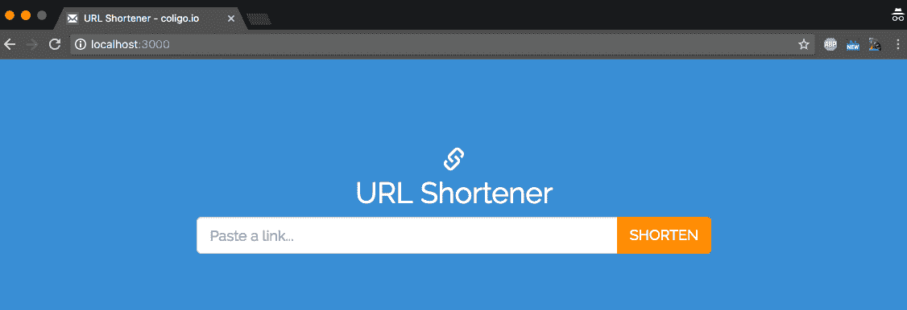
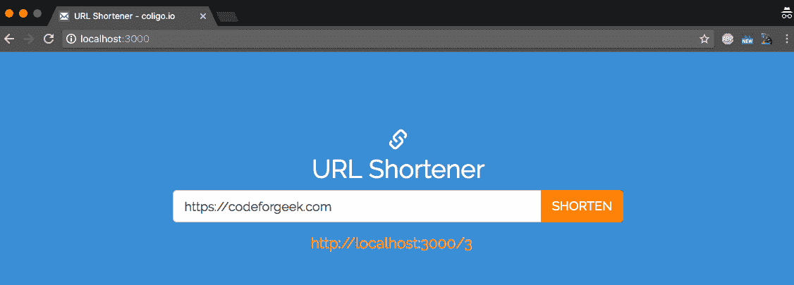
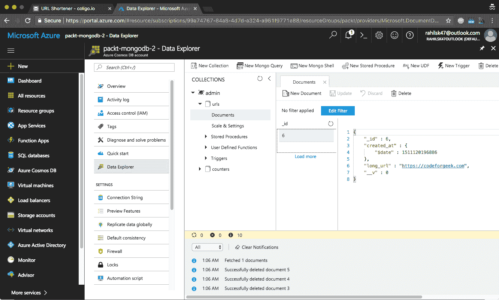

# 使用 Cosmos DB 构建高性能链接缩短与追踪系统

Cosmos DB 是为其服务提供 SLA 的独特数据库之一。这种高性能系统对于实时运行的应用程序至关重要，例如群聊、实时视频通话或链接缩短服务。

在本章中，我们将使用 Cosmos DB 构建一个链接缩短服务。我们将在后续章节讨论选择哪种 API。我们将使用 Node.js 进行应用程序开发。

在本章中，我们将学习以下内容：

- 为什么需要 URL 缩短？
- 系统需求
- 容量估算
- 数据库设计
- URL 编码算法
- Node 应用开发
- 安全性与权限

## 为什么需要 URL 缩短？

URL 缩短用于为长 URL 创建较短的别名。当用户访问这些短 URL 时，会被重定向到原始 URL。无论何时使用，任何 URL 的较短版本都能节省大量空间，例如在打印或发推文时，因为推文有字符限制。

例如，如果我们通过 TinyURL 缩短此页面：

[`packtpub.com`](https://packtpub.com)

在这种情况下，我们将得到 [`tinyurl.com/jlg8zpc`](http://tinyurl.com/jlg8zpc)。

缩短后的 URL 尺寸几乎是实际 URL 的 1/3。

URL 缩短用于跨设备优化链接、追踪单个链接以分析受众和广告系列效果、隐藏联属原始 URL 等。

如果您以前没有使用过 [tinyurl.com](http://tinyurl.com/)，请尝试创建一个新的缩短 URL，并花些时间浏览其服务提供的不同选项。这将极大地帮助您更好地理解本章。

您也可以使用 [bit.ly](https://bitly.com/) 来更好地理解该概念。

让我们看看系统施加的需求。

## 系统需求

我们的 URL 缩短系统应满足特定需求。

以下是功能性需求：

- 给定一个 URL，我们的服务应生成其较短且唯一的别名
- 当用户访问较短的 URL 时，我们的服务应将他们重定向到原始链接

以下是非功能性需求：

- 系统应具有高可用性。这是必需的，因为如果我们的服务宕机，所有 URL 重定向都将开始失败。
- URL 重定向应实时发生，且延迟最小。
- 缩短的链接不应可被猜测（或预测）。

以下是扩展需求：

- 分析，例如，重定向发生了多少次？
- 我们的服务还应可通过 REST API 供其他服务访问

让我们计算系统上线所需的数据库大小和带宽。

## 容量估算

我们的系统将以读为主；与新的 URL 缩短相比，会有大量的重定向请求。假设读写比率为 100:1。

**流量估算**：如果我们假设每月会有 *5 亿* 个新的 URL 缩短，则在同一时期内预计会有 (*100 \* 5 亿 => 500 亿*) 次重定向。我们系统的**每秒查询率**（**QPS**）会是多少？

每秒新 URL 缩短数：

*5 亿 / (30 天 \* 24 小时 \* 3600 秒) ~= 200 URLs/s*

每秒 URL 重定向数：

*500 亿 / (30 天 \* 24 小时 \* 3600 秒) ~= 19K/s*

**存储估算**：既然我们预计每月有 5 亿个新 URL，如果我们保留这些对象五年，我们将存储的对象总数将达到 300 亿：

*5 亿 \* 5 年 \* 12 个月 = 300 亿*

假设我们存储的每个对象为 500 字节（仅为大概数字，稍后我们会深入探讨）；我们将需要 15 TB 的总存储空间：

*300 亿 \* 500 字节 = 15 TB*

**带宽估算**：对于写请求，因为我们每秒预计有 200 个新 URL，我们服务的总传入数据将为 100 KB/秒：

*200 \* 500 字节 = 100 KB/s*

对于读请求，因为我们每秒预计约有 19K 次 URL 重定向，我们服务的总传出数据将为 9 MB/秒：

*19K \* 500 字节 ~= 9 MB/s*

**内存估算**：如果我们想缓存一些频繁访问的热门 URL，需要多少内存来存储它们？如果我们遵循二八定律，即 20% 的 URL 产生 80% 的流量，我们希望缓存这 20% 的热门 URL。

因为我们每秒有 19K 个请求，每天将获得 17 亿个请求：

*19K \* 3600 秒 \* 24 小时 ~= 17 亿*

要缓存这些请求的 20%，我们需要 170 GB 内存：

*0.2 \* 17 亿 \* 500 字节 ~= 170 GB*

## 数据库设计

关于我们将要存储的数据性质，有几点观察：


*   我们需要存储数十亿条记录
*   我们要存储的每个对象都很小（小于 1K）
*   记录之间没有关系，除非我们想存储哪个用户创建了哪个 URL
*   我们的服务是读多写少的

我们需要两张表，一张用于存储 URL，另一张用于存储链接的计数。

以下代表 `URL` 表：

| `_id` |
| --- |
| `long_url` |
| `clicked` |
| `created_date` |

以下代表 `Counter` 表：

| `_id` |
| --- |
| `Seq` |

## URL 编码算法

这是有趣的部分，实际的 URL 编码和解码就发生在这里。

在我们跳入代码开发之前，让我们探讨一下 URL 缩短背后的基本理论。我们的需求如下：

给定一个长 URL，例如 `http://stackoverflow.com/questions/tagged/node.js`，生成一个唯一的、较短的 URL，例如 `localhost:3000/3Ys`。

首先，让我们看看如何从原始 URL 实际生成一个唯一键，在本例中是 3 年，它位于我们 localhost URL 的末尾。

为了满足唯一性要求，我们可以使用一类特殊的函数，称为双射函数（[`en.wikipedia.org/wiki/Bijection`](https://en.wikipedia.org/wiki/Bijection)），它们保证一对一映射。为了解释方便，双射函数基本上意味着：

“一个解码后的 URL 映射到唯一的一个键，而一个键映射到唯一的一个解码后的 URL”

我们将使用 base58 算法来完成我们的 URL 缩短和解码任务。

我们将把一个唯一的整数 ID（它是 base10）转换为其在 base58 中的等价形式。我们将使用的 base58 字母表如下：

```
123456789abcdefghijkmnopqrstuvwxyzABCDEFGHJKLMNPQRSTUVWXYZ
```

它只是数字 1-9、a-z 和 A-Z，总共给我们 58 个字符，因此称为 base58。我们不包含 0、l 或 O，以避免在通过电话分享 URL 或手动复制时产生混淆。

现在，将所有这些结合起来以生成较短的 URL，我们的解决方案如下：

1.  创建一个全局自增整数
2.  每当一个新的 URL 被缩短并添加到我们的数据库时，我们将增加该全局数字（base 10）并将其用作数据库中该条目的唯一 ID
3.  然后，我们将对该唯一 ID 进行 base58 编码以生成一个唯一的、较短的 URL

例如，唯一 ID 为 100022（base 10）的条目将生成 base58 编码 3Ys。因此，如果你存储大量 URL，比如 100,000,000 个，它们将生成一个缩短的哈希值：

```
9QwvW
```

让我们开发代码吧！

## Node 应用开发

所以，我们已经准备好了一切；让我们构建应用。

让我们创建 `package.json` 文件。

始终使用 `npm init --y` 命令生成样板 `package.json` 文件。

以下是我们需要的包：

*   `body-parser`
*   `express`
*   `mongoose`

让我们安装它们。在你的项目目录下运行此命令以安装依赖项：

```
npm install --save body-parser express mongoose
```

这是我的 `package.json` 的样子：

```
{
  "name": "url-shortener",
  "version": "1.0.0",
  "description": "A NodeJS + Express + MongoDB based URL shortener",
  "main": "app.js",
  "scripts": {
    "test": "echo \"Error: no test specified\" && exit 1"
  },
  "author": "shahid",
  "license": "MIT",
  "dependencies": {
    "body-parser": "¹.14.1",
    "express": "⁴.13.3",
    "mongoose": "4.2.9"
  }
}
```

让我们创建配置文件。将其命名为 `config.js` 并放入以下代码：

```
var config = {};
config.db = {};
config.webhost = 'http://localhost:3000/';
config.db.uri = 'copy the uri from Azure portal';
config.db.host = 'packt-mongodb-2.documents.azure.com';
config.db.name = 'url_shortener';
module.exports = config;
```

从 Azure 门户屏幕复制 URI。请参考以下屏幕截图作为参考：



我们已经完成了配置。让我们编写代码以连接到我们的 MongoDB 数据库 Cosmos。

创建一个名为 `connection.js` 的文件并将以下代码放入其中：

```
const mongoose = require('mongoose');
const config = require('../config.js');
mongoose.connect(config.db.uri);

module.exports = mongoose.connection;
```

这段代码将连接对象返回给调用者。

接下来，我们将创建数据库模式代码库，以确保 MongoDB 模式和数据索引。

以下是相应的代码库。将其放在名为 `url.js` 的文件中：

```
var mongoose = require('mongoose');
var connection = require('./connection');
var Schema = mongoose.Schema;

connection.once('open', function() {
  console.log("Connected....");
});

var CounterSchema = Schema({
    _id: {type: String, required: true},
    seq: { type: Number, default: 0 }
});

var counter = mongoose.model('counter', CounterSchema);

// create a schema for our links
var urlSchema = new Schema({
  _id: {type: Number, index: true},
  long_url: String,
  clicked: {type: Number, default:0 ,index: true},
  created_at: Date
});

urlSchema.pre('save', function(next){
  var doc = this;
  counter.findByIdAndUpdate({_id: 'url_count'}, {$inc: {seq: 1}}, function(error, counter) {
      if (error)
          return next(error);
          console.log(counter);
      doc.created_at = new Date();
      doc._id = counter.seq;
      next();
  });
});

var Url = mongoose.model('Url', urlSchema);

module.exports = Url;
```

正如你在前面的代码中所见，我们正在使用我们的连接对象并在控制台上打印连接状态。

正如我们在数据库部分讨论的，我们创建了两个模式。一个用于维护全局计数器，另一个用于维护实际链接。

我们正在使用 Mongoose 的 pre 函数事件，基本上是从 counter 集合中获取最新的 URL 计数值。这是为了确保我们永远不会生成重复的短 URL。

最后，我们导出数据库对象。

接下来，我们将开发我们的应用程序逻辑，即服务器代码，以处理来自用户的请求和响应，并调用我们开发的函数。

以下是服务器的代码库。我们使用 express node 模块来创建服务器路由：


## 使用 Node.js 和 MongoDB 的 URL 缩短应用程序

### 应用程序设置

```javascript
var express = require('express');
var app = express();
var path = require('path');
var bodyParser = require('body-parser');
var mongoose = require('mongoose');
var config = require('./config');
var base58 = require('./base58.js');

// grab the url model
var Url = require('./models/url');

app.use(bodyParser.json());
app.use(bodyParser.urlencoded({ extended: true }));

app.use(express.static(path.join(__dirname, 'public')));

app.get('/', function(req, res) {
  res.sendFile(path.join(__dirname, 'views/index.html'));
});

app.post('/api/shorten', function(req, res) {
  var longUrl = req.body.url;
  var shortUrl = '';

  // check if url already exists in database
  Url.findOne({ long_url: longUrl }, function(err, doc) {
    if (doc) {
      shortUrl = config.webhost + base58.encode(doc._id);

      // the document exists, so we return it without creating a new entry
      res.send({ 'shortUrl': shortUrl });
    } else {
      // since it doesn't exist, let's go ahead and create it:
      var newUrl = Url({
        long_url: longUrl
      });

      // save the new link
      newUrl.save(function(err) {
        if (err) {
          console.log(err);
        }

        shortUrl = config.webhost + base58.encode(newUrl._id);

        res.send({ 'shortUrl': shortUrl });
      });
    }
  });
});

app.get('/:encoded_id', function(req, res) {
  var base58Id = req.params.encoded_id;
  var id = base58.decode(base58Id);

  // check if url already exists in database
  Url.findOne({ _id: id }, function(err, doc) {
    if (doc) {
      res.redirect(doc.long_url);
    } else {
      res.redirect(config.webhost);
    }
  });
});

var server = app.listen(3000, function() {
  console.log('Server listening on port 3000');
});
```

首先，我们需要所需的模块，例如用于 Web 服务器的 `express` 或用于解析 HTTP 参数值的 `body-parser`。

接下来，我们需要三个模块。请参考以下代码：

```javascript
// our sweet config file.
var config = require('./config');
// Base 58 decoding, will discuss it in next section
var base58 = require('./base58.js');
// grab the url model
var Url = require('./models/url');
```

`Url` 模块实际上存储 URL 及其计数，正如我们在前一节中讨论的那样。

接下来，我们定义了路由并在这些路由上执行特定操作。例如，在根页面请求时，我们将 HTML 内容发送回服务器。

然后，我们定义了两个 API：一个用于缩短 URL (`/api/shorten`)，另一个用于解码 (`/:encoded_id`)。这两个路由都调用 `Url` 模块中存在的模型函数。

无论是编码还是解码，我们都使用 `base58` 模块的函数。让我们看看该模块的作用。

### Base58 编码模块

以下是 `base58.js` 模块的代码：

```javascript
var alphabet = "123456789abcdefghijkmnopqrstuvwxyzABCDEFGHJKLMNPQRSTUVWXYZ";
var base = alphabet.length;

function encode(num) {
  var encoded = '';
  while (num) {
    var remainder = num % base;
    num = Math.floor(num / base);
    encoded = alphabet[remainder].toString() + encoded;
  }
  return encoded;
}

function decode(str) {
  var decoded = 0;
  while (str) {
    var index = alphabet.indexOf(str[0]);
    var power = str.length - 1;
    decoded += index * (Math.pow(base, power));
    str = str.substring(1);
  }
  return decoded;
}

module.exports.encode = encode;
module.exports.decode = decode;
```

在这里，我们对 URL 进行实际的编码和解码。`encode()` 函数将数字编码为指定的代码，一旦我们访问该代码，`decode()` 函数就会返回完全相同的 URL。该模块是我们代码库的核心。

### 前端应用程序代码

让我们看看面向用户的应用程序代码，即我们的 HTML 代码。以下是 `index.html` 文件及其代码：

```html
<!DOCTYPE html>
<html>
<head>
  <meta charset="utf-8">
  <meta http-equiv="X-UA-Compatible" content="IE=edge">
  <meta name="viewport" content="width=device-width, initial-scale=1">

  <title>URL Shortener - coligo.io</title>
  <link href='https://fonts.googleapis.com/css?family=Raleway' rel='stylesheet' type='text/css'>
  <link rel="stylesheet" href="https://maxcdn.bootstrapcdn.com/bootstrap/3.3.6/css/bootstrap.min.css">
  <link href="css/styles.css" rel="stylesheet">
</head>
<body>

  <div class="site-wrapper">

    <div class="site-wrapper-inner">

      <div class="main-container">

        <div class="inner cover">
          <span class="glyphicon glyphicon-link"></span>
          <h1>URL Shortener</h1>
           
          <div class="row">

            <div class="col-lg-12">
              <div class="input-group input-group-lg">
                <input id="url-field" type="text" class="form-control" placeholder="Paste a link...">
                <span class="input-group-btn">
                  <button class="btn btn-shorten" type="button">SHORTEN</button>
                </span>
              </div>
            </div>

            <div class="col-lg-12">
              <div id="link"></div>
            </div>

          </div>

        </div>

      </div>

    </div>

  </div>

  <script src="https://code.jquery.com/jquery-2.2.0.min.js"></script>
  <script src="https://maxcdn.bootstrapcdn.com/bootstrap/3.3.6/js/bootstrap.min.js"></script>
  <script src="javascripts/shorten.js"></script>
</body>
</html>
```

### 测试应用程序

我们已经完成了代码；让我们测试运行它。

在终端中运行以下命令以启动应用程序：

```bash
node app.js
```

它应该在控制台中打印以下内容：



现在，打开浏览器并访问 `localhost:3000`（如果部署在服务器上，请将 `localhost` 替换为 URL）。你应该会看到类似于下面屏幕截图所示的界面：



现在，添加一个 URL 并点击 **SHORTEN** 按钮。你应该会收到编码后的链接。请参考以下屏幕截图：



点击该 URL，它将带你到目标 URL。

让我们检查一下数据库条目。打开 Azure 门户并转到 Cosmos DB MongoDB 集合。你应该会看到类似于下面屏幕截图所示的条目：



添加更多 URL 以查看更多条目和 ID 中的多样化编码。

### 安全与权限

我们可以在数据库中为每个 URL 存储权限级别（公开/私有）。我们还可以创建一个单独的表来存储有权查看特定 URL 的 `UserIDs`。

如果用户没有权限却尝试访问 URL，我们可以返回一个错误（HTTP 401）。

鉴于我们将数据存储在类似 Cassandra 的 NoSQL 宽列数据库中，存储权限的表的键将是哈希值（或 KGS 生成的键），而列将存储有权查看该 URL 的用户的 `UserIDs`。

### 总结

我们学习了如何使用 Node.js 和 Cosmos DB 的 MongoDB API 开发高效的实时 Web 应用程序。我们了解了需求收集、功能设计以及系统的各种输入。

我们使用 Node.js 开发了完整的应用程序，并逐步学习了它。最后，我们进行了测试运行以查看它是否工作，它确实工作了 :)

在下一章中，我们将深入探讨技术复杂性，并使用 Cosmos DB 构建一个实时电子邮件跟踪系统。
