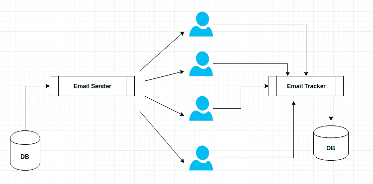
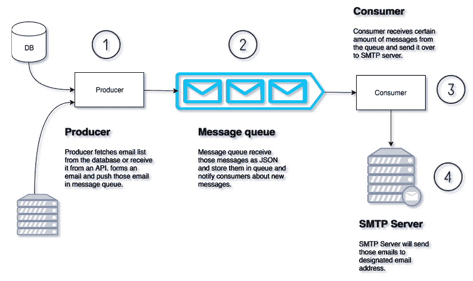
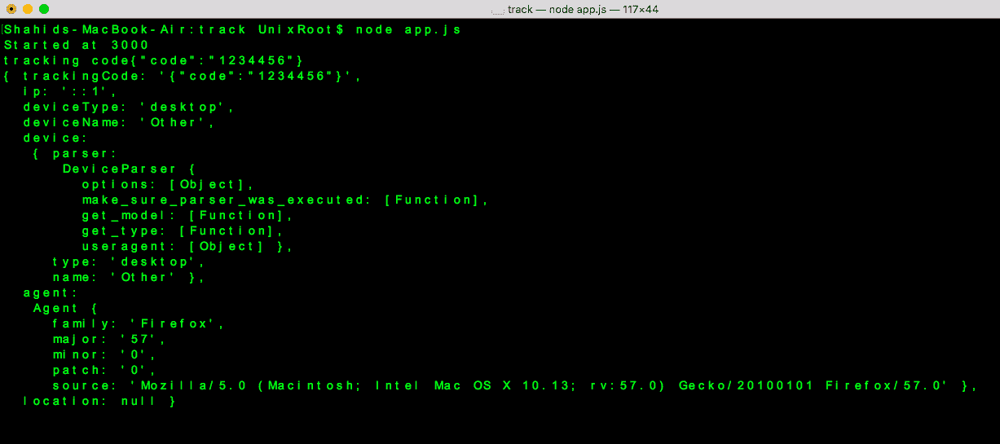
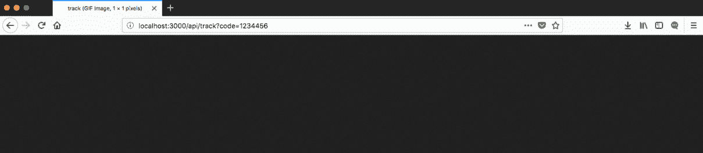
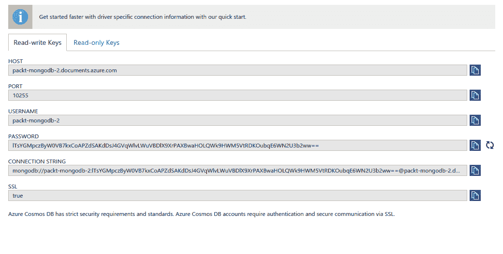

# 使用 Cosmos DB 构建高可用、实时的电子邮件跟踪系统

你是否曾使用过 Mailchimp 或 Mailerlite 等电子邮件营销软件？如果你用过，那么你应该已经熟悉它们的电子邮件跟踪功能。此功能允许你跟踪电子邮件的打开次数，并检查特定用户是否点击了电子邮件，这对任何业务都非常有用。


如果您不习惯使用此类营销软件，请允许我为您介绍一下。电子邮件营销软件允许您发送大量邮件——比如一次发送数百万封——并追踪有多少人打开了邮件，以及有多少人点击了通往购买您产品的按钮。有些软件甚至能追踪您的销售数据，这简直令人难以置信。

让我通过一个场景向您解释这一点，这将演示它有多么重要；想象一下这本书发布了，出版商 Packt 向其数百万读者发送了一封邮件，内容如下：

> "我们推出了一本新书！立即抢购，享 30% 折扣"

现在，有一个系统会告诉您：您发送了 100 万封邮件，约有 10 万人打开了它，其中 2 万人点击了按钮；Packt 随后可以轻松得知，结果他们因此售出了约 2000 本书。

所以，您可以做一些数学计算来算出转化率！非常神奇，对吧？

好吧，那让我们来构建一个，看看它是如何工作的。

欢迎来到本书倒数第二章。我非常兴奋能带您完成这一章，因为（依我之见）这是本书中最有趣的章节之一。

在本章中，我们将涵盖以下主题：

*   邮件追踪合法吗？
*   系统设计与假设
*   在 Cosmos DB 中选择数据库 API
*   编写我们的邮件发送器
*   追踪邮件并存储追踪数据
*   接下来是什么？也许是机器学习

好的，希望您对目前的主题感兴趣。让我们开始吧。

## 邮件追踪合法吗？

邮件追踪合法吗？用一个词回答：`不合法`。

但是，您可以合法地追踪已授权您这样做的用户。您听说过网站上的 `隐私政策` 和 `服务条款` 页面吗？这些页面通常会声明他们将使用您的数据为您提供邮件追踪、销售分析等功能。

所以，是的，如果用户已授权，或者平台所有者已公开声明，邮件追踪就是合法的。使用风险自负。

好吧，玩笑归玩笑，其实没有风险。

首先，让我详细向您解释一下。

一般来说，互联网上有两类邮件：

*   事务性邮件
*   群发邮件

事务性邮件包括密码、信用卡收据和确认邮件（如希拉里·克林顿的邮件），这些非常机密，绝不能被追踪。来自 `SMTP` 服务器的、表明邮件已送达的投递报告才是这里唯一重要的。

第二类是群发邮件，如营销邮件、新产品发布公告、新功能发布公告等。这类邮件面向广泛受众，发送者投入了大量资金。作为此类邮件的发送者，我必须知道它们的表现如何。这就是邮件追踪登场的地方。

好的，让我们看看这东西将如何工作。设计时间到！

## 系统设计与假设

邮件系统基本上分为两部分：

*   邮件发送器
*   邮件追踪器

我将通过一小段代码向您展示如何使用 `Node.js` 发送带有追踪代码的邮件。不过，它不会是生产级的（这是我们的假设）。

然而，邮件追踪器将采用生产级设计；该追踪器将接收来自邮件的事件并相应地更新数据库。我们将在后续章节讨论使用哪种数据库 API 以及其他所有内容。

现在，为了设计方便，这里有一张图表：



正如您在前图所见，邮件发送器将从某个包含邮件列表的来源获取记录，并向大量人群发送邮件。

当人们打开、点击并阅读这些邮件时，邮件追踪器将追踪这些事件并将其记录在数据库中。

系统设计不仅仅是图表设计；它包含许多内容，如容量估算、数据库图表等。

我们不会像上一章那样估算邮件容量，因为我想保持本章简短精炼。

那么，让我们看看这些假设：

*   邮件发送器代码将包含静态邮件地址
*   邮件发送器代码将没有数据源连接
*   邮件发送器将发送一封包含追踪代码的简单邮件
*   邮件追踪器将接收事件
*   邮件追踪器将尝试从该事件中获取尽可能多的信息
*   邮件追踪器将把这些事件添加到数据库中

好的，希望这些假设很清楚。让我们继续选择数据库 API。

## 在 Cosmos DB 中选择数据库 API

正如您所知，在撰写本书时，`Cosmos DB` 提供了四种数据库 API，我们可以根据需要选择或组合使用它们。目前，我们需要一种能高效写入数据的数据库，因为在邮件追踪中，我们将频繁更新记录。

我们对读操作的要求不高：追踪数据可以轻松提供给用户，或传输给数据分析引擎。

情况是这样的：如果我们必须手动安装或选择数据库，这些指标就会发挥作用。`Cosmos DB` 是一种托管数据库服务，提供一致性和延迟的 `SLA`，因此，任何您的应用程序能轻松集成的数据库 API 在这里也应该适用。

我倾向于选择 `MongoDB API` 支持，主要有以下两个原因：

*   它基于 `JSON`，可轻松与分析引擎同步
*   它在 `Node.js` 中提供原生支持，易于编程和集成

所以是的，我们将在 `Cosmos DB` 中使用 `MongoDB API` 来追踪和记录我们的邮件。

让我们深入代码，编写我们简单的邮件发送器。

## 编写我们的邮件发送器

在实践中，邮件发送器是我们系统中最复杂的组件之一。我实际上曾使用队列系统设计过一个邮件发送器，用于发送海量邮件（每月超过十亿封），这也是我不完全涵盖它的原因之一：因为它真的非常复杂。

不过，为了解释和简化起见，我设计了一个邮件发送器的简单流程图。请看：



允许我解释一下这是如何工作的。队列是可扩展分布式系统的核心设计之一。队列为您的系统提供进程间的分发和通信。

在我们的设计中，我使用了队列（消息排序可由您选择，我用了 `先进先出` (`FIFO`)）来处理海量的邮件消息；想象一下数十亿的量级，您根本无法在每次想发送邮件时都去查询一次数据库。

因此，这里的生产者从数据库、通过 `API` 调用或任何 `远程过程调用` (`RPC`) 调用获取邮件记录。

生产者获取这些邮件，为每位用户生成一封邮件，并将追踪代码添加到每封邮件中。

现在，稍等一下，让我解释一下什么是追踪代码。

我们需要一段代码，在用户打开邮件时执行。现在，我们不能在邮件中放入任何 JavaScript 代码（即使是低价的邮件服务器也会把您扔进软退信区），那么我们如何确保接收到事件数据？

这里就是神奇的部分。

您听说过 HTML 中的图片标签吗？

就是这个：

```

```

它可以为您提供追踪信息。现在别急，别疯狂。让我再解释一遍……再解释一次！

当浏览器或邮件客户端加载您的邮件时，它会从服务器下载图片。

它会向图片源路径发起一个 `HTTP GET` 调用。


## 使用 Node.js 构建邮件发送器

现在，如果我们将实际图片的路径替换为我们自定义 API 的路径会怎样？当 API 被请求时，我们就知道有人打开了邮件。我们可以在 URL 中包含额外信息，例如订阅者 ID、邮件 ID 等，从而收集更多信息。

非常神奇，对吧？

现在，我们已经知道如何创建链接了。我们在上一章刚刚制作了一个 URL 短链接生成器。每当短链接解码任何邮件时，你就知道该链接已被点击。

好了，关于生产者就聊这么多。一旦生产者生成邮件，它将这些消息推入队列，它的工作就完成了。

现在，队列存储这些消息并将它们分发给消费者。精彩的部分来了。

在图中，我展示了一个消费者从队列接收消息。实际上，你可以同时向多个消费者发送邮件。

*我知道你在想什么；没有任何消费者会收到相同的消息。*

所以假设，你在队列端有 10 个消费者，你可以配置它们一次能接收的消息数量。你可以一次性发送，比如说，100 条消息。

因此，如果我们一次性向 10 个消费者各发送 100 条消息，那就是一次性 1,000 条消息。消费者随后将这 1,000 条消息推送到 SMTP 服务器，以将它们投递到你的收件箱。此过程持续进行，直到队列为空，而在生产级系统中，队列永远不会为空。

我无法断言，但这正是（或类似于）每一款主流邮件营销软件所使用的架构。

### 项目设置

好了，代码时间。让我们使用 Node.js 构建一个简单而高效的邮件发送器。

首先，创建一个新目录，并在该目录内运行此命令以创建全新的 Node.js 项目：

```
mkdir dirname && npm init --y
```

将 `dirname` 替换为你的文件夹名称。

### 安装依赖

项目创建完成后，你需要安装该项目的依赖。我们要发送邮件，所以当然需要一个能处理此事的模块。我们还需要处理 Node 的异步流程，所以也要安装一个用于此目的的模块。

运行此命令以安装这两个依赖：

```
npm install --save nodemailer async
```

顾名思义，`nodemailer` 用于发送邮件，而 `async` 将用于处理流程控制。

### 邮件发送器实现

让我们直接进入并编写我们的服务器代码。

这是邮件发送器的代码。我将逐个函数进行解释：

```
const async = require("async");
const nodemailer = require("nodemailer");
// 可以是来自数据库的邮件列表
const listofemails = ["rwtc66@gmail.com","shahid@codeforgeek.com"];
const emailContent = "Hello World, this is Shahid Shaikh! <br>";

var success_email = [];
var failure_email = [];

class Mailer {
    constructor() {
      this.transporter = nodemailer.createTransport("SMTP",{
            host: 'smtp.gmail.com',
            port: 587,
            auth: {
              user: '',
              pass: ''
           },
            tls: {rejectUnauthorized: false},
            debug:true
          });
      this.invokeOperation();
    }

    /* 一次性调用邮件发送操作 */

    invokeOperation() {
        var self = this;
        async.each(listofemails,self.sendEmail,function(){
            console.log(success_email);
            console.log(failure_email);
        });
    }

    sendEmail(Email,callback) {
        console.log("Sending email to " + Email);
        var self = this;
        self.status = false;
        async.waterfall([
            function(callback) {
                var mailOptions = {
                    from: 'shahid@codeforgeek.com',
                    to: Email,
                    subject: 'Hi ! This is from Async Script',
                    text: emailContent + ""
                };
                transporter.sendMail(mailOptions, function(error, info) {
                    if(error) {
                        console.log(error)
                        failure_email.push(Email);
                    } else {
                        self.status = true;
                        success_email.push(Email);
                    }
                    callback(null,self.status,Email);
                });
            },
            function(statusCode,Email,callback) {
                    console.log("Will update DB here for " + Email + "With " + statusCode);
                    callback();
            }
            ],function(){
                // 当一切完成时返回给调用者。
                callback();
        });
    }
}

new Mailer(); // 开始吧
```

### 代码解释

首先，我们声明了依赖项，还声明了一些变量。我们将邮件列表存储在一个数组中，该数组可以替换为来自数据库的邮件或 API 调用获取的邮件。

我们还声明了两个单独的数组，分别用于存放成功发送的邮件和被拒绝的邮件。

接下来，我们在构造函数中创建了一个类，创建我们的 SMTP 传输，用于发送大量邮件。

我们创建了一个 Gmail SMTP，并使用 Google 邮件凭据来发送邮件。

Google SMTP 仅用于演示目的；在生产环境中，你必须使用功能完备的 SMTP 服务器。

创建 SMTP 传输后，我们调用操作，并使用它对邮件执行并行迭代。`async.each` 函数会根据邮件数量多次调用该函数。

且慢：如果邮件数量达到百万级怎么办？它会创建一百万个并行进程吗？

是的，但它不应该这样做。

所以，我们可以在 `async.each` 函数中添加限制——比如说，1,000 个并行进程；迭代就会被限制。

最后，在 `sendEmail` 函数中，我们将邮件发送给来自列表的目标地址，并根据条件将该操作的结果存储在相应的数组中。

这迄今为止是你见过的最简单的邮件发送器。相信我！

我们使用传统的 `new` 操作符调用该程序。你可以通过这里和那里的少量更改来扩展此程序，以满足你的生产系统需求，但它是可以工作的。

现在，关于追踪，你会在发送邮件部分看到我们追加了一张图片。这是供参考的代码：

```
emailContent + ""
```

这里，图片的 `src` 属性是我们的 API URL。你可以将域名替换为你的应用。我们将邮件 ID 添加到 URL 中，以识别是哪个用户执行了该操作。

让我们继续看看如何追踪这些邮件。

## 追踪邮件并存储追踪数据

到目前为止，我们讨论了邮件发送器的架构，以及如何构建一个可发送大量邮件的可扩展系统。

现在，是时候追踪这些邮件了。让我们构建并编写一个程序，该程序可以追踪邮件打开率、位置、IP、设备（即电脑、笔记本或手机）和代理（即浏览器）。

我们还将把这些数据插入 MongoDB 数据库或 Cosmos DB。

在上一节中，我们添加了追踪代码，这是一个使用我们的 API 调用作为源的图片标签，并将其放入邮件中。我们的 API 调用将返回图片。

让我们开发一段示例代码来实现相同的功能。

初始化一个新的 Node.js 项目并安装以下依赖：

```
npm i --S express
```

这是 API 的示例代码：


## 使用 Node.js 和 Express 进行邮件追踪

### 初始设置

```javascript
const express = require('express'); 
const app = express(); 
 
app.get('/api/track', function(req, res) { 
   console.log('tracking code' + JSON.stringify(req.query)); 
   // sending the image back. 
   var buf = new Buffer([ 
      0x47, 0x49, 0x46, 0x38, 0x39, 0x61, 0x01, 0x00, 0x01, 0x00, 
      0x80, 0x00, 0x00, 0xff, 0xff, 0xff, 0x00, 0x00, 0x00, 0x2c, 
      0x00, 0x00, 0x00, 0x00, 0x01, 0x00, 0x01, 0x00, 0x00, 0x02, 
      0x02, 0x44, 0x01, 0x00, 0x3b 
  ]); 
  res.set('Content-Type', 'image/png'); 
  res.end(buf, 'binary'); 
}); 
 
app.listen(3000); 
console.log("Started at 3000"); 
```

正如您在前面的代码中所见，我们在同一路径上暴露了 `GET` API，即 `/api/track`，并返回了图片。

不要害怕这个缓冲区：它只是一个 1 x 1 的图片二进制代码。从本质上讲，我们需要将图片发送回浏览器，这样浏览器就不会对图片报 404 错误。这张图片应该是透明的，且尽可能小，以免与实际邮件内容冲突。

### 提取追踪信息

现在，让我们尝试从 IP 和 HTTP 请求中提取追踪信息。

#### 获取 IP 地址

首先，我们需要 IP。

您可以从请求头中获取 IP。根据网络环境的不同，它可能位于以下键中，因此我们将所有这些键都作为备选项。请参阅以下代码：

```javascript
let ip = req.headers['x-forwarded-for'] || req.connection.remoteAddress || req.socket.remoteAddress || req.connection.socket.remoteAddress; 
```

#### 获取设备类型、位置和 User Agent

接下来，我们需要设备类型、位置和 User Agent。为此我们需要安装额外的依赖包。运行以下命令安装这些依赖包：

```
npm i --S geoip-lite express-device useragent 
```

让我们在代码中声明它们：

```javascript
const geoip = require('geoip-lite'); 
const device = require('express-device'); 
const useragent = require('useragent')(true); 
```

在 Express 中添加 user agent 中间件，以便它捕获每一个请求：

```javascript
app.use(device.capture({parseUserAgent: true})); 
```

我们可以使用以下代码从请求头中提取信息：

```javascript
var agent = useragent.parse(req.headers['user-agent']); 
var ua = useragent.is(req.headers['user-agent']) 
var geoLocation = geoip.lookup(ip); 
```

我们可以使用 `req.device` 键从请求对象中提取设备信息。请参阅完整代码，如下所示：

```javascript
const express = require('express'); 
const geoip = require('geoip-lite'); 
const device = require('express-device'); 
var useragent = require('useragent')(true); 
const app = express(); 
 
app.use(device.capture({parseUserAgent: true})); 
app.enable('trust proxy'); 
 
app.get('/api/track', function(req, res) { 
   console.log('tracking code' + JSON.stringify(req.query)); 
   let ip = req.headers['x-forwarded-for'] || req.connection.remoteAddress || req.socket.remoteAddress || req.connection.socket.remoteAddress; 
   var agent = useragent.parse(req.headers['user-agent']); 
   var ua = useragent.is(req.headers['user-agent']) 
   let geoLocation = geoip.lookup(ip); 
   var buf = new Buffer([ 
      0x47, 0x49, 0x46, 0x38, 0x39, 0x61, 0x01, 0x00, 0x01, 0x00, 
      0x80, 0x00, 0x00, 0xff, 0xff, 0xff, 0x00, 0x00, 0x00, 0x2c, 
      0x00, 0x00, 0x00, 0x00, 0x01, 0x00, 0x01, 0x00, 0x00, 0x02, 
      0x02, 0x44, 0x01, 0x00, 0x3b 
  ]); 
  res.set('Content-Type', 'image/png'); 
  res.end(buf, 'binary'); 
  let trackData = { 
      'trackingCode': JSON.stringify(req.query), 
      'ip': ip, 
      'deviceType': req.device.type, 
      'deviceName': req.device.name, 
      'device': req.device, 
      'agent': agent, 
      'location': geoLocation 
  }; 
  console.log(trackData); 
}); 
 
app.listen(3000); 
console.log("Started at 3000"); 
```

现在，每当有人打开邮件时，该 API 就会被触发，您将接收到追踪所需的所有信息。

### 测试追踪代码

让我们看看它是否真的有效。运行代码，并尝试从浏览器访问此 API。如果您在本地机器上运行，它将返回 `localhost:3000/api/track?code=1234456`，终端中将打印类似如下内容：



如您所见，我们接收到了关于设备类型、浏览器和 IP 的信息。由于我在本地机器上运行，位置获取功能被禁用了。在服务器上运行良好。

在浏览器中，您应该会看到类似如下内容：



这就是我们从代码中返回的 1 x 1 图片。

### 在 MongoDB (Cosmos DB) 中存储数据

追踪代码已生效；现在我们需要做的是将其添加到数据库中。正如之前讨论的，我们将使用 Cosmos DB 的 MongoDB API。

因此，为了使用它，我们首先需要创建数据库。前往 Azure 门户，从左侧选择 Cosmos DB，并创建一个新的 MongoDB API 数据库和一个新的集合。

创建完成后，从该屏幕复制访问密钥：



#### 安装依赖包

是时候添加代码了！首先，安装依赖包。在项目目录中运行以下命令：

```
npm i --S mongoose 
```

#### 配置

创建配置文件并添加以下代码：

```javascript
var config = {}; 
config.db = {}; 
config.db.uri = 'mongodb://packt-mongodb-2:lTsYGMpczByW0VB7kxCoAPZdSAKdDsJ4GVqWlvLWuVBDlX9XrPAXBwaHOLQWk9HWM5VtRDKOubqE6WN2U3b2ww==@packt-mongodb-2.documents.azure.com:10255/?ssl=true&replicaSet=globaldb'; 
config.db.host = 'packt-mongodb-2.documents.azure.com'; 
config.db.name = tracking; 
module.exports = config; 
```

请确保修改这些值以匹配您的访问密钥。

#### 数据库连接

让我们建立连接。创建一个文件，命名为 `connection.js`，并添加以下代码：

```javascript
const mongoose = require('mongoose'); 
const config = require('./config.js'); 
mongoose.connect(config.db.uri); 
module.exports = mongoose.connection; 
```

#### 数据模型

现在，让我们创建模型代码。为此，创建一个新文件，命名为 `trackmodel.js`，并将以下代码放入其中：

```javascript
var mongoose = require('mongoose'); 
var connection = require('./connection'); 
var Schema = mongoose.Schema; 
 
connection.once('open', function() { 
  console.log("Connected...."); 
}); 
 
// create a schema for our links 
var trackSchema = new Schema({ 
  data: Array, 
  created_at: Date 
}); 
 
module.exports = mongoose.model('track', trackSchema); 
```

#### 保存追踪数据

让我们将模型代码添加到应用程序代码中，并开始将信息保存到我们的集合中。将集合名称替换为您创建的名称。

在依赖声明中添加以下代码：

```javascript
var model = require('./trackModel'); 
```

现在，在路由中，在现有文件末尾添加此代码：

```javascript
var trackInfo = model({data: trackData}) 
trackInfo.save(function(err) { 
      if (err) { 
          console.log(err); 
      } 
}) 
```

这是完整代码，供您参考：


```javascript
const express = require('express');
const geoip = require('geoip-lite');
const device = require('express-device');
var useragent = require('useragent');
useragent(true);
var model = require('./trackModel');
const app = express();

app.use(device.capture({parseUserAgent: true}));
app.enable('trust proxy');

app.get('/api/track', function(req, res) {
   console.log('tracking code' + JSON.stringify(req.query));
   let ip = req.headers['x-forwarded-for'] || req.connection.remoteAddress || req.socket.remoteAddress || req.connection.socket.remoteAddress;
   var agent = useragent.parse(req.headers['user-agent']);
   var ua = useragent.is(req.headers['user-agent']);
   let geoLocation = geoip.lookup(ip);
   var buf = new Buffer([
      0x47, 0x49, 0x46, 0x38, 0x39, 0x61, 0x01, 0x00, 0x01, 0x00,
      0x80, 0x00, 0x00, 0xff, 0xff, 0xff, 0x00, 0x00, 0x00, 0x2c,
      0x00, 0x00, 0x00, 0x00, 0x01, 0x00, 0x01, 0x00, 0x00, 0x02,
      0x02, 0x44, 0x01, 0x00, 0x3b
  ]);
  res.set('Content-Type', 'image/png');
  res.end(buf, 'binary');
  let trackData = {
    'trackingCode': JSON.stringify(req.query),
    'ip': ip,
    'deviceType': req.device.type,
    'deviceName': req.device.name,
    'device': req.device,
    'agent': agent,
    'location': geoLocation
  };
  var trackInfo = model({data: trackData});
  trackInfo.save(function(err) {
      if (err) {
        console.log(err);
      }
  });
  console.log(trackData);
});

app.listen(3000);
console.log("Started at 3000");
```

现在，运行代码并访问同一个 API，即 `http://localhost:3000/api/track?code=1234456`。你现在应该能在 Azure 集合中看到数据。

恭喜！现在你可以发送任意数量的邮件，将追踪代码添加到其中，追踪数据，并使用我们开发的代码存储数据。

希望你在本章中对邮件追踪用例有了一些很好的见解。
