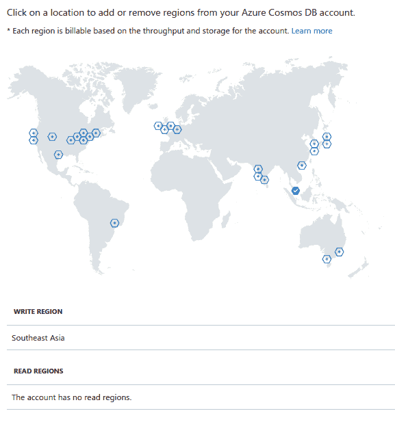
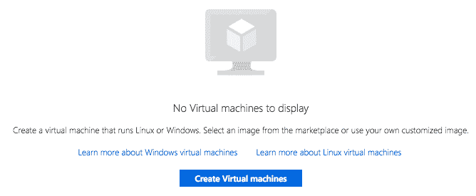
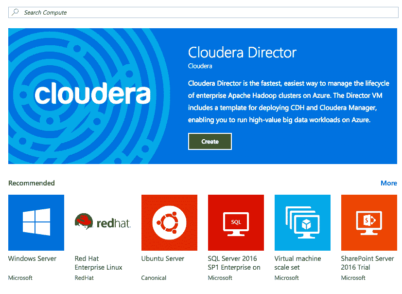
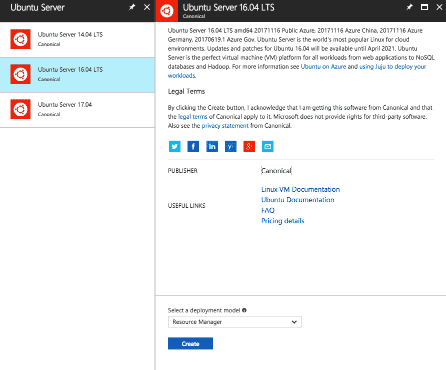
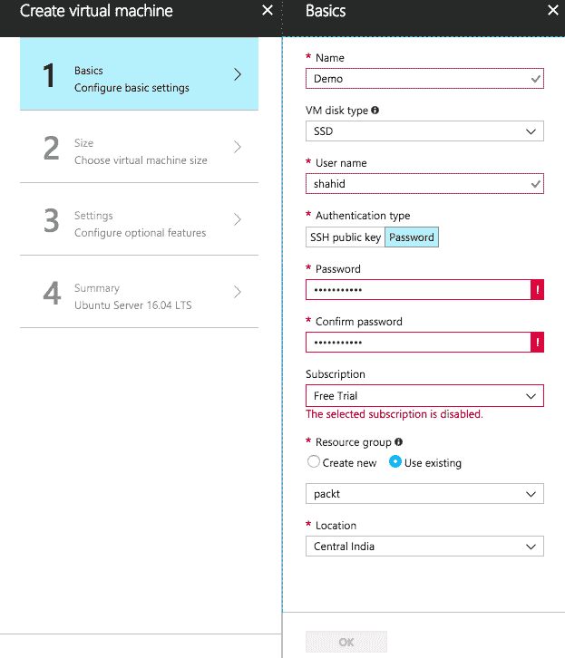
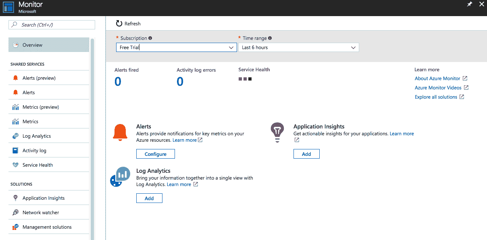
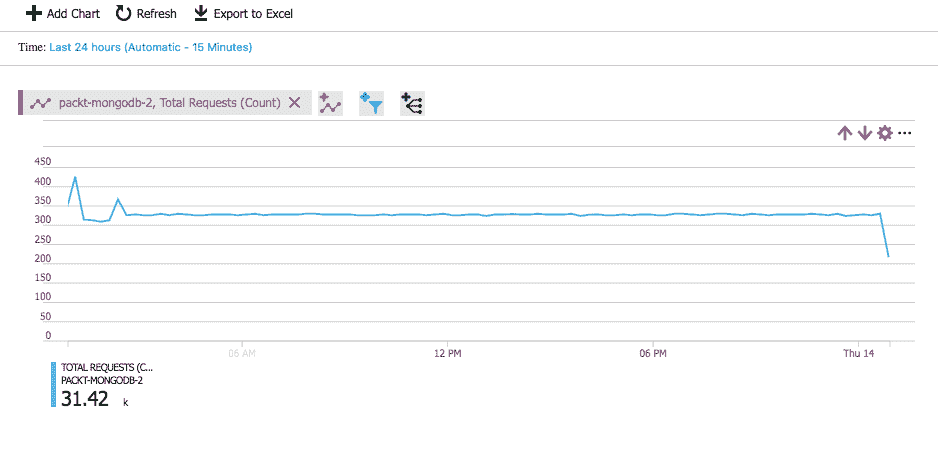
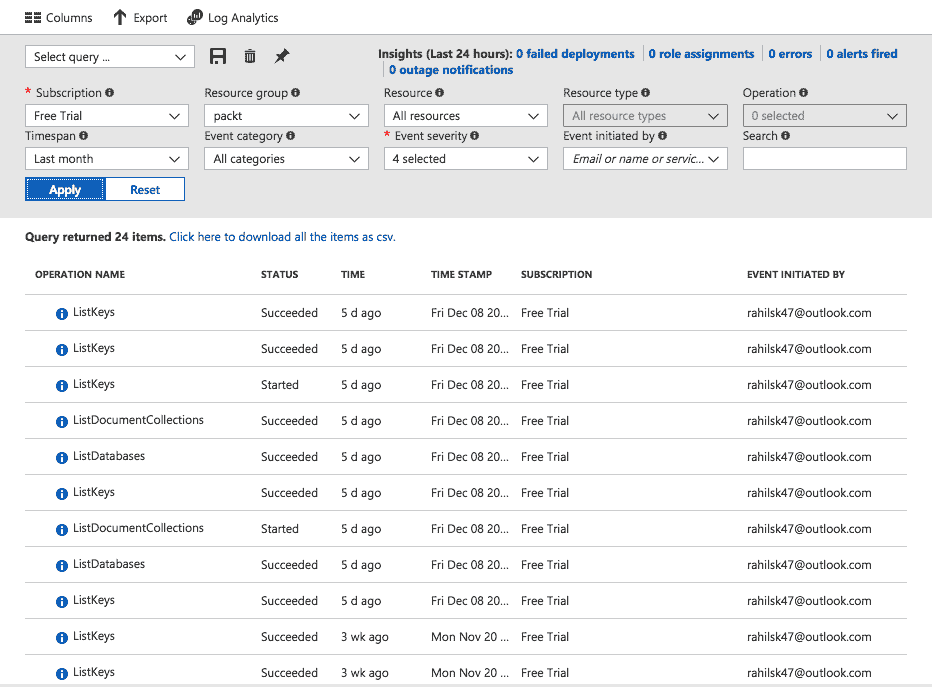

# Cosmos DB 部署与管理

## 摘要

在本章中，我们当然学习了与电子邮件营销相关的知识！我们学习了如何设计一个可扩展的邮件发送器，它可以发送大量邮件。

我们还研究了邮件追踪，并找到了一种追踪我们发送邮件的方法。我们编写了代码来提取追踪信息，例如设备、位置、打开率等。然后我们集成了 Cosmos DB MongoDB API 来存储这些追踪信息。

在下一章中，我们将了解更多关于 Cosmos DB 部署的内容以及开发 Cosmos DB 应用程序的最佳实践。

## 交钥匙分发

到目前为止，我们已经在 Cosmos DB 和 Azure 基础设施之上设计、开发并测试了一个应用程序。现在是时候部署它，让全世界都知道你的新应用了！

在本章中，我们将学习 Cosmos DB 的一些部署概念。

我们还将涵盖以下主题：

- 交钥匙分发
- 故障转移处理
- 数据库部署
- 备份与恢复
- 在 Azure 网络上部署自定义应用
- 监控流量和使用情况

你可以通过 `shahid@codeforgeek.com` 给我发邮件，或在 `@codeforgeek` 上给我发推文。

在你说“Shahid，我们在前几章已经学过这个了，为什么现在又要做一遍？”之前，我想先打住。我知道我们在前面的章节中已经涵盖了这个主题，但我想重新探讨一下，因为它对你的应用程序部署计划非常重要。

如果你是 DevOps，稍后可以感谢我（他们知道我的意思）。

Cosmos DB 提供了一项竞争性功能，其他托管数据库提供商（如 Amazon、Rackspace 等）至少在撰写本文时都不提供。因此，这成为了 Cosmos DB 的一个非常重要的卖点。

让我们再次回顾它，看看它如何帮助你的部署计划。因此，你只需点击几下按钮（并非真正的一键，但非常简单），就可以在全球 30 多个区域中复制你的数据。这就是交钥匙全球分发的含义。

因此，部署计划中可能的用例如下。假设你有一个基于 SaaS 的应用程序，在德国拥有庞大的客户群，但你的应用程序部署在纽约数据中心。现在，基于数据传输速率，你可以在德国（如果那里有提供）或德国附近启动一个读取区域，以更好地服务这些客户。

主要来说，复制是为了故障转移条件；如果某个区域中的某个节点发生故障，则拥有相同数据的另一个节点将接管，客户永远不会知道发生了任何变化。

例如，请参阅来自第 2 章的以下屏幕截图，*Cosmos DB 全球交钥匙分发系统：*



在这里，我的写入区域位于东南亚，我可以从全球范围内挑选任意读取区域。美国有大量数据中心，俄罗斯很少，非洲则没有（这不公平；非洲的 IT 正在蓬勃发展）。

你只需选择一个区域，见证奇迹发生；你的复制就完成了。

提到复制，让我们深入了解部署的下一个重要主题，即故障转移处理。

## 故障转移处理

当出现故障时，会发生什么？

这是任何部署的关键问题，因为它很重要。考虑像 WhatsApp 这样的应用程序；如果它们宕机，哪怕一分钟，用户群都会疯狂。对于你的应用程序也是如此，如果系统故障，你将失去用户，但更重要的是，你也将失去声誉。

Cosmos DB 是一个托管数据库提供商，我相信他们非常重视故障转移。通常有两种处理故障转移的方法：

- 自动故障转移
- 手动故障转移

让我们讨论一下每一种。

### 自动故障转移

在系统中断的罕见情况下，自动故障转移会尝试恢复并将流量重新分配到现有区域。通常有两种适用情况：

- 读取区域故障转移
- 写入区域故障转移

如果任何读取区域发生故障，Cosmos DB 会自动将其标记为离线，以避免现有流量尝试路由到该区域（以避免 `404` 和 `502` 错误），并利用内部共识确定下一个读取区域，将流量引导至该区域。

这几乎就是 Cosmos DB 提供的功能，我相信这也是其他每个数据库提供商提供的功能。关键特性是在受影响区域重新上线时重新同步数据。Cosmos DB 会用受影响期间错过的数据更新该区域，一切恢复正常。

如果任何写入区域发生故障，Cosmos DB 会寻找另一个写入区域。如果你的应用程序只有一个写入区域且该区域故障，Cosmos DB 将根据相对优先级将任何读取区域转换为写入区域，使应用程序平稳运行。

当原始写入区域重新上线时，它将重新同步数据，原始写入区域将再次成为写入区域，正如预期的那样。

我们已经了解了自动故障转移；现在让我们看看手动故障转移。

### 手动故障转移

你可以根据需要手动更改写入区域。

例如，如果你知道很多人在白天从印度执行写入操作，而你的写入区域在美国，你可以在 IST 时间手动将写入区域更改为印度，并在白天将其改回美国。

虽然不建议这样做，但你也可以参考故障转移处理的几个概念，比如我前面提到的，或基于持续流量。这完全取决于你。


这里的关键点是，这些手动故障转移任务都不会导致数据丢失或应用程序停机。请随意尝试它们，系统将保持在线（99% 的时间，1% 用于灾难情况）。

好的，让我们来讨论数据库部署！

## 数据库部署

Cosmos DB 是一种托管数据库，我们可以在其之上运行多种数据库 API，并将数据分布到全球各地。

与传统数据库部署不同，传统方式需要在 SQL 或 NoSQL 数据中进行更改并将其部署在服务器上，而在这里，你基本上只需使用数据库 ID 将应用程序接入，即可开始使用。

无需更多的服务器管理或运维处理；就是这么简单。

然后，一个问题出现了：

*我们能信任他们保管我们的数据吗？*

这是在涉及托管数据库解决方案时最常被问到的问题之一。是的，你可以信任他们保管你的数据。事实上，他们的存在就是为了给你提供最佳解决方案，如果你的数据出现问题，恢复数据是他们的责任（当然，前提是数据未损坏）。

关于信任他人保管数据的主题，让我们快速了解一下如何使用 Cosmos DB 备份和恢复数据。

## 备份与恢复

Cosmos DB 会自动备份你的所有数据，并按固定时间间隔保持其更新。自动备份操作在不影响数据库操作性能或可用性的情况下完成。

Cosmos DB 备份单独存储在另一个存储服务中，并且这些备份会在全球范围内复制，以实现高时间可用性并避免区域性灾难。

自动备份是为了应对你意外删除 Cosmos DB 容器并随后需要数据恢复的场景。

自动备份每四小时进行一次，并且至少存储最新备份的两个副本。如果你删除了数据库和信息，可以在四到八小时内联系 Azure 团队找回数据！

自动备份存储在 Blob 存储中，并保存在与主数据相同的区域，以便在发生故障时提供高可用性。自动备份还会跨区域复制，以保留备份副本。

有一个关键点你需要注意，如前所述：Azure 每四小时自动备份一次你的数据，如果数据库中发生数据损坏，你需要立即删除或丢弃数据库，以防止备份被损坏。

让我们继续看看如何在 Azure 网络上部署自定义应用。

## 在 Azure 网络上部署自定义应用

Azure 提供了多种在其网络上部署应用程序的方式。根据项目类型——即是 Web 应用程序、批处理应用程序还是其他类型的应用——你需要选择与之匹配的服务。

例如，假设我们要在 Azure 网络上部署 Node.js 应用程序；我们需要选择想要用来托管应用程序的服务器类型。

Azure 提供基于 Windows 和 Linux 的虚拟机，你可以在其中部署应用程序。

假设我们要在 Linux 环境中创建一个。

打开 Azure 门户，从左侧菜单点击“虚拟机”。点击“创建虚拟机”按钮。

请参考以下截图以获取帮助：



现在，Azure 将打开计算屏幕；你将看到关于操作系统和虚拟机映像的许多选项。请参考以下截图作为参考：



我将选择 Ubuntu Server。

点击 Ubuntu Server 并选择合适的 Ubuntu 操作系统版本。使用 Resource Manager 部署选项并点击“创建”按钮。请参考以下截图作为参考：



现在，给你的虚拟机命名并选择一个合适的密码。你可以选择创建新资源或使用现有资源。将磁盘类型设置为 SSD 以获得良好性能。请参考以下截图作为参考：



在下一个屏幕上，选择大小或使用默认大小。跳过选项 3，然后创建虚拟机。

虚拟机创建完成后，你可以通过终端使用以下命令登录：

```
ssh username@ip
```

提供密码，你应该能够登录到服务器。

每当你进行全新 Ubuntu 安装时，请运行此命令：

```
sudo apt-get update
sudo apt-get upgrade
```

你可以使用此命令安装 Node.js，或从官方网站下载：

```
sudo apt-get install nodejs
```

现在，如果你的代码库托管在 GitHub 上，可以使用 `git` 命令下载源代码：

```
git clone <<github url>>
```

使用 `npm install` 命令安装所需依赖并运行项目。

通过这种方式，你可以在 Azure 网络上部署任何自定义应用程序。

现在，让我们进入本章的最后一个主题：监控网络和流量。

## 监控流量与使用情况

Azure 提供对数据库及其使用情况的深度监控。你可以添加监控警报，并直接从控制面板检查网络日志。信息以整洁恰当的方式呈现，以便在屏幕上提供尽可能多的细节。

要查看监控，请登录 Azure 门户，点击左侧菜单中的“监视器”。你应该会看到类似于以下截图的屏幕：



现在，点击左侧菜单中的“指标”。它应该会打开一个类似于以下截图所示的屏幕：



你可以更改筛选器和数据库，以查看这些数据库的指标。

你还可以检查帐户和资源组的活动日志。从左侧菜单点击“活动日志”，然后选择你的资源组和日期范围以查看活动。请参考以下截图作为参考：



这是检查可疑活动的好方法。

现在，关于使用情况部分，你可以前往“成本管理 + 计费”屏幕查看帐户的当前使用情况。我有一个免费帐户用于本月，需要升级计划以进行进一步操作。

在“监视器”屏幕中探索更多选项，看看什么适合你。

在结束之前，让我们快速看看 Azure 为 Cosmos DB 提供的安全性。

## 数据库安全

未在网络中移动的 Cosmos DB 数据是加密且安全的。你可以放心，即使攻击者以某种方式获取了你的存储数据，对他们来说解密也将极其困难。

让我们看看 Azure 提供的关键安全功能：

*   `安全网络`：Cosmos DB 提供基于 IP 的规则筛选防火墙，用于高级网络保护
*   `授权`：Cosmos DB 使用基于哈希的身份验证代码授权用户
*   `用户管理`：Cosmos DB 使用资源概念提供安全的用户管理
*   `Active Directory 支持`：Cosmos DB 与广为人知且安全的 Active Directory 身份验证系统集成
*   `交钥匙分发和复制`：使用交钥匙分发，数据被复制并受到保护
*   `故障转移处理`：你可以使用自动或手动故障转移
*   `自动备份`：Cosmos DB 数据定期备份
*   `数据库恢复`：你可以从备份中恢复数据库
*   `攻击监控`：通过使用监控，你可以监控是否有攻击发生在你的服务器上
*   `HTTPS/SSL/TLS 加密`：通过 Azure 网络传输的所有数据均已加密


*   **静态加密**：存储在 Azure 计算机中的所有数据均已加密。

与整个行业相比，Azure 提供了一些非常先进的功能。

## 总结

我们已经学习了如何在 Cosmos DB 中执行数据的全球分发，以及为什么这很重要。我们还了解了故障转移以及处理它们的方法。

我们概览了 Cosmos DB 如何执行备份，以及在紧急情况下如何进行恢复。然后我们继续讨论了如何在 Azure 网络中部署自定义应用程序。

部署之后就是监控。得益于 Azure 管理门户，我们可以直接从浏览器监控应用程序的使用情况和活动。

这是本书的最后一章。在结束之前，我想说声谢谢，并祝愿你即将使用 Cosmos DB 基础设施构建的应用程序好运。如果本书在你构建应用的过程中提供了一点帮助，请务必让我们知道；你的反馈是我们的氧气。

我希望并祈愿本书对你有所裨益；如果有，请发邮件至 `shahid@codeforgeek.com` 或在推特上联系我 `@codeforgeek`。期待尽快收到你的消息！

# 你可能喜欢的其他书籍

如果你喜欢这本书，你可能会对 Packt 的这些其他书籍感兴趣：


**Microsoft Azure 流分析**

Anindita Basak, Krishna Venkataraman, Ryan Murphy, Manpreet Singh

ISBN: 978-1-78839-590-8

*   使用 Azure 流分析执行实时事件处理
*   在实时数据处理中融入大数据 Lambda 架构模式的特性
*   为存储和批量分析设计流式管道
*   在事件流上实现数据转换和计算活动
*   使用 PowerShell 和 .NET SDK 自动化你的流式管道
*   将你的流式管道与流行的机器学习和预测分析建模算法集成
*   有效地监控和排查 Azure 流作业


**学习 Microsoft Azure 存储**

Mohamed Waly

ISBN: 978-1-78588-491-7

*   了解 Azure 存储类型并确定适合你需求的类型
*   根据最佳实践为 Azure VM 设计 Azure 存储
*   根据最佳实践在 Azure 上设计和实现你的 SQL 数据库
*   学习如何使用 Azure 备份
*   学习如何使用 Azure 站点恢复
*   将 Azure 存储扩展到 StorSimple
*   监控存储指标和日志并自定义 Azure 监控仪表板
*   监控和排查 Azure 存储

# 留下评论 - 让其他读者知道你的想法

请通过在购买网站上留下评论，与其他人分享你对这本书的看法。如果你在亚马逊购买了这本书，请在本书的亚马逊页面给我们留下真实的评论。这至关重要，这样其他潜在读者可以看到并利用你的公正意见做出购买决定，我们可以了解客户对我们产品的看法，作者也能看到你对他们与 Packt 合作创作的这本书的反馈。这只会花费你几分钟时间，但对其他潜在客户、我们的作者和 Packt 来说却很有价值。谢谢！
