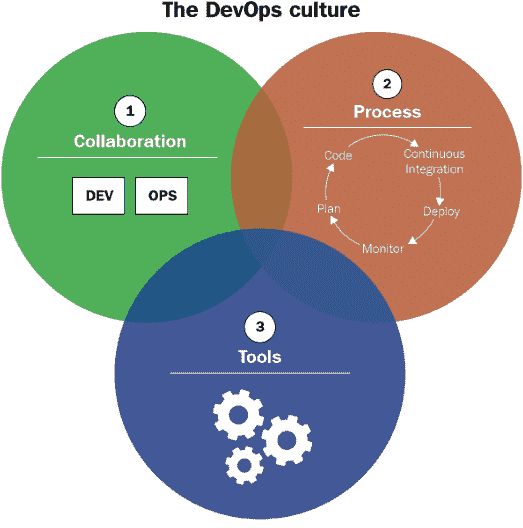
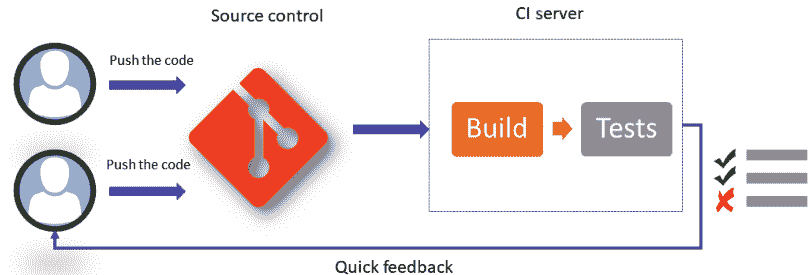
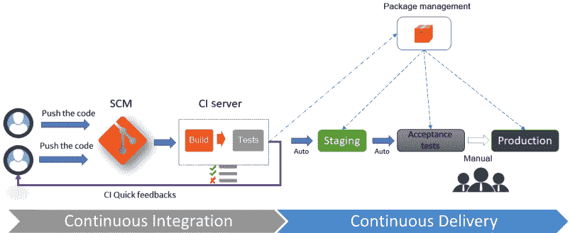
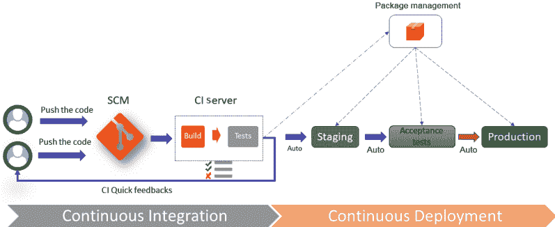

## 1 DevOps 文化和基础设施即代码实践

**DevOps**，这个术语在企业中越来越常见，常与“我们做 DevOps”或“我们使用 DevOps 工具”等短语一起出现，它是“Development”和“Operations”两个词的缩写。

DevOps 是一种与传统企业文化不同的文化，需要改变思维、流程和工具。它通常与**持续集成（CI）**和**持续交付（CD）**实践相关联，这些是软件工程实践，同时也与**基础设施即代码（IaC）**相关联，后者包括对基础设施结构和配置进行_代码化_。

在本章中，我们将了解什么是 DevOps 文化，什么是 DevOps 原则，以及它们为公司带来的好处。然后，我们将解释 CI/CD 实践，最后，我们将详细介绍 IaC 及其模式和实践。

在本章中，我们将涵盖以下主题：

- DevOps 入门
- 实现 CI/CD 和持续部署
- 了解 IaC 实践

查看以下视频以观看代码实际运行情况：`https://bit.ly/3JJAMAb`

### DevOps 入门

_DevOps_ 术语由 Patrick Debois、Gene Kim 和 John Willis 在 2007-2009 年引入，它代表了**开发（Dev）**和**运维（Ops）**的结合。它催生了一种主张将开发人员和运维人员聚集在团队中的运动。这能更快地向用户提供额外的业务价值，从而使其在市场上更具竞争力。

DevOps 文化是一组实践，旨在减少**开发人员**（希望创新并更快交付）与**运维人员**（希望保证生产系统的稳定性以及他们所做系统变更的质量）之间的障碍。

DevOps 文化也是敏捷流程（Scrum、XP 等）的延伸，这些流程可以缩短交付时间，并且已经涉及开发人员和业务团队。然而，由于 Ops 未被纳入同一团队，他们常常受到阻碍。

Dev 和 Ops 之间的沟通和这种联系，可以更好地跟踪端到端的生产部署，并进行更频繁、质量更高的部署，从而为公司节省资金。

为了促进这种协作并改善 Dev 和 Ops 之间的沟通，流程中必须建立几个关键要素，如下所示：

- 使用集成和持续交付（称为**CI/CD**）进行更频繁的应用程序部署。
- 实施和自动化单元测试和集成测试，采用以**行为驱动设计（BDD）**或**测试驱动设计（TDD）**为重点的流程。
- 实施收集用户反馈的手段。
- 监控应用程序和基础设施。

### DevOps 运动基于三个轴心：

- **协作文化**：这是 DevOps 的本质——团队不再因专业化孤岛而分离（一个开发团队，一个 Ops 团队，一个测试团队，等等）。然而，这些人通过组建具有相同目标的多学科团队聚集在一起：尽可能快地为产品交付附加值。
- **流程**：为了期望快速部署，这些团队必须遵循敏捷方法论的开发流程，具有允许更好功能、质量和快速反馈的迭代阶段。这些流程不仅应集成到持续集成的开发工作流中，还应集成到持续交付和部署的部署工作流中。DevOps 流程分为几个阶段：
  - A. 规划和优先级排序功能
  - B. 开发
  - C. 持续集成和交付
  - D. 持续部署
  - E. 持续监控

  这些阶段在项目整个生命周期中以循环和迭代的方式进行。
- **工具**：团队使用的工具和产品的选择在 DevOps 中非常重要。确实，当团队分为 Dev 和 Ops 时，每个团队使用其特定工具——开发人员使用部署工具，Ops 使用基础设施工具——这进一步扩大了沟通差距。

将开发和运维聚集在一起的团队，以及这种团结文化，所使用的工具必须能够被所有成员使用和利用。

开发人员需要与 Ops 团队使用的监控工具集成，以尽早检测性能问题，并与 Ops 提供的安全工具集成，以保护对各种资源的访问。

另一方面，Ops 必须自动化创建和更新基础设施的过程，并将代码集成到代码管理器中。这称为 IaC，但这只能在与了解应用程序所需基础设施的开发人员协作下完成。Ops 还必须集成到应用程序发布流程和工具中。

下图说明了 DevOps 文化的三个轴心——Dev 和 Ops 之间的协作、流程以及工具的使用：



图 1.1 – DevOps 文化联盟

因此，我们可以回到 Donovan Brown 对 DevOps 文化的定义（http://donovanbrown.com/post/what-is-devops）：

> “DevOps 是人员、流程和产品的结合，以便向最终用户持续交付价值。”

在企业内建立 DevOps 文化的好处如下：

- 团队内更好的协作和沟通，对公司内部产生人文和社会影响
- 缩短到生产的前置时间，从而带来更好的性能和最终用户满意度
- 使用 IaC 降低基础设施成本
- 通过迭代周期显著节省时间，这些周期减少了应用程序错误，自动化工具减少了手动任务，因此团队更专注于开发具有附加业务价值的新功能。


> 注意
> 关于 DevOps 文化及其对企业的影响和转型的更多信息，请阅读由 Gene Kim 和 Kevin Behr 编写的《The Phoenix Project: A Novel about IT, DevOps, and Helping Your Business Win》，以及由 Gene Kim、Jez Humble、Patrick Debois 和 John Willis 编写的《The DevOps Handbook: How to Create World-Class Agility, Reliability, and Security in Technology Organizations》。

在本节中，我们了解了 DevOps 文化的基本概念。现在，让我们来看看 DevOps 文化的第一种实践：实施 CI/CD 和持续部署。

### 实施 CI/CD 和持续部署

此前，我们了解到，DevOps 的关键实践之一是持续集成和持续交付的过程，也称为 CI/CD。事实上，在 CI/CD 这些缩写词背后，有三种实践：

- **持续集成 (CI)**
- **持续交付 (CD)**
- **持续部署**

这些实践各自对应什么？它们的前提条件和最佳实践是什么？适用于哪些场景？
让我们详细了解每种实践，从持续集成开始。

### 持续集成 (CI)

在 Martin Fowler 给出的以下定义中，提到了三个关键点——团队成员、集成以及尽可能快速：

> “持续集成是一种软件开发实践，团队成员频繁集成他们的工作……每次集成都通过自动化构建（包括测试）进行验证，以尽可能快速地检测集成错误。”

也就是说，CI 是一种自动化过程，允许您在团队成员每次更改时检查应用程序代码的完整性。这种验证必须尽可能快速地完成。

我们可以在 CI 中非常清楚地看到 DevOps 文化，其精神是协作和沟通，因为 CI 的执行会影响所有成员的工作方法，从而影响协作；此外，CI 还需要实施流程（分支、提交、拉取请求、代码审查等），并使用针对整个团队进行了调整的工具（Git、Jenkins、Azure DevOps 等）进行自动化。最后，CI 必须快速运行，以便尽快收集代码集成的反馈，从而能够更快地向用户交付新功能。

### 实施 CI

因此，要设置 CI，需要有一个 **源代码管理器 (SCM)** 来集中管理所有成员的代码。这种代码管理器可以是任何类型：Git、SVN 或 **团队基础版本控制 (TFVC)**。同样重要的是，需要有一个支持持续集成的自动化 **构建管理器 (CI 服务器)**，例如 Jenkins、GitLab CI、TeamCity、Azure Pipelines、GitHub Actions、Travis CI 和 Circle CI。

> **注意**
> 在本书中，我们将使用 Git 作为 SCM，并将更深入地了解其具体用途。

每个团队成员将每天迭代和增量地处理应用程序代码（例如在敏捷和 Scrum 方法中）。每个任务或功能必须通过使用分支与其他开发工作分开。

定期地，甚至一天多次，成员会存档或提交他们的代码，并且最好使用小提交（主干），以便在出现错误时可以轻松修复。这些代码将集成到应用程序的其余代码中，以及其他成员的其余提交中。

集成所有提交是 CI 过程的起点。

这个由 CI 服务器执行的过程需要自动化，并在每次提交时触发。服务器将检索代码，然后执行以下操作：

- 构建应用程序包——编译、文件转换等
- 执行单元测试（带代码覆盖率）

> 注意
> 也可以通过静态代码和漏洞分析来丰富此过程，我们将在第 12 章《使用 SonarQube 进行静态代码分析》中介绍，该章专门用于测试。

必须尽快优化此 CI 过程，以便它能快速运行，并且开发人员可以快速获得关于其代码集成的反馈。例如，已存档但无法编译或测试执行失败的代码可能会影响并阻塞整个团队。

有时，不良实践可能导致 CI 期间测试失败。要禁用此测试的执行，必须认为问题不严重，需要快速交付，或者编译该代码是必不可少的论据。

相反，当测试检测到的错误在生产环境中显现时，这种做法可能会产生严重后果。CI 期间节省的时间将用于通过热修复来修复错误并快速重新部署，这可能会导致压力。这与 DevOps 文化背道而驰，因为最终用户的应用程序质量较差，也没有真正的反馈；我们不是在开发新功能，而是花时间修复错误。

通过优化且完整的 CI 过程，开发人员可以快速修复问题并改进代码，或与团队其他成员讨论，然后提交代码进行新的集成。让我们看看下图：

### 持续集成 (CI) 管道



图 1.2 – 持续集成工作流

此图显示了持续集成的循环步骤。这包括团队成员将代码推送到 SCM，以及 CI 服务器执行构建和测试。此过程的目的是向成员提供快速反馈。

现在我们已经了解了持续集成是什么，让我们来看看持续交付。

### 持续交付 (CD)

持续集成完成后，下一步是将应用程序自动部署到一个或多个非生产环境，这称为 **暂存环境**。此过程称为 **持续交付 (CD)**。

CD 通常从 CI 准备好的应用程序包开始，该包将基于自动化任务列表进行安装。这些任务可以是任何类型：解压缩、停止和重启服务、复制文件、替换配置等。在 CD 过程中，还可以执行功能测试和验收测试。

与 CI 不同，CD 旨在测试带有所有依赖项的整个应用程序。这在由多个服务和 API 组成的微服务应用程序中非常明显；CI 只会测试正在开发的微服务，而一旦部署到暂存环境中，就可以测试和验证整个应用程序，以及它所包含的 API 和微服务。

在实践中，今天将 CI 与 CD 在 _集成_ 环境中关联非常普遍；也就是说，CI 同时在一个环境中部署。这是必要的，以便开发人员不仅可以执行单元测试，还可以在每次提交时验证整个应用程序（UI 和功能），以及其他团队成员开发的集成。

重要的是，CI 期间生成的包（也将在 CD 期间部署）必须是安装到所有环境中的同一个包，并且这种情况应一直持续到生产环境。但是，可能会有根据环境不同而不同的配置文件转换，但应用程序代码（二进制文件、DLL、Docker 镜像和 JAR）必须保持不变。

代码的这种不可变、不可更改的特性是唯一保证，即在一个环境中验证的应用程序质量与在前一个环境中部署的版本相同，也与将在下一个环境中部署的版本相同。如果需要在其中一个环境中验证后对代码进行更改（改进或错误修复），完成后，这些修改将需要再次经过 CI 和 CD 循环。

为 CI/CD 设置的工具通常与其他解决方案一起使用，如下所示：

- **包管理器**：这构成了 CI 生成的包和 CD 检索的包的存储空间。这些管理器必须支持 feed、版本控制和不同类型的包。市场上有几种，例如 Nexus、ProGet、Artifactory 和 Azure Artifacts。


### 持续交付（CD）管道



图 1.3 – 持续交付工作流

前面的图表清楚地表明，CD 过程是 CI 过程的延续。它代表了 CD 步骤的链条，这些步骤对于暂存环境是自动的，但对于生产部署是手动的。它还表明，包是由 CI 生成并存储在包管理器中的，并且在不同环境中部署的是同一个包。

现在我们已经了解了 CD，让我们来看看持续部署实践。

### 持续部署

持续部署是 CD 的扩展，但这一次，它拥有一个从开发人员提交代码到生产环境部署的整个 CI/CD 管道自动化的过程，涵盖所有验证步骤。

这种实践在企业中很少实施，因为它要求应用程序覆盖各种测试（单元测试、功能测试、集成测试、性能测试等）。成功执行这些测试足以验证应用程序在所有这些依赖项方面的功能是否正常。但是，它还允许你在不需要任何批准操作的情况下自动部署到生产环境。

持续部署过程还必须考虑在发生生产问题时恢复应用程序的所有步骤。

持续部署可以通过使用和实现功能开关技术（或功能标志）来实现，这涉及将应用程序的功能封装在功能中，并直接在生产环境中按需激活其功能，而无需重新部署应用程序的代码。

另一种技术是使用蓝绿生产基础设施，它由两个生产环境组成，一个蓝色，一个绿色。首先，我们部署到蓝色环境，然后部署到绿色环境；这将确保不需要停机。

### 持续部署管道



图 1.4 – 持续部署工作流

> **注意**
> 我们将在 _第 15 章，减少部署停机时间_ 中更详细地介绍功能开关和蓝绿部署的用法。

前面的图表与 CD 的图表几乎相同，但区别在于它描绘了端到端的自动化部署。

因此，CI/CD 过程是 DevOps 文化的重要组成部分，CI 允许团队集成和测试其代码的连贯性，并定期获得快速反馈。CD 自动部署到一个或多个暂存环境，从而提供测试整个应用程序直到部署到生产环境的可能性。

最后，持续部署自动化了从提交到生产环境部署应用程序的能力。

> **注意**
> 我们将学习如何在实践中使用 Jenkins、Azure DevOps 和 GitLab CI 实现所有这些过程，内容将在 _第 7 章，持续集成和持续交付_ 中介绍。

在本节中，我们讨论了对 DevOps 文化至关重要的实践，即持续集成、持续交付和持续部署。

在下一节中，我们将探讨另一种称为 IaC 的 DevOps 实践。

### 了解 IaC 实践

IaC 是一种由编写构成基础设施的资源的代码组成的实践。

随着 DevOps 文化的兴起和云基础设施的现代化，这种实践开始发挥作用。确实，手动部署基础设施的运维团队由于处理不一致和出错的风险，交付基础设施变更需要花费时间。此外，随着云及其可扩展性的现代化，构建基础设施的方式需要通过采用更自动化的方法来审查配置和变更实践。

IaC 是编写基础设施组件的配置和配置步骤代码的过程，这有助于以可重复且一致的方式自动化其部署。

在我们探讨 IaC 的使用之前，我们将了解这种实践的好处。

### IaC 的好处

IaC 的好处如下：

- 基础设施配置的标准化降低了出错的风险。
- 描述基础设施的代码在源代码管理器中进行版本控制。
- 代码集成到 CI/CD 管道中。
- 进行基础设施变更的部署更快且更高效。
- 基础设施的管理、控制更好，成本降低。

IaC 还为 DevOps 团队带来好处，使运维团队能够更高效地处理基础设施改进任务，而不是花费时间在手动配置上。它还为开发团队提供了升级基础设施和进行变更的可能性，而无需申请更多运维资源。

IaC 还允许创建自助服务、临时环境，这将使开发人员和测试人员能够更灵活地隔离测试新功能，且不受其他环境的影响。

### IaC 语言和工具

用于编写基础设施配置的语言和工具可以是不同类型的，即 **脚本类型**、**声明式** 和 **编程式**。我们将在以下部分中探讨它们。

#### 脚本类型

这些是 Bash、PowerShell 或其他使用云提供商提供的不同客户端（SDK）的脚本；例如，你可以使用 Azure CLI 或 Azure PowerShell 脚本化 Azure 基础设施的配置。

例如，以下是创建 Azure 资源组的命令：

- 使用 Azure CLI（文档可在 `https://bit.ly/2V10fxJ` 上查看），我们有以下命令：

```
az group create --location westeurope --resource-group MyAppResourcegroup
```

- 使用 Azure PowerShell（文档可在 https://bit.ly/2VcASeh 上查看），我们有以下命令：

```
New-AzResourceGroup -Name MyAppResourcegroup -Location westeurope
```

这些语言和工具的问题是它们需要大量的代码行。这是因为我们需要管理被操作资源的不同状态，并且需要编写创建或更新所需基础设施的所有步骤。

但是，这些语言和工具对于在资源列表上自动化重复操作（选择和查询）的任务，或者需要对基础设施资源执行带有某些逻辑的复杂处理的任务（例如，自动删除带有特定标签的 VM 的脚本）可能非常有用。

#### 声明式类型

这些是只需以配置和属性的形式编写所需系统或基础设施状态的语言。例如，HashiCorp 的 Terraform 和 Vagrant、Ansible、Azure ARM 模板、Azure Bicep（https://docs.microsoft.com/en-us/azure/azure-resource-manager/templates/bicep-overview）、PowerShell DSC、Puppet 和 Chef 都属于此类。用户只需编写所需基础设施的最终状态，工具将负责应用它。

例如，以下 Terraform 代码允许你定义 Azure 资源组的所需配置：

```
resource "azurerm_resource_group" "myrg" {
  name = "MyAppResourceGroup"
  location = "West Europe"
  tags = {
    environment = "Bookdemo"
  }
}
```

在此示例中，如果你想要添加或修改标签，只需修改前面代码中的 `tags` 属性，Terraform 将自行执行更新。


Here is another example that allows you to install and restart nginx on a server using Ansible:

```
---
- hosts: all
tasks:
- name: install and check nginx latest version
apt: name=nginx state=latest
- name: start nginx
service:
name: nginx
state: started
```

To ensure that the service is not installed, just change the preceding code, with `service` as an absent value and the `state` property with the `stopped` value:

```
---
- hosts: all
tasks:
- name: stop nginx
service:
name: nginx
state: stopped
- name: check nginx is not installed
apt: name=nginx state=absent
```

In this example, it was enough to change the `state` property to indicate the desired state of the service.

> Note
> For details regarding the use of Terraform and Ansible, see _Chapter 2, Provisioning Cloud Infrastructure with Terraform_, and _Chapter 3, Using Ansible for Configuring IaaS Infrastructure_.

### 程序化类型

For a few years now, an observation has been made that the two types of IaC code, which are of the scripting or declarative languages, are destined to be in the **operational** team. This does not commonly involve the developers in the IaC.

This is done to create more union between developers and operations so that we see the emergence of IaC tools that are based more on languages known by developers, such as TypeScript, Java, Python, and C#.

Among the IaC tools that allow us to provision infrastructure using a programming language, we have **Pulumi** (https://www.pulumi.com/) and **Terraform CDK** (https://github.com/hashicorp/terraform-cdk).

The following is an example of some _TypeScript_ code written with the Terraform CDK:

```
import { Construct } from 'constructs';
import { App, TerraformStack, TerraformOutput } from 'cdktf';
import {
    ResourceGroup,
} from './.gen/providers/azurerm';
class AzureRgCDK extends TerraformStack {
    constructor(scope: Construct, name: string) {
        super(scope, name);
        new AzurermProvider(this, 'azureFeature', {
            features: [{}]
        });
        const rg = new ResourceGroup(this, 'cdktf-rg', {
            name: 'MyAppResourceGroup',
            location: 'West Europe',
        });
    }
}
const app = new App();
new AzureRgCDK(app, 'azure-rg-demo');
app.synth();
```

In this example, which is written in Typescript, we are using two-tier libraries: the npm package and a Terraform CDK called cdktf. The npm package that’s used to provision Azure resources is called ‘gen/providers/azurerm’.

Then, we declare a new class that initializes the Azure provider and we define the creation of the resource group with the `new ResourceGroup` method.

Finally, to create the resource group, we instantiate this class and call the `app.synth` method of the CDK.

### IaC 拓扑

In a cloud infrastructure, IaC is divided into several typologies:

- Deploying and provisioning the infrastructure
- Server configuration and templating
- Containerization
- Configuration and deployment in Kubernetes

Let's deep dive into each topology.

### 部署和预配基础设施

Provisioning is the act of instantiating the resources that make up the infrastructure. They can be of the **Platform-as-a-Service** (**PaaS**) and serverless resource types, such as a web app, Azure function, or Event Hub, but also the entire network part that is managed, such as VNet, subnets, routing tables, or Azure Firewall. For virtual machine resources, the provisioning step only creates or updates the VM cloud resource, but not its content.

There are different provisioning tools we can use for this, such as Terraform, the ARM template, AWS Cloud training, the Azure CLI, Azure PowerShell, and also Google Cloud Deployment Manager. Of course, there are many more, but it is difficult to mention them all. In this book, we will look at, in detail, the use of Terraform to provide an infrastructure.

### 服务器配置

This step concerns configuring virtual machines, such as the hardening, directories, disk mounting, network configuration (firewall, proxy, and so on), and middleware installation.

> **Note**
> For more information about the Terraform CDK, I suggest reading the following blog posts and watching the following video:
> https://www.hashicorp.com/blog/cdk-for-terraform-enabling-python-and-typescript-support
> https://www.hashicorp.com/blog/announcing-cdk-for-terraform-0-1
> https://www.youtube.com/watch?v=5hSdb0nadRQ

There are different configuration tools, such as Ansible, PowerShell DSC, Chef, Puppet, and SaltStack. Of course, there are many more, but in this book, we will look in detail at the use of Ansible to configure a virtual machine.

To optimize server provisioning and configuration times, it is also possible to create and use server models, also called images, that contain all of the configuration (hardening, middleware, and so on) of the servers. While provisioning the server, we will indicate the template to use. So, in a few minutes, we will have a server that's been configured and is ready to be used.

There are also many IaC tools for creating server templates, such as **Aminator** (used by Netflix) and **HashiCorp Packer**.

Here is an example of some Packer file code for creating an Ubuntu image with package updates:

```
{
"builders": [{
"type": "azure-arm",
"os_type": "Linux",
"image_publisher": "Canonical",
"image_offer": "UbuntuServer",
"image_sku": "16.04-LTS",
"managed_image_resource_group_name": "demoBook",
"managed_image_name": "SampleUbuntuImage",
"location": "West Europe",
"vm_size": "Standard_DS2_v2"
}],
"provisioners": [{
"execute_command": "chmod +x {{ .Path }}; {{ .Vars }} sudo -E sh '{{ .Path }}'",
"inline": [
"apt-get update",
"apt-get upgrade -y",
"/usr/sbin/waagent -force -deprovision+user && export HISTSIZE=0 && sync"
],
"inline_shebang": "/bin/sh -x",
"type": "shell"
}
}
```

```
}]
}
```

This script creates a template image for the `Standard_DS2_V2` virtual machine based on the Ubuntu OS (the `builders` section). Additionally, Packer will update all the packages during the creation of the image with the `apt-get update` command. Afterward, Packer will deprovision the image to delete all user information (the `provisioners` section).

> **Note**
> The Packer part will be discussed in detail in _Chapter 4, Optimizing Infrastructure Deployment with Packer_.

### 使用容器的不可变基础设施

Containerization consists of deploying applications in containers instead of deploying them in VMs.

Today, it is very clear that the container technology to be used is **Docker** and that a Docker image is configured with code in a _Dockerfile_. This file contains the declaration of the base image, which represents the operating system to be used, additional middleware to be installed on the image, only the files and binaries necessary for the application, and the network configuration of the ports. Unlike VMs, containers are said to be immutable; the configuration of a container cannot be modified during its execution.

Here is a simple example of a Dockerfile:

```
FROM ubuntu
RUN apt-get update
RUN apt-get install -y nginx
ENTRYPOINT ["/usr/sbin/nginx", "-g", "daemon off;"]
EXPOSE 80
```

In this Docker image, we are using a basic Ubuntu image, installing `nginx`, and exposing port 80.

> **Note**
> The Docker part will be discussed in detail in _Chapter 9, Containerizing Your Application with Docker_.

### Kubernetes 中的配置和部署

**Kubernetes** is a container orchestrator – it is the technology that most embodies IaC (in my opinion) because of the way it deploys containers, the network architecture (load balancer, ports, and so on), and volume management, as well as how it protects sensitive information, all of which are described in the YAML specification files.

Here is a simple example of a YAML specification file:

```
apiVersion: apps/v1
kind: Deployment
metadata:
  name: nginx-demo
  labels:
    app: nginx
spec:
  replicas: 2
  selector:
    matchLabels:
      app: nginx
  template:
    metadata:
      labels:
        app: nginx
    spec:
      containers:
        - name: nginx
          image: nginx:1.7.9
          ports:
            - containerPort: 80
```

In the preceding specification file, we can see the name of the image to deploy (nginx), the port to open (80), and the number of replicas (2).

> **Note**
> The Kubernetes part will be discussed in detail in _Chapter 10, Managing Containers Effectively with Kubernetes_.


IaC，如同软件开发一样，要求我们实施能够让基础设施代码演进并便于维护的实践和流程。

其中包括软件开发的实践，如下：

- 有良好的命名原则。
- 不要用不必要的注释使代码臃肿。
- 使用小函数。
- 实现错误处理。

> Note
> 要了解更多关于良好软件开发实践的内容，请阅读这本优秀的书籍，就我而言，它是该领域的参考之作，即 Robert Martin 所著的 Clean Code。

然而，还有更具体的实践，我认为值得更多关注：

- **代码中必须自动化一切**：在执行 IaC 时，有必要对所有配置步骤进行编码和自动化，而不应将手动步骤留在代码之外，因为这会扭曲基础设施的自动化，并可能导致错误。如果有必要，请不要犹豫使用多种工具，例如 Terraform 和配合 Azure CLI 脚本的 Bash。
- **代码必须在源代码管理器中**：基础设施代码也必须放在 SCM 中，以便进行版本控制、跟踪、合并和恢复，从而使 Dev 和 Ops 之间对代码的可见性更好。
- **基础设施代码必须与应用程序代码在一起**：在某些情况下，这可能比较困难，但如果可能，将基础设施代码放在与应用程序代码相同的仓库中要好得多。这样做是为了确保开发人员和运维人员之间有更好的工作组织，他们将共享同一个工作区。
- **角色和目录的分离**：根据代码的角色将代码与基础设施分开是很好的。这样可以创建一个用于配置 VM 的目录，以及另一个包含测试完整基础设施集成的代码的目录。
- **集成到 CI/CD 流程中**：IaC 的目标之一是能够自动化基础设施的部署。因此，从其实施开始，就需要建立一个 CI/CD 流程，该流程将集成代码、测试代码，并在不同环境中部署代码。一些工具，例如 Terratest，允许你在基础设施代码上编写测试。最佳实践之一是将基础设施的 CI/CD 流程集成到与应用程序相同的管道中。
- **代码必须是幂等的**：基础设施部署代码的执行必须是幂等的；也就是说，它应该可以随意自动执行。这意味着脚本在运行时必须考虑基础设施的状态，并且如果要创建的资源已经存在，或者要删除的资源已经被删除，则不应生成错误。我们将看到，声明式语言（例如 Terraform）原生支持这种幂等性。基础设施代码一旦完全自动化，就必须允许构建和销毁应用程序的基础设施。
- **作为文档使用**：基础设施代码必须清晰，并且能够作为文档。编写基础设施文档需要很长时间，而且在许多情况下，它不会随着基础设施的演进而更新。
- **代码必须是模块化的**：在基础设施中，组件通常具有相同的代码——唯一的区别是其属性的值。此外，这些组件在公司的应用程序中被多次使用。因此，通过使用模块（或 Ansible 中的角色）将代码作为函数调用来优化代码编写时间非常重要。使用模块的另一个优势是能够标准化资源命名和某些属性的合规性。
- **拥有开发环境**：IaC 的问题是，很难在用于集成的环境中测试正在开发的基础设施代码，同样也很难测试应用程序，因为更改基础设施可能会产生影响。因此，即使对于 IaC，拥有一个可以随时受到影响甚至被销毁的开发环境也很重要。

对于本地基础设施测试，有些工具模拟本地环境，例如 Vagrant（来自 HashiCorp），因此你应该尽可能使用它们来测试代码脚本。

当然，良好实践的完整列表比这更长；软件工程实践的所有方法和流程也同样适用。

因此，IaC 如同 CI/CD 流程一样，是 **DevOps 文化** 的关键实践，它允许你通过编写代码来部署和配置基础设施。但是，只有使用适当的工具并实施良好实践，IaC 才能有效。

在本节中，我们介绍了一些 DevOps 最佳实践的概述。接下来，我们将介绍 DevOps 文化演进的简要概述。

### DevOps 文化的演进

随着时间的推移和使用 DevOps 文化所积累的经验，我们可以观察到实践以及融入这一运动的团队的演变。

例如，**GitOps** 实践就是这种情况，它正在企业中越来越多地出现。

GitOps 工作流通常应用于 Kubernetes，包括使用 Git 作为唯一的事实来源；也就是说，Git 仓库包含基础设施状态的代码，以及要部署的应用程序的代码。

控制器将在代码提交期间监督 Git 源的检索，执行测试，并重新部署应用程序。

> Note
> 有关 GitOps 文化、实践和工作流的更多详细信息，请阅读 GitOps 发起者的官方指南：`https://www.weave.works/technologies/gitops/`。

### 总结

在本章中，我们了解到 DevOps 文化是协作、流程和工具的故事。然后，我们详细介绍了 CI/CD 流程的不同步骤，并解释了持续集成、持续交付和持续部署之间的区别。最后，最后一部分解释了如何使用 IaC 及其最佳实践，我们还介绍了 DevOps 文化的演进。

我们了解了 DevOps 文化及其实践的基础，这为本书其余章节定下了基调，我们将在其中讨论如何使用工具和实践来应用这种文化。

在下一章中，我们将首先介绍 *Infrastructure as Code* 的实施，以及如何使用 Terraform 配置基础设施。

### 问题

1. DevOps 是哪些单词的缩写？
2. DevOps 是一个代表工具名称、文化或社会名称，还是书籍标题的术语吗？
3. DevOps 文化的三个轴是什么？
4. 持续集成的目标是什么？
5. 持续交付和持续部署之间有什么区别？
6. 什么是 IaC？

### 延伸阅读

如果你想了解更多关于 DevOps 文化的信息，以下是一些资源：

- DevOps 资源中心（Microsoft 资源）：https://docs.microsoft.com/en-us/azure/devops/learn/
- 2020 年 DevOps 现状报告（由 Puppet 提供）：https://puppet.com/resources/report/2020-state-of-devops-report
