## 2 使用 Terraform 配置云基础设施

在上一章中，我们介绍了 **基础设施即代码（IaC）** 的工具、实践和优势及其对 DevOps 文化的影响。在所有提到的 IaC 工具中，一个特别流行且强大的工具是 **Terraform**，它是 HashiCorp 工具套件的一部分。

在本章中，我们将探讨使用 Terraform 配置云基础设施的基础知识，以 Azure 为例。我们将首先概述其与其他 IaC 工具相比的优势。我们将学习如何以手动模式和自动模式安装它，然后我们将创建第一个 Terraform 脚本，使用最佳实践并在 **持续集成（CI）/持续部署（CD）** 流程中配置 Azure 基础设施。最后，我们将深入了解为 Terraform 状态文件实现远程后端。


### 技术要求

本章将解释如何使用 Terraform 预配 Azure 基础架构，以云基础架构为例。因此，您需要一个 Azure 订阅，可以免费获取，地址为 https://azure.microsoft.com/en-us/free/。

此外，我们还需要一个代码编辑器来编写 Terraform 代码。市面上有多种编辑器，但我将使用 **Visual Studio Code**。它免费、轻量、跨平台，并拥有多个 Terraform 扩展。您可以在 https://code.visualstudio.com/ 下载它。本章的完整源代码可在 https://github.com/PacktPublishing/Learning-DevOps-Second-Edition/tree/main/CHAP02 获取。

观看以下视频，查看代码实际运行情况：
https://bit.ly/3p7x63h

### 安装 Terraform

Terraform 是一个命令行工具，其基本版本是开源的，使用 **HashiCorp 配置语言 (HCL)**，是声明式的，并且相对易于阅读。其主要优势在于使用同一种语言在众多云提供商（如 Azure、AWS 和 Google）上进行部署，完整列表可在 https://www.terraform.io/docs/providers/ 查看。

Terraform 还有其他优势：

- 它是跨平台的，可以安装在 Windows、Linux 和 Mac 上。
- 它允许在实施基础架构更改之前进行预览。
- 它通过考虑资源依赖关系来允许操作并行化。
- 它集成了非常多的提供商。

Terraform 可以通过多种方式安装到您的系统上。让我们先来看看手动安装方法。

#### 手动安装

要手动安装 Terraform，请执行以下步骤：

1. 访问官方下载页面 https://www.terraform.io/downloads.html。然后，下载与您的操作系统对应的软件包。
2. 下载后，解压缩并将二进制文件复制到执行目录（例如，c:\Terraform 目录中）。
3. 然后，必须将 PATH 环境变量与二进制目录的路径相结合。有关详细说明，请观看 https://learn.hashicorp.com/tutorials/terraform/install-cli 上的视频。

现在我们已经了解了如何手动安装 Terraform，让我们来看看可用于通过脚本安装它的选项。

#### 通过脚本安装

脚本安装可自动化在远程服务器上安装或更新 Terraform，该服务器将负责执行 Terraform 代码，例如在 Jenkins 从属节点或 Azure Pipelines 代理上。

#### 在 Linux 上通过脚本安装 Terraform

要在 Linux 上安装 Terraform 二进制文件，我们有两种解决方案。第一种解决方案是使用以下脚本安装 Terraform：

```
TERRAFORM_VERSION="1.0.0" #Update with your desired version
curl -Os https://releases.hashicorp.com/terraform/${TERRAFORM_VERSION}/terraform_${TERRAFORM_VERSION}_linux_amd64.zip \
&& curl -Os https://releases.hashicorp.com/terraform/${TERRAFORM_VERSION}/terraform_${TERRAFORM_VERSION}_SHA256SUMS \
&& curl https://keybase.io/hashicorp/pgp_keys.asc | gpg --import \
&& curl -Os https://releases.hashicorp.com/terraform/${TERRAFORM_VERSION}/terraform_${TERRAFORM_VERSION}_SHA256SUMS.sig \
&& gpg --verify terraform_${TERRAFORM_VERSION}_SHA256SUMS.sig \
terraform_${TERRAFORM_VERSION}_SHA256SUMS \
&& shasum -a 256 -c terraform_${TERRAFORM_VERSION}_SHA256SUMS \
2>&1 | grep "${TERRAFORM_VERSION}_linux_amd64.zip:\sOK" \
&& unzip -o terraform_${TERRAFORM_VERSION}_linux_amd64.zip -d /usr/local/bin
```

此脚本执行以下操作：

- 它将 `TERRAFORM_VERSION` 参数设置为要下载的版本。
- 它通过检查校验和下载 Terraform 软件包。
- 它将软件包解压缩到用户的本地目录中。

> 重要说明
> 此脚本也可在本书的 GitHub 源代码中找到，地址为 https://github.com/PacktPublishing/Learning-DevOps-Second-Edition/blob/main/CHAP02/Terraform_install_Linux.sh。

要执行此脚本，请执行以下步骤：

1. 打开命令行终端。
2. 复制并粘贴前面的脚本。
3. 在命令行终端中按 `Enter` 键执行它。

以下屏幕截图显示了在 Linux 上安装 Terraform 的脚本执行情况：

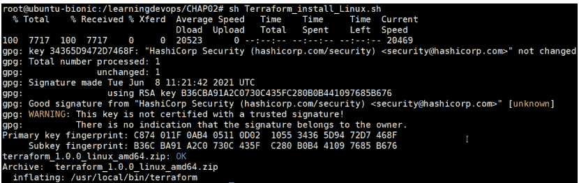

图 2.1 – Linux 上的 Terraform 安装脚本

在执行前面的脚本时，我们可以看到 Terraform ZIP 软件包的下载（使用 curl 工具）以及该软件包在 /usr/local/bin 文件夹内的解压缩操作。

此解决方案的好处是，我们可以选择 Terraform 安装文件夹，并且它适用于各种 Linux 发行版。这是因为它使用常见工具，包括 curl 和 unzip。

在 Linux 上安装 Terraform 的第二种解决方案是使用 apt 包管理器。您可以对 Ubuntu 发行版使用以下脚本：

```
sudo apt-get update && sudo apt-get install -y gnupg software-properties-common curl \
&& curl -fsSL https://apt.releases.hashicorp.com/gpg | sudo apt-key add - \
&& sudo apt-add-repository "deb [arch=amd64] https://apt.releases.hashicorp.com $(lsb_release -cs) main" \
&& sudo apt-get update && sudo apt-get install terraform
```

此脚本执行以下操作：

- 它添加 apt HashiCorp 存储库。
- 它更新本地存储库。
- 它下载 Terraform CLI。

> 重要说明
> 有关此脚本以及在其他发行版上安装 Terraform 的更多详细信息，请参阅 https://learn.hashicorp.com/tutorials/terraform/install-cli 上的文档，并导航到 Linux 选项卡。

此解决方案的好处是，您可以使用 Linux 包管理，它可以集成到流行的配置工具中（例如 Ansible、Puppet 或 Docker）。

我们刚刚讨论了在 Linux 上安装 Terraform。现在，让我们来看看它在 Windows 上的安装。

#### 在 Windows 上通过脚本安装 Terraform

如果我们使用 Windows，可以使用 **Chocolatey**，它是一个免费的公共包管理器，类似于 **NuGet** 或 **npm**，但专门用于软件。它广泛用于 Windows 服务器甚至本地计算机上的软件自动化。

> 重要说明
> Chocolatey 官方网站可在 https://chocolatey.org/ 找到，其安装文档可在 https://chocolatey.org/install 找到。

安装 Chocolatey 后，我们只需在 PowerShell 或 CMD 工具中运行以下命令：

```
choco install terraform -y
```

以下是使用 Chocolatey 在 Windows 上安装 Terraform 的屏幕截图：

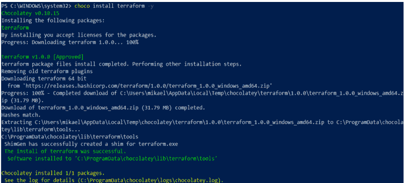

图 2.2 – Windows 上的 Terraform 安装

执行 `choco install terraform` 命令将从 Chocolatey 安装最新版本的 Terraform。

安装后，我们可以通过运行以下命令检查 Terraform 版本：

```
terraform version
```

此命令显示已安装的 Terraform 版本。

我们还可以通过运行以下命令查看 Terraform 提供的不同命令：

```
terraform --help
```

以下屏幕截图列出了不同命令及其功能：

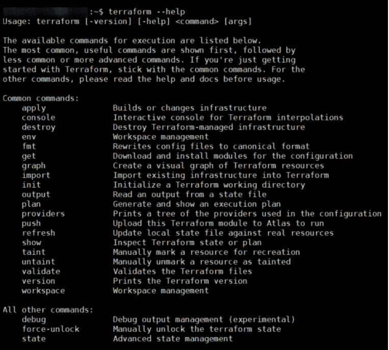

图 2.3 – Terraform 的可用命令

现在，让我们来看看在 macOS 上安装 Terraform。

#### 在 macOS 上通过脚本安装 Terraform

在 macOS 上，我们可以使用 **Homebrew**（macOS 包管理器，`https://brew.sh/`），通过在终端中执行以下命令来安装 Terraform：

```
brew install terraform
```

通过脚本安装 Terraform 的内容到此结束。让我们来看看另一种解决方案，它使用 Terraform 在 Azure 上部署，而无需安装它——**Azure Cloud Shell**。

### 将 Terraform 与 Azure Cloud Shell 集成

如果我们使用 Terraform 在 Azure 上部署基础架构，还应该知道 Azure 团队已将 Terraform 集成到 Azure Cloud Shell 中。

> **重要说明**
> 要了解有关 Azure Cloud Shell 的更多信息，请参阅其文档 `https://azure.microsoft.com/en-us/features/cloud-shell/`。

要从 Azure Cloud Shell 使用它，请执行以下步骤：

1. 通过打开 `https://portal.azure.com` 连接到 Azure 门户，并使用您的 Azure 帐户登录：

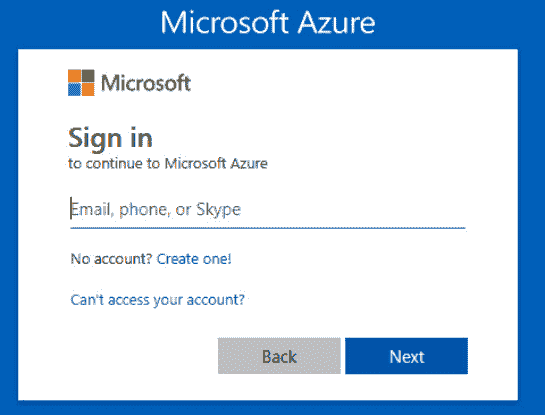

图 2.4 – Azure 登录页面


2. 打开 Cloud Shell 并选择所需模式，即 Bash 或 PowerShell。

3. 然后，我们可以在 shell 中运行 Terraform 命令行。

以下是在 Azure Cloud Shell 中执行 Terraform 的截图：

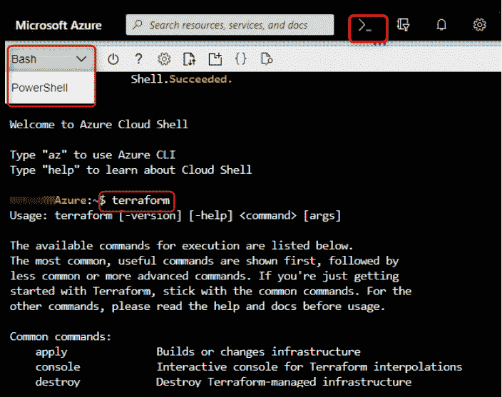

图 2.5 – Azure Cloud Shell

使用此解决方案的优点是我们不需要安装任何软件；只需将 Terraform 文件上传到 Cloud Shell 并在 Cloud Shell 中运行即可。此外，我们已经连接到 Azure，因此无需配置（请参阅 *Configuring Terraform for Azure* 部分）。

但是，此解决方案仅用于开发模式，不适用于本地或自动化的 Terraform 使用。因此，在本章中，我们将讨论 Azure 的 Terraform 配置。

既然我们已安装 Terraform，现在可以开始在本地使用它来预配 Azure 基础设施。我们将从第一步开始，即配置 Azure 的 Terraform。

### 为 Azure 配置 Terraform

在编写用于预配 Azure 等云基础设施的 Terraform 代码之前，我们必须配置 Terraform 以允许操作 Azure 订阅中的资源。

为此，首先，我们将在 Azure Active **Directory (AD)** 中创建一个新的 Azure **Service Principal (SP)**，在 Azure 中，这是一个具有管理 Azure 资源权限的 _应用程序用户_。

> **Important Note**
> 有关 Azure SP 的更多详细信息，请阅读 https://docs.microsoft.com/en-us/azure/active-directory/develop/app-objects-and-service-principals 上的文档。

对于此 Azure SP，我们必须为其分配将在其中创建资源的订阅上的参与者权限。

### 创建 Azure 服务主体

此操作可以通过 Azure 门户（所有步骤均在 https://docs.microsoft.com/en-us/azure/active-directory/develop/howto-create-service-principal-portal 的官方文档中详细说明）或通过执行以下 `az cli` 命令的脚本来完成（我们可以在 Azure Cloud Shell 中启动它）。

以下是您必须运行以创建 SP 的模板 `az cli` 脚本。在此，您需要输入 SP 名称、角色和范围：

```bash
az ad sp create-for-rbac --name="<ServicePrincipal name>"
--role="Contributor" --scopes="/subscriptions/<subscription Id>"
```

请参阅以下示例：

```bash
az ad sp create-for-rbac --name="SPForTerraform"
--role="Contributor" --scopes="/subscriptions/8921-1444-..."
```

此示例脚本创建一个名为 `SPForTerraform` 的新 SP，并授予其对订阅 ID（即 `8921....`）的参与者权限。

### 重要提示

有关创建 Azure SP 的 Azure CLI 命令的更多详细信息，请参阅 https://docs.microsoft.com/en-us/cli/azure/create-an-azure-service-principal-azure-cli?view=azure-cli-latest 上的文档。

以下截图显示了创建 Azure SP 的脚本执行情况：

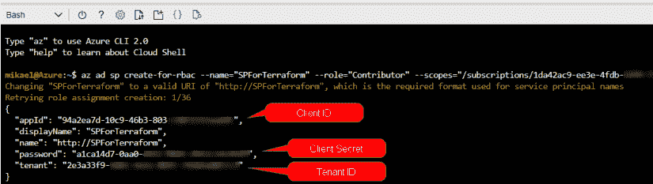

### Figure 2.6 – Creating an Azure SP

创建此 Azure SP 会返回三段身份识别信息：

- 应用程序 ID，也称为客户端 ID
- 客户端密钥
- 租户 ID

SP 在 Azure AD 中创建。以下截图显示了 Azure AD SP：

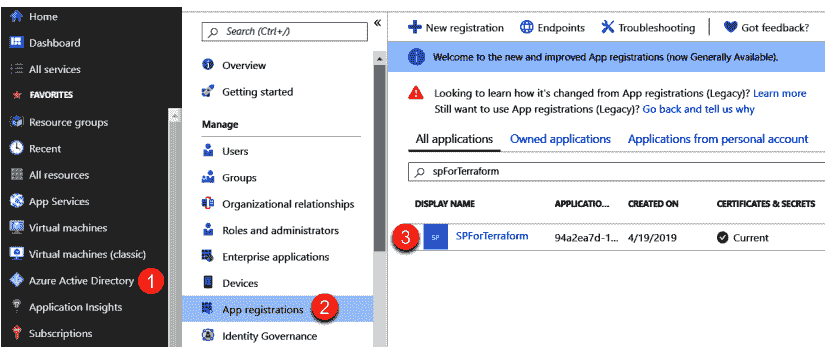

### Figure 2.7 – The App registrations list in the Azure portal

在此，我们刚刚了解如何在 Azure AD 中创建 SP，并已授予其操作我们 Azure 订阅资源的权限。

现在，让我们学习如何配置 Terraform 以使用我们的 Azure SP。

### Configuring the Terraform provider

创建 Azure SP 后，我们将配置 Terraform 配置以使用此 SP 连接到 Azure。为此，请执行以下步骤：

1. 在任意目录中，创建一个新文件名 `provider.tf`（扩展名 `.tf` 的文件对应于 Terraform 文件），其中包含以下代码：

```hcl
provider "azurerm" {
  features {}
  subscription_id = "<subscription ID>"
  client_id = "<Client ID>"
  client_secret = "<Client Secret>"
  tenant_id = "<Tenant Id>"
}
```

在上述代码中，我们指示使用的提供程序是 `azurerm`。连接到 Azure 的身份验证信息是已创建的 SP，我们添加了新块 **features**，它提供了可以自定义 Azure 提供程序资源行为的可能性。

但是，出于安全考虑，不建议将身份识别信息以纯文本形式放在配置中，尤其是如果您知道此代码可能被其他人访问。

2. 因此，我们将通过将其替换为以下代码来改进上述代码：

```hcl
provider "azurerm" {
  features {}
}
```

3. 因此，我们从 Terraform 配置中删除凭据，并将身份识别值传递给特定的 Terraform 环境变量：

- `ARM_SUBSCRIPTION_ID`
- `ARM_CLIENT_ID`
- `ARM_CLIENT_SECRET`
- `ARM_TENANT_ID`

> **Important Note**
> 有关 azurerm 提供程序的更多信息，请参阅 https://registry.terraform.io/providers/hashicorp/azurerm/latest/docs 上的文档。我们将在本章稍后的 Running Terraform form deployment 部分学习如何设置这些环境变量。

因此，Terraform 代码不再包含任何身份识别信息。

我们刚刚了解如何为 Azure 身份验证配置 Terraform。现在，我们将解释如何快速配置 Terraform 以进行本地开发和测试。

### 用于本地开发和测试的 Terraform 配置

在本地工作并希望快速测试 Terraform 代码时（例如，在沙箱环境中），使用您自己的 Azure 帐户而不是使用 SP 可能更方便且更快。

为此，可以使用 az login 命令预先连接到 Azure。然后，在打开的窗口中输入您的身份识别信息。

以下是 Azure 登录窗口的截图：

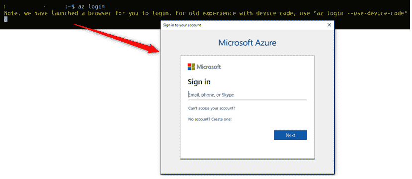

Figure 2.8 – The Azure Sign in page with Azure login

如果访问多个订阅，可以使用以下命令选择所需的订阅：

```bash
az account set --subscription="<Subscription ID>"
```

然后，我们像以前一样使用 `provider`, "azurerm" `{ }` 配置 Terraform 提供程序。当然，在远程服务器上执行时不应使用此身份验证方法。

> Important Note
> 有关提供程序配置的更多信息，请参阅 https://www.terraform.io/docs/providers/azurerm/index.html 上的文档。

因此，Azure 的 Terraform 配置由使用来自 Azure SP 的信息的提供程序配置定义。

完成此配置后，我们可以开始编写 Terraform 配置来管理和预配 Azure 资源。

### 编写 Terraform 脚本以部署 Azure 基础设施

为了说明使用 Terraform 在 Azure 中部署资源，我们将提供一个由 Terraform 组成的简单 Azure 架构，该架构由以下组件组成：

- 有一个 Azure 资源组。
- 还有一个由虚拟网络和子网组成的网络配置。
- 在此子网中，我们将创建一个具有公共 IP 地址的虚拟机，以便公开可用。

为此，在我们之前创建 `provider.tf` 文件的同一目录中，我们将创建一个带有以下代码的 `main.tf` 文件：

1. 让我们从提供 `resource` 组的代码开始：

```hcl
resource "azurerm_resource_group" "rg" {
  name = "bookRg"
  location = "West Europe"
}
```


### 任何一段 Terraform 代码都由相同的语法模型组成

任何一段 Terraform 代码都由相同的语法模型组成，Terraform 对象的语法由四个部分组成：

- `resource` 或 `data` 块的类型
- 要管理的资源名称（例如，`azurerm_resource_group`）
- 内部 Terraform ID（例如，`rg`）
- 对应于资源实际属性的属性列表（即，`name` 和 `location`）

> Important Note
> 有关 Terraform 语法的更多文档可在 https://www.terraform.io/docs/configuration-0-11/resources.html 上找到。

此代码使用 `azurerm_resource_group` Terraform 资源，将预配一个名为 `bookRg`、存储在 West Europe 位置的资源组。

2. 然后，我们将编写网络部分的代码：

```hcl
resource "azurerm_virtual_network" "vnet" {
    name = "book-vnet"
    location = "West Europe"
    address_space = ["10.0.0.0/16"]
    resource_group_name = azurerm_resource_group.rg.name
}

resource "azurerm_subnet" "subnet" {
    name = "book-subnet"
    virtual_network_name = azurerm_virtual_network.vnet.name
    resource_group_name = azurerm_resource_group.rg.name
    address_prefix = "10.0.10.0/24"
}
```

在这段用于网络部分的 Terraform 代码中，我们创建了一个名为 book-vnet 的 VNet 的代码，并在其中创建了一个名为 book-subnet 的子网。

如果我们仔细查看这段代码，可以看到，对于资源之间的依赖关系，我们没有使用明确的 ID，而是使用对 Terraform 资源的指针。

VNet 和子网是资源组的属性，使用 `${azurerm_resource_group.rg.name}`，这告诉 Terraform VNet 和子网将在资源组之后创建。至于子网，它通过使用 `${azurerm_virtual_network.vnet.name}` 值依赖于其 VNet；这是显式依赖概念。

现在，让我们编写虚拟机的 Terraform 预配代码，它由以下内容组成：

- 一个网络接口
- 一个公共 IP 地址
- 一个用于诊断启动（启动信息日志）的 Azure 存储对象
- 一个虚拟机

带有 IP 配置的 **网络接口** 的示例代码如下：

```hcl
resource "azurerm_network_interface" "nic" {
  name = "book-nic"
  location = "West Europe"
  resource_group_name = azurerm_resource_group.rg.name
  ip_configuration {
    name = "bookipconfig"
    subnet_id = azurerm_subnet.subnet.id
    private_ip_address_allocation = "Dynamic"
    public_ip_address_id = azurerm_public_ip.pip.id
  }
}
```

在这段 Terraform 代码中，我们使用了一个 azurerm_network_interface 块（https://www.terraform.io/docs/providers/azurerm/r/network_interface.html）。在其中，我们配置了网络接口的名称、区域、资源组和带有动态 IP 地址的 IP 配置。

公共 IP 地址的代码，该 IP 地址位于我们刚刚创建的子网中，如下所示：

```hcl
resource "azurerm_public_ip" "pip" {
  name = "book-ip"
  location = "West Europe"
  resource_group_name = "${azurerm_resource_group.rg.name}"
  public_ip_address_allocation = "Dynamic"
  domain_name_label = "bookdevops"
}
```

在这段 Terraform 代码中，我们在 https://www.terraform.io/docs/providers/azurerm/r/public_ip.html 上使用了一个 azurerm_public_ip 块。在其中，我们配置了 IP 地址的动态分配和 DNS 标签。

存储帐户的代码，我们用于启动诊断日志，如下所示：

```hcl
resource "azurerm_storage_account" "stor" {
  name = "bookstor"
  location = "West Europe"
  resource_group_name = azurerm_resource_group.rg.name
  account_tier = "Standard"
  account_replication_type = "LRS"
}
```

在这段 Terraform 代码中，我们在 https://docs.microsoft.com/en-us/azure/storage/common/storage-account-overview 上使用了一个 azurerm_storage_account 块。在其中，我们配置了名称、区域、资源组和存储类型，在我们的情况中，是 Standard LRS。

> Important Note
> 存储帐户的文档可在 https://docs.microsoft.com/en-us/azure/storage/common/storage-account-overview 上找到。

以及包含先前创建的网络接口 ID 的 Ubuntu 虚拟机的代码，如下所示：

```hcl
resource "azurerm_linux_virtual_machine" "vm" {
  name = "bookvm"
  location = "West Europe"
  resource_group_name = azurerm_resource_group.rg.name
  vm_size = "Standard_DS1_v2"
  network_interface_ids = ["${azurerm_network_interface.nic.id}"]
  storage_image_reference {
    publisher = "Canonical"
    offer = "UbuntuServer"
    sku = "16.04-LTS"
    version = "latest"
  }
  ...
}
```

在这段 Terraform 代码中，我们在 https://registry.terraform.io/providers/hashicorp/azurerm/latest/docs/resources/linux_virtual_machine 上使用了一个 azurerm_linux_virtual_machine 块。在其中，我们配置了名称、大小（Standard_DS1_V2）、对 network_interface Terraform 对象的引用以及虚拟机操作系统的类型（Ubuntu）。

所有这些代码部分都与之前的部分完全相同，使用显式依赖来指定资源之间的关系。

> Important Note
> 此完整源代码可在 https://github.com/PacktPublishing/Learning-DevOps-Second-Edition/tree/main/CHAP02/terraform_simple_script 上找到。

我们刚刚创建了一个完整的 Terraform 脚本，允许我们预配一个小型 Azure 基础设施。但是，与任何语言一样，关于文件分离、应用清晰可读的代码以及最后使用内置函数，都有良好的实践。

### 遵循一些 Terraform 良好实践

我们刚刚查看了用于预配 Azure 基础设施的 Terraform 代码示例，但查看编写 Terraform 代码的一些良好实践也是有用的。

#### 通过文件分离获得更好的可见性

执行 Terraform 代码时，`execution` 目录中所有带有 `.tf` 扩展名的配置文件都会自动执行；在我们的示例中，我们有 `provider.tf` 和 `main.tf`。将代码分离到多个文件中是很好的，以便提高代码的可读性和可演进性。

使用我们的示例脚本，我们可以通过以下方式将其分离来做得更好：

- `Rg.tf`：包含资源组的代码。
- `Network.tf`：包含 VNet 和子网的代码。
- `Compute.tf`：包含网络接口、公共 IP、存储和虚拟机的代码。

> Important Note
> 带有单独文件的完整代码可在 `https://github.com/PacktPublishing/Learning-DevOps-Second-Edition/tree/main/CHAP02/terraform_separate_files` 上找到。

#### 敏感数据的保护

必须小心 Terraform 配置中的敏感数据，例如密码和访问权限。我们已经了解到，对于对 Azure 的访问身份验证，没有必要将它们留在代码中。此外，在我们关于虚拟机管理员帐户的示例中，请注意虚拟机管理员帐户的密码已在此 Terraform 配置中明确指定。为了解决这个问题，我们可以使用强大的密钥管理器来存储密码，例如 Azure Key Vault 或 HashiCorp Vault，并通过 Terraform 获取它们。

### 使用变量和插值函数动态化配置

编写 Terraform 配置时，重要的是从一开始就考虑到，托管应用程序的基础设施通常对所有阶段都是相同的。但是，只有某些信息会因阶段而异，例如资源名称和实例数量。

为了给代码提供更多灵活性，我们必须在代码中使用变量，步骤如下：

1. 通过在全局 Terraform 代码中添加以下示例代码来声明变量。或者，我们可以将其添加到另一个文件（例如 `variables.tf`）中，以便更好地阅读代码：

```hcl
variable "resource_group_name" {
    description ="Name of the resource group"
}
variable "location" {
    description ="Location of the resource"
    default ="West Europe"
}
variable "application_name" {
    description ="Name of the application"
}
```

2. 在另一个名为 `terraform.tfvars` 的 `.tfvars` 文件中，使用 `variable_name=value` 语法实例化它们的值，类似于以下内容：

```hcl
resource_group_name ="bookRg"
application_name ="book"
```

3. 在代码中使用这些变量，使用 `var.<name of the variable>`；例如，在资源组 Terraform 代码中，我们可以编写以下内容：

```hcl
resource "azurerm_resource_group" "rg" {
    name = var.resource_group_name
    location = var.location
    tags {
        environment = "Terraform Azure"
    }
}
```


除此之外，Terraform 拥有一大套内置函数，可用于操作数据或变量。要了解这些函数的更多信息，请参阅官方文档 `https://www.terraform.io/docs/configuration/functions.html`。

当然，还有许多其他良好实践，但这些实践应从第一行代码开始应用，以确保您的代码得到良好维护。

> **重要提示**
> 
> 本示例的完整最终代码可在 `https://github.com/PacktPublishing/Learning-DevOps-Second-Edition/tree/main/CHAP02/terraform_vars_interp` 获取。

我们已编写了一个 Terraform 配置，采用最佳实践，允许我们在 Azure 中创建一个提供网络和虚拟机的简单云基础设施。现在，让我们来看看如何使用我们的代码运行 Terraform 来预配此基础设施。

### 运行 Terraform 进行部署

编写好 Terraform 配置后，我们现在需要运行 Terraform 来部署基础设施。

但是，在任何执行之前，首先需要使用 Azure SP 进行身份验证，以确保 Terraform 可以管理 Azure 资源。

为此，我们可以设置特定于 Terraform 的环境变量以包含在 _Configuring Terraform for Azure_ 部分中先前创建的 SP 的信息，也可以使用 `az cli` 脚本。

以下脚本在 Linux 操作系统中导出四个 Terraform 环境变量：

```
export ARM_SUBSCRIPTION_ID=xxxxx-xxxxx-xxxxx-xxxx
export ARM_CLIENT_ID=xxxxx-xxxxx-xxxxx-xxxx
export ARM_CLIENT_SECRET=xxxxxxxxxxxxxxxxxxxx
export ARM_TENANT_ID=xxxxx-xxxxx-xxxxx-xxxx
```

此外，我们可以使用带有登录命令的 az cli 脚本：

```
az login
```

身份验证完成后，我们可以运行 Terraform 工作流。

在我们的场景中，我们从一个没有任何 Azure 资源组的空 Azure 订阅开始；然而，在现实世界中，我们的订阅可能已经包含一个资源组。

在运行 Terraform 之前，在 Azure 门户中，检查您的订阅中是否没有资源组，如下所示：

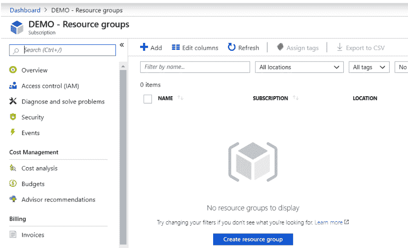

图 2.9 – Azure 上没有资源组

要运行 Terraform，我们需要打开一个命令行终端，例如 CMD、PowerShell 或 Bash，并导航到我们之前编写的 Terraform 配置文件所在的目录。

Terraform 配置的执行分为几个步骤，包括初始化、更改预览和应用这些更改。

接下来，让我们详细了解这些步骤的执行过程，从初始化步骤开始。

### 初始化

初始化步骤允许 Terraform 执行以下操作：

- 初始化 Terraform 上下文以检查并建立 Terraform 提供程序与远程服务之间的连接——在我们的案例中，这是与 Azure 的连接。
- 下载提供程序的插件——在我们的案例中，将是 azurerm 提供程序。
- 检查代码变量。

要执行初始化，请运行 init 命令：

```
terraform init
```

以下是 terraform init 的截图：

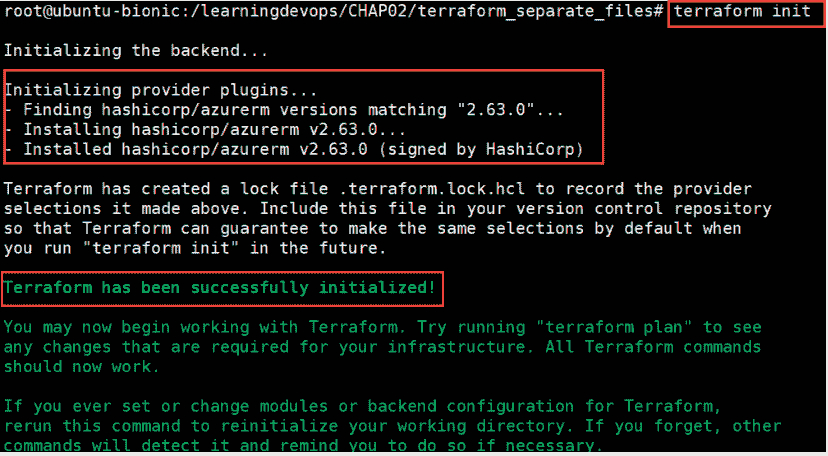

图 2.10 – 执行 terraform init 命令

如前面命令执行过程中所了解到的，Terraform 执行以下操作：

- 它下载 `azurerm` 插件的最新版本。
- 它创建一个工作 `.terraform` 目录。

以下是 `.terraform` 目录的截图：

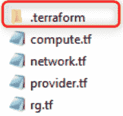

图 2.11 – Terraform 配置目录

> **重要提示**
> 有关 `init` 命令行的更多信息，请参阅 `https://www.terraform.io/docs/commands/init.html` 中的文档。

一旦初始化步骤完成，我们可以进入下一步，即预览更改。

### 预览更改

下一步是在应用更改之前预览对基础设施所做的更改。为此，请使用 `plan` 命令运行 Terraform。执行时，plan 会自动使用 `terraform.tfvars` 文件来设置变量。要执行它，请启动 `plan` 命令：

```
terraform plan
```

以下输出显示了 terraform plan 命令的执行：

```
Refreshing Terraform state in-memory prior to plan...
The refreshed state will be used to calculate this plan, but will not be persisted to local or remote state storage.

------------------------------------------------------------------------

An execution plan has been generated and is shown below.
Resource actions are indicated with the following symbols:
  + create

Terraform will perform the following actions:

  + azurerm_network_interface.nic
      id:                                    <computed>
      applied_dns_servers.#:                 <computed>
      dns_servers.#:                         <computed>
      enable_accelerated_networking:         "false"
      enable_ip_forwarding:                  "false"
      internal_dns_name_label:               <computed>
      internal_fqdn:                         <computed>
      ip_configuration.#:                    "1"
      ip_configuration.0.application_gateway_backend_address_pool_ids.#: <computed>
      ip_configuration.0.application_security_group_ids.#:               <computed>
      ip_configuration.0.load_balancer_backend_address_pool_ids.#:       <computed>
      ip_configuration.0.load_balancer_inbound_nat_rules_ids.#:          <computed>
      ip_configuration.0.name:               "bookipconfig"
      ip_configuration.0.primary:            <computed>
      ip_configuration.0.private_ip_address_allocation:                  "dynamic"
      ip_configuration.0.private_ip_address_version:                     "IPv4"
      ip_configuration.0.public_ip_address_id:                           "${azurerm_public_ip.pip.id}"
      ip_configuration.0.subnet_id:                                      "${azurerm_subnet.subnet.id}"
      location:                              "westeurope"

  + azurerm_virtual_network.vnet
      id:                                    <computed>
      address_space.#:                       "1"
      address_space.0:                       "10.0.0.0/16"
      location:                              "westeurope"
      name:                                  "book-vnet"
      resource_group_name:                   "bookRg"
      subnet.#:                              <computed>
      tags.%:                                <computed>

Plan: 7 to add, 0 to change, 0 to destroy.

------------------------------------------------------------------------

Note: You didn't specify an "-out" parameter to save this plan, so Terraform can't guarantee that exactly these actions will be performed if
```

图 2.12 – 执行 terraform plan 命令

在执行 plan 命令期间，该命令会显示将受更改影响的资源的名称和属性。它还显示新资源的数量、将被修改的资源数量以及将被删除的资源数量。

### 应用更改

在验证 `plan` 命令的结果符合我们的预期后，最后一步是实时应用 Terraform 代码以预配并将更改应用到我们的基础设施。

为此，我们将执行 `apply` 命令：

```
terraform apply
```

此命令执行与 `plan` 命令相同的操作，并交互式地询问用户确认我们是否要实施更改。

以下是 `terraform apply` 确认的截图：

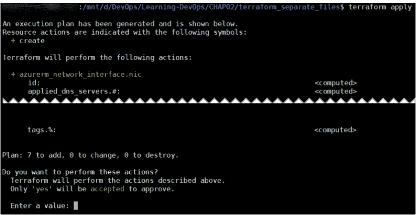

图 2.13 – Terraform 中要应用的更改的确认

确认是通过输入 `yes`（或输入 `no` 以取消）给出的，然后 Terraform 将更改应用到基础设施。

### 重要提示

有关 `plan` 命令行的更多信息，请参阅 https://www.terraform.io/docs/commands/plan.html 中的文档。

因此，我们刚刚看到了将要应用到我们基础设施的更改预测。现在，我们将查看如何应用它们。


### 以下是 terraform apply 执行的截图：

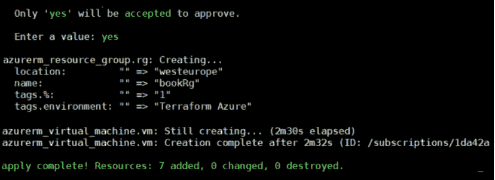

### 图 2.14 – 执行 terraform apply 命令

apply 命令的输出显示 Terraform 执行的所有操作，以及所有更改和受影响的资源。它以一行摘要结束，显示添加、更改或销毁的资源总数。

> Important Note
> 
> 有关 apply 命令行的更多信息，请参阅 https://www.terraform.io/docs/commands/apply.html 上的文档。

由于 Terraform apply 命令已正确执行，我们可以在 Azure 门户中检查 Terraform 代码中描述的资源是否存在。

### 以下是 Terraform 创建的 Azure 资源的截图：

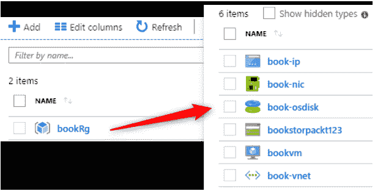

### 图 2.15 – 已预配的 Azure 资源列表

我们可以从门户中看到，Terraform 代码中指定的资源已成功预配。

因此，我们刚刚学习了如何使用三个主要命令通过 Terraform 预配基础架构：

- `init` 命令用于初始化上下文
- `plan` 命令用于预览更改
- `apply` 命令用于应用更改

在下一节中，我们将探讨其他 Terraform 命令和 Terraform 生命周期。

### 使用不同命令行选项了解 Terraform 生命周期

我们刚刚发现，使用 Terraform 对基础架构应用更改主要是通过三个命令完成的。它们包括 `init`、`plan` 和 `apply` 命令。但是，Terraform 有其他非常实用且重要的命令，可用于最佳管理我们基础架构的生命周期，并且必须考虑如何在 CI/CD 管道等自动化上下文中执行 Terraform。

可以对一段基础架构执行的其他操作之一是通过删除资源来清理资源。这样做是为了更好地重建或删除临时基础架构。

### 使用 destroy 更好地重建

由 IaC 维护的基础架构生命周期中的一个步骤是删除基础架构；不要忘记，IaC 的目标和优势之一是能够快速更改基础架构，也可以按需创建环境。也就是说，我们创建并保留环境，只要我们需要它们，当它们不再使用时，我们将销毁它们，从而使公司能够节省资金。

为了实现这一点，有必要自动化基础架构的删除，以便能够快速重建它。

要销毁之前使用 Terraform 预配的基础架构，请执行以下命令：

```
terraform destroy
```

执行此命令应给出以下输出：

```
root@vm:/mnt/d/DevOps/Learning-DevOps/CHAP02/terraform_separate_files$ terraform destroy
azurerm_resource_group.rg: Refreshing state... [ID /subscriptions/1da42ac9-ee3e-4fdb-b294-f7a607f589d5/resourceGroups/bookRg]
azurerm_storage_account.stor: Refreshing state... [ID /subscriptions/1da42ac9-ee3e-4fdb-b294-... /storageAccounts/bookstorage123]
azurerm_public_ip.pip: Refreshing state... [ID /subscriptions/1da42ac9-ee3e-4fdb-b294-... soft.Network/publicIPAddresses/book-ip]
azurerm_virtual_network.vnet: Refreshing state... [ID /subscriptions/1da42ac9-ee3e-4fdb-b294-... /virtualNetworks/book-vnet]
azurerm_subnet.subnet: Refreshing state... [ID /subscriptions/1da42ac9-ee3e-4fdb-b294-... /subnets/book-subnet]
azurerm_network_interface.nic: Refreshing state... [ID /subscriptions/1da42ac9-ee3e-4fdb-b294-...oft.Network/networkInterfaces/book-nic]
azurerm_virtual_machine.vm: Refreshing state... [ID /subscriptions/1da4ac9-ee3e-4fdb-b294-...crosoft.Compute/virtualMachines/bookvm]

An execution plan has been generated and is shown below.
Resource actions are indicated with the following symbols:
  - destroy

Terraform will perform the following actions:

  - azurerm_network_interface.nic

  - azurerm_public_ip.pip

  - azurerm_resource_group.rg

  - azurerm_storage_account.stor

  - azurerm_subnet.subnet

  - azurerm_virtual_machine.vm

  - azurerm_virtual_network.vnet

Plan: 0 to add, 0 to change, 7 to destroy.

Do you really want to destroy all resources?
  Terraform will destroy all your managed infrastructure, as shown above.
  There is no undo. Only 'yes' will be accepted to confirm.

  Enter a value: yes

azurerm_resource_group.rg: Still destroying... [ID /subscriptions/1da42ac9-ee3e-4fdb-b294-f7a607f589d5/resourceGroups/bookRg, 2m40s elapsed]
azurerm_resource_group.rg: Destruction complete after 2m47s

Destroy complete! Resources: 7 destroyed.
```

图 2.16 – 确认 terraform destroy 命令

此命令与 apply 一样，在应用销毁之前需要用户确认：

```
azurerm_resource_group.rg: Still destroying... [ID /subscriptions/1da42ac9-ee3e-4fdb-b294-f7a607f589d5/resourceGroups/bookRg, 2m40s elapsed]
azurerm_resource_group.rg: Destruction complete after 2m47s

Destroy complete! Resources: 7 destroyed.
```

图 2.17 – 执行 terraform destroy 命令

验证后，等待确认消息，表明基础架构已被销毁。

destroy 命令仅销毁当前 Terraform 配置中配置的资源。其他资源（手动创建或由其他 Terraform 代码创建）不受影响。但是，如果我们的 Terraform 代码提供了一个资源组，它将销毁其所有内容。

### 格式化和验证配置

学习如何使用 Terraform 销毁资源后，强调拥有符合 Terraform 样式规则的格式良好的代码的重要性，并验证代码不包含语法或变量错误也很重要。

### 格式化代码

Terraform 有一个命令，允许代码与 Terraform 的样式和约定正确对齐。

以下命令自动格式化代码：

```
terraform fmt
```

以下是 Terraform 排列的文件的截图：

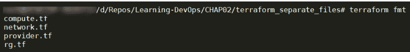

该命令重新格式化代码，并指示排列好的文件列表。

> Important Note
> 
> 有关 Terraform 样式指南的更多信息，请参阅 https://www.terraform.io/docs/configuration/style.html。此外，有关 terraform fmt 命令行的信息，请参阅 https://www.terraform.io/docs/commands/fmt.html。

### 验证代码

同样，Terraform 有一个命令来验证代码，并允许我们在执行 `plan` 命令或 `apply` 命令之前检测可能的错误。

让我们考虑以下代码片段的示例：

```
resource "azurerm_public_ip" "pip" {
  name = var.ip-name
  location = var.location
  resource_group_name = "${azurerm_resource_group.rg.name}"
  allocation_method = "Dynamic"
  domain_name_label = "bookdevops"
}
```

在 `name` 属性中，我们使用了一个未声明或未实例化任何值的 `ip-name` 变量。

执行 `terraform plan` 命令应返回错误：

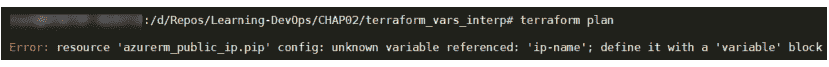

图 2.19 – 带有错误的 terraform plan 命令

由于此错误，在 CI/CD 过程中，可能会延迟基础架构的部署。

为了尽早检测 Terraform 代码中的错误，请在开发周期中执行以下命令。这将验证目录中的所有 Terraform 文件：

```
terraform validate
```

以下截图显示了此命令的执行：

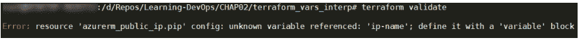

图 2.20 – 执行 terraform validate 命令

在这里，我们观察到与 `plan` 命令返回的相同错误。

我们刚刚发现了 Terraform 的主要命令行。让我们深入了解一下将 Terraform 集成到 CI/CD 过程中的内容。


### CI/CD 流程中的 Terraform 生命周期

到目前为止，我们已在本地计算机上查看并执行了各种 Terraform 命令，这些命令允许我们初始化、预览、应用和销毁基础架构，以及格式化和验证 Terraform 代码。在本地使用 Terraform（在开发环境中）时，执行生命周期如下：

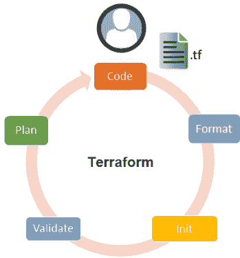

图 2.21 – Terraform CICD 流程

以下步骤说明了前面图表中的顺序：

- 代码开发
- 使用 `terraform fmt` 格式化代码
- 使用 `terraform init` 初始化
- 使用 `terraform validate` 验证代码
- 使用 `terraform plan` 进行规划
- 手动验证基础架构上的 Terraform 更改

但是，IaC 类似于应用程序，必须在自动化 CI/CD 流程中部署或执行。这始于团队成员的 Terraform 代码归档。然后，它触发 CI 并执行我们在本章中学习的 Terraform 命令。

以下是 CI/CD 自动化中 Terraform 生命周期的屏幕截图：

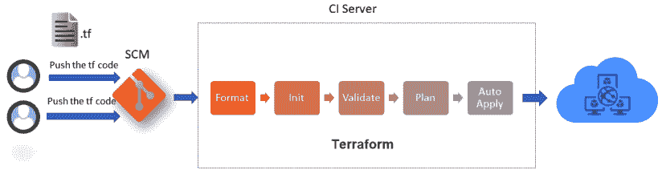

图 2.22 – Terraform CICD 工作流

CI 服务器（已安装 Terraform）为 Terraform 执行 CI/CD 的步骤如下：

- 从 SCM 检索代码
- 使用 `terraform fmt` 格式化代码
- 使用 `terraform init` 初始化
- 使用 `terraform validate` 验证代码
- 使用 `terraform plan -out-out.tfplan` 显示基础架构更改的预览
- 使用 `terraform apply --auto-approve out.tfplan` 在自动模式下应用更改

通过向 `apply` 和 `destroy` 命令添加 `--auto-approve` 选项，Terraform 也可以在自动模式下执行。这是为了避免向用户请求确认以验证需要应用的更改。通过这种自动化，Terraform 可以与 CI/CD 工具集成。

在 `plan` 命令中，添加了 `out` 选项以指定带有 `.tfplan` 格式的文件，该文件包含 `plan` 命令的输出。然后，`apply` 命令使用此 `out.tfplan` 文件。此过程的优点是可以在以后的计划上执行应用程序，这可用于回滚情况。

在本节中，我们了解到，除了常规的 `init`、`plan`、`apply` 和 `destroy` Terraform 命令外，Terraform 还具有允许我们改善代码可读性并验证代码语法的选项。此外，我们解释了 Terraform 允许与 CI/CD 管道完美集成，具有生命周期和自动化选项。

在下一节中，我们将研究 `tfstate` 文件是什么以及如何使用远程后端保护它。

### 使用远程后端保护状态文件

当 Terraform 处理资源时，它会将这些资源的状态写入 Terraform 状态文件。该文件采用 JSON 格式，并在 Terraform 执行过程中保留资源及其属性。

默认情况下，名为 `terraform.tfstate` 的文件在首次执行 `apply` 命令时在本地创建。然后，每次执行 `plan` 命令时，Terraform 都会使用它，以将其状态（写入状态文件中）与目标基础架构的状态进行比较。最后，它将返回将要应用内容的预览。

在企业中使用 Terraform 时，本地存储的此状态文件会带来许多问题：

- 由于该文件包含基础架构的状态，因此不应删除。如果删除，执行 Terraform 时可能无法按预期运行。
- 它必须同时可供处理同一基础架构资源的所有团队成员访问。
- 该文件可能包含敏感数据，因此必须安全。
- 当预配多个环境时，需要能够使用多个状态文件。

鉴于所有这些要点，无法在本地保留此状态文件，甚至无法将其归档到 SCM 中。

为了解决此问题，Terraform 允许将此状态文件存储在名为远程后端的共享安全存储中。

> **重要说明**
> Terraform 支持多种类型的远程后端；完整列表可在 https://www.terraform.io/docs/backends/types/remote.html 上查看。

在我们的案例中，我们将使用 azurerm 远程后端，通过存储帐户和状态文件的 Blob 来存储状态文件。

因此，我们将分三步实现和使用远程后端：

- 创建存储帐户
- 远程后端的 Terraform 配置
- 使用此远程后端执行 Terraform

让我们详细了解这些步骤的执行过程：

1. 若要创建 Azure 存储帐户和 Blob 容器，可以使用 Azure 门户（https://docs.microsoft.com/en-gb/azure/storage/common/storage-quickstart-create-account?tabs=azure-portal）或 az cli 脚本：

```
### 1-Create resource group
az group create --name MyRgRemoteBackend --location westeurope
### 2-Create storage account
az storage account create --resource-group MyRgRemoteBackend --name storageremotetf --sku Standard_LRS --encryption-services blob
### 3-Get storage account key
ACCOUNT_KEY=$(az storage account keys list --resource-group MyRgRemoteBackend --account-name storageremotetf --query [0].value -o tsv)
### 4-Create blob container
az storage container create --name tfbackends --account-name storageremotetf --account-key $ACCOUNT_KEY
```

此脚本创建一个名为 MyRgRemoteBackend 的资源组和一个名为 storageremotetf 的存储帐户。然后，脚本从存储帐户中检索帐户密钥，并在该存储帐户内创建名为 tfbackends 的 Blob 容器。此脚本可以在 Azure Cloud Shell 中运行，使用脚本而非 Azure 门户的优势在于，该脚本可以集成到 CI/CD 流程中。

2. 然后，要配置 Terraform 以使用先前创建的远程后端，需要在 Terraform.tf 文件中添加配置部分：

```
terraform {
 backend "azurerm" {
 storage_account_name = "storageremotetfdemo"
 container_name = "tfbackends"
 key = "myappli.tfstate"
 snapshot = true
 }
}
```

storage_account_name 属性包含存储帐户的名称，container_name 属性包含容器名称，key 属性包含 Blob 状态对象的名称，snapshot 属性在每次 Terraform 执行时对此 Blob 对象启用快照。

但是，仍需向 Terraform 提供另一条配置信息，以便它能够连接并拥有存储帐户的权限。此信息是访问密钥，即存储帐户上的私有身份验证和授权密钥。要向 Terraform 提供存储密钥，如同 Azure SP 信息一样，请设置带有存储帐户访问密钥值的 ARM_STORAGE_KEY 环境变量。

以下是 Azure 存储访问密钥的屏幕截图：

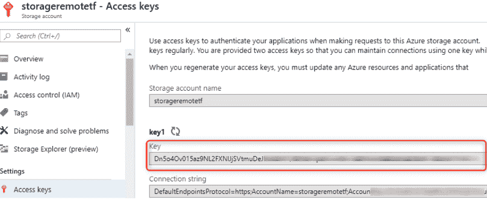

图 2.23 – Azure 存储访问密钥

> Important Note Terraform 支持存储帐户上的其他身份验证类型，例如使用 SAS 令牌或使用 SP。有关如何为 azurerm 远程后端配置 Terraform 的更多信息，请参阅 https://www.terraform.io/docs/backends/types/azurerm.html 上的文档。

3. 最后，一旦 Terraform 配置完成，即可使用此新远程后端运行 Terraform。在 `init` 期间，Terraform 初始化状态文件的上下文。默认情况下，`init` 命令保持不变，即 `terraform init`。

但是，如果使用多个 Terraform 状态来管理多个环境，则可以在 `.tf` 文件中使用简化代码创建多个远程后端配置：

```
terraform {
backend "azurerm" {}
}
```

然后，创建多个仅包含后端属性的 `backend.tfvars` 文件。

这些 `backend` 属性是存储帐户名称、Blob 容器名称和状态文件的 Blob 名称：

```
storage_account_name = "storageremotetf"
container_name = "tfbackends"
key = "myappli.tfstate"
snapshot = true
```

在此场景中，执行 `init` 命令时，可以使用以下命令指定要使用的 `backend.tfvars` 文件：

```
terraform init -backend-config="backend.tfvars"
```

`-backend-config` 参数是后端配置文件的路径。

就我个人而言，我更喜欢这种做法，因为它允许我通过将后端属性的值外部化来解耦代码，从而提高代码的可读性。


### 那么，以下是 Terraform 的执行过程：

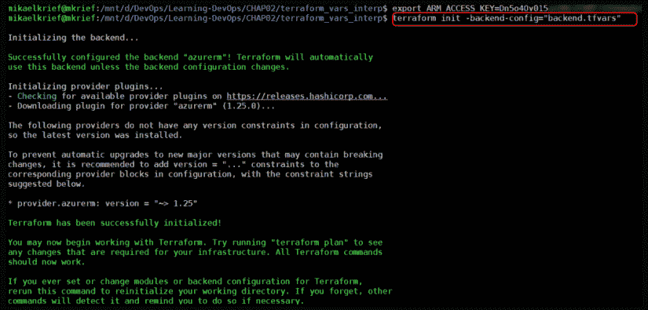

图 2.24 – 带后端配置的 terraform init 命令

在此执行过程中，我们可以查看 ARM_ACCESS_KEY 环境变量的导出，以及 Terraform init 命令，该命令通过 -backend-config 选项确定后端配置。

使用此远程后端后，状态文件将不再本地存储，而是存储在存储账户上，这是一个共享空间。因此，它可以同时被多个用户使用。同时，此存储账户提供安全性来保护状态文件的敏感数据，并提供状态文件的备份或还原功能，这两者都是 Terraform 必不可少且至关重要的元素。

> **注意**
>
> 本章的完整源代码可在 `https://github.com/PacktPublishing/Learning-DevOps-Second-Edition/tree/main/CHAP02` 获取，最终的 Terraform 代码位于 `terraform_vars_interp` 文件夹中。

### 总结

在本章关于 Terraform 的内容中，我们了解到其安装可以手动完成，也可以使用脚本完成。

要应用 Terraform，我们详细介绍了其配置的不同步骤，以使用 Azure 服务主体 (SP) 预配 Azure 基础设施。

此外，我们逐步解释了其本地执行过程及其主要命令行，即 `init`、`plan`、`apply` 和 `destroy`，以及其在 CI/CD 流程中的生命周期。最后，我们通过查看 Azure 远程后端中的状态文件保护来结束本章。

因此，Terraform 是一个符合基础设施即代码 (IaC) 原则的工具。Terraform 代码对用户来说可读且易于理解，其执行能很好地集成到 CI/CD 流水线中，从而允许您自动预配云基础设施。

在本书中，我们将继续讨论 Terraform，并补充其与 Packer、Azure Kubernetes 服务以及减少停机时间相关的内容。

在下一章中，我们将探索 IaC 的下一步，即使用 Ansible 进行配置管理。我们将介绍其安装、用于配置预配虚拟机的用法，以及如何使用 Ansible Vault 保护机密。

### 问题

- 1. Terraform 使用什么语言？
- 2. Terraform 的作用是什么？
- 3. Terraform 是一种脚本工具吗？
- 4. 哪个命令允许您显示已安装的版本？
- 5. 使用 Terraform 管理 Azure 时，连接 Terraform 与 Azure 的 Azure 对象名称是什么？
- 6. Terraform 工作流的三个主要命令是什么？
- 7. 哪个 Terraform 命令允许您销毁资源？
- 8. 添加到 `apply` 命令的选项是什么，用于自动应用基础设施更改？
- 9. Terraform 状态文件的用途是什么？
- 10. 将 Terraform 状态文件留在本地是一种好的做法吗？如果不是，应该怎么做？

### 延伸阅读

如果您想了解更多关于 Terraform 的信息，以下是一些资源：

- 官方 Terraform 文档：https://www.terraform.io/
- Terraform 下载和安装信息：https://www.terraform.io/downloads.html
- Terraform Azure 提供程序：https://www.terraform.io/docs/providers/azurerm/index.html
- 官方 Azure Terraform 文档：https://docs.microsoft.com/en-us/azure/terraform/terraform-overview
- 书籍：Terraform Cookbook：https://www.packtpub.com/product/terraform-cookbook/9781800207554
- Terraform 入门指南，第二版：https://www.packtpub.com/networking-and-servers/getting-started-terraform-second-edition
- Terraform 在线学习：https://learn.hashicorp.com/terraform
