## 3 使用 Ansible 配置 IaaS 基础设施

在上一章中，我们讨论了使用 Terraform 预配 Azure 云基础设施。如果该基础设施包含 **虚拟机** (VM)，一旦预配完成，就需要配置其系统并安装所有必要的中间件。这种配置对于将托管在 VM 上的应用程序正常运行是必要的。

有几种 **基础设施即代码** (IaC) 工具可用于配置 VM，其中最著名的是 Ansible、Puppet、Chef、SaltStack 和 PowerShell DSC。其中，来自 Red Hat 的 Ansible (`https://www.ansible.com/overview/it-automation`) 凭借其众多优势脱颖而出，具体如下：

- 它是声明式的，并使用易于阅读的 YAML 语言。
- Ansible 只使用一个可执行文件。
- 它不需要在要配置的 VM 上安装代理。
- Ansible 连接到远程 VM 只需要简单的 SSL/WinRM 连接。
- 它具有模板引擎和保险库，用于加密/解密敏感数据。
- 它是幂等的。

Ansible 的主要用例如下：

- 配置带有中间件和加固的 VM（我们将在本章中学习）
- 基础设施预配，例如 Terraform，但使用 YAML 配置
- 安全合规性，以测试系统或网络配置是否符合企业要求

在本章中，我们将学习如何安装 Ansible，然后使用它配置带有清单和剧本的 VM。我们还将学习如何在讨论如何在 Azure 中使用动态清单之前，使用 Ansible Vault 保护敏感数据。

本章将涵盖以下主题：

- 安装 Ansible
- 创建 Ansible 清单
- 执行第一个剧本
- 执行 Ansible
- 使用 Ansible Vault 保护数据
- 为 Azure 基础设施使用动态清单

### 技术要求

要跟随本章学习，您必须满足以下技术要求：

- 要安装 Ansible，我们需要一个操作系统，例如 Red Hat、Debian、CentOS、macOS 或任何 BSD 系统。对于 Windows 用户，可以安装 **适用于 Linux 的 Windows 子系统 (WSL)**；请参阅文档 `https://docs.microsoft.com/en-us/windows/wsl/install-win10`。
- 运行 Ansible 的机器上必须安装 Python 2（版本 2.7）或 Python 3（版本 3.5+）。您可以在此处下载：`https://www.python.org/downloads/`。有关 Ansible 要求的更多信息，请参阅此处的文档：`https://docs.ansible.com/ansible/latest/installation_guide/intro_installation.html#control-node-requirements`。
- Ansible 剧本使用 YAML 配置文件，因此任何代码编辑器都可以；但是，我们将使用 Visual Studio Code，因为它非常合适。您可以在此处下载：https://code.visualstudio.com/。
- 本章的大部分内容不会专注于特定的云提供商，除了最后关于 Azure 的部分。为此，我们需要一个 Azure 订阅，可以在此处免费获取：https://azure.microsoft.com/en-us/free/。
- 要运行 Azure 的 Ansible 动态清单，我们需要安装 Azure Python SDK：https://docs.microsoft.com/en-us/azure/python/python-sdk-azure-install?view=azure-python。
- 本章的完整源代码可在此处获取：https://github.com/PacktPublishing/Learning-DevOps-Second-Edition/tree/main/CHAP03。

查看以下视频，观看代码实际运行情况：
https://bit.ly/3HdwbVc。

### 安装 Ansible

在开始使用 Ansible 之前，我们必须知道可以在哪些操作系统上使用它，以及如何安装和配置它。然后，我们必须了解围绕其运行所需的工件的一些概念。

在本节中，我们将了解如何在本地或服务器机器上安装 Ansible，以及如何将 Ansible 集成到 Azure Cloud Shell 中。然后，我们将讨论构成 Ansible 的不同元素或工件。最后，我们将配置 Ansible。

要开始，我们将学习如何使用自动脚本下载和安装 Ansible。

### 使用脚本安装 Ansible

与 Terraform 不同，Ansible 不是跨平台的，只能安装在 Red Hat、Debian、CentOS、macOS 或任何 BSD 系统上。您使用脚本进行安装，该脚本根据操作系统而有所不同。

例如，要在 Ubuntu 上安装最新版本，我们必须在 Bash 终端中运行以下脚本：

```bash
sudo apt-get update
sudo apt-get install software-properties-common
sudo apt-add-repository --yes --update ppa:ansible/ansible
sudo apt-get install ansible
```


### 重要提示

此脚本也可在此处查看：https://github.com/PacktPublishing/Learning-DevOps-Second-Edition/blob/main/CHAP03/install_ansible_ubuntu.sh。

此脚本会更新必要的软件包，安装 software-properties-common 依赖项，添加 Ansible 仓库，并安装最新版本的 Ansible。

### 重要提示

所有发行版类型的 Ansible 安装脚本均可在此处查看：https://docs.ansible.com/ansible/latest/installation_guide/intro_installation.html#installing-ansible-on-specific-operating-systems。

要在 Windows 操作系统计算机上本地安装 Ansible，没有原生解决方案，但可以在本地 VirtualBox 虚拟机或 WSL 上安装。WSL 允许使用 Windows 操作系统的开发人员直接在其工作站上测试脚本和应用程序，而无需安装虚拟机。

### 重要提示

阅读本文以了解如何在本地 VirtualBox 环境中安装 Ansible：https://phoenixnap.com/kb/install-ansible-on-windows。有关 WSL 的更多详细信息，请阅读此处的文档：https://docs.microsoft.com/en-us/windows/wsl/about。

要测试是否已成功安装，我们可以运行以下命令来检查其已安装的版本：

```
ansible --version
```

执行此命令的结果会提供有关已安装的 Ansible 版本的一些信息，如下所示：

```
mikael@VmAnsible:~$ ansible --version
ansible 2.8.3
config file = /etc/ansible/ansible.cfg
configured module search path = [u'/home/mikael/.ansible/plugins/modules', u'/usr/share/ansible/plugins/modules']
ansible python module location = /usr/lib/python2.7/dist-packages/ansible
executable location = /usr/bin/ansible
python version = 2.7.15+ (default, Oct 7 2019, 17:39:04) [GCC 7.4.0]
```

图 3.1 – ansible --version 命令

要显示所有 Ansible 命令和选项的列表，请使用 `--help` 参数执行 `ansible` 命令：

```
ansible --help
```

以下屏幕截图显示了此命令的执行情况：

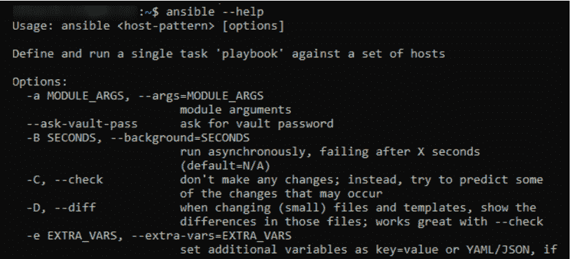

图 3.2 – `ansible --help` 命令

如我们所见，在本地或远程计算机上安装 Ansible 非常简单，并且可以通过脚本实现自动化。如果我们在 Azure 中部署基础架构，也可以使用 Ansible，因为它已集成到 Azure Cloud Shell 中。

现在，让我们看看 Ansible 是如何集成到 Azure Cloud Shell 中的。

### 将 Ansible 集成到 Azure Cloud Shell 中

如我们在 _第 2 章，使用 Terraform 部署云基础架构_ 中所学，**Azure Cloud Shell** 集成了第三方工具，这些工具可在 Azure 中使用，而无需在 VM 上安装它们。其中的工具包括 Terraform（我们在上一章中详细介绍过），还有 Ansible，Microsoft 已将其集成，以允许我们自动配置托管在 Azure 上的 VM。

要在 Azure 云中使用 Ansible，我们必须执行以下操作：

- 连接到 `https://portal.azure.com` 的 Azure 门户。
- 打开 Cloud Shell。
- 选择 Bash 模式。
- 在打开的终端中，我们现在可以访问所有 Ansible 命令。

以下屏幕截图显示了 Azure Cloud Shell 中的 `ansible` 命令：

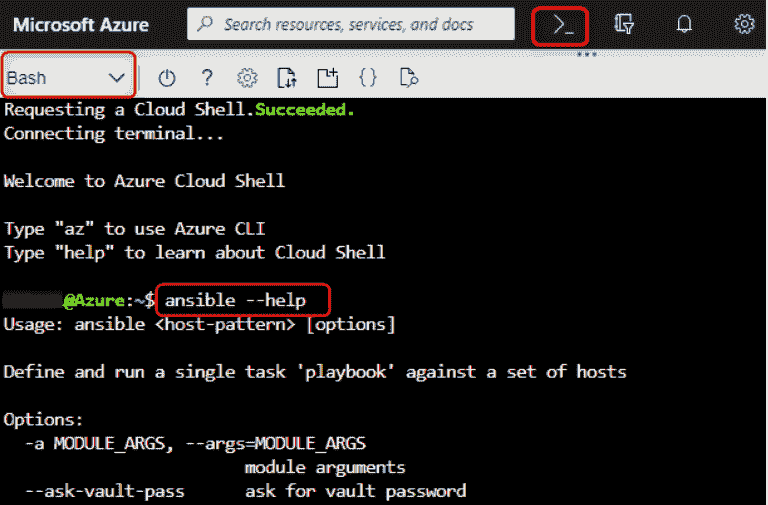

图 3.3 – Azure Cloud Shell 中的 Ansible

这样，就可以在不安装任何软件的情况下使用 Ansible 进行开发和测试。

此外，Ansible 具有允许我们预配 Azure 基础架构（例如 Terraform，但本书不会涵盖 Ansible 的这一方面）的模块，因此其集成到 Azure Cloud Shell 中允许简化身份验证。

> **重要提示**
> 有关将 Ansible 集成到 Azure Cloud Shell 的详细文档可在此处查看：`https://docs.microsoft.com/en-us/azure/ansible/ansible-run-playbook-in-cloudshell`。

在开始使用 Ansible 之前，我们将回顾本章中将一直使用的 Ansible 的重要概念（或工件）。

### Ansible 工件

要配置系统，Ansible 需要几个主要工件：

- **主机**：这些是 Ansible 将配置的目标系统；主机也可以是本地系统。
- **清单**：这是一个 INI 或 YAML 格式的文件，包含 Ansible 将执行配置操作的目标主机列表。此清单也可以是一个脚本，动态清单就是这种情况。

> **重要提示**
> 我们将在 _创建 Ansible 清单_ 部分中了解如何实现 Ansible 清单，而将在 _为 Azure 基础架构使用动态清单_ 部分中了解如何实现动态清单。

- **剧本**：这是将执行以配置主机的 Ansible 配置脚本。

> **重要提示**
> 我们将在本章后面的 _执行第一个剧本_ 部分中学习如何编写剧本。

在了解如何安装 Ansible 后，我们研究了 Ansible 的基本元素，即主机、清单和剧本。现在，让我们学习如何配置 Ansible。

### 配置 Ansible

默认情况下，Ansible 配置位于 `/etc/ansible/ansible.cfg` 文件中，该文件在安装 Ansible 时创建。此文件包含多个配置键，例如 SSL 连接、用户、协议、传输等。

如前所述，此文件在安装 Ansible 时默认创建。为了帮助用户入门，初始内容被放置在其中。此内容包含大量被注释掉的配置键，因此不会被 Ansible 应用，但用户可以随时激活它们。

> 注意
> 如果我们在 Azure Cloud Shell 中使用 Ansible，则需要在 Azure 云驱动器中手动创建此文件（ansible.cfg），并将 ANSIBLE_CONFIG 环境变量设置为创建的文件的路径。有关此环境变量的文档可在此处查看：https://docs.ansible.com/ansible/latest/reference_appendices/config.html#envvar-ANSIBLE_CONFIG。

以下屏幕截图显示了此 /etc/ansible/ansible.cfg 配置文件的摘录，其中包含一些注释中的键，如 # 符号所示：

```
### config file for ansible -- https://ansible.com/
### ==============================================

### nearly all parameters can be overridden in ansible-playbook
### or with command line flags. ansible will read ANSIBLE_CONFIG,
### ansible.cfg in the current working directory, .ansible.cfg in
### the home directory or /etc/ansible/ansible.cfg, whichever it
### finds first

[defaults]

### some basic default values...

#inventory      = /etc/ansible/hosts
#library        = /usr/share/my_modules/
#module_utils   = /usr/share/my_module_utils/
#remote_tmp     = ~/.ansible/tmp
#local_tmp      = ~/.ansible/tmp
#plugin_filters_cfg = /etc/ansible/plugin_filters.yml
#forks          = 5
#poll_interval  = 15
#sudo_user      = root
#ask_sudo_pass  = True
#ask_pass       = True
#transport      = smart
#remote_port    = 22
#module_lang    = C
#module_set_locale = False
```

图 3.4 – Ansible 配置文件
如果我们想更改默认的 Ansible 配置，可以修改此文件。

> 重要提示
> 有关所有 Ansible 配置键的更多详细信息，请参阅官方文档：https://docs.ansible.com/ansible/latest/reference_appendices/config.html#ansible-configuration-settings。

我们也可以使用 ansible-config 命令查看和修改此配置。例如，要显示 Ansible 配置文件，可以执行以下命令：

```
ansible-config view
```

以下屏幕截图显示了此命令的执行情况：

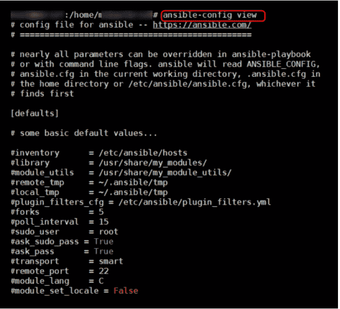

图 3.5 – 使用 CLI 查看 Ansible 配置

在本节中，我们学习了如何安装 Ansible 并探索了一些 Ansible 工件。最后，我们研究了配置 Ansible 的不同方法。


### 创建 Ansible 清单

在下一节中，我们将详细介绍静态 Ansible 清单以及如何创建它以定位主机。

清单包含 Ansible 将执行管理和配置操作的主机列表。

清单有两种类型：

- **静态清单**：主机以 INI（或 YAML）格式列在文本文件中；这是 Ansible 清单的基本模式。当我们知道主机地址（IP 或 FQDN）时，会使用静态清单。

- **动态清单**：主机列表由外部脚本动态生成（例如，使用 Python 脚本）。如果我们没有主机地址，例如，在由按需环境组成的基础架构中，则会使用动态清单。

在本节中，我们将学习如何以 `init` 格式创建静态清单，从基本示例开始，然后我们将查看组和主机配置。

让我们先学习如何创建静态清单文件。

### 清单文件

为了在运行 playbook 时配置主机，Ansible 需要一个包含主机列表的文件；也就是说，目标机器的 IP 或 **完全限定域名（FQDN）** 地址列表。此主机列表记录在名为 **清单文件** 的静态文件中。

默认情况下，Ansible 在安装过程中包含一个创建的清单文件；该文件是 `/etc/ansible/hosts`，其中包含多个清单配置示例。在我们的案例中，我们将手动在我们选择的目录中创建并填充此文件，例如 `devopsansible`。

让我们一步步来：

1. 首先，我们必须使用以下基本命令创建目录：

```bash
mkdir devopsansible
cd devopsansible
```

2. 现在，让我们创建一个名为 myinventory（不带扩展名）的文件，其中我们将写入目标主机的 IP 地址或 FQDN，如以下示例所示：

```
192.10.14.10
mywebserver.entreprise.com
localhost
```

当基于此清单执行 Ansible 时，它将在此清单中提到的所有主机上执行所有请求的操作（playbook）。

> **重要说明**
> 有关清单文件的更多信息，请阅读 https://docs.ansible.com/ansible/latest/user_guide/intro_inventory.html 上的文档。

但是，在企业中使用 Ansible 时，相同的 Ansible 代码（或 playbook）包含为应用程序的所有 VM 执行的配置操作。由于这些 VM 在应用程序中具有不同的角色，例如，应用程序由一个（或多个）Web 服务器和一个数据库服务器组成，我们必须将清单分开以按功能角色分离 VM。

要在清单中按角色对 VM 进行分组，我们将 VM 组织到将在 [] 中标记的组中，这给我们提供了以下清单：

```
[webserver]
192.10.20.31
mywebserver.exemple.com
[database]
192.20.34.20
```

在此示例中，我们定义了两个组，webserver 和 database。所有主机都分布在这些组中。

作为另一个示例，我们还可以按环境对主机进行分组，使用此示例清单：

```
[dev]
192.10.20.31
192.10.20.32
[qa]
192.20.34.20
192.20.34.21
[prod]
192.10.12.10
192.10.12.11
```

在本章后面，我们将学习这些组将如何在 playbook 编写中使用。

现在，让我们学习如何通过配置主机来完成我们的清单。

### 在清单中配置主机

如我们所见，整个 Ansible 配置都在 `ansible.cfg` 文件中。但是，此配置是通用的，适用于所有 Ansible 执行，以及与主机的连接。

但是，当使用 Ansible 配置来自不同环境或角色且具有不同权限的 VM 时，拥有不同的连接配置很重要，例如每个环境的不同管理用户和 SSL 密钥。出于此原因，可以通过按主机配置特定参数来在清单文件中覆盖默认的 Ansible 配置，如在此清单中定义。

可以覆盖的主要配置参数如下：

- `ansible_user`：这是连接到远程主机的用户。
- `ansible_port`：可以更改 SSH 端口的默认值。
- `ansible_host`：这是主机的别名。
- `ansible_connection`：这是到远程主机的连接类型，可以是 Paramiko、SSH 或 local。
- `ansible_private_key_file`：这是用于连接到远程主机的私钥。

> **重要说明**
> 参数的完整列表可在以下文档中找到：
> https://docs.ansible.com/ansible/latest/user_guide/intro_inventory.html#list-of-behavioral-inventory-parameters。

### 测试清单

编写清单后，可以测试是否可以从 Ansible 访问提到的所有主机。为此，我们可以执行以下命令：

```bash
ansible -i inventory all -u demobook -m ping
```

`-i` 参数是清单文件的路径，`-u` 参数对应于用于连接到远程机器的远程用户名，`-m` 是要执行的命令。在这里，我们在清单中的所有机器上执行 `ping` 命令。

以下是我们配置了主机连接的清单示例：

```
[webserver]
webserver1 ansible_host=192.10.20.31 ansible_port=2222
webserver2 ansible_host=192.10.20.31 ansible_port=2222
[database]
database1 ansible_host=192.20.34.20 ansible_user=databaseuser
database2 ansible_host=192.20.34.21 ansible_user=databaseuser
[dev]
webserver1
database1
[qa]
webserver2
database2
```

在此清单示例中可以看到以下内容：

- 连接信息已在每个主机旁指定。
- 别名实现（例如 `webserver1` 和 `webserver2`）用于另一个组（例如本示例中的 `qa` 组）。

在实现了 Ansible 清单后，我们现在将学习如何测试此清单。

以下屏幕截图显示了此命令的执行：

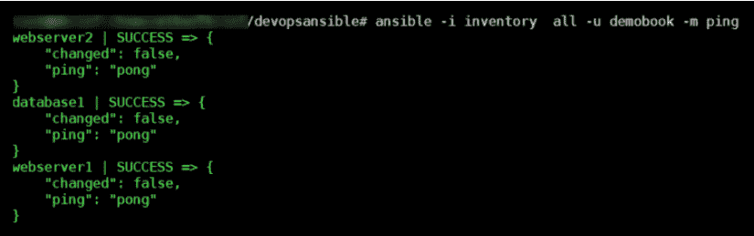

图 3.6 – 使用 all 选项测试 ansible ping 命令

我们还可以通过使用组名而不是 `all` 来调用此命令，测试特定组中主机的连接性。例如，在我们的案例中，我们将执行此命令：

`ansible -i inventory webserver -u demobook -m ping`

以下屏幕截图显示了此命令的执行：

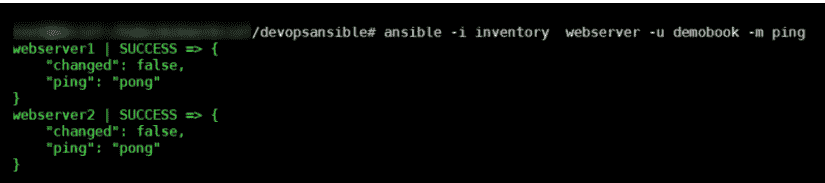

图 3.7 – 针对特定主机测试 ansible ping 命令

在本节中，我们了解到 Ansible 需要一个清单文件来配置主机。然后，我们创建并测试了我们的第一个清单文件，然后再学习如何进一步配置此文件。

在下一节中，我们将学习如何在 Ansible playbooks 中设置和编写配置操作代码。

### 执行第一个 playbook

Ansible 的基本元素之一是它的 playbooks，因为如在介绍中规定的那样，它们包含配置或管理 VM 所需执行的操作或任务的代码。

确实，一旦 VM 已配置，就必须对其进行配置，并且必须安装在该 VM 上托管的应用程序所需的所有中间件。此外，有必要执行有关目录配置及其访问的管理任务。

在本节中，我们将了解 playbook 由什么组成，它的模块，以及如何使用角色来改进我们的 playbook。

现在，让我们开始学习如何编写基本 playbook。

### 编写基本 playbook

playbook 的代码是用 YAML 编写的，YAML 是一种声明性语言，允许我们轻松可视化配置步骤。

为了了解 playbook 的样子，让我们看一个简单而经典的示例；也就是说，在 Ubuntu VM 上安装 NGINX 服务器。之前，我们创建了一个工作目录 devopsansible，我们将在其中创建一个 playbook.yml 文件并插入以下内容代码：

```yaml
---
- hosts: all
tasks:
- name: install and check nginx latest version
  apt: name=nginx state=latest
- name: start nginx
  service:
    name: nginx
    state: started
---
```

让我们详细看看：

- 首先，YAML 文件以可选的 -- 字符开始和结束。

- `- hosts` 属性包含要配置的主机列表。在这里，我们将此属性的值写为 `all` 以在我们清单中列出的所有 VM 上安装 NGINX。如果我们想仅在特定组上安装它，例如，在 webserver 组上，我们将按如下方式记录：

```yaml
---
- hosts: webserver
```


### 了解 Ansible 模块

在上一节中，我们了解到，在 Ansible playbook 中，我们使用模块。这使得 Ansible 今天如此流行，以至于 Ansible 原生提供了大量的公共模块（+200）。完整列表可在此处查看：`https://docs.ansible.com/ansible/latest/collections/index_module.html`。

这些模块允许我们执行在 VM 上进行配置和管理所需的所有任务和操作，而无需编写任何代码或脚本行。

在企业中，我们还可以创建自定义模块，并在内部私有注册表中发布它们。更多信息可在此处查看：`https://docs.ansible.com/ansible/latest/dev_guide/developing_modules_general.html`。

现在我们已经学习了如何编写简单的 playbook 以及如何使用模块，我们将通过角色进一步改进 playbook。

### 使用角色改进 playbook

在企业中，配置 VM 时，我们注意到每个应用程序之间存在一定的任务重复。例如，多个应用程序需要相同的 NGINX 安装，并且必须以相同的方式执行。

使用 Ansible，这种重复将需要在多个 playbook 之间复制 playbook 代码，如我们在 *执行基本 playbook* 部分中的 playbook 示例所示（因为每个应用程序都包含一个 playbook）。为了避免这种重复，从而节省时间、避免错误，并使安装和配置操作保持一致，我们可以将 playbook 代码封装在名为 *role* 的目录中，该目录可被多个 playbook 使用。

要创建与我们示例相对应的 `nginx` 角色，我们将在 `devopsansible` 目录中创建以下目录和文件树：

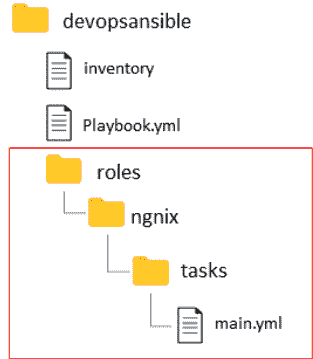

图 3.8 – Ansible 架构文件夹

然后，在位于 `tasks` 中的 `main.yml` 文件中，我们将从 playbook 中复制并粘贴以下代码到创建的文件中：

```yaml
- name: install and check nginx latest version
  apt: name=nginx state=latest
- name: start nginx
  service:
    name: nginx
    state: started
```

然后，我们将修改 playbook 以使用此角色，内容如下：

```yaml
---
- hosts: webserver
  roles:
    - nginx
```

按照节点角色，我们将提供要使用的角色列表（角色目录的名称）。因此，此 `nginx` 角色现在已集中化，可以在多个 playbook 中使用，而无需重写其代码。

以下是配置带有 Apache 的 VM Web 服务器和包含 MySQL 数据库的另一个 VM 的 playbook 代码：

```yaml
---
- hosts: webserver
  roles:
    - php
    - apache
- hosts: database
  roles:
    - mysql
```

> 重要说明
> 有关角色创建的更多信息，请阅读官方文档 https://docs.ansible.com/ansible/latest/user_guide/playbooks_reuse_roles.html。

但是，在开始创建角色之前，我们可以使用 Ansible Galaxy（`https://galaxy.ansible.com/`），它包含社区提供的大量角色，涵盖大量配置和管理需求。

在企业中，我们还可以创建自定义角色，并在公司内部私有 galaxy 中发布它们。更多信息可在此处查看：`https://docs.ansible.com/ansible/latest/dev_guide/developing_modules_general.html`。

在本节中，我们学习了如何编写 playbook，以及如何使用角色改进 playbook。我们所有的工件最终都已准备就绪，因此现在可以执行 Ansible。

### 执行 Ansible

到目前为止，我们已经学习了如何安装 Ansible、列出清单中的主机以及设置我们的 Ansible playbook。现在，我们可以运行 Ansible 来配置我们的 VM。

为此，我们将运行带有 `ansible-playbook` 命令的 Ansible 工具，如下所示：

```bash
ansible-playbook -i inventory playbook.yml
```

此命令的基本选项如下：

- 带有清单文件路径的 `-i` 参数
- playbook 文件的路径

以下是该命令的执行情况：

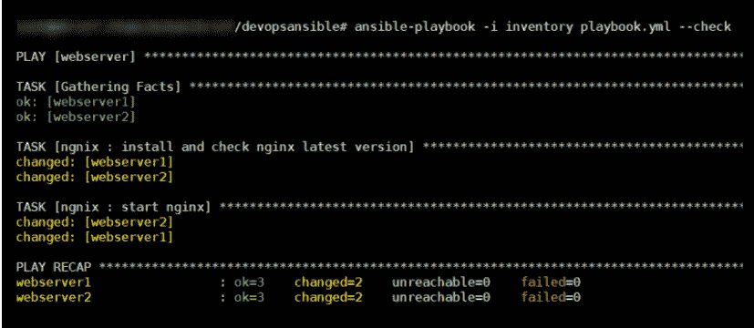

该命令的执行将 playbook 应用于清单中的主机，分几个步骤进行：

1. 收集事实：Ansible 检查主机是否可达。
2. 在主机上执行任务的 playbook。

### PLAY Recap：这是在每个主机上执行的更改状态；此状态的值可以如下：

| ok | 这是已正确应用于主机的 playbook 任务数量。 |
|---|---|
| changed | 这是已应用的更改数量。 |
| unreachable | 主机不可达。 |
| failed | 此主机上的执行失败。 |

表 3.1 – PLAY Recap 的值

如果我们需要升级 playbook 以在 VM 上添加或修改中间件，在使用此升级后的 playbook 第二次执行 Ansible 时，我们将看到 Ansible 没有重新应用 VM 的完整配置；它只应用了差异。

以下截图显示了在未对 playbook 进行任何更改的情况下，Ansible 的第二次执行：

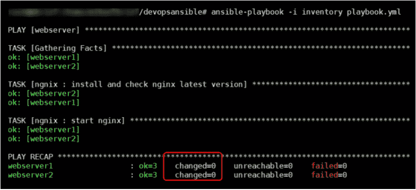

在这里，我们可以看到 Ansible 在主机上没有更改任何内容（changed=0）。

我们还可以向此命令添加一些有用选项，以提供以下内容：

- 在应用更改之前预览 Ansible 更改
- 执行输出中的更多日志

这些选项不仅对 playbook 开发阶段很重要，而且在执行过程中出现错误时对调试也很重要。

### 使用预览或干运行选项

在编码 Ansible playbook 时，我们通常需要在不直接将其应用于基础架构的情况下测试不同步骤。因此，尤其是在使用 Ansible 自动化 VM 配置时，拥有其执行预览非常有用。这使我们可以检查 playbook 的语法是否与主机上已存在的系统配置保持良好一致性。

使用 Ansible，可以通过向命令添加 `--check` 选项来检查 playbook 在主机上的执行：

```bash
ansible-playbook -i inventory playbook.yml --check
```

以下是此干运行执行的示例：

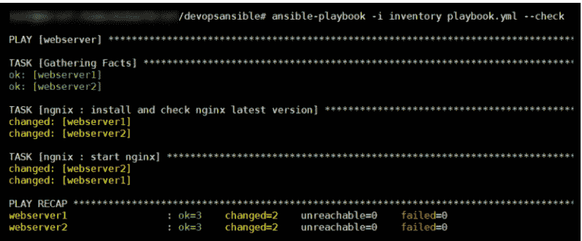

图 3.11 – Ansible playbook 干运行执行

使用此选项，Ansible 不会将配置更改应用于主机；它只检查并预览已对主机所做的更改。

> **重要说明**
> 有关 `--check` 选项的更多信息，请参阅以下文档：https://docs.ansible.com/ansible/latest/user_guide/playbooks_checkmode.html。

### 增加日志级别输出

在出现错误时，可以通过向 Ansible 命令添加 -v、-vvv 或 -vvvv 选项来在输出中添加更多日志。

-v 选项启用基本详细模式，-vvv 选项启用带有更多输出的详细模式，-vvvv 选项添加详细模式和连接调试信息。

执行以下命令将应用 playbook，并将使用已添加的 -v 选项显示更多日志信息：

```bash
ansible-playbook -i inventory playbook.yml -v
```

这在出现 Ansible 错误时可用于调试。

> **重要说明**
> `ansible-playbook` 命令的完整文档可在此处查看：`https://docs.ansible.com/ansible/2.4/ansible-playbook.html`。

我们刚刚学习了如何使用清单和 playbook 执行 Ansible，并探索了一些允许以下操作的选项：

- 预览 Ansible 将要做出的更改
- 增加日志级别以便于调试

在下一节中，我们将讨论使用 Ansible Vault 时的数据安全性。

我们刚刚看到，Ansible 允许我们在将 playbook 应用于主机之前对其进行检查；同样有必要知道，还有其他工具可以测试 playbook 的功能（而无需模拟其执行），例如 HashiCorp 的 Vagrant。

Vagrant 允许我们非常快速地在本地创建由 VM 组成的测试环境，我们可以在其中运行 playbook 并查看结果。有关使用 Ansible 和 Vagrant 的更多信息，请参阅以下文档：`https://docs.ansible.com/ansible/latest/scenario_guides/guide_vagrant.html`。

我们刚刚学习了如何预览 Ansible 将要应用的更改。现在，让我们看看如何增加 Ansible 执行的日志级别输出。


### 使用 Ansible Vault 保护数据

到目前为止，我们已学习如何使用包含要配置的主机列表的清单文件以及包含主机配置操作代码的剧本来使用 Ansible。但在所有基础设施即代码（IaC）工具中，都需要将特定于上下文或环境的某些数据提取到变量中。

在本节中，我们将了解如何在 Ansible 中使用变量以及如何使用 Ansible Vault 保护敏感数据。

为了说明变量的使用和保护，我们将通过在数据库服务器上安装 MySQL 服务器来完善我们的示例。

让我们先来看看 Ansible 中变量的使用和实用性。

#### 在 Ansible 中使用变量以实现更好的配置

使用 IaC 部署基础设施时，所使用的代码通常由两部分组成：

- 描述构成基础设施的元素或资源的部分。
- 另一部分用于区分不同环境下此基础设施的属性。

针对每个环境的这种差异化第二部分是通过使用变量来完成的，Ansible 拥有一个完整的系统，允许我们将变量注入剧本中。

为了学习如何在 Ansible 中使用变量，我们将完善代码，并在 roles 目录中添加一个名为 mysql 的角色，其目录结构如下：

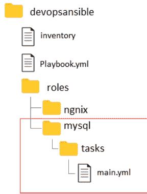

图 3.12 – Ansible 角色文件夹结构

在此角色的 main.yml 文件中，我们将编写以下代码：

```yaml
---
- name: Update apt cache
  apt: update_cache=yes cache_valid_time=3600
- name: Install required software
  apt: name="{{ packages }}" state=present
  vars:
    packages:
    - python-mysqldb
    - mysql-server
- name: Create mysql user
  mysql_user:
    name={{ mysql_user }}
    password={{ mysql_password }}
    priv=*.*:ALL
    state=present
```

在此代码中，一些静态信息已被变量替换。它们如下：

- packages：包含要安装的软件包列表，该列表在以下代码中定义。
- mysql_user：包含 MySQL 数据库的 admin 用户。
- mysql_password：包含 MySQL 数据库的 admin 密码。

此角色的不同任务如下：

- 更新软件包
- 安装 MySQL 服务器和 Python MySQL 软件包
- 创建 MySQL 用户

#### 重要提示

此角色的完整源代码可在 `https://github.com/PacktPublishing/Learning-DevOps-Second-Edition/tree/main/CHAP03/devopsansible/roles/mysql.` 处找到。

如我们所见，在用户创建任务中，我们将 `mysql_user` 和 `mysql_password` 变量用于用户名和密码。因此，此信息可能因环境而异，或者在运行 Ansible 时动态实例化。

为了定义这些变量的值，我们将创建一个 `group_vars` 目录，该目录将包含我们清单中定义的每个组的所有变量值。

然后，在此 `group_vars` 文件夹中，我们将创建一个与清单中定义的数据库组对应的 `database` 子目录和一个 `main.yml` 子文件。

在此 `main.yml` 文件中，我们放置这些变量所需的值，如下所示：

```yaml
---
mysql_user: mydbuserdef
mysql_password: mydbpassworddef
```

最后，我们将通过添加以下代码来调用 `mysql` 角色来完善我们的剧本：

```yaml
- hosts: database
become: true
roles:
  - mysql
```

我们可以与之前相同的命令 ansible-playbook -i inventory playbook.yml 来执行 Ansible。将生成以下输出：

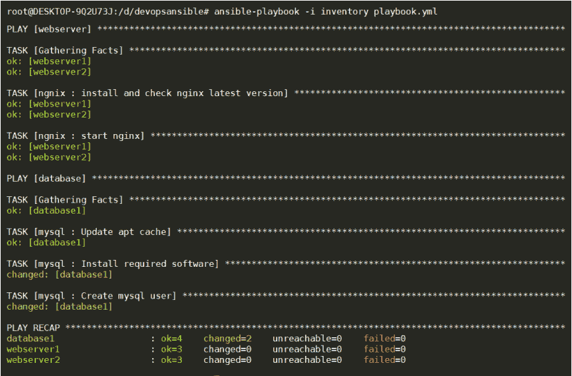

图 3.13 – Ansible 剧本的 MySQL 执行

在此，Ansible 已对数据库服务器进行了两项更改：要安装的软件包列表和 MySQL 管理员用户。我们刚刚学习了如何在 Ansible 中使用变量，但此变量在代码中是明确的，这引发了安全问题。

> **重要提示**
> 有关 Ansible 变量的更多信息，请阅读此处的完整文档：https://docs.ansible.com/ansible/latest/user_guide/playbooks_variables.html。

现在，让我们学习如何使用 Ansible Vault 保护剧本变量。

#### 使用 Ansible Vault 保护敏感数据

配置系统通常需要敏感信息，这些信息不应落入错误的人手中。在 Ansible 工具中，有一个名为 **Ansible Vault** 的子工具，用于保护通过剧本传输到 Ansible 的数据。

在本节中，我们将学习如何操作 Ansible Vault 来加密和解密 MySQL 用户的信息。

第一步是加密包含变量值的 `group_vars/database/main.yml` 文件，方法是执行以下命令：

```bash
ansible-vault encrypt group_vars/database/main.yml
```

Ansible Vault 要求您包含一个密码，该密码将用于解密文件，然后显示此命令的执行过程以加密文件的内容：

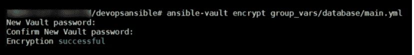

执行此命令后，文件的内容已被加密，因此值不再清晰。以下是其中的示例：

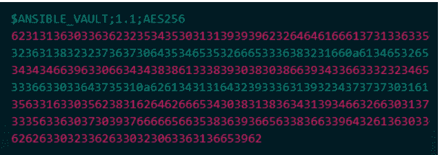

要解密文件以进行修改，必须执行 `decrypt` 命令：

```bash
ansible-vault decrypt group_vars/database/main.yml
```

Ansible Vault 要求输入用于加密文件的密码，文件将再次变得可读。

在 Ansible 使用自动化过程中，最好将密码存储在受保护位置的文件中；例如，在 `~/.vault_pass.txt` 文件中。

然后，要使用此文件加密变量文件，我们必须执行 `ansible-vault` 命令并添加 `--vault-password-file` 选项：

```bash
ansible-vault encrypt group_vars/database/main.yml --vault-password-file ~/.vault_pass.txt
```

现在文件已加密且数据受到保护，我们将运行 Ansible。在 **交互模式** 下，我们将运行以下命令：

```bash
ansible-playbook -i inventory playbook.yml --ask-vault-pass
```

Ansible 要求用户输入以下屏幕截图中显示的密码：

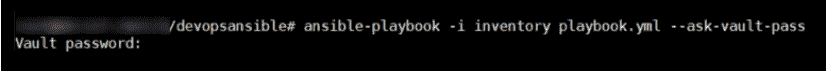

图 3.16 – 使用 Ansible Vault 解密的文件

在 **自动模式** 下——即在 CI/CD 管道中——我们可以添加 `--vault-password-file` 参数，指定包含用于解密数据的密码的文件路径：

```bash
ansible-playbook -i inventory playbook.yml --vault-password-file ~/.vault_pass.txt
```

至此，我们已使用不再在代码中清晰显示的数据以及 `ansible-vault` 命令执行了 Ansible。

> **重要提示**
> 清单、剧本和角色的完整源代码可在此处找到：https://github.com/PacktPublishing/Learning-DevOps-Second-Edition/tree/main/CHAP03/devopsansible。

在本节中，我们学习了如何使用 `ansible-vault` 实用程序保护剧本中的敏感数据。我们加密和解密了变量文件以保护它们，然后使用这些加密文件重新运行了 Ansible。在下一节中，我们将学习如何将 Ansible 与动态清单一起使用。

#### 将动态清单用于 Azure 基础设施

在配置由多个虚拟机以及按需构建的临时环境组成的基础设施时，常见的观察是，维护静态清单（如我们在 _创建 Ansible 清单_ 部分中所见）可能会迅速变得复杂，且其维护需要花费大量时间才能完成。

为了解决这个问题，Ansible 允许通过调用脚本（例如 Python 脚本）动态获取清单，该脚本可以由云提供商提供，也可以由我们自己开发并返回清单内容。

在本节中，我们将了解如何使用 Ansible 通过动态清单配置 Azure 中的虚拟机。让我们开始：

1. 第一步是配置 Ansible 以便能够访问 Azure 资源。为此，我们将在 Azure AD 中创建一个 Azure 服务主体，方式与我们为 Terraform 所做的完全相同（请参见 _第 2 章，使用 Terraform 配置云基础设施_ 中的 _为 Azure 配置 Terraform_ 部分）。然后，我们必须将四个服务主体 ID 的信息导出到以下环境变量中：

```bash
export AZURE_SUBSCRIPTION_ID=<subscription_id>
export AZURE_CLIENT_ID=<client ID>
export AZURE_SECRET=<client Secret>
export AZURE_TENANT=<tenant ID>
```

> **重要提示**
> 有关 Ansible 的 Azure 环境变量的更多信息，请参阅此处的 Azure 文档：https://docs.ansible.com/ansible/latest/scenario_guides/guide_azure.html。

2. 然后，为了能够生成带有组的清单并筛选虚拟机，最好为虚拟机添加标记。标记可以使用 Terraform、`az cli` 命令行或 Azure PowerShell 脚本添加。以下是使用 `az cli` 的示例脚本：

```bash
az resource tag --tags role=webserver -n VM01 -g demoAnsible --resource-type "Microsoft.Compute/virtualMachines"
```


前面的脚本将 `role` 标签的值设置为 webserver，并添加到 VM01 虚拟机中。
然后，我们必须对 VM02 虚拟机执行相同的操作（只需在前面的脚本中将 `-n` 参数的值更改为 VM02）。

下面的截图显示了 Azure 门户中的 VM 标签：

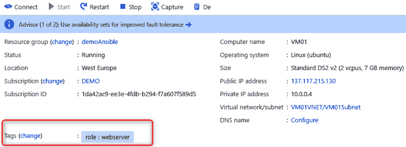

图 3.17 – Azure 角色标签

现在，我们必须使用以下脚本将包含数据库的标签添加到我们的 VM 中：

```
az resource tag --tags role=database -n VM04 -g demoAnsible --resource-type "Microsoft.Compute/virtualMachines"
```

此脚本将 `role` 标签添加到 VM04，其值为 `database`。

> **重要说明**
> 关于管理 Azure 标签的 `az cli` 文档可在此处找到：https://docs.microsoft.com/
> fr-fr/cli/azure/resource?view=azure-cli-
> latest&viewFallbackFrom=azure-cli-latest.md#az-
> resource-tag.

3. 若要在 Azure 中使用动态清单，我们需要执行以下操作：

- 在机器上使用以下脚本安装 Ansible Azure 模块。

```
wget -q https://raw.githubusercontent.com/ansible-collections/azure/dev/requirements-azure.txt;
pip3 install -r requirements-azure.txt;
```

- 我们也可以通过执行以下命令使用 Ansible Galaxy 安装 Azure 模块：

```
ansible-galaxy collection install azure.azcollection
```

> 注意
> 有关 Azure 集合的更多详细信息，请阅读 https://galaxy.ansible.com/azure/azcollection 上的文档。

创建一个名为 inv.azure_rm.yml 的新文件（该文件的名称必须以 azure_rm 结尾），并在文件中写入以下配置：

- 使用 azure_rm 插件。
- 允许按角色标签对返回的 VM 列表进行分组。
- 仅筛选 demoAnsible 资源组。

该文件的内容将如下所示：

```
plugin: azure_rm
include_vm_resource_groups:
- demoAnsible
auth_source: auto
keyed_groups:
- key: tags.role
leading_separator : false
```

> 重要说明
> inv.azure_rm.yml 文件的完整源代码可在此处找到：https://github.com/PacktPublishing/
> Learning-DevOps-Second-Edition/tree/main/CHAP03/
> devopsansible/inventories.

4. 在 Azure 中设置好 Ansible 动态清单的所有构件后，最好测试其功能，其中包括执行以下操作：

A. 确保没有执行错误。
B. 确保与我们的 Azure 环境的连接和身份验证已正确完成。
C. 确保其执行返回我们基础设施中的 Azure VM。

### 重要说明

如前所述的 _技术要求_ 部分中所述，在运行以下命令之前，我们需要在机器上安装 Azure Python 模块。

要执行此测试，请运行以下命令：

```
ansible-inventory -i inv.azure_rm.yml --list
```

此命令允许我们以列表格式显示清单脚本作为输出。以下是此执行的一个小示例屏幕：

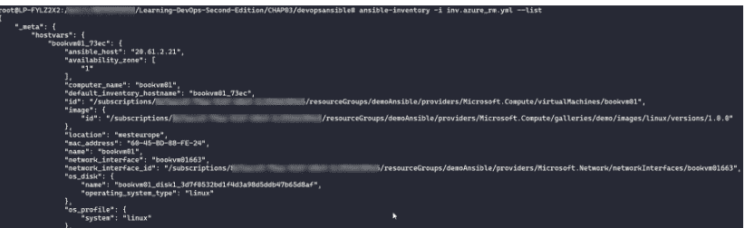

图 3.18 – 动态 Ansible 清单 VM 列表

我们也可以通过运行相同的命令但带有 `--graph` 选项来以图形模式显示此清单，如下所示：

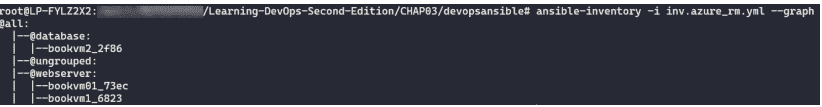

图 3.19 – 按角色分组的动态 Ansible 清单 VM 列表

使用 `--graph` 选项，我们可以根据 VM 的标签获得更好的可视化效果。

测试结束后，我们可以进行最后一步，即使用动态清单执行 Ansible。

5. 一旦我们在 Azure 中测试了动态清单，我们就只需在其上运行 Ansible，并使用我们应用到 VM 的标签。为此，我们必须使用以下命令运行我们的 playbook：

```
ansible-playbook playbook.yml -i inv.azurerm.yml -u demobook --ask-pass
```

### 注意

在我们的实验室中，我们使用带有用户名和密码的 VM，因此在前面的命令中，我们使用 -u 参数（用于 VM 用户名）和 -ask-pass 参数（用于提示输入 VM 用户密码）。但更好的做法是建议使用 SSH 公钥/私钥而不是密码。

下面的截图显示了使用动态清单执行 Ansible playbook 的情况：

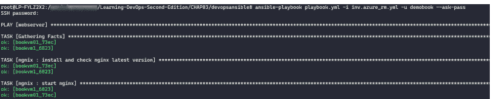

图 3.20 – 动态 Ansible 清单执行

从现在起，每当我们 Azure 基础设施中的 VM 具有 role=webserver 标签时，它都会被动态清单自动考虑，因此不需要任何代码修改。

### 重要说明

有关在 Azure 上使用动态清单的其他方法，您可以查阅 https://docs.microsoft.com/en-
us/azure/developer/ansible/dynamic-inventory-
configure?tabs=azure-cli 上的 Azure 文档。

通过使用动态清单，我们可以充分利用云的可扩展性，实现自动 VM 配置，而无需进行任何代码更改。

在本节中，我们学习了如何在 Azure 中使用动态清单，通过实现其配置并进行必要的脚本恢复，然后使用 Ansible 执行此动态清单。

### 摘要

在本章中，我们了解到 Ansible 是一个非常强大且完整的工具，允许我们自动化服务器配置和管理。为了工作，它使用一个包含要配置的主机列表的清单，以及一个 playbook，其中编码了配置操作列表。

角色、模块和变量也允许更好地管理和集中 playbook 代码。Ansible 还有一个保护敏感 playbook 数据的保险库。最后，对于动态环境，可以通过实现动态清单来简化清单编写。

在下一章中，我们将学习如何使用 Packer 创建服务器模板来优化基础设施部署。

### 问题

1. 本章详细介绍了 Ansible 的什么角色？
2. 我们可以在 Windows 操作系统上安装 Ansible 吗？
3. 本章研究的两个构件是什么，Ansible 运行需要它们？
4. `ansible-playbook` 命令中添加了什么选项，用于预览将要应用的更改？
5. 用于加密和解密 Ansible 数据的实用程序名称是什么？
6. 在 Azure 中使用动态清单时，清单脚本用于返回 VM 列表的 VM 属性是什么？

### 进一步阅读

如果您想了解更多关于 Ansible 的信息，以下是一些资源：

- Ansible 文档：`https://docs.ansible.com/ansible/`
`latest/index.html`
- 快速入门视频：`https://www.ansible.com/resources/`
`videos/quick-start-video?extIdCarryOver=true&sc_`
`cid=701f2000001OH6uAAG`
- Azure 上的 Ansible 文档：`https://docs.microsoft.com/en-us/`
`azure/ansible/`
- Visual Studio Code Ansible 扩展：`https://marketplace.`
`visualstudio.com/items?itemName=vscoss.vscode-ansible`
- 精通 Ansible：`https://www.packtpub.com/virtualization-and-`
`cloud/mastering-ansible-third-edition`
- Ansible 网络研讨会培训：`https://www.ansible.com/resources/`
`webinars-training`
