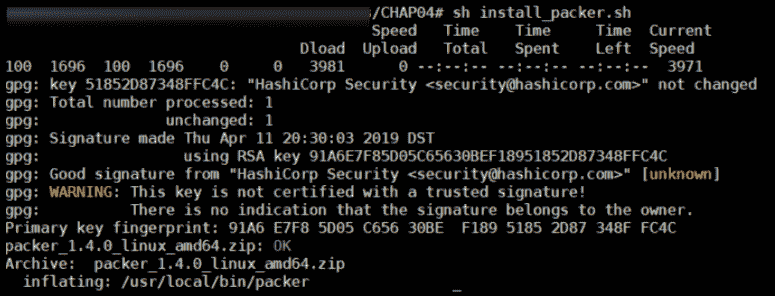
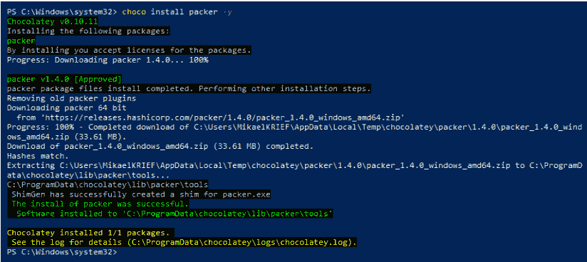
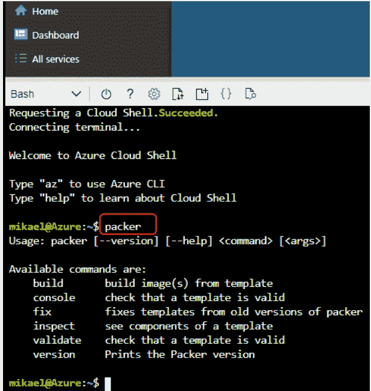
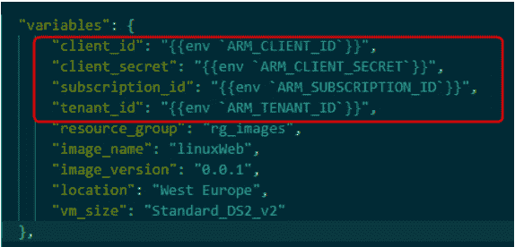
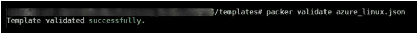
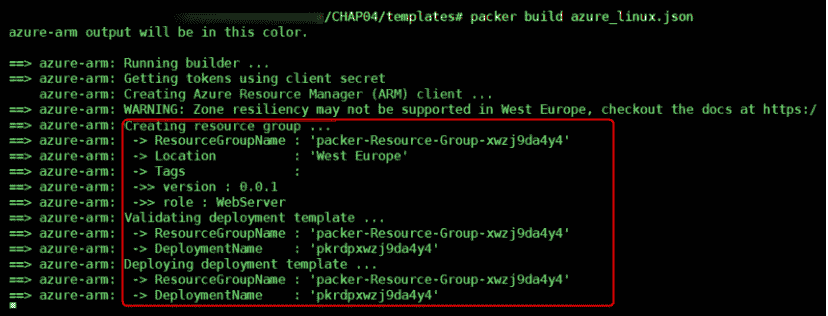
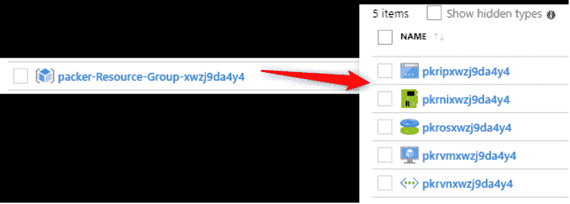
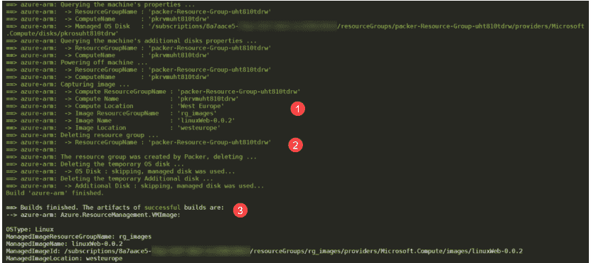
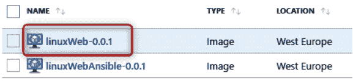

## 4 使用 Packer 优化基础设施部署

在前几章中，我们学习了如何使用 Terraform 配置云基础设施，然后继续使用 Ansible 对 VM 进行自动化配置。
这种自动化使我们能够从生产力的真正提升和非常明显的节省时间中受益。

然而，尽管有这种自动化，我们注意到以下几点：

- 配置 VM 可能非常耗时，因为它取决于其加固情况，以及将在该 VM 上安装和配置的中间件。

- 在每个环境或应用程序之间，中间件版本不尽相同，因为它们的自动化脚本不一定相同或随时间维护。因此，例如，生产环境由于更关键，更有可能拥有最新版本的软件包，而预生产环境则不是这样。在这种情况下，我们经常会遇到生产环境中应用程序行为的问题。

- 配置和安全合规性通常没有应用或更新。

为了解决这些问题，所有云提供商都集成了一项服务，允许他们创建或生成自定义 VM 镜像。这些镜像包含 VM 的所有配置及其安全管理和中间件配置，然后可以用作创建应用程序 VM 的基础。

使用这些镜像的好处如下：

- 从镜像配置 VM 非常快速。

- 每个 VM 的配置都是统一的，而且最重要的是，符合安全合规性。

在 **基础设施即代码 (IaC)** 工具中，有来自 HashiCorp 工具的 Packer，它允许我们从文件（或模板）创建 VM 镜像。

在本章中，我们将学习如何以不同模式安装 Packer。我们将讨论 Packer 模板的语法，以创建在 Azure 中使用脚本或 Ansible playbook 的自定义 VM 镜像。

我们将详细介绍使用 JSON 和 HCL 格式的模板执行 Packer 的过程。最后，我们将了解 Terraform 如何使用 Packer 创建的镜像。通过本章，我们将了解 Packer 是一个简单的工具，它简化了 DevOps 过程中 VM 的创建，并与 Terraform 集成得很好。

在本章中，我们将涵盖以下内容：

- Packer 概述

- 使用脚本创建 Packer 模板

- 使用 Ansible 创建 Packer 模板

- 执行 Packer


### 技术要求

本章将以在 Azure 基础架构中使用 Packer 创建 VM 镜像为例，介绍如何在云基础架构中使用 Packer。因此，你需要一个 Azure 订阅，可以在此处免费获取：https://azure.microsoft.com/en-us/free/。

在“在 Packer 模板中使用 Ansible”部分，我们将学习如何编写使用 Ansible 的 Packer 模板，因此你需要在机器上安装 Ansible 并了解其工作原理，详细内容请参阅第 3 章《使用 Ansible 配置 IaaS 基础架构》。

本章的最后一部分将介绍将 Terraform 与 Packer 镜像结合使用的示例；对于其应用，需要安装 Terraform 并了解其操作，详细内容请参阅第 2 章《使用 Terraform 配置云基础架构》。

本章的完整源代码可在此处获取：https://github.com/PacktPublishing/Learning-DevOps-Second-Edition/tree/main/CHAP04。

请观看以下视频，查看代码实际运行情况：https://bit.ly/35exxSo。

### Packer 概述

Packer 是 HashiCorp 开源工具套件的一部分，Packer 的官方页面在此：https://www.packer.io/。它是一个开源命令行工具，允许我们从 JSON 文件在多个平台上创建任何操作系统的自定义 VM 镜像（这些镜像也称为 **templates**）。

Packer 的操作非常简单；它基于不同云提供商提供的基础操作系统，通过执行 JSON 或 HCL 模板中描述的脚本来配置临时 VM。然后，从这个临时 VM 中，Packer 生成可用于配置 VM 的自定义镜像。

除了 VM 镜像，Packer 还提供其他类型的镜像，例如 Docker 镜像或 Vagrant 镜像。对 Packer 进行简要介绍后，让我们来看看不同的安装模式。

### 安装 Packer

与 Terraform 类似，Packer 是一个跨平台工具，可以安装在 Windows、Linux 或 macOS 上。Packer 的安装几乎与 Terraform 的安装相同（请参阅第 2 章《使用 Terraform 配置云基础架构》），可以通过两种方式完成：手动安装或通过脚本安装。

#### 手动安装

要手动安装 Packer，请使用以下步骤：

- 1. 访问官方下载页面（`https://www.packer.io/downloads.html`）并下载与你的操作系统对应的软件包。
- 2. 下载后，解压缩并将二进制文件复制到执行目录中（例如，在 `c:\Packer` 内）。
- 3. 然后，必须将 `PATH` 环境变量设置为二进制目录的路径。

> **Tip**
> 有关如何在 Windows 上更新 `PATH` 环境变量的详细说明，请参阅此文章：`https://www.architectryan.com/2018/03/17/add-to-the-path-on-windows-10/`，对于 Linux，请参阅此文章：`https://www.techrepublic.com/article/how-to-add-directories-to-your-path-in-linux/`。

现在我们已经了解了如何手动安装 Packer，让我们来看看使用脚本安装它的可用选项。

#### 通过脚本安装

也可以使用自动脚本安装 Packer，该脚本可以安装在远程服务器上并用于 CI/CD 过程。确实，Packer 可以在本地使用，正如我们将在本章中看到的那样，但它的真正目标是集成到 CI/CD 管道中。这个自动化 DevOps 管道将允许构建和发布统一的 VM 镜像，这些镜像将保证基于这些镜像的中间件和 VM 安全性的完整性。

让我们来看看针对不同操作系统（即 Linux、Windows 和 macOS）的这些脚本的结构。

### 在 Linux 上通过脚本安装 Packer

在 Linux 上安装 Packer 二进制文件，我们有两种解决方案：

- 第一个解决方案是使用以下脚本安装 Packer：

```
PACKER_VERSION="1.7.3" #Update with your desired version
curl -Os https://releases.hashicorp.com/packer/${PACKER_VERSION}/packer_${PACKER_VERSION}_linux_amd64.zip \
&& curl -Os https://releases.hashicorp.com/packer/${PACKER_VERSION}/packer_${PACKER_VERSION}_SHA256SUMS \
&& curl https://keybase.io/hashicorp/pgp_keys.asc | gpg --import \
&& curl -Os https://releases.hashicorp.com/packer/${PACKER_VERSION}/packer_${PACKER_VERSION}_SHA256SUMS.sig \
&& gpg --verify packer_${PACKER_VERSION}_SHA256SUMS.sig packer_${PACKER_VERSION}_SHA256SUMS \
&& shasum -a 256 -c packer_${PACKER_VERSION}_SHA256SUMS 2>&1 | grep "${PACKER_VERSION}_linux_amd64.zip:\sOK" \
&& unzip -o packer_${PACKER_VERSION}_linux_amd64.zip -d /usr/local/bin
```

```
Note
The code of this script is also available here: https://github.com/PacktPublishing/Learning-DevOps-Second-Edition/blob/main/CHAP04/install_packer.sh.
```

此脚本执行以下操作：

- 下载 Packer 版本 1.7.3 软件包并检查校验和
- 解压缩并将软件包复制到本地目录 `/usr/local/bin`（默认情况下，此文件夹位于 `PATH` 环境变量中）

以下是在 Linux 上安装 Packer 的脚本执行截图：



图 4.1 – 安装 Packer 脚本执行

此解决方案的好处是我们可以选择 Packer 安装文件夹，并且它适用于各种 Linux 发行版，因为它使用常用工具，即 curl 和 unzip。

- 在 Linux 上安装 Packer 的第二种解决方案是对 Ubuntu 发行版使用 apt 包管理器，使用以下脚本：

```
sudo apt-get update && sudo apt-get install -y gnupg software-properties-common curl \
&& curl -fsSL https://apt.releases.hashicorp.com/gpg | sudo apt-key add - \
&& sudo apt-add-repository "deb [arch=amd64] https://apt.releases.hashicorp.com $(lsb_release -cs) main" \
&& sudo apt-get update && sudo apt-get install packer
```

此脚本执行以下操作：

- 添加 apt HashiCorp 存储库
- 更新本地存储库
- 下载 Packer CLI

> Important Note
> 有关此脚本以及在其他发行版上安装 Packer 的更多详细信息，请阅读 https://learn.hashicorp.com/tutorials/packer/get-started-install-cli?in=packer/docker-get-started 的文档，并导航到 Linux 选项卡。

### 在 Windows 上通过脚本安装 Packer

在 Windows 上，我们可以使用 **Chocolatey**，它是一个软件包管理器。Chocolatey 是一个免费的公共包管理器，类似于 NuGet 或 npm，但专门用于软件。它广泛用于 Windows 服务器甚至本地机器上的软件自动化。Chocolatey 的官方网站在此：`https://chocolatey.org/`，其安装文档在此：`https://chocolatey.org/install`。

安装 Chocolatey 后，我们只需在 PowerShell 或 CMD 工具中运行以下命令：

```
`choco install packer -y`
```

以下是使用 Chocolatey 在 Windows 上安装 Packer 的截图：



图 4.2 – 使用 Chocolatey 安装 Packer

执行 `choco install packer -y` 将从 Chocolatey 安装最新版本的 Packer。

### 在 macOS 上通过脚本安装 Packer

在 macOS 上，我们可以使用 **Homebrew**（macOS 包管理器，`https://brew.sh/`），通过在终端中执行以下命令来安装 Packer：

```
`brew install packer`
```

### 将 Packer 与 Azure Cloud Shell 集成

正如我们在《第 2 章：使用 Terraform 配置云基础架构》的“将 Terraform 与 Azure Cloud Shell 集成”部分中详细了解的那样，Packer 也与 Azure Cloud Shell 集成，如以下截图所示：



图 4.3 – Azure Cloud Shell 上的 Packer

现在我们已经了解了在不同操作系统上安装 Packer 及其与 Azure Cloud Shell 的集成，接下来我们将检查其已安装的版本。

### 检查 Packer 安装

安装后，我们可以通过运行以下命令检查已安装的 Packer 版本：

```
packer --version
```


此命令显示已安装的 Packer 版本：

```
PS C:\Users\mkrief> packer --version
1.7.3
```

图 4.4 – Packer 版本命令

要查看所有 Packer 命令行选项，我们可以执行以下命令：

```
packer --help
```

执行后，我们将看到可用命令列表，如下图所示：

```
PS C:\Users\mkrief> packer --help
Usage: packer [--version] [--help] <command> [<args>]

Available commands are:
    build        build image(s) from template
    console      creates a console for testing variable interpolation
    fix          fixes templates from old versions of packer
    fmt          Rewrites HCL2 config files to canonical format
    hcl2_upgrade transform a JSON template into an HCL2 configuration
    init         Install missing plugins or upgrade plugins
    inspect      see components of a template
    validate     check that a template is valid
    version      Prints the Packer version
```

图 4.5 – Packer 帮助命令

我们刚刚了解了 Packer 的手动安装过程以及在不同操作系统上使用脚本进行安装，以及它与 Azure Cloud Shell 的集成。

我们将使用脚本编写模板，以便在 Azure 中使用 Packer 创建 VM 镜像。

### 使用脚本为 Azure VM 创建 Packer 模板

如前所述，要创建 VM 镜像，Packer 基于一个以 JSON 格式或 **HashiCorp 配置语言**（HCL）编写的文件（模板），HCL 是从 Packer 1.5.0 版本引入的（有关更多信息，请阅读以下博客文章：`https://www.packer.io/guides/hcl`）。我们将首先了解此模板的结构和组成，然后实践如何创建一个在 Azure 中创建 VM 镜像的模板。

### Packer 模板的结构

Packer 模板由几个主要部分组成，例如 `builders`、`provisioners` 和 `variables`。模板的 JSON 格式如下：

```
{
	"variables": {
		// list of variables
		...
	},
	"builders": [
		{
			//builders properties
			...
		}
	],
	"provisioners": [
		{
			// list of scripts to execute for image provisionning
			...
		}
	]
}
```

让我们详细了解每个部分。

#### builders 部分

`builders` 部分是必需的，包含定义镜像及其位置的所有属性，例如名称、镜像类型、将生成镜像的云提供商、云连接信息、要使用的基础镜像以及特定于镜像类型的其他属性。

以下是 `builders` 部分的示例代码：

```
{
	"builders": [{
		"type": "azure-rm",
		"client_id": "xxxxxxxx",
		"client_secret": "xxxxxxxx",
		"subscription_id": "xxxxxxxxxx",
		"tenant_id": "xxxxxx",
		"os_type": "Linux",
		"image_publisher": "Canonical",
		"image_offer": "UbuntuServer",
		"location": "westus"
		......
	}]
}
```

在此示例中，builders 部分定义了一个将存储在 Azure 云中且基于 Linux Ubuntu 操作系统的镜像。我们还配置了云的身份验证密钥。

> 注意
> builders 部分的文档位于：https://www.packer.io/docs/builders。

如果我们想要在多个提供商上创建相同的镜像，可以在同一模板文件中指定多个包含提供商属性的 builders 块。例如，请参阅以下 JSON 格式的代码示例：

```
{
"builders": [
{
"type": "azure-rm",
"location": "westus",
......
},
{
"type": "docker",
"image": "alpine:latest",
...
}
]
}
```

要将相同的块代码转换为 HCL 格式，我们首先编写两个 `sources` 块来定义不同的提供商属性。然后在 `build` 部分中调用这些 `sources`，如下所示：

```
build {
    sources = ["sources.azure-arm.azurevm","sources.docker.docker-img"]
    ...
}
```

在此代码示例中，我们在 Packer 模板中定义了 Azure VM 镜像的信息以及基于 Alpine 的 Docker 镜像的信息。这样做的好处是标准化将在 provisioning 部分详细介绍的这两个镜像的脚本。

在详细介绍每个部分之后，我们将看到一个带有 `builders` 部分的具体示例，用于在 Azure 中创建镜像。

让我们继续介绍 `provisioners` 部分。

### provisioners 部分

`provisioners` 部分是可选的，包含一系列脚本，Packer 将在临时 VM 基础镜像上执行这些脚本，以根据我们的需求构建自定义 VM 镜像。

如果 Packer 模板不包含 `provisioners` 部分，则不会对基础镜像进行任何配置。

此部分中定义的操作适用于 Windows 和 Linux 镜像，操作可以是多种类型，例如执行本地或远程脚本、执行命令或复制文件。

> 注意
> Packer 原生提供的 `provisioners` 类型在文档中有详细介绍：https://www.packer.io/docs/provisioners/index.html。

还可以通过创建自定义 provisioning 类型来扩展 Packer。要了解有关自定义 `provisioners` 的更多信息，请参阅此处的文档：https://www.packer.io/docs/extending/custom-provisioners.html。

以下是 JSON 格式的 `provisioners` 部分示例：

```
{
...
"provisioners": [
{
"type": "shell",
"script": "hardening-config.sh"
},
{
"type": "file",
"source": "scripts/installers",
"destination": "/tmp/scripts"
}
]
...}
```

以下是相同块代码的 HCL 格式：

```
provisioner "shell" {
scripts = ["hardening-config.sh"]
}
provisioner "file" {
source = "scripts/installers"
destination = "/tmp/scripts"
}
```

在此 `provisioners` 部分中，Packer 将上传并执行本地脚本 `hardening-config.sh`，以在远程临时 VM 基础镜像上应用强化配置，并将本地文件夹 `scripts/installers` 的内容复制到远程文件夹 `/tmp/scripts`，以配置镜像。

因此，在此部分中，我们列出了要创建的镜像的所有配置操作。

但是，在创建 VM 镜像时，有必要对其进行通用化，换句话说，删除用于创建此镜像的所有个人用户信息。

例如，对于 Windows VM 镜像，我们将使用 Sysprep 工具作为 provisioners 的最后一步，使用以下代码：

```
"provisioners": [
...
{
"type": "powershell",
"inline": ["& C:\\windows\\System32\\Sysprep\\Sysprep.exe /oobe /generalize /shutdown /quiet"]
}]
```

Packer 模板中 Sysprep 用法的另一个示例可在此处找到：https://www.packer.io/docs/builders/azure.html。

对于在 Linux 镜像上删除个人用户信息，我们将使用以下代码：

```
"provisioners": [
.....
{
"type": "shell",
"execute_command": "sudo sh -c '{{ .Vars }} {{ .Path }}'",
"inline": [
"/usr/sbin/waagent -force -deprovision+user & export HISTSIZE=0 & sync"
]
}
]
```

> 注意
> 有关 provisioners 部分的更多信息，请参阅此处的文档：https://www.packer.io/docs/templates/provisioners.html，操作列表可在此处找到：https://www.packer.io/docs/provisioners/index.html。

介绍完 provisioners 部分后，让我们来谈谈变量。

### variables 部分

在 Packer 模板中，我们通常需要使用代码中不是静态的值。这个可选的 `variables` 部分用于定义变量，这些变量将作为命令行参数或环境变量填充。然后，这些变量将在 `builders` 或 `provisioners` 部分中使用。

以下是 `variables` 部分的示例：

```
{
"variables": {
"access_key": "{{env 'ACCESS_KEY'}}",
"image_folder": "/image",
"vm_size": "Standard_DS2_v2"
},
....
}
```

在此示例中，我们初始化以下内容：

- 使用 `ACCESS_KEY` 环境变量初始化 `access_key` 变量
- 使用 `/image` 值初始化 `image_folder` 变量
- VM 镜像大小的值，即 `vm_size` 变量

要使用这些所谓的用户变量，我们使用 `{{user 'variablename' }}` 表示法，以下是在 `builders` 部分中使用这些变量的示例：

```
"builders": [
{
"type": "azure-arm",
"access_key": "{{user 'access_key'}}",
"vm_size": "{{user 'vm_size'}}",
...
}
],
```

在 `provisioners` 部分中，我们使用在 `variables` 部分中定义的变量，如下所示：

```
"provisioners": [
{


因此，我们使用变量来定义镜像的属性，这些变量将在执行 Packer 模板时提供。我们也可以在 `provisioners` 部分使用这些变量来集中管理这些属性，从而避免在此处重新定义，例如，将在模板中多次重复的镜像路径（`/image`）。

> Note
> 除了用户提供的变量之外，还可以检索其他变量来源，例如存储在 HashiCorp Vault 或 Consul 中的密钥。有关变量的更多信息，请参阅文档：https://www.packer.io/docs/templates/legacy_json_templates/user-variables.

我们刚刚了解了 Packer 模板的结构及其主要组成部分，即 `builders`、`provisioners` 和 `variables`。现在，让我们通过一个具体示例来了解如何编写 Packer 模板，以便在 Azure 中创建镜像。

### 使用 Packer 模板构建 Azure 镜像

有了前面看到的所有元素，我们现在就能够创建一个 Packer 模板，用于在 Azure 中创建 VM 镜像。

为此，我们首先需要创建一个 Azure AD **服务主体** (**SP**)，它将拥有在我们的订阅中创建资源的权限。创建过程与我们为 Terraform 所做的完全相同；有关详细信息，请参见 _第 2 章，使用 Terraform 配置云基础设施_ 中的 _为 Azure 配置 Terraform_ 部分。然后，在本地磁盘上，我们将创建一个 Packer 模板文件。

如果你想使用 JSON 模板格式，请创建一个 azure_linux.json 文件，这将是我们的 Packer 模板。我们将从 builders 部分开始编写此文件，如下所示：

```json
..."builders": [{
"type": "azure-arm",
"client_id": "{{user 'clientid'}}",
"client_secret": "{{user 'clientsecret'}}",
"subscription_id": "{{user 'subscriptionid'}}",
"tenant_id": "{{user 'tenantid'}}",
"os_type": "Linux",
"image_publisher": "Canonical",
"image_offer": "UbuntuServer",
"image_sku": "18.04-LTS",
"location": "West Europe",
"vm_size": "Standard_DS2_v3",
"managed_image_resource_group_name": "{{user 'resource_group'}}",
"managed_image_name": "{{user 'image_name'}}-{{user 'image_version'}}",
"azure_tags": {
"version": "{{user 'image_version'}}",
"role": "WebServer"
}
}],....
```

本部分描述了以下内容：

- 它描述了 azure_rm 类型，该类型指示提供程序。
- 此外，它描述了 client_id、secret_client、subscription_id 和 tenant_id 属性，这些属性包含先前创建的 SP 的信息。出于安全考虑，这些值不会以明文形式写入 JSON 模板；它们将放置在变量中（我们将在 builders 部分的详细信息之后立即看到）。
- managed_image_resource_group_name 和 managed_image_name 属性指示要创建的资源组以及镜像的名称。镜像的名称也放置在一个带有名称和版本号的变量中。
- 其他属性对应于操作系统类型（Ubuntu 18）、大小（Standard_DS2_v3）、区域和标记的信息。

现在我们将编写 `variables` 部分，该部分定义非固定元素：

```json
..."variables": {
"subscriptionid": "{{env 'AZURE_SUBSCRIPTION_ID'}}",
"clientid": "{{env 'AZURE_CLIENT_ID'}}",
"clientsecret": "{{env 'AZURE_CLIENT_SECRET'}}",
"tenantid": "{{env 'AZURE_TENANT_ID'}}",

"resource_group": "rg_images",
"image_name": "linuxWeb",
"image_version": "0.0.1"
},...
```

我们定义了变量及其默认值，如下所示：

- SP 的四个身份验证信息将通过 Packer 命令行或环境变量传递。
- 要生成的镜像的资源组、名称、大小和区域也在 `variables` 中。
- 包含镜像版本（用于镜像名称）的 `image_version` 变量已定义。

因此，有了这些变量，我们就可以使用同一个 JSON 模板文件生成多个名称和大小不同的镜像（我们将在执行 Packer 时看到这一点）。

最后，最后一步是使用以下代码编写 `provisioners` 镜像的步骤：

```json
"provisioners": [
{
"type": "shell",
"execute_command": "sudo sh -c '{{ .Vars }} {{ .Path }}'",
"inline": [
"apt-get update",
"apt-get -y install nginx"
]
},
{
"type": "shell",
"execute_command": "sudo sh -c '{{ .Vars }} {{ .Path }}'",
"inline": [
"/usr/sbin/waagent -force -deprovision+user & export HISTSIZE=0 & sync"
]
}
]
```

前面的代码块的作用如下：

- 它使用 `apt-get update` 和 `upgrade` 更新软件包。
- 它安装 NGINX。

然后，在创建镜像之前的最后一步中，VM 将被取消预配，以删除用于在临时 VM 上安装所有内容的用户信息，使用以下命令：

/usr/sbin/waagent -force -deprovision+user & export HISTSIZE=0 & sync

> **Note**
> 此 Packer 模板的完整源代码可在此处查看：https://github.com/PacktPublishing/Learning-DevOps-Second-Edition/blob/main/CHAP04/templates/azure_linux.json.

我们刚刚了解了 Packer 模板的结构，它主要由三个部分组成，即 `variables`、`builders` 和 `provisioners`，然后我们看了一个具体示例，即编写 Packer 模板以在 Azure 中生成使用脚本或预配命令的自定义 VM 镜像。

我们的 Packer 模板已完成并准备好运行，但首先我们将看到另一种使用 Ansible 的 `provisioners` 类型。

### 在 Packer 模板中使用 Ansible

我们刚刚了解了如何编写使用命令脚本（例如 apt-get）的 Packer 模板，但也可以使用 Ansible playbook 来创建镜像。确实，当我们使用 IaC 配置 VM 时，我们通常习惯于在考虑将其制作成 VM 镜像之前，直接使用 Ansible 配置 VM。

Packer 有趣的地方在于，我们可以重用用于配置 VM 的相同 playbook 脚本来创建我们的 VM 镜像。因此，这是一个巨大的节省时间的方法，因为我们不必重写脚本。

为了付诸实践，我们将编写以下内容：

- 一个安装 NGINX 的 Ansible playbook
- 一个使用我们的 playbook 的 Packer 模板

让我们从编写 Ansible playbook 开始。

### 编写 Ansible playbook

我们将要编写的 playbook 与我们在第 3 章，使用 Ansible 配置 IaaS 基础设施中设置的 playbook 几乎相同，但有一些更改。

以下是 playbook 的示例：

```yaml
---
- hosts: 127.0.0.1
  become: true
  connection: local
  tasks:
  - name: installing Nginx latest version
    apt:
      name: nginx
      state: latest
  - name: starting Nginx service
    service:
      name: nginx
      state: started
```

所做的更改如下：

- 没有清单，因为是 Packer 管理远程主机，即将用于创建镜像的临时 VM。
- 因此，`hosts` 的值是本地 IP 地址。
- 我们在此 playbook 中仅保留 NGINX 的安装，并删除了安装 MySQL 数据库的任务。

> Note
> 此 playbook 的代码可在此处查看：https://github.com/PacktPublishing/Learning-DevOps-Second-Edition/blob/main/CHAP04/templates/ansible/playbookdemo.yml.

现在我们已经编写了 Ansible playbook，我们将看到如何将其执行集成到 Packer 模板中。

### 在 Packer 模板中集成 Ansible playbook

就 Packer 模板而言，JSON builders 和 variables 部分与我们在“在 Packer 模板中使用 Ansible”部分中详细介绍的使用脚本的模板之一相同。不同之处在于 JSON provisioners 部分，我们将按以下方式编写：

```json
"provisioners": [
{
"type": "shell",
"execute_command": "sudo sh -c '{{ .Vars }} {{ .Path }}'",
"inline": [
"add-apt-repository ppa:ansible/ansible", "apt-get update", "apt-get install ansible -y"
]
},
{
"type": "ansible-local",
"playbook_file": "ansible/playbookdemo.yml"
},
{


本节中描述的操作（Packer 将使用此模板执行这些操作）如下：

- 1. 在临时 VM 上安装 Ansible。
- 2. 在此临时 VM 上，`ansible-local` 预配器运行 playbook `playbookdemo.yml`，该 playbook 安装并启动 NGINX。此预配器的文档位于：`https://www.packer.io/docs/provisioners/ansible/ansible-local`。
- 3. `clean.sh` 脚本删除不再使用的 Ansible 及其依赖包。
- 4. 取消预配 VM 以删除本地用户信息。

> Note
> 完整的 Packer 模板可在此处查看：`https://github.com/PacktPublishing/Learning-DevOps-Second-Edition/blob/main/CHAP04/templates/azure_linux_ansible.json`，clean 脚本 `clean.sh` 的源代码可在此处查看：`https://github.com/PacktPublishing/Learning-DevOps-Second-Edition/blob/main/CHAP04/templates/clean.sh`。

如我们在此处所见，Packer 将在用于创建映像的临时 VM 上执行 Ansible，但也可以通过使用 Packer 的 Ansible 预配器远程使用 Ansible，其文档位于：`https://www.packer.io/docs/provisioners/ansible/ansible`。
至此，我们了解了 Packer 模板由 `builders`、`variables` 和 `provisioners` 部分组成，并且可以在 Packer 模板中使用 Ansible。
我们将使用这些 JSON 模板运行 Packer，在 Azure 中创建 VM 映像。

### 执行 Packer

现在我们已创建 Packer 模板，下一步是运行 Packer 以生成自定义 VM 映像，该映像将用于快速预配已配置并可供应用程序使用的 VM。

作为提醒，要生成此映像，Packer 将从我们的 JSON 模板中 _创建临时 VM_，在该 VM 上执行本模板中描述的 _所有配置操作_，然后从此映像 _生成映像_。最后，在执行结束时，它 _删除临时 VM_ 及其所有依赖项。

要在 Azure 中生成我们的 VM 映像，请执行以下步骤：

- 1. 配置 Packer 以对 Azure 进行身份验证。
- 2. 检查我们的 Packer 模板。
- 3. 运行 Packer 以生成我们的映像。

让我们详细了解每个步骤的执行情况。

### 配置 Packer 以对 Azure 进行身份验证

为了允许 Packer 在 Azure 中创建资源，我们将使用本章前面在 _使用 Packer 模板构建 Azure 映像_ 部分中创建的 Azure AD SP。
要在 Azure 中执行 Packer，我们将使用此 SP 的四个身份验证信息（subscription_id、client_id、client_secret 和 tenant_id），这些信息在我们 Packer 模板的 _variables_ 部分中提供的环境变量中。

在我们的以下模板中，我们有四个变量（_client_id_、_client_secret_、_subscription_id_ 和 _tenant_id_），它们的值分别取自四个环境变量（_ARM_CLIENT_ID_、_ARM_CLIENT_SECRET_、_ARM_SUBSCRIPTION_ID_ 和 _ARM_TENANT_ID_）：



图 4.6 – Packer 模板变量

因此，我们可以按如下方式设置这些环境变量（这是 Linux 示例）：

```
export ARM_SUBSCRIPTION_ID=<subscription_id>
export ARM_CLIENT_ID=<client ID>
export ARM_CLIENT_SECRET=<client Secret>
export ARM_TENANT_ID=<tenant ID>
```

> Note
> 对于 Windows，我们可以使用 PowerShell $env 命令设置环境变量。

身份验证的第一步已完成，我们将现在检查我们编写的 Packer 模板。

### 检查 Packer 模板的有效性

在执行 Packer 生成映像之前，我们将执行 `packer validate` 命令以检查我们的模板是否正确。

因此，在包含 Packer 模板的文件夹中，我们对模板执行以下命令：

```
packer validate azure_linux.json
```

此命令的执行输出返回模板是否有效的检查状态，如以下屏幕截图所示：



图 4.7 - Packer validate 命令

我们的 Packer 模板语法正确，因此可以启动 Packer 以生成我们的映像。

### 运行 Packer 以生成我们的 VM 映像

要使用 Packer 生成我们的映像，我们将在模板文件上使用 `build` 命令执行 Packer，如下所示：

```
packer build azure_linux.json
```

在 Packer 执行的输出中，我们可以看到 Packer 正在执行的不同操作。首先是创建临时 VM，如以下屏幕截图所示：



图 4.8 – Packer 创建临时 VM 输出

在 Azure 门户中，我们看到 Packer 创建的临时资源组及其资源，如以下屏幕截图所示：



图 4.9 – Azure 门户中的 Packer 临时资源组

Packer 的执行时间取决于要在临时 VM 上执行的操作。执行结束时，Packer 指示它已生成映像并删除临时资源。

### 126 使用 Packer 优化基础设施部署

以下屏幕截图是 Packer 执行输出的结束部分，显示了临时资源组的删除和映像的生成：



图 4.10 – Packer 执行输出

Packer 执行后，在 Azure 门户中，我们检查映像是否存在。以下屏幕截图显示了我们生成的映像：



图 4.11 – Packer 创建的 Azure VM 映像

在此屏幕中，我们可以看到我们的映像以及使用 Ansible 的 Packer 模板生成的映像。

还值得注意的是，在执行 `packer build` 命令时，我们可以覆盖模板的变量，如以下示例所示：

```
packer build -var 'image_version=0.0.2' azure_linux.json
```

我们可以将所有变量通过 `-var` 选项传递给 `build` 命令。

因此，使用此选项，我们可以在不更改模板内容的情况下更改映像名称，并且可以对模板中定义的所有变量执行此操作。

> **Note**
> Packer build 命令的完整文档可在此处查看：https://www.packer.io/docs/commands/build.html。

我们刚刚了解了用于检查 JSON Packer 模板语法的 Packer 命令行，然后在生成 Azure 中 VM 映像的模板上运行 Packer。

现在我们将学习使用 HCL 格式编写 Packer 模板的基本元素。

### 使用 HCL 格式编写 Packer 模板

自 Packer 1.5.0 版本发布以来，可以使用 HCL 格式编写 Packer 模板，我们已在 _第 2 章，使用 Terraform 预配云基础设施_ 中详细了解了该格式。

> **Note**
> Packer 中的 HCL 集成目前处于 Beta 阶段，HashiCorp 将从 1.7.0 版本开始优先采用该格式。

模板的 HCL 格式与 JSON 格式非常相似，由 `variable`、`source`、`build` 和 `provisioner` 块组成。以下代码显示了 HCL Packer 模板的结构。

要编写 HCL 模板，请创建一个包含以下所有代码的 `.pkr.hcl` 文件：

```
packer {
  required_plugins {
    azure = {
      version = ">= 1.0.0"
      source = "github.com/hashicorp/azure"
    }
  }
}

variable "var name" {
```

首先，我们从 1.7.0 版本引入的 Packer 插件配置开始。在此块中，我们列出代码中将使用的所有插件。

> Note
> 有关 Packer 插件的更多信息，请阅读 https://www.packer.io/docs/plugins 上的文档。

然后，在 `variable` 块中，我们声明用户变量，例如 Azure 凭据、VM 名称、VM 大小或其他变量。以下代码显示示例 `variable` 块：

```
variable "image_folder" {
    default = "/image"
}
variable "vm_size" {
    default = "Standard_DS2_v2"
}
```

> Note
> 有关 HCL 变量的更多信息和详细信息，请阅读 https://www.packer.io/guides/hcl/variables 上的文档。


The `source` block contains the properties of the target image to build an Azure image or Docker image. The following code show examples of two `source` blocks:

- The first `source` declaration is for an Azure VM:

```
source "azure-arm" "azurevm" {
    os_type = "Linux"
    location = "West Europe"
    vm_size = "Standard_DS2_V2"
    ...
}
```

- The second `source` declaration is for the Docker image:

```
source "docker" "docker-img"
{
    image = "ubuntu"
    export_path = "imagedocker.tar"
}
```

The `build` block contains the source list to use and the `provisioner` scripts for configuring the images. The following code show a sample `build` block:

```
build {
    sources = ["sources.azure-arm.azurevm","sources.docker.docker-img"]
    provisioner "shell" {
    inline = [
    "apt-get update",
    "apt-get -y install nginx"
    ]
    execute_command = "chmod +x {{ .Path }}; {{ .Vars }} sudo -E sh '{{ .Path }}'"
    inline_shebang = "/bin/sh -x"
    }
    provisioner "shell" {
    inline = [
    "sleep 30",
    "/usr/sbin/waagent -force -deprovision+user && export HISTSIZE=0 && sync"
    ]
    execute_command = "chmod +x {{ .Path }}; {{ .Vars }} sudo -E
sh '{{ .Path }}'"
    inline_shebang = "/bin/sh -x"
    }
}
```

在前面的代码中，`source` 属性包含在 `source` 块详细信息中刚才声明的源列表。

然后，我们使用一系列 `shell` 类型的 `provisioner` 块来安装 NGINX 包并清理包含个人信息的镜像——这与我们使用 JSON 格式时执行的操作完全相同。

> Note
> 此 HCL 模板格式的代码源可在 `https://github.com/PacktPublishing/Learning-DevOps-Second-Edition/blob/main/CHAP04/templates/.pkr.hcl` 上找到。

最后，要使用 HCL 模板执行 Packer，我们执行以下命令来下载插件：

```
packer init .pkr.hcl
```

然后，通过运行 `validate` 命令来检查模板语法：

```
packer validate .pkr.hcl
```

最后，通过运行以下命令来构建所需的镜像：

```
packer build .pkr.hcl
```

执行前面的命令后，将创建镜像，这与我们之前在 JSON 格式中看到的情况完全相同。

> Note
> 要将 Packer 模板从 JSON 格式迁移到 HCL 格式，请阅读此文档：`https://learn.hashicorp.com/tutorials/packer/hcl2-upgrade`。

### 将 Packer 镜像与 Terraform 配合使用

现在，我们已经生成了自定义 VM 镜像，将基于此新镜像预配一个新 VM。对于此 VM 的预配，我们将继续使用 HashiCorp 的 Terraform 实践 IaC。

为此，我们将使用在第 2 章《使用 Terraform 预配云基础架构》中创建的 Terraform 脚本，并对其进行修改以使用自定义镜像。

在 `compute.tf` 脚本中，添加以下数据块，该块将指向我们在上一节中使用 Packer 生成的 VM 镜像：

```
### GET THE CUSTOM IMAGE CREATED BY PACKER
data "azurerm_image" "customngnix" {
    name = "linuxWeb-0.0.1"
    resource_group_name = "rg_images"
}
```

在此代码中，我们添加了一个 `azurerm_image` Terraform 数据块，它允许我们检索 Azure 中 VM 镜像的属性，其中我们使用自定义镜像的名称指定 `name` 属性，并使用镜像的资源组指定 `resource_group_name` 属性。

有关此 `azurerm_image` 数据块及其属性的更多信息，请参阅文档：https://www.terraform.io/docs/providers/azurerm/d/image.html。

然后，在 VM Terraform 代码中的 `azurerm_virtual_machine` 资源代码（仍在 `compute.tf` 文件中），`storage_image_reference` 部分将使用以下代码进行修改：

```
resource "azurerm_virtual_machine" "vm" {
...
### USE THE CUSTOM IMAGE
storage_image_reference {
    id = "${data.azurerm_image.customngnix.id}"
}
```

在此代码中，ID 属性使用我们先前添加的数据块中镜像的 ID。

> Note
> `compute.tf` 脚本的完整代码可在此处找到：`https://github.com/PacktPublishing/Learning-DevOps-Second-Edition/blob/main/CHAP04/terraform/compute.tf`，完整的 Terraform 代码可在此处找到：`https://github.com/PacktPublishing/Learning-DevOps-Second-Edition/tree/main/CHAP04/terraform`。

执行此 Terraform 代码时，与第 2 章《使用 Terraform 预配云基础架构》中看到的经典 Terraform 执行相同，预配的 VM 将基于 Packer 生成的自定义镜像。

我们看到，通过稍微修改我们之前的 Terraform 代码，添加一个检索 VM 镜像信息的数据块，并使用该镜像的 ID，我们就可以在 Terraform 中使用 Packer 生成的自定义 VM 镜像。

### 摘要

在本章中，我们了解了如何安装 Packer 并使用它来创建自定义 VM 镜像。VM 镜像是由两个 Packer 模板制作而成：第一个使用脚本，第二个使用 Ansible。

然后，我们了解了如何使用 HCL 格式编写 Packer 模板。最后，我们修改了 Terraform 代码以使用我们的 VM 镜像。

本章结束了 IaC 实践的实现，首先使用 **Terraform** 预配云基础架构，然后使用 **Ansible** 进行服务器配置，最后使用 **Packer** 完成 VM 镜像创建。

借助这些由 Packer 创建的 VM 镜像，我们将能够通过更快的部署、即用型 VM 以及因此减少停机时间来改善基础架构预配时间。

显然，这些并非唯一的 IaC 工具；市场上有许多其他工具，您将需要进行技术监控，以找到最适合您需求的工具。

在下一章中，我们将开始一个新部分，即 CI/CD 的实现，并学习如何使用 Git 来管理您的代码。

### 问题

1. 什么是安装 Packer 的两种方式？

2. 用于在 Azure 中创建 VM 镜像的 Packer 模板的强制性部分有哪些？

3. 哪个命令用于验证 Packer 模板？

4. 哪个命令用于生成 Packer 镜像？

### 延伸阅读

如果您想了解更多有关 Packer 的信息，以下是一些资源：

- Packer 文档：https://www.packer.io/docs/
- Packer Learning：https://learn.hashicorp.com/packer
- 在 Azure 中使用 Packer：https://docs.microsoft.com/en-us/azure/virtual-machines/linux/build-image-with-packer
- 使用 Packer 设计不可变基础架构（Pluralsight 视频）：https://www.pluralsight.com/courses/packer-designing-immutable-infrastructure
