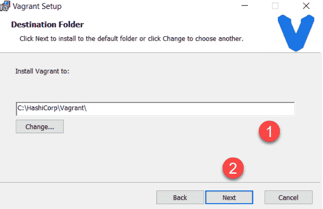
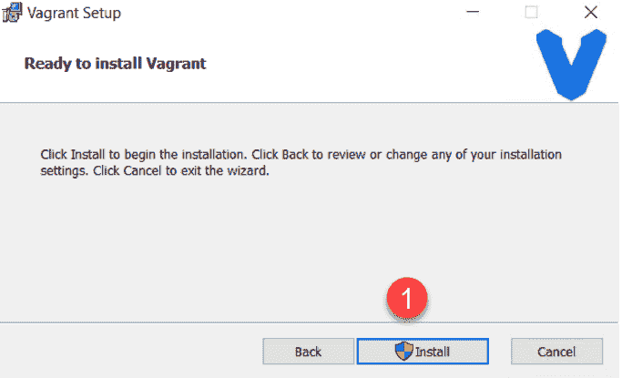
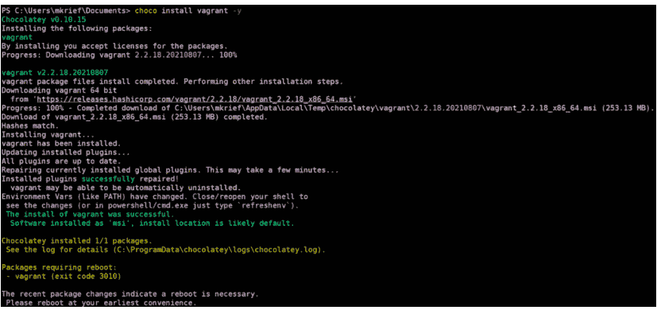
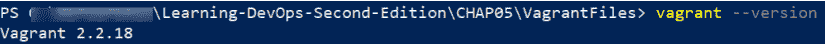
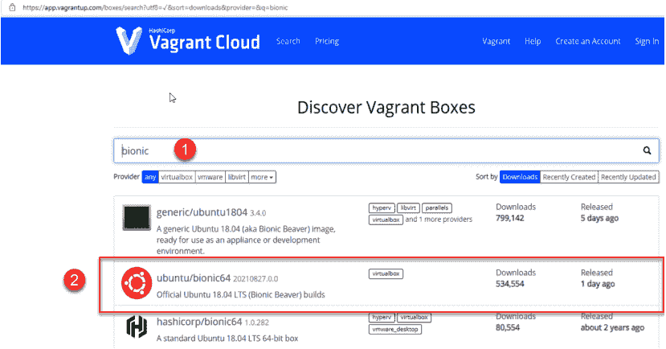
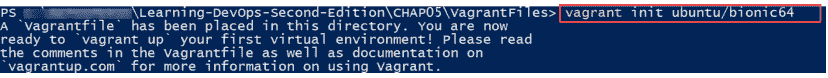
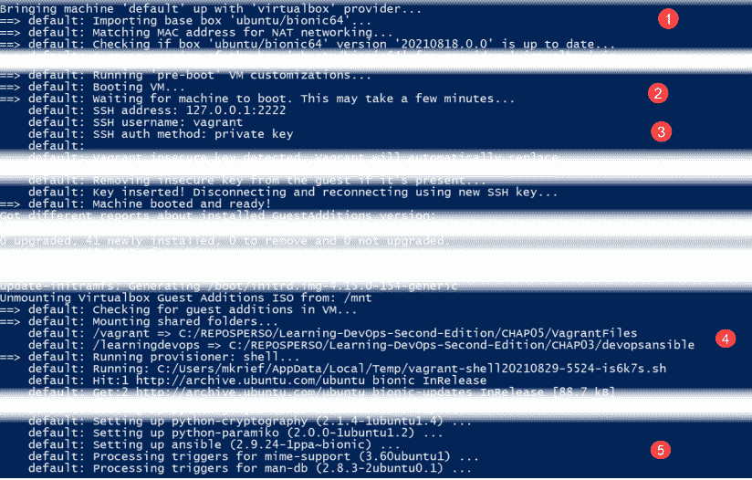

## 5 使用 Vagrant 构建开发环境

在前面的章节中，我们学习了如何使用 Terraform 预配基础架构，如何使用 Ansible 安装中间件，以及最后如何使用 Packer 创建虚拟机 (VM) 镜像。

运维团队经常指出的一个问题是，他们需要能够在隔离环境中测试所有自动化脚本，即不在本地计算机上的环境。例如，在 Linux 下编写 Ansible 脚本，在本地 Windows 机器上测试是困难的。

为了解决这个问题，我们可以使用 Hyper-V 或 VirtualBox 等虚拟化系统，它们允许您在本地运行带有不同操作系统的 VM。但是，要更进一步，我们可以使用 HashiCorp 的 Vagrant 工具来自动化这些 VM 的创建和预配。

在本章中，我们将学习使用 Vagrant 的基础知识。我们将讨论其安装、如何编写 Vagrant 文件，以及最后，我们将检查其执行以创建和预配 Linux VM。

在本章中，我们将介绍以下主要主题：

- 安装 Vagrant
- 编写 Vagrant 配置文件
- 使用 Vagrant CLI 预配本地 VM

### 技术要求

Vagrant 可以在任何虚拟机监控程序上创建 VM。在本章中，我们将使用 VirtualBox 作为本地 VM 虚拟机监控程序。您可以从 `https://www.virtualbox.org/wiki/Downloads` 下载并安装它。

在 Windows 上，如果您已经安装了 Hyper-V，要使用 VirtualBox，您需要禁用 Hyper-V。请参阅以下文档：

`https://www.vagrantup.com/docs/installation#windows-virtualbox-and-hyper-v`

本章中执行的所有命令都将在终端控制台（例如 PowerShell 或 Bash）中执行。

本章的完整源代码可在此处找到：

`https://github.com/PacktPublishing/Learning-DevOps-Second-Edition/tree/main/CHAP05/`

查看以下视频以查看代码实际运行情况：`https://bit.ly/3s5a049`

### 安装 Vagrant

Vagrant 是一个跨平台工具，可以安装在 Windows、Linux 或 macOS 上。安装可以通过两种方式进行：手动安装或通过 Windows 中的脚本安装。

### 在 Windows 上手动安装

要在 Windows 上手动安装 Vagrant，请执行以下步骤：

1. 转到官方下载页面 (`https://www.vagrantup.com/downloads`)，单击 **Windows** 选项卡，并下载与您操作系统 CPU 类型（32 位或 64 位）对应的 MSI 包。


### 2. 下载完成后，单击下载的 MSI 文件并选择安装目录（保留默认值）：



图 5.1 – Vagrant Setup 文件夹选择

### 3. 然后，单击 Install 按钮：



图 5.2 – Vagrant Setup Install 按钮

你已学习如何在 Windows 系统上手动安装 Vagrant。在下一节中，我们将讨论使用 Chocolatey 或脚本安装 Vagrant。

### 在 Windows 上通过脚本安装 Vagrant

在 Windows 上，我们可以使用 **Chocolatey**，它是一个软件包管理器。

> **注意**
> 在本章中，我不会重新介绍 Chocolatey，因为我们已在前面的章节中介绍过。有关 Chocolatey 的更多信息，请阅读 https://chocolatey.org/ 上的文档。

安装 Chocolatey 后，我们只需在 PowerShell 或 CMD 工具中运行以下命令：

```
choco install vagrant -y
```

以下是使用 Chocolatey 在 Windows 上安装 Vagrant 的截图：



要完成 Vagrant 的安装，我们需要重启机器。

### 在 Linux 上通过脚本安装 Vagrant

在 Linux 上，我们可以执行以下脚本来自动安装 Vagrant：

```
sudo apt-get update && sudo apt-get install -y gnupg software-properties-common curl \
&& curl -fsSL https://apt.releases.hashicorp.com/gpg | sudo apt-key add - \
&& sudo apt-add-repository "deb [arch=amd64] https://apt.releases.hashicorp.com $(lsb_release -cs) main" \
&& sudo apt-get update && sudo apt-get install vagrant
```

此脚本执行以下操作：

- 它添加 apt HashiCorp 存储库。
- 它更新本地存储库。
- 它下载并安装 Vagrant CLI。

> **注意**
> 有关在其他操作系统上安装 Vagrant 的所有信息，请参阅 `https://www.vagrantup.com/downloads` 上的文档。

安装 Vagrant 后，我们可以通过运行以下命令来测试 Vagrant CLI 的安装：

```
vagrant --version
```

上述命令显示已安装的 Vagrant 版本，以下截图显示了此命令的执行情况：



图 5.4 – 显示已安装的 Vagrant 版本

我们刚刚学习了 Vagrant 的手动安装过程以及如何在 Linux 上使用脚本安装它。

现在，我们将介绍一些主要的 Vagrant 工件，并编写 Vagrant 模板配置，以在本地创建一个基本的 Linux VM，并使用 Ansible 对其进行配置来测试 Ansible 脚本。

### 编写 Vagrant 配置文件

在讨论如何编写 Vagrant 配置文件之前，有必要提及 Vagrant 的几个工件。

Vagrant 的重要元素如下：

- Vagrant 二进制文件（CLI）：我们在上一节 _Installing Vagrant_ 中学习了如何下载和安装它。

- VM 的基础镜像，称为 **Vagrant Boxes**，将在配置文件中使用和提及。此镜像可以是公共镜像，即发布在 Vagrant 云上的镜像，也可以是机器上的本地镜像。

- 配置文件定义了我们想要在本地创建的 VM 的组成。

现在我们已经了解了 Vagrant 的不同元素，将编写我们 VM 的配置文件。首先，我们将检查将使用哪个基础机器。

### 使用 Vagrant Cloud 获取 Vagrant Boxes

要使用基本 Vagrant 镜像，HashiCorp 已设置了一个门户，允许你发布和公开共享与 Vagrant 兼容的 VM 镜像。

要访问这些镜像（称为 boxes），你可以导航到 `https://app.vagrantup.com/boxes/search` 网站，然后根据以下标准搜索你感兴趣的特定 box：

- 操作系统（Windows 或 Linux）

- 支持的虚拟机监控程序

- 已安装的中间件

- 发布者

以下截图显示了在 Vagrant Cloud 上搜索的示例：



图 5-5 – Vagrant Cloud 搜索框

在此示例中，我们正在搜索一个基本 Bionic box。在结果列表中，我们找到了官方的 `ubuntu/bionic64` box，它与 VirtualBox 虚拟机监控程序兼容。

单击所需的 box 后，门户将显示更多信息，例如配置详细信息和 box 的变更日志：


ubuntu / bionic64 Vagrant box

如何使用 Vagrant 使用此 box：

```
Vagrantfile New
Vagrant.configure("2") do |config|
  config.vm.box = "ubuntu/bionic64"
end
```

v20210827.0.0 当前发布版本

此版本是在 1 天前创建的。

没有描述。

图 5.6 – Vagrant Cloud box 详细信息

> **注意**
> 有关 Vagrant Cloud 以及如何创建和发布自定义 boxes 的更多信息，建议你参阅 https://www.vagrantup.com/vagrant-cloud 上的官方文档。

现在我们已选择基础 box，将为我们的 VM 编写 Vagrant 配置文件。

### 编写 Vagrant 配置文件

要使用 Vagrant 创建本地 VM，我们需要在配置文件中编写 VM 的配置。

此配置将包含有关 VM 的信息，例如：

- 要使用的 box
- 硬件配置，例如 RAM 和 CPU
- 网络配置
- 用于配置和配置 VM 的脚本
- 要与 VM 共享的本地文件夹

在本节中，我们将学习如何创建一个基本的 Vagrant 配置文件，该文件将创建一个本地 VM，其中已安装 Ansible 二进制文件。

要创建 Vagrant 配置，请执行以下步骤：

1. 创建一个名为 `VagrantFiles` 的文件夹。
2. 在此文件夹内，打开一个新的终端控制台，并运行带有 box 名称的 `vagrant init` 命令，如下所示：

```
vagrant init ubuntu/bionic64
```

以下截图显示了此命令的执行情况：



上述命令创建了一个新的 Vagrantfile 文件，其中包含 bionic VM 的基本配置，代码如下：

```
Vagrant.configure("2") do |config|
config.vm.box = "ubuntu/bionic64"
end
```

接下来，我们将添加脚本，以便在配置此 VM 时安装 Ansible。

3. 在此 `VagrantFiles` 文件夹中，创建一个名为 `scripts` 的新文件夹，然后使用以下内容创建一个名为 `ansible.sh` 的新脚本文件：

```
apt-get update
sudo apt-get --assume-yes install software-properties-common
sudo apt-add-repository --yes --update ppa:ansible/ansible
sudo apt-get --assume-yes install ansible
```

4. 在 Vagrantfile 文件中，使用以下行更新配置：

```
Vagrant.configure("2") do |config|
config.vm.box = "ubuntu/bionic64"
config.vm.provision "shell", path: "scripts/ansible.sh"
end
```

5. 要测试本地 Ansible playbook，我们可以通过在配置文件中添加以下行来共享本地目录与 VM：

```
Vagrant.configure("2") do |config|
config.vm.box = "ubuntu/bionic64"
config.vm.provision "shell", path: "scripts/ansible.sh"
config.vm.synced_folder "C:\\<path>\\CHAP03\\devopsansible", "/learningdevops"
end
```

在上述配置中，我们在本地机器和 VM 中的 /learningdevops 文件夹之间共享了本地 c:\\...\Chap03\\devopsansible 文件夹（这是本地文件夹的一个示例）。

> **注意**
> 有关此 Vagrant 配置文件的更多详细信息，请参阅 https://www.vagrantup.com/docs/vagrantfile 上的完整文档。

6. 最后一步是通过运行以下命令来验证此配置文件：

```
vagrant validate
```

此命令的输出显示在以下截图中：


图 5.8 – 验证 Vagrant 配置


> 注意
> 在本节中，我们学习了如何使用 Vagrant 配置文件创建 VM。如果希望在同一配置文件中创建多个 VM，请参阅官方文档 https://www.vagrantup.com/docs/multi-machine。

我们刚刚讨论了如何选择 Vagrant box 以及如何编写 Vagrant 配置文件。现在，在下一节中，我们将学习如何使用 Vagrant CLI 和配置文件在本地创建 VM。

### 使用 Vagrant CLI 创建本地 VM

既然我们已经编写了配置文件，就可以在本地创建 VM 了。

为此，我们将使用多个 Vagrant CLI 命令。要显示所有可用命令，我们将运行 `vagrant --help` 命令：

```
PS C:\Learning-DevOps-Second-Edition\CHAP05\VagrantFiles> vagrant --help
Usage: vagrant [options] <command> [<args>]

-h, --help Print this help.

Common commands:
 autocomplete manages autocomplete installation on host
 box manages boxes: installation, removal, etc.
 cloud manages everything related to Vagrant Cloud
 destroy stops and deletes all traces of the vagrant machine
 global-status outputs status Vagrant environments for this user
 halt stops the vagrant machine
 help shows the help for a subcommand
 init initializes a new Vagrant environment by creating a Vagrantfile
 login
 package packages a running vagrant environment into a box
 plugin manages plugins: install, uninstall, update, etc.
 port displays information about guest port mappings
 powershell connects to machine via powershell remoting
 provision provisions the vagrant machine
 push deploys code in this environment to a configured destination
 rdp connects to machine via RDP
 reload restarts vagrant machine, loads new Vagrantfile configuration
 resume resume a suspended vagrant machine
 snapshot manages snapshots: saving, restoring, etc.
 ssh connects to machine via SSH
 ssh-config outputs OpenSSH valid configuration to connect to the machine
 status outputs status of the vagrant machine
 suspend suspends the machine
 up starts and provisions the vagrant environment
 upload upload to machine via communicator
 validate validates the VagrantFile
 version prints current and latest Vagrant version
 winrm executes commands on a machine via WinRM
 winrm-config outputs WinRM configuration to connect to the machine
```

图 5.9 – 显示 Vagrant 命令

> 注意
> 关于 Vagrant CLI 命令的所有详细信息均记录在 https://www.vagrantup.com/docs/cli。

在下一节中，我们将学习如何创建 VM，然后连接到该 VM，最后执行一些脚本。

### 创建 VM

要创建 VM，请导航到创建 `Vagrantfile` 文件的文件夹，并运行以下命令：

```
vagrant up
```

输出如下截图所示：



执行上述命令将执行以下步骤：

- 从 Vagrant Cloud 导入 box。
- 在 hypervisor 中创建新 VM（在本例中，这是 VirtualBox）。
- 使用 SSH 密钥创建 SSH 连接（Vagrant 创建私有/公共 SSH 密钥）。
- 挂载共享文件夹。
- 应用 provisioning Ansible 脚本。

VM provisioning 完成后，我们可以在 VirtualBox 中的 hypervisor 里查看此 VM。

既然 VM 已启动并完成了 provisioning，我们可以连接到它。

### 连接到 VM

要使用 SSH 连接 VM，可以使用专用于 Vagrant 的默认 SSH 命令（以管理员模式运行）：

```
`vagrant ssh`
```

输出如下截图所示：

```
PS C:\Users\Administrator\Learning-DevOps-Second-Edition\CHAP05\VagrantFiles> vagrant ssh
Welcome to Ubuntu 18.04.5 LTS (GNU/Linux 4.15.0-154-generic x86_64)

 * Documentation:  https://help.ubuntu.com
 * Management:     https://landscape.canonical.com
 * Support:        https://ubuntu.com/advantage

System information as of Sun Aug 29 14:25:23 UTC 2021

System load:  0.01                Processes:             96
Usage of /:   4.1% of 38.71GB     Users logged in:       0
Memory usage: 17%                 IP address for enp0s3: 10.0.2.15
Swap usage:   0%

0 updates can be applied immediately.

New release '20.04.3 LTS' available.
Run 'do-release-upgrade' to upgrade to it.

vagrant@ubuntu-bionic:~$
```

图 5.11 – 连接 SSH 到 Vagrant VM

执行此命令意味着 Vagrant 自动将 SSH 凭据连接到 VM，我们可以在 VM 内部运行任何命令或脚本。

例如，我们可以运行 `ansible --version` 命令以显示已安装的 Ansible 版本：

```
vagrant@ubuntu-bionic: $ ansible --version
ansible 2.9.24
  config file = /etc/ansible/ansible.cfg
  configured module search path = [u'/home/vagrant/.ansible/plugins/modules', u'/usr/share/ansible/plugins/modules']
  ansible python module location = /usr/lib/python2.7/dist-packages/ansible
  executable location = /usr/bin/ansible
  python version = 2.7.17 (default, Feb 27 2021, 15:10:58) [GCC 7.5.0]
vagrant@ubuntu-bionic: $
```

图 5.12 – 在 VM 内部执行命令

运行所需的测试后，如果我们希望销毁此 VM 以重新创建它，可以运行 `vagrant destroy` 命令：

```
PS C:\Users\<username>\Learning-DevOps-Second-Edition\CHAP05\VagrantFiles> vagrant destroy
default: Are you sure you want to destroy the 'default' VM? [y/N] y
==> default: Forcing shutdown of VM...
==> default: Destroying VM and associated drives...
```

图 5.13 – 销毁 Vagrant VM

在本节中，我们学习了如何使用 Vagrant CLI 创建 VM 并连接到它。

### 摘要

在本章中，我们了解到可以使用 HashiCorp 的 Vagrant 在本地创建 VM，以便拥有一个隔离的开发环境。

我们讨论了如何下载和安装它。然后，我们学习了如何使用 Bionic box、一个 `ansible install` 脚本和一个本地共享文件夹编写 Vagrant 配置文件。

最后，我们学习了如何执行 Vagrant 命令行以创建此 VM 并连接到它进行测试。

在下一章中，我们将开始一个新主题，即 CI/CD 的实现，并学习如何使用 Git 来管理您的代码。

### 问题

- Vagrant 的作用是什么？
- 创建 VM 的 Vagrant 命令是什么？
- 连接 SSH 到 VM 的 Vagrant 命令是什么？

### 延伸阅读

如果您想了解更多关于 Vagrant 的信息，请查看以下资源：

- 官方 Vagrant 文档：https://www.vagrantup.com/docs/
- 官方 Vagrant Cloud 文档：https://www.vagrantup.com/vagrant-cloud
