## 6 使用 Git 管理源代码

几年前，当我们作为开发人员并作为团队的一部分编写代码时，我们遇到了反复出现的问题，大部分问题如下：

- 如何与团队成员共享我的代码
- 如何对我的代码更新进行版本控制
- 如何跟踪我代码的更改
- 如何检索我代码的旧状态或其部分

随着时间的推移，这些问题已通过源代码管理器的出现得到解决，也称为 **版本控制系统 (VCS)** 或更常见地称为 **版本控制管理器 (VCM)**。

这些 VCS 的目标主要是执行以下操作：

- 允许开发人员代码协作
- 检索代码
- 对代码进行版本控制
- 跟踪代码更改


随着敏捷方法和 **开发-运维（DevOps）** 文化的兴起，在流程中使用版本控制系统（VCS）已成为强制性要求。正如在 _第 1 章，DevOps 文化和基础设施即代码实践_ 中所述，实施 **持续集成/持续部署（CI/CD）** 流程的前提条件是必须使用 VCS。

在本章中，我们将了解如何使用最著名的 VCS 之一——Git。我们将先概述 Git 并了解如何安装它。然后，我们将学习其主要命令行，以便让任何开发者熟悉其用法。最后，我们将了解当前使用 Git 工作流和 Gitflow 的过程。本章的目的是展示如何使用简单的流程在日常工作中使用 Git。

本章涵盖以下主题：

- 概述 Git 及其主要命令行
- 了解 Git 流程和 Gitflow 模式

本章不涵盖 Git 服务器的安装，因此如果您想了解更多相关信息，可以参考以下链接的文档：`https://git-scm.com/book/en/v2/Git-on-the-Server-The-Protocols.`

### 技术要求

使用 Git 没有任何技术先决条件；我们只需要一个命令行终端。

为了在本章中说明其用法，我们将使用 Azure DevOps 平台上的 Azure Repos（原名 **Visual Studio Team System (VSTS)**），这是一个带有 Git 仓库管理器的云平台。您可以在此处免费注册：`https://visualstudio.microsoft.com/team-services/`。

查看以下视频，观看代码的实际运行情况：`https://bit.ly/3LTcoOi`。

### 概述 Git 及其主要命令行

要了解 Git 的起源，有必要知道有两种类型的 VCS：集中式系统和分布式系统。

最早出现的第一种类型是 **集中式系统**，例如 **Subversion (SVN)**、**Concurrent Version System (CVS)**、**Team Foundation Version Control (TFVC)** 和 Microsoft **Visual SourceSafe (VSS)**。这些系统由一个远程服务器组成，该服务器集中存储所有开发者的代码。

我们可以这样表示集中式源代码控制系统：

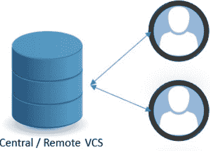

图 6.1 – 集中式源代码控制

所有开发者都可以在远程服务器上存档和检索他们的代码。该系统允许团队之间更好地协作，并保证代码备份。但是，它也有其缺点，例如：

- 如果开发者与远程服务器之间没有连接（由于网络问题或因特网断开连接），则无法再执行存档或代码恢复操作。
- 如果远程服务器不再工作，代码以及历史记录都将丢失。

第二种 VCS 类型，即后来出现的 **分布式系统**，例如 Mercurial 或 Git。这些系统由一个远程仓库和每个开发者本地机器上的该仓库的本地副本组成，如下图所示：

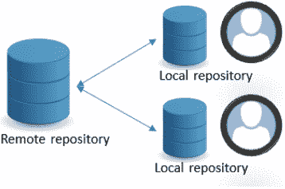

图 6.2 – 分布式源代码控制

因此，使用这种分布式系统，即使与远程仓库断开连接，开发者也可以继续使用本地仓库工作，并在远程仓库再次可访问时进行同步。代码及其历史记录的副本也存在于本地仓库中。

因此，Git 是一个分布式 VCS，由 Linus Torvalds 和 Linux 开发社区于 2005 年创建。

> 注意
> 要了解更多关于 Git 历史的信息，请阅读此页面：`https://git-scm.com/book/en/v2/Getting-Started-A-Short-History-of-Git`。

自创建以来，Git 已成为一个非常强大且成熟的工具，任何人都可以用于编码。

Git 是一个免费的跨平台工具，可以安装在本地机器上供操作代码的人使用——即客户端模式——但也可以安装在服务器上以托管和管理远程仓库。

Git 是一个带有大量选项的命令行工具。然而，如今有许多图形化工具——例如 Git GUI、GitKraken、GitHub Desktop 或 Sourcetree——允许您更轻松、更直观地与 Git 操作进行交互，而无需自己使用命令行。但是，这些图形化工具不包含命令行中可用的所有操作和选项。幸运的是，许多代码编辑器，例如 **Visual Studio Code (VS Code)**、Visual Studio、JetBrains 和 Sublime Text，允许与 Git 和远程仓库直接集成代码。

对于远程仓库，有几种云和免费解决方案，例如 GitHub、GitLab、Azure DevOps 或 Bitbucket Cloud。此外，还有称为本地解决方案的其他解决方案，可以安装在企业中，例如 Azure DevOps Server、Bitbucket 或 GitHub Enterprise。

在本章中，我们将了解如何使用 Git——例如，将 Azure DevOps 作为远程仓库——并且我们将在未来章节中了解如何使用 GitLab 和 GitHub。

在本节中，我们介绍了 Git，现在将了解如何在本地机器上安装它以开发和版本化我们的源代码。

### Git 安装

我们现在将详细介绍在 Windows、Linux 和 macOS 系统上安装和配置 Git 的步骤。

要在 Windows 机器上手动安装，我们必须从 `https://gitforwindows.org/` 下载 **Git for Windows 工具** 可执行文件，下载完成后，单击可执行文件，并在安装过程中按照以下不同的配置步骤操作：

1. 为 Git 二进制文件选择安装路径。我们保留默认路径，如下图所示：

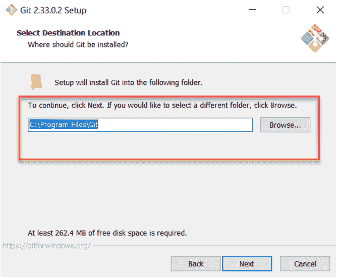

图 6.3 – Git 安装路径

2. 在 Windows 资源管理器中选择 Git 集成组件，标记 **Windows 资源管理器集成** 复选框，如下图所示：

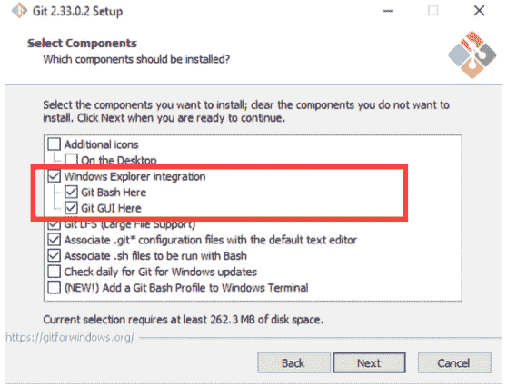

图 6.4 – 选择 Git 安装组件

3. 选择您的代码编辑器 **集成开发环境 (IDE)**；在我们的情况中，我们通过选择 **将 Visual Studio Code 用作 Git 的默认编辑器** 选项来使用 VS Code，如下图所示：

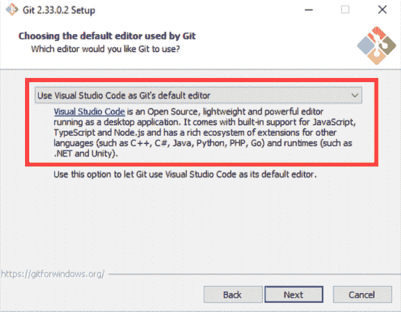

图 6.5 – 选择 Git 安装编辑器

4. 配置默认分支的名称。我们可以保留默认选项，使用 `master` 作为默认分支名称，如下图所示：

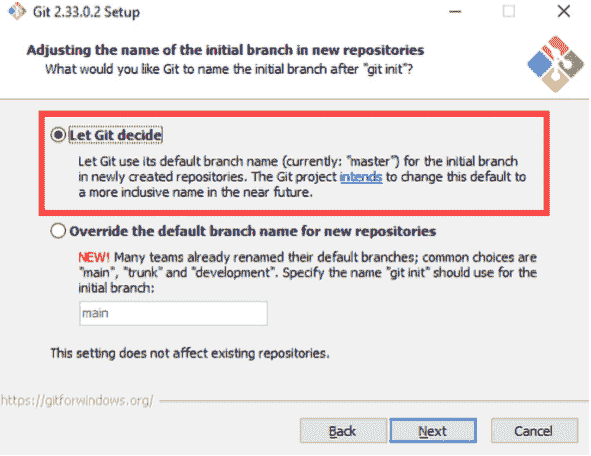

图 6.6 – Git 配置默认分支名称

5. 选择 **调整您的 PATH 环境** 选项时，我们可以保留安装程序建议的默认选择，如下图所示：

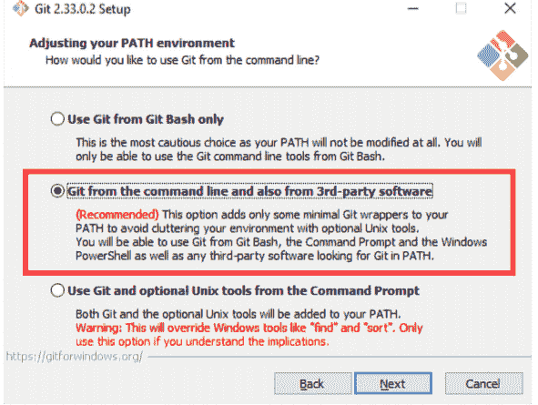

图 6.7 – Git 安装 PATH 配置

6. 选择要使用的安全外壳 (SSH) 客户端，保留默认选项以使用集成的 `ssh.exe` 客户端，如下图所示：

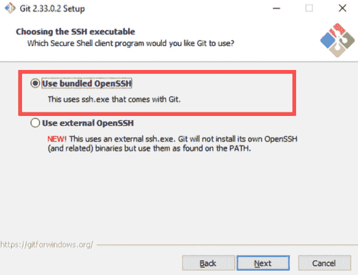

图 6.8 – Git 安装 SSH 工具

7. 选择一种超文本传输安全协议 (HTTPS) 传输类型，我们也将保留默认选项，即使用 OpenSSL 库选项，如下图所示：

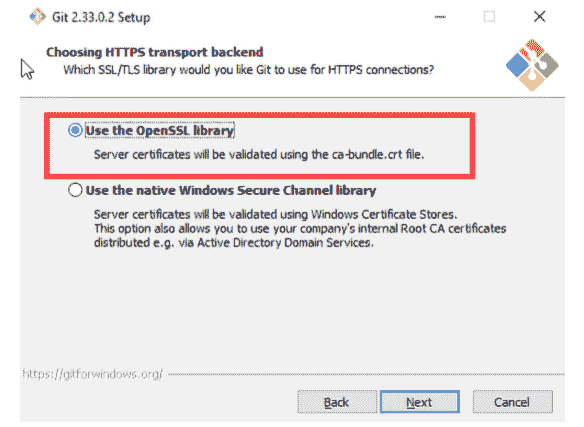

图 6.9 – Git 安装使用 OpenSSL

8. 选择文件末尾编码的选项。我们也将选择默认选项，即以 Unix 格式存档，如下图所示：

图 6.10 – 选择 Git 安装文件的编码

9. 为 Git Bash 选择默认终端模拟器。我们选择 MinTTy，如下图所示：

图 6.11 – Git 安装终端模拟器

10. 选择 `git pull` 命令的默认行为。我们保留默认选项，如下图所示：

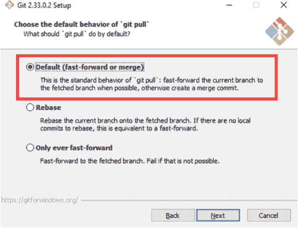

图 6.12 – Git 安装默认 git pull 命令

11. 选择凭据管理器助手，保留默认选项，如下图所示：

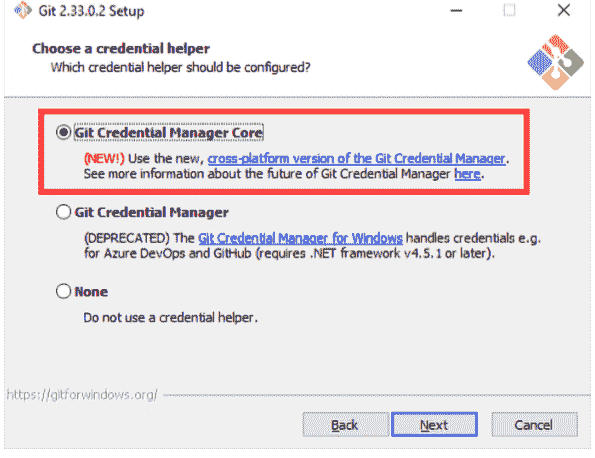

图 6.13 – Git 安装凭据管理器


### 12. 在下一屏幕中，我们启用文件系统缓存，如下所示：

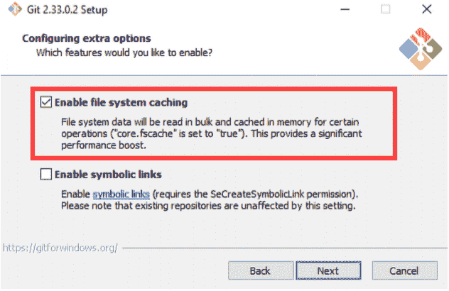

图 6.14 – Git 安装文件缓存

### 13. 然后，通过单击 Install 按钮完成安装配置，如下图所示：

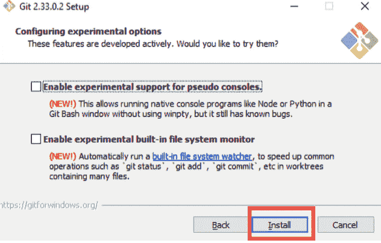

图 6.15 – Git 安装最后一步

安装结束时，安装实用程序建议打开 Git Bash，它是专用于 Git 命令的命令行 Linux 终端模拟器，如下图所示：

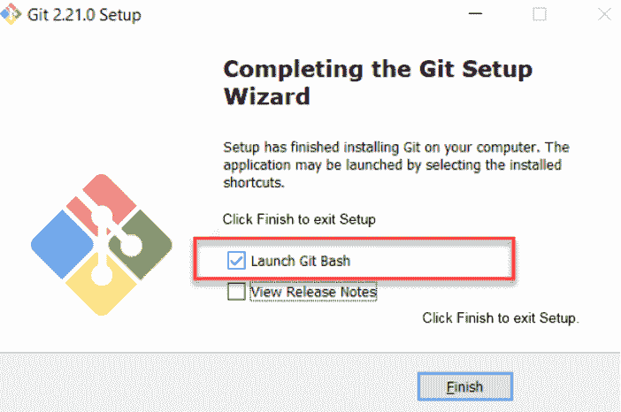

图 6.16 – Git 安装结束

安装完成后，我们可以立即在 Git Bash 窗口中直接运行 `git version` 命令来检查 Git 安装状态，如下所示：

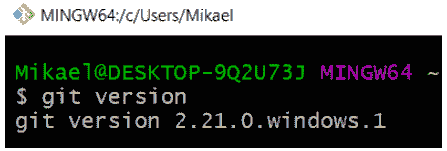

图 6.17 – 显示 Git 版本

我们也可以使用自动脚本安装 Git，该脚本使用 **Chocolatey**（Windows 软件包管理器），我们在之前关于 Terraform 和 Packer 的章节中已经使用过它。（提醒：Chocolatey 文档可在此处查阅：`https://chocolatey.org/`。）

要使用 Chocolatey 安装适用于 Windows 的 Git，我们必须在操作终端中执行以下命令：

```
choco install -y git
```

执行结果将显示在以下屏幕截图中：

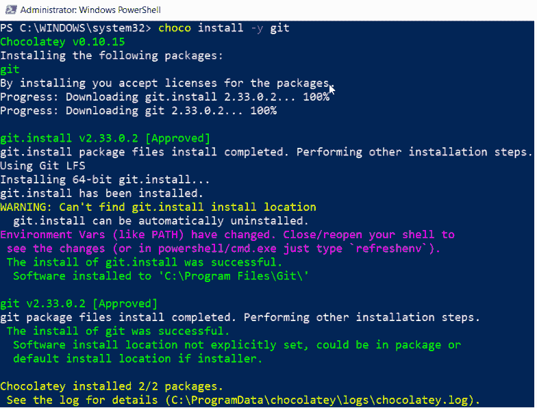

图 6.18 – 使用 Chocolatey 安装 Git

要在 **Linux** 机器上安装 Git，对于 Ubuntu 等 Debian 系统，我们按如下方式运行 `apt-get` 命令：

```
apt-get install git
```

或者，对于 **CentOS** 或 **Fedora**，使用 `yum` 命令安装 Git，如下所示：

```
yum install git
```

对于 **macOS** 系统，我们可以使用 Homebrew（`https://brew.sh/`）下载并安装 Git，Homebrew 是专用于 macOS 的包管理器，方法是在终端中执行此命令：

```
brew install git
```

Git 安装完成，我们现在将继续进行其配置。

### Git 配置

Git 配置要求我们配置用户名和电子邮件，这些信息将在代码提交时使用。要执行此配置，我们在终端中执行以下命令——无论是原生的 **操作系统 (OS)** 终端，还是 Windows 上的 Git Bash：

```
git config --global user.name "<your username>"
git config --global user.email "<your email>"
```

然后，我们可以通过执行以下命令检查配置值：

```
git config --global --list
```

请参阅以下屏幕截图：

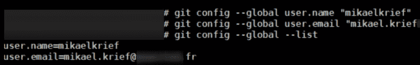

图 6.19 – Git 配置

Git 现已配置完毕并可供使用，但在使用之前，我们将对其术语进行概述。

### 有用的 Git 术语

Git 是一个对象和术语非常丰富且拥有自己概念的工具。在使用之前，了解其工件及其组成术语非常重要。以下是该术语的简要列表：

- **Repository**：仓库是 Git 的基本元素；它是跟踪和版本化源代码的存储空间。有 **远程仓库** 集中托管团队代码并允许团队协作。还有 **本地仓库**，它是本地机器上远程仓库的副本。

- **Clone**：克隆是制作远程仓库本地副本的操作。

- **Commit**：提交是对一个或多个文件所做的更改，该更改保存到本地仓库。每个提交都是唯一的，并由一个称为 SHA-1 的唯一编号标识，通过该编号可以跟踪代码更改。

- **Branch**：仓库中的代码默认存储在 `master` 分支中。分支可以创建其他分支，这些分支将是 master 的副本，开发者在其中进行更改，从而允许我们隔离工作而不影响 master 分支。随时可以将一个分支合并到另一个分支。

- **Merge**：这是一个操作，用于将一个分支的代码与另一个分支合并。

- **Checkout**：这是一个操作，允许我们从一个分支切换到另一个分支。

- **Fetch**：这是一个操作，用于从远程仓库检索代码，而不将其与本地仓库合并。

- **Pull**：这是一个操作，用于从远程仓库更新本地仓库。拉取相当于获取和合并操作。

- **Push**：推送是拉取的反向操作——它允许我们从本地仓库更新远程仓库。

- **Pull request (PR)**：PR 是 Git 的一项功能（由 GitHub 发起），它提供 **图形用户界面 (GUI)** 客户端或 Web 界面，用于在团队用户之间讨论拟议的更改，然后再将其集成到主分支。如果您想了解有关 PR 的更多信息，请阅读 GitHub 文档：`https://docs.github.com/en/github/collaborating-with-pull-requests/proposing-changes-to-your-work-with-pull-requests/about-pull-requests`。

这些是使用 Git 及其工作流程时需要知道的概念。当然，此列表并不详尽，还有其他重要的术语和概念；我们可以在多个网站上找到相关信息。以下是一个简短列表：

- **GitHub 词汇表**：`https://help.github.com/en/articles/github-glossary`
- **Atlassian 词汇表**：`https://www.atlassian.com/git/glossary/terminology`
- **Linux Academy**：`https://linuxacademy.com/blog/linux/git-terms-explained/`

在解释了这些概念后，我们现在可以了解如何使用 Git 命令行。

### Git 命令行

在迄今为止所了解的所有 Git 内容基础上，我们现在可以开始操作它。最好的方法是先学习如何在命令行上使用 Git；然后，一旦掌握了流程，我们就可以更好地使用图形化工具。

以下是主要 Git 命令行的介绍，这些命令现在已成为（或应该成为）开发者日常工作的一部分。我们将在下一节 _Understanding the Git process and Gitflow pattern_ 中了解它们在实践中的应用。

第一个命令是允许我们从远程仓库检索代码的命令。

#### 检索远程仓库

需要知道的第一个命令行是 `clone` 命令，它会复制远程仓库以创建本地仓库。要执行的命令如下所示：

```
git clone <url of the remote repository>
```

唯一的必需参数是仓库 **Uniform Resource Locator (URL)**（任何仓库都可以通过唯一 URL 标识）。执行此命令后，远程仓库的内容将下载到本地机器，本地仓库会自动创建并配置。

#### 初始化本地仓库

请注意，`init` 是允许创建本地仓库的 Git 命令。要在将包含本地仓库的目录中执行此操作，请运行以下简单命令：

```
git init
```

此命令创建一个 `.git` 目录，该目录包含本地仓库的所有文件夹和配置文件。

#### 配置本地仓库

执行 `init` 命令后，必须通过设置链接的远程仓库来配置新的本地仓库。要进行此设置，我们将使用以下命令添加 `remote`：

```
git remote add <name> <url of the remote>
```

作为参数传递的名称允许在本地标识此远程仓库；它相当于别名。我们也可以在本地仓库上配置多个远程设备。

#### 为下一次提交添加文件

提交（我们将在下一节中介绍）是将我们的更改存档到本地仓库。当我们编辑文件时，可以选择哪些文件将包含在下一次提交中；这是一个暂存概念。未选中的其他文件将被搁置，以备以后提交。

要为下一次提交添加文件，我们执行 add 命令，如下所示：

```
git add <files path to add>
```

因此，例如，如果我们希望在下一次提交中包含所有修改的文件，请执行 `git add .` 命令。我们还可以使用 **正则表达式 (RegEx)** 过滤要添加的文件，例如 `git add *.txt`。

#### 创建提交

提交是 Git 实体，包含对文件所做的更改列表，这些更改已在本地仓库中注册。因此，提交是指存档之前使用 add 命令选定的文件所做的更改。

创建提交的命令如下所示：

```
git commit -m "<your commit message>"
```

-m 参数对应于我们分配给此提交的消息或描述。消息非常重要，因为我们将能够识别文件更改的原因。

还可以提交自上次提交以来修改的所有文件，而无需执行 add 命令，方法是执行 `git commit -a -m "<message>"` 命令。

执行提交后，更改将存档在本地仓库中。


### 更新远程仓库

当我们提交代码时，提交记录会保存在本地仓库中，当我们准备与团队其他成员共享这些代码以进行验证或部署时，必须将其发布到远程仓库。要使用本地仓库中的提交记录更新远程仓库，需要执行推送操作，使用以下命令：

```
git push <alias> <branch>
```

作为参数传递的别名对应于本地仓库 Git 配置中配置的远程仓库别名（通过 `git remote add` 命令完成）。

而 branch 参数是要更新的分支——默认情况下，它是 `master` 分支。

### 从远程仓库同步本地仓库

如前所述，Git 命令行用于从本地仓库更新远程仓库。现在，要执行相反的操作——即使用其他成员推送到远程仓库的所有更改来更新仓库——我们将执行拉取操作，使用以下命令：

```
git pull
```

执行此命令会导致两个操作：

- 将本地代码与远程代码合并。
- 提交到本地仓库。

另一方面，如果我们不想提交——例如，为了能够进行其他更改——则不应使用 pull 命令，而应执行 `fetch`，使用以下命令：

```
git fetch
```

其执行仅将远程代码合并到本地代码，要存档，我们将不得不执行 `commit` 来更新本地仓库。

### 管理分支

默认情况下，创建仓库时，代码位于名为 `master` 的主分支中。为了能够隔离 `master` 分支的开发——例如，开发新功能、修复 bug，甚至进行技术实验——我们可以从其他分支创建新分支，并在想要合并代码时将它们合并在一起。

要从当前本地加载的分支创建分支，我们执行以下命令：

```
git branch <name of the desired branch>
```

要切换到另一个分支，我们执行以下命令：

```
git checkout <name of the branch>
```

此命令会更改分支，并使用该分支的内容加载当前工作目录。

要将分支合并到当前分支，执行合并命令，如下所示：

```
git merge <branch name>
```

将要合并的分支名称作为参数。

最后，要显示本地分支列表，我们执行 branch 命令，如下所示：

```
git branch
```

从命令行使用分支管理并不容易。Git 的图形工具（已提及）允许更好的可视化和分支管理。我们将在下一节详细了解它们的用途，该节将介绍 Git 流程。关于常用 Git 命令行就介绍到这，虽然还有更多命令用于处理其他事项。

在下一节，我们将通过应用 Git 的工作和协作流程，将所有这些付诸实践，并了解 Gitflow 模式的概览。

### 了解 Git 流程和 Gitflow 模式

到目前为止，我们已经了解了一个非常强大的版本控制系统 Git 的基础知识，包括其安装、配置以及一些最常用的命令行。在本节中，我们将通过一个案例研究将所有这些付诸实践，该案例将展示在项目生命周期中应应用哪个 Git 流程。

在这个案例研究中，对于远程仓库，我们将使用 **Azure Repos**（Azure DevOps 服务之一），这是一个免费的 Git 云平台，可用于个人甚至商业项目。要了解有关 Azure DevOps 的更多信息，请参阅此处的文档：`https://azure.microsoft.com/en-us/services/devops/`。我们将在本书中经常提到它。

### 开始使用 Git 流程

在这个实验中，我们将解释两名开发人员开始新应用程序开发项目的 Git 协作流程。

以下是我们将在本节中详细讨论的 Git 流程步骤：

- 第一位开发人员在本地仓库中提交代码，并将其推送到远程仓库。
- 然后，第二位开发人员从远程仓库获取推送的代码。
- 第二位开发人员更新此代码，创建提交，并将代码的新版本推送到远程仓库。
- 最后，第一位开发人员在本地仓库中检索代码的最新版本。

我们将了解的 Gitflow 数据流如下图所示：

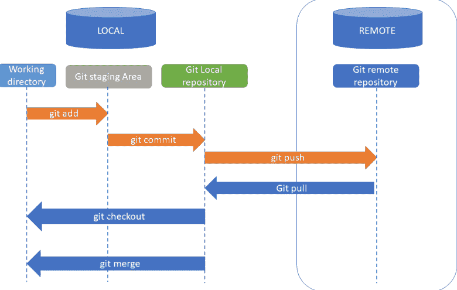

图 6.20 – Git 数据流

但是，在开始使用 Git 命令之前，我们将先了解在 Azure Repos 中创建和配置 Git 仓库的步骤。

### 创建和配置 Git 仓库

首先，我们将在 Azure DevOps 中创建一个远程 Git 仓库，用于与其他团队成员协作。请按照以下步骤操作：

- 在 Azure DevOps 中，我们将创建一个新项目，如下所示：

### 创建项目以开始

项目名称 *
BookDemo
描述
Demo 项目
可见性
公共
任何人在互联网上都可以查看项目。某些功能（如 TFVC）不受支持。
私有
只有您授予访问权限的人才能查看此项目。
高级
版本控制
Git
工作项流程
基本
+ 创建项目

图 6.21 – 创建 Azure DevOps 项目

### 输入项目名称和描述，正如我们从前面的截图中可以看到，**版本控制**类型是 **Git**。然后，在左侧菜单中，我们单击 Azure **Repos** 服务，如下所示：

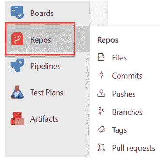

图 6.22 – Azure Repos 菜单

### 默认仓库已创建，且与项目同名，如下所示：

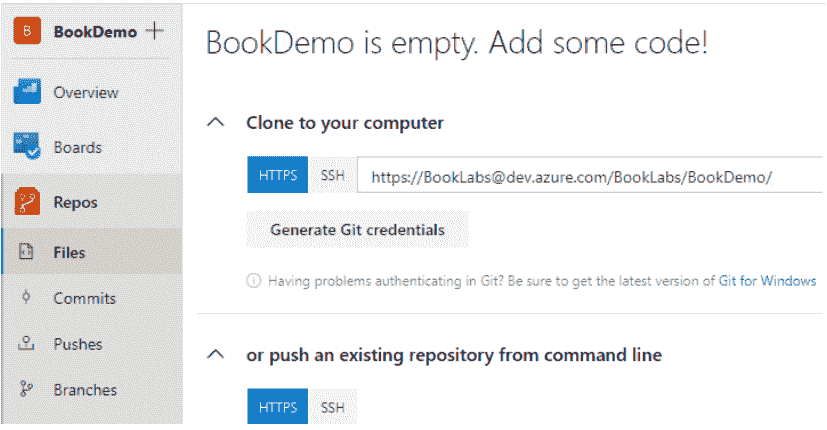

图 6.23 – Azure DevOps 新仓库

现在 Git 仓库已在 Azure Repos 中创建，我们将了解如何初始化和配置本地工作目录以使用此 Git 仓库。

要初始化此仓库，我们将创建一个本地目录并为其命名（例如，bookProject）。这将包含应用程序代码。

创建此目录后，我们将通过在 bookProject 文件夹内执行 git init 命令来初始化本地 Git 仓库，如下所示：

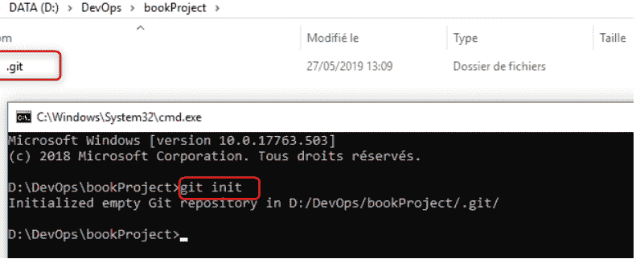

前面命令的结果是一条确认消息和一个新的 .git 目录。这个新目录将包含本地 Git 仓库的所有信息和配置。

然后，我们将配置此本地仓库以链接到 Azure DevOps 远程仓库。此链接将允许本地仓库和远程仓库的同步。为此，在 Azure DevOps 中，我们获取仓库的 URL，该 URL 位于仓库信息中，如下面的截图所示：

BookDemo 为空。添加一些代码！

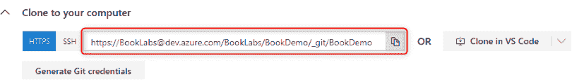

在我们在第 4 步中创建的 bookProject 文件夹内运行 git remote add 命令，如下所示：

```
git remote add origin <url of the remote repository>
```

通过执行前面的命令，我们创建了一个 `origin` 别名，它将指向远程仓库 URL。

> 注意
> 
> 此整个初始化和配置过程也适用于空目录（如我们的情况），或适用于已包含我们想要存档的代码的目录。

因此，我们现在有一个要使用的本地 Git 仓库。在创建和配置仓库后，我们将开始为应用程序开发代码，并从提交代码开始使用 Git 流程进行协作。

### 提交代码

流程的第一步是代码提交，它允许您将代码更改存储在本地 Git 仓库中，请按照以下步骤操作：

- 在我们的目录中，我们将创建一个包含以下示例文本的 `Readme.md` 文件：

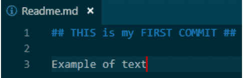

- 要在本地仓库中提交此文件，我们必须通过执行 `git add .` 命令将其添加到下一次提交的文件列表中（末尾的 `.` 字符表示包括要修改、添加或删除的所有文件）。

- 我们还可以通过运行 `git status` 命令查看将对本地仓库进行的更改的状态，如下面的截图所示：


从前面的执行中，我们可以看到创建了一个 Readme.md 文件，并且它也会集成到提交中。

最后要执行的操作是通过将更改存档到本地仓库来验证更改，为此，我们执行以下命令：

```
git commit -m "Add file readme.md"
```

我们进行带有描述的提交，以便跟踪更改。以下是前面命令的截图：

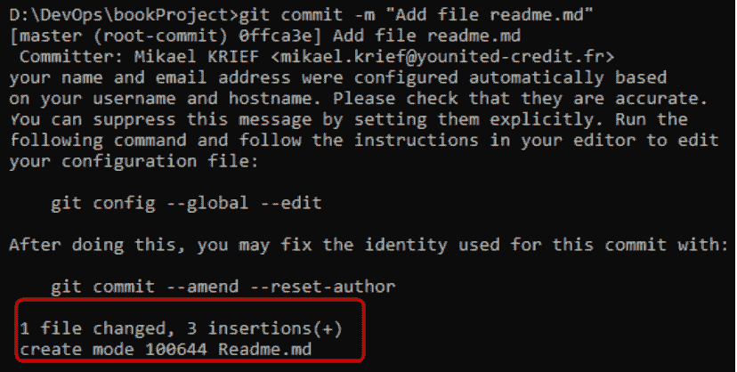

### 存档到远程仓库

为了存档本地更改并允许团队对这段代码进行协作，我们将通过执行以下命令将提交推送到远程仓库：

```
git push origin master
```

我们向 `git push` 命令指示远程仓库的别名和分支。在首次执行此命令时，系统会要求我们对 Azure DevOps 仓库进行身份验证，如下面的截图所示：

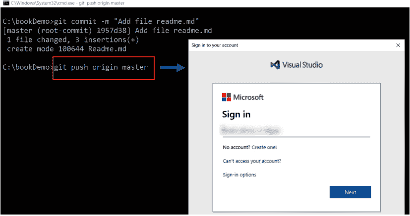

图 6.29 – 在 Azure DevOps 上执行 git push

身份验证后，推送操作将执行，如下所示：

```
C:\Users\user\BookProject>git push origin master
Enumerating objects: 3, done.
Counting objects: 100% (3/3), done.
Writing objects: 100% (3/3), 275 bytes | 275.00 KiB/s, done.
Total 3 (delta 0), reused 0 (delta 0)
remote: Analyzing objects... (3/3) (6 ms)
remote: Storing packfile... done (324 ms)
remote: Storing index... done (148 ms)
To https://dev.azure.com/BookLabs/BookDemo/_git/BookDemo
 * [new branch]      master -> master
```

图 6.30 – git push 结果

远程仓库已与我们的更改保持同步，在 Azure Repos 界面中，我们可以看到远程仓库的代码。下面的截图显示了 Azure Repos 中包含新添加文件的目录：

图 6.31 – Azure Repos 新增文件

就这样：我们完成了 Git 流程的第一个主要步骤，该步骤包括初始化仓库并将代码推送到远程仓库。下一步是由另一名团队成员对代码进行更改。

### 克隆仓库

当另一名成员首次想要检索整个远程仓库代码时，他们会执行克隆操作，为此，他们必须执行此命令：

```
git clone <repository url>
```

执行此命令将执行以下操作：

1. 创建一个与仓库同名的新目录。
2. 创建一个带有初始化和配置的本地仓库。
3. 下载远程代码。

因此，团队成员可以修改代码并进行更改。

### 更新代码

当代码被修改且开发者在远程仓库上更新他们的更改时，他们将执行与初始化远程仓库时完全相同的操作，即执行以下命令：

```
git add .
git commit -m "update the code"
git push origin master
```

我们将文件添加到下一次提交中，创建了一个提交，并将提交推送到远程仓库。

最后剩下的步骤是其他成员检索更新。

### 检索更新

当一名成员更新远程仓库时，可以通过运行 `git pull` 命令来检索这些更新，并使用更改更新我们的本地仓库，如下所示：

```
git pull origin master
```

下面的截图显示了执行此 `git pull` 命令的情况：

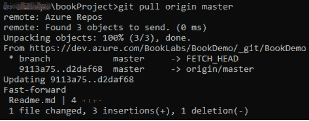

图 6.32 – git pull 命令

从前面的执行中，我们指示要在本地仓库中更新的 origin 别名和 master 分支，其执行显示了推送的提交。在执行此命令结束时，我们的本地仓库已保持最新。

关于代码更新的其余流程，与我们在“更新代码”部分中看到的相同。

我们刚刚了解了使用 Git 的简单流程，但也可以通过使用分支来隔离开发。

### 使用分支隔离代码

在开发应用程序时，我们通常需要修改部分代码，但又不希望影响应用程序现有的稳定代码。为此，我们将使用所有版本控制系统（VCS）中都存在的一个功能，该功能允许我们创建和管理分支。

使用分支的机制非常简单，如下所述：

1. 从一个分支，我们创建另一个分支。
2. 我们开发这个新分支。
3. 如果我们在团队中工作，创建一个 PR 以讨论代码更改。如果审核人同意这些更改，他们将批准更改的代码。
4. 要将在此新分支上所做的更改应用到原始分支，将执行合并操作。

从概念上讲，分支系统的表示方式如下：

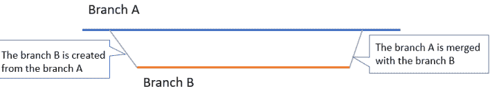

图 6.33 – 分支图

在此图中，我们看到分支 B 是从分支 A 创建的。这两个分支将由开发团队修改，以便为我们的应用程序添加新功能。但最终，分支 A 与分支 B 合并，从而合并了分支 B 的代码更改。

现在我们已经了解了分支的基础知识，让我们按照以下步骤了解如何在 Git 中使用分支：

1. 本实验的目的是从 `master` 分支创建一个 `Feature1` 分支。然后，在 `Feature1` 分支上进行一些更改后，我们将把 `Feature1` 分支的代码更改合并到 `master` 分支。首先，使用以下命令从 `master` 在本地仓库上创建一个 `Feature1` 分支：

```
git branch Feature1
```

执行此命令创建了一个新分支 `Feature1`，它包含与父分支 `master` 完全相同的代码。

2. 要使用此分支的代码加载工作目录，我们执行以下命令：

```
git checkout Feature1
```

从以下输出中，我们可以看到分支的切换：

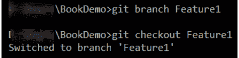

3. 我们还可以使用以下命令查看本地仓库的分支列表：

```
git branch
```

此命令的输出如下所示：

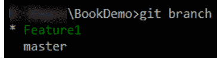

在执行过程中，我们可以看到两个分支以及当前活动的分支。

4. 现在，我们将在此分支上对代码进行更改。更新机制与我们之前看到的所有内容相同，因此我们将执行以下命令：

```
git add .
git commit -m "Add feature 1 code"
```

5. 对于 `push` 操作，我们将使用此命令在参数中指定 `Feature1` 分支的名称：

```
git push origin Feature1
```

下面的截图显示了执行所有这些步骤的代码：

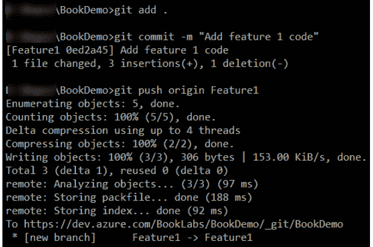

图 6.36 – 添加 Git 分支

6. 通过我们执行的前面命令，我们在 `Feature1` 分支上创建了一个提交。然后我们执行了 `push` 命令，将新分支及其提交发布到远程仓库。另一方面，在 Azure Repos 界面中，我们可以在 **Branches** 部分看到我们的两个分支，如下面的截图所示：

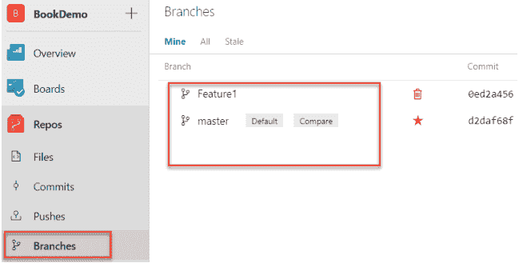

图 6.37 – Azure Repos 分支列表

7. 在合并代码之前，我们创建一个 PR 以讨论更改。下面的截图显示了在 Azure DevOps 中创建 PR 和审批步骤。我们首先创建一个 PR，如下所示：

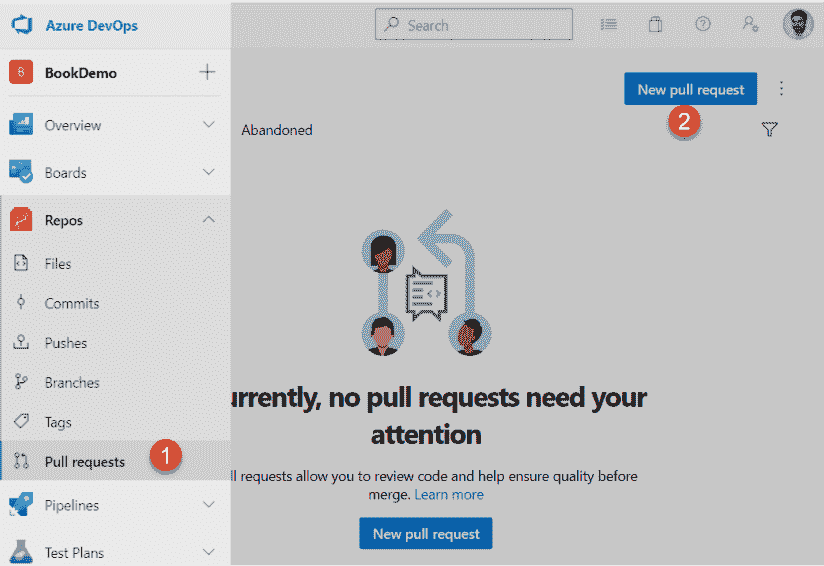

图 6.38 – Azure Repos：创建 PR
然后，通过选择源分支和目标分支、输入标题和描述以及选择审核人来填写此 PR 的表单。我们还可以查看将要合并的代码差异。该过程在下面的截图中说明：


最后，审核人员将审查、批准或拒绝这些更改（他们也可以直接合并），如下图所示：

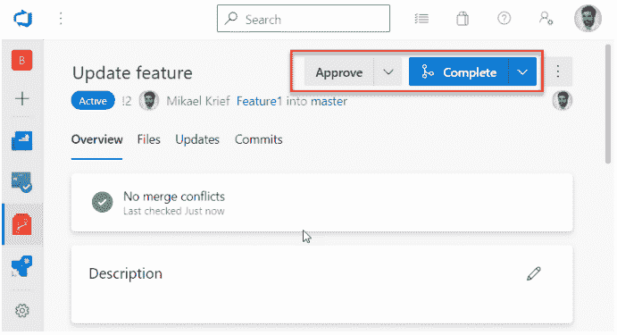

8. 我们流程中的最后一步是将 `Feature1` 分支的代码合并到 `master` 分支的代码中，即 `master` 分支。要执行此合并操作，我们首先将工作目录加载到 `master` 分支，然后将 `Feature1` 分支合并到当前分支（即 `master` 分支）。

为此，我们将执行以下命令：

```
git checkout master
git merge Feature1
```

这些命令的执行过程如下所示：

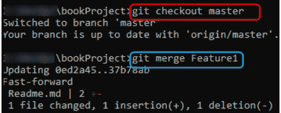

执行结束后，`master` 分支的代码中就包含了 `Feature1` 分支中所做的更改。

我们刚刚了解了 Git 中分支及其合并的使用；现在，让我们来看看 Gitflow 分支模式及其实用性。

### Gitflow 分支策略

当我们开始在 Git 中使用分支时，经常会出现这样一个问题：_使用哪种分支策略是正确的_？换句话说，我们需要隔离代码的关键是什么——是按环境、功能、主题还是发布版本来划分？

这个问题没有通用的答案，项目中分支的管理取决于项目的上下文。然而，有一些分支策略模式已经被多个社区和大量用户认可，能够在 Git 项目中实现更好的协作流程。

建议我们仔细研究其中一种分支模式，即 Gitflow。

#### Gitflow 模式

这些模式之一是 **Gitflow**，由 _nvie_ 开发，非常流行且具有非常容易上手的 Git 工作流。

Gitflow 的分支图如下所示：

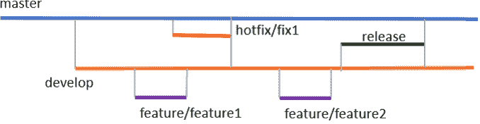

图 6.42 – Gitflow 图

让我们来看看这个工作流的细节，以及每个分支在创建顺序中的用途，如下所示：

- 1. 首先，我们有 `master` 分支，其中包含当前处于生产环境中的代码。没有开发人员直接在其上工作。
- 2. 从这个 `master` 分支，我们创建一个 `develop` 分支，它是将包含应用程序下一次交付中要部署的更改的分支。
- 3. 对于应用程序的每个功能，都会从 `develop` 分支创建一个 `feature/<功能名称>` 分支（/ 将因此创建一个 `feature` 目录）。
- 4. 当一个功能编码完成后，该功能的分支会合并到 `develop` 分支中。
- 5. 然后，当我们想要部署所有最新开发的功能时，我们会从 `develop` 分支创建一个 `release` 分支。
- 6. `release` 分支的内容会成功部署到所有环境中。
- 7. 当生产环境中的部署完成后，`release` 分支会与 `master` 分支合并，通过此合并操作，`master` 分支包含生产代码。因此，`release` 分支和功能分支上的代码不再必要，这些分支可以被删除。
- 8. 如果在生产环境中检测到错误，我们会创建一个 `hotfix/<错误名称>` 分支；然后，一旦错误修复，我们会将此分支合并到 `master` 和 `develop` 分支中，以便在后续分支和部署中传播修复。

在了解 Gitflow 模式的工作流后，我们将讨论有助于其实现的工具。

### Gitflow 工具

为了帮助团队和开发人员使用 Gitflow，_nvie_ 创建了一个 Git 命令行覆盖工具，允许您根据工作流步骤轻松创建分支。此工具可在 _nvie_ 的 GitHub 页面上找到：`https://github.com/nvie/gitflow`。

另一方面，也有支持 Gitflow 模型的 Git 图形工具，例如 GitKraken (`https://www.gitkraken.com/`) 和 Sourcetree (`https://www.sourcetreeapp.com/`)。这些工具允许我们通过图形界面使用 Gitflow 流程，如下图所示，使用带有 `Git-flow` 功能的 Sourcetree，该功能允许我们使用 Gitflow 模式创建分支。

下图显示了 Sourcetree 针对 Gitflow 模式分支命名的配置：

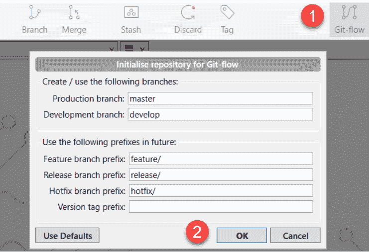

图 6.43 – Sourcetree Git-flow 工具

然后，在此配置之后，我们可以轻松使用此名称创建分支，如下图所示：

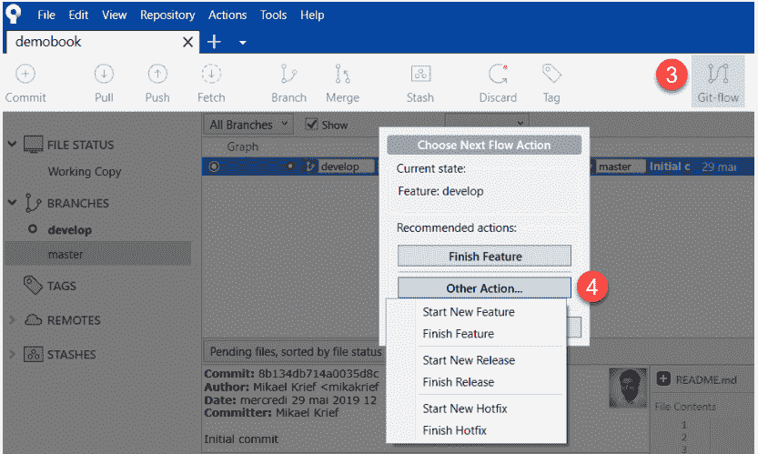

图 6.44 – 创建 Sourcetree 分支

如前几张截图所示，我们使用 Sourcetree 和允许我们直观创建分支的图形界面。

> **注意**
>
> 有关 Gitflow 及其流程的更多文档，请阅读此文章：
> https://jeffkreeftmeijer.com/git-flow/。

要开始使用 Gitflow，我建议您先从小型项目开始，然后您会发现该机制在大型项目中也是相同的。在本节中，我们了解了使用 Git 命令行及其工作流的过程。然后，我们讨论了开发分支的管理，最后，我们进一步了解了 Gitflow 分支，它允许简单地管理分支，并提供更好的 Git 开发工作流。

### 总结

Git 如今是所有开发人员的必备工具；它允许我们使用命令行或图形工具，共享和版本化代码，以实现更好的团队协作。

在本章中，我们了解了如何在不同操作系统上安装 Git 以及主要命令行的概述。然后，通过一个小型实验，我们了解了 Git 工作流及其 Git 命令行的应用。最后，我们介绍了通过实现分支和使用 Gitflow 模式来隔离代码，该模式提供了一个简单的分支策略模型。

在下一章中，我们将讨论 CI/CD，它是 DevOps 文化的关键实践之一。

### 问题

- 1. 什么是 Git？
- 2. 哪个命令用于初始化仓库？
- 3. Git 用于保存部分代码的工件名称是什么？
- 4. 哪个 Git 命令允许您将代码保存到本地仓库？
- 5. 哪个 Git 命令允许您将代码发送到远程仓库？
- 6. 哪个 Git 命令允许您从远程仓库更新本地仓库？
- 7. 哪个 Git 机制用于 Git 代码隔离？
- 8. 什么是 Gitflow？

### 进一步阅读

如果您想了解更多关于 Git 的信息，以下是一些资源：

- Git 文档：https://www.git-scm.com/doc
- Pro Git 书籍：https://git-scm.com/book/en/v2
- Mastering Git 书籍：https://www.packtpub.com/application-development/mastering-git
- 设置 Git：https://try.github.io/
- 学习 Git 分支：https://learngitbranching.js.org/
- Atlassian Git 教程：https://www.atlassian.com/git/tutorials
- git-flow 速查表：https://danielkummer.github.io/git-flow-cheatsheet/
