## 7 持续集成和持续交付

**开发运维（DevOps）**文化的主要支柱之一是实施**持续集成（CI）**和部署流程，正如我们在 _第 1 章，DevOps 文化和基础设施即代码实践_ 中所解释的那样。

在上一章中，我们了解了 Git 及其命令行和使用工作流，在本章中，我们将了解 Git 在 CI/CD 工作流中所起的重要作用。

**CI** 是一个过程，它向团队所有成员提供关于代码一致性和质量的快速反馈。当每个用户的代码提交从远程仓库检索并合并代码、对其进行编译和测试时，就会发生 CI。

**持续交付（CD）** 是将应用程序部署到不同阶段（或环境）的过程的自动化。


在本章中，我们将学习 CI/CD 流程的原则，以及如何使用不同的工具（如 **Jenkins**、**Azure Pipelines** 和 **GitLab CI**）来实践该流程。对于每种工具，我们将介绍其优点、缺点和最佳实践，并查看实现 CI/CD 流水线的实际示例。

你将了解 CI/CD 流水线的概念。之后，我们将探讨包管理器及其在流程中的作用。

然后，你将学习如何安装 Jenkins，最后，在 Jenkins、Azure Pipelines 和 GitLab CI 上构建 CI/CD 流水线。

本章涵盖以下主题：

- CI/CD 原则
- 在 CI/CD 过程中使用包管理器
- 使用 Jenkins 进行 CI/CD 实现
- 使用 Azure Pipelines 进行 CI/CD
- 使用 GitLab CI

### 技术要求

本章唯一的要求是系统中已安装 Git，如上一章中详细说明。

本章的源代码可在 `https://github.com/PacktPublishing/Learning-DevOps-Second-Edition/tree/main/CHAP07` 上获取。

查看以下视频，观看代码的实际运行情况：`https://bit.ly/3s9G8Pj`。

### CI/CD 原则

要实现 CI/CD 流水线，了解构建高效且安全流水线所需的不同元素非常重要。为了理解 CI/CD 的原则，以下图表展示了 CI/CD 工作流的不同步骤，我们在 _第 1 章，DevOps 文化和基础设施即代码实践_ 中已经见过：

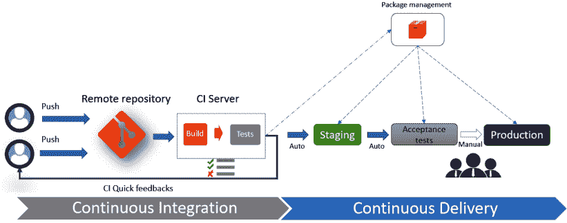

图 7.1 – CI/CD 工作流

让我们详细查看每个步骤，以列出 CI/CD 过程的产物。

#### CI

CI 阶段检查团队成员存档的代码。它必须在每个推送到远程仓库的提交上执行。

设置 Git 类型的 **源代码控制版本 (SCV)** 是一个必要的先决条件，它使集中化所有团队成员的代码成为可能。

团队将需要决定一个用于 CI 的代码分支。例如，我们可以使用 `master` 分支，或作为 GitFlow 一部分的 `develop` 分支；它只需要是一个非常定期集中代码更改的活跃分支。

此外，CI 是通过在服务器上执行的自动任务套件实现的，该套件遵循在开发人员笔记本电脑上执行的类似模式，该笔记本电脑具有 CI 所需的工具；此服务器称为 **CI 服务器**。

CI 服务器可以是本地类型，安装在公司数据中心，例如 Jenkins 或 TeamCity，或者可能是云类型，我们不必担心安装和维护，例如 Azure Pipelines 或 GitLab CI。

CI 阶段执行的任务必须自动化，并考虑验证代码所需的所有元素。

这些任务通常是代码编译和带有代码覆盖率的单元测试执行。我们还可以添加 SonarQube（或 SonarCloud）的静态代码分析，我们将在 _第 12 章，使用 SonarQube 进行静态代码分析_ 中查看。

在验证任务结束时，在许多情况下，CI 生成一个将部署到不同环境（也称为 **阶段**）的应用程序包。

为了能够托管此包，我们需要一个包管理器，也称为 **仓库管理器**，它可以是本地（本地安装）的，例如 Nexus、Artifactory 或 ProGet，或者是 **软件即服务 (SaaS)** 解决方案，例如 Azure Pipelines、Azure Artifacts 或 GitHub Packages 注册表。此包在环境配置方面也必须是中立的，并且 _必须_ 进行版本控制，以便在必要时部署应用程序的先前版本。

#### CD

一旦应用程序在 CI 期间被打包并存储在包管理器中，CD 过程就准备好检索包并将其部署到不同环境。

每个环境中的部署由一系列自动任务组成，这些任务也在具有访问不同环境权限的远程服务器上执行。

因此，有必要让 Dev、Ops 以及安全团队参与 CI/CD 工具和流程的实施。确实，正是这种人员与工具和流程的结合，将在不同服务器或云资源上部署应用程序，既遵守网络规则，也遵守公司的安全标准。

在部署阶段，通常需要修改生成包中的应用程序配置，以便其适应目标环境。因此，有必要集成一个 **配置管理器**，它已经存在于常见的 CI/CD 工具中，例如 Jenkins、Azure Pipelines 或 Octopus Deploy。此外，当有新的配置键时，最佳实践是让每个环境（包括生产环境）在 Ops 团队的参与下进行输入。

最后，部署的触发可以自动完成，但对于更关键的环境（例如，生产环境），受严格监管的公司可能有需要手动触发并检查有权触发部署的人员的网关。

设置 CI/CD 流水线的不同工具列表如下：

- 一个 SCV
- 一个包管理器
- 一个 CI 服务器
- 一个配置管理器

但请不要忘记，所有这些工具只有在 Dev 和 Ops 团队围绕它们协作时，才能真正有效地为产品交付增值。

我们刚刚了解了实现 CI/CD 流水线的原则。在本章的其余部分，我们将查看不同工具的实际实现，从包管理器开始。

### 在 CI/CD 过程中使用包管理器

包管理器是一个中央仓库，用于集中和共享包、开发库、工具和软件。

对于使用包管理器的消费客户端，其好处是能够跟踪、更新、安装和删除已安装的包。

有许多公共包管理器，例如 NuGet、**Node Package Manager (npm)**、Maven、Bower 和 Chocolatey，它们为不同语言和平台的开发人员提供框架或工具。

以下截图来自 NuGet 包管理器，它公开提供了超过 150,000 个 .NET 框架：


#### 共有 255,875 个包

- Newtonsoft.Json ✔ by: dotnetfoundation jamesnk newtonsoft
  ↓ 1,281,207,499 总下载量 ↻ 6 个月前上次更新 ↥ 最新版本：13.0.1 ◇ json
  Json.NET 是 .NET 的一个流行的高性能 JSON 框架

- Microsoft.Extensions.DependencyInjection ✔ by: aspnet dotnetframework Microsoft
  ↓ 753,833,308 总下载量 ↻ 12 天前上次更新 ↥ 最新版本：6.0.0-rc.1.21451.13
  Microsoft.Extensions.DependencyInjection 的依赖注入默认实现。

- Microsoft.Extensions.Logging ✔ by: aspnet dotnetframework Microsoft
  ↓ 735,313,652 总下载量 ↻ 12 天前上次更新 ↥ 最新版本：6.0.0-rc.1.21451.13
  Microsoft.Extensions.Logging 的日志基础设施默认实现。

图 7.2 – NuGet 包管理器

开发人员使用这种类型包管理器的一个优势是，他们不必将包与应用程序源代码一起存储，而是可以在配置文件中将其作为引用，这样包将被自动检索。

在企业应用程序中，事情有点不同，因为尽管开发人员使用公共管理器中的包，但在企业中生成的一些元素必须保持内部。

确实，通常的情况是，框架（例如 NuGet 或 npm 库）是在内部开发的，不能公开暴露。此外，正如我们在 CI/CD 流水线中看到的，我们需要为应用程序制作一个包，并将其存储在对公司私有的包管理器中。

这就是为什么建议查看 NuGet 和 npm 等包管理器，它们可以在企业内部或个人需求中使用。

### 私有 NuGet 和 npm 仓库

如果您需要集中 NuGet 或 npm 包，可以创建自己的本地仓库。

要创建您的 **NuGet 服务器** 实例，请参阅 Microsoft 文档：`https://docs.microsoft.com/en-us/nuget/hosting-packages/overview`。

对于 npm，我们也可以使用 `npm local-npm` 包在本地安装它，其文档可在此处查看：`https://www.npmjs.com/package/local-npm`。

按包类型方法安装每个仓库的问题是，我们需要为不同类型的包安装和维护仓库及其基础设施。

这就是为什么最好切换到通用仓库解决方案，例如用于本地解决方案的 Nexus (Sonatype)、ProGet 和 Artifactory，以及用于 SaaS 解决方案的 Azure Artifacts、MyGet 或 Artifactory。

为了了解包管理器的工作原理，我们将查看 Nexus Repository OSS 和 Azure Artifacts。

### Nexus Repository OSS

Nexus Repository 是 Sonatype 公司的产品（`https://www.sonatype.com/`），该公司专门从事 **开发-安全-运维 (DevSecOps)** 工具，这些工具将安全控制集成到应用程序的代码中。


Nexus Repository 存在开源/免费版本，其文档可在 https://www.sonatype.com/nexus-repository-oss?smtNoRedir=1 和 https://help.sonatype.com/repomanager3 上查阅。

在安装和使用 Nexus 之前，请考虑要求文档中详细说明的软件和硬件要求，文档地址如下：https://help.sonatype.com/repomanager3/installation/system-requirements。

关于安装和配置步骤，请参阅安装流程，文档地址如下：https://help.sonatype.com/repomanager3/installation。

您也可以通过 Docker 容器使用它（我们将在下一章详细介绍 Docker），相关文档如下：https://hub.docker.com/r/sonatype/nexus3/。

安装 Nexus Repository 后，我们必须按照以下步骤创建一个仓库：

- 1. 在 **Repositories** 部分，单击 **Create repository** 按钮。
- 2. 然后，选择将存储在仓库中的包类型（例如，npm、NuGet 或 Bower），如下图所示：

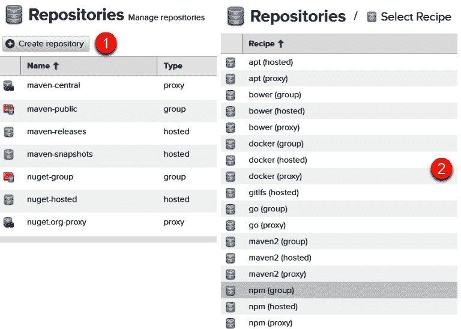

图 7.3 – Nexus 包管理器

Nexus 是一个高性能且广泛使用的企业仓库，但安装和维护它需要付出努力。对于 Azure Artifacts 等 SaaS 包管理器则不存在此问题，我们将在本节后面介绍。

### Azure Artifacts

Azure Artifacts 是 Azure DevOps 提供的服务之一。我们在上一章已经介绍过它，并且在本章的 _使用 Azure Pipelines 进行 CI/CD_ 部分还会再次介绍。它托管在云端，因此允许管理私有包源。

当前支持的包包括 NuGet、npm、Maven、Gradle、Python 以及通用包。与 Nexus 的主要区别在于，在 Azure Artifacts 中，源不是按包类型划分的，一个源可以包含不同类型的包。

Azure Artifacts 的一个优势是它与其他 Azure DevOps 服务（例如 Azure Pipelines）完全集成，Azure Pipelines 允许管理 CI/CD 管道，我们将在稍后介绍。

在 Azure Artifacts 中，还有一种称为 **通用包** 的包类型，它允许在源中存储所有类型的文件（称为 **包**），这些包可以被其他服务或用户消费。

以下是一个 Azure Artifacts 源的示例，其中包含多种类型的包，我们可以看到一个 NuGet 包、一个 npm 包、一个通用包、一个 Maven 包和一个 Python 包：

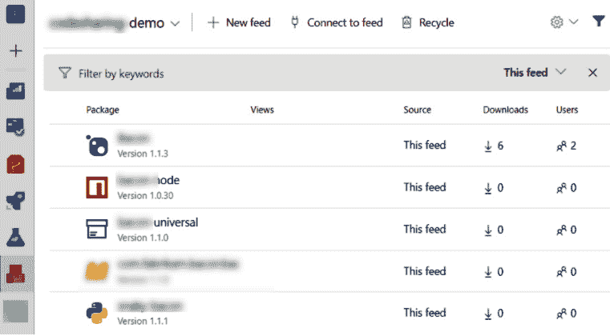

图 7.4 – Azure Artifacts 包

Azure Artifacts 的优势在于它是 SaaS 产品模式，因此无需安装或管理基础设施；有关更多信息，文档可在此处查阅：https://azure.microsoft.com/en-us/services/devops/artifacts/。

我们已完成对包管理器的概述，涵盖了本地 NuGet 服务器实例、NPM、Nexus 和 Azure Artifacts。当然，还有许多其他包管理器工具应根据公司需求予以考虑。

在介绍完包管理器后，我们将使用一个名为 Jenkins 的知名工具实现 CI/CD 管道。

### 使用 Jenkins 进行 CI/CD 实现

Jenkins 是最古老的 CI 工具之一，最初发布于 2011 年。它是开源的，并使用 Java 开发。

Jenkins 之所以闻名，得益于为其工作的庞大社区及其插件。事实上，有超过 1,500 个 Jenkins 插件可让您在作业中执行各种操作。而且，即使您的某项任务没有插件，您也可以自行创建一个。

在本节中，我们将介绍 Jenkins 的安装和配置，并将创建一个 CI Jenkins 作业，该作业将在 Git 仓库中提交代码时执行。

演示应用程序的源代码是一个开源 Java 项目，可在 GitHub Microsoft 仓库空间中查阅：https://github.com/microsoft/MyShuttle2。要使用它，您需要将其 fork 到您的 GitHub 帐户中。

在介绍 Jenkins 作业之前，我们将了解如何安装和配置 Jenkins。

### 安装和配置 Jenkins

Jenkins 是一个跨平台工具，可以安装在任何类型的支持上，例如 **虚拟机 (VM)** 甚至 Docker 容器。其安装文档可在此处查阅：https://jenkins.io/doc/book/installing/。

对于我们的演示，以及为了快速访问 CI/CD 管道的配置，我们将在 Azure VM 上使用 Jenkins。事实上，Azure Marketplace 包含一个预装了 Jenkins 及其先决条件的 VM。

### 以下步骤展示了如何创建带有 Jenkins 及其基本配置的 Azure VM：

- 1. 要了解创建已预装 Jenkins 的 Azure VM 的所有步骤，请阅读此处提供的文档：https://docs.microsoft.com/en-us/azure/jenkins/install-jenkins-solution-template。
- 以下截图显示了 Azure Marketplace 上的 Jenkins 集成：

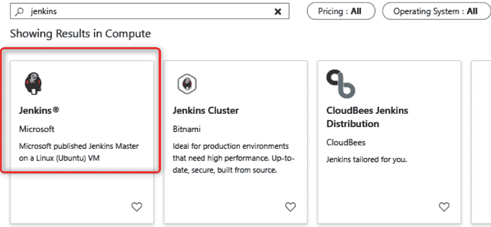

图 7.5 – Azure Marketplace 上的 Jenkins

- 2. 安装并创建后，我们将在浏览器中访问 Jenkins，方法是在 Azure 门户的 **DNS 名称** 字段中提供其 **统一资源定位符 (URL)**，如下图所示：

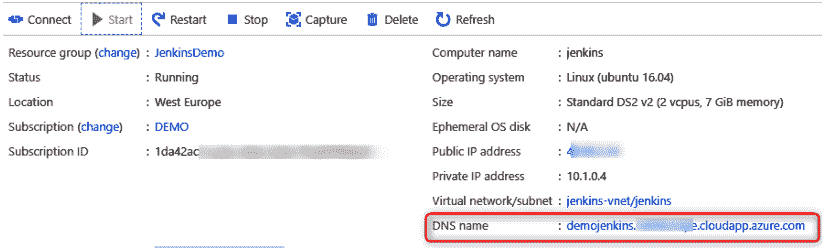

图 7.6 – Jenkins 的 Azure 域名系统 (DNS) 名称

3. 按照 Jenkins 主页上显示的说明操作，通过安全 **安全套接层 (SSL)** 隧道启用对此 Jenkins 实例的访问。有关此步骤的更多详细信息，请阅读 `https://docs.microsoft.com/en-us/azure/jenkins/install-jenkins-solution-template#connect-to-jenkins` 中的文档以及此文章：`https://jenkins.io/blog/2017/04/20/secure-jenkins-on-azure/`。

4. 然后，按照 Jenkins 屏幕上显示的 **解锁 Jenkins** 消息中的配置说明操作。配置完成后，我们即可准备好 Jenkins 以创建 CI 作业。

为了在 Jenkins 中使用 GitHub 功能，我们还通过 Jenkins 插件管理安装了 **GitHub 集成插件**，具体操作请参阅此文档：`https://jenkins.io/doc/book/managing/plugins/`。

以下截图显示了 GitHub 插件的安装：

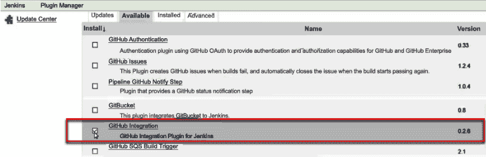

图 7.7 – Jenkins GitHub 集成

现在我们已在 Jenkins 中安装了 GitHub 插件，让我们来看看如何使用 Webhook 配置 GitHub 以便与 Jenkins 集成。

### 配置 GitHub Webhook

为了让 Jenkins 运行新作业，我们必须首先在 GitHub 仓库中创建一个 Webhook。当仓库中发生新的推送时，此 Webhook 将用于通知 Jenkins。

为此，请执行以下步骤：

- 1. 在 GitHub 仓库中，转到 **设置 | Webhook** 菜单。
- 2. 单击 **添加 Webhook** 按钮。
- 3. 在 **有效载荷 URL** 字段中，填写 Jenkins 的 URL 地址，后跟 /github-webhook/，保持密钥输入不变，并选择 **仅推送事件** 选项。
- 4. 验证 Webhook。

以下截图显示了为 Jenkins 配置 GitHub Webhook 的过程：

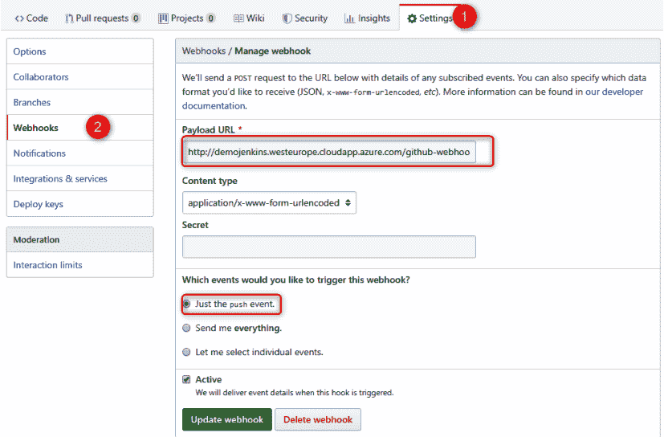

图 7.8 – Jenkins 的 GitHub Webhook 配置

- 5. 最后，我们可以在 GitHub 界面上检查 Webhook 是否已正确配置并与 Jenkins 通信，如下图所示：

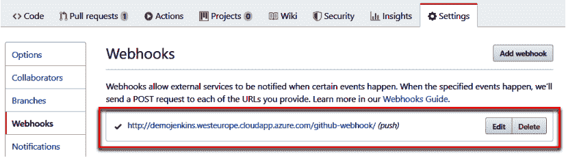

图 7.9 – GitHub Webhook 验证

GitHub 的配置已完成。我们现在将在 Jenkins 中创建一个新的 CI 作业。

### 配置 Jenkins CI 作业

要配置 Jenkins，请执行以下步骤：

- 1. 首先，我们将通过单击 **新建项目** 或 **创建新作业** 链接来创建一个新作业，如下图所示：

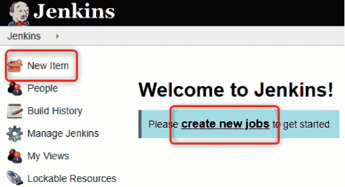

图 7.10 – 在 Jenkins 中创建新作业

- 2. 在作业配置表单中，输入作业名称（例如，`demoCI`），并选择 **自由风格项目** 模板，然后通过单击 **确定** 进行验证，如下图所示：

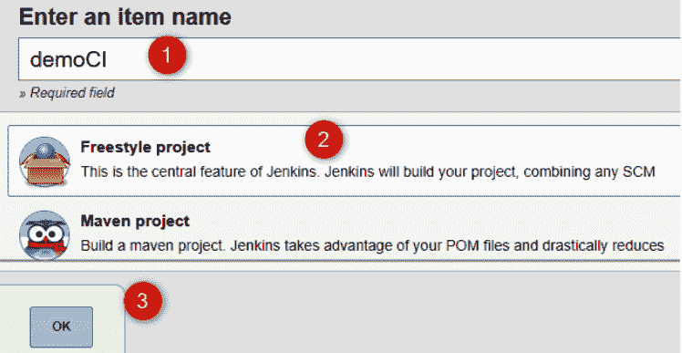

图 7.11 – Jenkins 作业名称


### 3. 然后，我们使用以下参数配置作业：

- 在 **GitHub 项目** 输入框中，输入 GitHub 仓库的 URL，如下所示：

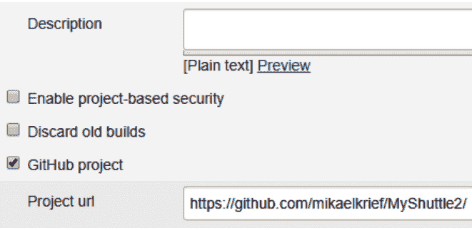

图 7.12 – Jenkins 作业：GitHub

- 在 **源代码管理** 部分，输入 GitHub 仓库的 URL 和代码分支，如下所示：

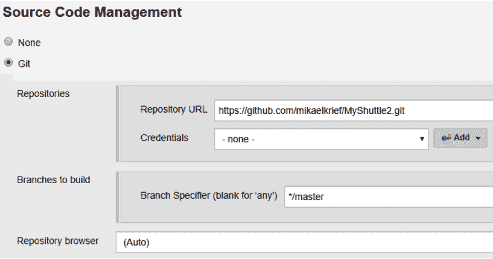

图 7.13 – Jenkins 作业：GitHub 配置

- 在 **构建触发器** 部分，勾选 **GitHub hook trigger for GITScm polling** 复选框，如下所示：

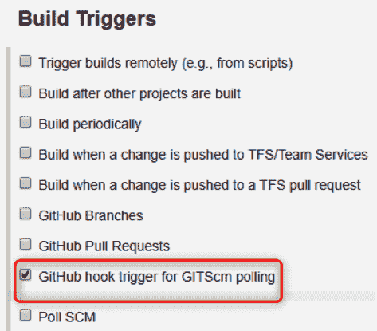

图 7.14 – Jenkins 作业：GitHub hook 触发器

- 在 **构建** 部分，在 **添加构建步骤** 下拉列表中，我们将为本实验选择 **执行 Shell** 步骤。您可以根据需要向 CI 添加尽可能多的操作（编译、文件复制和测试）。您可以在下面的屏幕截图中看到一些可能操作的示例：

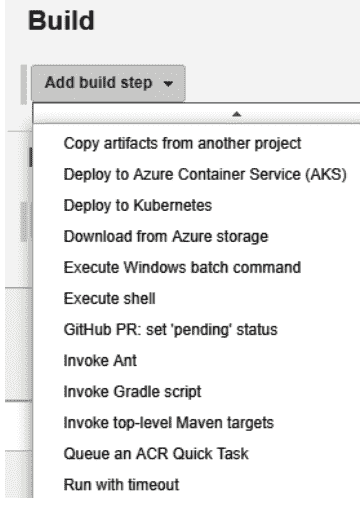

图 7.15 – Jenkins 作业：添加构建步骤

- 在 Shell 命令文本框中，我们输入 `printenv` 命令，以便在作业管道执行期间执行，如下面的屏幕截图所示：

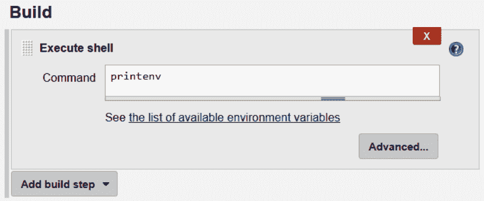

图 7.16 – Jenkins 作业命令步骤示例

- 4. 然后，单击 **应用**，再单击 **保存** 按钮完成配置。

我们的 Jenkins CI 作业现已创建，并配置为在提交时触发，并执行各种操作。

我们将手动运行它以测试其正常运行情况。

### 执行 Jenkins 作业

要测试作业执行，我们将执行以下步骤：

- 1. 首先，我们将修改 GitHub 仓库的代码——例如，通过修改 `Readme.md` 文件。

- 2. 然后，直接从 GitHub Web 界面提交到 master 分支。

- 3. 在提交后，我们在 Jenkins 中看到的是 `DemoCI` 作业已排队并正在运行。

### 永久链接

- 上一次构建 (#4)，18 秒前
- 上一次稳定构建 (#4)，18 秒前
- 上一次成功构建 (#4)，18 秒前
- 上一次完成构建 (#4)，18 秒前

下面的屏幕截图显示了作业执行队列：

图 7.17 – Jenkins 作业运行历史记录

4. 单击作业，然后单击 **控制台输出** 菜单的链接，我们可以查看作业执行日志，如下面的屏幕截图所示：

图 7.18 – Jenkins 作业控制台输出

我们刚刚在 Jenkins 中创建了一个 CI 作业，它在 Git 仓库（在我们的示例中为 GitHub）提交时运行。

在本节中，我们介绍了在 Jenkins 中创建管道的过程。现在，让我们看看如何使用另一种 DevOps 工具：Azure Pipelines 来创建 CI/CD 管道。

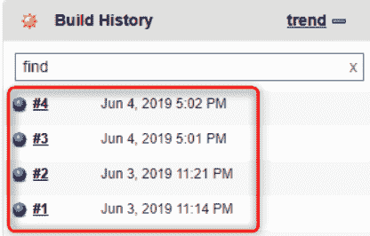

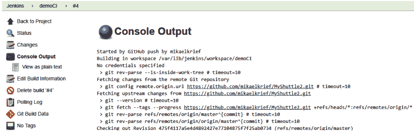

### 使用 Azure Pipelines 进行 CI/CD

Azure Pipelines 是 Azure DevOps 提供的服务之一。它以前称为 **Visual Studio Team Services (VSTS)**。

Azure DevOps 是 Microsoft 提供的完整 DevOps 平台，可通过 Web 浏览器完全访问，无需安装。它非常有用，原因如下：

- DevOps 工具在 **版本控制系统 (VCS)** 中管理其代码。
- 它以敏捷模式管理项目。
- 它在 CI/CD 管道中部署应用程序，以集中管理软件包。
- 它执行手动测试计划。

这些功能中的每一个都组合成服务，如下表所示：

| 服务名称 | 描述 | 文档链接 |
|---|---|---|
| Azure Repos | 这是我们在上一章中介绍的 VCS。 | [https://azure.microsoft.com/en-us/services/devops/repos/](https://azure.microsoft.com/en-us/services/devops/repos/) |
| Azure Boards | 这是一种用于敏捷模式下项目管理的服务，包含冲刺、待办事项列表和看板。 | [https://azure.microsoft.com/en-us/services/devops/boards/](https://azure.microsoft.com/en-us/services/devops/boards/) |
| Azure Pipelines | 这是一种允许管理 CI/CD 管道的服务。 | [https://azure.microsoft.com/en-us/services/devops/pipelines/](https://azure.microsoft.com/en-us/services/devops/pipelines/) |
| Azure Artifacts | 这是一个私有包管理器。 | [https://azure.microsoft.com/en-us/services/devops/artifacts/](https://azure.microsoft.com/en-us/services/devops/artifacts/) |
| Azure Test Plans | 这允许您创建和管理手动测试计划。 | [https://azure.microsoft.com/en-us/services/devops/test-plans/](https://azure.microsoft.com/en-us/services/devops/test-plans/) |

表 7.1 – Azure DevOps 服务列表

Azure DevOps 对最多五名用户免费。超过此数量后，有按用户收费的许可证版本。有关许可的更多信息，请参阅 https://azure.microsoft.com/en-us/pricing/details/devops/azure-devops-services/ 上的产品说明，其中还包含一个计算器，可用于估算团队的成本。

> 注意
> 还有一种 **Azure DevOps Server**，它与 Azure DevOps 是同一产品，但本地安装。要了解这两种产品之间的区别，请阅读此处的文档：https://docs.microsoft.com/en-us/azure/devops/user-guide/about-azure-devops-services-tfs?view=azure-devops。

要注册 Azure DevOps 并创建名为组织的帐户，我们需要 Microsoft Live 帐户或 GitHub 帐户，然后执行以下步骤：

1. 在浏览器中，访问此 URL：https://azure.microsoft.com/en-us/services/devops/。
2. 单击 **登录** 按钮。
3. 在下一页，选择要使用的帐户（**Live** 或 **GitHub**）。
4. 注册后，建议的第一步是创建一个具有唯一名称的组织，并选择 Azure 位置——例如，组织名称为 BookLabs，位置为 `West Europe`。
5. 在此组织中，我们现在可以创建带有 CI/CD 管道的项目，就像我们在 _第 6 章，使用 Git 管理源代码_ 中学到的那样。

在本实验中，我们将展示如何设置 **端到端 (E2E)** CI 和 CD 管道，首先使用 Azure Repos 对代码进行版本控制。然后，在 Azure Pipelines 中，我们将介绍 CI 流程，并以应用程序在发布中的自动部署结束。

### 在 Azure Repos 中使用 Git 对代码进行版本控制

如我们所提到，设置 CI 流程的首要前提是将应用程序代码在 SVC 中进行版本控制，我们将在 Azure Repos 中通过以下步骤完成此操作：

1. 要开始本实验，我们将创建一个新项目；此操作已在 _第 6 章，使用 Git 管理源代码_ 的 _开始使用 Git 流程_ 部分中介绍过。

2. 然后，在 Azure Repos 中，我们将使用存储库菜单的 **导入存储库** 选项从另一个 Git 存储库导入代码，如下面的屏幕截图所示：

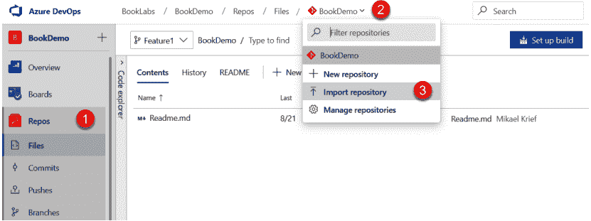

图 7.19 – Azure Repos 导入存储库菜单

3. 打开 **导入 Git 存储库** 窗口后，输入我们要导入源代码的 Git 存储库的 URL。在本实验中，我们将导入 `https://github.com/mikaelkrif/DemoAspNetApp.git` 存储库中找到的源代码，如下面的屏幕截图所示：

### 导入 Git 存储库


源类型
Git

克隆 URL *
https://github.com/mikaelkrif/DemoAspNetApp.git 1

需要授权

名称 *
DemoAspNetApp


图 7.20 – Azure Repos 导入存储库

4. 单击 **导入** 按钮，然后我们将看到代码已导入到我们的存储库中。下面的屏幕截图显示了导入到我们 Azure Repos 存储库中的代码，这是一个 ASP.NET 代码应用程序及其单元测试：

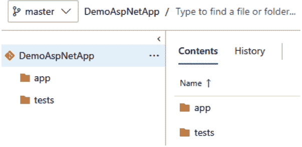

图 7.21 – Azure Repos 导入存储库完成

现在我们已将代码放入 Azure Repos，将设置一个 CI 管道，在每次用户提交时检查和测试代码。

### 创建 CI 管道

我们将按照以下步骤在 Azure Pipelines 中创建 CI 管道：

1. 要创建此管道，请打开 **管道 | 构建** 菜单，如下面的屏幕截图所示。然后，单击 **新建管道** 按钮：

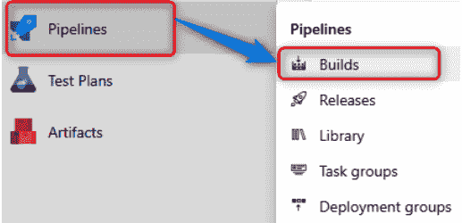

图 7.22 – Azure Pipelines：创建构建

2. 对于配置模式，我们选择 **使用经典编辑器** 选项，如下面的屏幕截图所示：

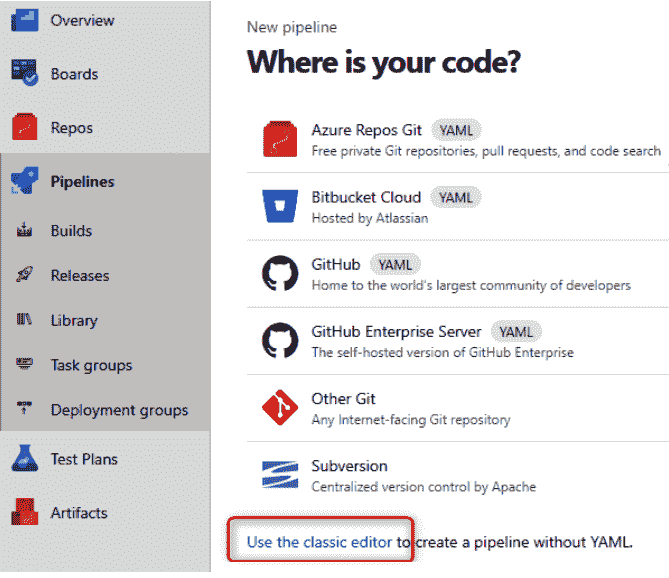

图 7.23 – Azure Pipelines 经典编辑器链接


在 Azure Pipelines 中，可以选择经典编辑器模式，该模式允许我们通过图形界面配置管道，或者 YAML 管道模式，该模式涉及使用 **YAML Ain't Markup Language** (YAML) 文件来描述管道的配置。

在此实验中，我们将使用经典编辑器模式，以便可以可视化不同的选项和配置步骤。

3. 管道的第一个配置步骤是选择包含应用程序源代码的仓库。

今天，Azure Pipelines 支持多种 Git 系统，例如 Azure Repos、GitHub、Bitbucket 和 **Subversion** (SVN)。因此，我们将在包含导入源代码的仓库中选择 **Azure Repos Git**，如下图所示：

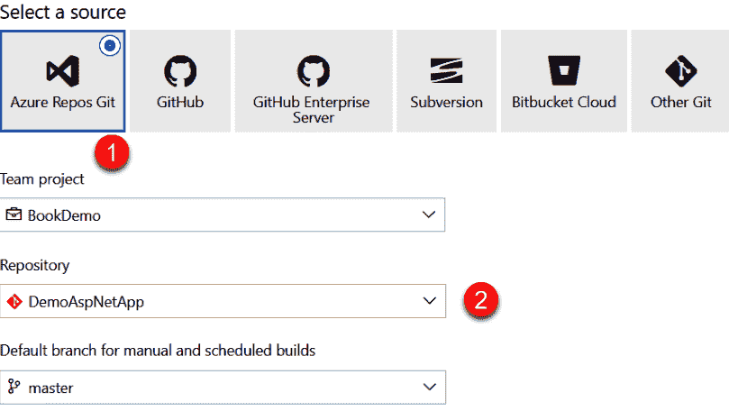

图 7.24 – Azure Pipelines：选择源代码仓库

4. Azure Pipelines 提议选择一个包含所有预配置构建步骤的构建模板；也可以从空模板开始。

由于我们的项目是 ASP.NET Core 应用程序，我们将选择 **ASP.NET Core** 模板，如下图所示：

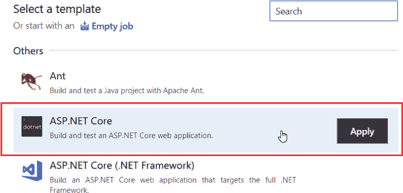

图 7.25 – Azure Pipelines：选择模板

选择模板后，我们将到达构建定义的配置页面。

构建定义的配置包含四个主要部分，概述如下：

- Variables
- Steps
- Triggers
- Options

5. 我们配置 **Variables** 部分，该部分允许我们以键值形式填写变量列表，创建可在步骤中使用的值。

下图显示了我们构建定义的 **Variables** 选项卡：

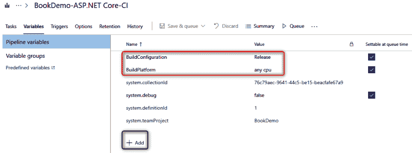

当我们导航到 **Variables** 选项卡时，可以看到模板已预填的 `BuildConfiguration` 和 `BuildPlatform` 变量，以及 **+ Add** 按钮，该按钮允许我们在需要时添加其他变量。

> **Note**
> 变量文档可在此处查阅：https://docs.microsoft.com/en-us/azure/devops/pipelines/process/variables?view=azure-devops&tabs=classic%2Cbatch。

6. 我们配置 **Tasks** 选项卡，该选项卡包含构建中要执行的所有步骤的配置。

下图是该选项卡的截图：

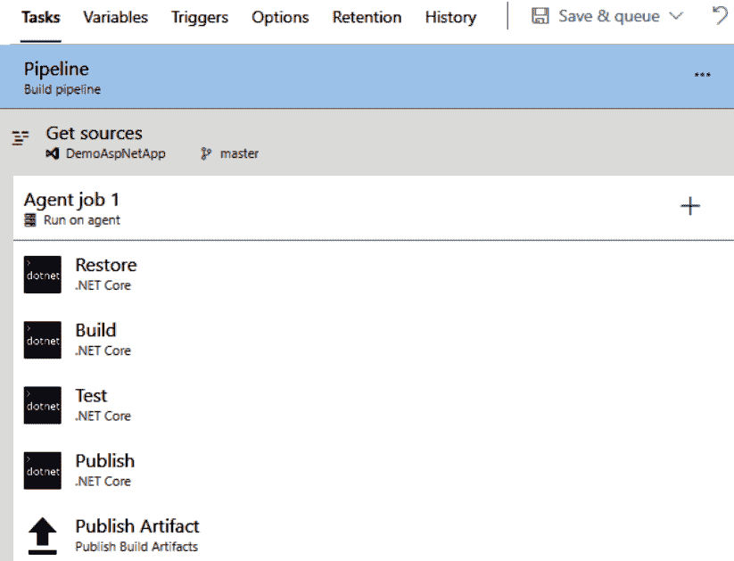

图 7.27 – Azure Pipelines：任务列表

在上述截图中，第一部分是 **Pipeline**，它允许我们配置构建定义的名称以及要使用的代理。

确实，在 Azure DevOps 中，管道在安装在 VM 或容器上的代理上执行。

Azure DevOps 提供来自多个 **operating systems (OSes)** 的免费代理，称为托管代理，但也可以安装自己的代理，称为 **self-hosted** 代理。

> Note
> 要了解有关托管代理和自托管代理的更多信息，请参阅以下文档：https://docs.microsoft.com/en-us/azure/devops/pipelines/agents/agents?view=azure-devops。

下图显示了 **Pipeline** 部分的配置：

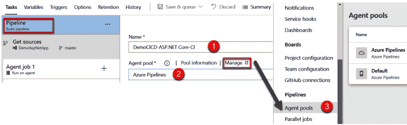

图 7.28 – Azure Pipelines：代理池配置

7. 然后，我们有 **Get sources** 阶段，它包含我们在开始时进行的源代码配置；不过，可以在此处对其进行修改，如下图所示：

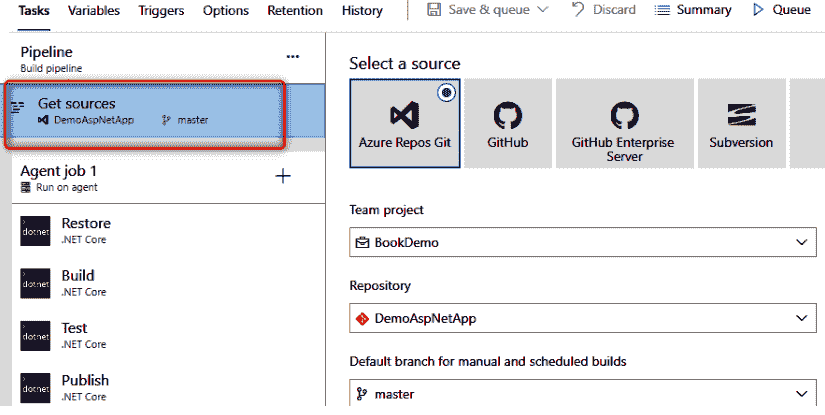

图 7.29 – Azure Pipelines：源代码配置

8. 我们有 **Agent job** 部分，它包含要在管道中执行的任务的有序列表。这些任务中的每一个都在右侧面板中配置。

我们可以单击 + 按钮添加任务，然后从 Azure Pipelines 目录中选择它们，如下所示：

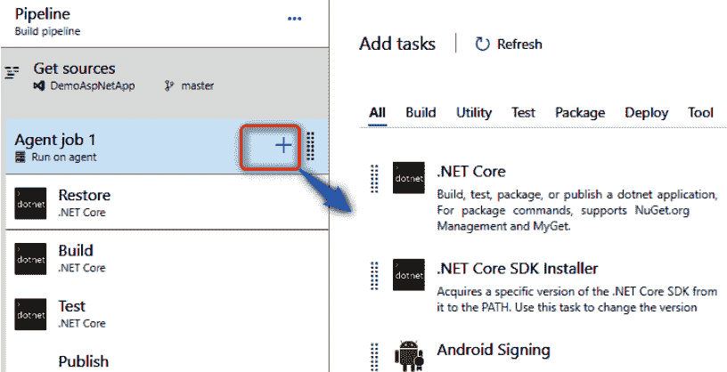

图 7.30 – Azure Pipelines：添加任务

默认情况下，Azure Pipelines 包含非常丰富的任务目录；这些任务的列表可在此处查阅：https://docs.microsoft.com/en-us/azure/devops/pipelines/tasks/index?view=azure-devops。我们还可以安装在 Azure 市场中找到的任务：https://marketplace.visualstudio.com/search?target=AzureDevOps&category=Azure%20Pipelines&sortBy=Downloads。如果需要，也可以按照此处的文档创建适合您需求的任务：https://docs.microsoft.com/en-us/azure/devops/extend/get-started/node?view=azure-devops。

让我们定义 CI 管道中的五个任务，如下所示：

| Step/task | Description |
|---|---|
| Restore | Restores the packages referenced in the project |
| Build | Builds the project and generates binaries |
| Test | Runs unit tests |
| Publish | Creates a ZIP package that contains the binary files of the project |
| Publish build artifacts | Defines an artifact that is our ZIP package of the application, which we will publish in Azure DevOps, and which will be used in the deployment release, as seen in the previous section, using a package manager in the CI/CD process |

表 7.2 – Azure Pipelines 步骤列表

9. 我们 CI 管道的最后一个重要配置是在 **Triggers** 选项卡中配置构建触发器以启用 CI，如下图所示：

图 7.31 – Azure Pipelines：启用 CI

10. 我们的 CI 或构建管道配置已完成；我们通过单击 **Save & queue** 按钮来验证并首次测试其执行，如下图所示：

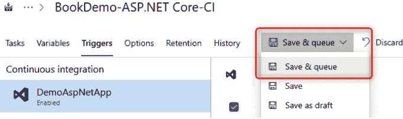

图 7.32 – Azure Pipelines：保存并排队管道

11. 构建执行结束时，我们有一些信息来帮助分析管道状态，如下所示：

- 下图显示执行日志。这显示了管道中定义的每个任务的执行详细信息：

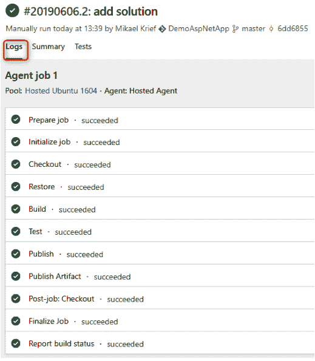

图 7.33 – Azure Pipelines 运行结果

接下来显示单元测试的执行结果。下图显示了单元测试执行报告，其中包含一些重要指标，例如通过/失败的测试数量和测试执行时间：

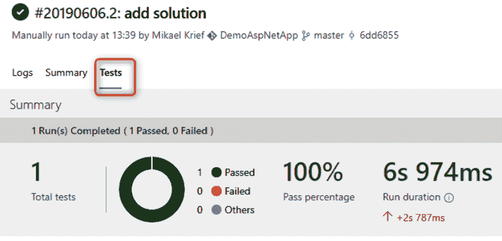

图 7.34 – Azure Pipelines：测试执行摘要

下图显示已发布的构建产物。这提供了探索或下载管道中 **Publish Build Artifact** 任务定义的已发布构建产物的可能性。

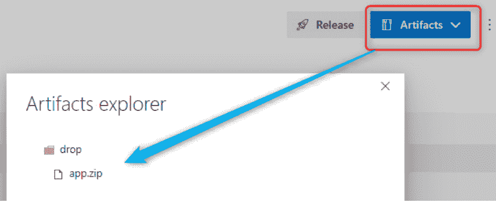

图 7.35 – Azure Pipelines：浏览构建产物

现在我们知道我们的 CI 构建已配置并可运行，我们将为 CD 管道创建和配置部署发布。

### 创建 CD 管道 – 发布

在 Azure Pipelines 中，允许在不同阶段或环境中进行部署的元素称为 **release**。我们将创建一个发布定义，该定义将通过以下步骤将构建生成的构建产物部署到 Azure Web 应用：

1. 要创建发布定义，我们转到 **Releases** 菜单并单击 **New pipeline**，如下所示：

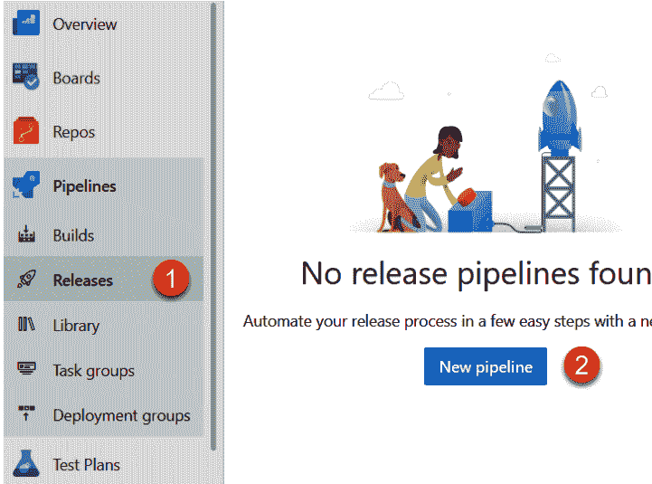

图 7.36 – Azure Pipelines：创建发布定义

2. 与构建一样，配置的第一步是选择一个已配置的模板。对于本实验，我们将选择 **Azure App Service deployment** 模板，如下图所示：

图 7.37 – Azure Pipelines：Azure 应用服务部署模板

3. 然后，在下一个窗口中，第一个阶段被命名，例如，CI 作为 CI 环境，如下图所示：

图 7.38 – Azure Pipelines：阶段名称


4. 我们在 artifacts 部分通过添加一个构件来配置发布的入口点，该构件是在“创建 CI 管道”部分之前创建的构建定义，如下所示：

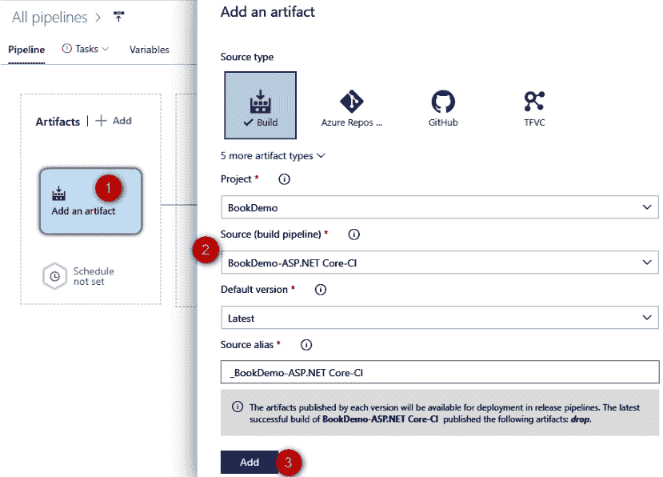

图 7.39 – Azure Pipelines：添加发布构件

5. 我们为每次成功的生成执行配置自动发布触发器，如下所示：

### 所有管道 > 新建发布管道

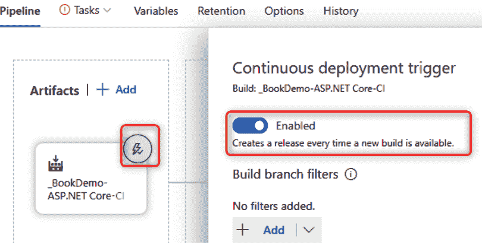

图 7.40 – Azure Pipelines：启用 CD 的发布

6. 现在，我们将配置在 CI 阶段中执行的步骤；单击该阶段后，我们将获得与生成完全相同的配置窗口，包含以下信息：

- **在代理上运行** 部分中代理的选择
- 步骤及其参数的配置

在我们的案例中，我们看到模板中已存在的 Azure Web 应用中有一个部署任务。我们首先填充 CI 标题中位于的参数，因为它们在 CI 过程中是共享的，如下面的屏幕截图所示：

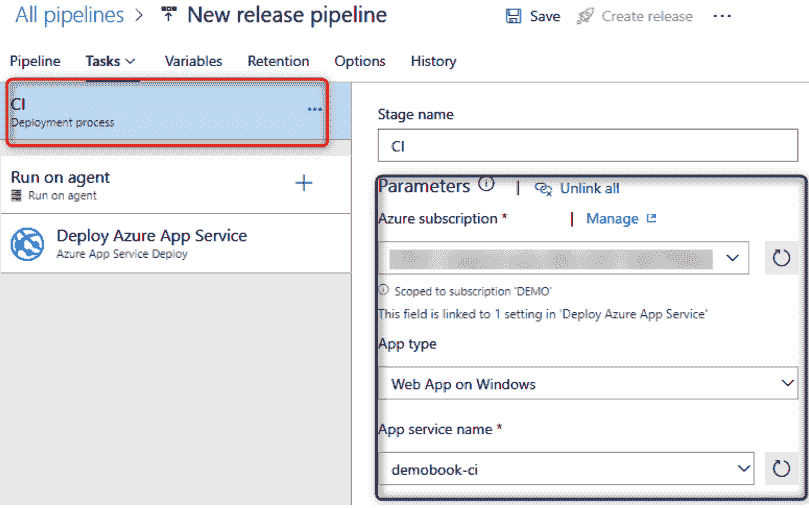

图 7.41 – Azure Pipelines：发布配置

我们将填充以下参数：

- 与 Azure 订阅的连接
- 我们要在其中部署 ZIP 包的 Azure Web 应用的名称

> **注意**
>
> 在将应用程序部署到其中之前，Web 应用必须已经创建。
> 如果尚未创建，可以使用 Azure 命令行界面 (CLI) `az webapp create` 命令，文档位于 https://docs.microsoft.com/en-us/cli/azure/webapp?view=azure-cli-latest#az-webapp-create，或者使用 PowerShell `New-AzureRmWebApp` 命令，文档位于 https://docs.microsoft.com/en-us/powershell/module/azurerm.websites/new-azurermwebapp?view=azurermps-6.13.0。

然后，在 Azure 部署任务的参数中，我们无需修改任何内容。

7. 我们只需用一个简单描述其功能的名称重命名发布，然后保存它，如下所示：

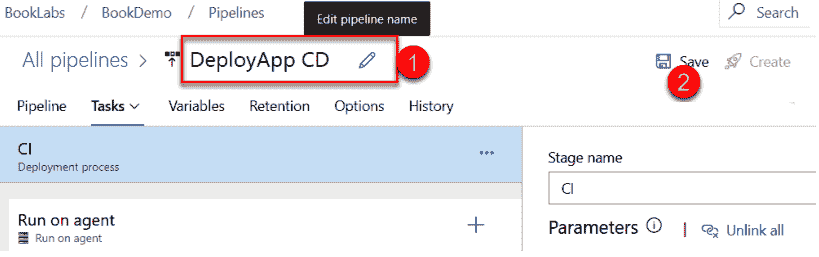

8. 现在，我们通过部署其他环境（或阶段）来完成发布定义，在我们的示例中，这些环境是 QA 和 PROD。为了简化操作，我们将在发布中克隆 CI 环境设置，并将 **App service name** 设置的名称更改为 Web 应用的名称。下面的屏幕截图显示了克隆环境操作：

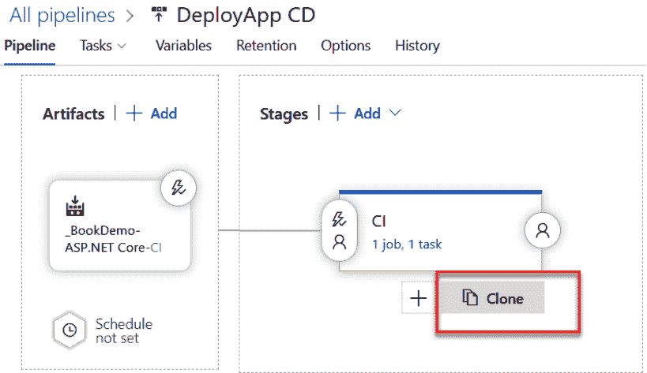

下面的屏幕截图显示了带有新环境 Web 应用名称的 Azure **App service name** 设置：

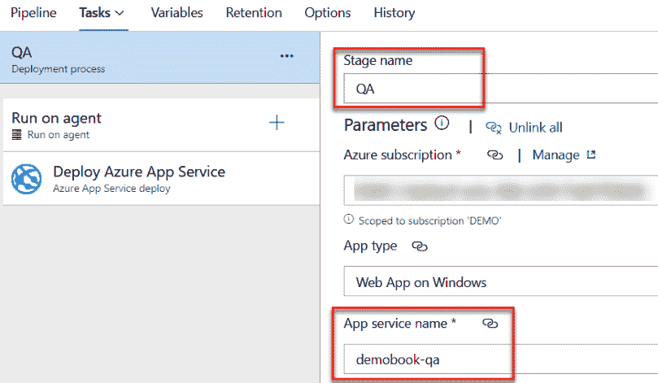

图 7.44 – Azure 发布：编辑应用服务名称

9. 我们最终得到了发布定义，如下所示：

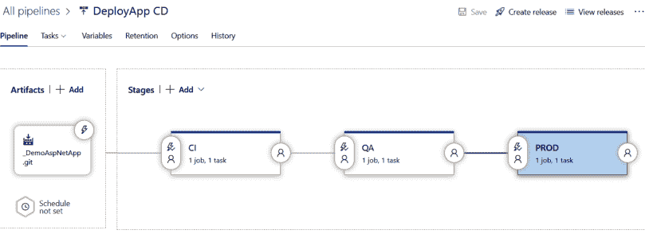

图 7.45 – Azure Pipelines：发布定义

10. 要触发我们的应用程序部署，我们将通过单击 **Create release** 按钮创建一个新发布，如下面的屏幕截图所示：

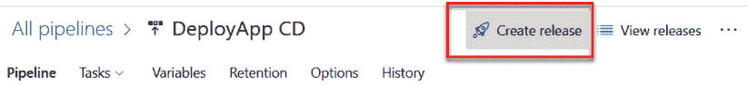

图 7.46 – Azure Pipelines：创建发布

11. 在执行结束时，我们可以看到其部署状态，如下面的屏幕截图所示：

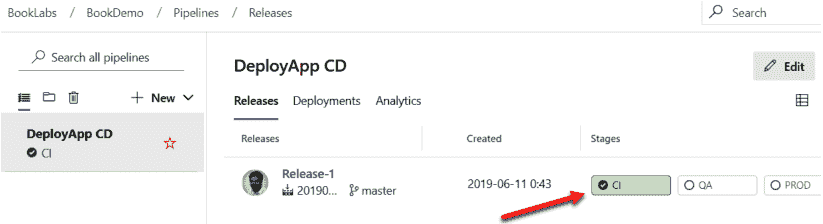

图 7.47 – Azure Pipelines：部署状态

在此屏幕截图中，我们看到集成环境中的部署已成功完成。

通过遵循本实验中的步骤，我们已在 **用户界面** (UI) 模式（称为经典模式）下创建了 CI 和 CD 管道。现在，我们将学习如何使用 YAML 文件以代码模式创建管道。

### 在 YAML 文件中创建完整的管道定义

在前面的部分中，我们讨论了在 Azure DevOps 中使用 UI 创建 CI 和 CD 管道，这有一些优势，但其不便之处之一是为大量项目自动化创建管道的困难。

为了解决这个问题，Azure DevOps 提供了将完整的管道定义（CI 和 CD）编写在保存在存储库中的 YAML 文件中的可能性。

### 230 持续集成和持续交付

> 注意
> 本节的目的是演示仅包含 CI 步骤的 Azure DevOps 管道 YAML 的概览。这不是一个高级实验，如果您想了解更多信息，请阅读此处的文档：https://docs.microsoft.com/en-us/azure/devops/pipelines/yaml-schema。

在以下实验中，我们将学习如何在 YAML 文件中创建基本管道定义。具体操作如下：

1. 在 Azure Repos 中，在先前创建的 DemoBook 存储库内，添加一个名为 azure-pipeline.yml 的新文件，内容如下：

```yaml
trigger:
- master
pool:
vmImage: ubuntu-latest
steps:
- task: DotNetCoreCLI@2
displayName: "Restore"
inputs:
command: restore
projects: '**/*.csproj'
- task: DotNetCoreCLI@2
displayName: "build"
inputs:
command: 'build'
projects: '**/*.csproj'
arguments: '--configuration Release'
- task: DotNetCoreCLI@2
displayName: "Run tests"
inputs:
command: 'test'
projects: '**/tests/*.csproj'
arguments: '--configuration Release'
- task: DotNetCoreCLI@2
displayName: "Code coverage"
inputs:
command: test
projects: '**/*/Tests/*.csproj'
arguments: '--configuration Release --collect "Code coverage"'
```

在此文件中，我们有三个部分：`trigger`、`pool` 和 `steps`。在 `trigger` 部分，我们指定触发管道的代码分支，因此，`master` 分支上的任何提交都将执行管道。

然后，`pool` 部分指示用于执行管道的代理池。最后，在 `steps` 部分，我们编写管道执行期间将运行的所有任务。在此实验中，我们声明了四个任务，如下所示：

- 项目的 NuGet 包还原
- 项目的编译
- 测试的执行
- 已执行测试的代码覆盖率发布

2. 我们将此文件提交并推送到存储库的根目录，如下所示：

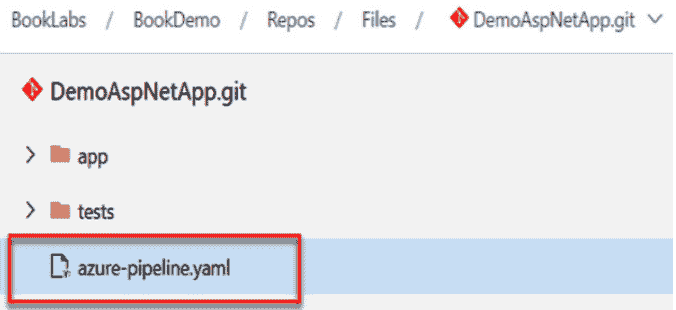

图 7.48 – Azure Pipelines：YAML 管道

### 3. 在 Azure Pipelines 中，打开 **Pipeline** 菜单并单击 **Create pipeline** 按钮，如下面的屏幕截图所示：

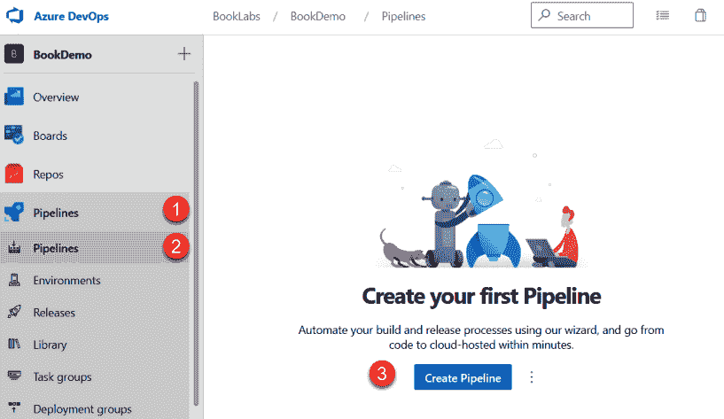

图 7.49 – Azure Pipelines：创建新的 YAML 管道

### 4. 选择代码源（此处，我们选择 **Azure Repos Git**）并选择包含管道 YAML 文件的存储库，如下面的屏幕截图所示：

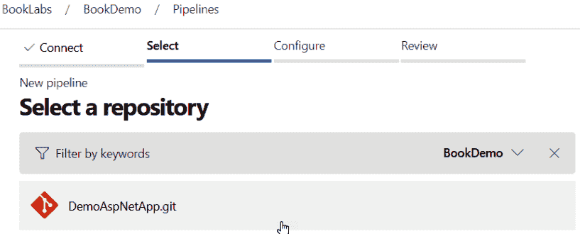

图 7.50 – Azure Pipelines：选择存储库

5. 然后，通过选择使用现有 YAML 文件的选项来配置 Azure 管道，如下面的屏幕截图所示：

BookLabs / BookDemo / Pipelines

新建管道
配置您的管道
ASP.NET Core
生成和测试面向 .NET Core 的 ASP.NET Core 项目。
ASP.NET Core (.NET Framework)
生成和测试面向完整 .NET Framework 的 ASP.NET Core 项目。
入门管道
从最小管道开始，您可以自定义该管道来生成和部署代码。
现有 Azure Pipelines YAML 文件
在存储库的任何分支中选择 Azure Pipelines YAML 文件。

图 7.51 – Azure Pipelines：选择使用现有 YAML 文件的选项

然后，选择管道 YAML 文件的路径，如下所示：

选择现有 YAML 文件
在存储库的任何分支中选择 Azure Pipelines YAML 文件。
分支
master
路径
/azure-pipeline.yml
从下拉列表中选择文件或键入文件路径
DemoAspNetApp.git
取消 继续

图 7.52 – Azure Pipelines：选择 YAML 文件

通过单击 Continue 按钮进行验证。


### 6. 文件内容将显示在屏幕上。最后，要执行管道，请单击 **Run** 按钮，如下图所示：

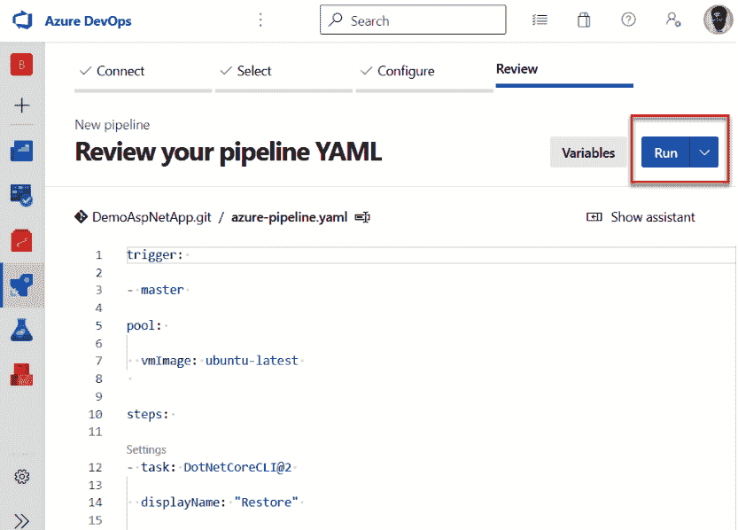

图 7.53 – Azure Pipelines：运行管道

管道已创建并正在执行。

### 7. 最后，我们可以查看管道执行的详细信息，如下图所示：

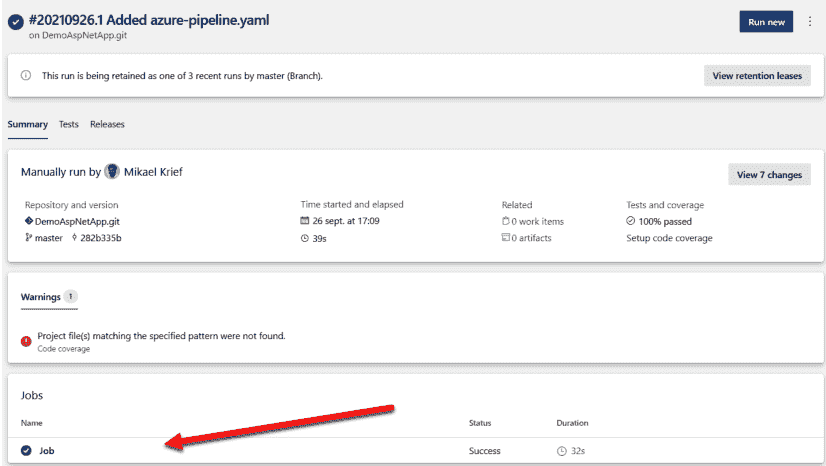

图 7.54 – Azure Pipelines：作业执行

单击 **Job**，如上图所示，以显示每个任务执行的详细信息。您应该会看到类似这样的屏幕：

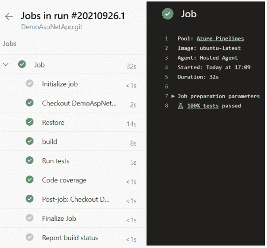

图 7.55 – Azure Pipelines：执行详情

在本节中，我们学习了如何使用包含管道定义的 YAML 文件的基础知识，该文件还有许多其他非常有趣的功能。要了解更多信息，请参阅此处的文档：https://docs.microsoft.com/en-us/azure/devops/pipelines/?view=azure-devops。

现在让我们看看如何使用 GitLab CI 创建 CI 管道。

### 使用 GitLab CI

在本章的前几节中，我们学习了如何使用 Jenkins 和 Azure Pipelines 创建 CI/CD 管道。

现在，让我们看看使用另一种正在流行起来的 DevOps 工具的实验：GitLab CI。GitLab CI 是 GitLab 提供的服务之一（https://about.gitlab.com/），与 Azure DevOps 类似，是一个具有以下属性的云平台：

- 源代码管理器
- CI/CD 管道管理器
- 项目管理看板

它提供的其他服务列在此处：https://about.gitlab.com/features/。

GitLab 采用免费定价模式，附加服务需付费；定价表可在此处查看：https://about.gitlab.com/pricing/。Azure DevOps 与 GitLab 之间的差异在此链接中详细说明：https://about.gitlab.com/devops-tools/azure-devops-vs-gitlab.html。

在本实验中，我们将了解以下内容：

1. GitLab 身份验证
2. 创建新项目并在 GitLab 中对其代码进行版本控制
3. 在 GitLab CI 中创建和执行 CI 管道

### GitLab 身份验证

创建 GitLab 帐户是免费的，可以通过创建 GitLab 帐户或使用外部帐户（例如 Google、GitHub、Twitter 或 Bitbucket）来完成。

要创建 GitLab 帐户，我们需要访问 https://gitlab.com/users/sign_in#register-pane 并选择身份验证类型。

以下屏幕截图显示了 GitLab 身份验证表单：

### GitLab.com

GitLab.com 提供免费无限（私有）仓库和无限协作者。

- 在 GitLab.com 上探索项目（无需登录）
- 关于 GitLab.com 的更多信息
- GitLab.com 支持论坛
- GitLab 主页

通过注册并登录此服务，您即表示接受我们的：

- 隐私政策
- GitLab.com 条款。

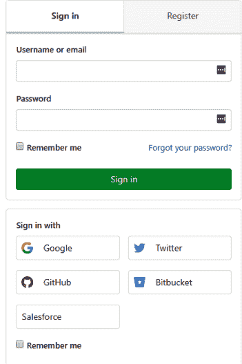

图 7.56 – GitLab 注册

一旦您的帐户已创建并经过身份验证，您将被带到帐户主页，该主页提供了以下屏幕截图中显示的所有功能：

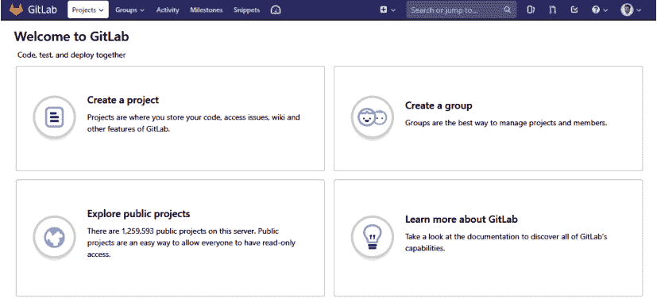

图 7.57 – GitLab 主页

现在我们已完成身份验证，让我们继续创建新项目。

### 创建新项目并管理源代码

要在 GitLab 中创建新项目，请执行以下步骤：

1. 单击主页上的 **Create a project**，如下图所示：

### 欢迎使用 GitLab

一起编写代码、测试和部署


图 7.58 – GitLab 新建项目

- 然后，我们可以从几个选项中进行选择，如下所示：
- 要创建空项目（无代码），表单要求您输入项目名称，如下图所示：


图 7.59 – GitLab 项目配置

- 要从内置模板项目创建新项目，请按以下步骤操作：


图 7.60 – GitLab 项目模板

- 要从另一个 SVC 平台的内部或外部仓库导入代码，如下图所示：


图 7.61 – GitLab：导入代码

- 要导入的代码位于外部 SVC 仓库中，如下图所示：

### 为外部仓库运行 CI/CD 管道

连接您的外部仓库，CI/CD 管道将针对新提交运行。将创建一个仅启用 CI/CD 功能的 GitLab 项目。

如果使用 GitHub，您将在 GitHub 上看到提交和拉取请求的管道状态。[更多信息](https://docs.gitlab.com/ee/ci/external_repos/index.html)

**从以下位置连接仓库**


图 7.62 – GitLab：外部仓库的 CI/CD

在本例中，对于本实验，我们将从第一个选项开始，即空项目，并且正如我们在表单中看到的，我们选择一个项目名称，例如 BookDemo，然后单击 **Create a project** 按钮进行验证。

2. 项目创建完成后，我们将看到一个页面，指示执行不同 Git 命令以推送代码的方法。

3. 为此，在本地磁盘上，我们将创建一个新的 `gitlab-ci-demo.yml` 文件，然后复制示例的内容，该示例可在 `https://github.com/PacktPublishing/Learning-DevOps-Second-Edition/tree/main/CHAP07` 中找到，并将其放入 `gitlab-ci-demo.yml` 文件中。

4. 然后，我们将在终端中执行以下命令将代码推送到仓库，详情请参见 _第 6 章，使用 Git 管理源代码_：

```
git init
git remote add origin <git repo Url>
git add .
git commit -m "Initial commit"
git push -u origin master
```

> **注意**
> 执行期间，将出现一个身份验证窗口，要求您输入 GitLab 帐户的 **标识符 (ID)**，因为这是一个私有项目。登录 GitLab Web 门户的帐户后，您的用户名将在帐户页面 `https://gitlab.com/profile/account` 上可用。

执行这些命令后，我们将获得一个包含实验代码的远程 GitLab 仓库。

### 以下屏幕截图显示了远程 GitLab 仓库：


图 7.63 – GitLab 仓库

我们的应用程序代码已存入 GitLab，现在可以使用 GitLab 创建 CI 流程了。

### 创建 CI 管道

在 GitLab CI 中，CI 管道（和 CD）的创建不是通过 **图形用户界面 (GUI)** 完成的，而是通过项目根目录中的 YAML 文件完成的。

这种方法，即在与代码位于同一位置的文件中描述管道的过程，可以称为 **管道即代码 (PaC)**，与 **基础设施即代码 (IaC)** 类似。我们将按以下步骤操作：

1. 要创建此管道，我们将在应用程序代码的根目录下创建一个 `.gitlab-ci.yml` 文件，内容如下：

```yaml
image: microsoft/dotnet:latest
stages:
  - build
  - test
```

```yaml
variables:
  BuildConfiguration: "Release"

build:
  stage: build
  script:
    - "cd app"
    - "dotnet restore"
    - "dotnet build --configuration $BuildConfiguration"
test:
  stage: test
  script:
    - "cd tests"
    - "dotnet test --configuration $BuildConfiguration"
```

> **注意**
> 此文件的代码也可在此处查看：https://github.com/PacktPublishing/Learning-DevOps-Second-Edition/blob/main/CHAP07/gitlab-ci-demo.yml。

我们可以在代码开头看到，我们使用了 microsoft/dotnet:latest Docker 镜像，该镜像将在容器中挂载，管道的操作将在其中执行。

然后，我们定义了两个阶段，一个用于构建，一个用于测试执行，以及一个将在脚本中使用的 BuildConfiguration 变量。

最后，我们描述了各自目录中要执行的脚本的每个阶段。这些 .NET Core 脚本与我们在“使用 Azure Pipelines 进行 CI/CD”部分中看到的脚本相同。

> **注意**
> 关于此 .gitlab-ci.yml 文件的格式和语法的完整文档可在此处查看：https://docs.gitlab.com/ee/ci/yaml/。

2. 然后，我们将提交并推送此文件到远程仓库。

3. 代码推送后，我们可以看到 CI 进程已触发。


因此，当代码被推送到仓库时，我们的 CI 流水线会被触发，现在让我们来看看如何查看其执行详情。

### 访问 CI 流水线执行详情

要访问已执行 CI 流水线的执行详情，请执行以下步骤：

1. 在 GitLab CI 菜单中，进入 **CI / CD | 流水线**，你将看到流水线执行列表，如下图所示：


图 7.64 – GitLab 流水线

2. 要显示流水线的详情，我们点击所需的流水线执行，如下图所示：


图 7.65 – GitLab 流水线执行

3. 我们可以看到执行状态，以及在流水线 YAML 文件中定义的两个阶段。要查看某个阶段的执行日志详情，我们点击该阶段，如下图所示：


图 7.66 – GitLab 执行日志详情

我们可以看到流水线 YAML 文件中编写的脚本的执行情况。

在本节中，我们了解了在 GitLab CI 中实现 CI 流水线的过程，包括初始化远程仓库、创建用于配置流水线的 YAML 文件以及执行流水线。

### 摘要

在本章中，我们探讨了 DevOps 中最重要的主题之一：CI/CD 流程。我们首先介绍了 CI 和 CD 的原则。然后，我们重点介绍了包管理器，涵盖了 NuGet、npm、Nexus 和 Azure Artifacts。

最后，我们了解了如何使用三种不同的工具（Jenkins、Azure Pipelines 和 GitLab CI）实现和执行端到端 CI/CD 流水线。对于每种工具，我们都介绍了应用程序源代码的归档，以及流水线的创建和执行。

阅读本章后，我们应该能够以源代码管理作为源来创建 CI 和 CD 流水线。此外，我们将能够选择和使用包管理器来集中和分发我们的包。

在下一章中，我们将学习如何使用 Azure DevOps 为 IAC 项目创建 CI/CD 流水线，目标是执行 Packer、Terraform 和 Ansible 代码。

### 问题

1. 实现 CI 流水线的先决条件是什么？
2. CI 流水线何时会被触发？
3. 包管理器的用途是什么？
4. NuGet 包管理器中存储哪些类型的包？
5. Azure Artifacts 集成到哪个平台中？
6. Jenkins 是云服务吗？
7. 在 Azure DevOps 中，允许管理 CI/CD 流水线的服务名称是什么？
8. GitLab 提供哪三种服务？
9. 在 GitLab CI 中，哪个元素允许你构建 CI 流水线？

### 延伸阅读

如果你想了解更多关于 CI/CD 流水线的信息，可以参考以下资源：

- Hands-On Continuous Integration and Delivery: https://www.packtpub.com/virtualization-and-cloud/hands-continuous-integration-and-delivery
- Continuous Integration, Delivery, and Deployment: https://www.packtpub.com/application-development/continuous-integration-delivery-and-deployment
- Mastering Jenkins: https://www.packtpub.com/application-development/mastering-jenkins
- Azure DevOps Server 2019 Cookbook: https://www.packtpub.com/networking-and-servers/azure-devops-server-2019-cookbook-second-edition
- Mastering GitLab 12: https://www.packtpub.com/cloud-networking/mastering-gitlab-12
