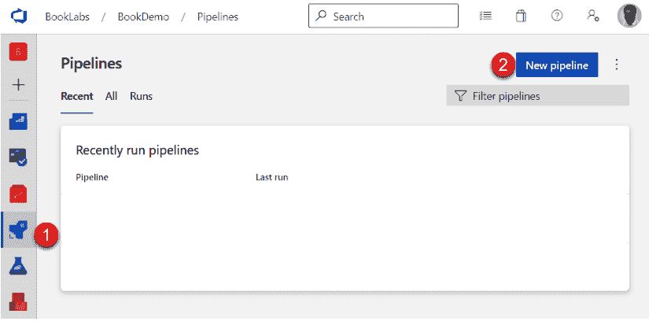
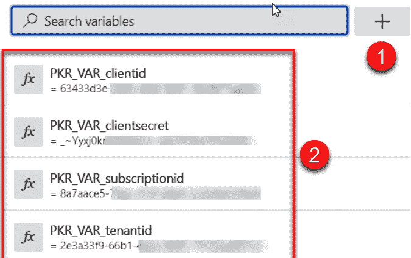
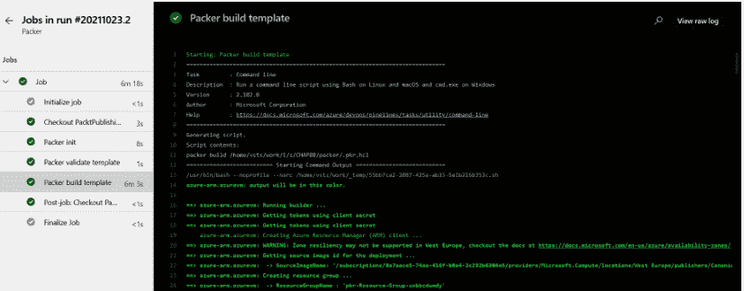
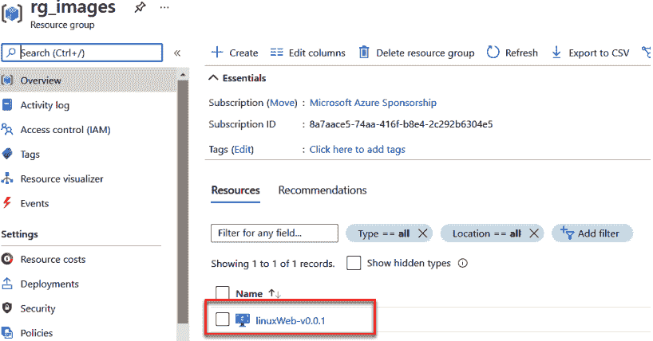
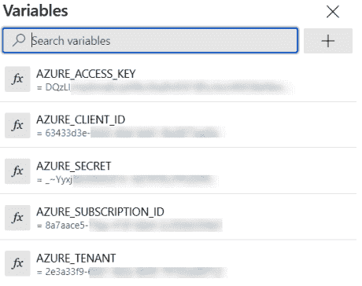
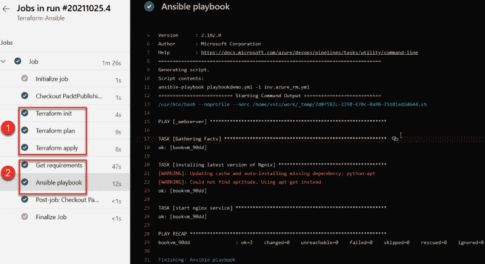
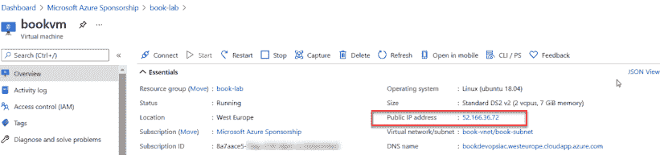

## 8 使用 CI/CD 流水线部署基础设施即代码

在本书的第一部分，我们学习了大量关于 **基础设施即代码 (IaC)**、其优势以及 Terraform、Packer 和 Ansible 等工具及其命令行的知识。然后，在第二部分中，我们讨论了 Git，并专门用一章来介绍应用程序的持续集成和持续部署。

但是，我们也不应忽视将 CI/CD 作为 IaC 付诸实践，这将使我们能够编排和自动化整个基础设施配置过程。

正是在这本书的第二版中，我想添加这一章，以重复利用我们在前面章节中学到的所有内容，并展示如何使用 CI/CD 流水线实现 IaC，该流水线将由 Packer、Terraform 和 Ansible 组成。

将要使用的流水线工具是 Azure Pipelines，我们已经在 _第 7 章，持续集成和持续交付_ 中详细介绍过它。因此，我们将学习如何编写 Azure 流水线的 YAML 文件以使用 Packer 生成镜像。然后，我们将看到如何编写 YAML 流水线以使用 Terraform 配置 **虚拟机 (VM)**，并通过执行 Ansible 在该 VM 上安装 nginx 来完成。

本章涵盖以下主题：

- 在 Azure Pipelines 中运行 Packer
- 在 Azure Pipelines 中运行 Terraform 和 Ansible

### 技术要求

本章需要以下内容：

- 用于创建 Packer 镜像和配置 VM 的 Azure 订阅；你可以在此处创建免费帐户：https://azure.microsoft.com/en-us/free/search/。
- 用于创建 YAML 流水线定义的 Azure DevOps 帐户；你可以在此处创建免费帐户：https://azure.microsoft.com/en-us/pricing/details/devops/azure-devops-services/。

本章的源代码可在此处查看：https://github.com/PacktPublishing/Learning-DevOps-Second-Edition/tree/main/CHAP08。

查看以下视频以观看代码实际运行情况：https://bit.ly/3BDT9ne

### 在 Azure Pipelines 中运行 Packer

要启动我们的 IaC 流水线，我们将自动使用 Packer 创建 Azure VM 镜像。要执行此操作，我们将使用带有 YAML 格式流水线的 Azure Pipelines。该流水线的目标是自动执行 Packer 命令。

> **重要说明**
> 有关如何在 Azure DevOps 中创建 YAML 流水线的更多详细信息，请阅读 _第 7 章，持续集成和持续交付_。

我们将在本节的实验中使用的 Packer 模板是我们在 _第 4 章，使用 Packer 优化基础设施部署_ 中学习的代码。此源代码可在此处查看：https://github.com/PacktPublishing/Learning-DevOps-Second-Edition/blob/main/CHAP08/packer/.pkr.hcl。

在开始使用 Packer 之前，我们需要先创建一个 Azure 资源组，用于存储流水线创建的 VM 镜像。在我们的实验中，我们将此 Azure 资源组命名为 rg_images。下图显示了 Azure 资源组：


图 8.1 – Packer 镜像的 Azure 资源组

现在，我们可以编写流水线代码，该代码将在 Packer 模板上执行 Packer 命令行。

为此，在与 Packer 模板相同的文件夹中，创建一个新的 YAML 文件来描述流水线的步骤，然后编写三个代码块，如下所示：

1. 第一步是执行 `packer init` 命令：

```yaml
- script: packer init $(Build.SourcesDirectory)/CHAP08/packer/.pkr.hcl
  displayName: Packer init
```

2. 第二步是通过运行 `packer validate` 命令来验证 Packer 模板：

```yaml
- script: packer validate $(Build.SourcesDirectory)/CHAP08/packer/.pkr.hcl
  displayName: Packer validate template
```

3. 最后一步是通过运行 `packer build` 命令使用 Packer 构建镜像：

```yaml
- script: packer build $(Build.SourcesDirectory)/CHAP08/packer/.pkr.hcl
  displayName: Packer build template
  env:
    PKR_VAR_clientid: $(PKR_VAR_clientid)
    PKR_VAR_clientsecret: $(PKR_VAR_clientsecret)
    PKR_VAR_subscriptionid: $(PKR_VAR_subscriptionid)
    PKR_VAR_tenantid: $(PKR_VAR_tenantid)
```


在此步骤代码中，我们将 Azure 服务主体账户对应的环境变量添加到脚本中。要在 Packer 模板中使用，这些环境变量必须采用 PKR_VAR_<变量名> 格式。

> Important Note
> 此 YAML 管道文件的完整源代码可在此处查看：https://github.com/PacktPublishing/Learning-DevOps-Second-Edition/blob/main/CHAP08/packer/pipeline.yaml。

然后，将此文件提交并推送到你的 Git 仓库。在本实验中，我们使用 GitHub，但你也可以使用其他 Git 仓库，例如 Azure Repos 或 Bitbucket。最后一步是按照以下步骤创建并运行 Azure 管道：

1. 在 Azure Pipelines 菜单中，单击 **New pipeline**：



图 8.2 – 在 Azure Pipelines 中创建新管道

2. 选择包含 Packer 模板和 YAML 管道文件的 Git 仓库，并选择使用现有 YAML 管道文件的选项。此步骤的所有详细信息均在第 7 章 *Continuous Integration and Continuous Delivery* 的 *Creating the full pipeline definition in a YAML file* 节中介绍。创建管道后，在 **Edit** 模式下，添加四个变量以存储 Azure 服务主体的凭据信息。

### 变量



图 8.3 – Azure Pipelines 变量

这些是我们在上一步骤脚本中使用的 YAML 管道变量。

3. 然后，我们可以运行管道并等待执行结束。在日志面板中，我们可以显示所有执行详细信息。



图 8.4 – Azure Pipelines Packer 管道日志

4. 最后，在 Azure 门户中，我们可以在 Azure 资源组中查看生成的 VM 镜像。



图 8.5 – Azure 上的 Packer 镜像

在本节中，我们学习了如何使用 Azure DevOps 中的管道自动创建 Packer 镜像。在下一节中，我们将继续介绍 IaC 管道，以在自动管道中执行 Terraform 和 Ansible 命令。

### 在 Azure Pipelines 中运行 Terraform 和 Ansible

创建 Packer 管道后，我们将创建用于预配 Azure VM 的管道，该 VM 使用 Packer 创建的镜像，然后使用 Ansible 配置此 VM。在此演示中，我们将使用 Ansible 在此 VM 上安装 nginx。

此代码中使用的 Terraform 配置将预配新的 Azure 资源组、带有子网的虚拟网络，以及带有标签 role 且值为 webserver 的 Linux VM。

此完整 Terraform 代码可在此处查看：`https://github.com/PacktPublishing/Learning-DevOps-Second-Edition/tree/main/CHAP08/terraform`。我不会对其进行解释，因为它与我们在第 2 章 *Provisioning Cloud Infrastructure with Terraform* 中学习的代码相同。

我们用于在 Linux 机器上安装 nginx 的完整 Ansible 代码可在此处查看：https://github.com/PacktPublishing/Learning-DevOps-Second-Edition/blob/main/CHAP08/ansible/playbookdemo.yml。我们已在第 3 章 *Using Ansible for Configuring IaaS Infrastructure* 中了解过它。对于 Ansible 清单，我们使用 **动态清单**，它根据特定的 Azure 资源组和 VM 上的标签来选择 VM 主机。

此动态清单的配置代码可在此处查看：https://github.com/PacktPublishing/Learning-DevOps-Second-Edition/blob/main/CHAP08/ansible/inv.azure_rm.yml。

现在我们已拥有所有 Terraform 和 Ansible 代码，可以按照以下步骤编写 Azure Pipelines 的 YAML 代码。为此，创建一个新的 azure-pipeline.yml 文件，内容如下：

1. 第一步是运行带有 `init`、`plan` 和 `apply` 的 Terraform 工作流命令：

```yaml
- script: terraform init --backend-config backend.tfvars
  displayName: Terraform init
  workingDirectory: $(Build.SourcesDirectory)/CHAP08/terraform
  env:
    ARM_CLIENT_ID: $(AZURE_CLIENT_ID)
    ARM_CLIENT_SECRET: $(AZURE_SECRET)
    ARM_SUBSCRIPTION_ID: $(AZURE_SUBSCRIPTION_ID)
    ARM_TENANT_ID: $(AZURE_TENANT)
    ARM_ACCESS_KEY: $(AZURE_ACCESS_KEY)
- script: terraform plan
  displayName: Terraform plan
  workingDirectory: $(Build.SourcesDirectory)/CHAP08/terraform
  env:
    ARM_CLIENT_ID: $(AZURE_CLIENT_ID)
    ARM_CLIENT_SECRET: $(AZURE_SECRET)
    ARM_SUBSCRIPTION_ID: $(AZURE_SUBSCRIPTION_ID)
    ARM_TENANT_ID: $(AZURE_TENANT)
    ARM_ACCESS_KEY: $(AZURE_ACCESS_KEY)
- script: terraform apply -auto-approve
  displayName: Terraform apply
  workingDirectory: $(Build.SourcesDirectory)/CHAP08/terraform
  env:
    ARM_CLIENT_ID: $(AZURE_CLIENT_ID)
    ARM_CLIENT_SECRET: $(AZURE_SECRET)
    ARM_SUBSCRIPTION_ID: $(AZURE_SUBSCRIPTION_ID)
    ARM_TENANT_ID: $(AZURE_TENANT)
    ARM_ACCESS_KEY: $(AZURE_ACCESS_KEY)
```

在这些脚本任务中，我们运行以下三个命令：

- 使用 Terraform 状态后端配置的 `terraform init` 命令。
- 用于预览更改的 `terraform plan` 命令。

> Important Note
> 可选地，我们可以在此处添加一个步骤，在应用更改前手动批准 `plan` 结果。在此实验中，我们对计划更改有信心，管道可以直接应用更改。

- 用于应用更改并在 VM 不存在时创建 VM 的 `terraform apply` 命令。对此命令，我们添加 `-auto-approve` 选项以自动应用更改，无需确认。

对于 Azure 身份验证，我们使用服务主体凭据和 Azure 存储访问密钥（用于状态后端）作为环境变量。

2. 然后，在此管道中，我们继续使用以下代码执行 Ansible：

```yaml
- script: pip install ansible[azure]==2.8.6
  displayName: Get requirements
- script: ansible-playbook playbookdemo.yml -i inv.azure_rm.yml
  displayName: Ansible playbook
  workingDirectory: $(Build.SourcesDirectory)/CHAP08/ansible
  env:
    AZURE_CLIENT_ID: $(AZURE_CLIENT_ID)
    AZURE_SECRET: $(AZURE_SECRET)
    AZURE_SUBSCRIPTION_ID: $(AZURE_SUBSCRIPTION_ID)
    AZURE_TENANT: $(AZURE_TENANT)
    ANSIBLE_HOST_KEY_CHECKING: False
```

在此代码中，第一个脚本安装动态清单所需的 Ansible Azure 插件。

第二个脚本执行 Ansible playbook，并使用在 `inv.azure_rm.yml` 文件中配置的动态清单。我们还将 Azure 服务主体凭据用作环境变量。

然后，将此文件提交并推送到你的 Git 仓库。

最后一步是按照以下步骤创建并运行 Azure 管道：

1. 在 Azure Pipelines 菜单中，单击 **New pipeline**。

2. 选择包含 Packer 模板和 YAML 管道文件的 Git 仓库，并选择使用现有 YAML 管道文件的选项。

此步骤的所有详细信息均在第 7 章 Continuous Integration and Continuous Delivery 的 *Creating the full pipeline definition in a YAML file* 节中介绍。

3. 创建管道后，在 **Edit** 模式下，添加五个变量以存储 Azure 服务主体的凭据信息以及用于 Terraform 状态后端的 Azure 存储访问密钥。



图 8.6 – Azure Pipelines Terraform 和 Ansible 变量

这些是我们在 YAML 管道的所有脚本步骤中使用的变量。

4. 然后，我们可以运行管道并等待执行结束。在日志面板中，我们可以逐步显示所有执行详细信息。



图 8.7 – Azure Pipelines Terraform 和 Ansible 日志详细信息

我们可以在此屏幕上看到 Terraform 命令执行，然后是 Ansible 执行。

5. 最后，要验证执行是否成功，请在 Azure 门户中查找此 VM 的公共 IP。



图 8.8 – Azure VM 公共 IP

打开浏览器并导航到此公共 IP：


### 欢迎使用 nginx！

如果您看到此页面，则表示 nginx Web 服务器已成功安装并正在运行。还需要进一步配置。

有关在线文档和支持，请参阅 [nginx.org](https://nginx.org/)。商业支持可在 [nginx.com](https://nginx.com/) 获得。

_感谢您使用 nginx。_

图 8.9 – nginx 主页

我们现在可以看到 nginx 的主页了。

在本节中，我们学习了如何编写管道代码，以便在 Azure DevOps 中使用 YAML 管道自动执行 Terraform，然后执行 Ansible，以及 Terraform 和 Ansible 命令行。

### 摘要

在本章中，我们实现了基础设施即代码（IaC）的示例管道。在第一节中，我们学习了如何在管道中集成 Packer 命令行。然后，在第二部分中，我们继续使用另一个管道运行 Terraform 来预配 Azure 虚拟机，并使用 Ansible 在该虚拟机上安装 nginx。

本章中使用的所有 YAML 管道代码均适用于 GitHub 和 Azure Pipelines，对于 Jenkins 或 GitLab CI 等其他 CI/CD 工具，流程完全相同。

在下一章中，我们将学习如何使用 Docker 构建和运行容器。

### 问题

- 1. 本章使用的工具名称是什么？

- 2. Terraform、Ansible 和 Packer 之间的 IaC 预配顺序是什么？

### 进一步阅读

如果您想了解更多关于 IaC 管道的信息，以下是一些实验室：

- Azure DevOps 上的 Terraform DevOps 实验室：`https://azuredevopslabs.com/labs/vstsextend/terraform/`。

- Azure DevOps 上的 Ansible DevOps 实验室：`https://www.azuredevopslabs.com/labs/vstsextend/ansible/`。
