## 9 使用 Docker 容器化应用程序

在过去几年中，一种技术尤其在网络、社交网络和活动中引起轰动——Docker。

Docker 是一种容器化工具，于 2013 年开源。它允许您将应用程序与其主机系统隔离，使应用程序变得可移植，并在开发者的工作站上测试的代码可以部署到生产环境，而无需担心执行运行时依赖项。我们将在本章中简要讨论应用程序容器化。

容器是一种嵌入应用程序及其依赖项的系统。与**虚拟机（VM）**不同，容器仅包含轻量级**操作系统（OS）**以及 OS 所需的元素，例如系统库、二进制文件和代码依赖项。

要了解 VM 和容器之间的区别，以及为什么容器将在未来取代 VM，我建议您阅读这篇博客文章：`https://blog.docker.com/2018/08/containers-replacing-virtual-machines/`。

VM 和容器的主要区别在于，托管在虚拟机监控程序上的每个 VM 都包含一个完整的 OS，因此与虚拟机监控程序上的客户机 OS 完全独立。

然而，容器不包含完整的 OS——只包含少数几个二进制文件——但它们依赖于客户机 OS，并使用其资源（**中央处理器（CPU）**、**随机存取存储器（RAM）**和网络）。

在本章中，我们将学习如何在不同平台上安装 Docker，如何创建 Docker 镜像，以及如何将其注册到 Docker Hub。然后，我们将讨论一个**持续集成/持续部署（CI/CD）**管道示例，该管道将 Docker 镜像部署到 **Azure 容器实例（ACI）**。之后，我们将展示如何使用 Docker 运行带有**命令行界面（CLI）**的工具。

最后，我们还将学习 **Docker Compose** 的基本概念以及如何在 ACI 中部署 Docker Compose 容器。

本章涵盖以下主题：

- 安装 Docker
- 创建 Dockerfile
- 在本地计算机上构建和运行容器
- 将镜像推送到 Docker Hub
- 将 Docker 镜像推送到私有注册表（ACR）
- 使用 CI/CD 管道将容器部署到 ACI
- 使用 Docker 运行命令行工具
- Docker Compose 入门
- 在 ACI 中部署 Docker Compose 容器

### 技术要求

本章有以下技术要求：

- 一个 Azure 订阅。您可以在此处获取免费帐户：`https://azure.microsoft.com/en-us/free/`。
- 对于某些 Azure 命令，我们将使用 Azure CLI。请参阅此处的文档：`https://docs.microsoft.com/en-us/cli/azure/install-azure-cli`。
- 在本章的最后部分，在 *为容器创建 CI/CD 管道* 节中，我们将讨论 Terraform 和 CI/CD 管道，这些内容已在 *第 2 章，使用 Terraform 预配云基础设施* 和 *第 7 章，持续集成和持续部署* 中解释。

本章中包含的脚本的所有源代码均可在此处找到：
https://github.com/PacktPublishing/Learning-DevOps-Second-Edition/tree/main/CHAP09.

查看以下视频，观看代码的实际运行情况：
https://bit.ly/3tlJov8

### 安装 Docker

Docker 的守护程序是免费的，非常适合开发人员和小团队——我们将在本书中使用它。

Docker 是一种跨平台工具，可以安装在 Windows、Linux 或 macOS 上，并且在某些云提供商（例如 **Amazon Web Services (AWS)** 和 Azure）上也原生存在。

要运行，Docker 需要以下元素：

- **Docker 客户端**：这允许您在命令行上执行各种操作。
- **Docker 守护程序**：这是 Docker 的引擎。
- **Docker 注册表**：这是公共注册表（Docker Hub）或 Docker 镜像的私有注册表。

在安装 Docker 之前，我们将首先在 Docker Hub 上创建一个帐户。

### 在 Docker Hub 上注册

Docker Hub 是一个称为 **注册表** 的公共空间，包含超过 200 万个由公司、社区甚至个人用户上传的公共 Docker 镜像。

### 使用 Docker 容器化您的应用程序

要在 Docker Hub 上注册并列出公共 Docker 镜像，请执行以下步骤：

1. 访问 https://hub.docker.com/，您将看到以下屏幕：

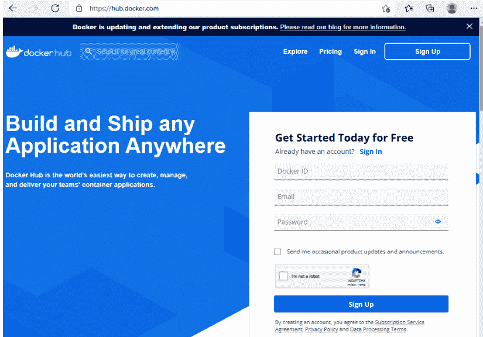

图 9.1 – Docker Hub 登录页面

2. 用唯一标识符（ID）、电子邮件和密码填写表单。然后，单击注册按钮。

3. 创建帐户后，您可以登录该网站，该帐户将允许您上传自定义镜像并下载 Docker Desktop。

4. 要查看和探索 Docker Hub 上可用的镜像，请转到探索部分，如以下屏幕截图所示：

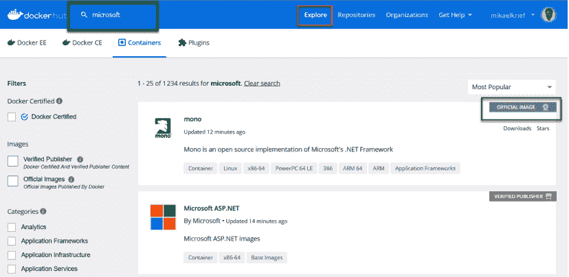

图 9.2 – Docker Hub 探索页面

将显示一个 Docker 镜像列表，带有搜索过滤器，您可以使用它来搜索官方镜像或经过验证的发布者的镜像，以及 Docker 认证的镜像。

在 Docker Hub 上创建帐户后，我们现在将查看在 Windows 上安装 Docker。

### Docker 安装

我们现在将详细讨论在 Windows 上安装 Docker。

在 Windows 或 macOS 上安装 Docker Desktop 之前，我们需要检查所有许可证选项。有关 Docker Desktop 许可证的更多信息，请阅读定价页面（https://www.docker.com/pricing）和 **常见问题解答（FAQ）**页面（https://www.docker.com/pricing/faq）。

要在 Windows 计算机上安装 Docker Desktop，首先需要检查硬件要求，如下所示：

- Windows 10/11 64 位，至少配备 4 **千兆字节（GB）**的 RAM
- **适用于 Linux 的 Windows 子系统 2（WSL 2）**后端或已启用 Hyper-V。如果遇到任何问题，您可以参考此文档：https://docs.docker.com/docker-for-windows/troubleshoot/#virtualization-must-be-enabled。


> 注意
> 关于 WSL 的更多信息，请阅读此处的文档：
> https://docs.microsoft.com/en-us/windows/wsl/
> install
> 关于 Docker Desktop 要求的更多详细信息在此处指定：
> https://docs.docker.com/desktop/windows/install/

要安装 Docker Desktop（它与适用于 Windows 和 macOS 的 Docker 安装程序是相同的二进制文件），请执行以下步骤：

1. 首先，通过单击安装文档页面 https://docs.docker.com/desktop/windows/install/ 上的 **Docker Desktop for Windows** 按钮下载 Docker Desktop，如下图所示：

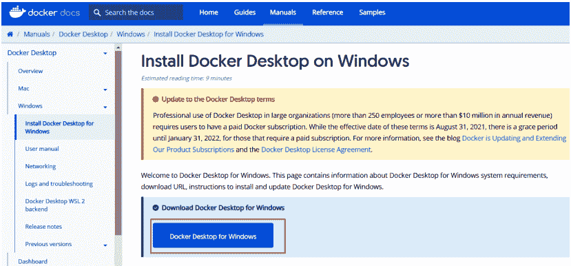

图 9.3 – Docker Desktop 下载链接

2. 下载完成后，单击下载的 **可执行文件 (EXE)**。
3. 然后，执行单个配置步骤，即安装 WSL 2 后端所需组件的可能性，如下图所示：


### 配置

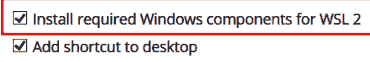

图 9.4 – Docker Desktop 配置

在我们的示例中，我们将勾选此选项，以使用 WSL 2 作为后端安装 Windows 组件。

4. 安装完成后，我们将收到确认消息和一个关闭安装的按钮，如下图所示：

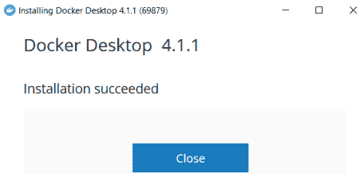

图 9.5 – Docker Desktop 安装结束

5. 最后，要启动 Docker，请启动 Docker Desktop 程序。通知栏中将出现一个图标，指示 Docker 正在启动。然后，它将通过一个小窗口要求您登录 Docker Hub。Docker Desktop 的启动步骤如下图所示：

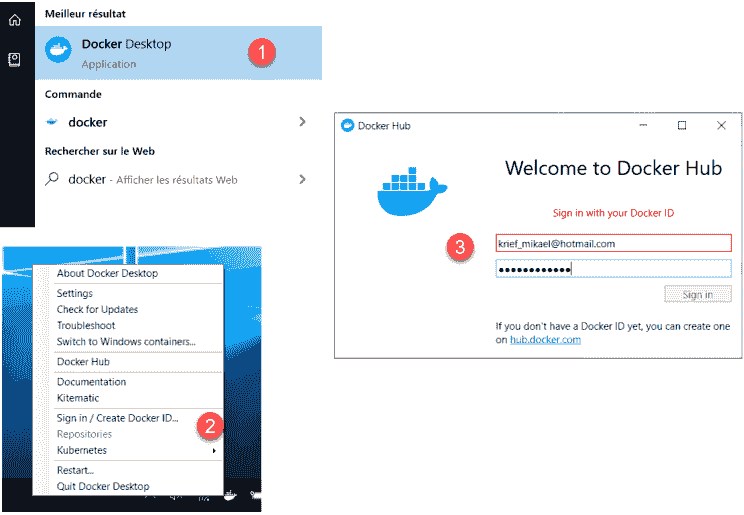

图 9.6 – 从 Docker Desktop 登录 Docker Hub

就这样！我们已在 Windows 上安装并启动了 Docker。

要在其他操作系统上安装 Docker，可以在 https://docs.docker.com/get-docker/ 阅读每个操作系统的文档。之后，您可以从此页面选择所需的目标操作系统，如下图所示：

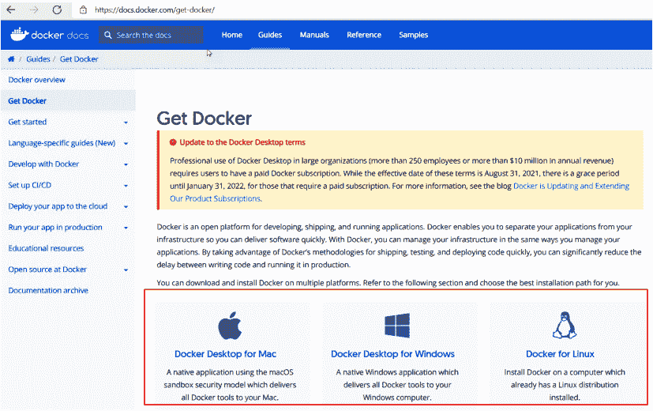

要检查 Docker 安装，请打开终端窗口（在 Windows PowerShell 终端上也适用）并执行以下命令：

`docker --help`

您应该能看到类似这样的内容：

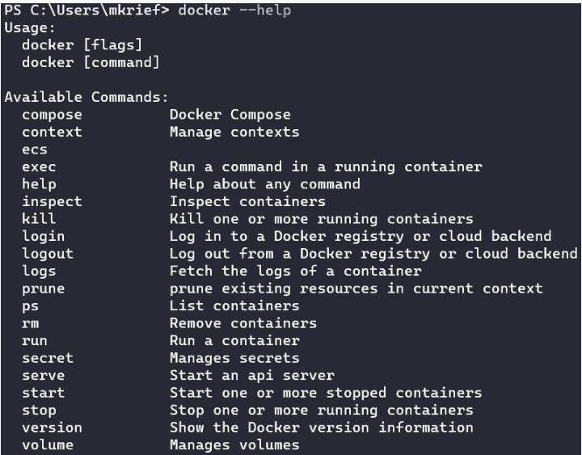

图 9.8 – docker --help 命令

如上图所示，该命令显示 Docker 客户端工具中可用的不同操作。

在详细了解 Docker 命令的执行之前，了解 Docker 的概念非常重要。

### Docker 元素概览

在执行 Docker 命令之前，我们将讨论 Docker 的一些基本元素，即 **Dockerfile**、**容器** 和 **卷**。

首先，需要知道 **Docker 镜像** 是 Docker 的基本元素，由名为 Dockerfile 的文本文档组成，其中包含我们要容器化的二进制文件和应用程序文件。

**Docker 注册表** 是共享 Docker 镜像的集中式存储系统。此注册表可以是公共的（如 Docker Hub 的情况），也可以是私有的，例如 **Azure Container Registry (ACR)** 或 JFrog Artifactory。

容器是从 Docker 镜像执行的实例。可以在容器中拥有同一镜像的多个实例，应用程序将在其中运行。最后，卷是物理位于主机操作系统（即容器外部）上的存储空间，如果需要，可以在多个容器之间共享。此空间将允许存储持久元素，例如文件或数据库。

要操作这些元素，我们将使用命令行，这些命令行将在本章后续内容中讨论。

在本节中，我们讨论了 Docker Hub 和创建帐户的不同步骤。然后，我们查看了在本地安装 Docker Desktop 的步骤，最后，我们以 Docker 元素概览结束。

我们现在将开始使用 Docker，我们将要查看的第一个操作是从 Dockerfile 创建 Docker 镜像。

### 创建 Dockerfile

一个基本的 Docker 元素是名为 **Dockerfile** 的文件，其中包含构建 Docker 镜像的逐步说明。

要了解如何创建 Dockerfile，我们将查看一个示例，该示例允许我们构建包含 Apache Web 服务器和 Web 应用程序的 Docker 镜像。

让我们开始编写 Dockerfile。

### 编写 Dockerfile

要编写 Dockerfile，我们将首先创建一个 **超文本标记语言 (HTML)** 页面，它将是我们的 Web 应用程序。因此，我们将创建一个新的 `appdocker` 目录，并在其中创建一个 `index.html` 页面，其中包含在网页上显示欢迎文本的示例代码，如下所示：

```
<html>
<body>
<h1>Welcome to my new app</h1>
This page is test for my demo Dockerfile.<br />
Enjoy ...
</body>
</html>
```

然后，在同一目录中，我们创建一个 Dockerfile（不带扩展名），其内容如下，我们将在稍后详细说明：

```
FROM httpd:latest
COPY index.html /usr/local/apache2/htdocs/
```

要创建 Dockerfile，请从 FROM 语句开始。必需的 FROM 语句定义基础镜像，我们将使用它来构建 Docker 镜像——任何 Docker 镜像都是从另一个 Docker 镜像构建而来。此基础镜像可以保存在 Docker Hub 或另一个注册表中，例如 JFrog Artifactory、Nexus Repository 或 ACR。

在我们的代码示例中，我们使用标记为最新版本的 Apache httpd 镜像，https://hub.docker.com/_/httpd/，并使用 FROM httpd:latest Dockerfile 指令。

然后，我们使用 COPY 指令执行镜像构建过程。Docker 将我们刚刚创建的本地 index.html 文件复制到镜像的 /usr/local/apache2/htdocs/ 目录中。

> 注意
> 此 Dockerfile 和 HTML 页面的源代码可在此处找到：
> https://github.com/PacktPublishing/Learning-
> DevOps-Second-Edition/tree/main/CHAP09/appdocker.

我们刚刚查看了 Dockerfile 的 FROM 和 COPY 指令，但还有其他指令，我们将在下一节中介绍。

### Dockerfile 指令概览

我们之前提到，Dockerfile 文件由指令组成，我们还查看了使用 FROM 和 COPY 指令的具体示例。还有其他指令将允许您构建 Docker 镜像。以下是可用于此目的的主要指令概览：

- FROM：此指令用于定义我们镜像的基础镜像，如上一节 _编写 Dockerfile_ 中详细示例所示。
- COPY 和 ADD：用于将一个或多个本地文件复制到镜像中。ADD 指令支持额外的两个功能，即引用 **统一资源定位符 (URL)** 和提取压缩文件。

> 注意
> 关于 COPY 和 ADD 之间差异的更多详细信息，您可以阅读此文章：https://nickjanetakis.com/blog/docker-tip-2-the-difference-between-copy-and-add-in-a-dockerfile.

- RUN 和 CMD：这些指令将命令作为参数，该命令将在镜像构建期间执行。RUN 指令创建一个层，以便可以缓存和版本化。CMD 指令定义在调用运行镜像时要执行的默认命令。CMD 指令可以在运行时通过提供额外参数来覆盖。

您可以在 Dockerfile 中编写以下 RUN 指令示例来执行 apt-get 命令：

```
RUN apt-get update
```

使用上述指令，我们更新镜像中已存在的 apt 软件包并创建一个层。我们还可以使用 CMD 指令，如以下示例所示，该示例将在执行期间显示 docker 消息：

```
CMD "echo docker"
```

- ENV：此指令允许您实例化可用于构建镜像的环境变量。这些环境变量将在容器的整个生命周期中持续存在，如下所示：

```
ENV myvar=mykey
```

上述命令将 mykey 值设置为容器中的 myvar 环境变量。

- WORKDIR：此指令给出容器的执行目录，如下所示：

```
WORKDIR usr/local/apache2
```

这就是 Dockerfile 指令的概览。还有其他常用指令，例如 EXPOSE、ENTRYPOINT 和 VOLUME，您可以在 https://docs.docker.com/engine/reference/builder/ 的官方文档中找到它们。


### 在本地计算机上构建和运行容器

在本章迄今为止，我们已讨论 Docker 元素，并查看了用于容器化 Web 应用程序的 Dockerfile 示例。现在，我们拥有运行 Docker 所需的所有元素。

Docker 的执行通过不同的操作进行，如下所示：

- 从 Dockerfile 构建 Docker 镜像
- 从该镜像在本地实例化新容器
- 测试我们在本地容器化的应用程序

让我们深入了解每个操作。

### 构建 Docker 镜像

我们将从先前创建的 Dockerfile 构建 Docker 镜像，该文件包含以下指令：

```
FROM httpd:latest
COPY index.html /usr/local/apache2/htdocs/
```

我们将转到终端并进入包含 Dockerfile 的目录，然后使用以下语法执行 `docker build` 命令：

```
docker build -t demobook:v1 .
```

`-t` 参数指示镜像的名称及其标记。在此示例中，我们将镜像命名为 demobook，并添加的标记为 v1。

命令末尾的 .（点）指定我们将使用当前目录中的文件。以下屏幕截图显示了此命令的执行：

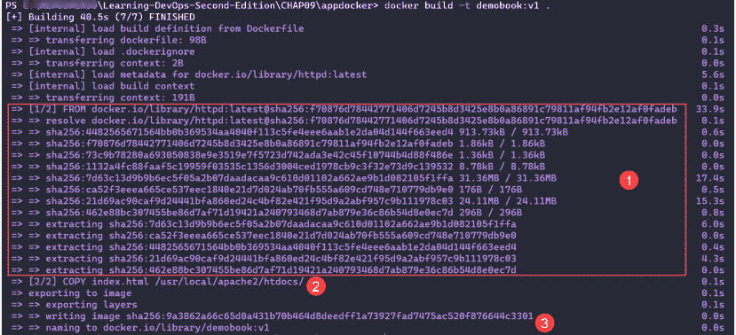

图 9.9 – docker build 命令

我们可以在此前执行中看到 Docker 镜像构建器的三个步骤，如下所示：

1. Docker 下载定义的基础镜像。
2. Docker 将 index.html 文件复制到镜像中。
3. Docker 创建并标记镜像。

当你执行 docker build 命令时，它会从 Docker Hub 下载 Dockerfile 中指示的基础镜像，然后 Docker 执行 Dockerfile 中提到的各种指令。

> **Note**
> 请注意，如果在首次执行 docker build 命令时收到 `Get https://registry-1.docker.io/v2/library/httpd/manifests/latest: unauthorized: incorrect username or password` 错误，则执行 docker logout 命令。接下来，重新启动 docker build 命令，如本文所示：https://medium.com/@blacksourcez/fix-docker-error-unauthorized-incorrect-username-or-password-in-docker-f80c45951b6b。

执行结束时，我们获得本地存储的 Docker demobook 镜像。

> **Note**
> Docker 镜像根据操作系统存储在本地文件夹系统中。有关 Docker 镜像位置的更多信息，可以阅读本文：http://www.scmgalaxy.com/tutorials/location-of-dockers-images-in-all-operating-systems/。

我们还可以通过执行以下 Docker 命令检查镜像是否成功创建：

```
docker images
```

以下是前面命令的输出：

```
PS C:\Users\Administrator\Documents\Learning-DevOps-Second-Edition\CHAP09\appdocker> docker images
REPOSITORY TAG IMAGE ID CREATED SIZE
demobook v1 9a3862a66c65 5 minutes ago 143MB
gcr.io/k8s-minikube/kicbase v0.0.12-snapshot3 25ac91b9c8d7 14 months ago 952MB
```

图 9.10 – docker images 命令

此命令显示本地计算机上的 Docker 镜像列表，我们可以看到刚刚创建的 demobook 镜像。因此，下次构建镜像时，我们不需要再次下载 httpd 镜像。

现在，我们已为应用程序创建了 Docker 镜像，将实例化该镜像的新容器。

### 实例化镜像的新容器

要实例化 Docker 镜像的新容器，我们将在终端中执行 docker run 命令，语法如下：

```
docker run -d --name demoapp -p 8080:80 demobook:v1
```

-d 参数指示容器将在后台运行。在 --name 参数中，我们指定要使用的容器名称。在 -p 参数中，我们指示所需的端口转换。在我们的示例中，这意味着容器的端口 80 将转换为本地计算机上的端口 8080。最后，命令的最后一个参数是镜像名称及其标记。

此命令的执行如下所示：

```
PS C:\Users\Administrator\Documents\Learning-DevOps-Second-Edition\CHAP09\appdocker> docker run -d --name demoapp -p 8080:80 demobook:v1
6cce2099b174cbe29fcd4d88d4f6uc4d5b2ebbfdf58cedfb1a5e2984e3f4e6bee7e1a
```

图 9.11 – docker run 命令

执行结束时，此命令显示容器的 ID，容器在后台运行。也可以通过执行以下命令显示本地计算机上运行的容器列表：

```
docker ps
```

以下屏幕截图显示了我们容器的执行：

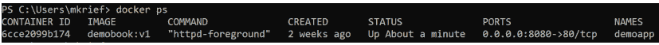

图 9.12 – `docker ps` 命令

每个容器执行后，我们会看到其快捷 ID、关联的镜像、名称、执行命令以及端口转换信息。

因此，我们已构建 Docker 镜像并在本地实例化了该镜像的新容器。我们现在将了解如何运行本地容器中的 Web 应用程序。

### 在本地测试容器

_在容器中运行的所有内容都保留在容器内_——这是容器隔离的原则。但是，在我们之前进行的端口转换中，您可以使用 `run` 命令在本地计算机上测试容器。

为此，打开 Web 浏览器并输入 `http://localhost:8080`，其中 8080 表示命令中指示的转换端口。您应该能够看到以下结果：

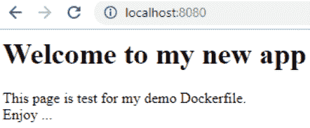

图 9.13 – Docker 应用程序已启动

我们可以看到我们的 `index.html` 页面的内容已显示。

在本节中，我们了解了可用于构建 Docker 镜像的不同 Docker 命令。然后，我们从该镜像实例化了新容器，最后在本地对其进行了测试。

在下一节中，我们将了解如何将 Docker 镜像发布到 Docker Hub。

### 将镜像推送到 Docker Hub

创建包含应用程序的 Docker 镜像的目标是能够在包含 Docker 并托管公司应用程序的服务器上使用它，就像使用虚拟机一样。

为了使镜像能够下载到另一台计算机，它必须保存在 Docker 镜像注册表中。如前所述，有几个 Docker 注册表可以本地安装，例如 JFrog Artifactory 和 Nexus Repository。

如果要创建公共镜像，可以将其推送（或上传）到 Docker Hub，即 Docker 的公共（且免费，具体取决于您的许可证）注册表。我们现在将了解如何将上一节中创建的镜像上传到 Docker Hub。为此，您需要在 Docker Hub 上拥有一个帐户，我们在安装 Docker Desktop 之前已创建该帐户。

要将 Docker 镜像推送到 Docker Hub，请执行以下步骤：

1. **登录 Docker Hub**：使用以下命令登录 Docker Hub：

```
docker login -u <your dockerhub login>
```

执行命令时，系统会要求您输入 Docker Hub 密码，并指示您已连接到 Docker 注册表，如以下屏幕截图所示：

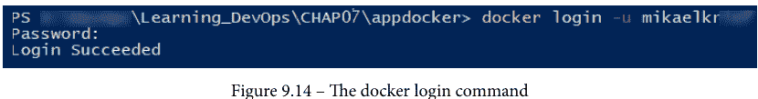

2. **检索镜像 ID**：下一步是检索已创建镜像的 ID。为此，我们将执行 `docker images` 命令以显示带有 ID 的镜像列表。

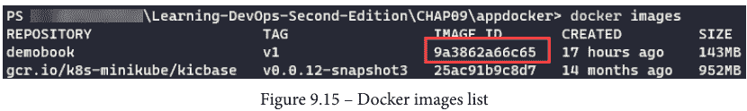

3. **为 Docker Hub 标记镜像**：使用我们检索到的镜像 ID，我们现在将为 Docker Hub 标记镜像。为此，执行以下命令：

```
docker tag <image ID> <dockerhub login>/demobook:v1
```

以下屏幕截图显示了在创建的镜像上执行此命令的情况：

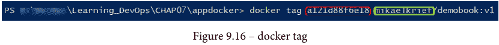


### 4. 将 Docker 镜像推送到 Docker Hub

为镜像打上标签后，最后一步是将打好标签的镜像推送到 Docker Hub。

为此，我们将执行以下命令：

```
docker push docker.io/<dockerhub login>/demobook:v1
```

以下截图显示了上述命令的执行情况：

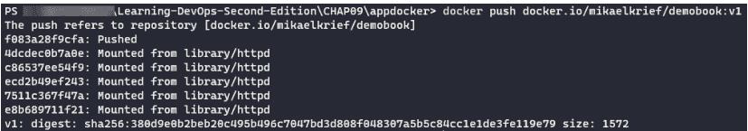

从这次执行中我们可以看到，镜像已上传到 Docker Hub。

要在 Docker Hub 中查看推送的镜像，我们连接到 Docker Hub 网页门户 https://hub.docker.com/，可以看到该镜像已存在，如下图所示：

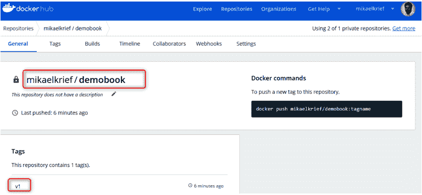

默认情况下，推送到 Docker Hub 的镜像处于公开模式——所有人都可以在资源管理器中查看并使用它。

我们可以在 Docker Hub 搜索引擎中访问此镜像，如下图所示：

图 9.19 – 在 Docker Hub 中查找镜像

要将此镜像设为私有——即只有经过身份验证的你才能使用它——你必须进入镜像的 Settings 选项卡，然后单击 Make private 按钮，如下图所示：

图 9.20 – 将 Docker 镜像设为私有

在本节中，我们介绍了通过命令行登录 Docker Hub 的步骤和 Docker 命令，然后介绍了用于将 Docker 镜像上传到 Docker Hub 的 tag 和 push 命令。

在下一节中，我们将通过一个 ACR 实例示例，了解如何将 Docker 镜像推送到私有 Docker 注册表。

### 将 Docker 镜像推送到私有注册表 (ACR)

在上一节中，我们学习了如何将 Docker 镜像推送到 Docker Hub（这是一个公共注册表）。现在，我们将学习如何将 Docker 镜像推送到私有注册表。

有许多本地或云解决方案支持 Docker 私有注册表。以下是这些解决方案的列表：

- Docker registry server: `https://docs.docker.com/registry/deploying/`
- Artifactory from JFrog: `https://www.jfrog.com/confluence/display/JFROG/Docker+Registry`
- Amazon Elastic Container Registry (ECR): `https://aws.amazon.com/ecr/`
- Google Container Registry (GCR): `https://cloud.google.com/container-registry`
- ACR: `https://azure.microsoft.com/en-us/services/container-registry/`

在本节中，我们将研究其中一种解决方案——ACR。

要将 Docker 镜像推送到 ACR，我们将执行以下步骤：

1. 在推送 Docker 镜像之前，我们将使用以下方法之一创建 ACR 资源：

   - Azure CLI (`https://docs.microsoft.com/en-us/azure/container-registry/container-registry-get-started-azure-cli`)。创建资源组和 ACR 资源的 az cli 脚本如下所示：

   ```
   az group create --name RG-ACR --location eastus
   az acr create --resource-group RG-ACR --name acrdemo --sku Basic
   ```

   - PowerShell (`https://docs.microsoft.com/en-us/azure/container-registry/container-registry-get-started-powershell`)。创建资源组和 ACR 资源的 PowerShell 脚本如下所示：

   ```
   New-AzResourceGroup -Name RG-ACR -Location EastUS
   $registry = New-AzContainerRegistry -ResourceGroupName "RG-ARC" -Name "acrdemo" -EnableAdminUser -Sku Basic
   ```

   - Azure 门户 (`https://docs.microsoft.com/en-us/azure/container-registry/container-registry-get-started-portal`)

   在下一步中，我们将使用名为 demobookacr 的 ACR 资源。

2. 然后，我们将通过运行以下 az cli 命令连接到 Azure 帐户：

   ```
   az login
   ```

3. 我们将使用以下 az acr login 命令连接到已创建的 ACR 资源（步骤 1），并将 --name 参数作为步骤 1 中创建的 ACR 资源的名称，如下所示：

   ```
   az acr login --name demobookacr
   ```

   此命令将在后台使用 docker login 命令连接到 Docker 注册表。

4. 要将 Docker 镜像推送到此 ACR 资源，我们将执行几个命令。

   第一个命令是为本地镜像创建标签，如下所示：

   ```
   docker tag demobook:v1 demobookacr.azurecr.io/demobook:v1
   ```

   第二个命令是将镜像推送到 ACR 资源，如下所示：

   ```
   docker push demobookacr.azurecr.io/demobook:v1
   ```

   这两个命令与我们学习的用于将 Docker 镜像打标签并推送到 Docker Hub 的命令完全相同，区别在于此处 ACR 的 Docker 注册表 URL 为 <acr name>.azurecr.io。

   以下截图显示了这些命令的执行情况：

   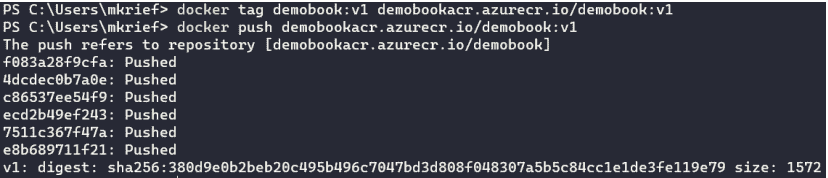

   图 9.21 – 将 Docker 镜像推送到 ACR

   以下截图显示了 ACR 中推送的 Docker 镜像：

   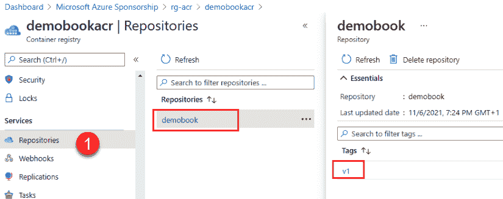

   图 9.22 – ACR 中的 Docker 镜像

5. 最后，要拉取此 Docker 镜像，我们将使用以下命令：

   ```
   docker pull demobookacr.azurecr.io/demobook:v1
   ```

   在本节中，我们学习了如何使用 Docker 在私有 Docker 注册表（即 ACR）中推送和拉取 Docker 镜像。

   在下一节中，我们将了解如何使用 CI/CD 管道在托管云容器服务（ACI 和 Terraform）中部署此镜像。

### 使用 CI/CD 管道将容器部署到 ACI

Docker 之所以迅速受到开发人员和运维团队的青睐，主要原因之一是 Docker 镜像和容器的部署使企业应用程序的 CI 和 CD 管道变得更加容易。

为了自动化我们应用程序的部署，我们将创建一个 CI/CD 管道，用于部署包含我们应用程序的 Docker 镜像到 ACI。

ACI 是 Azure 提供的一项托管服务，可让您非常轻松地部署容器，而无需担心硬件架构。

> **Note**
> 要了解有关 ACI 的更多信息，请访问官方页面 `https://azure.microsoft.com/en-us/services/container-instances/`。

此外，我们将使用 Terraform 进行 **基础设施即代码 (IaC)**，我们在 _第 2 章，使用 Terraform 预配云基础设施_ 中讨论过这一点，并使用 Azure ACI 资源及其与 Docker 镜像的集成。

因此，我们将本节分为以下两个部分：

- Azure ACI 的 Terraform 代码配置及其与我们 Docker 镜像的集成
- Azure Pipelines 中 CI/CD 管道的示例，允许您执行 Terraform 代码

首先，我们将编写允许您在 Azure 中预配 ACI 资源的 Terraform 代码。

### 编写 ACI 的 Terraform 代码

要使用 Terraform 预配 ACI 资源，我们导航到新的 `terraform-aci` 目录并创建一个 Terraform 文件 `main.tf`。

在此代码中，我们将使用 `azurerm_container_group` Terraform 对象为资源组和 ACI 资源提供 Terraform 代码。

> **Note**
>
> Terraform ACI 资源的文档可在此处查阅：`https://registry.terraform.io/providers/hashicorp/azurerm/latest/docs/resources/container_group`。

此 `main.tf` 文件包含以下 Terraform 代码，用于创建资源组：

```
resource "azurerm_resource_group" "acidemobook" {
  name = "demoBook"
  location = "westus2"
}
```

在此 `main.tf` 文件中，我们在 Terraform 配置中添加 `variable` 声明，如下所示：

```
variable "imageversion" {
  description="Tag of the image to deploy"
}
variable "dockerhub-username" {
  description ="Tag of the image to deploy"
}
```

然后，我们使用 `azurerm_container_group` 资源块添加 ACI 的 Terraform 代码，如下所示：

```
resource "azurerm_container_group" "aci-myapp" {
 name = "aci-agent"
 location = "West Europe"
 resource_group_name = azurerm_resource_group.acidemobook.name
 os_type = "linux"
 container {
 name = "myappdemo"
 image = "docker.io/mikaelkrif/${{var.dockerhub-username}}:${{var.imageversion}}"
 cpu = "0.5"
 memory = "1.5"
 ports {
 port = 80
 protocol = "TCP"
 }
 }
}
```

在前面的代码片段中，我们执行以下操作：

- 我们声明 `imageversion` 和 `dockerhub-username` 变量，这些变量将在 CI/CD 管道期间实例化，并包含要部署的镜像的用户名和标签。
- 我们使用 Terraform 的 `azurerm_container_group` 资源来管理 ACI。在其 `image` 属性中，我们指示要部署的镜像的信息——即，其在 Docker Hub 中的完整名称及其标签，在我们的示例中，该标签在 `imageversion` 变量中。

最后，为了保护 Terraform 状态文件，我们可以使用 Terraform 远程后端，通过 Azure Blob 存储实现，正如我们在 _第 2 章，使用 Terraform 预配云基础设施_ 的 _保护远程后端中的状态文件_ 部分中讨论的那样。


### 为容器创建 CI/CD 流水线

要创建一个用于构建镜像并执行 Terraform 代码的 CI/CD 流水线，我们可以使用在 _第 7 章，持续集成与持续交付_ 中详细讨论过的所有工具。

在本章中，为了可视化流水线，我们将使用 **Azure Pipelines**，它是之前详细介绍的工具之一。建议仔细阅读 _第 7 章，持续集成与持续交付_ 中的 _使用 Azure Pipelines_ 部分。出于这个原因，我们不会详细介绍流水线的所有阶段，而只介绍与我们的容器主题相关的阶段。

要在 Azure Pipelines 中实现 CI/CD 流水线，我们将按照以下步骤进行：

1. 我们将创建一个新的生成定义，其 **源代码** 将指向 GitHub 仓库的分支（`https://github.com/PacktPublishing/Learning-DevOps-Second-Edition`），并选择该仓库的根文件夹，如下图所示：

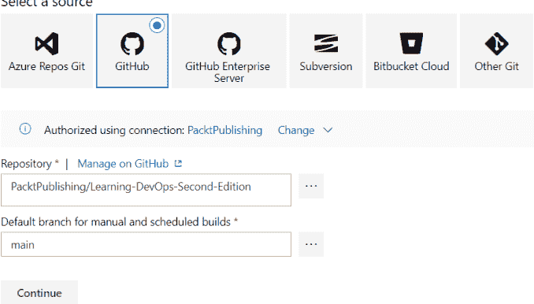

图 9.23 – 使用 GitHub 源的 Azure Pipelines

> **注意**
>
> 此 Terraform 文件的完整源代码可在此处查看：`https://github.com/PacktPublishing/Learning-DevOps-Second-Edition/tree/main/CHAP09/terraform-aci`。

我们有允许创建 Azure ACI 资源的 Terraform 代码，该资源将执行我们镜像的容器。现在，我们将创建一个 CI/CD 流水线，以自动部署应用程序的容器。

### 注意

有关 GitHub 分支的更多信息，请阅读 _第 16 章，开源项目的 DevOps_。

您可以自由使用 Azure Pipelines 中可用的任何源代码控制版本。

2. 然后，在 **变量** 选项卡上，我们将定义将在流水线中使用的变量。下图显示了 **变量** 选项卡上的信息：

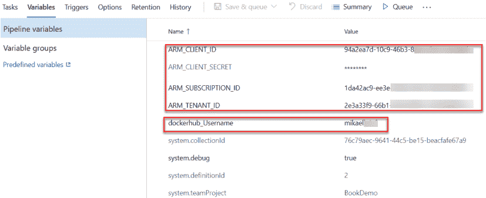

### 图 9.24 – 流水线变量

我们定义了四个用于 Azure 和 Docker Hub 用户名的 Terraform 连接信息。

3. 然后，在 **任务** 选项卡上，我们必须执行以下步骤：

- A. 在 Dockerfile 上运行 `docker build` 命令。
- B. 将镜像推送到 Docker Hub。
- C. 运行 Terraform 代码以使用更新镜像的新版本更新 ACI 资源。

下图显示了任务的配置：

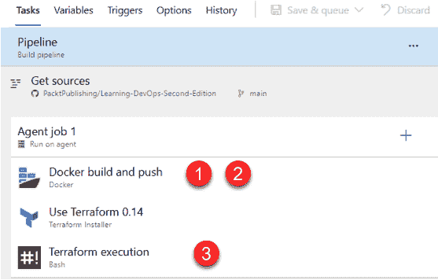

我们按照以下步骤配置在 _步骤 3_ 中提到的任务：

1. 第一个任务，**Docker 构建和推送**，允许您构建 Docker 镜像并将其推送到 Docker Hub。其配置非常简单，如下所示：

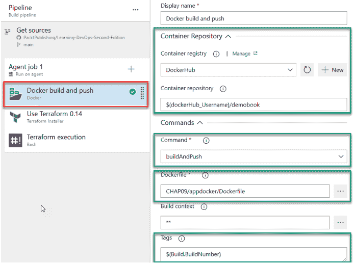

这是该任务所需的参数：

- 使用名为 DockerHub 的服务连接连接到 Docker Hub
- 将推送到 Docker Hub 的镜像标记

2. 第二个任务，**Terraform 安装程序（显示名称为使用 Terraform 0.14）**，允许您通过指定要使用的 Terraform 版本，在流水线代理上下载 Terraform。

> 注意
> 此任务可在 Visual Studio Marketplace 上找到，网址为
> https://marketplace.visualstudio.com/
> items?itemName=charleszipp.azure-pipelines-tasks-
> terraform&targetId=76c79aec-9641-44c5-be15-
> beacfae67a9。

下图显示了其配置，配置非常简单：

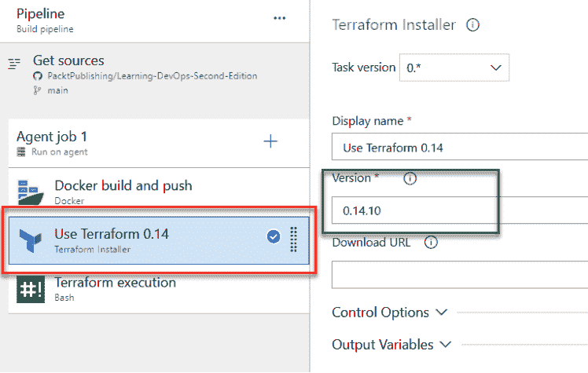

图 9.27 – Terraform 步骤参数

3. 最后一个任务，**Bash**，允许您在 Bash 脚本中执行 Terraform，下图显示了其配置：

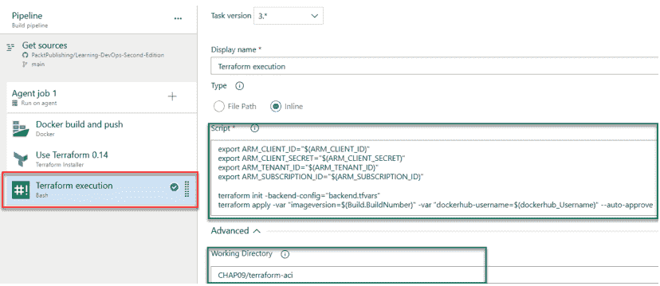

### 图 9.28 – Bash 步骤参数

配置的脚本如下：

```
export ARM_CLIENT_ID="$(ARM_CLIENT_ID)"
export ARM_CLIENT_SECRET="$(ARM_CLIENT_SECRET)"
export ARM_TENANT_ID="$(ARM_TENANT_ID)"
export ARM_SUBSCRIPTION_ID="$(ARM_SUBSCRIPTION_ID)"
terraform init -backend-config="backend.tfvars"
terraform apply -var "imageversion=$(Build.BuildNumber)" 
-var "dockerhub-username=$(dockerhub_Username)" --auto-
approve
```

此脚本执行三个操作，按以下顺序进行：

- A. 导出 Terraform 所需的环境变量。
- B. 执行 `terraform init` 命令。
- C. 执行 `terraform apply` 以应用更改，带有两个 `-var` 参数，分别是我们的 Docker Hub 用户名以及要应用的标记。这些参数允许执行一个容器，使用刚刚推送到 Docker Hub 的新镜像。

然后，要在 **代理作业** 选项中配置要使用的生成代理，我们使用 Azure Pipelines 代理托管的 Ubuntu 16.04，如下图所示：

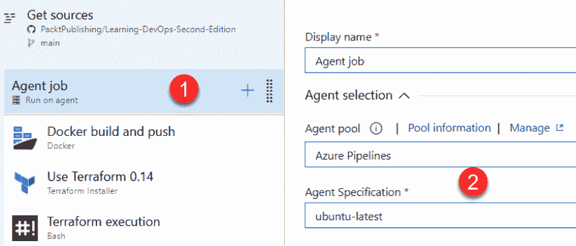

图 9.29 – 代理作业参数

最后，最后一个配置是 **触发器** 选项卡上的触发器配置，它在每次提交时启用 CI 并触发此生成，如下图所示：

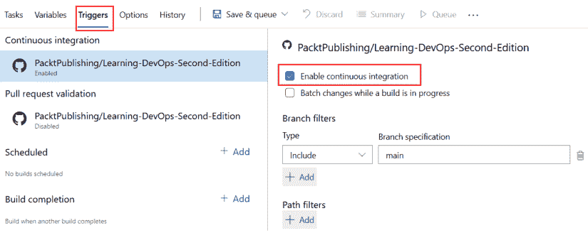

图 9.30 – 已启用 CI

至此，Azure Pipelines 中的 CI/CD 流水线配置完成。

触发此生成后，我们应该能够在其执行结束时看到 Docker 镜像的新版本，该版本对应于将 Docker 镜像推送到 Docker Hub 的生成编号，如下图所示：

### mikaelkrif / demobook

此仓库没有描述

最后推送：一小时前

### 标记

此仓库包含 7 个标记。

1.0.13 一小时前

1.0.12 一小时前

图 9.31 – 通过流水线在 Docker Hub 中推送的 Docker 镜像

在 Azure 门户中，我们有 `aci-app` ACI 资源和我们的 `mydemoapp` 容器，如下图所示：

图 9.32 – ACI 容器

请注意，容器运行正常。

现在，要访问我们的应用程序，我们需要检索 Azure 门户中提供的容器的公共 **完全限定域名 (FQDN)** URL。下图显示了可以在哪里找到此信息：

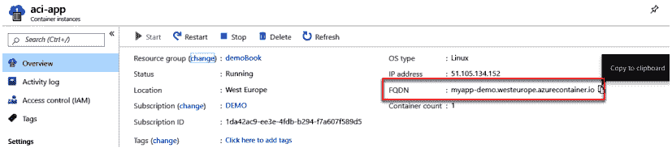

图 9.33 – ACI 中应用程序容器的 FQDN

我们使用此 URL 打开网页浏览器：

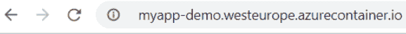

### 欢迎使用我的新应用

此页面是我的演示 Dockerfile 的测试。
享受 ...

图 9.34 – 测试应用程序

我们的 Web 应用程序显示正确。

下次应用程序更新时，CI/CD 生成将被触发，镜像的新版本将被推送到 Docker Hub，并且新容器将加载此镜像的新版本。

在本节中，我们探讨了编写 Terraform 代码以管理 ACI 资源，以及在 Azure Pipelines 中创建 CI/CD 流水线，该流水线允许您将应用程序的镜像部署到 Docker Hub，然后使用镜像的新版本更新 ACI 资源。

在下一节中，我们将讨论 Docker 的另一个用例——即运行命令行工具。

### 使用 Docker 运行命令行工具

到目前为止，在本章中，我们已研究了使用 Docker 将带有 Nginx 的 Web 应用程序容器化的用例。

Docker 的另一个用例是能够运行位于 Docker 容器中的命令行工具。

为了说明这一点，我们将运行一个 Terraform 配置示例，使用 **Terraform** 二进制文件，该文件不位于本地计算机上，而是位于 Docker 容器中。

本节中使用的 Terraform 配置与上一节 _使用 CI/CD 流水线将容器部署到 ACI_ 中的配置相同，源代码可在此处查看：`https://github.com/PacktPublishing/Learning-DevOps-Second-Edition/tree/main/CHAP09/terraform-aci`。

本实验的目标是使用 Docker 容器中的 Terraform 二进制文件运行此 Terraform 配置。要运行此实验，请执行以下步骤：

1. 首先，我们使用以下命令从 Docker Hub 拉取官方 Terraform 镜像：

   `docker pull hashicorp/terraform`

下图显示了此命令的执行情况：

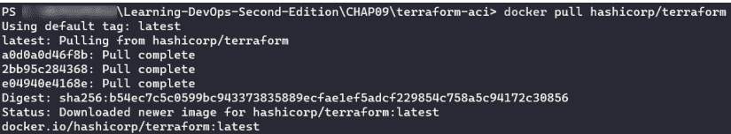

图 9.35 - 用于拉取 Terraform 镜像的 docker pull 命令

2. 然后，在包含 Terraform 配置的文件夹中，我们将使用以下三个 `docker run` 命令运行 Terraform 工作流：

   首先，我们运行 `terraform init` 命令，如下所示：

   `docker run -i -t -v ${PWD}:/usr/tf -w /usr/tf ' --env ARM_CLIENT_ID="<azure clientId>" ' --env ARM_CLIENT_SECRET="<azure client secret>" ' --env ARM_SUBSCRIPTION_ID="<azure subscription>" ' --env ARM_TENANT_ID="azure tenant id" ' --env ARM_ACCESS_KEY="azure access key " ' hashicorp/terraform:latest ' init -backend-config="backend.tfvars"`

   在此 `docker run` 命令中，我们使用以下参数：

   - `-v` 用于创建卷，将包含 Terraform 代码的当前本地目录挂载到容器内的 `/usr/tf` 目录中


+   - `-w` 用于指定工作目录
+   - `--env` 用于指定 Terraform 进行 Azure 身份验证所需的环境变量
+   - `Hashicorp/terraform:latest`，即镜像名称
+   - `init -backend-config="backend.tfvars"`，即 Terraform 命令要运行的参数

现在，我们运行 `terraform plan` 命令，如下所示：

```
docker run -i -t -v ${PWD}:/usr/tf -w /usr/tf '
--env ARM_CLIENT_ID="<azure clientId>" '
--env ARM_CLIENT_SECRET="<azure client secret>" '
--env ARM_SUBSCRIPTION_ID="<azure subscription>" '
--env ARM_TENANT_ID="azure tenant id" '
--env ARM_ACCESS_KEY="azure access key " '
hashicorp/terraform:latest '
plan -var dockerhub-username="<docker hub username>" -out plan.tfplan
```

在上述命令中，我们使用相同的参数，配合 `plan` 命令用于 Terraform。

最后，我们运行 `terraform apply` 命令，如下所示：

```
docker run -i -t -v ${PWD}:/usr/tf -w /usr/tf '
--env ARM_CLIENT_ID="<azure clientId>" '
--env ARM_CLIENT_SECRET="<azure client secret>" '
--env ARM_SUBSCRIPTION_ID="<azure subscription>" '
--env ARM_TENANT_ID="azure tenant id" '
--env ARM_ACCESS_KEY="azure access key " '
hashicorp/terraform:latest '
apply plan.tfplan
```

我们刚刚学习了在 Docker 容器中运行工具（此处为 Terraform）的基本示例。这种 Docker 用法具有以下优势：

+   - 无需在本地机器上安装这些工具；安装过程由 Docker 镜像中的工具编辑器完成。
+   - 可以运行同一工具的多个版本。

在下一节中，我们将讨论 Docker Compose 的使用，它允许我们将多个 Docker 镜像挂载到同一组容器中。

### Docker Compose 入门

在本章迄今为止，我们已学习如何编写 Dockerfile、创建 Docker 镜像以及运行该 Docker 镜像的容器。

如今，应用程序不再以独立模式运行；它们需要其他依赖项，例如服务（例如，另一个应用程序；**应用程序编程接口**（API））或数据库。这意味着对于这些应用程序，Docker 工作流更加一致。确实，当我们使用多个 Docker 应用程序时，需要为每个应用程序执行 `docker build` 和 `docker run` 命令，这需要一些精力。

Docker Compose 是一个更高级的 Docker 工具，允许我们在同一部署周期中同时部署多个 Docker 容器。Docker Compose 还允许我们管理这些 Docker 容器共有的元素，例如数据卷和网络配置。

> **注意**
> 有关 Docker Compose 的更多详细信息，请阅读此处的官方文档：
> `https://docs.docker.com/compose`

在 Docker Compose 中，此配置（包含构成同一应用程序的工件的 Docker 镜像、卷和网络）只需在 **YAML Ain't Markup Language**（**YAML**）格式的配置文件中简单完成即可。

在本节中，我们将了解 Docker Compose 的基本模式安装。然后，我们将编写一个简单的 Docker Compose 配置文件，在同一上下文中运行带有 MySQL 数据库的 nginx 应用程序。最后，我们将执行此 Docker Compose 配置文件并在 Docker 容器中查看结果。

### 安装 Docker Compose

在 Windows 或 macOS 上，**Docker Compose** 二进制文件已随 Docker Desktop 一起安装。

按照此文档在 Linux 上安装 Docker Compose 二进制文件：`https://docs.docker.com/compose/install/#install-compose-on-linux-systems`。

我们可以通过运行以下命令来检查 Docker Compose 是否已正确安装：

```
docker-compose version
```

以下屏幕截图显示了此命令的结果：

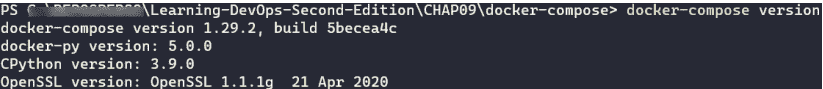

图 9.36 – docker-compose version 命令

此命令显示已安装的 `docker-compose` 二进制文件的版本。

既然 Docker Compose 已安装，我们将编写 Docker Compose 配置 YAML 文件。

### 编写 Docker Compose 配置文件

对于使用 Docker Compose 部署容器，我们将编写一个配置文件来运行与 `mysql` 容器耦合的 nginx 容器。

为此，我们将创建一个名为 `docker-compose.yml` 的新文件，包含以下两个代码块的内容。

第一个代码片段（YAML 格式）用于创建 nginx 容器，如下所示：

```
version: '3' #version of the Docker Compose YAML schema
services:
  nginx:
    image: nginx:latest
    container_name: nginx-container
    ports:
      - 8080:80
```

在上述代码片段中，我们从 `services` 属性开始，该属性包含要在 Docker 中运行的服务（或 Docker 应用程序）列表。第一个服务是 nginx 服务。我们配置要使用的 `nginx` `docker` 镜像、容器名称以及公开端口，即 `8080`，用于本地访问 nginx 服务。

### 执行 Docker Compose

对于运行 YAML 配置文件中描述的 Docker 容器，我们将通过在包含 `docker-compose.yml` 文件的文件夹中执行以下命令来运行 Docker Compose 的基本操作：

```
docker-compose up -d
```

> 注意
> `-d` 选项用于以分离模式运行容器。
> `docker-compose` CLI 的完整文档可在此处查阅：
> `https://docs.docker.com/compose/reference/`

然后，我们使用以下代码添加 MySQL 服务的 YAML：

```
mysql:
  image: mysql:5.7
  container_name: mysql-container
  environment:
    MYSQL_ROOT_PASSWORD: secret
    MYSQL_DATABASE: mydb
    MYSQL_USER: myuser
    MYSQL_PASSWORD: password
```

在上述代码片段中，我们使用 Docker 镜像、容器名称以及配置数据库访问所需的环境变量来配置 `mysql` 服务。

> 注意
> 此文件的完整源代码可在此处查阅：
> `https://github.com/PacktPublishing/Learning-DevOps-Second-Edition/blob/main/CHAP09/docker-compose/docker-compose.yml`

我们刚刚编写了 `docker-compose` 配置的 YAML 文件。现在，我们将运行 Docker Compose 以执行此配置中描述的容器。

以下屏幕截图显示了 `docker-compose up -d` 命令的执行：

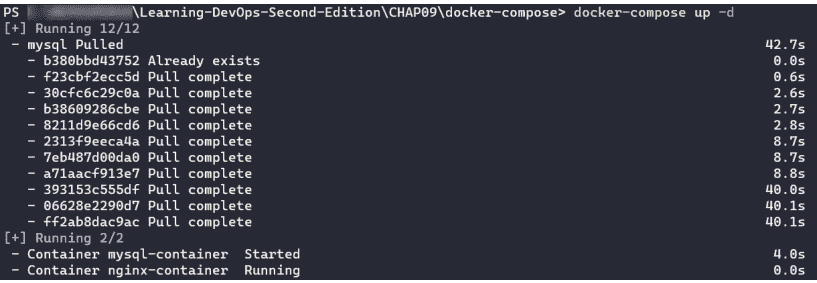

图 9.37 – docker-compose up -d 命令

执行结束时，Docker Compose 会显示已启动容器的列表。在我们的示例中，这些是 `nginx` 和 `mysql`。

要检查容器是否正在运行，我们执行 `docker ps` Docker 命令以显示正在运行的容器列表。

以下屏幕截图显示了 `docker ps` 命令的执行：

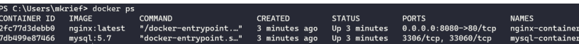

图 9.38 – docker ps 命令

我们可以看到我们的两个容器正在运行。

在 Windows 或 macOS 上，我们也可以使用 Docker Desktop，它在容器列表中显示由 Docker Compose 在 `docker-compose` 组内挂载的正在运行的容器，如以下屏幕截图所示：

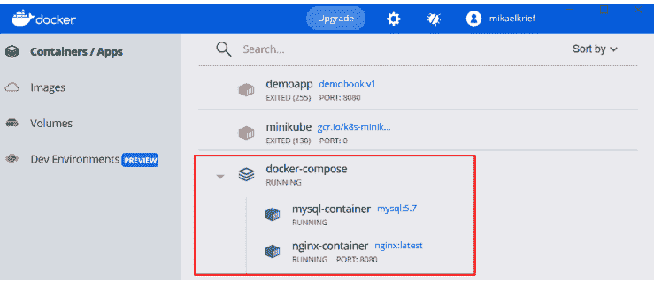

图 9.39 – Docker Desktop 中的 Docker Compose 容器列表

在本节中，我们学习了编写 Docker Compose 配置文件以及在本地执行 Docker Compose 以运行 Docker 容器的一些基本功能。

在下一节中，我们将讨论在 ACI 上远程执行这些容器的相同过程。

### 在 ACI 中部署 Docker Compose 容器

我们在 _Deploying a container to ACI with a CI/CD pipeline_ 部分讨论了 ACI。

现在，我们将学习如何在 ACI 中使用 Docker Compose 配置执行容器，以运行一组位于同一应用程序服务上的容器。

对于此实验，我们将使用在 _Using Docker for running command-line tools_ 部分中学习的相同 Docker Compose 配置。唯一的区别是，nginx 服务的运行端口为 80，而不是我们在本地使用的 8080（因为我的端口 80 已被另一项服务占用）。

对于在 ACI 上部署容器，我们将执行以下步骤：

+   1. 在我们的 Azure 订阅中，我们将创建一个名为 `rg-acicompose` 的新资源组。
+   2. 然后，在控制台终端中，运行以下 Docker 命令以登录 Azure：
+   
    `docker login azure`
+   
    执行此命令将打开一个窗口，允许我们对 Azure 订阅进行身份验证。
+   3. 通过运行以下命令创建新的 Docker 上下文：
+   
    `docker context create aci demobookaci`
+   
    通过运行此命令，我们选择在步骤 1 中创建的 Azure 订阅和资源组，如以下屏幕截图所示：
+   
    PS C:\Users\Learning DevOps-Second-Edition\CHAP09(docker-compose> docker context create aci demobookaci
    ? Select a subscription ID Microsoft Azure Sponsorship (* **************)
    ? Select a resource group rg-acicompose (westeurope)
    Successfully created aci context "demobookaci"
+   
    图 9.40 – 为 ACI 创建 Docker 上下文
+   4. 通过运行以下命令检查新的 Docker 上下文：
+   
    `docker context ls`


此命令显示 Docker 上下文列表，并使用 * 符号指示当前上下文，如下面的屏幕截图所示：

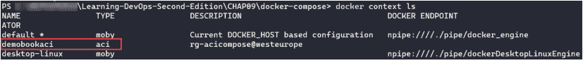

图 9.41 – Docker 上下文列表

5. 通过运行以下命令选择新创建的 demobookaci 上下文：

```
docker context use demobookaci
```

6. 最后，要在该 ACI 资源中部署 Docker Compose 配置应用程序，请运行以下命令：

```
docker compose up
```

以下屏幕截图显示了执行此命令的结果：

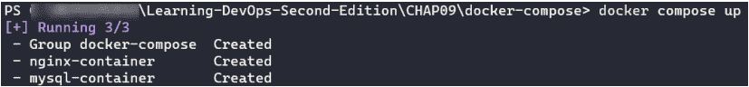

图 9.42 – 用于部署到 ACI 的 docker compose up 命令

在我们的 Azure 订阅中，可以看到包含两个容器的已创建 ACI 资源，如下面的屏幕截图所示：

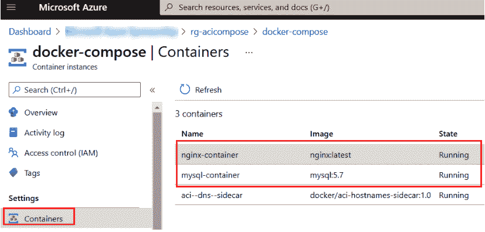

图 9.43 – Docker Compose 创建的 ACI 容器

最后，要测试并访问已部署的应用程序，请在 ACI 属性中查找应用程序 FQDN 并在浏览器中启动应用程序。这正是我们在本章的 *使用 CI/CD 管道将容器部署到 ACI* 部分中学到的内容。

> 注意
> 关于 ACI 中 Docker Compose 的另一个示例，请阅读此处的官方教程：
> https://docs.microsoft.com/en-us/azure/container-instances/tutorial-docker-compose

在本节中，我们学习了如何使用 `docker-compose` YAML 文件和一些 Docker 命令行上下文，在 ACI 中使用 Docker Compose 部署多个容器。

### 摘要

在本章中，我们介绍了 Docker 及其基本概念。我们讨论了创建 Docker Hub 帐户所需的步骤，然后在本地使用 Docker Desktop 安装了 Docker。

我们创建了一个 Dockerfile，详细说明了 Web 应用程序 Docker 镜像的组成，还查看了它包含的主要指令——`FROM`、`COPY` 和 `RUN`。

我们执行了 `docker build` 和 `docker run` 命令，从我们的 Dockerfile 构建镜像并在本地执行它，然后使用 `push` 命令将其推送到 Docker Hub。

在本章的第二部分，我们在 Azure Pipelines 中实现并执行了 CI/CD 管道，将我们的容器部署到使用 Terraform 预配的 ACI 资源中。然后，我们讨论了使用 Docker 运行命令行工具（例如 Terraform）。

最后，我们学习了如何安装和使用 Docker Compose 来创建多个应用程序容器并将它们部署到 ACI 中。

在下一章中，我们将继续探讨容器主题，并了解 Kubernetes，它是一种大规模管理容器的工具。我们将使用 **Azure Kubernetes Service (AKS)** 和 Azure Pipelines 在 Kubernetes 中使用 CI/CD 管道部署应用程序。

### 问题

- 1. 什么是 Docker Hub？
- 2. 允许您创建 Docker 镜像的基本元素是什么？
- 3. 在 Dockerfile 中，定义要使用的基础镜像的指令是什么？
- 4. 哪个 Docker 命令允许您创建 Docker 镜像？
- 5. 哪个 Docker 命令允许您实例化新容器？
- 6. 哪个 Docker 命令允许您将镜像发布到 Docker Hub？

### 延伸阅读

如果您想了解更多有关 Docker 的信息，以下是一些优秀的书籍：

- *Docker Cookbook*: https://www.packtpub.com/virtualization-and-cloud/docker-cookbook-second-edition
- *Beginning DevOps with Docker*: https://www.packtpub.com/virtualization-and-cloud/beginning-devops-docker
