## 10 使用 Kubernetes 有效管理容器

在上一章中，我们详细了解了 Docker 容器、Docker 镜像的构建以及在本地计算机上实例化新容器。最后，我们设置了一个 **持续集成/持续部署** (CI/CD) 管道，用于构建镜像、将其部署到 Docker Hub 并在 **Azure 容器实例** (ACI) 中执行其容器。

当使用少量容器时，这一切都运行良好且不会带来太多问题。但在所谓的 **微服务应用程序**——即由多个服务（每个服务都是一个容器）组成的应用程序——中，我们需要管理和编排这些容器。

市场上有两种主要的容器编排工具：Docker Swarm 和 Kubernetes。

一段时间以来，Kubernetes（也称为 **K8S**）已被证明是容器管理领域的真正领导者，因此正在成为应用程序容器化的 _必备_ 技术。

在本章中，我们将学习如何在本地计算机上安装 Kubernetes，以及如何以标准方式和使用 Helm 在 Kubernetes 中部署应用程序的示例。我们将通过创建图表并将其发布到 **Azure 容器注册表 (ACR)** 上的私有注册表，更深入地了解 Helm。

然后，我们将讨论 **Azure Kubernetes Service (AKS)** 作为 Kubernetes 集群的示例，最后，我们将学习如何监控 Kubernetes 中的应用程序和指标。

本章将涵盖以下主题：

- 安装 Kubernetes
- Kubernetes 应用程序部署的第一个示例
- 使用 Helm 作为包管理器
- 在私有注册表 (ACR) 中发布 Helm 图表
- 使用 AKS
- 使用 Azure Pipelines 为 Kubernetes 创建 CI/CD 管道
- 在 Kubernetes 中监控应用程序和指标

### 技术要求

本章是上一章 Docker 章节的延续，因此要正确理解它，有必要阅读该章节并安装 Docker Desktop（适用于 Windows **操作系统 (OS)**）。

在本章的 CI/CD 部分中，您需要检索上一章 Docker 章节中提供的源代码，该代码可在 `https://github.com/PacktPublishing/Learning-DevOps-Second-Edition/tree/main/CHAP09/appdocker` 上找到。

关于 ACR 上 Helm 图表的部分，有必要拥有 Azure 订阅（在此处免费注册：`https://azure.microsoft.com/en-us/free/`）并且您已安装 Azure **命令行界面 (CLI)** 二进制文件，可在此处获取：`https://docs.microsoft.com/en-us/cli/azure/install-azure-cli`。

本章的完整源代码可在 `https://github.com/PacktPublishing/Learning-DevOps-Second-Edition/tree/main/CHAP10` 上找到。

查看以下视频以观看代码实际运行情况：
https://bit.ly/3p7ydjt

### 安装 Kubernetes

在安装 Kubernetes 之前，我们需要了解其架构和主要组件，因为 Kubernetes 不是一个简单的工具，而是一个集群——即它由一个 **主服务器** 和其他称为 **节点** 的从服务器组成。我建议您以简化的方式探索 Kubernetes 的架构。

### Kubernetes 架构概述

Kubernetes 是一个由多个组件组成的平台，这些组件一起组装并按需扩展，以便实现应用程序的更好可扩展性。Kubernetes 的架构（一种客户端/服务器类型）可以简单地表示，如下图所示：

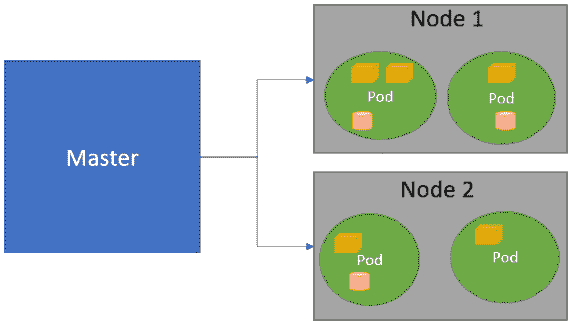

在前面的图中，我们可以看到集群由主组件和节点（也称为 **工作节点**）组成，它们代表从服务器。在每个节点中，都有 **Pod**，它们是将包含容器和卷的虚拟元素。简单来说，我们可以为每个应用程序创建一个 Pod，它将包含应用程序的所有容器。例如，一个 Pod 可以包含 Web 服务器容器、数据库容器以及将包含图像和数据库文件的持久文件的卷。

最后，`kubectl` 是允许我们与 Kubernetes 集群交互的客户端工具。有了这个，我们就具备了使用 Kubernetes 的主要要求，因此让我们看看如何在本地计算机上安装它。

### 在本地计算机上安装 Kubernetes

在开发将托管在 Kubernetes 上的容器化应用程序时，在将其部署到远程 Kubernetes 生产集群之前，能够在本地计算机上运行应用程序（及其容器）非常重要。

为了在本地安装 Kubernetes 集群，有几种解决方案，将在下面详细介绍。

第一种解决方案是使用 **Docker Desktop**，执行以下步骤：

- 1. 如果我们已经安装了 Docker Desktop（我们在 _第 9 章 使用 Docker 容器化您的应用程序_ 中了解过），可以在 **Kubernetes** 选项卡的 **设置** 中激活 **启用 Kubernetes** 选项，如下面的屏幕截图所示：

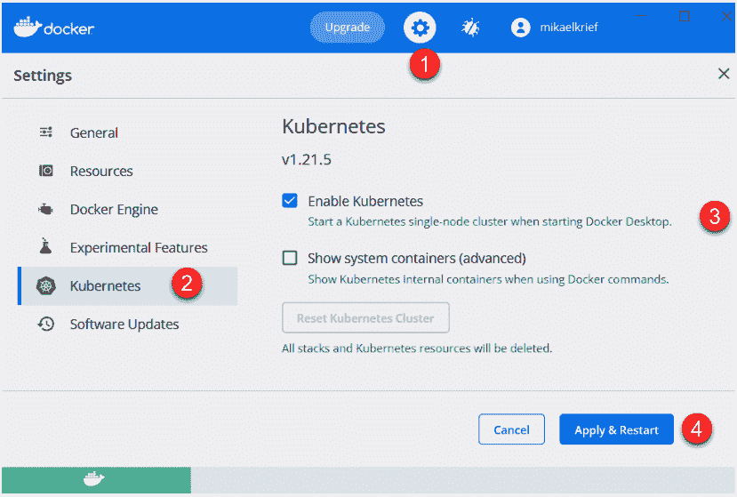

图 10.2 – 在 Docker Desktop 中启用 Kubernetes


2. 单击 **Apply & Restart** 按钮后，Docker Desktop 将在本地计算机上安装一个本地 Kubernetes 集群，以及 `kubectl` 客户端工具。

在本地安装 Kubernetes 的第二种方式是安装 minikube，它也会在本地安装一个简化的 Kubernetes 集群。以下是您可以阅读的官方文档：https://minikube.sigs.k8s.io/docs/start/。

> Note
> 安装本地 Kubernetes 还有其他解决方案，例如 kind 或 kubeadm。有关更多详细信息，请阅读此处的文档：https://kubernetes.io/docs/tasks/tools/。

在本地安装 Kubernetes 后，我们将通过在终端中执行以下命令来检查其安装情况：

```
kubectl version --short
```

以下屏幕截图显示了上述命令的结果：

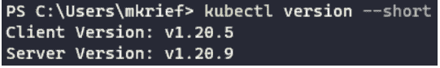

图 10.3 – kubectl 获取二进制版本

> Note
> 我们在 Kubernetes 集群上执行的所有操作都将使用 `kubectl` 命令完成。

安装 Kubernetes 集群后，我们还需要另一个元素，即 Kubernetes 仪表板。这是一个 Web 应用程序，允许我们查看集群的状态以及所有组件。

在下一节中，我们将讨论如何安装和测试 Kubernetes 仪表板。

### 安装 Kubernetes 仪表板

为了安装 Kubernetes 仪表板（这是一个预打包的容器化 Web 应用程序，将部署在我们的集群中），我们将在终端中运行以下命令：

```
kubectl apply -f https://raw.githubusercontent.com/kubernetes/dashboard/v2.4.0/aio/deploy/recommended.yaml
```

其执行情况如下屏幕截图所示：

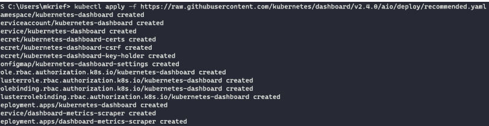

图 10.4 – Kubernetes 仪表板安装

从上述屏幕截图中，我们可以看到创建了不同的工件，具体如下：secrets、两个 Web 应用程序、**基于角色的访问控制 (RBAC)** 角色、权限和服务。

> **Note**
> 请注意，安装仪表板的命令参数中提到的 **统一资源定位符 (URL)** 可能会根据仪表板的版本而更改。要查找当前有效的 URL，请访问官方文档 `https://kubernetes.io/docs/tasks/access-application-cluster/web-ui-dashboard/`。

现在我们已经安装了此 Kubernetes 仪表板，将连接到它并对其进行配置。

要从本地计算机打开仪表板并连接到它，我们必须首先通过执行以下步骤在 Kubernetes 集群和我们的计算机之间创建代理：

1. 要创建代理，我们在终端中执行 `kubectl proxy` 命令。执行详情如下屏幕截图所示：

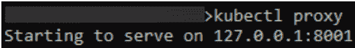

图 10.5 – kubectl proxy 命令

我们可以看到，代理已在本地主机地址 (127.0.0.1) 的 8001 端口上打开。

2. 然后，在 Web 浏览器中打开以下 URL，`http://localhost:8001/api/v1/namespaces/kubernetes-dashboard/services/https:kubernetes-dashboard:/proxy/#/login`，这是一个由代理创建的本地 URL（localhost 和 8001），指向我们已安装的 Kubernetes 仪表板应用程序。

以下屏幕截图显示了如何选择 Kubernetes 配置文件或输入身份验证令牌：

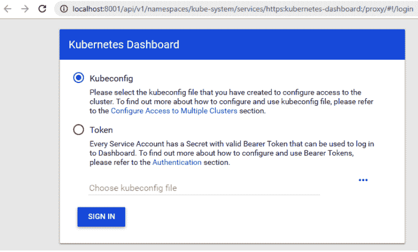

图 10.6 – Kubernetes 仪表板身份验证

3. 要创建新的用户身份验证令牌，我们将在 PowerShell 终端中执行以下脚本：

```
$TOKEN=((kubectl -n kube-system describe secret default |
Select-String "token:") -split " +")[1]
kubectl config set-credentials docker-for-desktop
--token="${TOKEN}"
```

执行此脚本会在本地配置文件中创建一个新令牌。

4. 最后，在仪表板中，我们将选择位于 `C:\Users\<user name>.kube\` 文件夹中的 `config` 文件，如下屏幕截图所示：

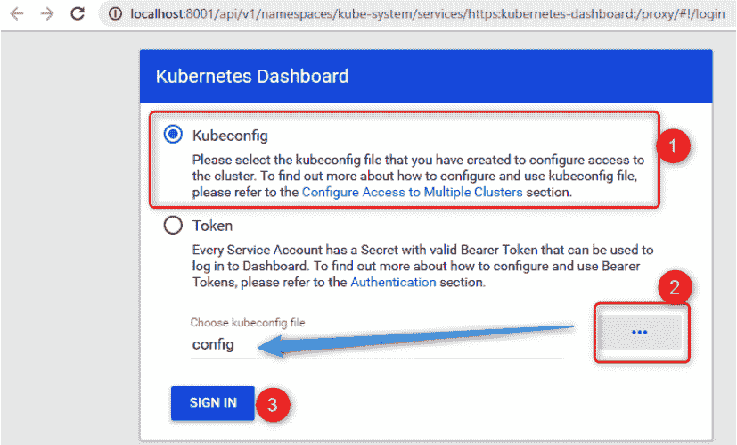

图 10.7 – 使用 kubeconfig 文件进行 Kubernetes 仪表板身份验证

> **Note**
> 关于令牌身份验证，请阅读此博客文章：
> https://www.replex.io/blog/how-to-install-access-and-add-heapster-metrics-to-the-kubernetes-dashboard

5. 单击 SIGN IN 按钮后，仪表板将显示如下：

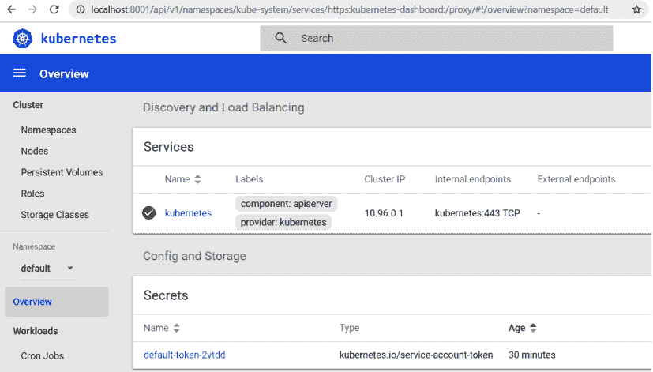

图 10.8 – Kubernetes 仪表板资源列表

我们刚刚了解了如何在本地计算机上安装 Kubernetes 集群，然后在该集群中安装和配置了 Kubernetes Web 仪表板。我们现在将使用 **YAML Ain’t Markup Language (YAML)** 规范文件和 `kubectl` 命令在本地 Kubernetes 集群中部署我们的第一个应用程序。

### Kubernetes 应用程序部署的第一个示例

安装 Kubernetes 集群后，我们将在其中部署一个应用程序。首先，需要知道的是，当我们在 Kubernetes 中部署应用程序时，我们会在 Kubernetes **pod** 对象中创建 Docker 容器的新实例，因此我们首先需要一个包含应用程序的 Docker 镜像。

对于我们的示例，我们将使用包含 Web 应用程序的 Docker 镜像，该镜像已在 _第 9 章，使用 Docker 容器化您的应用程序_ 中推送到 Docker Hub。

要部署此 Docker 容器实例，我们将创建一个新的 k8sdeploy 文件夹，并在其中创建一个 Kubernetes 部署 YAML 规范文件 (myapp-deployment.yml)，内容如下：

```
---
apiVersion: apps/v1
kind: Deployment
metadata:
  name: webapp
spec:
  selector:
    matchLabels:
      app: webapp
  replicas: 2
  template:
    metadata:
      labels:
        app: webapp
    spec:
      containers:
        - name: demobookk8s
          image: mikaelkrif/demobook:latest
          ports:
            - containerPort: 80
```

在上述代码片段中，我们以如下方式描述我们的部署：

- apiVersion 属性是应使用的 API 版本。
- 在 Kind 属性中，我们指定规范类型为 deployment。
- replicas 属性指示 Kubernetes 将在集群中创建的 Pod 数量；这里，我们选择两个实例。

在此示例中，我们选择了两个副本，这至少可以分发应用程序的流量负载（如果负载量很大，可以增加更多副本），同时确保应用程序正常运行。因此，如果两个 Pod 中的一个出现问题，另一个（即相同的副本）将确保应用程序正常运行。

然后，在 `containers` 部分中，我们使用 `name` 和 `tag` 指定镜像（来自 Docker Hub）。最后，`ports` 属性指示容器在集群中将使用的端口。

> Note
> 此源代码也可在 `https://github.com/PacktPublishing/Learning-DevOps-Second-Edition/blob/main/CHAP10/k8sdeploy/myapp-deployment.yml` 上找到。

要部署我们的应用程序，我们进入终端并执行一个基本的 `kubectl` 命令 (`kubectl apply`)，如下所示：

```
kubectl apply -f myapp-deployment.yml
```

`-f` 参数对应于 YAML 规范文件。

此命令将 YAML 规范文件中描述的部署应用于 Kubernetes 集群。

执行此命令后，我们将通过显示集群中 Pod 列表来检查此部署的状态。为此，在终端中我们执行 `kubectl get pods` 命令，该命令将返回集群 Pod 列表。以下屏幕截图显示了部署的执行情况，并显示了我们用于检查部署的 Pod 信息：

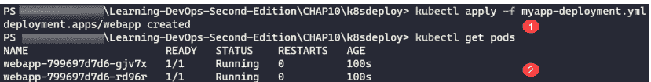

图 10.9 – kubectl apply 命令

从上述屏幕截图中可以看到，第二个命令显示了我们的两个 Pod，其名称（`webapp`）在 YAML 文件中指定，后跟一个 **唯一标识符 (UID)**，并且它们处于 `Running` 状态。

我们还可以在 Kubernetes Web 仪表板上可视化集群的状态，包括 `webapp` 部署、使用的 Docker 镜像以及已创建的两个 Pod。如需更多详细信息，可以单击元素的不同链接。

我们的应用程序已成功部署在 Kubernetes 集群中，但目前它仅在集群内可访问，要使其可用，我们需要将其暴露到集群外部。


为了在集群外部访问 Web 应用程序，我们必须向集群添加一种服务类型和一个 NodePort 类别元素。要添加此服务类型和 NodePort 元素，与部署的方式相同，我们将在同一个 k8sdeploy 目录中创建第二个服务规范 YAML 文件（myapp-service.yml），其代码如下：

```yaml
---
apiVersion: v1
kind: Service
metadata:
  name: webapp
  labels:
    app: webapp
spec:
  type: NodePort
  ports:
    - port: 80
      targetPort: 80
      nodePort: 31000
  selector:
    app: webapp
```

在前面的代码片段中，我们指定了 kind，Service，以及服务类型，NodePort。

然后，在 ports 部分，我们指定端口转换：内部暴露的端口 80，以及对集群外部暴露的端口 31000。

> **Note**
> 此文件的源代码也可在 https://github.com/PacktPublishing/Learning-DevOps-Second-Edition/blob/main/CHAP10/k8sdeploy/myapp-service.yml 上获取。

要在集群上创建此服务，我们执行 kubectl apply 命令，但这次将 myapp-service.yml 文件作为参数，如下所示：

```bash
kubectl apply -f myapp-service.yml
```

命令的执行在集群中创建了服务，并且，为了测试我们的应用程序，我们打开带有 http://localhost:31000 URL 的 Web 浏览器，我们的页面显示如下：

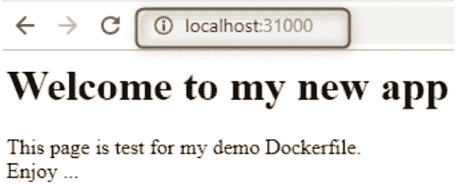

Figure 10.10 – Demo Kubernetes application

我们的应用程序现在已部署在 Kubernetes 集群上，并且可以从集群外部访问。

在本节中，我们了解到，应用程序的部署以及在 Kubernetes 中创建对象，是通过使用 YAML 格式的规范文件和几个 kubectl 命令行来实现的。

下一步是使用 Helm 包来简化 YAML 规范文件的管理。

### 使用 Helm 作为包管理器

如前所述，我们在 Kubernetes 集群上执行的所有操作都是通过 kubectl 工具和 YAML 规范文件完成的。

在一家在 Kubernetes 集群上部署多个微服务应用程序的公司中，我们经常注意到大量的这些 YAML 规范文件，这会带来维护问题。为了解决这个维护问题，我们可以使用 Helm，它是 Kubernetes 的包管理器。

> Note
> 有关包管理器的更多信息，您也可以阅读第 7 章 持续集成和持续交付中的使用包管理器部分。

因此，Helm 是一个存储库，它将允许共享称为 charts 的包，这些包包含可直接使用的 Kubernetes 规范文件模板。

### 安装 Helm 客户端

那么，我们将了解如何在本地 Kubernetes 集群上安装 Helm，稍后，我们将了解如何使用 Helm 安装应用程序。

自版本 3 以来，Helm 仅由一个二进制文件组成：一个 **客户端工具**，它主要允许我们在目标 Kubernetes 集群上安装 Kubernetes 规范文件包，列出存储库的包，并指示要安装的包。

要安装 Helm 客户端，请参阅 `https://helm.sh/docs/using_helm/#installing-the-helm-client` 的安装文档，该文档详细说明了根据不同操作系统的安装程序。

例如，在 Windows 中，我们可以通过 **Chocolatey** 包管理器安装它，执行以下命令：

```bash
choco install kubernetes-helm -y
```

要检查其安装，请执行 `helm --help` 命令，如下面的屏幕截图所示：

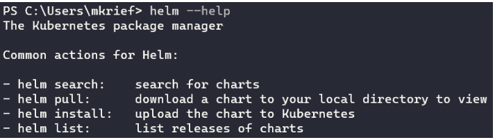

Figure 10.11 – helm --help command

命令的执行告诉我们 Helm 已正确安装。现在，我们将学习如何使用公共 Helm chart。

> **Note**
> 要了解有关 Helm 的更多信息并访问其文档，请访问 `https://helm.sh/`。

> **Note**
> 在本书第一版中，我们使用了 3.0 之前的 Helm 版本，并学习了如何安装 Helm Tiller 插件。自 3.0+ 版本起，Tiller 插件不再需要安装，因此本版删除了 Tiller 安装指南。

### 使用 Artifact Hub 中的公共 Helm chart

Helm 存储库中包含的包称为 **charts**。Charts 由文件组成，这些文件是应用程序的 Kubernetes 规范文件模板。

使用 charts，可以在不编写任何 YAML 规范文件的情况下在 Kubernetes 中部署应用程序。因此，要部署应用程序，我们将使用其对应的 chart，并传递该应用程序的一些配置变量。

安装 Helm 后，我们将安装一个位于 Helm 公共存储库（称为 **Artifact Hub**）中的 chart，可在此处访问：`https://artifacthub.io/`。但是首先，要显示公共 charts 列表，我们运行以下命令：

```bash
helm search hub
```

`hub` 参数是 Artifact Hub 的名称。

要搜索特定包，我们可以运行 `helm search hub <package name>` 命令，如果我们想要搜索所有 `wordpress` 包（例如），我们运行以下命令：

```bash
helm search hub wordpress
```

以下是结果摘录，其中包含大量 charts：

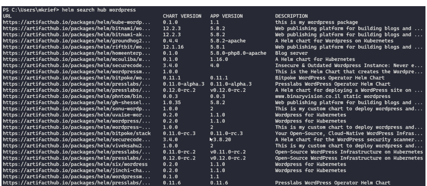

Figure 10.12 – Searching for Helm packages

要轻松查找包，请访问 Artifact Hub 网站（https://artifacthub.io/）并搜索 wordpress 包，如下面的屏幕截图所示：

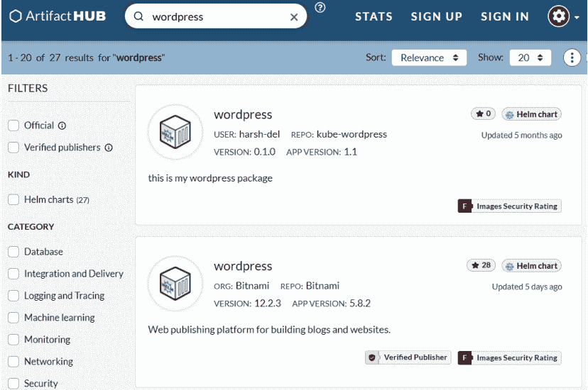

Figure 10.13 – Artifact Hub wordpress search

此页面列出了所有社区发布者的所有 wordpress 包。

然后，单击所需的包以显示包的详细信息，如下面的屏幕截图所示：

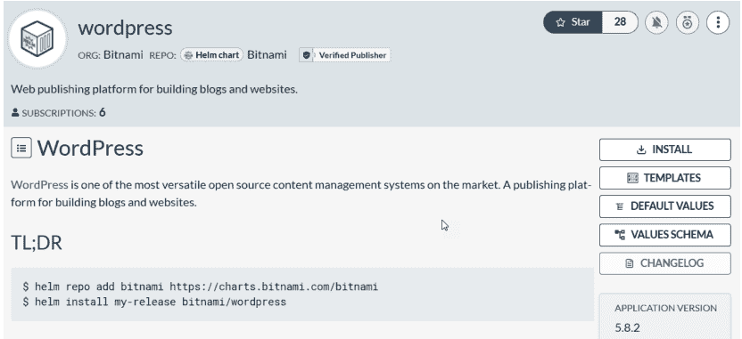

Figure 10.14 – Artifact Hub wordpress details

在此页面上，我们可以看到包的当前版本以及一些技术包安装指南。

> **Note**
> 也可以使用 Nexus、Artifactory 或甚至 ACR 等工具创建我们自己的私有或企业 Helm 存储库。

现在让我们使用 Helm 安装一个应用程序。

为了说明 Helm 的使用，我们将使用 Helm chart 在 Kubernetes 集群中部署一个 WordPress 应用程序。

为此，请执行以下命令（在此处提及：https://artifacthub.io/packages/helm/bitnami/wordpress）：

```bash
helm repo add bitnami https://charts.bitnami.com/bitnami
helm install wpdemo bitnami/wordpress
```

第一个命令 helm repo add 将 bitnami 存储库的索引添加到本地。然后，我们使用 helm install <release name> <package name> 命令在 Kubernetes 上安装所需的包。

下面的屏幕截图显示了这两个命令的执行情况：

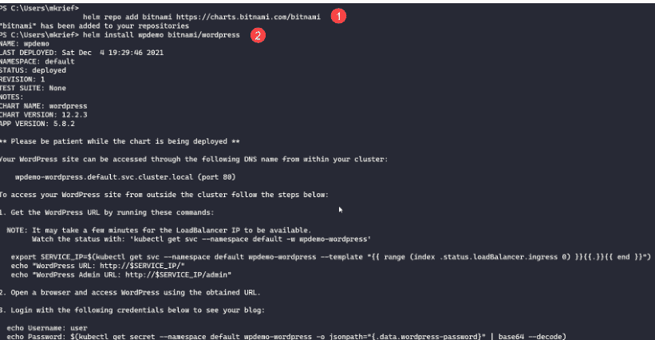

Figure 10.15 – Installing an application with Helm

执行前面的命令后，Helm 在本地 Kubernetes 集群上安装了名为 wpdemo 的 WordPress 实例和所有 Kubernetes 组件。

我们还可以通过执行以下命令显示集群上安装的 Helm 包列表：

```bash
helm ls
```

下面的屏幕截图显示了此命令的执行情况：

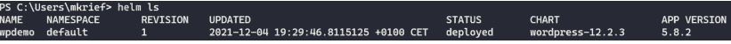

Figure 10.16 – Helm list of installed packages

如果我们想要删除包及其所有组件（例如，删除使用此包安装的应用程序），我们执行 helm delete 命令，如下所示：

```bash
helm delete wpdemo
```

下面的屏幕截图显示了此命令的执行情况：

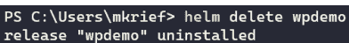

Figure 10.17 – helm delete command

我们已讨论了将 Artifact Hub 中的 Helm chart 安装到 Kubernetes 集群。在下一节中，我们将学习如何创建自定义 Helm chart 包。

### 创建自定义 Helm chart

我们刚刚学习了如何从 Artifact Hub 使用和安装公共 Helm chart，但在公司中，我们通常有一些自定义应用程序，需要我们创建自定义 Helm charts。

以下是创建自定义 Helm chart 的基本步骤：

1. 在将包含 Helm chart 文件模板的文件夹内，运行 `helm create <chart name>` 命令，如下所示：

   ```bash
   helm create demobook
   ```

   执行此命令将为我们的 chart 创建目录结构和基本模板文件，如下面的屏幕截图所示：

   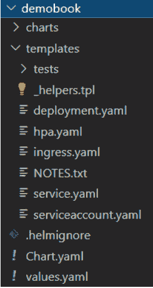

   Figure 10.18 – Helm chart structure folder

2. 然后，按照此处的技术文档自定义 chart 模板和值：`https://helm.sh/docs/chart_template_guide/`。


### 3. 最后，我们通过运行 `helm install <chart name> <chart path root>` 命令在 Kubernetes 集群中发布图表，如下所示：

```
helm install demochart ./demobook
```

以下截图显示了上述命令的执行情况：

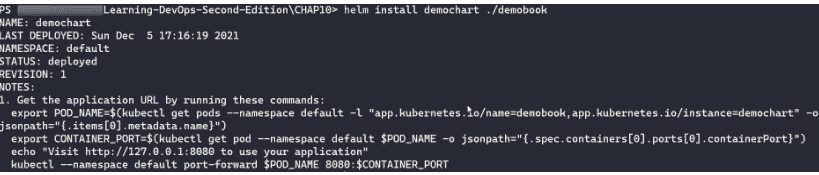

要检查 Helm 包的安装情况，请运行 `kubectl get pods` 命令以显示创建的 Pod 列表。

以下截图显示了创建的 Pod 列表：

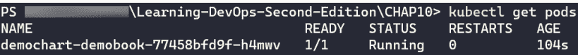

并运行 `helm ls` 命令以显示已安装的 Helm 图表列表，如以下截图所示：

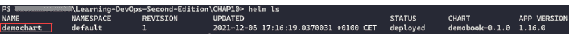

我们可以在上述截图中看到已安装在 Kubernetes 集群上的 `demochart` Helm 图表。

在本节中，我们了解了 Helm 的安装和使用概述，Helm 是 Kubernetes 的包管理器。然后，我们了解了如何从 Artifact Hub 安装 Helm 图表。最后，我们了解了如何创建自定义 Helm 图表并将其安装到 Kubernetes 集群中。

在下一节中，我们将学习如何将自定义 Helm 图表发布到私有 Helm 仓库——即 ACR。

### 在私有注册表（ACR）中发布 Helm 图表

在上一节中，我们讨论了名为 Artifact Hub 的公共 Helm 仓库，它非常适合公共（或社区）应用程序或工具。但对于公司应用程序，拥有私有 Helm 注册表更好，也是推荐的做法。

在市场上，有很多私有注册表，例如 Nexus 或 Artifactory，本文档解释了如何创建私有 Helm 仓库：`https://helm.sh/docs/topics/chart_repository/`。

在本节中，我们将讨论如何使用私有 Helm 仓库（即 ACR，我们在 _第 9 章：使用 Docker 容器化您的应用程序_ 中已经了解过）。因此，为了开始我们的实验，我们假设已经在 Azure 上创建了名为 demobookacr 的 ACR。

> **注意**
> 如果您尚未创建 ACR，请按照此处的文档操作：
> `https://docs.microsoft.com/en-us/azure/container-registry/container-registry-get-started-azure-cli`

要在 ACR 中发布自定义 Helm 图表，请执行以下步骤：

1. 第一步是在包含图表的 `chart.yaml` 文件的文件夹中运行 `helm package` 命令，以 `tar.gz` 格式创建图表的包。

运行以下命令，将 "." 作为参数，以指示 `chart.yaml` 文件位于当前文件夹中：

```
helm package .
```

以下截图显示了此命令的执行情况：

图 10.22 – 创建 Helm 包

Helm 图表包以 `demobook-0.1.0.tgz` 的名称创建。

2. 然后，使用以下 PowerShell 脚本对 ACR 进行身份验证：

```
$env:HELM_EXPERIMENTAL_OCI=1
$USER_NAME="00000000-0000-0000-0000-000000000000"
$ACR_NAME="demobookacr"

az login
$PASSWORD=$( az acr login --name $ACR_NAME --expose-token
--output tsv --query accessToken)
helm registry login "$ACR_NAME.azurecr.io" --username
$USER_NAME --password "$PASSWORD"
```

上述脚本执行以下操作：

- 将 HELM_EXPERIMENTAL_OCI 环境变量设置为 1。有关环境变量的更多详细信息，请阅读此文档：https://helm.sh/docs/topics/registries/。
- 将 USER_NAME 变量设置为一个 000 的虚拟值。
- 将 ACR_NAME 变量设置为 ACR 的名称。
- 通过使用 az cli 命令动态设置 PASSWORD 变量。
- 使用 Helm registry login 对 ACR 注册表进行身份验证。

3. 最后，我们使用以下命令将 Helm 图表推送到 ACR 注册表：

```
helm push .\demobook-0.1.0.tgz oci://$ACR_NAME.azurecr.io/helm
```

执行此命令后，推送的 Helm 图表将位于 ACR 上的 helm/demobook 存储库中。

4. 我们可以通过运行以下命令来检查 Helm 图表是否已正确推送到 ACR：

```
az acr repository show --name $ACR_NAME --repository helm/demobook
```

执行此命令将显示 helm/demobook Helm 图表的详细信息。

在 Azure 门户中，我们可以看到 Helm 仓库、Helm 图表和标签，如以下截图所示：

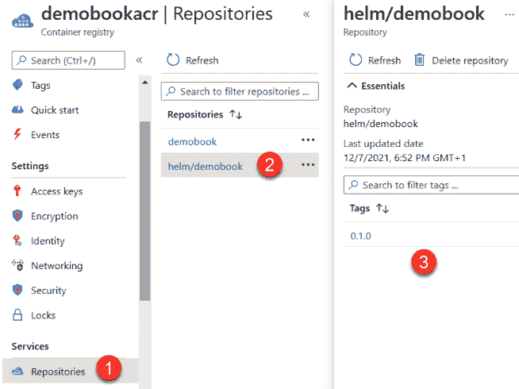

图 10.23 – ACR Helm 仓库

我们刚刚学习了如何使用 Helm 命令行和 `az cli` 命令构建并推送自定义 Helm 图表到 ACR。

现在，在下一节中，让我们来看一个托管在 Azure 上的托管 Kubernetes 服务示例，称为 AKS。

### 使用 AKS

生产 Kubernetes 集群的安装和配置通常可能很复杂。这种类型的安装需要服务器的可用性、具备 Kubernetes 集群安装和管理所需技能的人力资源，以及——尤其是——实施增强的安全策略以保护应用程序。

为了解决这些问题，云提供商提供托管 Kubernetes 集群服务。亚马逊的 **Elastic Kubernetes Service (EKS)**、谷歌的 **Google Kubernetes Engine (GKE)** 以及最后 Azure 的 AKS 就是这种情况。在本节中，我将介绍 AKS 的概述，同时也强调托管 Kubernetes 集群的优势。

因此，AKS 是一项 Azure 服务，允许我们创建和管理真正的 Kubernetes 集群作为托管服务。

使用此托管 Kubernetes 集群的优势在于，我们不必担心其硬件安装，并且当节点安装在 **虚拟机 (VMs)** 上时，主节点部分的管理完全由 Azure 完成。

使用此服务是免费的；收取的是节点安装所在 VMs 的费用。

> **注意**
> 要了解有关 AKS 提供的优势的更多信息，您可以阅读 https://docs.microsoft.com/en-us/azure/aks/intro-kubernetes 上的文档。

让我们现在来看看如何创建 AKS 服务。

### 创建 AKS 服务

在 Azure 中创建 AKS 集群可以通过三种不同的方式，如下所示：

- **手动，通过 Azure 门户**：创建 AKS 服务的标准方式是通过 Azure 门户，创建 Kubernetes 服务，然后输入其基本 Azure 属性——即所需节点的类型和数量，如以下截图所示：

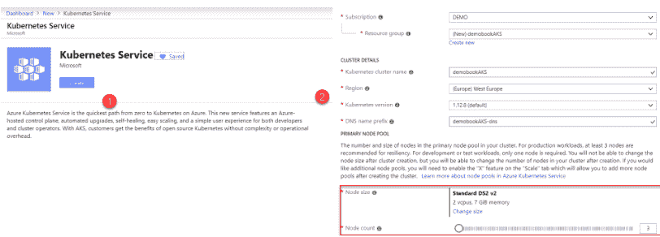

图 10.24 – 通过 Azure 门户创建 AKS

- **通过 az cli 脚本创建**：您也可以使用 az `cli` 脚本来自动化 AKS 集群的创建。脚本如下所示：

```
#Create the Resource group
az group create --name Rg-AKS --location westeurope
#Create the AKS resource
az aks create --resource-group Rg-AKS --name demoBookAKS
--node-count 2 --generate-ssh-keys --enable-addons
monitoring
```

node-count 属性指示节点数量，enable-addons 属性使我们能够监控 AKS 服务。

- **使用 Terraform 创建**：也可以使用 Terraform 创建 AKS 服务。完整的 Terraform 脚本可在 Azure 文档 https://docs.microsoft.com/en-us/azure/terraform/terraform-create-k8s-cluster-with-tf-and-aks 上找到，要了解有关使用 Terraform 的更多信息，您可以阅读第 2 章，使用 Terraform 配置云基础设施。

现在 AKS 集群已创建，我们将能够配置 kubeconfig 文件以连接到此 AKS 集群。

### 为 AKS 配置 kubeconfig 文件

要配置 kubectl 用于连接到 AKS 服务的 kubeconfig 文件，我们将使用 az cli 工具，在终端中执行以下命令：

```
az login
#If you have several Azure subscriptions
az account set --subscription <subscription Id>
az aks get-credentials --resource-group Rg-AKS --name demoBookAKS
```

此最后命令将资源组作为参数，以及创建的 AKS 集群的名称。此命令的作用是自动创建 .kube\config 文件，并使用此文件配置 kubectl 以连接到 AKS 集群，如以下截图所示：

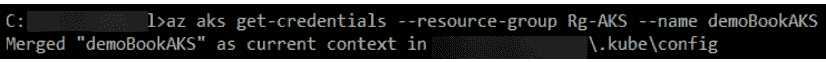

图 10.25 – 通过 az cli 获取 AKS 凭据


要测试与 AKS 的连接，我们可以执行以下命令，`kubectl get nodes`，该命令显示创建 AKS 群集时配置的节点数量，如下图所示：

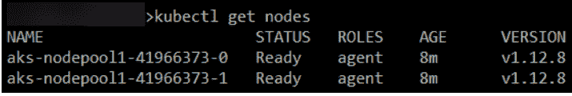

图 10.26 – kubectl get nodes 列表

本章中我们在 _Kubernetes 应用程序部署的第一个示例_ 部分看到的所有操作，无论是使用 AKS 还是 `kubectl` 部署应用程序，都是相同的。

在了解在 Azure 中创建 AKS 服务的步骤后，我们将现在提供其优势的概述。

### AKS 的优势

AKS 是在 Azure 中托管的 Kubernetes 服务。这有助于与 Azure 集成，并具有此处列出的其他一些优势：

- **即用型**：在 AKS 中，Kubernetes Web 仪表板原生安装，位于 `https://docs.microsoft.com/en-us/azure/aks/kubernetes-dashboard` 的文档说明了如何访问它。

- **集成监控服务**：AKS 还具有 Azure 的所有集成监控服务，包括容器监控、群集性能管理和日志管理，如下图所示：

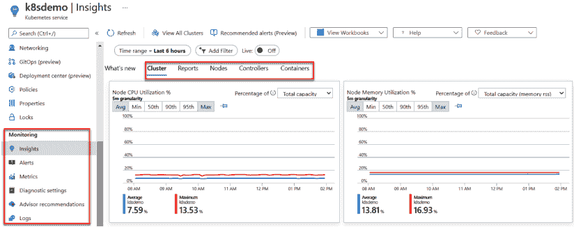

图 10.27 – AKS 监控

- **非常易于扩展**：AKS 允许通过门户或脚本快速直接扩展群集的节点数量。

如下图所示，我们在 Azure 门户中选择所需的节点数量，更改会立即生效：

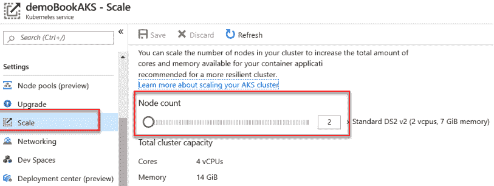

图 10.28 – AKS 扩展

如果我们有 Azure 订阅并且想要使用 Kubernetes，安装是直观且快速的。AKS 具有许多优势，例如 Azure 门户中的集成监控和扩展。使用 `kubectl` 工具不需要与本地 Kubernetes 实例相比进行任何更改。

在本节中，我们讨论了 AKS，它是 Azure 中的托管 Kubernetes 服务。然后，我们创建了 AKS 实例并配置了 `kubeconfig` 文件以连接到该 AKS 实例。最后，我们列出了其优势，主要是集成监控和快速可扩展性。

在下一节中，我们将看到一些关于如何使用 Azure Pipelines 的 CI/CD 管道在 Kubernetes 中部署应用程序的资源。

### 使用 Azure Pipelines 为 Kubernetes 创建 CI/CD 管道

到目前为止，我们已经了解如何使用 `kubectl` 在本地 Kubernetes 群集或使用 AKS 的远程群集中部署容器化应用程序。

在本书的第一版中，我解释了如何在 Azure DevOps 中构建完整的管道，从创建新 Docker 镜像并将其推送到 Docker Hub 到在 AKS 群集中部署。

自第一版以来，不同 CI/CD 工具的许多功能已得到改进，以便在 Kubernetes 中部署。

这就是为什么在第二版中，我不会再详细解释它，而是为您提供一些对我日常工作有用的不同资源，如下所示：

- 第一个资源是一个非常完整的视频，解释了使用 Azure DevOps 在 AKS 中部署应用程序的所有详细信息，位于以下链接：https://www.youtube.com/watch?v=K4uNl6JA7g8

- 关于同一主题，在 Azure DevOps 上有一个很棒的实验室，位于以下链接：https://www.azuredevopslabs.com/labs/vstsextend/kubernetes/

- 要创建用于部署到 Kubernetes 的 YAML 格式的 Azure DevOps 管道，请阅读此处的官方文档：https://docs.microsoft.com/en-us/azure/devops/pipelines/ecosystems/kubernetes/aks-template?view=azure-devops

- 然后，以下文档还提供了一个使用 Jenkins 和 Azure DevOps 将应用程序部署到 Kubernetes 的教程：https://docs.microsoft.com/en-us/azure/devops/pipelines/release/integrate-jenkins-pipelines-aks?view=azure-devops

在本节中，我们报告了一些用于端到端 (E2E) DevOps CI/CD 管道的资源，以便使用 Azure Pipelines 在 Kubernetes 群集（我们示例中的 AKS）中部署应用程序。

在下一节中，我们将学习监控 Kubernetes 上的应用程序和指标的不同方法，并了解可以使用的工具。

### 监控 Kubernetes 中的应用程序和指标

当我们在 Kubernetes 中部署应用程序时，拥有一个监控策略来检查和调试这些应用程序的生命周期以及检查 **中央处理器 (CPU)** 和 **随机存取存储器 (RAM)** 指标非常重要——我认为这是一项要求。

我们将现在讨论在 Kubernetes 中调试和监控应用程序的不同方法。

让我们从基本方法开始，即使用 `kubectl` 命令行。

### 使用 kubectl 命令行

要使用 `kubectl` 命令行调试应用程序，请运行下面详细说明的命令：

- 要显示 Kubernetes 资源的状态，请运行以下命令：

```
kubectl get pods,svc
```

前面命令的输出如下图所示：

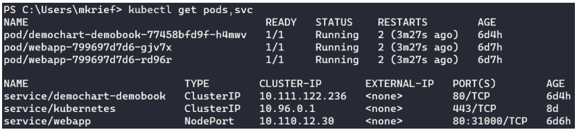

图 10.29 – kubectl 获取资源

使用此命令，我们可以查看 pod 是否正在运行并了解服务的状态。

- 要显示应用程序日志，请运行 `kubectl logs pod/<pod name>` 命令，如下图所示：

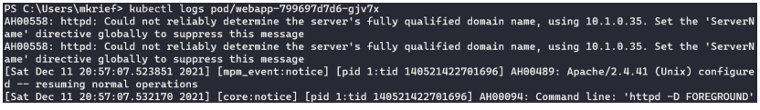

图 10.30 – kubectl 获取 pod 日志

此命令显示应用程序日志的输出。

有关使用 `kubectl` 调试应用程序的更多详细信息，请阅读此处的文档：

`https://kubernetes.io/docs/tasks/debug-application-cluster/debug-running-pod/`

使用 `kubectl` 命令，我们可以自动化应用程序调试，但有必要学习所有命令行选项。

接下来，我们将讨论使用一些工具调试应用程序。

### 使用 Web 仪表板

如前一节本章第一部分 _安装 Kubernetes_ 中所述，我们可以使用基本仪表板在 Web **用户界面 (UI)** 中显示在 Kubernetes 中部署的所有资源的详细信息。

对于 Azure 的 AKS、Amazon Web Services (AWS) 的 EKS 和 Google Cloud Platform (GCP) 的 GKE 等云托管 Kubernetes 服务，我们可以使用集成和托管的仪表板。例如，对于 Azure 门户中的 AKS，我们可以轻松查看所有 pod 日志。以下是 Azure 门户中 pod 日志的示例：

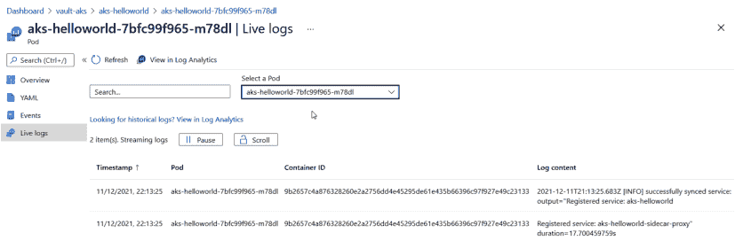

图 10.31 – AKS 实时日志

有关在 AKS 上调试的更多详细信息，请阅读此处的文档：

`https://docs.microsoft.com/en-us/azure/architecture/microservices/logging-monitoring`

我们还可以使用 Octant 或 Lens 等分层工具。

### 使用分层工具

有许多工具或解决方案可用于监控和显示在 Kubernetes 群集中部署的所有资源。其中包括两个我经常使用的免费工具：Octant 和 Lens。

### Octant

Octant 是一个 VMware 社区项目，是一个在本地或 Docker 容器中启动的 Web 应用程序，用于可视化 Kubernetes 资源和应用程序日志。

Octant 的文档可在此处查看：

`https://octant.dev/`

源代码可在此处查看：
https://github.com/vmware-tanzu/octant/blob/master/README.md

### Lens

Lens 也是一个免费工具，通过客户端二进制文件安装。对我来说，Lens 是可视化和调试应用程序的最佳工具。Lens 的文档可在此处查看：
https://k8slens.dev/。

您可以在下图中查看 Lens 仪表板的概览：

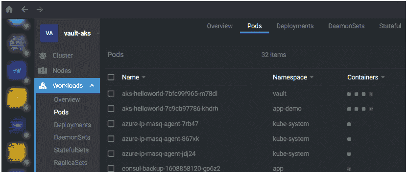

图 10.32 – Lens 仪表板

讨论了调试应用程序的工具后，我们将看到如何显示 Kubernetes 指标。

### 监控 Kubernetes 指标

刚才描述的所有工具对于调试 Kubernetes 资源和托管在 Kubernetes 中的应用程序非常出色。但这还不够——在监控方面，我们还需要监控应用程序使用的 CPU 和 RAM 等指标。


With the following basic `kubectl` command line, we can display the CPU and RAM used by nodes and pods:

```
PS C:\Users\mkrieg> kubectl top nodes
NAME CPU(cores) CPU% MEMORY(bytes) MEMORY%
aks-default-29977126-vmss000000 133m 7% 1875Mi 87%
aks-default-29977126-vmss000001 147m 7% 1986Mi 92%
aks-default-29977126-vmss000002 342m 18% 2017Mi 93%
PS C:\Users\mkrieg> kubectl top pods -n vault
NAME CPU(cores) MEMORY(bytes)
aks-helloworld-7bfc99f965-m78dl 15m 87Mi
consul-consul-connect-injector-webhook-deployment-79b4b98ctt844 4m 38Mi
consul-consul-controller-5bd877dfd-4rlmw 2m 22Mi
consul-consul-gjtkq 8m 32Mi
consul-consul-klk08 8m 26Mi
consul-consul-server-0 14m 64Mi
consul-consul-tnlds 9m 23Mi
consul-consul-webhook-cert-manager-556df5dbfd-k6wfp 3m 20Mi
vault-0 4m 53Mi
vault-1 6m 37Mi
vault-agent-injector-846f9f7bc6-76bjz 4m 13Mi
web-0lenqv6avrgwgqscxzhzsz6rqk-f5984776d-lkzqz 0m 0Mi
```

Figure 10.33 – kubectl getting metrics

Among the best-known solutions are **Prometheus** and **Grafana**, which monitor the metrics of Kubernetes and provide a lot of dashboard models.

For more details, you can read this article, which explains Kubernetes monitoring with Prometheus and Grafana:

`https://sysdig.com/blog/kubernetes-monitoring-prometheus/`

In this section, we discussed some `kubectl` commands, tools, or solutions such as dashboards, Octant, and Lens to debug applications on Kubernetes.

### 摘要

In this chapter, we have seen an advanced use of containers with the use of Kubernetes, which is a container manager.

We discussed the different options for installing a small cluster on a local machine using Docker Desktop. Then, using the YAML specification file and the `kubectl` command, we realized the deployment of a Docker image in our Kubernetes cluster in order to run a web application.

We installed and configured Helm, which is the package manager of Kubernetes. Then, we applied it in practice with an example of a chart deployment in Kubernetes.

We also had an overview of AKS, which is a Kubernetes service managed by Azure, looking at its creation and configuration and some resources links that explain how to deploy applications with CI/CD pipelines with Azure DevOps.

Finally, we finished this chapter with a short list of Kubernetes monitoring tools such as the `kubectl` command line, Lens, Prometheus, and Grafana for debugging Kubernetes metrics.

The next chapter begins a new part of this book, which deals with application testing, and we will start with **application programming interface (API)** testing with Postman.

### 问题

- 1. What is the role of Kubernetes?
- 2. Where is the configuration of the objects that are written in Kubernetes?
- 3. What is the name of the Kubernetes client tool?
- 4. Which command allows us to apply a deployment in Kubernetes?
- 5. What is Helm?
- 6. What is AKS?

### 延伸阅读

If you want to know more about Kubernetes, take a look at the following resources:

- _The DevOps 2.3 Toolkit_: `https://www.packtpub.com/business/devops-23-toolkit`
- _Hands-On Kubernetes on Azure_: `https://www.packtpub.com/virtualization-and-cloud/hands-kubernetes-azure`
- _Hands-On Kubernetes on Azure - Second Edition_: `https://www.packtpub.com/product/hands-on-kubernetes-on-azure-second-edition/9781800209671`
- _Mastering Kubernetes - Third Edition_: `https://www.packtpub.com/product/mastering-kubernetes-third-edition/9781839211256`
