## 11 使用 Postman 测试 API

In the previous chapters, we talked about DevOps culture and **Infrastructure as Code** (IaC) with Terraform, Ansible, and Packer. Then, we saw how to use a source code manager with Git, along with the implementation of a CI/CD pipeline with Jenkins and Azure Pipelines. Finally, we showed the containerization of applications with Docker and their deployment in a Kubernetes cluster.

If you are a developer, you should realize that you use APIs every day, either for client-side use (where you consume the API) or as a provider of the API.

An API, as well as an application, must be testable, that is, it must be possible to test the different methods of this API in order to verify that it responds without error and that the response of the API is equal to the expected result.

In addition, the proper functioning of an API is much more critical to an application because this API is potentially consumed by several client applications, and if it does not work, it will have an impact on all of these applications.

The common API challenges are that we need to script or develop a dedicated application client to test each API individually or a workflow of multiple API execution.

In this chapter, we will learn how to test an API with a specialized tool called **Postman**. We will explore the use of collections and variables, then we will write Postman tests, and finally, we will see how to automate the execution of Postman tests with Newman in a CI/CD pipeline.

This chapter covers the following topics:

- Creating a Postman collection
- Using environments and variables
- Writing Postman tests
- Executing tests locally
- Understanding the Newman concept
- Preparing Postman collections for Newman
- Running the Newman command line
- Integration of Newman in the CI/CD pipeline process

### 技术要求

In this chapter, we will use **Newman**, which is a Node.js package. Therefore, we need to install Node.js and npm on our computer beforehand, which we can download at `https://nodejs.org/en/`.

For the demo APIs that are used in this chapter, we will use an example that is provided on the internet: `https://jsonplaceholder.typicode.com/`.

The GitHub repository, which contains the complete source code used in this chapter, can be found at `https://github.com/PacktPublishing/Learning-DevOps-Second-Edition/tree/main/CHAP11`.

Check out the following video to see the code in action: `https://bit.ly/3s7239U`.

### 使用请求创建 Postman 集合

Postman is a free client tool in a graphical format that can be installed on any type of OS. Its role is to test APIs through requests, which we will organize into collections. It also allows us to dynamize API tests through the use of variables and the implementation of environments. Postman is famous for its ease of use, but also for the advanced features that it offers.

In this section, we will learn how to create and install a Postman account, then we will create a collection that will serve as a folder to organize our requests, and finally, we will create a request that will test a demo API.

Before we use Postman, we will need to create a Postman account by going to `https://www.postman.com/` and clicking on the **Sign Up for Free** button. In the form, click on the **Create Account** link, as shown in the following screenshot:

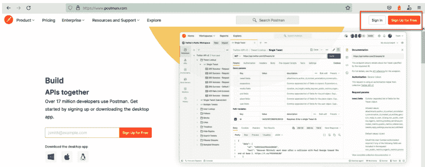

Figure 11.1 – Postman signup

Now, you can either create a Postman account for yourself by filling out the form, or you can create an account using your Google account.

This account will be used to synchronize Postman data between your machine and your Postman account. This way, the data will be accessible on all of your workstations.

After creating a Postman account, we will look at how to download and install it on a local machine.

### 安装 Postman

Once the Postman account has been created, those who are using Windows can download Postman from `https://www.getpostman.com/downloads/` and choose the version to install. For those who want to install it on Linux or macOS, just click on the link of your OS. The following screenshot shows the download links according to your OS:

#### Postman 应用程序

The ever-improving Postman app (a new release every two weeks) gives you a full-featured Postman experience.


By downloading and using Postman, I agree to the [Privacy Policy](https://www.getpostman.com/privacy) and [Terms](https://www.getpostman.com/terms).

Version 9.4.1 · [Release Notes](https://www.getpostman.com/release-notes) · [Product Roadmap](https://www.getpostman.com/product-roadmap)

Not your OS? Download for Mac ([Intel Chip](https://www.getpostman.com/downloads/mac-intel) / [Apple Chip](https://www.getpostman.com/downloads/mac-apple)) or Linux (x64)

Figure 11.2 - Postman download

Once Postman is downloaded, we need to install it by clicking on the download file for Windows, or for other OSes, follow the installation documentation at `https://learning.getpostman.com/docs/postman/launching_postman/installation_and_updates/`.

We have just seen that the installation of Postman is very simple; the next step is to create a collection in which we will create a request.

> **Note**
> The API that we will test in this chapter is a demo API, which is provided freely on the following site: `https://jsonplaceholder.typicode.com/`.


### 创建集合

在 Postman 中，我们测试的任何请求都必须添加到名为 `Collection` 的目录中，该目录用于存储请求，并允许更好地组织请求。

因此，我们将创建一个名为 `DemoBook` 的集合，该集合将包含对演示 API 的请求，为此，我们将执行以下任务：

1. 在 Postman 中，在左侧面板上，单击 **Collections | +** 按钮。
2. 选项卡打开后，我们将输入名称 `DemoBook`。创建新集合的这些步骤在以下屏幕截图中有所说明：

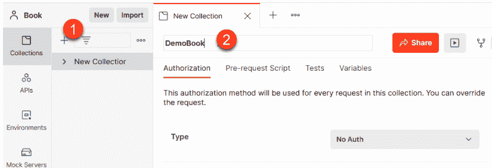

图 11.3 – Postman 集合创建

因此，我们有一个名为 `Demobook` 的集合，它出现在 Postman 的左侧面板中。

此集合还与我们的 Postman Web 帐户同步，我们可以在 `https://web.postman.co/me/collections` 访问它。

此集合将允许我们组织 API 测试的请求，并且还可以修改其属性，以便对包含在此集合中的所有请求应用某些配置。

这些属性包括请求身份验证、请求前后要执行的测试以及此集合中所有请求共有的变量。

要修改此集合的设置和属性，请执行以下操作：

1. 单击集合上下文菜单中的 ... 按钮。
2. 选择 **Edit** 选项，此时将出现编辑表单，我们可以在其中更改将应用于此集合中请求的所有设置。
3. 在编辑授权、脚本、测试或变量选项的所有配置选项卡之间切换。

### 创建我们的第一个请求

在 Postman 中，包含要测试的 API 属性的对象称为 **请求**。

此请求包含 API 本身的配置，但它还包含要执行的测试，以检查其是否正常运行。

请求的主要参数如下：

- API 的 URL
- 其方法：GET/POST/DELETE/PATCH
- 其身份验证属性
- 其查询字符串键及其请求正文
- 要在 API 执行前后执行的测试

以下屏幕截图显示了修改集合属性的步骤：

因此，我们已经讨论了创建集合（即第一个 Postman 工件）所遵循的过程，这将允许我们组织 API 测试请求。

我们现在将创建一个请求，该请求将调用并测试我们的演示 API 的正常运行情况。

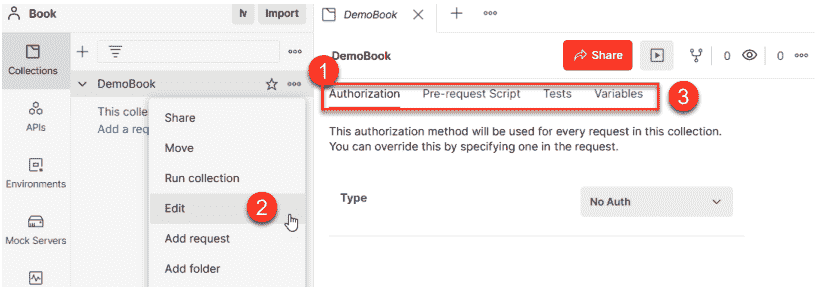

请求的创建分为两步：在集合中创建，然后进行配置。

1. **创建请求**：要创建我们 API 的请求，需要遵循以下步骤：

   I. 我们转到 DemoBook 集合的上下文菜单，并单击 **Add Request** 选项：

   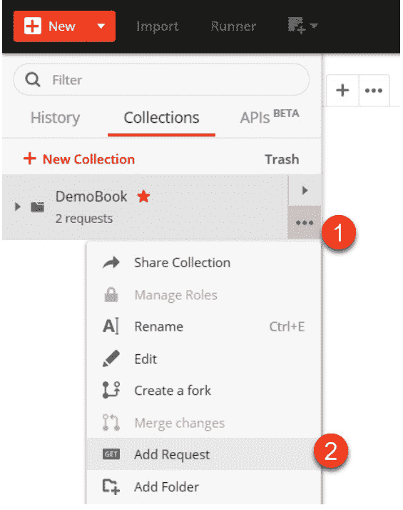

   图 11.5 – 在 Postman 中添加请求

   II. 然后，在新选项卡中输入请求名称，即 Get all posts，如以下屏幕截图所示：

   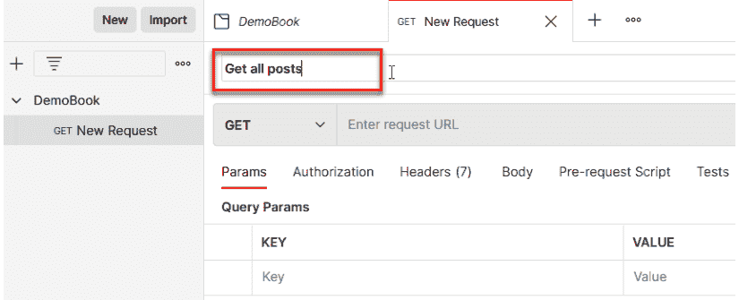

2. **配置请求**：创建请求后，我们将通过输入要测试的 API 的 URL（即 `https://jsonplaceholder.typicode.com/posts`）并使用 **GET** 方法来对其进行配置。输入 URL 后，我们单击 **Save** 按钮保存请求配置。以下屏幕截图显示了带有 URL 和方法的此请求参数：

   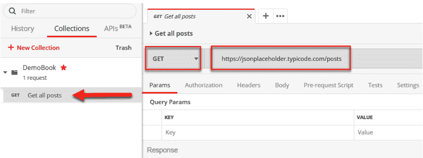

最后，为了完成测试并为我们的实验室添加更多内容，我们将向集合中添加第二个请求，我们将其命名为 Get a single post。它将测试 API 的另一种方法，并且还将确保我们使用 `https://jsonplaceholder.typicode.com/posts/<ID of post>` URL 对其进行配置。

以下屏幕截图显示了我们集合中的请求：

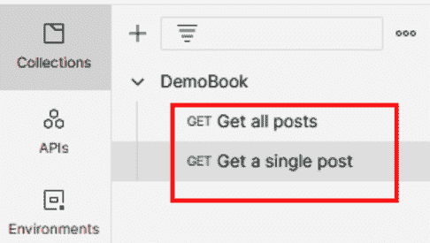

图 11.8 – Postman 请求列表

> **Note**
> 请注意，有关集合创建的 Postman 文档可在 `https://learning.getpostman.com/docs/postman/collections/creating_collections/` 上找到。

在本节中，我们学习了如何在 Postman 中创建集合，以及如何创建请求及其配置。

在下一节中，我们将学习如何使用环境和变量来动态化我们的请求。

### 使用环境和变量动态化请求

当我们想要测试 API 时，我们需要在多个环境中对其进行测试以获得更好的结果。例如，我们将在本地计算机和开发环境中对其进行测试，然后也在 QA 环境中进行测试。为了优化测试实现时间并避免在 Postman 中出现重复请求，我们将向同一请求注入变量，以便在所有环境中都可测试。

因此，在以下步骤中，我们将通过创建一个环境和两个变量来改进我们的请求；然后，我们将修改请求以使用这些变量：

1. 在 Postman 中，我们将首先创建一个名为 `Local` 的 **环境**，如以下屏幕截图所示：

   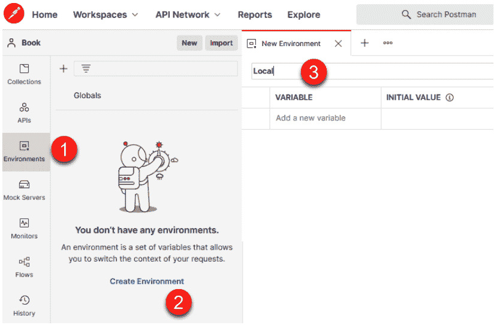

   图 11-9 – 在 Postman 中添加环境

2. 然后，在此 `Local` 环境中，我们将插入一个名为 `POSTID` 的 **变量**，该变量将包含要传递给请求 URL 的值。以下屏幕截图显示了 `POSTID` 变量的创建：

   图 11.10 – 在 Postman 中添加环境变量

3. 因此，对于 `Local` 环境，`PostID` 变量的值为 6。要为其他环境设置不同的值，有必要使用我们刚刚看到的相同步骤创建其他环境，然后添加相同的变量（同名）及其相应的值。例如，以下是 `QA` 环境的变量屏幕：

   图 11.11 – 在 Postman 中添加第二个环境

4. 最后，我们将修改请求以使用刚刚声明的变量。在 Postman 中，变量的使用是通过 `{{variable_name}}` 模式完成的。因此，首先，我们从右上角的下拉列表中选择所需的环境。然后，在请求中，我们将用 `{{POSTID}}` 替换 URL 末尾的帖子 ID，如以下屏幕截图所示：

   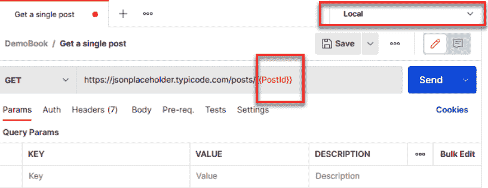

   图 11.12 – 在 Postman 中使用环境变量

> **Note**
> 请注意，有关环境和变量的 Postman 文档可在 https://learning.getpostman.com/docs/postman/environments_and_globals/intro_to_environments_and_globals/ 上找到。

在本节中，我们创建了一个 Postman 请求，该请求将允许我们测试 API。然后，我们通过在 Postman 中创建包含变量的环境（这些变量也用于 Postman 的请求）来使其执行更加灵活。

在下一节中，我们将编写 Postman 测试以验证 API 结果。

### 编写 Postman 测试

测试 API 不仅仅是检查其调用是否返回 200 返回码，即 API 是否响应正常，还要检查其返回结果是否符合预期，或者其执行时间是否不过长。

例如，考虑一个以 JSON 格式返回包含多个属性的响应的 API。在此 API 的测试中，有必要验证返回的结果是包含预期属性的 JSON 文本，并且更有必要验证这些属性的值。

在 Postman 中，可以编写测试，以确保请求的响应在返回或执行时间方面符合预期结果，使用的是 JavaScript 语言。

Postman 测试在请求的 **Tests** 选项卡中编写：

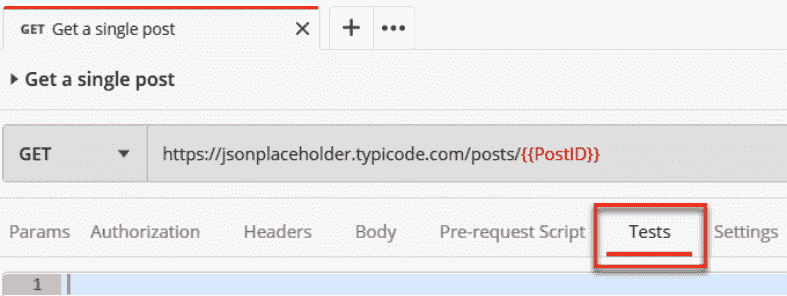

图 11.13 – Postman Tests 选项卡

要测试我们的请求，我们将编写几个测试，如下所示：

- 请求的返回码为 200
- 请求的响应时间小于 400 ms
- 答案不是空 JSON
- 返回的 JSON 响应包含 `userId` 属性，且其值等于 1

要执行这些测试，我们将在 **Tests** 选项卡中编写以下代码。

以下代码说明了请求的返回码：

```
pm.test("Status code is 200", function () {
pm.response.to.have.status(200);
});
```


下面的代码说明响应时间小于 400 ms：

```
pm.test("Response time is less than 400ms", function () {
    pm.expect(pm.response.responseTime).to.be.below(400);
});
```

下面的代码说明 JSON 格式的响应不为空：

```
pm.test("Json response is not empty", function () {
    pm.expect(pm.response).to.be.json;
});
```

下面的代码说明，在 JSON 响应中，`userId` 属性等于 1：

```
pm.test("Json response userId eq 1", function () {
    var jsonRes = pm.response.json();
    pm.expect(jsonRes.userId).to.eq(1);
});
```

因此，最终，我们请求的 **Tests** 选项卡（用于测试我们的 API）包含所有这些代码，如下面的截图所示：

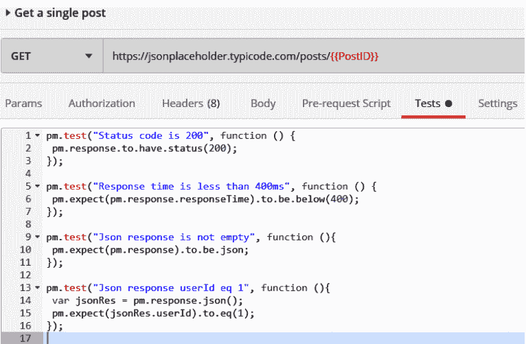

图 11.14 – Postman Tests 代码

我们已完成带有测试编写的 Postman 请求，它将根据 API 的反馈代码、性能和响应内容来检查 API 的正常运行。

> 注意
> 要了解有关 Postman 测试和脚本的更多信息，可以阅读 https://learning.getpostman.com/docs/postman/scripts/intro_to_scripts 上的文档。

在本节中，我们刚刚了解了如何在 Postman 中编写 API 测试来检查我们 API 的正常运行。我们现在将在本地运行我们的 Postman 请求以测试我们的 API。

### 在本地执行 Postman 请求测试

到目前为止，在 Postman 中，我们已创建一个集合，其中两个请求包含我们要测试的 API 的参数和测试。要使用参数和测试来检查 API 的正常运行，我们现在必须执行位于 Postman 中的请求。请注意，只有在执行结束时，我们才会知道我们的 API 是否符合我们的预期。

要执行 Postman 请求，请执行以下操作：

1. 首先必须选择所需的环境。
2. 单击请求的 **Send** 按钮，如下面的截图所示：

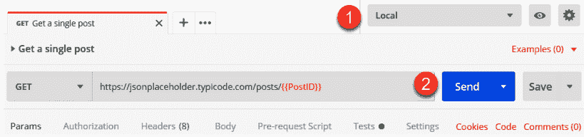

图 11.15 – Postman 注册

3. 在 **Body** 选项卡中，我们可以查看查询响应的内容，如果我们想以 JSON 格式显示它，可以选择显示格式。下面的截图显示了以 JSON 格式显示的请求响应：

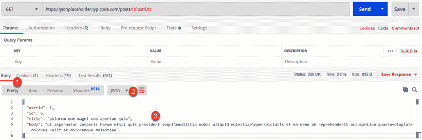

4. **Test Results** 选项卡显示我们之前编写的测试的执行结果，在我们的情况中，四个测试都已正确执行——它们全部显示为绿色，如下面的截图所示：

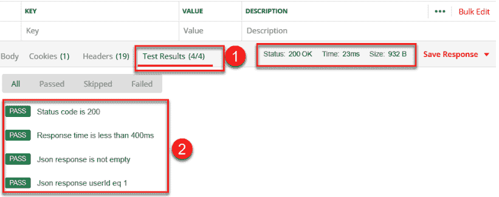

在前面的截图中，我们可以看到 Postman 请求的返回代码等于 200，这对应于请求成功执行的返回代码，以及其 23 ms 的执行时间，这低于我为自己设定的阈值（400 ms）作为示例。

如果某个测试失败，它将显示为红色以便清晰识别。失败测试的示例如下面的截图所示：

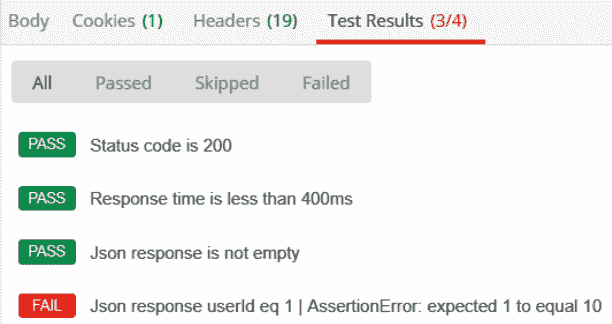

图 11.18 – Postman 测试失败

我们刚刚了解了执行 Postman 请求以测试 API，但此执行仅适用于当前请求。如果我们想要执行集合中的所有 Postman 请求，可以使用 **Postman Collection Runner**。

Postman Collection Runner 是 Postman 的一个功能，它会按请求在集合中组织的顺序自动执行集合中的所有请求。

你可以通过访问 `https://learning.getpostman.com/docs/postman/collection_runs/starting_a_collection_run/` 了解更多有关集合文档的信息。

下面的两个截图显示了 **Runner** 执行步骤，在其中我们选择要执行的集合、环境和迭代次数。要启动其执行，我们单击 **Run DemoBook** 按钮：

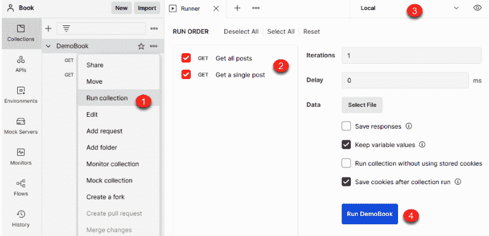

图 11.19 – Postman Runner

因此，在 **Runner** 选项卡中，我们可以看到集合中所有请求的测试执行结果，如下面的截图所示：

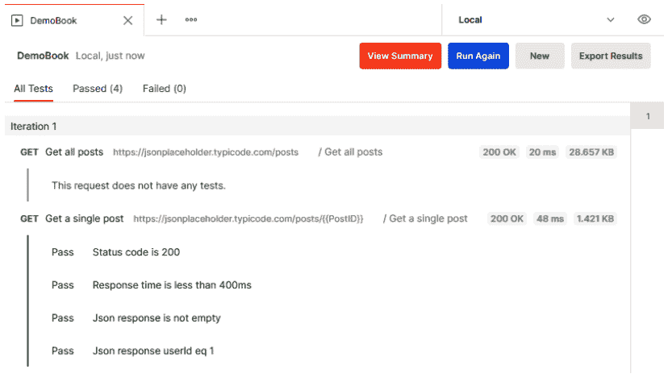

图 11.20 – Postman Runner 执行

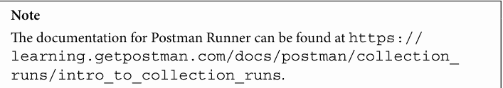

在本节中，我们学习了如何执行 Postman 请求以单元方式测试 API，然后再使用 Postman Runner 执行集合中的所有请求。在下一节中，我们将介绍 Newman，它允许我们自动化执行 Postman 测试。

### 理解 Newman 概念

在本章中，到目前为止，我们一直在讨论在本地使用 Postman 来测试我们开发或使用的 API。但在单元测试、验收测试和集成测试中，重要的是它们是自动化的，以便可以在 CI/CD 管道中执行。

Postman 本身是一个图形工具，不会自动化自身，但有一个名为 **Newman** 的另一个工具，它可以自动化在 Postman 中编写的测试。

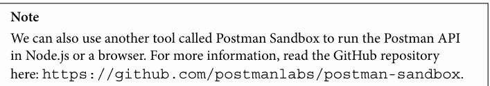

Newman 是一个免费的命令行工具，其巨大的优势在于可以自动化已经在 Postman 中编写的测试。它允许我们将 API 测试执行集成到 CI/CD 脚本或流程中。

此外，它还提供生成不同格式（HTML、JUnit 和 JSON）的测试结果报告的可能性。

不过，Newman 不允许我们执行以下操作：

- 创建或配置 Postman 请求；正如我们将看到的，由 Newman 执行的请求将从 Postman 导出。
- 仅执行集合中的一个请求——它执行集合中的所有请求。

### 使用 Postman 测试 API

> 注意
> 要了解有关 Newman 的更多信息，可以访问 `https://www.npmjs.com/package/newman` 上的产品页面。

要使用 Newman，我们需要——如本章 _Technical requirements_ 部分所述——安装 Node.js 和 npm，它们可在 `https://nodejs.org/en/` 上获得（此安装程序同时安装这两个工具）。

然后，要安装 Newman，我们必须在终端中执行此命令：

```
npm install -g newman
```

下面的截图显示了命令的执行：

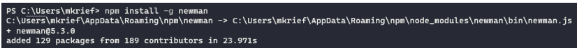

图 11.21 – Newman 安装

此命令在全局范围内安装 npm `newman` 包及其所有依赖项，也就是说，它在整个本地机器上都可访问。

安装后，我们可以通过运行 `newman --help` 命令来测试其安装，该命令显示要使用的参数和选项，如下面的截图所示：

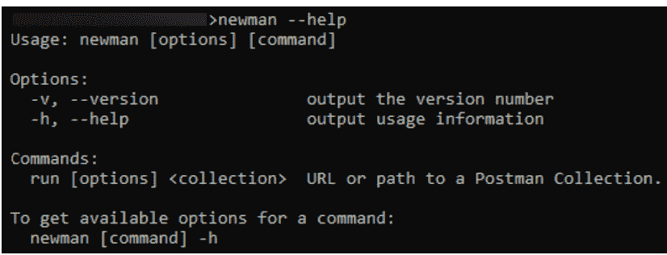

图 11.22 – Newman 帮助命令

在本节中，我们通过讨论 Newman 的优势来介绍它，并学习了如何安装它。在下一节中，我们将导出 Postman 的集合和环境以供 Newman 使用。

### 为 Newman 准备 Postman 集合

正如我们刚刚看到的，Newman 是 Postman 的客户端工具，要工作，它需要我们在 Postman 中创建的集合、请求和环境的配置。

这就是为什么，在运行 Newman 之前，我们将不得不导出 Postman 的集合和环境，并且此导出将作为 Newman 的参数。那么，让我们开始导出我们在 Postman 中创建的 DemoBook 集合。

#### 导出集合

导出 Postman 集合包括获取一个 JSON 文件，该文件包含此集合及其中请求的所有设置。

正是从这个 JSON 文件，Newman 才能运行与我们从 Postman 运行时相同的 API 测试。

要执行此导出，请执行以下任务：

1. 转到我们要导出的集合的上下文菜单。
2. 选择 **Export** 操作。
3. 然后，在打开的窗口中，取消选中 **Collection v2.1 (recommended)** 复选框。
4. 最后，通过单击 **Export** 按钮进行验证。


### 这些步骤在以下截图中显示：

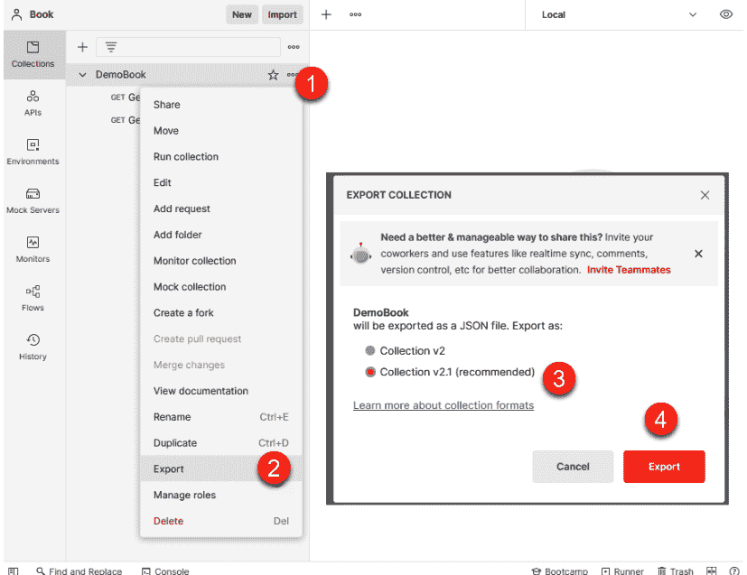

单击 **Export** 按钮会将集合导出为 JSON 格式文件，`DemoBook.postman_collection.json`，我们将其保存在创建的专用于 Newman 的文件夹中。

导出集合后，我们还需要导出环境和变量信息，因为我们集合中的请求依赖于这些信息。

### 导出环境

我们可以在此处停止 Newman 的配置，但问题是我们的 Postman 请求使用的是在环境中配置的变量。

因此，我们还需要以 JSON 格式导出每个环境的信息，以便可以将其作为参数传递给 Newman。

要导出环境及其变量，请执行以下任务：

- 从 Postman 左侧面板打开 **ENVIRONMENTS**。
- 然后，单击 **Export** 环境按钮。

这些步骤在以下截图中显示：

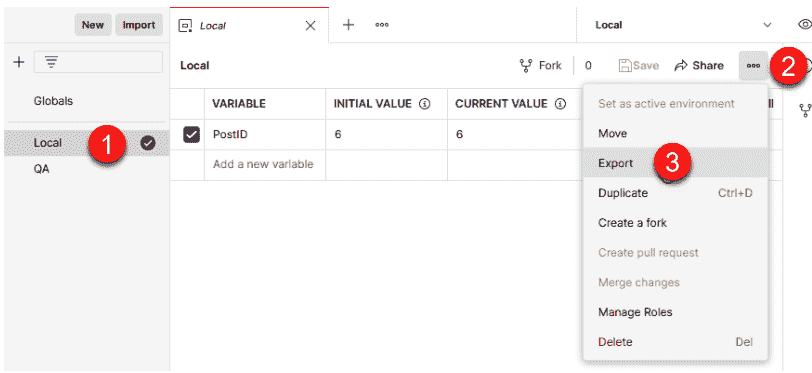

图 11.24 – Postman 导出环境

因此，对于每个环境，我们将其配置导出到一个 JSON 文件中，并将其保存在导出集合的同一文件夹中。

最后，我们在机器上有一个文件夹，其中包含三个 Postman JSON 文件：

- 一个用于集合的 JSON 文件
- 一个用于 `Local` 环境的 JSON 文件
- 一个用于 `QA` 环境的 JSON 文件

以下截图显示了包含 Postman 导出内容的本地文件夹：

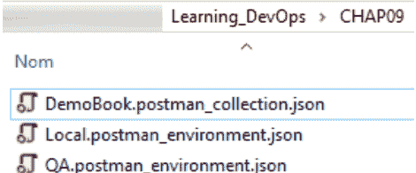

图 11.25 – Postman 导出文件夹

我们刚刚介绍了 Postman 请求的所有配置的导出，包括集合和环境，现在我们将查看 Newman 命令行的执行。

### 运行 Newman 命令行

在导出了前面看到的 Postman 配置后，我们将在本地机器上运行 Newman 实用程序。

要执行 Newman，请转到 Terminal，然后转到 JSON 配置文件所在的文件夹，并执行以下命令：

```
newman run DemoBook.postman_collection.json -e Local.postman_environment.json
```

`newman run` 命令将我们导出的集合的 JSON 文件作为参数和参数 `-e`（即导出的环境的 JSON 文件）进行处理。

> **Note**
>
> 有关此命令的所有参数的更多详细信息，请阅读 https://www.npmjs.com/package/newman#newman-options 上的文档。

Newman 将执行我们导出的集合中的 Postman 请求。它还将使用导出环境的变量，并执行我们在请求中编写的测试。

其执行结果（非常详细）在以下截图中显示：

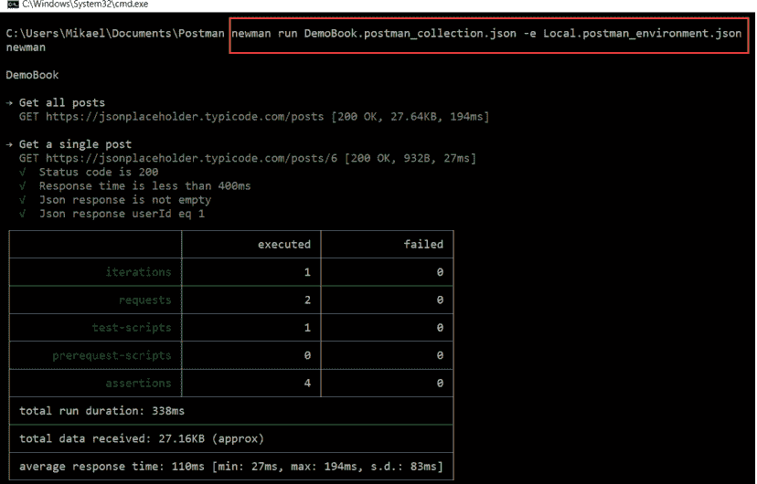

图 11.26 – Newman 执行

以下是另一个截图，显示了在测试中出现错误时的执行结果：

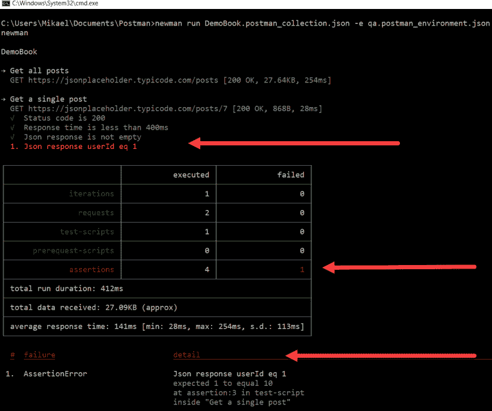

图 11.27 – Newman 测试失败

我们可以看到显示错误的测试详细信息以及请求中预期的内容。在本节中，我们学习了如何在本地机器上运行 Newman，现在我们将学习 Newman 如何集成到 CI/CD 管道中。

### Newman 在 CI/CD 管道流程中的集成

Newman 是一个工具，可从命令行自动执行 Postman 请求，这将使我们能够快速将其集成到 CI/CD 管道中。

为了简化其在管道中的集成，我们转到包含从 Postman 导出的 JSON 文件的目录中的第一步，并创建一个 npm 配置文件——package.json。

这将具有以下内容：

```json
{
  "name": "postman",
  "version": "1.0.0",
  "description": "postmanrestapi",
  "scripts": {
    "testapilocal": "newman run DemoBook.postman_collection.json -e Local.postman_environment.json -r junit,cli --reporter junit-export result-tests-local.xml",
    "testapiQA": "newman run DemoBook.postman_collection.json -e QA.postman_environment.json -r junit,cli --reporter-junit export result-tests-qa.xml"
  },
  "devDependencies": {
    "newman": "^5.3.0"
  }
}
```

在 scripts 部分，我们放置了前面部分中看到的命令行将执行的两个脚本，并向它们添加了 `-r` 参数，该参数允许以 JUnit 格式输出命令的报告，而在 DevDependencies 部分，我们指示需要 Newman 包。

就这样；我们拥有将 Newman 的执行集成到 CI/CD 管道所需的所有文件。

为了展示 Newman 在 CI/CD 管道中的集成，我们将使用 **Azure Pipelines**——一个我们在 _Chapter 7, Continuous Integration and Continuous Delivery_ 和 _Chapter 9, Containerizing Your Application with Docker_ 中见过的 Azure DevOps 服务，它的优势在于拥有管道的图形表示。

作为管道的先决条件，包含 Postman 导出的 JSON 文件以及 `package.json` 文件的目录必须提交到源代码控制版本中。在我们的情况中，我们将使用包含本章完整源代码的 GitHub 仓库：`https://github.com/PacktPublishing/Learning-DevOps-Second-Edition/tree/main/CHAP11`。

### 生成和发布配置

在 Azure Pipelines 中，我们将通过执行以下操作来创建生成和发布配置：

- 我们创建一个新的 **build definition**，它将运行 Newman 所需的文件复制到生成构件中，如以下截图所示：

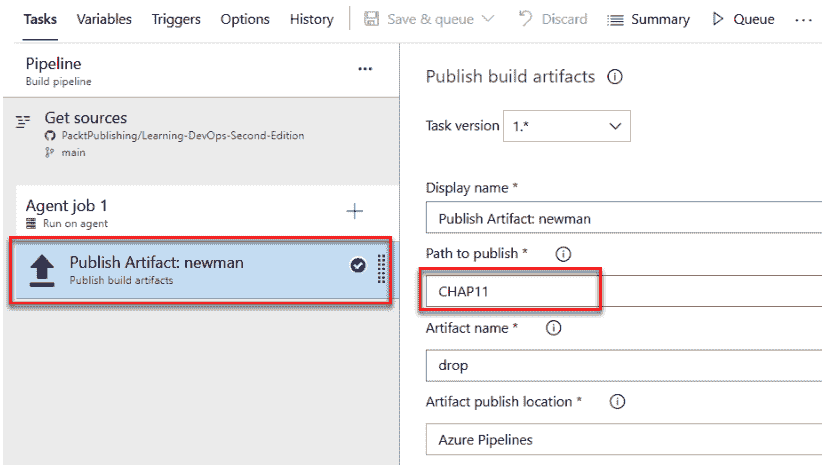

图 11.28 – Azure Pipelines 发布 Newman 文件

我们还在 **Triggers** 选项卡中启用持续集成选项。然后，为了运行此生成，我们保存并排队此生成定义。

- 然后，我们创建一个新的 **release definition**，它将负责为每个环境运行 Newman。此发布将获取生成的构件，并将由两个阶段组成，**DEV** 和 **QA**，如以下截图所示：

All pipelines > Newman exec

Pipeline Tasks ↓ Variables Retention Options History

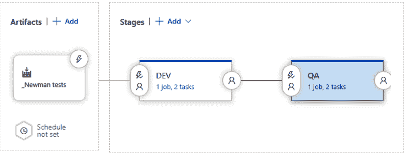

图 11.29 – Azure Pipelines Newman 执行发布

对于每个阶段，我们根据 package.json 文件配置三个任务，如下所示：

- 安装 Newman。
- 运行 Newman。
- 在 Azure Pipelines 中发布测试结果。

以下截图显示了每个阶段的任务配置：

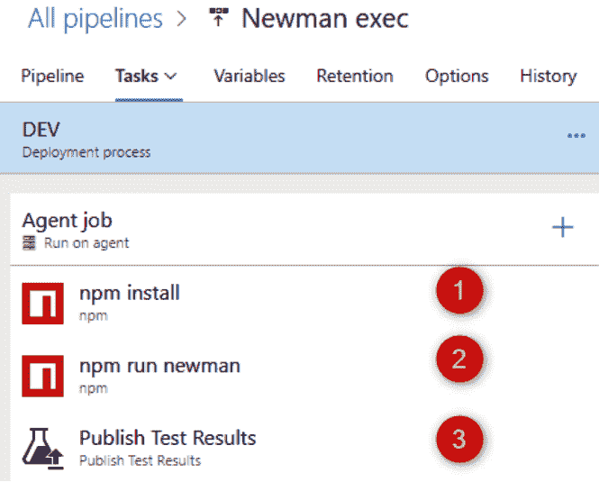

图 11.30 – Azure Pipelines Newman 发布步骤

让我们按顺序查看这些任务参数的详细信息。

### npm install

**npm install** 任务的参数如下：

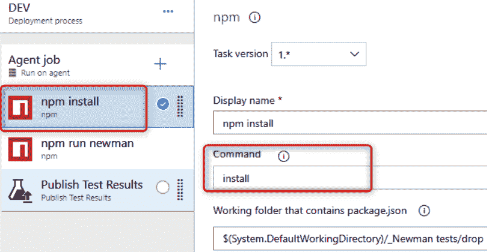

图 11.31 – Azure Pipelines npm install

在此，要在包含构件文件的目录中执行的命令是 `npm install`。

### npm run newman

**npm run newman** 任务的参数如下：

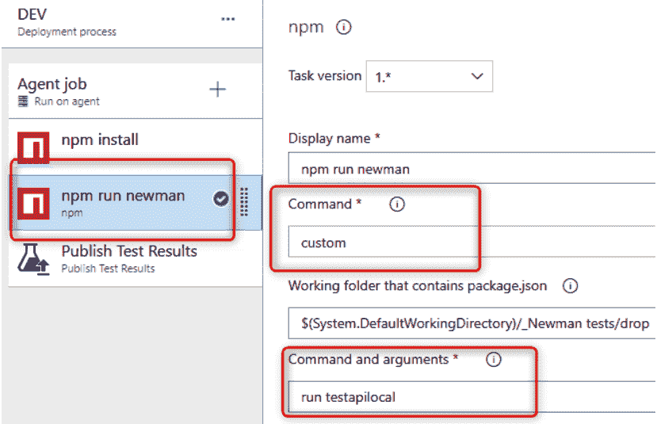

在此，要执行的自定义命令是在包含构件文件的目录中运行 `npm run testapilocal`，其中 `testapilocal` 命令在 `package.json` 文件的 script 部分中定义（如前所述），并执行 Newman 的命令行。

### 发布测试结果

**Publish Test Results** 任务的参数如下，该任务允许我们发布 Newman 执行的测试结果在 Azure Pipelines 中：

### 发布测试结果

Task version 2.*

Display name *
Publish Test Results

Test result format *
JUnit

Test results files *
**/result-tests-local.xml

Search folder
$(System.DefaultWorkingDirectory)

图 11.33 – Azure Pipelines 发布 Newman 测试结果

在此任务的参数中，我们指示由 Newman 生成的 JUnit XML 报告文件，并在此任务的 **Control Options** 字段中选择一个选项，即使 **npm run newman** 任务失败也要执行该任务。


### 流水线执行

完成发布配置后，我们可以执行此发布，最后，可以在 **Tests** 选项卡中查看 Newman 测试的报告。

以下截图显示了 Azure Pipelines 中 Newman 测试的报告：

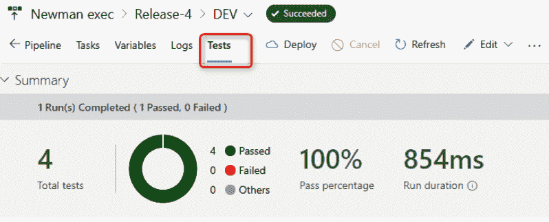

图 11.35 – Azure Pipelines 中 Newman 测试结果视图

以下截图显示了运行此任务的 **Control Options** 参数：**即使之前的任务失败，除非部署已取消**：

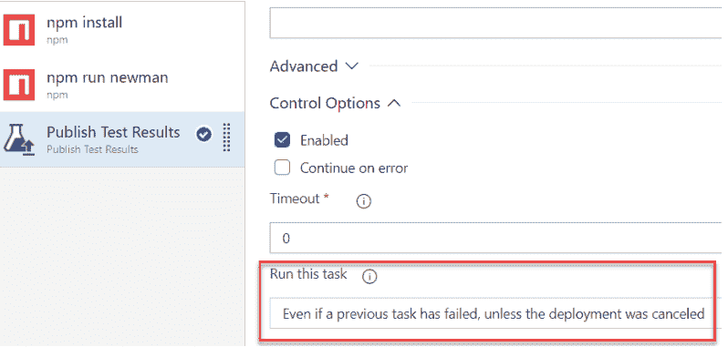

图 11.34 – Azure Pipelines 发布 Newman 测试结果选项

流水线配置已完成——我们现在将进行其执行。

所有 Postman 测试均已成功完成。

以下是一张截图，显示了在某个测试失败时的测试报告：

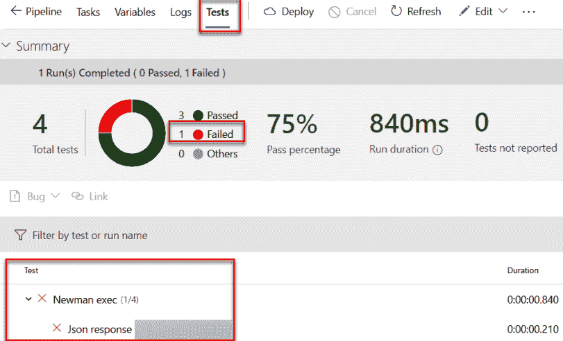

图 11.36 – Azure Pipelines 中 Newman 失败测试结果视图

因此，我们成功集成了 Newman 的执行，从而能够在 CI/CD 流水线中自动化我们在 Postman 中配置的 API 请求。

关于在 **Jenkins** 中集成 Newman 执行，请阅读 https://learning.getpostman.com/docs/postman/collection_runs/integration_with_jenkins 的文档，关于与 **Travis CI** 集成，文档可在 https://learning.getpostman.com/docs/postman/collection_runs/integration_with_travis 找到。

在本节中，我们学习了如何在 Azure Pipelines 中创建和配置 CI/CD 流水线，该流水线执行已为 Newman 导出的 Postman 测试。

### 总结

在本章中，我们介绍了 Postman，这是一个用于测试 API 的优秀工具。我们创建了 Postman 账户并将其本地安装。

然后，我们创建了集合和环境，其中创建了包含待测试 API 设置的请求。

我们还讨论了使用 Newman 命令行工具自动化这些测试，并导出 Postman 集合和环境。

最后，在本章的最后部分，我们在 Azure DevOps 中创建并执行了一个 CI/CD 流水线，该流水线在 DevOps 过程中自动化 API 测试的执行。

在下一章中，我们将继续探讨测试主题，并将研究使用名为 **SonarQube** 的知名工具进行静态代码分析。

### 问题

- 1. Postman 的目标是什么？
- 2. 在 Postman 中首先需要创建什么元素？
- 3. 包含待测试 API 配置的元素名称是什么？
- 4. Postman 中哪个工具允许我们执行集合中的所有请求？
- 5. 哪个工具允许我们将 Postman API 测试集成到 CI/CD 流水线中？

### 延伸阅读

如果您想了解更多关于 Postman 的信息，以下是一些额外资源：

• Postman Learning Center: `https://learning.getpostman.com/`

• 关于 Postman 的视频和教程: `https://www.getpostman.com/resources/videos-tutorials/`
