## 12 使用 SonarQube 进行静态代码分析

在上一章中，我们探讨了如何使用 Postman（一个用于测试 API 的免费工具）测试 **应用程序编程接口 (API)** 的功能，以及使用 Newman 将这些测试集成和自动化到 **持续集成/持续部署 (CI/CD)** 流水线中。

测试 API 或应用程序的功能是一种良好的实践，当我们希望提高应用程序质量时。在公司中，应用程序的质量必须由所有成员考虑，因为为用户带来商业价值的应用程序会增加公司的利润。

然而，我们常常忽略测试应用程序代码的质量，因为我们认为重要的是应用程序如何工作，而不是它是如何编写的。这种思维方式是一个大错误，因为编写不良的代码可能包含安全漏洞，也可能导致性能问题。此外，代码质量对其维护和可扩展性有影响，因为过于复杂或编写不良的代码难以维护，因此公司修复它的成本会更高。

在本章中，我们将重点介绍使用名为 SonarQube 的知名工具进行静态代码分析。我们将简要概述它并介绍如何安装它。然后，我们将使用 SonarLint 在本地分析代码。最后，我们将 SonarQube 集成到 Azure Pipelines 上的 CI/CD 流水线中。

在本章中，我们将涵盖以下主题：

- 探索 SonarQube
- 安装 SonarQube
- 使用 SonarLint 进行实时分析
- 在 CI 过程中执行 SonarQube

### 技术要求

要使用 SonarQube 和 SonarLint，我们必须安装 **Java 运行时环境 (JRE)**，可在 `https://www.oracle.com/technetwork/java/javase/downloads/jre8-downloads-2133155.html` 上找到（需要 Oracle 账户），在安装了 SonarQube 的服务器和安装了 SonarLint 的本地开发环境上。

要将 SonarQube 集成到 Azure DevOps 流水线中，我们必须在 Azure DevOps 组织上安装以下扩展：`https://marketplace.visualstudio.com/items?itemName=SonarSource.sonarqube`。

本章的完整代码源可在 `https://github.com/PacktPublishing/Learning-DevOps-Second-Edition/tree/main/CHAP12` 上找到。

查看以下视频以查看代码运行情况：`https://bit.ly/3s96XTR`。

### 探索 SonarQube

SonarQube 是 SonarSource (`https://www.sonarsource.com/`) 的开源工具，使用 Java 编写。它允许我们执行静态代码分析以验证应用程序代码的质量和安全性。

SonarQube 专为开发团队设计，为他们提供可自定义的仪表板和报告，以便他们可以展示其应用程序中的代码质量。

它允许分析多种语言（超过 25 种）的静态代码，例如 **PHP: Hypertext Preprocessor (PHP)**、Java、.NET、JavaScript、Python 等。完整列表可在 `https://www.sonarqube.org/features/multi-languages/` 上找到。

此外，除了代码分析中的安全问题、代码异味和代码重复外，SonarQube 还为单元测试提供代码覆盖率。有关这些问题概念的更多详细信息，请阅读此处的文档：`https://docs.sonarqube.org/latest/user-guide/concepts/`。

最后，SonarQube 与 CI/CD 流水线集成良好，以便在开发人员提交代码时自动化代码分析。这降低了部署具有安全漏洞或代码复杂性过高的应用程序的风险。

另一方面，需要注意的是，他们有许多可以付费的插件。插件列表可在此处找到：`https://www.sonarplugins.com/`。

现在我们已提供了 SonarQube 的概述，将查看其架构和组件。最后，我们将查看不同的安装方式。

### 安装 SonarQube

SonarQube 是一种本地解决方案，换句话说，必须安装在服务器或 **虚拟机 (VMs)** 上。此外，SonarQube 由多个组件组成，这些组件将分析应用程序的源代码，检索和存储来自此分析的数据，并提供关于代码质量和安全性的报告。

在安装 SonarQube 之前，查看其架构和组件是至关重要的。

#### SonarQube 架构概述

SonarQube 是一种客户端/服务器工具，这意味着其架构由服务器端和客户端端的构件组成。

以下图表显示了简化的 SonarQube 架构：

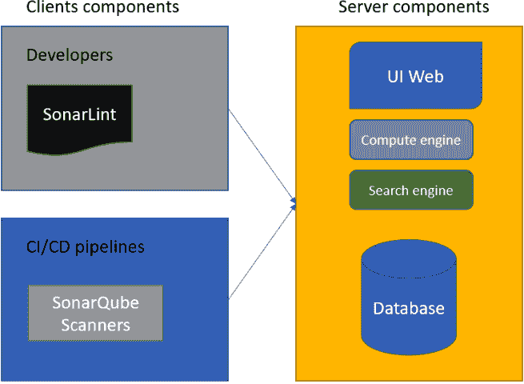

图 12.1 – 带有客户端和服务器组件的 SonarQube 架构

让我们看看前面图表中显示的组件。构成 SonarQube 服务器端的组件列表如下：

- 包含所有分析数据的 SQL Server、MySQL、Oracle 或 PostgreSQL 数据库。
- 显示仪表板的 Web 应用程序。
- 负责检索分析和处理并将其放入数据库的计算引擎。
- 使用 Elasticsearch 构建的搜索引擎。

客户端组件列表如下：

- 扫描器，它扫描应用程序的源代码并将数据发送到计算引擎。
- 扫描器通常安装在用于执行 CI/CD 流水线的构建代理上。
- SonarLint 是安装在开发人员工作站上的工具，用于实时分析。我们将在本章后面详细介绍它。


有关此架构的更多详细信息，我们可以查阅 SonarQube 架构和集成文档，该文档可在 https://docs.sonarqube.org/latest/user-guide/concepts/ 上找到。

现在我们已经了解了其架构和组件，将学习如何安装它。

### SonarQube 安装

SonarQube 可以通过不同方式安装——手动安装，或从 Sonar 镜像安装 Docker 容器。或者，如果我们有 Azure 订阅，可以使用来自 Azure 市场的 SonarQube 虚拟机。让我们逐一详细了解这些选项。

### SonarQube 手动安装

如果我们想手动安装 SonarQube 服务器，必须考虑先决条件。这些先决条件是：服务器上必须已安装 Java，并且需要检查 https://docs.sonarqube.org/latest/requirements/requirements/ 中显示的硬件配置。

然后，我们必须按顺序手动安装服务器组件，如下所示：

1. 安装数据库。可以是 MSSQL、Oracle、PostgreSQL 或 MySQL。
2. 然后，对于 Web 应用程序，从 https://www.sonarqube.org/downloads/ 下载 SonarQube 社区版，并解压下载的 ZIP 文件。
3. 在 $SONARQUBE-HOME/conf/sonar.properties 文件中，配置对步骤 1 中安装的数据库以及 Elasticsearch 存储路径的访问，详情请参阅以下文档：https://docs.sonarqube.org/latest/setup/install-server/。
4. 启动 Web 服务器。

要了解根据所选数据库和我们的 **操作系统 (OS)** 进行此安装的所有详细信息，可以查阅以下文档：https://docs.sonarqube.org/latest/setup/install-server/。

### 通过 Docker 安装

如果我们想为测试或演示目的安装 SonarQube 社区版，可以通过 Docker Hub 上提供的官方 Docker 镜像 `https://hub.docker.com/_/sonarqube/` 进行安装。请注意，此镜像使用一个小型集成数据库，不适用于生产环境。

### 在 Azure 中安装

如果我们有 Azure 订阅，可以使用来自 Azure 市场的 SonarQube 虚拟机快速访问整个 SonarQube 服务器。按照以下步骤在 Azure 中创建 SonarQube 虚拟机：

1. 在 Azure 市场中，搜索并选择 **SonarQube** 镜像。以下截图显示了市场中的 SonarQube 页面：

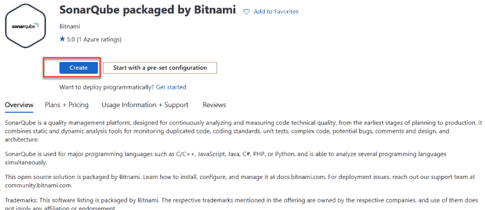

图 12.2 – Azure 市场中的 SonarQube

2. 单击 **创建** 按钮开始。

3. 在 VM 表单中，在 **基本** 选项卡上，选择 **资源组** 类型并提供 **虚拟机名称** 信息，如以下截图所示：

### 创建虚拟机 ...

基本   磁盘   网络   管理   高级   标记   审阅 + 创建

创建运行 Linux 或 Windows 的虚拟机。从 Azure 市场选择镜像或使用您自己的自定义镜像。完成基本选项卡，然后选择审阅 + 创建以使用默认参数预配虚拟机，或查看每个选项卡以进行完全自定义。[了解更多](https://docs.microsoft.com/en-us/azure/virtual-machines/linux/quick-create-portal?toc=%2Fazure%2Fvirtual-machines%2Flinux%2Ftoc.json&bc=%2Fazure%2Fvirtual-machines%2Flinux%2Ftoc.json)

#### 项目详细信息

选择订阅以管理已部署资源和成本。使用资源组像文件夹一样来组织和管理所有资源。

订阅 *
Microsoft Azure Sponsorship
资源组 *
(新) demo-sonar
新建

#### 实例详细信息

虚拟机名称 *
demo-sonar
区域 *
(欧洲) 西欧
可用性选项
不需要基础设施冗余
安全类型
标准
镜像 *
SonarQube packaged by Bitnami - Gen1
查看所有镜像 | 配置 VM 代

审阅 + 创建
< 上一步
下一步：磁盘 >

图 12.3 – SonarQube Azure 创建

我们还可以在 **磁盘** 和 **网络** 选项卡中更改一些可选 VM 选项。然后，通过单击 **审阅 + 创建** 按钮验证这些更改。

资源创建结束时，我们可以在 Azure 门户中查看部署状态，在此示例中部署成功：

### 您的部署已完成

部署名称：CreateVm-bitnami.sonarqube-6-4-2019072815... 开始时间：7/28/2019, 3:40:26 PM 订阅：Microsoft Azure Sponsorship 相关 ID：6bfacfb4-78eb-4e07-8f79-8 资源组：demo-sonar

#### 部署详细信息 (下载)

| 资源 | 类型 | 状态 | 操作详细信息 |
|---|---|---|---|
| demo-sonar | Microsoft.Compute/virt... | OK | 操作详细信息 |
| demo-sonar592 | Microsoft.Network/netw... | 已创建 | 操作详细信息 |
| demosonardiag | Microsoft.Storage/stora... | OK | 操作详细信息 |
| demo-sonar-vnet | Microsoft.Network/virtu... | OK | 操作详细信息 |
| demo-sonar-nsg | Microsoft.Network/netw... | OK | 操作详细信息 |
| demo-sonar-ip | Microsoft.Network/publi... | OK | 操作详细信息 |

图 12.4 – SonarQube Azure 部署

#### 4. 要访问已安装的 SonarQube 服务器，请查看 VM 的详细信息并获取公共 IP 地址值，如以下截图所示：

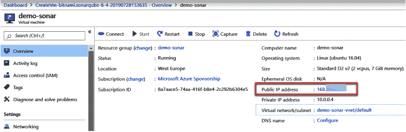

图 12.5 – SonarQube Azure 互联网协议 (IP) 地址

打开 Web 浏览器，将此 IP 地址作为 **统一资源定位符 (URL)**。将显示 SonarQube 身份验证页面，如以下截图所示：

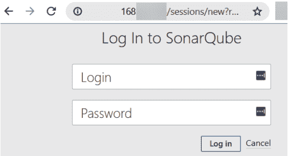

图 12.6 – SonarQube 登录屏幕

默认登录名为 admin，可通过 VM 启动诊断信息访问，如文档 (https://docs.bitnami.com/azure/faq/get-started/find-credentials/) 中所示。以下截图显示如何通过 **启动诊断** 选项执行密码恢复：

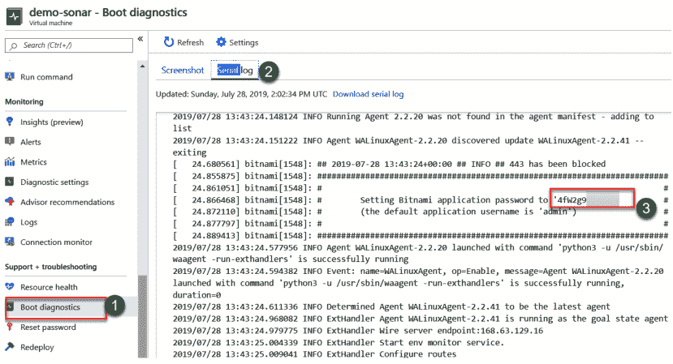

图 12.7 – SonarQube Azure 密码恢复

身份验证后，我们可以访问 SonarQube 仪表板，如下所示：

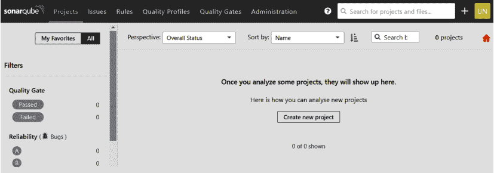

图 12.8 – SonarQube 主页

我们已了解在 VM 中安装 SonarQube 的步骤，现在将学习如何在 Kubernetes 上安装 SonarQube。

### 在 Kubernetes 上安装 SonarQube

要在 Kubernetes 集群上安装 SonarQube，我们将使用此处提供的 helm-chart 包：https://github.com/SonarSource/helm-chart-sonarqube/tree/master/charts/sonarqube。

在 Kubernetes 上安装 SonarQube 之前，重要的是阅读此处的要求：https://docs.sonarqube.org/latest/setup/sonarqube-on-kubernetes/。

要在 Kubernetes 上安装 SonarQube，请运行以下脚本：

```bash
helm repo add sonarqube https://SonarSource.github.io/helm-chart-sonarqube
helm repo update
kubectl create namespace sonarqube
helm upgrade --install -n sonarqube sonarqube/sonarqube
```

脚本的第一行将 SonarQube Helm 注册表添加到本地。

第二行更新此注册表的索引。

然后，脚本创建 sonarqube 命名空间。

最后，最后一行安装 sonarqube Helm 图表。

执行此脚本结束时，Helm 图表执行会在控制台上显示用于使用已安装 SonarQube 实例的脚本，如以下截图所示：

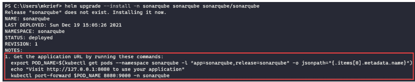

图 12.9 – 使用 Helm 在 Kubernetes 上安装 SonarQube

> 注意
> 执行此脚本之前，请通过执行以下命令检查所有 pod 是否正在运行：
> kubectl get pods -n sonarqube

在本节中，我们了解了 SonarQube 的架构，以及客户端和服务器组件的详细信息。然后，我们了解了可用的不同安装方法和 SonarQube 的配置。在下一节中，我们将了解开发人员如何在提交代码之前使用 SonarLint 进行实时代码分析。

### 使用 SonarLint 进行实时分析

在 CI 环境中使用 SonarQube 的开发人员经常面临不得等待太长时间才能获得 SonarQube 分析结果的问题。他们必须提交代码并等待 CI 管道结束，才能获得代码分析结果。

为了解决这个问题，从而改善开发人员的日常工作，SonarQube 的开发商 SonarSource 提供了另一个工具 SonarLint，它允许进行实时代码分析。

SonarLint 是一个免费开源工具 (https://www.sonarlint.org/)，下载方式因开发工具和开发语言而异。SonarLint 可用于 Eclipse、IntelliJ IDEA、Visual Studio 和 Visual Studio Code (VS Code) 集成开发环境 (IDE)。


在这本书中，我们将查看在 VS Code IDE 中使用 TypeScript 编写的应用程序上使用 SonarLint 的示例。使用 SonarLint 的前提是在本地开发计算机上安装 JRE。可以从 https://www.oracle.com/technetwork/java/javase/downloads/jre8-downloads-2133155.html 下载。

要了解有关 SonarLint 具体用法的更多信息，请执行以下步骤：

1. 在 VS Code 中，通过转到 Azure 市场上的以下页面安装 SonarLint 扩展：

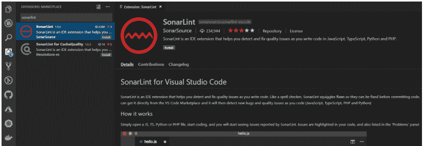

图 12.10 – SonarLint VS Code 扩展

2. 然后，在 VS Code 中，在 **User** 设置中，使用 JRE 的安装路径配置扩展，如下所示：

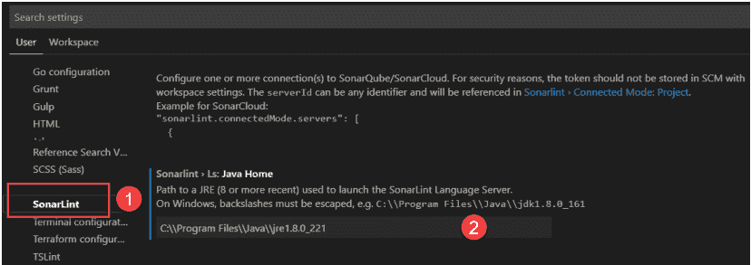

图 12.11 – SonarLint VS Code 扩展配置

3. 在我们的项目中，创建一个 tsApp 文件夹。在该文件夹内，创建一个包含应用程序代码的 app.ts 文件。源代码可在此处查看：https://github.com/PacktPublishing/Learning-DevOps-Second-Edition/blob/main/CHAP12/tsApp/app.ts。

4. 请注意，在此 SonarLint 示例代码中，它指出代码不正确，如以下屏幕截图所示：

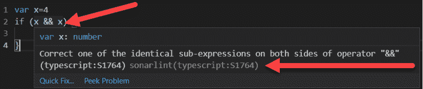

图 12.12 – SonarLint 示例检查代码

SonarLint 允许我们通过显示有关错误及其修复方法的详细信息来了解更多有关此错误的信息，如以下屏幕截图所示：

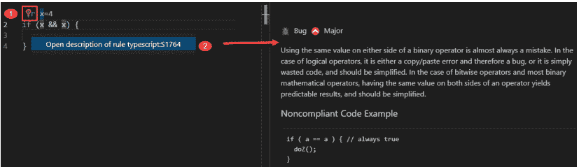

图 12.13 – SonarLint 示例检查代码错误详情

因此，SonarLint 及其与各种 IDE 的集成允许我们尽可能实时检测静态代码错误——即在开发人员编写代码并在将其提交到源代码控制版本之前。

在本节中，我们学习了如何在 VS Code 中安装 SonarLint 以及如何使用它执行实时代码分析。

在下一节中，我们将讨论如何将 SonarQube 分析集成到 Azure Pipelines 中的 CI 进程。

### 在 CI 进程中执行 SonarQube

迄今为止，在本章中，我们了解了如何安装 SonarQube 以及开发人员如何在本地计算机上使用 SonarLint。

现在，我们将了解如何在 CI 过程中执行代码分析，以确保每次进行代码提交时，我们都可以检查所有团队成员提供的应用程序代码。

为了将 SonarQube 集成到 CI 进程中，我们需要执行以下操作：

1. 通过创建新项目配置 SonarQube。
2. 在 Azure Pipelines 中创建和配置 CI 构建。

让我们先来看看在 SonarQube 中创建新项目。

### 配置 SonarQube

SonarQube 的配置包括创建新项目和检索识别令牌。要创建新项目，请执行以下步骤：

1. 单击仪表板上的 **Create new project** 链接。
2. 然后，在表单中输入唯一的 `demobook` 键和名为 `demo-book` 的项目名称。
3. 要验证此操作，请单击 **Set Up** 按钮创建项目。步骤如以下屏幕截图所示：

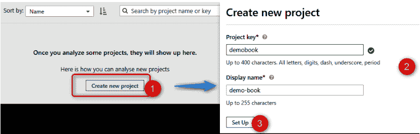

图 12.14 – SonarQube 项目创建

项目创建后，SonarQube 助手建议我们创建一个令牌（唯一密钥），该令牌将用于分析。

要生成和创建此令牌，请执行以下步骤：

1. 在输入框中，键入所需的令牌名称。
2. 然后，通过单击 **Generate** 按钮对其进行验证。
3. 唯一密钥随后显示在屏幕上。此密钥即为我们的令牌，我们必须妥善保管。以下屏幕截图显示了生成令牌的步骤：

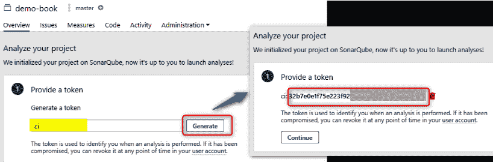

图 12.15 – SonarQube 令牌生成

使用新项目配置 SonarQube 已完成。现在，我们将配置 CI 管道以执行 SonarQube 分析。

### 在 Azure Pipelines 中为 SonarQube 创建 CI 管道

为了说明将 SonarQube 分析集成到 CI 管道中，我们将使用 Azure Pipelines，我们在第 7 章“持续集成和持续交付”中详细介绍过它。

本节中将用作示例的应用程序是使用 Node.js 开发的，它是一个简单的计算器，包含一些方法，包括单元测试方法。

> 注意
> 请注意，本节的目的不是讨论应用程序代码，而是管道。您可以在 https://github.com/PacktPublishing/Learning-DevOps-Second-Edition/tree/main/CHAP12/AppDemo 访问应用程序源代码。

要在 Azure Pipelines 中使用 SonarQube，我们必须从 Visual Studio 市场（位于 https://marketplace.visualstudio.com/items?itemName=SonarSource.sonarqube）在我们的 Azure DevOps 组织中安装 SonarQube 扩展，如本章技术要求部分所述。

以下屏幕截图显示了从 Visual Studio 市场安装扩展的标题和按钮：

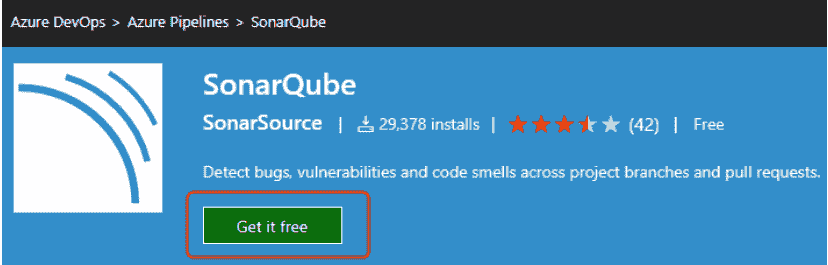

图 12.16 – SonarQube Azure DevOps 扩展

安装扩展后，我们可以配置 CI 构建。

在 Azure Pipelines 中，我们将创建一个带有以下配置的新生成定义：

1. 在 **Get Sources** 选项卡中，选择包含应用程序源代码的存储库和分支，如以下屏幕截图所示：

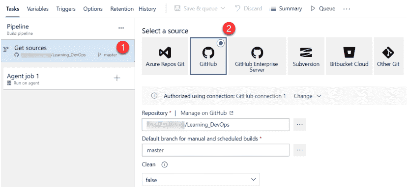

图 12.17 – Azure DevOps 选定的存储库

2. 然后，在 **Tasks** 选项卡中，配置任务的计划，如下所示：

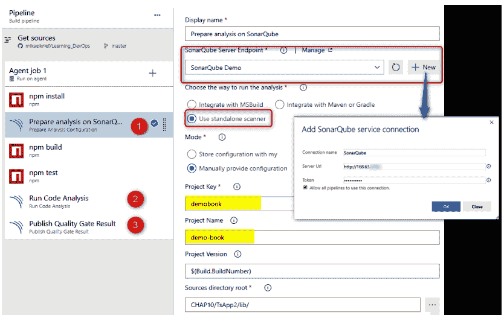

图 12.18 – Azure Pipelines SonarQube：准备分析

以下是这些任务配置的详细信息：

1. **Prepare analysis on SonarQube** 任务包括使用以下内容配置 SonarQube：

   - 一个端点服务，即与我们之前在 SonarQube 配置中生成的 URL 和令牌的 SonarQube 连接
   - SonarQube 项目的键和名称
   - 分析的版本号

2. 然后，我们使用 `npm build` 和 `npm test` 构建并执行应用程序的单元测试。

3. **Run Code Analysis** 任务检索测试结果，分析我们应用程序的 TypeScript 代码，并将分析数据发送到 SonarQube 服务器。

然后，我们保存，开始执行 CI 构建，并等待其完成。

### SonarQube 仪表板已使用代码分析进行更新，如以下屏幕截图所示：

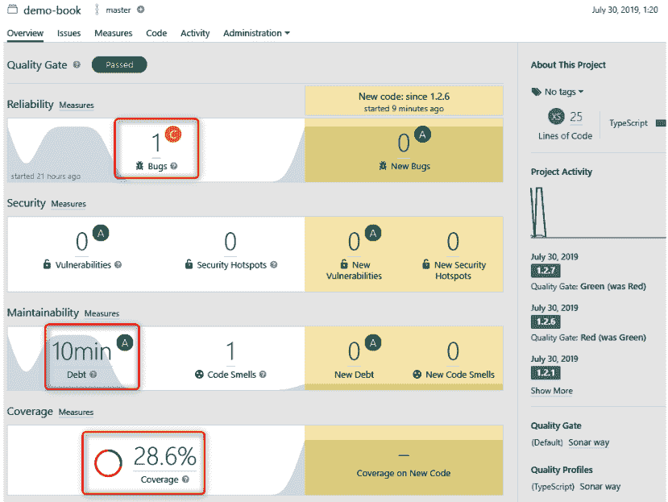

图 12.19 – SonarQube 仪表板分析

在此，我们可以看到错误数量、代码可维护性以及代码覆盖率的度量。单击这些数据中的每一项，我们可以访问元素的详细信息。

在本节中，我们了解了如何将 SonarQube 分析集成到 CI 管道中，该管道将提供仪表板，以及每次代码提交的代码分析结果和报告。

### 总结

在本章中，我们了解了如何使用 SonarQube 分析应用程序的静态代码。此分析可以检测和防止代码语法问题和代码中的漏洞，还可以指示单元测试提供的代码覆盖率。

然后，我们详细讨论了 SonarLint 的使用，它允许开发人员在编写代码时实时检查代码。

最后，我们了解了 SonarQube 的配置及其集成到 CI 进程中，以确保在团队成员的每次代码提交时都会触发持续分析。

在下一章中，我们将通过使用 **Zed Attack Proxy (ZAP)** 工具执行安全测试、使用 Postman 执行性能测试以及使用 Azure DevOps 启动负载测试来探讨一些安全实践。

### 问题

1. SonarQube 是用哪种语言开发的？
2. 安装 SonarQube 的要求是什么？
3. SonarQube 的作用是什么？
4. 允许开发人员进行实时分析的工具名称是什么？

### 进一步阅读

如果您想了解更多有关 SonarQube 的信息，以下是一个可以帮助您的资源：

- • SonarQube 文档：`https://docs.sonarqube.org/latest/`


